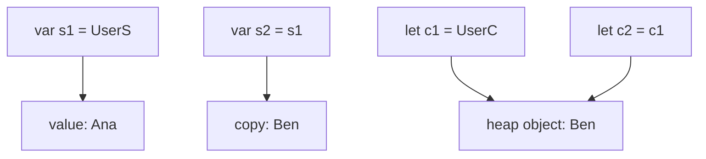
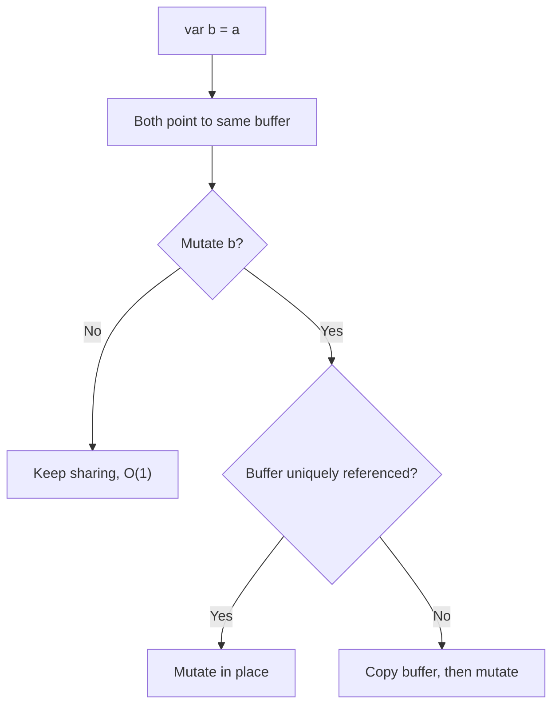
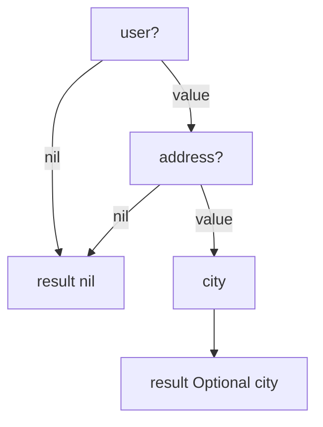
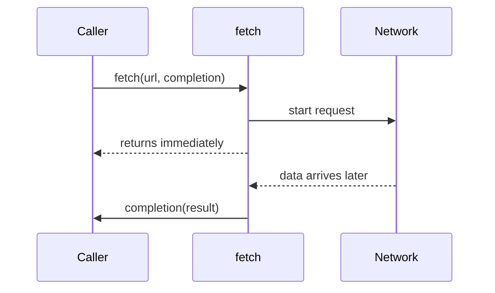
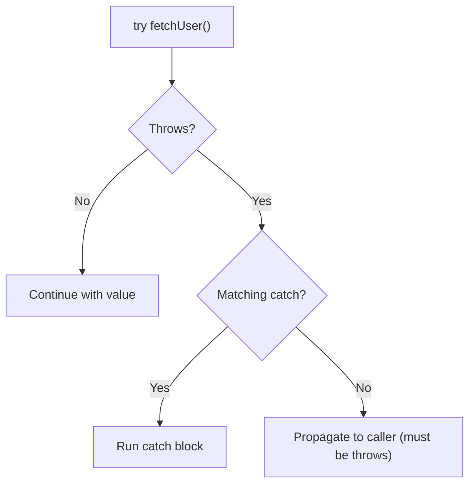
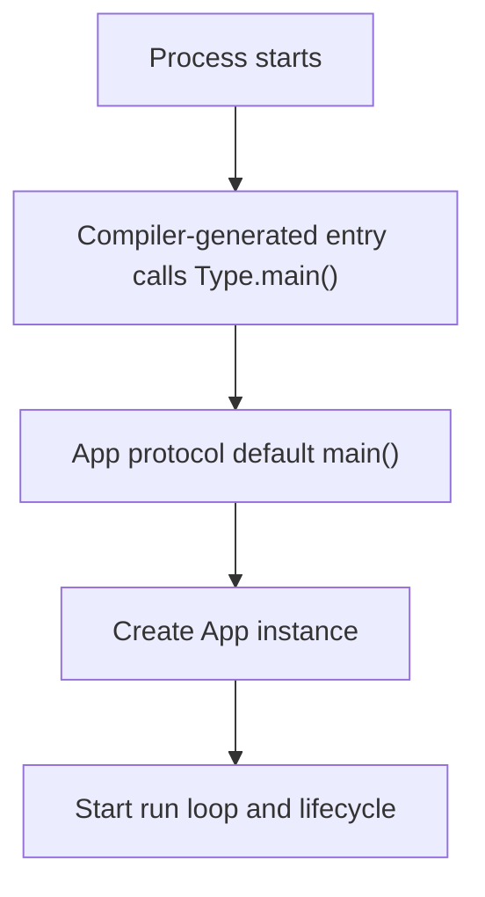
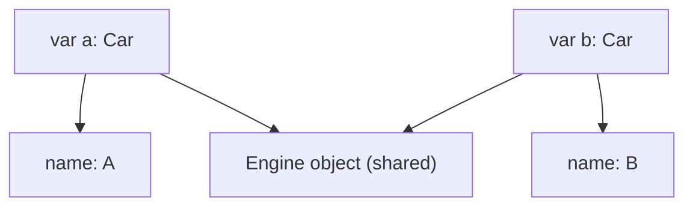

# Swift – Fundamentals

[⬅ Back to index](../README.md)

Covers: language basics, value vs reference types, optionals, collections, functions & closures, enums, error handling, access control.

---

## Language Basics

### 1. What is Swift? What are its key features?

<details>
<summary>Answer</summary>

**In short:** Swift is Apple's modern, **type-safe, compiled** language for iOS, macOS, watchOS, tvOS and visionOS (also used on Linux and servers). Its pillars are **safety** (optionals, no implicit conversions, bounds checks), **performance** (LLVM compilation, ARC instead of a garbage collector), **value semantics and protocol-oriented design**, and **built-in concurrency** (async/await, actors, compile-time data-race checking in Swift 6).

#### Why Swift exists

Apple introduced Swift in 2014 to replace Objective-C as the main language for its platforms. Objective-C is a thin layer over C: messages to `nil` silently do nothing, pointers can dangle, and many bugs only show up at runtime. Swift moves as many of those bugs as possible to **compile time**.

#### Key features

| Feature | What it means in practice |
|---|---|
| **Safety** | Optionals instead of null pointers; arrays are bounds-checked; variables must be initialized before use (definite initialization); integer overflow traps instead of wrapping silently; no implicit type conversions. |
| **Value semantics** | Structs and enums are first-class and used heavily (even `String`, `Array`, `Int` are structs). Copies are independent, which avoids shared-mutable-state bugs. |
| **Protocol-oriented programming** | Protocols with extensions and default implementations let you share behaviour without class inheritance. |
| **Performance** | Compiled ahead of time via LLVM to native code. Memory is managed by **ARC** (Automatic Reference Counting), so there are no garbage-collector pauses. Generics can be specialized for concrete types. |
| **Modern syntax** | Type inference, closures, generics, powerful `switch` pattern matching, `if`/`switch` expressions. |
| **Concurrency** | `async`/`await`, structured concurrency (`TaskGroup`), `actor`s, `Sendable`. Swift 6 language mode turns data-race checks into compile errors. |
| **Interop** | Calls Objective-C and C directly; C++ interop has been added more recently. |
| **Open source** | Swift is open source and runs on Linux and Windows; server frameworks (e.g. Vapor) use it. |

```swift
let names = ["Ana", "Ben"]          // type inferred as [String]
let upper = names.map { $0.uppercased() }

func greet(_ name: String?) {
    guard let name else { return }  // optional unwrapping, enforced by the compiler
    print("Hi, \(name)")
}
```

**Likely follow-ups:**
- *Is Swift garbage collected?* No. It uses ARC: reference counts are inserted at compile time and objects are freed deterministically when the count hits zero.
- *Swift vs Objective-C?* Swift is safer (optionals, type safety), faster in many cases, and supports value types and generics fully; Objective-C has a dynamic runtime and message passing.
- *What is the Swift 6 language mode?* A mode where concurrency safety checks (Sendable, actor isolation) are errors rather than warnings.

</details>

### 2. `let` vs `var`?

<details>
<summary>Answer</summary>

**In short:** `let` declares a **constant** that can be assigned only once; `var` declares a **variable** that can be reassigned. For a **struct**, `let` freezes the whole value (no property can change). For a **class**, `let` only freezes the *reference*; the object's `var` properties can still be mutated.

#### The basics

```swift
let maxRetries = 3
maxRetries = 4          // ❌ compile error: cannot assign to a 'let' constant

var count = 0
count += 1              // ✅
```

A `let` doesn't have to be assigned at the point of declaration, as long as the compiler can prove it's assigned exactly once before use:

```swift
let message: String
if isError { message = "Failed" } else { message = "OK" }   // ✅ assigned once on each path
```

#### Value types vs reference types

This is the part interviewers probe.

```swift
struct Point { var x: Int; var y: Int }
final class Box { var value = 0 }

let p = Point(x: 1, y: 2)
p.x = 10                // ❌ error: p is a let, and Point is a value type

let b = Box()
b.value = 10            // ✅ allowed: the reference is constant, the object is not
b = Box()               // ❌ error: can't point b at a different object
```

Why the difference? A struct variable **is** the value, so making it constant makes all its contents constant. A class variable only **holds a pointer** to an object on the heap; `let` makes the pointer constant, not the object.

| | `let` struct | `let` class reference |
|---|---|---|
| Reassign the variable | No | No |
| Change `var` properties | No | **Yes** |
| Call `mutating` methods | No | n/a (classes have no `mutating`) |

#### Best practice

Prefer `let` everywhere and switch to `var` only when you actually need to mutate. Xcode warns "variable was never mutated; consider changing to let". Constants make code easier to reason about and are safe to share across threads.

**Pitfalls:**
- Assuming `let viewModel = ViewModel()` makes the view model immutable. It doesn't, if `ViewModel` is a class.
- A `let` array can't be appended to (`Array` is a struct).

**Likely follow-ups:**
- *How do you make a class truly immutable?* Make all its stored properties `let` (and mark the class `final`).
- *Is `let` the same as `const` in C?* Close, but it applies to value semantics: a `let` struct is deeply immutable for its value-type contents.

</details>

### 3. What is type inference and type safety in Swift?

<details>
<summary>Answer</summary>

**In short:** **Type inference** means the compiler works out a variable's type from its initial value (`let x = 10` is an `Int`), so you don't have to write it. **Type safety** means every value has one fixed type checked at compile time: you can't pass a `String` where an `Int` is expected, and there are **no implicit numeric conversions** (you must write `Double(intValue)`).

#### Type inference

```swift
let count = 10            // Int
let price = 9.99          // Double (the default for floating-point literals)
let name = "Swift"        // String
let ids = [1, 2, 3]       // [Int]
let lookup = ["a": 1]     // [String: Int]

let ratio: Float = 0.5    // explicit annotation overrides the default
```

Inference also works for closures and generics:

```swift
let doubled = ids.map { $0 * 2 }   // compiler infers the closure is (Int) -> Int
```

Inference keeps code short without losing static typing: the type is still fixed at compile time, it just isn't written down.

#### Type safety

```swift
let a: Int = 5
let b: Double = 2.5
let sum = a + b               // ❌ error: binary operator '+' cannot be applied to Int and Double
let sum2 = Double(a) + b      // ✅ explicit conversion
```

Many languages (C, JavaScript) silently convert between types, which can lose precision or produce surprising results. Swift forces you to be explicit, so conversions are visible in the code.

Optionals are part of type safety too: `String` and `String?` are different types, so the compiler forces you to handle the missing case.

**Pitfalls:**
- Large expressions mixing many literals and overloaded operators can make the type checker slow ("the compiler is unable to type-check this expression in reasonable time"). Adding explicit types or splitting the expression fixes it.
- `let x = 0` is `Int`, so `x / 2` uses integer division. Write `let x = 0.0` or annotate `Double` if you want floating point.

**Likely follow-ups:**
- *Is Swift statically or dynamically typed?* Statically typed, with inference.
- *Does inference hurt performance?* Not at runtime; it can only affect compile time.

</details>

### 4. What are the basic data types?

<details>
<summary>Answer</summary>

**In short:** Swift's basic types are `Int` (plus sized variants `Int8`…`Int64`, `UInt`…), `Double`, `Float`, `Bool`, `Character` and `String`, plus the collections `Array`, `Dictionary`, `Set`, and tuples. Unlike Java or C, **these are all structs (value types)** defined in the standard library, not special primitives, so they can have methods and conform to protocols.

#### Overview

| Type | Description | Example |
|---|---|---|
| `Int` | Signed integer, the platform word size (64-bit on all current Apple devices) | `let age = 30` |
| `Int8`, `Int16`, `Int32`, `Int64`, `UInt`… | Fixed-size / unsigned integers, mainly for binary formats and C interop | `let byte: UInt8 = 255` |
| `Double` | 64-bit floating point; default for decimal literals | `let pi = 3.14159` |
| `Float` | 32-bit floating point | `let f: Float = 0.5` |
| `Bool` | `true` / `false` | `let isOn = true` |
| `Character` | A single user-perceived character (grapheme cluster) | `let c: Character = "é"` |
| `String` | Unicode-correct text | `let s = "Hello"` |
| `Array<T>` / `[T]` | Ordered collection | `[1, 2, 3]` |
| `Dictionary<K, V>` / `[K: V]` | Key–value lookup | `["a": 1]` |
| `Set<T>` | Unique, unordered elements | `Set([1, 2])` |
| Tuple | Fixed group of values | `(code: 200, msg: "OK")` |
| `Optional<T>` / `T?` | A value or `nil` | `let n: Int? = nil` |

#### Why "they're structs" matters

```swift
extension Int {
    var isEven: Bool { self % 2 == 0 }   // you can extend Int like any type
}
print(4.isEven)   // true
```

Because they're value types, assigning one to another variable gives an independent copy. Collections use copy-on-write so this stays cheap.

There's no implicit conversion between them: `Int` and `Int32` are different types and need `Int32(x)`.

**Pitfalls:**
- Integer overflow **traps** at runtime (`Int.max + 1` crashes). Use the `&+` overflow operators if you really want wrapping.
- Use `Int` by default, even for values that are never negative; Apple recommends `UInt` only when you specifically need it.

**Likely follow-ups:**
- *Does Swift have primitives?* Not in the Java sense; the compiler optimizes these structs down to machine values.
- *What is `Decimal` for?* Exact base-10 arithmetic, e.g. money.

</details>

---

## Value vs Reference Types

### 5. Struct vs Class – what are the differences?

<details>
<summary>Answer</summary>

**In short:** A **struct** is a **value type**: assigning or passing it makes an independent copy. A **class** is a **reference type**: assignments share one instance on the heap, managed by ARC. Classes add inheritance, `deinit` and identity (`===`); structs get a free memberwise initializer and are safer to share. Apple's guidance is to **use structs by default** and choose a class when you need identity or shared mutable state.

#### The core difference: copy vs share

```swift
struct UserS { var name: String }
final class UserC { var name: String; init(name: String) { self.name = name } }

var s1 = UserS(name: "Ana")
var s2 = s1          // copy
s2.name = "Ben"
print(s1.name)       // "Ana"  – s1 is unaffected

let c1 = UserC(name: "Ana")
let c2 = c1          // same object
c2.name = "Ben"
print(c1.name)       // "Ben"  – both names point at one instance
```



#### Full comparison

| Struct | Class |
|---|---|
| **Value type**: copied on assignment | **Reference type**: shared reference |
| No inheritance (can conform to protocols) | Single inheritance |
| Memberwise initializer generated | Must write initializers (no memberwise init) |
| No `deinit` | Has `deinit` |
| Stored inline/stack when possible, no ARC overhead for the value itself | Heap-allocated, reference counted (ARC) |
| `mutating` keyword needed to modify self in methods | Methods can modify properties freely |
| Thread-safer by default (independent copies) | Shared mutable state → data races |
| No identity: no `===` | Identity check with `===` |
| `let` makes the whole value immutable | `let` only fixes the reference |

#### When to pick which

**Apple's guidance:** use **structs by default**. Use classes when you need:
- **Identity**: one shared instance that many parts of the app observe (a cache, a session, an `@Observable` view model).
- **Inheritance**, e.g. subclassing `UIViewController`.
- **Objective-C interop** (`NSObject` subclasses, KVO).
- **`deinit`** to release resources.

Models such as `User`, `Message`, `Settings` are usually structs; services and controllers are usually classes.

**Pitfalls:**
- A struct containing a class property is only *partly* a value: copies share that inner object.
- Large structs copied in hot loops can cost more than expected; collections avoid this with copy-on-write.
- Mark classes `final` unless designed for subclassing; it enables static dispatch.

**Likely follow-ups:**
- *Are enums value or reference types?* Value types, like structs.
- *What is copy-on-write?* Collections share their storage until one copy is mutated (see next question).
- *Can structs conform to protocols and have methods?* Yes, both.

</details>

### 6. What is Copy-on-Write (CoW)?

<details>
<summary>Answer</summary>

**In short:** Copy-on-Write is an optimization used by the standard-library collections (`Array`, `Dictionary`, `Set`, `String`). They're value types, but their elements live in a shared heap buffer. Assigning a collection just shares the buffer (O(1)); the real copy happens **only when one of the copies is mutated while the buffer is shared**. Your own structs don't get this automatically.

#### The problem it solves

Value semantics say every assignment gives an independent copy. If `Array` copied all its elements on every assignment or function call, passing a 1 million–element array around would be very slow. CoW gives value semantics with reference-like cost.

#### How it works

```swift
var a = [1, 2, 3]   // a owns buffer B1 (refcount 1)
var b = a           // b shares B1 (refcount 2) – no element copy
b.append(4)         // B1 is shared → copy into B2, then append
                    // a → B1 [1,2,3], b → B2 [1,2,3,4]
b.append(5)         // B2 is uniquely referenced → mutate in place
```



Before each mutation, the collection checks whether its buffer is uniquely referenced. If it is, it mutates in place; if not, it copies first.

#### Implementing CoW in your own type

```swift
final class Storage { var values: [Int: String] = [:] }

struct Cache {
    private var storage = Storage()

    var values: [Int: String] { storage.values }

    mutating func set(_ v: String, for k: Int) {
        if !isKnownUniquelyReferenced(&storage) {   // shared? make a private copy
            let copy = Storage()
            copy.values = storage.values
            storage = copy
        }
        storage.values[k] = v
    }
}
```

`isKnownUniquelyReferenced(_:)` returns true when exactly one strong reference points to the class instance.

**Pitfalls:**
- Your own structs **don't** get CoW automatically. They're copied member by member (though any array members inside them are themselves CoW).
- Holding an extra reference (e.g. keeping a copy in a local variable) during a loop of mutations triggers a full copy each time the buffer is shared, which can turn an O(n) loop into O(n²).

**Likely follow-ups:**
- *Is copying an array O(1) or O(n)?* O(1) to assign; O(n) the first time a shared copy is mutated.
- *Is CoW thread-safe?* The uniqueness check is safe, but mutating the same variable from two threads is still a data race.

</details>

### 7. Where are structs and classes stored — stack or heap?

<details>
<summary>Answer</summary>

**In short:** As a rule of thumb, **class instances live on the heap** and are reference counted, while **structs live on the stack or inline inside whatever contains them**. But it's not absolute: a struct can end up on the heap (captured by an escaping closure, stored in a class, boxed in an existential), and the optimizer can sometimes put a non-escaping class instance on the stack. The key takeaway: value types usually avoid heap allocation and ARC overhead.

#### Why it matters

- **Stack allocation** is just moving a stack pointer: very fast, freed automatically when the function returns, no locking.
- **Heap allocation** needs the allocator to find free memory (with thread-safe bookkeeping), and the object needs **reference counting** (atomic increments/decrements) for its whole life.

That's part of why structs are often faster in hot code.

#### Where things actually go

| Situation | Where the data lives |
|---|---|
| Local `struct` variable | Stack (or registers) |
| `struct` stored property of a class | Inline inside the class object, so on the heap |
| `struct` captured by an `@escaping` closure | Boxed on the heap |
| `struct` in an `any Protocol` existential larger than the inline buffer (3 words) | Heap box |
| `Array`/`String` contents | Heap buffer (the struct itself is small and holds a reference) |
| `class` instance | Heap, reference counted |
| `class` instance that provably doesn't escape a function | Can be stack-promoted by the optimizer |

```swift
struct Point { var x, y: Double }

func work() {
    let p = Point(x: 1, y: 2)          // stack
    let list = [p, p]                   // array struct on stack, elements in heap buffer
    let shape: any Equatable = p        // existential; small struct fits inline
    DispatchQueue.main.async { print(p) } // escaping capture: p is boxed on the heap
}
```

#### What to say in an interview

"Value types are *usually* stack-allocated or stored inline and don't need ARC, which makes them cheap. Classes are heap-allocated and reference counted. The real location is an implementation detail decided by the compiler, so I choose struct vs class for **semantics** (copy vs shared identity) first, and performance second."

**Pitfalls:**
- Saying "structs are always on the stack" is a classic wrong answer.
- A struct with many class-typed properties still pays ARC costs for each of them when copied.

**Likely follow-ups:**
- *What's an existential container?* The box used for `any Protocol` values: an inline buffer plus type metadata and a witness table.
- *Why is ARC costly?* Retain/release are atomic operations, and they happen on every copy of a reference.

</details>

### 8. When would you choose a class over a struct?

<details>
<summary>Answer</summary>

**In short:** Choose a class when you need **shared identity** (one instance that several parts of the app see and mutate), **inheritance**, **Objective-C interop**, a **`deinit`**, or SwiftUI's **`@Observable`** macro (which only works on classes). Otherwise default to a struct.

#### The reasons in detail

**1. Shared identity / shared mutable state.** If two screens must see the *same* object change, you need a reference:

```swift
@Observable
final class CartViewModel {          // one cart shared across screens
    var items: [Item] = []
}
```

With a struct, each screen would get its own copy and changes wouldn't propagate. Examples: `NetworkManager`, an image cache, a database connection, a session.

**2. Inheritance.** UIKit is class-based: you subclass `UIViewController`, `UIView`, `UITableViewCell`.

**3. Objective-C interop.** `@objc` APIs, `NSObject` subclasses, KVO, target-action and selectors all need classes.

**4. Lifecycle / `deinit`.** Structs have no `deinit`. If something must happen when the owner goes away (close a file handle, cancel a subscription, remove an observer), a class's `deinit` is the place.

```swift
final class FileWriter {
    private let handle: FileHandle
    init(handle: FileHandle) { self.handle = handle }
    deinit { try? handle.close() }   // cleanup when last reference goes away
}
```

**5. Observation.** The `@Observable` macro (iOS 17+) and the older `ObservableObject` protocol both require classes.

#### Decision table

| Need | Pick |
|---|---|
| Plain data model (`User`, `Order`) | struct |
| Many owners must see the same mutations | class |
| Subclassing a framework class | class |
| Cleanup on destruction | class |
| Thread-safe shared mutable state | `actor` (a reference type with isolation) |
| SwiftUI view | struct |

**Pitfalls:**
- Choosing a class "for performance" without measuring; structs are usually cheaper.
- Forgetting `final` on classes not meant for subclassing.
- Shared mutable classes across threads need synchronization, or should be actors.

**Likely follow-ups:**
- *Why are SwiftUI views structs?* They're cheap descriptions that are recreated often; state lives elsewhere.
- *What's an actor?* A reference type that serializes access to its mutable state, preventing data races.

</details>

### 9. What is the `mutating` keyword?

<details>
<summary>Answer</summary>

**In short:** Methods on a struct or enum can't modify `self` by default. Marking a method `mutating` allows it to change properties, or even replace `self` entirely. Because the change happens in place on the value, you **can't call a mutating method on a `let` instance**.

#### Why it's needed

Value types are meant to be predictable: a `let` value never changes. To uphold that, the compiler needs to know which methods change the value. Inside a normal method, `self` is an immutable copy; inside a `mutating` method, `self` is passed as `inout`, so writes go back to the caller's variable.

```swift
struct Counter {
    var count = 0

    func peek() -> Int { count }       // read-only: fine

    mutating func increment() {
        count += 1                     // modifies self
    }

    mutating func reset() {
        self = Counter()               // can even assign a new self
    }
}

var a = Counter()
a.increment()        // ✅

let b = Counter()
b.increment()        // ❌ error: cannot use mutating member on immutable value
```

#### Enums

`mutating` is common for enum state machines:

```swift
enum Light {
    case red, green, yellow
    mutating func next() {
        switch self {
        case .red: self = .green
        case .green: self = .yellow
        case .yellow: self = .red
        }
    }
}
```

#### Protocols

If a protocol method may need to mutate a conforming struct, declare it `mutating` in the protocol. Classes implementing it just leave out the keyword.

```swift
protocol Resettable { mutating func reset() }
```

**Pitfalls:**
- Classes don't use `mutating`; their methods can always change properties (even through a `let` reference).
- A computed property setter on a struct is implicitly mutating; a getter isn't unless marked `mutating get`.

**Likely follow-ups:**
- *What does `nonmutating` mean?* A setter that doesn't mutate the struct itself, e.g. when it writes to external storage (SwiftUI's `@State` uses this idea).
- *How does `mutating` relate to `inout`?* `self` is effectively an `inout` parameter in a mutating method.

</details>

---

## Optionals

### 10. What are optionals? How do you unwrap them?

<details>
<summary>Answer</summary>

**In short:** An optional (`T?`, short for `Optional<T>`) is an **enum with two cases, `.some(T)` and `.none`**, representing a value that might be missing. Non-optional types can never be `nil`, so the compiler forces you to handle absence explicitly. You unwrap with `if let` / `guard let`, `??`, optional chaining (`?.`), pattern matching, `map`/`flatMap`, or (rarely) force unwrap `!`.

#### Why optionals exist

In Objective-C, Java or C, any reference can be null, and forgetting to check causes crashes (or, in ObjC, silent no-ops). Swift makes "might be absent" part of the **type**: `String` always has a value, `String?` might not. You can't use a `String?` where a `String` is needed until you unwrap it.

```swift
// Roughly how the standard library defines it
enum Optional<Wrapped> {
    case none
    case some(Wrapped)
}
let a: Int? = 5        // .some(5)
let b: Int? = nil      // .none
```

#### Ways to unwrap

```swift
let name: String? = fetchName()

// 1. Optional binding
if let name { print("Hi \(name)") }           // shorthand since Swift 5.7
guard let name else { return }                // name is non-optional after this

// 2. Nil-coalescing: provide a default
let display = name ?? "Guest"

// 3. Optional chaining: stops at the first nil, result is optional
let city = user?.address?.city                // String?

// 4. Pattern matching
switch name {
case .some(let n): print(n)
case .none: print("no name")
}
if case let n? = name { print(n) }

// 5. map / flatMap
let length = name.map { $0.count }            // Int?
let number = name.flatMap { Int($0) }         // Int? (not Int??)

// 6. Force unwrap: crashes if nil
let forced = name!
```

| Technique | Use when |
|---|---|
| `if let` | Do something only if a value exists |
| `guard let` | Value is required for the rest of the function |
| `??` | A sensible default exists |
| `?.` | Reaching through a chain of optionals |
| `!` | You can *prove* it's non-nil (rare) |

**Pitfalls:**
- Force unwraps are the most common cause of Swift crashes. Prefer `guard let` with a clear failure path.
- `map` on an optional returning another optional gives `T??`; use `flatMap`.

**Likely follow-ups:**
- *What is `Optional` under the hood?* A generic enum; `nil` is just `.none`.
- *Can a non-optional be nil?* No, the compiler prevents it.
- *What is `Int??`?* A nested optional, e.g. from `try?` on a function that already returns an optional (before Swift 5 flattened `try?`).

</details>

### 11. `if let` vs `guard let`?

<details>
<summary>Answer</summary>

**In short:** `if let` unwraps an optional and makes the value available **inside the `if` block** only. `guard let` handles the failure case first: its `else` branch **must exit the scope** (`return`, `throw`, `break`, `continue`), and the unwrapped value is then available **for the rest of the scope**. Use `guard` for early exits and required values; use `if let` when the value is optional to the logic.

#### Side by side

```swift
// if let: value lives inside the braces
func greet(_ name: String?) {
    if let name {
        print("Hello, \(name)")
    } else {
        print("Hello, stranger")
    }
    // name is still String? here
}

// guard let: value lives after the guard
func submit(email: String?, password: String?) throws {
    guard let email, !email.isEmpty else { throw FormError.missingEmail }
    guard let password else { throw FormError.missingPassword }
    try api.login(email: email, password: password)   // both non-optional
}
```

#### Why `guard` exists: the "pyramid of doom"

Nested `if let`s push the main logic further right with every check:

```swift
// ❌ hard to read
if let user {
    if let token = user.token {
        if let url = URL(string: base) {
            load(url, token)
        }
    }
}

// ✅ guard: checks up front, happy path stays at the left margin
guard let user, let token = user.token, let url = URL(string: base) else { return }
load(url, token)
```

| | `if let` | `guard let` |
|---|---|---|
| Scope of unwrapped value | Inside the `if` block | After the guard, rest of the scope |
| `else` required | No | Yes, and it must exit |
| Best for | Optional, side branches | Preconditions, early exit |

Both can combine multiple bindings and boolean conditions separated by commas.

**Pitfalls:**
- Forgetting that `guard`'s `else` must leave the scope; the compiler enforces it.
- Using `guard` in the middle of long functions where an `if let` would be clearer.

**Likely follow-ups:**
- *Can you use `guard` without optionals?* Yes: `guard count > 0 else { return }`.
- *What's `if let x` shorthand?* Swift 5.7 lets you write `if let x` instead of `if let x = x`.

</details>

### 12. What is an implicitly unwrapped optional (`String!`)?

<details>
<summary>Answer</summary>

**In short:** An implicitly unwrapped optional (IUO) is an optional that is **force-unwrapped automatically** whenever you use it as a non-optional. It can still hold `nil`, and using it while `nil` **crashes**. It exists for values that are briefly `nil` during setup but guaranteed to be set before use, the classic example being `@IBOutlet weak var label: UILabel!`.

#### How it behaves

```swift
var title: String! = nil
title = "Hello"

let upper = title.uppercased()   // no ? or ! needed: implicitly force-unwrapped
let maybe: String? = title       // can still be treated as a normal optional
if title != nil { }              // and compared with nil

title = nil
print(title.count)               // 💥 crash: unexpectedly found nil
```

Since Swift 4.2, `T!` is not a separate type. It's a regular `Optional<T>` with an attribute telling the compiler "force-unwrap this when needed". If type inference can use it as an optional, it stays optional:

```swift
let copy = title    // inferred as String?, not String
```

#### Legitimate uses

- **Interface Builder outlets:** the view controller is created first, and outlets are connected later when the storyboard/XIB loads. They're `nil` in `init` but set before `viewDidLoad`.
- **Two-phase initialization** where a property can't be set in `init` (e.g. depends on `self`), but is always set right after.
- Some imported Objective-C APIs without nullability annotations historically appeared as IUOs.

#### Better alternatives in new code

- Initialize in `init` and use a non-optional.
- `lazy var` for values that need `self`.
- A regular optional with `guard let` when it truly can be missing.

**Pitfalls:**
- Using IUOs to silence the compiler just moves crashes to runtime.
- Accessing an outlet before the view loads (e.g. setting `vc.label.text` right after creating the controller) crashes.

**Likely follow-ups:**
- *Why are outlets `weak`?* The view hierarchy already owns subviews; historically this avoided retain cycles (it's fine either way for subviews today).
- *Difference between `!` on a type and `!` on a value?* `String!` declares an IUO; `value!` force-unwraps once.

</details>

### 13. What is optional chaining?

<details>
<summary>Answer</summary>

**In short:** Optional chaining (`a?.b?.c()`) lets you access properties, methods and subscripts through optionals. If any link in the chain is `nil`, the whole expression stops and evaluates to `nil` instead of crashing. The result is **always optional**, even if the last member is non-optional.

#### Example

```swift
struct Address { var city: String }
struct User { var address: Address?; var posts: [String]? }

let user: User? = loadUser()

let city = user?.address?.city            // String?  (city itself is String)
let count = user?.posts?.count ?? 0       // Int, thanks to ??
let first = user?.posts?.first            // String? – flattened, not String??
user?.posts?.append("hi")                 // method call; does nothing if nil
```

#### How it works

Each `?.` checks the value on its left. If it's `.none`, evaluation **short-circuits**: nothing to the right runs (including function calls and their arguments). If it's `.some`, it unwraps and continues. The optionals don't nest: a chain through several optionals still gives a single-level optional.



Calls that return `Void` become `Void?`, so you can check whether they actually ran:

```swift
if user?.posts?.append("x") != nil { print("appended") }
```

#### Compared with force unwrapping

```swift
user!.address!.city     // crashes if either is nil
user?.address?.city     // returns nil safely
```

**Pitfalls:**
- Silent `nil` can hide bugs: a chain that "does nothing" may be a missing value you should have reported. Use `guard let` when absence is an error.
- Assignment through a chain (`user?.name = "x"`) is skipped if `user` is nil.

**Likely follow-ups:**
- *How does it differ from Objective-C messaging nil?* ObjC silently returns 0/nil for any type; Swift makes the result explicitly optional.
- *Can you chain on subscripts?* Yes: `dict["key"]?.first`.

</details>

---

## Collections, Functions & Closures

### 14. Array vs Set vs Dictionary?

<details>
<summary>Answer</summary>

**In short:** **Array** is ordered, allows duplicates and gives O(1) access by index but O(n) `contains`. **Set** is unordered, stores unique `Hashable` elements and has **O(1) average `contains`**. **Dictionary** maps unique `Hashable` keys to values with O(1) average lookup and is unordered. Choose by how you'll access the data.

#### Comparison

| | Array | Set | Dictionary |
|---|---|---|---|
| Ordered | Yes | No | No |
| Duplicates | Allowed | No | Keys unique |
| Element requirement | Any type | `Hashable` | Keys `Hashable` |
| Access by index | O(1) | — | — |
| Lookup / `contains` | O(n) | O(1) avg | O(1) avg by key |
| Insert | O(1) amortized append; O(n) insert in middle | O(1) avg | O(1) avg |
| Typical use | Lists, feeds, ordered data | Membership, deduplication, set math | Lookup by id, caches, grouping |

All three are **value types with copy-on-write**.

#### Examples

```swift
var feed = ["a", "b", "a"]                 // Array: order + duplicates
feed.append("c")
let second = feed[1]

var seen: Set<Int> = [1, 2, 3]             // Set
seen.insert(2)                              // no effect, already present
seen.contains(3)                            // fast
let common = seen.intersection([2, 3, 4])   // set algebra: union, subtracting, etc.

var usersById: [Int: String] = [1: "Ana"]   // Dictionary
usersById[2] = "Ben"
let name = usersById[1]                      // String? – key may be missing
let count = usersById[3, default: "none"]    // default subscript
```

#### Choosing well

A common performance bug: checking `array.contains(x)` inside a loop over another array is O(n·m). Converting one side to a `Set` makes it O(n + m).

```swift
let blocked = Set(blockedIds)
let visible = posts.filter { !blocked.contains($0.authorId) }
```

**Pitfalls:**
- Dictionary and Set iteration order is not stable between runs (hash seeding is randomized). Sort if you need order.
- Subscripting an array out of bounds crashes; dictionary subscripts return optionals instead.

**Likely follow-ups:**
- *What does `Hashable` require?* `Equatable` plus `hash(into:)`; equal values must produce equal hashes.
- *Is there an ordered dictionary?* Not in the standard library; the Swift Collections package provides `OrderedDictionary` and `OrderedSet`.

</details>

### 15. Explain `map`, `compactMap`, `flatMap`, `filter`, `reduce`.

<details>
<summary>Answer</summary>

**In short:** They're higher-order functions that transform collections without manual loops. `map` transforms each element; `compactMap` transforms and **drops `nil`s**; `flatMap` transforms each element into a sequence and **flattens** the results; `filter` keeps elements that match a predicate; `reduce` **combines** all elements into a single value.

#### Examples

```swift
let nums = ["1", "2", "x"]
nums.map { Int($0) }          // [Optional(1), Optional(2), nil]
nums.compactMap { Int($0) }   // [1, 2]  – removes nils
[[1, 2], [3]].flatMap { $0 }  // [1, 2, 3] – flattens
[1, 2, 3].filter { $0 > 1 }   // [2, 3]
[1, 2, 3].reduce(0, +)        // 6
```

| Function | Input → output | Typical use |
|---|---|---|
| `map` | `[A]` → `[B]` | Convert models to view models |
| `compactMap` | `[A]` → `[B]` dropping `nil` | Parse, keep valid results |
| `flatMap` | `[A]` → `[B]` from `[[B]]` | Flatten nested arrays |
| `filter` | `[A]` → `[A]` | Search, visibility rules |
| `reduce` | `[A]` → `B` | Sums, totals, building dictionaries |

#### A realistic chain

```swift
struct Order { let items: [Item]; let isPaid: Bool }
struct Item { let price: Decimal }

let revenue = orders
    .filter(\.isPaid)                        // key-path as function
    .flatMap(\.items)                        // all items from paid orders
    .map(\.price)
    .reduce(0, +)
```

`reduce(into:)` is better when building a collection, because it mutates one accumulator instead of copying it each step:

```swift
let countsByWord = words.reduce(into: [:]) { counts, word in
    counts[word, default: 0] += 1
}
```

#### Other useful ones

`sorted(by:)`, `forEach`, `first(where:)`, `contains(where:)`, `allSatisfy`, `min/max(by:)`, `zip`, `enumerated()`, `Dictionary(grouping:by:)`, `prefix`, `dropFirst`.

#### Laziness

Each step normally creates a new array. `.lazy` makes the chain evaluate element by element, only as far as needed:

```swift
let firstBig = hugeArray.lazy.map(expensive).first { $0 > 100 }   // stops early
```

**Pitfalls:**
- On optionals, `flatMap` used to mean `compactMap` for sequences; that use was renamed to `compactMap` in Swift 4.1.
- Long chains on large arrays allocate intermediate arrays; use `.lazy` or a single loop in hot paths.
- `forEach` can't `break` or `return` from the outer function.

**Likely follow-ups:**
- *`map` vs `forEach`?* `map` returns a new array; `forEach` is for side effects only.
- *What does `map` do on an optional?* Transforms the wrapped value if present, otherwise returns `nil`.

</details>

### 16. What are closures? What is trailing closure syntax?

<details>
<summary>Answer</summary>

**In short:** Closures are self-contained blocks of code that can be stored and passed around, and that **capture** constants and variables from the context where they're defined (like lambdas or blocks in other languages). Named functions are a special kind of closure. **Trailing closure syntax** lets you write a closure that is the last argument *after* the call's parentheses, which reads more naturally.

#### Closure syntax, from long to short

```swift
let names = ["Cara", "Ana", "Ben"]

names.sorted(by: { (a: String, b: String) -> Bool in return a < b })  // full
names.sorted(by: { a, b in a < b })        // types inferred, implicit return
names.sorted(by: { $0 < $1 })               // shorthand argument names
names.sorted { $0 < $1 }                    // trailing closure
names.sorted(by: <)                         // operator as function
```

#### Capturing

A closure keeps the variables it uses alive and sees later changes to them:

```swift
func makeCounter() -> () -> Int {
    var count = 0
    return {
        count += 1      // captures count by reference
        return count
    }
}
let next = makeCounter()
next()  // 1
next()  // 2  – count survives after makeCounter returned
```

Closures are **reference types**: assigning one to two variables shares the same captured state.

#### Trailing closures

If the last parameter is a function type, you can move the closure outside the parentheses; if it's the only argument, the parentheses can be dropped:

```swift
UIView.animate(withDuration: 0.3) {
    view.alpha = 0
}
```

**Multiple trailing closures** (Swift 5.3): the first is unlabeled, the rest are labeled. SwiftUI uses this a lot:

```swift
Button {
    save()
} label: {
    Text("Save")
}
```

**Pitfalls:**
- Closures that capture `self` strongly and are stored by `self` create **retain cycles**; use `[weak self]`.
- Trailing closures inside an `if`/`guard` condition can confuse the parser; wrap the call in parentheses.

**Likely follow-ups:**
- *Are closures value or reference types?* Reference types.
- *What's the difference between a function and a closure?* A function is a named closure; closure expressions are unnamed and can be written inline.

</details>

### 17. Escaping vs non-escaping closures?

<details>
<summary>Answer</summary>

**In short:** A **non-escaping** closure (the default) is guaranteed to be called, if at all, **before the function returns**. An **`@escaping`** closure can **outlive the call**: it's stored in a property or called later asynchronously, like a completion handler. Escaping closures require explicit `self` for class instances (a reminder to think about retain cycles) and often use `[weak self]`.

#### Non-escaping

```swift
func measure(_ work: () -> Void) {
    let start = Date()
    work()                           // runs before measure returns
    print(Date().timeIntervalSince(start))
}
```

Because the compiler knows the closure doesn't survive the call, it can keep its context on the stack, avoid ARC traffic, and you don't need to write `self.` inside it. `map`, `filter`, `sorted(by:)` all take non-escaping closures.

#### Escaping

```swift
final class ImageLoader {
    private var handlers: [() -> Void] = []

    func onFinish(_ handler: @escaping () -> Void) {
        handlers.append(handler)         // stored → must be @escaping
    }

    func fetch(_ url: URL, completion: @escaping (Result<Data, Error>) -> Void) {
        URLSession.shared.dataTask(with: url) { data, _, error in
            // runs later, after fetch() has returned
            if let data { completion(.success(data)) }
            else { completion(.failure(error ?? URLError(.unknown))) }
        }.resume()
    }
}
```



#### Retain cycles

If `self` stores an escaping closure that captures `self` strongly, neither is ever freed:

```swift
// ❌ cycle: self → handler → self
loader.onFinish { self.reload() }      // if loader is owned by self

// ✅
loader.onFinish { [weak self] in self?.reload() }
```

| | Non-escaping | `@escaping` |
|---|---|---|
| Called after function returns | No | Can be |
| Can be stored | No | Yes |
| Explicit `self` needed | No | Yes (for classes) |
| Retain-cycle risk | No | Yes |

**Pitfalls:**
- Optional closure parameters (`(() -> Void)?`) are implicitly escaping.
- Not every escaping closure needs `[weak self]`: one-shot closures like `UIView.animate`'s don't create cycles because `self` doesn't own them.

**Likely follow-ups:**
- *What is `withoutActuallyEscaping`?* Lets you pass a non-escaping closure to an API that expects escaping, as long as it doesn't really escape.
- *How does async/await change this?* Many completion handlers become `async` functions, removing most escaping closures.

</details>

### 18. What is a capture list?

<details>
<summary>Answer</summary>

**In short:** A capture list, written in square brackets before a closure's parameters (`{ [weak self, count] in ... }`), controls **how** the closure captures values. `[weak self]` / `[unowned self]` avoid retain cycles; `[count]` captures the **current value** at closure creation instead of a live reference to the variable. Without a capture list, closures capture variables by reference and class instances strongly.

#### Default capture vs capture list

```swift
var count = 0
let live = { print(count) }          // captures the variable
let snapshot = { [count] in print(count) }  // captures the value 0 now

count = 5
live()       // 5
snapshot()   // 0
```

#### Breaking retain cycles

```swift
final class ProfileViewModel {
    var onUpdate: (() -> Void)?
    var name = ""

    func bind(service: ProfileService) {
        service.observe { [weak self] newName in   // self is now Optional
            guard let self else { return }         // stop if deallocated
            self.name = newName
            self.onUpdate?()
        }
    }
}
```

| Capture | Holds | If object is freed | Use when |
|---|---|---|---|
| (default) strong | Strong reference | Can't be freed while closure lives | No cycle possible |
| `[weak self]` | Optional weak ref | Becomes `nil` | Closure may outlive `self` |
| `[unowned self]` | Non-optional, not retained | **Crash** on access | Closure never outlives `self` |
| `[x]` | Copy of the value at creation | n/a | Snapshot a value |

You can also name captures: `[weak delegate = self.delegate]`, `[url = request.url]`.

**Pitfalls:**
- `[weak self]` followed by a strong `guard let self` keeps `self` alive only for that closure run, which is usually what you want.
- `[unowned self]` crashes if the closure runs after `self` is deallocated; prefer `weak` unless lifetimes are certain.
- Capturing a struct in the list copies it; mutations made outside won't be seen.

**Likely follow-ups:**
- *Does `[weak self]` matter in a non-escaping closure?* No; non-escaping closures can't create cycles.
- *Do Task closures need `[weak self]`?* A `Task` retains `self` until it finishes; use `weak` if the task is long-running and shouldn't keep the object alive.

</details>

### 19. What is `@autoclosure`?

<details>
<summary>Answer</summary>

**In short:** `@autoclosure` automatically wraps an argument expression in a closure, so the caller writes a normal expression but the function **evaluates it lazily**, only when (and if) it calls it. The standard library uses it for `assert(condition(), message())` and the `??` operator, where the right-hand default is only computed when the left side is `nil`.

#### How it works

```swift
func logIfNeeded(_ isEnabled: Bool, _ message: @autoclosure () -> String) {
    if isEnabled {
        print(message())       // the expression is evaluated only here
    }
}

logIfNeeded(false, buildExpensiveReport())   // buildExpensiveReport() never runs
```

Without `@autoclosure`, the caller would have to write `logIfNeeded(false) { buildExpensiveReport() }`. With it, the call site looks like a normal argument but keeps the laziness.

#### Real uses in the standard library

```swift
let name = cachedName ?? loadNameFromDisk()   // loadNameFromDisk only if cachedName is nil
assert(index < count, "Index \(index) out of range")  // message only built on failure
```

The signature of `??` is roughly:

```swift
func ?? <T>(optional: T?, defaultValue: @autoclosure () throws -> T) rethrows -> T
```

This also gives short-circuiting behavior to custom operators, similar to `&&` and `||` (which use `@autoclosure` for their right-hand side).

#### Combined with escaping

If you store the autoclosure, mark it `@autoclosure @escaping`.

**Pitfalls:**
- It hides the fact that an argument may not run, which can surprise readers if the expression has side effects. Use it sparingly, mostly for logging, assertions and defaults.
- It only works for parameters of type `() -> T` (no arguments).

**Likely follow-ups:**
- *How do `&&` and `||` short-circuit?* Their right operand is an `@autoclosure`.
- *Difference from `lazy var`?* `lazy` defers a property's initialization; `@autoclosure` defers an argument's evaluation.

</details>

### 20. What are inout parameters?

<details>
<summary>Answer</summary>

**In short:** Function parameters are constants by default. An `inout` parameter lets the function **modify the caller's variable**. The caller passes it with `&`, and Swift uses **copy-in, copy-out** semantics: the value is copied in, the function works on it, and the result is written back when the function returns (the compiler often optimizes this to pass-by-reference).

#### Example

```swift
func increment(_ x: inout Int) { x += 1 }

var value = 5
increment(&value)
print(value)   // 6

func swapValues<T>(_ a: inout T, _ b: inout T) {
    let tmp = a; a = b; b = tmp          // the standard library has swap(_:_:)
}
```

#### Rules

- The argument must be a `var` (not a `let` or a literal), because it will be written to.
- You can't pass the same variable as two `inout` arguments at once (exclusivity enforcement).
- `inout` parameters can't be captured by escaping closures, since the write-back happens when the function returns.
- `inout` can't have default values and can't be variadic.

#### Copy-in, copy-out in practice

Because of write-back, `inout` works with computed properties and properties with observers: the getter runs on entry, the setter (and `didSet`) runs on exit.

```swift
struct Player { var score = 0 { didSet { print("score now \(score)") } } }
var p = Player()
increment(&p.score)    // prints "score now 1" once, after increment returns
```

#### Relation to `mutating`

A `mutating` method on a struct is effectively a method whose `self` is `inout`.

**Pitfalls:**
- Overusing `inout` makes data flow harder to follow; returning a new value is often clearer.
- Exclusivity violations (accessing the same variable while it's being modified via `inout`) are compile errors or runtime traps.

**Likely follow-ups:**
- *Is `inout` pass-by-reference?* Semantically copy-in/copy-out; physically often by reference as an optimization.
- *Can you pass a class instance as `inout`?* Yes, which lets the function replace the reference itself, not just mutate the object.

</details>

### 21. What are variadic parameters, default parameters, and argument labels?

<details>
<summary>Answer</summary>

**In short:** **Argument labels** are the external names used at the call site (`move(from: a, to: b)`), and `_` removes one. **Default parameters** have a value used when the caller omits them. **Variadic parameters** (`Int...`) accept zero or more values and arrive in the function as an array. Together they make Swift call sites readable and flexible.

#### Example

```swift
func log(_ items: Any..., separator: String = " ", level: Level = .info) {
    // items is [Any]
    let text = items.map { "\($0)" }.joined(separator: separator)
    print("[\(level)] \(text)")
}

log("User", 42, "logged in")                 // separator and level use defaults
log("a", "b", separator: ", ", level: .debug)
```

#### Argument labels vs parameter names

Each parameter can have an **external label** (used by callers) and an **internal name** (used in the body):

```swift
func move(from start: Point, to end: Point) {   // labels: from/to; names: start/end
    draw(start, end)
}
move(from: a, to: b)    // reads like a sentence

func square(_ x: Int) -> Int { x * x }          // _ → no label
square(4)
```

If you write a single name, it's used as both label and internal name.

#### Defaults

- Put parameters with defaults at the end (convention, not a rule).
- Defaults reduce the need for overloads: one `init(timeout: TimeInterval = 30)` instead of two initializers.
- Defaults are evaluated at the call each time it's made.

#### Variadics

- Since Swift 5.4, a function can have **multiple** variadic parameters, as long as the one after a variadic has a label.
- You **can't pass an array** directly to a variadic parameter; write a second overload that takes `[T]` if needed.

**Pitfalls:**
- Labels are part of the function's name: `move(from:to:)` and `move(_:_:)` are different functions.
- Good API design (Swift API Design Guidelines): omit the label when the first argument reads naturally, e.g. `append(x)`, `remove(at: i)`.

**Likely follow-ups:**
- *How do you refer to a function with labels?* By its full name, e.g. `#selector(move(from:to:))` or `let f = move(from:to:)`.
- *Can closures have argument labels?* No, closure types don't carry labels.

</details>

---

## Enums, Errors, Access Control

### 22. What are enums with associated values and raw values?

<details>
<summary>Answer</summary>

**In short:** **Raw values** give every case a fixed, compile-time value of one type (`String`, `Int`, …), useful for serialization: `enum Direction: String { case north }`. **Associated values** let each case carry its own payload that varies per instance: `case success(Data)`. An enum can have one or the other, not both. Swift enums are full **algebraic data types**: they can have methods, computed properties, protocol conformances, and can be recursive with `indirect`.

#### Raw values

```swift
enum Direction: String { case north, south }       // raw values "north", "south"
enum HTTPStatus: Int { case ok = 200, notFound = 404 }

Direction.north.rawValue          // "north"
HTTPStatus(rawValue: 404)         // Optional(.notFound) – failable init
HTTPStatus(rawValue: 999)         // nil
```

For `String` raw types the default is the case name; for `Int` it auto-increments from 0. Raw-value enums are great for `Codable` mapping to JSON strings.

#### Associated values

```swift
enum NetworkState {
    case loading
    case success(Data)                                  // associated values
    case failure(Error)
}

switch state {
case .loading: showSpinner()
case .success(let data): render(data)
case .failure(let error): show(error)
}
```

Associated values can be labeled: `case moved(x: Int, y: Int)`. They model **"one of these shapes"** precisely, which makes invalid states impossible. Compare:

```swift
// ❌ allows nonsense combinations (isLoading = true and error != nil)
struct ScreenState { var isLoading: Bool; var data: Data?; var error: Error? }

// ✅ exactly one state at a time
enum ScreenState { case loading, loaded(Data), failed(Error) }
```

| | Raw values | Associated values |
|---|---|---|
| Value fixed per case | Yes | No, set per instance |
| Types | One raw type for all cases | Any types, different per case |
| `init(rawValue:)` | Yes | No |
| Typical use | Constants, JSON mapping | State, results, events |

#### More enum features

- `switch` must be **exhaustive**; avoid `default` so the compiler flags new cases.
- `CaseIterable` provides `allCases` (for cases without associated values, unless you implement it yourself).
- `indirect` enables recursion, e.g. `indirect enum Expr { case num(Int); case add(Expr, Expr) }`.
- Methods, computed properties, `mutating` functions, extensions and protocol conformance all work.
- `if case .success(let data) = state { }` matches a single case.

**Pitfalls:**
- You can't compare enums with associated values with `==` unless they conform to `Equatable` (synthesized if all payloads are `Equatable`).
- `@unknown default` is needed when switching over non-frozen enums from frameworks (like system enums) to handle future cases.

**Likely follow-ups:**
- *Is `Optional` an enum?* Yes: `.some(Wrapped)` and `.none`.
- *Can enums have stored properties?* No, only computed ones; data goes in associated values.

</details>

### 23. How does error handling work in Swift?

<details>
<summary>Answer</summary>

**In short:** Errors are values conforming to the `Error` protocol (usually enums). A function that can fail is marked `throws`; callers must call it with `try`, and either handle errors in `do { } catch { }` or propagate them by being `throws` themselves. `try?` converts failures to `nil`, `try!` crashes on failure. Swift 6 adds **typed throws** (`throws(NetworkError)`). `Result` represents success/failure as a value, `defer` handles cleanup, and `rethrows` marks functions that only throw when their closure argument does.

#### Defining and throwing

```swift
enum NetworkError: Error {
    case offline
    case badStatus(Int)
}

func fetchUser(id: Int) throws -> User {
    guard isOnline else { throw NetworkError.offline }
    let (status, data) = request(id)
    guard status == 200 else { throw NetworkError.badStatus(status) }
    return try JSONDecoder().decode(User.self, from: data)   // propagates decoding errors
}
```

#### Handling

```swift
do {
    let user = try fetchUser(id: 1)
    show(user)
} catch NetworkError.offline {
    showOfflineBanner()
} catch NetworkError.badStatus(let code) where code >= 500 {
    showServerError()
} catch {
    print("Unexpected: \(error)")   // implicit `error` constant
}

let maybe = try? fetchUser(id: 1)    // User? – nil on any error
let sure = try! loadBundledConfig()  // crashes if it throws
```



Unlike exceptions in some languages, Swift errors don't unwind the stack expensively; a throw is roughly as cheap as a return, and every throwing call site is marked with `try`, so control flow is visible.

#### Related tools

| Tool | Purpose |
|---|---|
| `throws` / `try` | Declare and call failing functions |
| `try?` / `try!` | Convert to optional / assert no error |
| Typed throws (Swift 6) | `func load() throws(NetworkError)`: callers know the exact error type |
| `Result<Success, Failure>` | Store or pass an outcome as a value (completion handlers) |
| `defer { }` | Cleanup that runs however the scope exits |
| `rethrows` | Function throws only if its closure argument throws (e.g. `map`) |
| `async throws` | Asynchronous functions that can fail |

**Pitfalls:**
- `try?` throws away the error; don't use it where you need to tell the user what went wrong.
- An untyped `catch` must exist (or the function must be `throws`) because by default any `Error` can be thrown.
- Use `LocalizedError` to give errors user-facing descriptions.

**Likely follow-ups:**
- *Swift errors vs exceptions?* Swift errors are explicit (`throws`/`try`), checked by the compiler, and cheap. Runtime traps (out of bounds, force unwrap nil) are not catchable.
- *When use typed throws?* In constrained contexts (embedded, internal modules) where the error set is closed; for most public APIs untyped `throws` stays more flexible.

</details>

### 24. What are the access control levels in Swift?

<details>
<summary>Answer</summary>

**In short:** From most to least open: `open` (usable **and subclassable/overridable** outside the module), `public` (usable outside the module but not subclassable/overridable there), `package` (Swift 5.9, visible across modules in the same Swift package), `internal` (**the default**, visible within the module), `fileprivate` (same file), and `private` (the enclosing declaration plus its extensions in the same file).

#### The levels

| Level | Visible from | Subclass/override outside module |
|---|---|---|
| `open` | Any module that imports it | Yes |
| `public` | Any module that imports it | No |
| `package` | Modules in the same package | No |
| `internal` (default) | Same module (app target or framework) | — |
| `fileprivate` | Same source file | — |
| `private` | Enclosing declaration + its extensions in the same file | — |

A **module** is a unit of code distribution: an app target, a framework, or a Swift package target.

#### Example

```swift
// In a framework module "Networking"
open class BaseClient {                 // apps can subclass it
    open func headers() -> [String: String] { [:] }   // apps can override
    public func send() { }              // apps can call but not override
    internal var retries = 3            // only inside Networking
    private var token: String?          // only inside BaseClient (+ same-file extensions)
}

public struct Endpoint {
    public let path: String
    public init(path: String) { self.path = path }   // memberwise init is internal by default!
}
```

#### Rules worth knowing

- An entity can't be more visible than the types it uses: a `public` function can't return an `internal` type.
- Types' default member access is `internal` even if the type is `public`, so public types need explicit `public` members and a `public init`.
- `private(set)` / `internal(set)` restrict only the setter: `public private(set) var count`.
- `@testable import` lets unit tests access `internal` symbols of a module.
- Since Swift 4, `private` members are visible to extensions of the same type **in the same file**.

**Pitfalls:**
- Forgetting a `public init` on a public struct: the synthesized memberwise init is `internal`, so other modules can't create it.
- Using `public` in an app target achieves little; access levels matter most in frameworks and packages.

**Likely follow-ups:**
- *Why does `open` exist separately from `public`?* So library authors explicitly opt in to subclassing, which keeps classes safe to evolve and allows compiler optimizations.
- *`private` vs `fileprivate`?* `private` is scoped to the declaration (and its same-file extensions); `fileprivate` to the whole file.

</details>

### 25. What is `defer`?

<details>
<summary>Answer</summary>

**In short:** A `defer` block runs **when the current scope exits**, no matter how it exits: normal end, `return`, `throw`, `break` or `continue`. It's used for cleanup that must always happen (closing files, unlocking locks, resetting `isLoading`). Multiple `defer`s in the same scope run in **reverse order** (last declared, first run).

#### Example

```swift
func readConfig(at url: URL) throws -> Config {
    let handle = try FileHandle(forReadingFrom: url)
    defer { try? handle.close() }              // runs on every exit path below

    guard let data = try handle.readToEnd() else { throw ConfigError.empty }
    return try JSONDecoder().decode(Config.self, from: data)
}
```

Without `defer`, you'd have to remember to close the handle before each `return` and `throw`, and it's easy to miss one.

#### Common patterns

```swift
lock.lock()
defer { lock.unlock() }          // paired right next to the acquisition

isLoading = true
defer { isLoading = false }      // always turn off the spinner
let items = try await api.fetch()
```

#### Ordering

```swift
func demo() {
    defer { print("1") }
    defer { print("2") }
    print("body")
}
// body, 2, 1
```

Reverse order matches how resources are usually acquired and released (like a stack).

#### Rules

- `defer` belongs to the **scope** it's in, not the function: a `defer` inside an `if` or loop body runs when that block ends (each loop iteration).
- A `defer` block can't contain `return`, `break` or `throw` that would leave it.
- A `defer` only runs if execution reached it: one declared after an early `return` doesn't run.

**Pitfalls:**
- Putting `defer` at the bottom of a function defeats its purpose; place it right after acquiring the resource.
- The deferred code sees the variables' values at exit time, not at declaration time.

**Likely follow-ups:**
- *Is `defer` like `finally`?* Similar purpose, but tied to any scope and declared next to the setup it undoes.
- *Does `defer` run on a crash?* No; traps like `fatalError` end the process.

</details>

### 26. What are tuples and when do you use them?

<details>
<summary>Answer</summary>

**In short:** Tuples group a fixed number of values, possibly of different types, into one compound value without declaring a type: `(min: Int, max: Int)`. They're ideal for **lightweight, local** uses such as returning several values from a function or destructuring. For anything public, reused or needing behavior or protocol conformance, define a struct.

#### Basics

```swift
let response = (404, "Not Found")          // (Int, String)
response.0                                  // 404

let named = (code: 200, message: "OK")     // labeled elements
named.code                                  // 200

let (code, message) = named                 // destructuring
let (_, msg) = response                     // ignore parts with _
```

#### Returning multiple values

```swift
func minMax(_ values: [Int]) -> (min: Int, max: Int)? {
    guard var lo = values.first else { return nil }
    var hi = lo
    for v in values.dropFirst() {
        lo = Swift.min(lo, v); hi = Swift.max(hi, v)
    }
    return (lo, hi)
}

if let range = minMax([3, 9, 1]) {
    print(range.min, range.max)   // 1 9
}
```

#### Pattern matching

```swift
switch (statusCode, isCached) {
case (200, true): showCached()
case (200, false): showFresh()
case (400..<500, _): showClientError()
default: showGenericError()
}
```

Swapping without a temp variable: `(a, b) = (b, a)`.

#### Tuple vs struct

| | Tuple | Struct |
|---|---|---|
| Declaration | None | Needed |
| Methods / computed properties | No | Yes |
| Protocol conformance (`Hashable`, `Codable`) | No | Yes |
| Dictionary key / `Set` element | No | Yes if `Hashable` |
| Best for | Local, short-lived groupings | Domain models, public API |

**Pitfalls:**
- Tuples can't conform to protocols, so they can't be `Codable`, `Hashable` or used as dictionary keys.
- Large unlabeled tuples (`.0`, `.3`) quickly become unreadable.

**Likely follow-ups:**
- *Can tuples be compared?* Yes, with `==` and `<` up to 6 elements if their elements are `Equatable`/`Comparable`.
- *Is `Void` a tuple?* Yes, `Void` is the empty tuple `()`.

</details>

### 27. What are computed vs stored properties, lazy properties and property observers?

<details>
<summary>Answer</summary>

**In short:** A **stored** property holds a value in memory. A **computed** property has no storage and calculates its value with a getter (and optionally a setter). A **`lazy var`** is a stored property initialized on **first access**. **Property observers** (`willSet`, `didSet`) run code just before or after a stored property changes (not during initialization).

#### Stored and computed

```swift
struct Rectangle {
    var width: Double              // stored
    var height: Double             // stored

    var area: Double {             // computed, read-only
        width * height
    }

    var size: (Double, Double) {   // computed with getter and setter
        get { (width, height) }
        set { width = newValue.0; height = newValue.1 }
    }
}
```

Computed properties must be `var` (their value can change), even if read-only.

#### Lazy

```swift
final class ReportViewController: UIViewController {
    lazy var formatter: DateFormatter = {        // created only when first used
        let f = DateFormatter()
        f.dateStyle = .medium
        return f
    }()

    lazy var header = HeaderView(delegate: self) // can reference self
}
```

Use `lazy` for expensive objects that may never be needed, or for initial values that depend on `self` (which isn't available during normal property initialization).

#### Observers

```swift
final class ProfileViewModel {
    var username: String = "" {
        willSet { print("will change to \(newValue)") }
        didSet {
            guard username != oldValue else { return }
            validate()
        }
    }
}
```

| Kind | Storage | Runs code | Notes |
|---|---|---|---|
| Stored | Yes | No | `let` or `var` |
| Computed | No | On every get/set | Must be `var` |
| `lazy var` | Yes | Initializer once, on first access | Must be `var`, not thread-safe |
| `willSet` / `didSet` | On a stored property | Around each set | Not called in the type's own `init` |

**Pitfalls:**
- `lazy` is **not thread-safe**: two threads accessing it first at the same time can both run the initializer.
- Observers don't fire for assignments inside the type's own initializer.
- Expensive computed properties run every time they're read; cache if needed.
- Passing a property with observers as `inout` triggers `didSet` once on write-back.

**Likely follow-ups:**
- *Can a `let` be lazy?* No, `lazy` requires `var`.
- *What are property wrappers?* Reusable get/set logic (`@State`, `@Published`, `@AppStorage`) applied with an attribute.

</details>

### 28. What are static vs class properties and methods?

<details>
<summary>Answer</summary>

**In short:** Both `static` and `class` declare **type members**, which belong to the type itself rather than to instances. `static` members **can't be overridden**; `class` members (only allowed in classes, and only for methods and computed properties) **can be overridden** by subclasses. A `static let` is **lazily initialized and thread-safe**, which is how Swift singletons are written: `static let shared = Manager()`.

#### Example

```swift
struct Temperature {
    static let absoluteZero = -273.15          // shared constant
    static func fromFahrenheit(_ f: Double) -> Double { (f - 32) * 5 / 9 }
}
Temperature.absoluteZero                       // accessed on the type

class Shape {
    class var sides: Int { 0 }                 // overridable type property (computed)
    class func make() -> Shape { Shape() }     // overridable type method
    static func describe() -> String { "Shape" }   // NOT overridable
}

final class Triangle: Shape {
    override class var sides: Int { 3 }
    override class func make() -> Shape { Triangle() }
}
```

#### Comparison

| | `static` | `class` |
|---|---|---|
| Allowed in | struct, enum, class, protocol requirements | class only |
| Overridable | No | Yes |
| Stored properties | Yes (`static let/var`) | No (only computed) |
| Dispatch | Static | Dynamic |

`static` in a class is effectively `class final`.

#### Singletons

```swift
final class SessionManager {
    static let shared = SessionManager()       // lazy, initialized once, thread-safe
    private init() { }                          // prevents other instances
}
```

Global variables and static stored properties are initialized lazily on first access, using a one-time initialization mechanism (like `dispatch_once`), so this is safe even if several threads touch it first.

**Pitfalls:**
- `static var` is shared mutable global state: not thread-safe for later mutation, and in Swift 6 mode the compiler flags it as unsafe unless it's isolated (e.g. `@MainActor`) or the type is `Sendable` and it's a `let`.
- Singletons make testing harder; inject dependencies via protocols where possible.

**Likely follow-ups:**
- *Can protocols declare static requirements?* Yes, with `static`; classes can satisfy them with `class` or `static`.
- *Is a `static let` initialized at app launch?* No, on first access.

</details>

### 29. What is `typealias` and what is `Any` vs `AnyObject`?

<details>
<summary>Answer</summary>

**In short:** `typealias` gives an existing type a new name (no new type is created), for readability: `typealias Completion = (Result<User, Error>) -> Void`. `Any` can hold an instance of **any type at all** (structs, enums, functions, classes). `AnyObject` can hold an instance of **any class type** only; it's mostly used to restrict protocols to classes (`protocol Delegate: AnyObject`) so delegates can be held `weak`.

#### typealias

```swift
typealias Completion = (Result<User, Error>) -> Void
typealias JSON = [String: Any]
typealias Codable = Decodable & Encodable     // how the standard library defines it

func fetch(completion: @escaping Completion) { }
```

Typealiases are interchangeable with the original type; they don't add type safety. If you need a distinct type (e.g. `UserID` vs `OrderID` that can't be mixed up), wrap it in a struct instead. Protocols use `associatedtype`, not `typealias`, for generic placeholders.

#### Any vs AnyObject

```swift
let things: [Any] = [1, "two", 3.0, { print("hi") }, UIView()]  // anything

let objects: [AnyObject] = [UIView(), NSObject()]              // class instances only
// let bad: [AnyObject] = [1]   // ❌ Int is a struct (bridging aside)
```

| | `Any` | `AnyObject` |
|---|---|---|
| Holds | Any type | Class instances only |
| Use for | Heterogeneous data (`[String: Any]` JSON), interop | Class-only protocols, identity, ObjC `id` |
| `weak` possible | No | Yes |
| `===` | No | Yes |

#### Class-constrained protocols

```swift
protocol ListViewDelegate: AnyObject {
    func didSelect(_ item: Item)
}

final class ListView {
    weak var delegate: ListViewDelegate?    // only possible because of AnyObject
}
```

Without `AnyObject`, a struct could conform, and `weak` is meaningless for value types, so the compiler won't allow `weak`.

**Pitfalls:**
- `Any` throws away type information; you need `as?` casts to use the values. Prefer generics or enums with associated values.
- An optional stored in `Any` produces a warning ("expression implicitly coerced from 'T?' to 'Any'"); be explicit.

**Likely follow-ups:**
- *What's `AnyClass`?* A typealias for `AnyObject.Type`, the metatype of any class.
- *`Any` vs generics?* Generics keep the concrete type known at compile time; `Any` erases it.

</details>

### 30. What are extensions?

<details>
<summary>Answer</summary>

**In short:** Extensions add functionality to an existing type, including types you don't own (`Int`, `String`, `UIView`): computed properties, methods, initializers, subscripts, nested types and **protocol conformances**. They **can't add stored properties** or override existing methods. They're also used to organize code (one extension per protocol conformance) and, on protocols, to provide **default implementations**.

#### Adding behavior

```swift
extension Date {
    var isWeekend: Bool { Calendar.current.isDateInWeekend(self) }
}

extension Array {
    subscript(safe index: Int) -> Element? {
        indices.contains(index) ? self[index] : nil
    }
}

extension UIColor {
    convenience init(hex: UInt32) {
        self.init(red: CGFloat((hex >> 16) & 0xFF) / 255,
                  green: CGFloat((hex >> 8) & 0xFF) / 255,
                  blue: CGFloat(hex & 0xFF) / 255, alpha: 1)
    }
}

items[safe: 10]    // nil instead of a crash
```

#### Organizing conformances

```swift
final class FeedViewController: UIViewController { /* core */ }

extension FeedViewController: UITableViewDataSource {
    func tableView(_ tv: UITableView, numberOfRowsInSection s: Int) -> Int { items.count }
    func tableView(_ tv: UITableView, cellForRowAt ip: IndexPath) -> UITableViewCell {
        tv.dequeueReusableCell(withIdentifier: "cell", for: ip)
    }
}

extension FeedViewController: UITableViewDelegate { }
```

#### Protocol extensions and constrained extensions

```swift
protocol Greeter { var name: String { get } }
extension Greeter {
    func greet() -> String { "Hi, \(name)" }      // default implementation
}

extension Collection where Element: Numeric {    // only for numeric collections
    var total: Element { reduce(0, +) }
}
[1, 2, 3].total   // 6
```

#### What extensions can't do

| Can | Can't |
|---|---|
| Computed properties, methods, subscripts | Stored properties |
| Convenience initializers (classes); any init (structs, keeps memberwise init) | Designated initializers on classes |
| Nested types, protocol conformance | Override existing members |

Adding an init in a struct's extension keeps the auto-generated memberwise initializer, which is a common trick.

**Pitfalls:**
- Methods added in protocol extensions but **not declared in the protocol** are statically dispatched: a conforming type's own version won't be called through the protocol type.
- Extending framework types with generic names (`func load()`) risks collisions; prefix or namespace them.

**Likely follow-ups:**
- *How do you fake stored properties in an extension?* Associated objects via the ObjC runtime (`objc_setAssociatedObject`), for NSObject subclasses; usually better to avoid.
- *Extensions vs categories?* Extensions are Swift's version of Objective-C categories, but unnamed and able to add protocol conformance.

</details>


---

## More Swift Essentials

### 31. `==` vs `===` in Swift?

<details>
<summary>Answer</summary>

**In short:** `==` checks **value equality**: do two values have the same content, as defined by the type's `Equatable` conformance? `===` checks **identity**: do two **class references** point to the **same instance** in memory? `===` only works with class instances (`AnyObject`).

#### Example

```swift
final class Person: Equatable {
    let name: String
    init(name: String) { self.name = name }
    static func == (lhs: Person, rhs: Person) -> Bool { lhs.name == rhs.name }
}

let a = Person(name: "A"); let b = Person(name: "A"); let c = a
a == b    // true  – same content
a === b   // false – different instances
a === c   // true  – same instance
```

#### Where each comes from

- `==` is a requirement of the `Equatable` protocol. For structs and enums, Swift **synthesizes** it when all stored properties (or associated values) are `Equatable`. Classes must implement it themselves.
- `===` is a built-in operator on `AnyObject?` that compares object addresses. It needs no conformance.

| | `==` | `===` |
|---|---|---|
| Compares | Content | Identity (same object) |
| Works on | Any `Equatable` type | Class instances only |
| Defined by | You / synthesized | Language |
| Opposite | `!=` | `!==` |

#### When identity matters

```swift
// Remove a specific observer object, even if another has equal content
observers.removeAll { $0 === observer }

// Check whether a view controller is the one currently shown
if navigationController?.topViewController === self { }
```

`ObjectIdentifier(obj)` gives a `Hashable` identity, useful as a dictionary key for objects.

**Pitfalls:**
- A class without `Equatable` can't use `==` at all; people sometimes use `===` there unintentionally, which checks something different.
- For `NSObject` subclasses, `==` calls `isEqual(_:)`; override `isEqual` (and `hash`) rather than defining `==`.

**Likely follow-ups:**
- *What does `Identifiable` have to do with this?* It gives a stable `id` for identity of values (e.g. SwiftUI lists), separate from content equality.
- *Must `Hashable` agree with `==`?* Yes, equal values must have equal hashes.

</details>

### 32. Float vs Double vs CGFloat?

<details>
<summary>Answer</summary>

**In short:** `Float` is a 32-bit floating-point number (about 6–7 significant decimal digits). `Double` is 64-bit (about 15–16 digits) and is **Swift's default** for floating-point literals, so prefer it. `CGFloat` is the Core Graphics type for UI geometry (frames, points, sizes); it's 64-bit on all modern Apple devices, and since Swift 5.5 `CGFloat` and `Double` convert implicitly in most places. **Never use floating point for money**; use `Decimal` or integer minor units (cents).

#### Comparison

| Type | Size | Precision | Typical use |
|---|---|---|---|
| `Float` | 32-bit | ~6–7 digits | Graphics/ML buffers, Metal, memory-sensitive arrays |
| `Double` | 64-bit | ~15–16 digits | General math, coordinates, durations (`TimeInterval` is a `Double`) |
| `CGFloat` | 64-bit on 64-bit platforms (32-bit on old 32-bit devices) | Same as `Double` there | UIKit/Core Graphics geometry |
| `Decimal` | Larger, base-10 | Exact decimal digits | Money, financial calculations |

```swift
let x = 0.1                    // Double by default
let f: Float = 0.1
let width: CGFloat = 100
let total: Double = width * 2  // OK since Swift 5.5 (implicit CGFloat ↔ Double)
```

#### Why not floats for money

Binary floating point can't represent most decimal fractions exactly:

```swift
0.1 + 0.2 == 0.3                 // false (0.30000000000000004)

let price = Decimal(string: "0.10")!
price + Decimal(string: "0.20")! == Decimal(string: "0.30")!   // true
```

Errors like this accumulate in sums and break reconciliation. Use `Decimal` (or store integer cents) and format with `.formatted(.currency(code:))`.

#### Comparing floating-point values

Avoid `==` on computed results; compare within a tolerance:

```swift
abs(a - b) < 1e-9
```

**Pitfalls:**
- `Decimal(0.1)` from a `Double` literal already carries the binary error; create decimals from strings or integers.
- `Double.nan != Double.nan`; check with `.isNaN`.
- Converting `Double` to `Int` truncates and crashes if the value is out of range or NaN.

**Likely follow-ups:**
- *Why does CGFloat exist?* Historically its size matched the platform (32/64-bit), keeping Core Graphics APIs efficient on both.
- *What's `Float16`?* A 16-bit float available on Apple silicon, used mainly in ML and graphics.

</details>

### 33. How do Strings work in Swift? Why can't you index them with an `Int`?

<details>
<summary>Answer</summary>

**In short:** A Swift `String` is a **Unicode-correct collection of `Character`s**, where each `Character` is an **extended grapheme cluster** (what a user sees as one character, which may be several Unicode scalars). Because characters have **variable width** in memory, finding the n-th character means walking from the start (O(n)), so Swift deliberately doesn't offer `s[3]`. You use `String.Index` instead, which makes the cost visible.

#### Characters vs scalars vs bytes

```swift
let word = "café"
word.count                    // 4 characters
word.unicodeScalars.count     // 4 or 5, depending on whether é is precomposed
word.utf8.count               // 5 bytes (é is 2 bytes in UTF-8)

let family = "👨‍👩‍👧"
family.count                  // 1 – one grapheme cluster
family.unicodeScalars.count   // 5 – three emoji joined by two zero-width joiners
```

Two strings that look the same compare equal even if their scalars differ (`"é"` precomposed vs `"e" + combining accent`), because Swift compares by **canonical equivalence**.

#### Indexing

```swift
let s = "Hello, Swift"
let i = s.index(s.startIndex, offsetBy: 7)
s[i]                                   // "S"
let range = i..<s.endIndex
let sub = s[range]                     // "Swift" (a Substring)

if let comma = s.firstIndex(of: ",") {
    let greeting = s[..<comma]         // "Hello"
}
s.prefix(5)                            // "Hello"
```

If Swift allowed `s[3]`, it would look O(1) but be O(n), and loops like `for i in 0..<s.count { s[i] }` would silently be O(n²).

#### Key facts

- `count` is **O(n)** for the same reason. Use `isEmpty` rather than `count == 0`.
- Slicing gives a **`Substring`**, which **shares storage** with the original string. Convert with `String(sub)` before storing it long-term, or you keep the whole original alive.
- Views for different encodings: `.unicodeScalars`, `.utf8`, `.utf16` (UTF-16 indices are what `NSString`/`NSRange` use).
- **Raw strings** `#"C:\path"#` don't need escaping; interpolation inside them is `\#(value)`. **Multi-line strings** use `"""`.
- Strings are **value types** with copy-on-write, and since Swift 5 they're stored natively as UTF-8.
- Strings are collections, so `map`, `filter`, `reversed()`, `contains` all work.

**Pitfalls:**
- Using an index from one string on a different string is invalid and may crash.
- `NSRange` from regex or attributed-string APIs is UTF-16 based; convert with `Range(nsRange, in: string)`.

**Likely follow-ups:**
- *What's a grapheme cluster?* One or more Unicode scalars that display as a single character (letters with accents, flags, emoji sequences).
- *How do you reverse a string?* `String(s.reversed())`, which reverses characters, keeping emoji intact.

</details>

### 34. What are ranges? Closed, half-open and one-sided ranges?

<details>
<summary>Answer</summary>

**In short:** Ranges represent an interval of values. `a...b` is a **closed range** (includes `b`), `a..<b` is a **half-open range** (excludes `b`, the natural fit for indices), and **one-sided ranges** (`a...`, `..<b`, `...b`) omit one end, letting context fill it in. They're used for loops, slicing collections, and pattern matching in `switch`.

#### Syntax

```swift
1...5      // ClosedRange: 1,2,3,4,5
0..<5      // Range (half-open): 0,1,2,3,4 – common for indices
array[2...]   // one-sided: from index 2 to the end
array[..<3]   // up to (not including) 3
array[...3]   // up to and including 3
switch age { case ..<13: "child"; case 13...19: "teen"; default: "adult" }
for i in stride(from: 0, to: 10, by: 2) { }   // custom step: 0,2,4,6,8
```

| Syntax | Type | Includes upper bound |
|---|---|---|
| `a...b` | `ClosedRange` | Yes |
| `a..<b` | `Range` | No |
| `a...` | `PartialRangeFrom` | n/a (to the end) |
| `..<b` | `PartialRangeUpTo` | No |
| `...b` | `PartialRangeThrough` | Yes |

#### Why half-open for indices

`0..<array.count` covers every valid index exactly, and an empty array gives the empty range `0..<0`. A closed range `0...count - 1` crashes when `count` is 0 because `0...-1` is invalid (lower bound greater than upper).

```swift
for i in 0..<items.count { }       // safe even when empty
for i in items.indices { }          // even better
```

#### Pattern matching

Ranges work with `~=`, which is what `switch` uses:

```swift
let score = 87
switch score {
case 90...: print("A")
case 80..<90: print("B")
default: print("Below B")
}
if (200..<300).contains(statusCode) { print("success") }
```

#### Other uses

- `stride(from:to:by:)` (exclusive) and `stride(from:through:by:)` (inclusive) for steps and counting down.
- Ranges of `String.Index` slice strings: `s[start..<end]`.
- `Range<Double>` works for `contains`, but can't be iterated (only integer-like `Strideable` ranges are sequences).

**Pitfalls:**
- `a...b` with `a > b` crashes at runtime. Guard against it or use `stride`.
- `for i in (0..<10).reversed()` to count down; you can't write `10..<0`.

**Likely follow-ups:**
- *What does `array[2...]` return?* An `ArraySlice` sharing storage with the array; wrap in `Array(...)` to keep it.
- *How do you check overlap?* `range1.overlaps(range2)`; `clamped(to:)` restricts one range to another.

</details>

### 35. What is the `Result` type and when would you use it?

<details>
<summary>Answer</summary>

**In short:** `Result<Success, Failure: Error>` is an enum with two cases, `.success(value)` and `.failure(error)`. It represents the outcome of an operation **as a value** you can store and pass around. It was the standard for completion handlers before async/await, replacing ambiguous `(Data?, Error?)` pairs. With async/await, prefer `throws`, and convert with `Result { try work() }` or `try result.get()`.

#### Why it exists

Old-style callbacks used two optionals:

```swift
func load(completion: (User?, Error?) -> Void)
```

That allows four combinations, two of which are meaningless (both nil, both set). `Result` makes exactly one outcome possible:

```swift
enum NetworkError: Error { case offline, decoding }

func load(completion: @escaping (Result<User, NetworkError>) -> Void) {
    // ...
    completion(.success(user))
    // or completion(.failure(.offline))
}

load { result in
    switch result {
    case .success(let user): show(user)
    case .failure(let error): showError(error)
    }
}
```

#### Useful API

```swift
let r: Result<Data, NetworkError> = .success(data)

let user = r.map { try? decode($0) }           // transform success
let wrapped = r.mapError { AppError.network($0) }   // transform error
let chained = r.flatMap { parse($0) }          // parse returns a Result
let value = try r.get()                        // back to throwing

let captured = Result { try String(contentsOf: url) }   // throwing → Result<String, any Error>
```

#### When to use it today

| Situation | Use |
|---|---|
| New async code | `async throws` |
| Callback-based API (legacy, delegates) | `Result` in the completion handler |
| Storing an outcome to process later (caching last error, state) | `Result` |
| Passing outcomes through Combine or across layers | `Result` or the framework's own types |
| Bridging a completion handler to async | `withCheckedThrowingContinuation` + `continuation.resume(with: result)` |

**Pitfalls:**
- Using `Result` in new async code where `throws` would be simpler.
- `Result { try ... }` produces `Failure == any Error`, losing a specific error type.

**Likely follow-ups:**
- *Is `Result` like `Either`?* Yes, a specialized Either where one side is an error.
- *How do you convert a Result to async?* `continuation.resume(with: result)` inside a checked continuation.

</details>

### 36. `try` vs `try?` vs `try!`? What are multi-pattern catch clauses?

<details>
<summary>Answer</summary>

**In short:** `try` calls a throwing function and **propagates** any error, so it must be inside `do/catch` or a `throws` function. `try?` converts the result to an **optional**, returning `nil` on error and discarding the error. `try!` **crashes** if an error is thrown, so it's only for cases where failure is impossible. **Multi-pattern catch** (Swift 5.3) lets one `catch` clause match several error patterns separated by commas.

#### The three forms

```swift
func parse(_ s: String) throws -> Int {
    guard let n = Int(s) else { throw ParseError.notANumber }
    return n
}

// try: handle or propagate
do {
    let n = try parse(input)
    use(n)
} catch {
    report(error)
}

// try?: optional result, error discarded
let n = try? parse(input)                 // Int?
let value = (try? parse(input)) ?? 0      // with a fallback

// try!: assert it never fails
let config = try! loadBundledConfig()     // bundled file always present
```

| Form | On success | On error | Use when |
|---|---|---|---|
| `try` | Value | Propagated to `catch` / caller | You need to handle or report the error |
| `try?` | Optional value | `nil` | Failure is fine to ignore or default |
| `try!` | Value | **Crash** | Failure is a programmer error |

Since Swift 5, `try?` on a function returning an optional gives a single optional (`Int?`, not `Int??`).

#### Catch clauses

```swift
do {
    try checkout()
} catch PaymentError.declined, PaymentError.expired {        // multi-pattern catch (Swift 5.3)
    showRetry()
} catch let error as NetworkError where error.isTransient {
    retryLater()
} catch {
    show(error)        // implicit `error` constant
}
```

- Clauses are checked top to bottom; the first match wins.
- Patterns can bind associated values: `catch PaymentError.limit(let max)`. With multi-pattern catch, every pattern must bind the same names and types.
- `where` adds a condition.
- A final plain `catch` catches anything else (required unless the enclosing function `throws` or the error type is fully covered with typed throws).

**Pitfalls:**
- `try?` hides useful error details, e.g. a decoding error that explains exactly which key was wrong.
- `try!` in production paths that depend on network or user data is a crash waiting to happen.

**Likely follow-ups:**
- *Where does `try` go in an expression?* It covers everything to its right: `try a() + b()` marks both calls.
- *How do `try` and `await` combine?* `try await fetch()`, in that order.

</details>

### 37. When do Swift functions not need a `return` keyword?

<details>
<summary>Answer</summary>

**In short:** **Implicit returns:** if a function, closure, computed property or subscript body is a **single expression**, Swift returns that expression automatically (functions/properties since Swift 5.1; closures always). Since **Swift 5.9**, `if` and `switch` can also be used **as expressions**, so a body consisting of one `if`/`switch` whose branches are single expressions also needs no `return`.

#### Examples

```swift
func square(_ x: Int) -> Int { x * x }
var isAdult: Bool { age >= 18 }
subscript(i: Int) -> Element { storage[i] }
let doubled = nums.map { $0 * 2 }

let label = switch status { case .ok: "Fine"; case .error: "Oops" }
```

#### `if` / `switch` expressions (Swift 5.9)

```swift
let color = if score > 80 { "green" } else { "red" }

var icon: String {
    switch state {                 // single expression → implicit return
    case .loading: "hourglass"
    case .done: "checkmark"
    case .failed: "xmark"
    }
}
```

Rules for these expressions:
- Each branch must be a single expression producing the same type (or `throw` / `fatalError`).
- `if` must have an `else`.
- They're allowed as a variable's initial value, as a `return` value, or as an implicit return; not nested arbitrarily inside other expressions.

#### Why it matters

It's what makes SwiftUI's `var body: some View { ... }` work without `return`, and it keeps simple computed properties and closures short. Before Swift 5.9 you'd write a closure called immediately or a `let` declared and assigned in each branch.

**Pitfalls:**
- Adding a second statement (like a `print` for debugging) to a single-expression function breaks the implicit return; you then need `return`.
- Branches with different types in an `if` expression need an explicit type annotation or fail to compile.

**Likely follow-ups:**
- *How does SwiftUI's `body` contain many views without `return`?* Result builders (`@ViewBuilder`) transform the statements into a single expression.
- *Can `guard` be an expression?* No, only `if` and `switch`.

</details>

### 38. What do `#if`, `canImport`, `targetEnvironment`, `#warning`/`#error` do? `assert` vs `precondition` vs `fatalError`?

<details>
<summary>Answer</summary>

**In short:** `#if` blocks are **compile-time** conditions: code in a false branch isn't compiled at all. You can test build flags (`DEBUG`), OS, Swift/compiler version, module availability (`canImport`) and simulator vs device (`targetEnvironment`). `#warning`/`#error` emit compiler diagnostics. For runtime checks: `assert` is checked **only in debug builds**, `precondition` in **debug and release** (`-O`), and `fatalError` **always** crashes.

#### Compile-time conditions

```swift
#if DEBUG
let baseURL = URL(string: "https://staging.example.com")!
#else
let baseURL = URL(string: "https://api.example.com")!
#endif

#if canImport(UIKit)
import UIKit
typealias PlatformColor = UIColor
#elseif canImport(AppKit)
import AppKit
typealias PlatformColor = NSColor
#endif

#if targetEnvironment(simulator)
let camera = MockCamera()          // no real camera in the simulator
#endif

#warning("TODO: remove before release")
#if !DEBUG && !RELEASE_KEY_SET
#error("Missing API key configuration")
#endif
```

| Condition | Checks |
|---|---|
| `DEBUG`, custom flags | `SWIFT_ACTIVE_COMPILATION_CONDITIONS` build setting |
| `os(iOS)`, `os(macOS)` | Target OS |
| `swift(>=6.0)` / `compiler(>=6.0)` | Language mode / compiler version |
| `canImport(Module)` | Whether a module is available to import |
| `targetEnvironment(simulator)` | Simulator build |
| `if #available(iOS 17, *)` | **Runtime** OS version check (not `#if`) |

#### Assertions and traps

```swift
func item(at index: Int) -> Item {
    precondition(index >= 0 && index < items.count, "Index out of range")
    return items[index]
}

assert(Thread.isMainThread, "UI update off main thread")   // debug only

required init?(coder: NSCoder) {
    fatalError("init(coder:) has not been implemented")      // always crashes
}
```

| | Debug (`-Onone`) | Release (`-O`) | `-Ounchecked` |
|---|---|---|---|
| `assert` / `assertionFailure` | Checked | Not evaluated | Not evaluated |
| `precondition` / `preconditionFailure` | Checked | Checked | Not checked (assumed true) |
| `fatalError` | Crashes | Crashes | Crashes |

- **`assert`**: developer sanity checks, free in production.
- **`precondition`**: invariants that must hold even in production (invalid arguments) because continuing would be worse than crashing.
- **`fatalError`**: unreachable code or unimplemented required methods; its return type is `Never`, so the compiler knows execution stops.

**Pitfalls:**
- Side effects inside `assert(...)` disappear in release builds.
- `#if DEBUG` only works if the `DEBUG` flag is set in the target's active compilation conditions (Xcode's default for Debug configurations).

**Likely follow-ups:**
- *`#if os(iOS)` vs `#if canImport(UIKit)`?* `canImport` is about module availability (e.g. UIKit also exists on tvOS and Mac Catalyst), often the more accurate check.
- *What does `Never` mean?* A return type for functions that never return, like `fatalError`.

</details>

### 39. What does the `@main` attribute do?

<details>
<summary>Answer</summary>

**In short:** `@main` marks the **entry point** of a program: the type whose static `main()` method runs when the app starts. You usually don't write `main()` yourself; protocols such as SwiftUI's `App` (and `UIApplicationDelegate`) provide a default implementation. It replaced `main.swift`, `@UIApplicationMain` and `@NSApplicationMain`, and only one entry point is allowed per module.

#### SwiftUI app

```swift
import SwiftUI

@main
struct ShopApp: App {
    var body: some Scene {
        WindowGroup { ContentView() }
    }
}
```

The `App` protocol provides `static func main()`, which creates your `ShopApp` instance, sets up the app lifecycle and runs the main event loop.

#### UIKit app

```swift
@main
final class AppDelegate: UIResponder, UIApplicationDelegate {
    func application(_ application: UIApplication,
                     didFinishLaunchingWithOptions launchOptions: [UIApplication.LaunchOptionsKey: Any]?) -> Bool {
        true
    }
}
```

Here `UIApplicationDelegate` supplies `main()`, which calls `UIApplicationMain` with this class as the delegate.

#### Command-line tool

```swift
@main
struct Tool {
    static func main() async throws {        // async entry point is supported
        let data = try await download()
        print(data.count)
    }
}
```

#### How it fits together



| Old way | Replacement |
|---|---|
| `main.swift` with top-level code | `@main` type (top-level code still allowed in `main.swift`) |
| `@UIApplicationMain` | `@main` on the app delegate |
| `@NSApplicationMain` | `@main` |

**Pitfalls:**
- You can't have both a `main.swift` file and an `@main` type in the same module.
- Only one `@main` per module; Swift packages with executable targets need it in exactly one place.

**Likely follow-ups:**
- *Can you customize startup before the app object exists?* Write your own `static func main()` and call `UIApplicationMain` yourself, e.g. to pick a different delegate during unit tests.
- *What does `UIApplicationMain` do?* Creates the `UIApplication` singleton and delegate and starts the main run loop.

</details>

### 40. Why is immutability important? What is a UUID used for?

<details>
<summary>Answer</summary>

**In short:** **Immutability** (`let`, value types, `private(set)`) makes code safer and easier to reason about: immutable data can be shared across threads without locks (it's naturally `Sendable`), nothing can change it behind your back, and the compiler can optimize more. A **UUID** (`UUID()`) is a 128-bit universally unique identifier, used for client-generated IDs (records created offline, **idempotency keys**), `Identifiable` conformance and unique file names.

#### Why immutability matters

**1. Thread safety.** Data races need *shared mutable* state. Remove the mutability and the race is impossible:

```swift
struct Settings: Sendable {        // all lets → safe to pass between tasks
    let theme: Theme
    let fontSize: Int
}
```

**2. Predictability.** If a model is a `let` struct, no other part of the app can change it while you're using it. Bugs where "something modified this object" disappear.

**3. Simpler state management.** Instead of mutating, create a new value. SwiftUI and diffing (e.g. diffable data sources) work by comparing old and new value snapshots.

```swift
let updated = Settings(theme: .dark, fontSize: old.fontSize)
```

**4. Optimization.** The compiler can make stronger assumptions about `let` values.

Practical habits: default to `let`, use structs for models, expose state with `private(set)` so only the owner mutates it.

#### UUID

```swift
let id = UUID()                    // e.g. 6F9619FF-8B86-D011-B42D-00CF4FC964FF
id.uuidString                      // for storage / JSON
UUID(uuidString: stored)           // parse back (optional)

struct Todo: Identifiable, Codable {
    let id: UUID                   // SwiftUI List / ForEach identity
    var title: String
}
```

`UUID()` creates a random (version 4) UUID. With 122 random bits, collisions are practically impossible, so clients can create IDs **without asking the server**.

Common uses:
- **Offline-first apps:** create records locally with their final ID and sync later.
- **Idempotency keys:** send the same UUID with a payment request when retrying, so the server processes it only once.
- `Identifiable` models for SwiftUI lists.
- Unique temporary file names.

**Pitfalls:**
- `UUID()` is new on every call; generating it inside a computed `id` or a SwiftUI view body breaks identity and causes views to reset.
- Don't use UUIDs as secrets or security tokens; use proper cryptographic tokens.
- `identifierForVendor` is a different concept (a device/vendor identifier).

**Likely follow-ups:**
- *Does `let` make a class instance immutable?* No, only the reference.
- *UUID vs auto-increment IDs?* UUIDs can be created anywhere without coordination; sequential IDs are smaller and ordered but need a central authority.

</details>

### 41. Functions vs methods? What does `private(set)` do?

<details>
<summary>Answer</summary>

**In short:** A **function** is a named, standalone block of code. A **method** is a function **associated with a type**: instance methods operate on an instance (`self`), type methods (`static`/`class`) on the type. **`private(set)`** gives a property a readable getter at its normal access level but a **private setter**, so outside code can read it but only the type itself can change it.

#### Functions vs methods

```swift
func formatPrice(_ value: Decimal) -> String {      // global function
    value.formatted(.currency(code: "USD"))
}

struct Cart {
    var items: [Item] = []

    func total() -> Decimal {                        // instance method
        items.reduce(0) { $0 + $1.price }
    }
    mutating func add(_ item: Item) { items.append(item) }   // mutating method

    static func empty() -> Cart { Cart() }           // type method
}
```

| | Function | Method |
|---|---|---|
| Belongs to | Module / file scope (or nested in another function) | A type (class, struct, enum, actor) |
| Has `self` | No | Instance methods: yes |
| Called as | `formatPrice(x)` | `cart.total()`, `Cart.empty()` |

Methods can be referenced unapplied: `Cart.total` has type `(Cart) -> () -> Decimal`.

#### `private(set)`

```swift
final class Counter {
    private(set) var count = 0
    func increment() { count += 1 }     // allowed: inside the type
}

let c = Counter()
c.increment()
print(c.count)      // ✅ readable
c.count = 10        // ❌ error: setter is inaccessible
```

The getter keeps the property's own access level; only the setter is restricted. Combinations:

```swift
public private(set) var state: State        // library: anyone reads, only the type writes
internal(set) public var version: Int       // public read, module-internal write
fileprivate(set) var cache: [String: Data]
```

#### Why it's useful

It enforces **one-way data flow**: a view model exposes state for views to read, but all changes go through its methods, where validation, logging and side effects live.

```swift
@Observable
final class LoginViewModel {
    private(set) var isLoading = false
    private(set) var error: String?

    func login() async { isLoading = true; defer { isLoading = false } /* ... */ }
}
```

**Pitfalls:**
- `private(set)` on a class property doesn't stop outsiders from mutating the *object it refers to* if that object is a class with public vars.
- For a struct property with `private(set)`, outsiders can't call its mutating methods either (e.g. `vm.items.append(x)` fails).

**Likely follow-ups:**
- *What is a nested function?* A function declared inside another; it can capture the outer function's variables.
- *Can you use `private(set)` with `let`?* No, `let` has no setter.

</details>

### 42. How do you compare two tuples?

<details>
<summary>Answer</summary>

**In short:** Tuples whose elements are all `Equatable` can be compared with `==` and `!=`, and tuples whose elements are all `Comparable` with `<`, `<=`, `>`, `>=`. Comparison is **lexicographic**: element by element, left to right, and the first difference decides. The standard library provides these operators for tuples of **up to 6 elements**. Tuples can't conform to protocols, so for anything bigger or reused, use a struct.

#### Examples

```swift
(1, "a") == (1, "a")   // true
(1, "z") < (2, "a")    // true – first elements decide (1 < 2)
(3, "apple") < (3, "banana")   // true – first elements tie, "apple" < "banana"
(1, 2, 3) != (1, 2, 4) // true
```

#### Sorting by multiple keys

The lexicographic rule makes tuples handy for multi-key sorting:

```swift
struct Employee { let department: String; let lastName: String; let age: Int }

let sorted = employees.sorted {
    ($0.department, $0.lastName) < ($1.department, $1.lastName)
}
// sorts by department, then by last name within a department
```

To sort descending on one key, swap that element: `($0.department, $1.age) < ($1.department, $0.age)` sorts department ascending, age descending.

#### Limits

- Operators exist only up to 6 elements; a 7-element tuple has no `==`.
- Tuples can't conform to `Equatable`, `Hashable` or `Comparable`, so they can't be dictionary keys or `Set` elements, and an array of tuples can't use `==` directly or `contains(_:)`.

```swift
let pairs = [(1, "a"), (2, "b")]
pairs.contains { $0 == (1, "a") }    // ✅ use the closure version
// pairs == otherPairs               // ❌ Array needs Equatable elements
```

When you hit these limits, define a struct and let the compiler synthesize the conformances:

```swift
struct Key: Hashable, Comparable {
    let section: Int; let row: Int
    static func < (a: Key, b: Key) -> Bool { (a.section, a.row) < (b.section, b.row) }
}
```

**Pitfalls:**
- Both tuples must have the same element types in the same order, or the comparison won't compile.
- Comparing floating-point elements inherits NaN behavior (`NaN` is never equal).

**Likely follow-ups:**
- *Why is there a 6-element limit?* The operators are written out per arity in the standard library; tuples can't conform to protocols generically.
- *Better way to sort by several keys?* Tuple comparison in the `sorted` closure, or `SortDescriptor`/`KeyPathComparator` in newer Foundation APIs.

</details>

### 43. Shallow vs deep copy in Swift? What is `NSCopying`?

<details>
<summary>Answer</summary>

**In short:** Copying a **value type** (struct, enum, array of structs) gives an independent copy of its value data, effectively deep for value contents, and copy-on-write keeps it cheap. Copying a **class reference** is **shallow**: both variables point to the same object. A struct that contains a class property copies only the reference. For an independent copy of a class, write a copy initializer or conform to **`NSCopying`** (`copy(with:)`); a true **deep copy** means copying every referenced object recursively.

#### Value vs reference copies

```swift
final class Engine { var hp = 100 }
struct Car { var name: String; var engine: Engine }

var a = Car(name: "A", engine: Engine())
var b = a                 // copies name, but engine is the SAME object
b.name = "B"              // a.name stays "A"
b.engine.hp = 300         // a.engine.hp is now 300 too!
```



| Kind | What's copied | Result |
|---|---|---|
| Struct of value types | All values | Fully independent |
| Struct containing a class | Values + the reference | Shared inner object (shallow) |
| Class reference assignment | The pointer | Same object |
| `NSCopying` / custom copy | What you implement | Shallow or deep, your choice |

#### Making copies of classes

```swift
final class Engine: NSObject, NSCopying {
    var hp = 100
    func copy(with zone: NSZone? = nil) -> Any {
        let e = Engine()
        e.hp = hp
        return e
    }
}

let original = Engine()
let clone = original.copy() as! Engine     // independent object
```

`NSCopying` is the Foundation protocol behind `copy()`, and Objective-C `@property (copy)` relies on it. In Swift, the `@NSCopying` attribute on a stored property copies the assigned value automatically. For pure Swift classes, a simple copy initializer (`init(copying other: Engine)`) is often clearer.

#### Deep copy

If `Engine` itself held other class instances, its `copy(with:)` must copy those too, recursively, or the copy is still partly shared. This is error-prone with graphs of objects (cycles, shared children).

**Best approach in Swift:** model data with value types so copies are naturally independent, and keep classes for things with identity. If a struct must wrap a class, implement copy-on-write (`isKnownUniquelyReferenced`) to preserve value semantics.

**Pitfalls:**
- Assuming a `struct` is always fully independent when it has class-typed properties.
- `NSMutableArray.copy()` copies the array but not the objects in it (shallow).
- Encoding/decoding with `Codable` to deep copy works but is slow; use it only as a last resort.

**Likely follow-ups:**
- *What's `NSMutableCopying`?* The protocol behind `mutableCopy()`, returning a mutable version (e.g. `NSMutableString`).
- *Why do ObjC string properties use `copy`?* So a caller passing an `NSMutableString` can't change the property's value later.

</details>

---

[⬅ Back to index](../README.md) · [Next: Swift Advanced ➡](02-swift-advanced.md)
