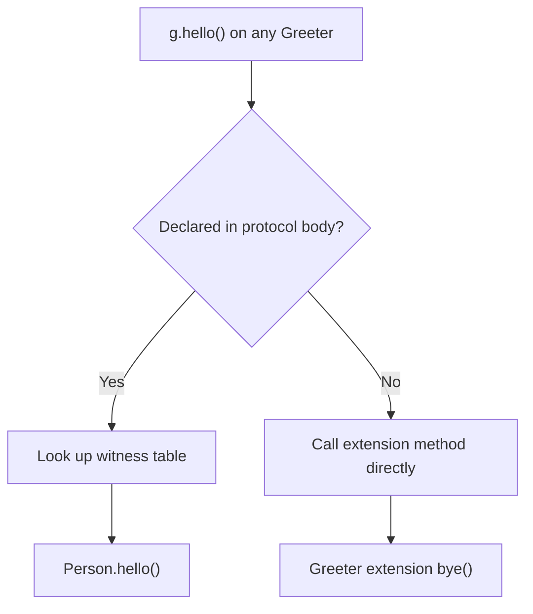
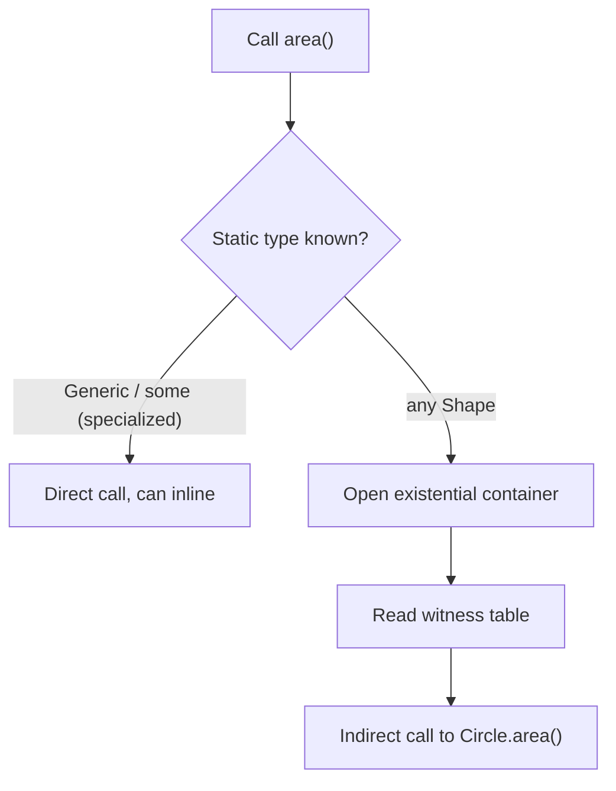
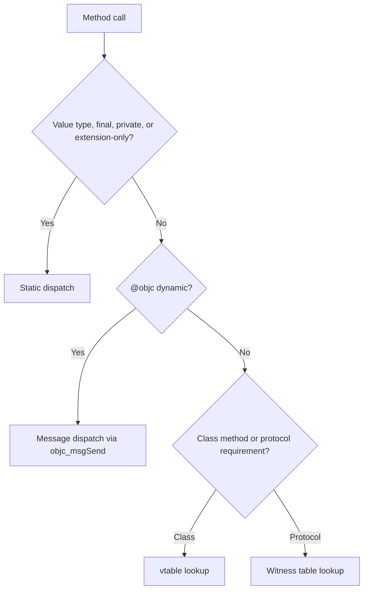
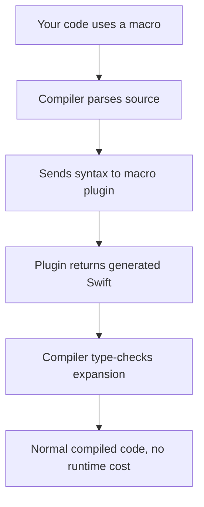
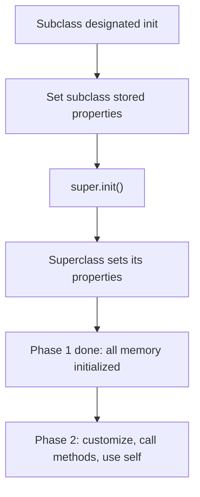
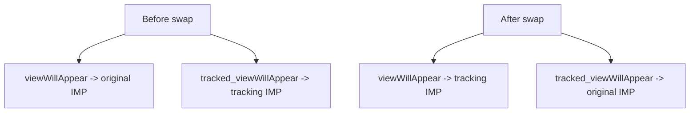
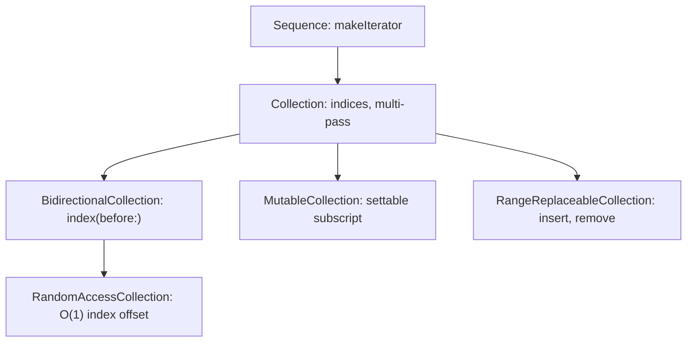

# Swift – Advanced

[⬅ Back to index](../README.md)

Covers: protocols & POP, generics, associated types, `some` vs `any`, method dispatch, property wrappers, result builders, macros, key paths, Codable, Equatable/Hashable, Objective-C interop.

---

## Protocols

### 1. What is Protocol-Oriented Programming (POP)?

<details>
<summary>Answer</summary>

**In short:** POP (introduced at WWDC 2015) is designing around **protocols + protocol extensions + value types** instead of class hierarchies. Protocols describe capabilities, extensions supply default behaviour, and any struct, enum or class can opt in to as many capabilities as it needs.

#### Why it exists

Object-oriented Swift code in the UIKit era leaned heavily on base classes: `BaseViewController`, `BaseModel`, and so on. That forces every type into one hierarchy, works only for classes (reference semantics, shared mutable state), and makes reuse an all-or-nothing deal. Apple's "Protocol-Oriented Programming in Swift" talk proposed starting with a protocol instead of a superclass.

#### The building blocks

- **Protocols define capabilities**: "can be identified", "can be cached", "can render a cell".
- **Protocol extensions provide default implementations**, so conformers get behaviour for free without a base class.
- **Composition**: a type can conform to many protocols. Class inheritance allows only one parent.
- **Works with structs and enums**, so you keep value semantics (no accidental shared state, thread-friendlier).
- **Easy to test**: depend on a protocol, inject a mock that conforms to it.
- **Constrained extensions** let you add behaviour only to some conformers: `extension Collection where Element: Numeric`.

```swift
protocol Identifiable { var id: String { get } }

extension Identifiable {
    // Every conformer gets this for free
    var debugID: String { "ID-\(id)" }
}

protocol Cacheable { var cacheKey: String { get } }

// Default implementation only for types that are both
extension Cacheable where Self: Identifiable {
    var cacheKey: String { "cache-\(id)" }
}

struct Article: Identifiable, Cacheable {   // value type, two capabilities
    let id: String
}

Article(id: "42").cacheKey   // "cache-42"
```

#### Real-world example

The standard library itself is built this way: `Array` gets `map`, `filter`, `contains` and `sorted` because it conforms to `Sequence`, `Collection`, `RandomAccessCollection`, and so on. Each protocol adds a layer of abilities via extensions.

**Common pitfalls**
- Methods that live only in an extension (not declared as requirements) are statically dispatched, so conformers can't truly override them (see question 3).
- POP doesn't mean "protocol for everything". A protocol with a single conformer and no test double is often just indirection.

**Likely follow-ups**
- *Is POP a replacement for OOP?* No. It's a preference: compose capabilities first, use classes when you need identity or reference semantics.
- *Why value types?* Copies are independent, so there's no shared mutable state and fewer threading bugs.

</details>

### 2. Protocol vs class inheritance? What problems does inheritance have?

<details>
<summary>Answer</summary>

**In short:** Inheritance gives you one parent, tight coupling to that parent's implementation, and reference types only. Protocols let a type adopt many capabilities, work with structs and enums, and couple you only to an interface, so they're the default choice for sharing behaviour in Swift.

#### Problems with class inheritance

| Problem | What it means in practice |
|---|---|
| Single inheritance | A class can't be both a `NetworkingViewController` and a `KeyboardHandlingViewController` |
| Fragile base class | A change in the parent's implementation silently breaks subclasses that relied on its internal behaviour |
| God base classes | `BaseViewController` keeps collecting "shared" helpers until every screen drags in analytics, loading spinners and alerts |
| Reference types only | Shared mutable state; structs and enums can't participate |
| Inherit everything | You get every method and stored property of the parent, needed or not |
| Hard to test | You can't easily swap a superclass for a fake |

#### What protocols give you

- **Multiple conformances**: `struct User: Codable, Hashable, Identifiable`.
- **Value types** can adopt them.
- **Looser coupling**: callers depend on what something can do, not on what it is.
- **Composition** of small protocols: `typealias Codable = Encodable & Decodable`.
- **Retroactive modeling**: you can make an existing type (even one you don't own) conform via an extension. You can't change the superclass of an existing class.

```swift
// Inheritance: every screen inherits everything
class BaseViewController: UIViewController {
    func showSpinner() { /* ... */ }
    func trackScreen() { /* ... */ }
    func showError(_ e: Error) { /* ... */ }
}

// Protocols: opt in to exactly what you need
protocol LoadingPresentable: UIViewController {}
extension LoadingPresentable {
    func showSpinner() { /* ... */ }
}

protocol ErrorPresentable: UIViewController {}
extension ErrorPresentable {
    func showError(_ e: Error) { /* ... */ }
}

final class ProfileViewController: UIViewController, LoadingPresentable, ErrorPresentable {}
```

#### When inheritance is still right

UIKit is class-based, so subclassing `UIView` or `UIViewController` is normal. Inheritance also fits when there's a true "is-a" relationship and you need to share stored state, not just behaviour (protocol extensions can't add stored properties).

**Likely follow-ups**
- *Can protocol extensions add stored properties?* No, only computed properties and methods.
- *What's "composition over inheritance"?* Build behaviour by combining small pieces (protocols, injected objects) rather than extending a deep hierarchy.

</details>

### 3. What are protocol extensions? What's the dispatch gotcha?

<details>
<summary>Answer</summary>

**In short:** Protocol extensions add methods and computed properties (often default implementations) to every conforming type. The gotcha: a method that is defined **only in the extension**, and not declared in the protocol body, is **statically dispatched**, so when you call it through the protocol type you get the extension's version even if the concrete type has its own.

#### How it works

When a type conforms to a protocol, the compiler builds a **protocol witness table**: one entry per *requirement* (each method or property declared in the protocol body), pointing at the conformer's implementation, or at the default from the extension if the type didn't provide one.

Methods that exist only in an extension have **no slot in the witness table**. When you call one on a value typed as the protocol, the compiler simply calls the extension's implementation directly, based on the static type.

```swift
protocol Greeter { func hello() }

extension Greeter {
    func hello() { print("Default hello") }   // requirement -> witness table -> dynamic
    func bye() { print("Default bye") }       // NOT a requirement -> static
}

struct Person: Greeter {
    func hello() { print("Person hello") }
    func bye() { print("Person bye") }        // shadows, doesn't override
}

let g: Greeter = Person()
g.hello()  // "Person hello"
g.bye()    // "Default bye"   <- surprising!

let p = Person()
p.bye()    // "Person bye"    (static type is Person)
```



#### The fix

If conformers should be able to customise the behaviour, **declare it as a requirement** in the protocol and keep the default in the extension:

```swift
protocol Greeter {
    func hello()
    func bye()          // now a customization point
}
```

#### Why Swift does this

Extension-only methods are useful as "helpers that are always the same" (like `Sequence.map`). Static dispatch makes them fast and stops conformers from changing them by accident.

**Common pitfalls**
- The same issue appears with class conformances: a subclass overriding a default implementation that the superclass didn't implement itself won't be called through the protocol.
- Constrained extensions (`where Self: ...`) can also pick a different default depending on static type information.

**Likely follow-ups**
- *What's a customization point?* A protocol requirement with a default implementation: conformers may override it and dynamic dispatch respects that.
- *Can protocol extensions add stored properties?* No.

</details>

### 4. What are associated types?

<details>
<summary>Answer</summary>

**In short:** An associated type is a **placeholder type inside a protocol** that each conforming type fills in. It makes a protocol generic (e.g. `Collection.Element`). Since Swift 5.7 you can declare **primary associated types** (`protocol Repository<Item>`) and write constrained existentials like `any Repository<User>`.

#### Why they exist

Some protocols describe behaviour that depends on a type that varies per conformer. A `Repository` of users returns `[User]`; a repository of orders returns `[Order]`. You can't write that with a fixed type, and you don't want `[Any]`. An associated type says "each conformer decides this".

```swift
protocol Repository {
    associatedtype Item
    func fetchAll() async throws -> [Item]
}

struct User { let name: String }

struct UserRepo: Repository {
    // Item is inferred as User from the method signature
    func fetchAll() async throws -> [User] { [] }
}
```

You can constrain them: `associatedtype Item: Identifiable`, or add `where` clauses like `associatedtype Iterator: IteratorProtocol where Iterator.Element == Element` (that's how `Sequence` is defined).

#### The historical problem

Before Swift 5.7, a protocol with associated types (a "PAT") couldn't be used as a plain type:

```swift
let repo: Repository   // error (pre-5.7): can only be used as a generic constraint
```

The compiler didn't know what `Item` would be, so you had to use generics (`func load<R: Repository>(_ r: R)`) or write a type eraser (`AnyRepository<Item>`, see question 26).

#### What changed in Swift 5.7

- **Existentials for any protocol:** `any Repository` is allowed (though you can't call methods that return `Item` in a useful typed way without more info).
- **Primary associated types:** declare the important associated type in angle brackets and constrain it at the use site.

```swift
protocol Repository<Item> {
    associatedtype Item
    func fetchAll() async throws -> [Item]
}

let repo: any Repository<User> = UserRepo()   // constrained existential
func show(_ repo: some Repository<User>) { }  // opaque/generic, faster
```

**Common pitfalls**
- Associated types are fixed per conformance: one type can't be a `Repository` of both `User` and `Order`.
- Overusing them makes APIs hard to consume; sometimes a plain generic struct is simpler.

**Likely follow-ups**
- *Associated type vs generic parameter?* A generic parameter is chosen by the caller (`Array<Int>`); an associated type is chosen by the conforming type.
- *Standard library examples?* `Sequence.Element`, `Collection.Index`, `View.Body`, `Publisher.Output`.

</details>

### 5. `some` vs `any` – opaque types vs existentials?

<details>
<summary>Answer</summary>

**In short:** `some Protocol` means "**one specific** concrete type, known to the compiler but hidden from the caller", so it's statically dispatched with no boxing. `any Protocol` means "**any** conforming type, possibly different each time", stored in a boxed existential container with dynamic dispatch. Prefer `some` (or generics); use `any` when you genuinely need different types at runtime, such as a heterogeneous array.

#### `some`: opaque types

```swift
var body: some View {              // the real type is a long nested VStack<TupleView<...>>
    VStack { Text("Hi"); Image(systemName: "star") }
}

func makeShape() -> some Shape {   // always returns the same concrete type
    Circle()
}
```

- The implementation picks the type; the caller only sees "some Shape".
- The compiler knows the real type, so it can specialize, inline and avoid allocation.
- Every return path must return the **same** type. `if flag { return Circle() } else { return Rectangle() }` doesn't compile.
- In parameter position (Swift 5.7+), `func draw(_ s: some Shape)` is shorthand for `func draw<S: Shape>(_ s: S)`: there the caller picks the type.

#### `any`: existentials

```swift
let shapes: [any Shape] = [Circle(), Rectangle()]   // different types in one array

var current: any Shape = Circle()
current = Rectangle()                               // allowed: type can change
```

- The value lives in an **existential container**: a small inline buffer (3 words) plus pointers to type metadata and the protocol witness table. Larger values are heap-allocated.
- Each method call goes through the witness table (dynamic dispatch), and the compiler can't specialize.
- The `any` keyword arrived in Swift 5.6. It's required when using a protocol with associated types or `Self` requirements as a type (5.7+), and recommended everywhere else (the `ExistentialAny` upcoming feature flag enforces it).

#### Comparison

| | `some P` | `any P` |
|---|---|---|
| Who picks the type | Implementation (return) or caller (parameter) | Decided at runtime, can change |
| Same type every time? | Yes | No |
| Storage | Direct, unboxed | Existential container, may heap-allocate |
| Dispatch | Static, specializable | Dynamic via witness table |
| Heterogeneous collections | No | Yes |
| Typical use | `some View`, generic params | `[any Shape]`, stored dependencies |

**Common pitfalls**
- Reaching for `any` by default because it "looks like Java interfaces". It's the slower, less type-safe option.
- Expecting `some View` to allow returning different views from branches: use `@ViewBuilder`, `Group`, or (last resort) `AnyView`.

**Likely follow-ups**
- *Can you pass an `any P` to a function taking `some P`?* Yes, since Swift 5.7 the compiler "opens" the existential implicitly.
- *Is `any P` the same as type erasure?* Conceptually similar (both hide the type); `any` is built into the language, hand-written erasers like `AnyPublisher` are library types.

</details>

### 6. What is a protocol composition and class-only protocol?

<details>
<summary>Answer</summary>

**In short:** **Protocol composition** (`A & B`) requires a value to conform to several protocols at once without declaring a new protocol. A **class-only protocol** (`protocol P: AnyObject`) can be adopted only by classes, which is what lets you hold it in a `weak` reference, typically for delegates.

#### Protocol composition

```swift
protocol Identifiable { var id: String { get } }

// Accept anything that is BOTH Codable and Identifiable
func save(_ item: Codable & Identifiable) { /* ... */ }

// Give a composition a name
typealias Persistable = Codable & Identifiable

// Compose a class with protocols, too
func present(on vc: UIViewController & UIAdaptivePresentationControllerDelegate) { }
```

It's how the standard library defines `Codable` (`Encodable & Decodable`). It avoids creating "umbrella" protocols that exist only to group others. In generic code you can write the same thing as `<T: Codable & Identifiable>`.

#### Class-only protocols

```swift
protocol ProfileViewDelegate: AnyObject {
    func didTapLogout()
}

final class ProfileView: UIView {
    weak var delegate: ProfileViewDelegate?   // allowed only because of AnyObject
}
```

Why it's needed: `weak` and `unowned` only make sense for reference types (they don't retain a heap object). A struct could conform to a normal protocol, so the compiler won't let you declare `weak var delegate: SomeProtocol?` unless the protocol is restricted to classes. The weak reference breaks the retain cycle between a view controller (which owns the view) and the view (which points back at its delegate).

You'll also see `class` instead of `AnyObject` in older code (`protocol P: class`); it's deprecated in favour of `AnyObject`.

**Common pitfalls**
- Forgetting `AnyObject` on a delegate protocol and then holding a strong reference, creating a retain cycle.
- `@objc` protocols are implicitly class-only.

**Likely follow-ups**
- *Can you restrict to a specific class?* Yes: `protocol P: UIViewController` means only `UIViewController` subclasses can conform.
- *Why not make every protocol class-only?* You'd lose value types, which defeats much of POP.

</details>

---

## Generics

### 7. What are generics? What are generic constraints?

<details>
<summary>Answer</summary>

**In short:** Generics let you write one function or type that works with many types while staying fully type-safe, using type parameters like `<T>`. **Constraints** (`T: Comparable`, `where` clauses) limit which types are allowed so the code can use their capabilities. The compiler can **specialize** generic code per concrete type, so it's typically as fast as hand-written code.

#### Why they exist

Without generics you'd either duplicate code (`swapInts`, `swapStrings`) or use `Any` and lose type safety (casts everywhere, crashes at runtime). `Array<Element>`, `Dictionary<Key, Value>`, `Optional<Wrapped>` and `Result<Success, Failure>` are all generics.

```swift
// Works for any type, and both args must be the SAME type
func swapValues<T>(_ a: inout T, _ b: inout T) { (a, b) = (b, a) }

// Constraint: T must be Comparable, so we can call max()
func largest<T: Comparable>(_ items: [T]) -> T? { items.max() }

// where clause: constrain an associated type
func uniqueCount<C: Collection>(_ c: C) -> Int where C.Element: Hashable {
    Set(c).count
}

// Generic type
struct Stack<Element> {
    private var items: [Element] = []
    mutating func push(_ x: Element) { items.append(x) }
    mutating func pop() -> Element? { items.popLast() }
}

// Constrained extension: only stacks of Equatable elements get contains
extension Stack where Element: Equatable {
    func contains(_ x: Element) -> Bool { items.contains(x) }
}
```

#### Kinds of constraints

| Form | Meaning |
|---|---|
| `T: Protocol` | T conforms to a protocol |
| `T: SomeClass` | T is that class or a subclass |
| `T: A & B` | T conforms to both |
| `where C.Element == String` | Same-type requirement on an associated type |
| `where T: Hashable` | Same as inline, but readable for many constraints |
| `some Collection` in a parameter | Shorthand for an anonymous generic parameter (Swift 5.7) |

#### How it runs

The compiler type-checks generic code once. At runtime, unspecialized generic code receives type metadata and witness tables as hidden parameters. When the concrete type is visible (same module, or `@inlinable` across modules), the optimizer **specializes**: it generates a copy for `[Int]` that calls `Int`'s `<` directly, enabling inlining.

**Common pitfalls**
- Over-generic APIs that are hard to read. Make code generic when you have at least two real use cases.
- Generic code across module boundaries may not be specialized unless it's `@inlinable`.

**Likely follow-ups**
- *Generic parameter vs associated type?* The caller picks a generic parameter; the conformer picks an associated type.
- *What's `some` in parameter position?* Sugar for a generic parameter.

</details>

### 8. Generics vs `any Protocol` – which is faster and why?

<details>
<summary>Answer</summary>

**In short:** Generics (and `some`) are usually faster. The compiler knows the concrete type, so it can **specialize** the code: direct calls, inlining, no boxing. `any Protocol` stores the value in an **existential container** and calls methods through a **witness table**, which adds indirection, can cost a heap allocation, and blocks most optimizations.

#### What happens under the hood

```swift
protocol Shape { func area() -> Double }
struct Circle: Shape { let r: Double; func area() -> Double { .pi * r * r } }

// Generic: compiler can emit a specialized totalArea for [Circle]
func totalArea<S: Shape>(_ shapes: [S]) -> Double {
    shapes.reduce(0) { $0 + $1.area() }   // direct call, inlinable
}

// Existential: every element is boxed; each area() is a table lookup
func totalArea(_ shapes: [any Shape]) -> Double {
    shapes.reduce(0) { $0 + $1.area() }
}
```



#### The existential container

An `any Shape` value is a fixed-size box: a 3-word inline buffer for the value, a pointer to type metadata, and a pointer per protocol witness table. If the value doesn't fit in 3 words, it's allocated on the heap and the buffer holds a reference. Copying the existential may copy that box.

#### Trade-offs

| | Generics / `some` | `any` |
|---|---|---|
| Speed | Fast when specialized | Indirection, possible allocation |
| Mixed types in one collection | No (`[S]` is one type) | Yes |
| Code size | Can grow (one copy per specialization) | Smaller |
| API ergonomics | Type parameters spread to callers | Simple to store and pass |

Don't micro-optimize everywhere: for a list of 10 dependencies stored in a view model, `any` is fine. Prefer generics in hot loops, algorithms, and library code.

**Likely follow-ups**
- *Is generic code always specialized?* No. Across modules without `@inlinable`, or when the optimizer chooses not to, it runs unspecialized using metadata passed at runtime, which is closer in cost to existentials.
- *How do you measure?* Instruments Time Profiler and building in Release, never Debug.

</details>

---

## Dispatch & Performance

### 9. What is method dispatch in Swift? Static vs dynamic vs message dispatch?

<details>
<summary>Answer</summary>

**In short:** Method dispatch is how the program decides which implementation to run for a call. **Static (direct)** dispatch is resolved at compile time and is the fastest. **Table (dynamic)** dispatch looks up a vtable (classes) or witness table (protocols) at runtime to support overriding and polymorphism. **Message** dispatch goes through the Objective-C runtime (`objc_msgSend`) and is the most dynamic, enabling KVO and swizzling.

#### The three kinds

| Kind | How | Used for | Cost |
|---|---|---|---|
| Static / direct | Address known at compile time | Structs, enums, `final` classes and methods, `private`/`fileprivate` members, `static` methods, protocol extension methods that aren't requirements | Fastest, inlinable |
| Table (vtable) | Index into the class's vtable | Non-final class methods that can be overridden | One indirect load + call |
| Table (witness table) | Index into the protocol witness table | Protocol requirements called via generic or `any` | Indirect call |
| Message | `objc_msgSend` looks up the selector in method lists and caches | `@objc dynamic` members, methods of NSObject subclasses called via ObjC | Slowest, fully dynamic |

```swift
struct Point { func length() -> Double { 0 } }       // static

class Animal {
    func speak() {}                                  // vtable
    final func breathe() {}                          // static
    @objc dynamic func run() {}                      // message (Animal: NSObject needed for @objc)
}

protocol Drawable { func draw() }                    // witness table when called via protocol
extension Drawable { func describe() {} }            // static (not a requirement)
```



#### Why it matters

Static dispatch isn't just "one fewer pointer jump": it lets the compiler **inline** the call and then optimize across it (constant folding, removing retains). Dynamic dispatch is an optimization barrier.

#### Performance tips

- Mark classes `final` when they aren't designed for subclassing.
- Use `private`/`fileprivate`: the compiler can see all overrides (there are none) and devirtualize.
- Enable **Whole Module Optimization** (default in Release builds): the compiler sees the whole module and can infer that `internal` methods with no overrides are effectively final.
- Prefer value types and generics in hot paths.

**Common pitfalls**
- Assuming `@objc` alone gives message dispatch. `@objc` exposes the method to ObjC, but Swift callers may still use vtable dispatch; you need `dynamic` to force message dispatch.

**Likely follow-ups**
- *Where are extension methods on classes dispatched?* Statically, unless marked `@objc` (extensions can't add vtable entries), which is why you can't override non-`@objc` methods declared in extensions.
- *What does `objc_msgSend` do?* Looks up the selector in the class's method cache, then method lists up the hierarchy, then jumps to the IMP.

</details>

### 10. What does `final` do?

<details>
<summary>Answer</summary>

**In short:** `final` on a class prevents subclassing; on a method, property or subscript it prevents overriding. Because the compiler then knows there can be no other implementation, it can use **static dispatch** (and inline), and it documents that the type wasn't designed for inheritance.

```swift
final class ImageCache {          // nobody can subclass this
    func image(for key: String) -> UIImage? { nil }   // effectively final too
}

class BaseService {
    final func authHeader() -> String { "Bearer ..." }   // subclasses can't override
    func fetch() {}                                      // can be overridden (vtable)
}

class UserService: BaseService {
    override func fetch() {}             // OK
    // override func authHeader() {}     // error: instance method overrides a 'final' instance method
}
```

#### Why it helps

1. **Performance:** a call on a non-final class method goes through the vtable, because a subclass might override it. With `final`, the target is known, so the call is direct and can be inlined.
2. **Correctness and intent:** subclasses can't break invariants by overriding internal behaviour (the fragile base class problem).
3. **API design:** for public frameworks, `final` (and not using `open`) lets you change internals later without breaking subclassers.

#### Related keywords

| Keyword | Effect |
|---|---|
| `final` | No subclassing / overriding anywhere |
| `private` / `fileprivate` members | Implicitly can't be overridden outside the file, so the compiler can devirtualize |
| `public` (on a class) | Usable but **not subclassable** outside the module |
| `open` | Subclassable and overridable outside the module |
| `static` (on a class member) | Equivalent to `class final` |

Whole Module Optimization can infer `final` for `internal` classes that have no subclasses, but writing it explicitly is clearer and works in every build mode.

**Likely follow-ups**
- *Should every class be final?* Many teams default to `final` and remove it only when inheritance is needed; it's a cheap, safe default.
- *Does `final` matter for structs?* No, structs can't be subclassed; their methods are already statically dispatched.

</details>

---

## Language Features

### 11. What are property wrappers?

<details>
<summary>Answer</summary>

**In short:** A property wrapper is a type marked `@propertyWrapper` that encapsulates the storage logic of a property (clamping, persisting, observing, thread-safety) so you can reuse it with an attribute like `@Clamped(0...100) var level`. It must expose `wrappedValue`, and can optionally expose a `projectedValue` accessed with `$`.

#### The problem it solves

Without wrappers, the same `get`/`set` boilerplate gets copied into every property that needs it: read from `UserDefaults`, trim whitespace, clamp to a range. Property wrappers move that logic into one type.

```swift
@propertyWrapper
struct Clamped {
    private var value: Int
    let range: ClosedRange<Int>

    init(wrappedValue: Int, _ range: ClosedRange<Int>) {
        self.range = range
        value = min(max(wrappedValue, range.lowerBound), range.upperBound)
    }

    var wrappedValue: Int {
        get { value }
        set { value = min(max(newValue, range.lowerBound), range.upperBound) }
    }
}

struct Volume {
    @Clamped(0...100) var level = 50
}

var v = Volume()
v.level = 150
print(v.level)   // 100
```

#### What the compiler generates

`@Clamped(0...100) var level = 50` is roughly rewritten into:

```swift
private var _level = Clamped(wrappedValue: 50, 0...100)   // the wrapper instance
var level: Int {                                         // computed property
    get { _level.wrappedValue }
    set { _level.wrappedValue = newValue }
}
// and if the wrapper has projectedValue:
// var $level: ProjectedType { _level.projectedValue }
```

#### Projected values

`projectedValue` exposes something extra about the wrapper. SwiftUI's `@State var name` gives `$name`, a `Binding<String>`; Combine's `@Published var items` gives `$items`, a publisher.

```swift
@propertyWrapper
struct UserDefault<T> {
    let key: String
    let defaultValue: T
    var wrappedValue: T {
        get { UserDefaults.standard.object(forKey: key) as? T ?? defaultValue }
        set { UserDefaults.standard.set(newValue, forKey: key) }
    }
}

enum Settings {
    @UserDefault(key: "hasOnboarded", defaultValue: false)
    static var hasOnboarded: Bool
}
```

**Real examples:** SwiftUI's `@State`, `@Binding`, `@Environment`, `@AppStorage`, `@FocusState`; Combine's `@Published`; custom `@UserDefault`, `@Trimmed`, `@Atomic`.

**Common pitfalls**
- An `@Atomic` wrapper doesn't make `x += 1` atomic: that's a separate get and set.
- Wrappers can't be used on top-level `let`s in all contexts, and they don't work in protocols as requirements.
- With the Observation framework (`@Observable`), the old wrappers like `@Published` are replaced by a macro, not a wrapper.

**Likely follow-ups**
- *Property wrapper vs macro?* Wrappers change one property's storage at runtime; macros generate arbitrary code at compile time.
- *Can wrappers be composed?* Yes, stack them (`@A @B var x`); the outer one wraps the inner.

</details>

### 12. What are result builders?

<details>
<summary>Answer</summary>

**In short:** A result builder (`@resultBuilder`) is a type with static `build...` methods that the compiler uses to turn a sequence of statements in a closure into a single combined value. It's what powers **DSLs** like SwiftUI's `@ViewBuilder`, where listing several views in `body` produces one view.

#### How it works

When a closure or function is marked with a builder, the compiler rewrites its body: each expression statement becomes a partial result, and they're combined with the builder's static methods.

| Method | Called for |
|---|---|
| `buildBlock(_ components...)` | Combining the statements in a block (required) |
| `buildOptional(_:)` | `if` without `else` |
| `buildEither(first:)` / `buildEither(second:)` | `if/else` and `switch` |
| `buildArray(_:)` | `for ... in` loops |
| `buildExpression(_:)` | Converting each expression before combining |
| `buildLimitedAvailability(_:)` | `if #available` |
| `buildFinalResult(_:)` | Final transformation of the result |

```swift
@resultBuilder
enum StringListBuilder {
    static func buildBlock(_ parts: [String]...) -> [String] { parts.flatMap { $0 } }
    static func buildExpression(_ s: String) -> [String] { [s] }
    static func buildOptional(_ part: [String]?) -> [String] { part ?? [] }
    static func buildEither(first: [String]) -> [String] { first }
    static func buildEither(second: [String]) -> [String] { second }
    static func buildArray(_ parts: [[String]]) -> [String] { parts.flatMap { $0 } }
}

func makeList(@StringListBuilder _ content: () -> [String]) -> [String] { content() }

let isAdmin = true
let menu = makeList {
    "Home"
    "Profile"
    if isAdmin { "Admin" }
    for i in 1...2 { "Item \(i)" }
}
// ["Home", "Profile", "Admin", "Item 1", "Item 2"]
```

The compiler turns the `menu` closure into roughly `buildBlock(buildExpression("Home"), buildExpression("Profile"), buildOptional(...), buildArray(...))`.

#### In SwiftUI

`@ViewBuilder` makes `VStack { Text("A"); Text("B") }` produce a `TupleView<(Text, Text)>`, and `if/else` produces `_ConditionalContent<A, B>`. That's why `some View` works with branches inside a builder: the builder wraps both branches into one concrete type.

**Other examples:** RegexBuilder (`Regex { OneOrMore(.digit) }`), `@SceneBuilder`, `@ToolbarContentBuilder`, community HTML and Auto Layout DSLs.

**Common pitfalls**
- Not every Swift statement is allowed: `guard`, `defer` and arbitrary `let` without use can produce confusing errors (local `let` declarations are allowed).
- Type-checking large builder bodies can be slow and produce vague errors; split big views into smaller ones.

**Likely follow-ups**
- *Why can `body` contain `if` without `AnyView`?* `buildEither` wraps both branches in a single conditional type.
- *Is there a limit on child views?* Historically `buildBlock` had overloads up to 10 children; since Swift 5.9 parameter packs removed that limit.

</details>

### 13. What are Swift macros?

<details>
<summary>Answer</summary>

**In short:** Macros (Swift 5.9) are **compile-time code generation**. A macro is implemented with SwiftSyntax in a separate compiler plugin; the compiler passes it the syntax tree of your code, the macro returns new code, and the result is type-checked like normal Swift. They remove boilerplate at no runtime cost, and Xcode can expand them so you see exactly what was generated.

#### Two kinds

| Kind | Syntax | Examples |
|---|---|---|
| **Freestanding** | `#name(...)` | `#Preview { }`, `#warning("...")`, `#expect(x == 1)`, custom `#URL("https://...")` that validates at compile time |
| **Attached** | `@Name` on a declaration | `@Observable`, `@Model` (SwiftData), `@Test` (Swift Testing), custom `@AddCodingKeys`, `@Mockable` |

Attached macros have roles that say what they may add: `peer` (new declarations next to it), `member` (members inside a type), `accessor` (getters/setters), `memberAttribute` (attributes on members), and `extension` (protocol conformances).

#### Example: what `@Observable` does

```swift
@Observable
final class CartModel {
    var items: [Item] = []
}
```

Expanding it in Xcode (right-click, Expand Macro) shows generated code: a hidden `ObservationRegistrar`, accessors on `items` that call `access` and `withMutation` so SwiftUI knows which views read the property, and an `Observable` conformance.

#### How it runs



- Macros run in a **sandboxed** separate process: no network or file access.
- Input must be valid Swift syntax, and output is type-checked, unlike C preprocessor macros (which are text substitution).
- Macros are **additive**: they can add code but not delete or rewrite your existing code.

#### Defining a macro (outline)

1. Create a Swift package from the "Swift Macro" template.
2. Declare it: `@freestanding(expression) public macro stringify<T>(_ value: T) -> (T, String) = #externalMacro(module: "MyMacros", type: "StringifyMacro")`.
3. Implement `StringifyMacro: ExpressionMacro` using SwiftSyntax.
4. Test expansions with `assertMacroExpansion`.

**Common pitfalls**
- Depending on swift-syntax used to add significant clean-build time; keep macros for real boilerplate.
- Debugging generated code is harder; always look at the expansion.
- Third-party macro packages must be trusted explicitly in Xcode the first time.

**Likely follow-ups**
- *Macro vs property wrapper?* Wrappers wrap one property's storage at runtime; macros can generate any declarations at compile time.
- *Macro vs C macro?* Swift macros are typed, hygienic and syntax-aware; C macros are blind text replacement.

</details>

### 14. What are key paths?

<details>
<summary>Answer</summary>

**In short:** A key path is a **type-safe reference to a property**, not its value. `\User.name` has type `KeyPath<User, String>`: "given a `User`, I can get a `String`". You can pass it around, store it, and apply it later with `user[keyPath: \.name]`. It's checked at compile time, unlike Objective-C's string-based KVC keys.

#### Types of key paths

| Type | Allows |
|---|---|
| `AnyKeyPath`, `PartialKeyPath<Root>` | Type-erased forms |
| `KeyPath<Root, Value>` | Read only |
| `WritableKeyPath<Root, Value>` | Read and write on value types (`var` properties) |
| `ReferenceWritableKeyPath<Root, Value>` | Write through a reference (class properties) |

```swift
struct User { var name: String; var age: Int }

let namePath = \User.name                      // WritableKeyPath<User, String>
var u = User(name: "Ana", age: 30)
print(u[keyPath: namePath])                    // "Ana"
u[keyPath: \.age] = 31                         // write via WritableKeyPath

// Key paths compose
struct Team { var lead: User }
let leadName = \Team.lead.name                 // KeyPath<Team, String>
```

#### Where you see them

```swift
let names = users.map(\.name)                          // key path as function (Swift 5.2)
let sorted = users.sorted(using: KeyPathComparator(\.age))
ForEach(items, id: \.id) { item in Text(item.title) }  // SwiftUI identity
@Environment(\.colorScheme) var scheme                 // SwiftUI environment
let obs = view.observe(\.isHidden) { v, _ in }         // KVO (NSObject + @objc dynamic)
publisher.assign(to: \.text, on: label)                // Combine
```

#### Generic helpers

```swift
extension Sequence {
    func sorted<T: Comparable>(by keyPath: KeyPath<Element, T>) -> [Element] {
        sorted { $0[keyPath: keyPath] < $1[keyPath: keyPath] }
    }
}
users.sorted(by: \.age)
```

Key paths also power `@dynamicMemberLookup` with type safety (question 19) and SwiftData/Core Data predicates.

**Common pitfalls**
- `assign(to:on:)` in Combine retains the object strongly; using `self` creates a retain cycle.
- Key paths to methods aren't allowed (only properties and subscripts).

**Likely follow-ups**
- *How is this different from KVC?* KVC uses strings (`value(forKey: "name")`), checked at runtime; key paths are compile-time checked and work on Swift structs.
- *Can a key path be `Hashable`?* Yes, key paths are Hashable, so they can be dictionary keys.

</details>

### 15. What is Codable? How do you customize it?

<details>
<summary>Answer</summary>

**In short:** `Codable` is a type alias for `Encodable & Decodable`. If all of a type's stored properties are Codable, the compiler synthesizes encoding and decoding, and you use it with `JSONDecoder`/`JSONEncoder` or `PropertyListEncoder`. You customize it with a `CodingKeys` enum, decoder strategies, or by writing `init(from:)` and `encode(to:)` yourself.

#### How it works

Codable separates **what to encode** (your type) from **the format** (the encoder). The synthesized code uses a `CodingKeys` enum and a **keyed container**:

```swift
struct User: Codable {
    let id: Int
    let fullName: String
    let email: String?                 // optional -> decodeIfPresent

    enum CodingKeys: String, CodingKey {
        case id
        case fullName = "full_name"    // rename
        case email
        // a property left out here is not encoded/decoded (needs a default value)
    }
}

let user = try JSONDecoder().decode(User.self, from: data)
```

#### Customization options, from cheapest to most work

| Need | Solution |
|---|---|
| snake_case JSON | `decoder.keyDecodingStrategy = .convertFromSnakeCase` |
| Dates | `decoder.dateDecodingStrategy = .iso8601` (or `.secondsSince1970`, `.formatted`, `.custom`) |
| Rename or skip a few keys | `CodingKeys` |
| Nested JSON, defaults, validation, type changes | Custom `init(from:)` / `encode(to:)` |
| Polymorphic payloads (`"type": "image"`) | Decode a discriminator, then switch |

```swift
// JSON: { "id": 1, "profile": { "name": "Ana" }, "role": null }
struct Member: Decodable {
    let id: Int
    let name: String
    let role: String

    enum CodingKeys: String, CodingKey { case id, profile, role }
    enum ProfileKeys: String, CodingKey { case name }

    init(from decoder: Decoder) throws {
        let c = try decoder.container(keyedBy: CodingKeys.self)
        id = try c.decode(Int.self, forKey: .id)
        let profile = try c.nestedContainer(keyedBy: ProfileKeys.self, forKey: .profile)
        name = try profile.decode(String.self, forKey: .name)          // flatten nesting
        role = try c.decodeIfPresent(String.self, forKey: .role) ?? "member"   // default
    }
}
```

**Polymorphism:**

```swift
enum Block: Decodable {
    case text(String), image(URL)
    enum CodingKeys: String, CodingKey { case type, value }
    init(from decoder: Decoder) throws {
        let c = try decoder.container(keyedBy: CodingKeys.self)
        switch try c.decode(String.self, forKey: .type) {
        case "text":  self = .text(try c.decode(String.self, forKey: .value))
        case "image": self = .image(try c.decode(URL.self, forKey: .value))
        default: throw DecodingError.dataCorruptedError(forKey: .type, in: c, debugDescription: "Unknown type")
        }
    }
}
```

**Common pitfalls**
- One unexpected `null` or missing key fails the **whole** decode; make fields optional or provide defaults where the API is unreliable.
- A `let` property with an initial value is not decoded (the compiler warns).
- Catch `DecodingError` and log its context (`.keyNotFound`, `.typeMismatch`) for debugging.
- Create the `JSONDecoder` once and reuse it; configuring it repeatedly in a hot path is wasteful.

**Likely follow-ups**
- *Does Codable support enums?* Yes: raw-value enums automatically, and enums with associated values are synthesized since Swift 5.5.
- *How to decode one bad element without failing the array?* Wrap elements in a lossy wrapper that decodes `Result` or optional per element.

</details>

### 16. Equatable, Hashable, Comparable, Identifiable?

<details>
<summary>Answer</summary>

**In short:** **Equatable** gives `==`; **Hashable** adds `hash(into:)` so values can go in a `Set` or be `Dictionary` keys; **Comparable** adds `<` so values can be sorted; **Identifiable** gives a stable `id` so frameworks like SwiftUI can track an item across updates. The compiler synthesizes Equatable and Hashable for structs and enums whose members all conform.

| Protocol | Requirement | Synthesized? | Used for |
|---|---|---|---|
| `Equatable` | `static func ==` | Yes, if all stored properties / associated values are Equatable | `==`, `contains`, `firstIndex(of:)`, SwiftUI diffing |
| `Hashable` | `func hash(into:)` (inherits Equatable) | Yes, same rule | `Set`, `Dictionary` keys, diffable data sources |
| `Comparable` | `static func <` (inherits Equatable) | Only for enums without associated values (or with Comparable ones) | `sorted()`, `max()`, ranges |
| `Identifiable` | `var id: ID` where `ID: Hashable` | No (but free if you have an `id` property) | SwiftUI `List`/`ForEach`, identity |

```swift
struct Product: Hashable, Identifiable {
    let id: UUID
    var name: String
    var price: Decimal
}

struct Version: Comparable {
    let major: Int, minor: Int
    static func < (l: Version, r: Version) -> Bool {
        (l.major, l.minor) < (r.major, r.minor)   // tuples compare lexicographically
    }
}
```

#### The Hashable contract

If `a == b`, then `a.hashValue == b.hashValue`. The reverse isn't required (collisions are allowed). If you write a custom `==` that compares only some fields, your `hash(into:)` must use **the same or fewer** fields:

```swift
struct Contact: Hashable {
    let id: Int
    var nickname: String
    static func == (l: Contact, r: Contact) -> Bool { l.id == r.id }
    func hash(into h: inout Hasher) { h.combine(id) }   // must match ==
}
```

#### Equality vs identity

`Identifiable.id` answers "is this the **same** item?" (a row that changed its title is still the same row). `Equatable` answers "has the **content** changed?". SwiftUI uses `id` to keep state and animate moves, and equality to skip redraws.

**Common pitfalls**
- Mutating a property that affects the hash while the value is in a `Set` or used as a key corrupts the collection.
- Using array index or `UUID()` generated in `body` as `id` breaks SwiftUI identity (new id every render).
- Hash values are randomly seeded per launch; never persist `hashValue`.

**Likely follow-ups**
- *Why does Hashable inherit Equatable?* Hash collisions are resolved by comparing with `==`.
- *Can classes get synthesized Equatable?* No, you implement it yourself (or compare identity with `===`).

</details>

### 17. What are subscripts?

<details>
<summary>Answer</summary>

**In short:** Subscripts let instances of your type be accessed with `[]`, like arrays and dictionaries. You declare them with `subscript(...) -> T { get set }`. They can take any number of parameters, use argument labels and default values, be generic, be `static`, and be read-only or read-write.

```swift
struct Matrix {
    let rows: Int, cols: Int
    private var grid: [Double]

    init(rows: Int, cols: Int) {
        self.rows = rows; self.cols = cols
        grid = Array(repeating: 0, count: rows * cols)
    }

    // Two parameters, read-write
    subscript(row: Int, col: Int) -> Double {
        get {
            precondition(row < rows && col < cols, "Index out of range")
            return grid[row * cols + col]
        }
        set { grid[row * cols + col] = newValue }
    }
}

var m = Matrix(rows: 2, cols: 2)
m[0, 1] = 3.5
```

#### Labels, defaults and overloads

Subscript parameters have **no argument labels by default** (unlike functions). Add an explicit label to require one, which is handy for alternative access styles:

```swift
extension Collection {
    // Safe access: returns nil instead of crashing
    subscript(safe i: Index) -> Element? {
        indices.contains(i) ? self[i] : nil
    }
}

let items = [1, 2, 3]
items[safe: 10]   // nil, no crash
```

Standard library examples: `dict["key", default: 0] += 1` (labeled parameter with default), `array[1...3]` (range subscript returning an `ArraySlice`), `value[keyPath: \.name]`.

#### Other forms

- **Generic subscripts**: `subscript<T: Decodable>(key: String) -> T?`.
- **Static subscripts** (Swift 5.1): `Config["apiURL"]` on the type itself.
- Subscripts power `@dynamicMemberLookup` (question 19).

**Common pitfalls**
- `indices.contains(i)` is O(1) for arrays but can be O(n) for other collections.
- A heavy subscript surprises readers; `[]` reads as cheap access, so expensive work belongs in a named method.

**Likely follow-ups**
- *Can a subscript throw or be async?* Read-only subscripts can be `throws` and `async` (Swift 5.5 effectful read-only properties and subscripts).
- *Subscript vs method?* Use a subscript for natural collection-like lookup; use a method when it has side effects or needs a descriptive name.

</details>

### 18. What are initializers in Swift? Designated vs convenience vs failable vs required?

<details>
<summary>Answer</summary>

**In short:** An initializer prepares a new instance so every stored property has a value before use. For classes, a **designated** init fully initializes the class's own properties and calls a superclass designated init; a **convenience** init must delegate to another init in the **same** class; a **failable** `init?` can return `nil`; and `required` forces every subclass to implement that init. Swift enforces **two-phase initialization** to guarantee safety.

#### The kinds

| Kind | Rule | Example |
|---|---|---|
| Designated | Initializes all properties introduced by this class, then calls `super.init` (delegates **up**) | `init(frame: CGRect)` |
| Convenience | Must call another init of the same class (delegates **across**), ending in a designated one | `convenience init(color: UIColor)` |
| Failable | `init?` returns nil on invalid input (`init!` exists but is rare) | `Int("abc")` returns nil |
| Required | Every subclass must provide it | `required init?(coder:)` from `NSCoding` |
| Memberwise (structs) | Synthesized for structs; disappears if you write an init in the struct body (keep it by writing yours in an extension) | `User(name:age:)` |

```swift
class Vehicle {
    let wheels: Int
    init(wheels: Int) { self.wheels = wheels }              // designated
    convenience init() { self.init(wheels: 4) }             // convenience -> across
}

class Bike: Vehicle {
    let hasBell: Bool
    init(hasBell: Bool) {
        self.hasBell = hasBell        // phase 1: own properties first
        super.init(wheels: 2)         // then up the chain
        // phase 2: self is fully usable here
    }
}

struct Email {
    let value: String
    init?(_ raw: String) {                                  // failable
        guard raw.contains("@") else { return nil }
        value = raw
    }
}

class CardView: UIView {
    required init?(coder: NSCoder) { fatalError("Not using storyboards") }
}
```

#### Two-phase initialization



- **Phase 1:** each class in the chain initializes its own stored properties, going **up** to the root. You can't call methods or read `self` yet.
- **Phase 2:** going back **down**, each init can now customize properties, call methods and pass `self` around.

This prevents a classic Objective-C bug where a superclass init calls an overridden method that reads uninitialized subclass properties.

#### Initializer inheritance

Subclasses don't inherit inits by default. They automatically inherit **all designated** inits if they define none of their own (and all their new properties have defaults), and **all convenience** inits if they implement or inherit all the superclass designated inits.

**Common pitfalls**
- Calling `self.someMethod()` before `super.init` is a compile error.
- Writing a custom init in a struct body removes the memberwise init.

**Likely follow-ups**
- *Why must UIView subclasses implement `init?(coder:)`?* It's `required` by `NSCoding`, and adding a designated init stops automatic inheritance.
- *What does `deinit` do?* Runs cleanup when a class instance is deallocated; structs don't have one.

</details>

### 19. What is `@dynamicMemberLookup` and `@dynamicCallable`?

<details>
<summary>Answer</summary>

**In short:** `@dynamicMemberLookup` lets you write `obj.anything`, and the compiler turns it into a call to `subscript(dynamicMember:)`. `@dynamicCallable` lets you call an instance like a function, `obj(1, 2)`, which turns into `dynamicallyCall(withArguments:)`. They were added mainly for interop with dynamic languages like Python; the key-path variant of dynamic member lookup is the one you'll use in app code, because it stays type-safe.

#### String-based (dynamic, unchecked)

```swift
@dynamicMemberLookup
struct JSON {
    private let storage: [String: Any]
    init(_ s: [String: Any]) { storage = s }
    subscript(dynamicMember key: String) -> Any? { storage[key] }
}

let json = JSON(["name": "Ana"])
json.name      // "Ana"
json.nmae      // compiles, returns nil: no type checking of the member name
```

#### Key-path based (type-safe forwarding)

```swift
@dynamicMemberLookup
struct Themed<Base> {
    private var base: Base
    init(_ b: Base) { base = b }
    subscript<T>(dynamicMember kp: WritableKeyPath<Base, T>) -> T {
        get { base[keyPath: kp] }
        set { base[keyPath: kp] = newValue }
    }
}

struct Settings { var fontSize = 14 }
var s = Themed(Settings())
s.fontSize = 16     // checked at compile time: becomes s[dynamicMember: \.fontSize]
// s.fontSzie       // compile error
```

This is how wrapper types forward properties without boilerplate. SwiftUI's `Binding` uses it: `$user.name` produces a `Binding<String>` from a `Binding<User>`, and TCA uses it for state access through stores.

#### `@dynamicCallable`

```swift
@dynamicCallable
struct Logger {
    func dynamicallyCall(withArguments args: [String]) {
        print(args.joined(separator: " "))
    }
    func dynamicallyCall(withKeywordArguments args: KeyValuePairs<String, String>) {
        print(args.map { "\($0.key)=\($0.value)" }.joined(separator: ", "))
    }
}

let log = Logger()
log("Hello", "world")      // withArguments
log(level: "info")         // withKeywordArguments
```

**Common pitfalls**
- The string version throws away compile-time checking; typos become runtime nils.
- Autocomplete can't help with string-based members.

**Likely follow-ups**
- *Real usage?* PythonKit (`np.array([1, 2])`), Binding projection in SwiftUI, and wrapper/proxy types.
- *Can it be combined with `@dynamicCallable`?* Yes, that's how Python interop makes `object.method(args)` work.

</details>

### 20. What is Objective-C interop? What do `@objc` and `dynamic` do?

<details>
<summary>Answer</summary>

**In short:** Swift and Objective-C can call each other in the same app. `@objc` exposes a Swift declaration to the Objective-C runtime (needed for selectors, target-action, `@IBAction` and optional protocol methods). `dynamic` forces calls to go through Objective-C **message dispatch**, which is required for KVO and method swizzling. A **bridging header** exposes ObjC to Swift, and the generated `ModuleName-Swift.h` exposes Swift to ObjC.

#### `@objc`

```swift
final class LoginViewController: UIViewController {
    override func viewDidLoad() {
        super.viewDidLoad()
        button.addTarget(self, action: #selector(didTapLogin), for: .touchUpInside)
    }
    @objc private func didTapLogin() { }    // #selector needs an @objc method
}

@objc protocol LegacyDelegate {
    @objc optional func didFinish()          // optional requirements require @objc
}
```

- Needed for `#selector`, `#keyPath`, `NotificationCenter` selector APIs, `@IBAction`/`@IBOutlet` (which imply `@objc`), `@objc optional` protocol methods, and anything ObjC code must see.
- Only ObjC-representable types are allowed: classes inheriting `NSObject`, `@objc` enums with `Int` raw values, and bridgeable types. Swift structs, generics, and enums with associated values can't be exposed.
- `@objcMembers` on a class exposes all its members.

#### `dynamic`

`@objc` alone exposes the method, but Swift callers may still use vtable or direct dispatch. Adding `dynamic` guarantees every call goes through `objc_msgSend`, so the runtime can intercept it:

```swift
class Player: NSObject {
    @objc dynamic var volume: Float = 0.5     // KVO-observable
}

let token = player.observe(\.volume, options: [.new]) { _, change in
    print(change.newValue ?? 0)
}
```

KVO works by creating a hidden subclass at runtime and overriding the setter, which only works if the setter is message-dispatched.

#### Mixing code

| Direction | Mechanism |
|---|---|
| ObjC to Swift (app target) | `ProjectName-Bridging-Header.h`: `#import` the ObjC headers |
| ObjC to Swift (framework) | Umbrella header / module map |
| Swift to ObjC | `#import "ModuleName-Swift.h"` (generated), sees only `@objc` / `public` API |

**Bridging:** `String`/`NSString`, `Array`/`NSArray`, `Dictionary`/`NSDictionary`, `Data`/`NSData`, `Int`/`NSNumber` convert automatically (`as` casts). ObjC nullability annotations (`nullable`, `nonnull`, `NS_ASSUME_NONNULL_BEGIN`) become Swift optionals; missing annotations import as implicitly unwrapped `!`. `NS_SWIFT_NAME` and `NS_REFINED_FOR_SWIFT` improve imported names.

**Common pitfalls**
- Forgetting `dynamic` on KVO-observed properties: observations silently don't fire.
- Un-annotated ObjC headers importing as `!`, leading to crashes on unexpected nil.
- `@objc` adds metadata and prevents some optimizations, so don't add it unnecessarily.

**Likely follow-ups**
- *Why does Swift prefer static dispatch over ObjC messaging?* Speed and inlining; `dynamic` opts back into the runtime only where needed.
- *Can Swift structs be used from ObjC?* No, wrap them in an `NSObject` subclass.

</details>

### 21. What is method swizzling?

<details>
<summary>Answer</summary>

**In short:** Method swizzling **swaps the implementations of two methods at runtime** using the Objective-C runtime (`method_exchangeImplementations`). After the swap, calling the original selector runs your code, which can then call the original implementation. It only works for methods dispatched through the ObjC runtime (NSObject subclasses, `@objc dynamic`). It's used by analytics and crash-reporting SDKs, but it's fragile and should be avoided in app code.

#### How it works

Every ObjC class has a method list mapping a **selector** (the name) to an **IMP** (a function pointer). `objc_msgSend` looks up the IMP for a selector at call time. Swizzling exchanges the IMPs of two selectors:



```swift
extension UIViewController {
    // Call once, e.g. at app launch
    static let swizzleViewWillAppear: Void = {
        let originalSel = #selector(UIViewController.viewWillAppear(_:))
        let swizzledSel = #selector(UIViewController.tracked_viewWillAppear(_:))
        guard
            let original = class_getInstanceMethod(UIViewController.self, originalSel),
            let swizzled = class_getInstanceMethod(UIViewController.self, swizzledSel)
        else { return }
        method_exchangeImplementations(original, swizzled)
    }()

    @objc dynamic func tracked_viewWillAppear(_ animated: Bool) {
        // After the swap this name points to the ORIGINAL implementation,
        // so this is not infinite recursion: it calls UIKit's viewWillAppear.
        tracked_viewWillAppear(animated)
        Analytics.trackScreen(String(describing: type(of: self)))
    }
}
```

The `static let` with a closure runs once and is thread-safe (lazy globals and statics use `dispatch_once` semantics), which replaces ObjC's `dispatch_once` in `+load`.

#### Where it's used

- Analytics SDKs auto-tracking screen views.
- Crash reporters and performance monitoring hooking `URLSession` or `UIApplication` delegate methods.
- Testing and debugging tools.

#### Why it's risky

- **Invisible behaviour:** nothing at the call site shows the method was changed; debugging is painful.
- **Fragile:** relies on private behaviour and method names that can change between iOS versions.
- **Conflicts:** two SDKs swizzling the same method can break each other depending on order.
- **Only works with ObjC dispatch:** pure Swift methods (vtable/static) can't be swizzled.

Prefer subclassing, composition, delegation, or explicit hooks (e.g. a base coordinator that calls analytics) in app code.

**Likely follow-ups**
- *Is there a Swift-native alternative?* `@_dynamicReplacement(for:)` exists but is an underscored, unofficial feature mostly used for tooling like hot reload; don't rely on it in production.
- *Why `+load` vs `+initialize` in ObjC?* `+load` runs once per class when loaded, before `main`; `+initialize` can run multiple times via subclasses.

</details>

### 22. What are `@discardableResult`, `@available`, `@MainActor` and `@inlinable`?

<details>
<summary>Answer</summary>

**In short:** These are attributes that give the compiler extra information. `@discardableResult` silences the "result unused" warning; `@available` and `#available` mark and check API availability by OS version; `@MainActor` isolates code to the main actor (main thread); `@inlinable` publishes a function's body in a module's interface so other modules can inline and specialize it.

#### `@discardableResult`

```swift
@discardableResult
func save(_ user: User) -> Bool { /* ... */ true }

save(user)        // no warning even though the Bool is ignored
```

Use it when ignoring the result is a normal use case (e.g. `Array.removeFirst()`, `navigationController?.popViewController(animated:)`). Don't use it to hide results callers should check, like errors.

#### `@available` and `#available`

```swift
@available(iOS 17, *)                         // declaration only usable on iOS 17+
func showTipKit() { }

@available(*, deprecated, renamed: "fetchUsers()")
func loadUsers() { }

func setup() {
    if #available(iOS 17, *) {                // runtime check
        showTipKit()
    } else {
        showLegacyTip()
    }
}
```

The `*` means "and all other platforms, at their minimum deployment target". `#unavailable` (Swift 5.6) is the inverse check. `@available` also supports `unavailable`, `obsoleted`, `message:` and `introduced:`.

#### `@MainActor`

A global actor attribute: everything marked with it runs isolated on the main actor, so UI updates are safe and the compiler enforces it.

```swift
@MainActor
final class ProfileViewModel: ObservableObject {
    @Published var name = ""
    func load() async {
        let user = try? await api.fetchUser()    // suspends off the main actor
        name = user?.name ?? ""                  // back on main, safe
    }
}
```

Details are covered in [Swift Concurrency](05-swift-concurrency.md).

#### `@inlinable`

By default, a framework exposes only function signatures to clients; the body is compiled inside the framework. `@inlinable` puts the body into the module interface, so client code can **inline** it and **specialize** generics for its own types. The standard library uses it heavily (`map`, `filter`).

```swift
@inlinable
public func clamp<T: Comparable>(_ x: T, _ lo: T, _ hi: T) -> T {
    min(max(x, lo), hi)
}
```

Trade-off: the inlined body is baked into client binaries, so changing it later doesn't reach already-compiled clients, and it can only reference `public` or `@usableFromInline` declarations.

| Attribute | Effect |
|---|---|
| `@discardableResult` | No unused-result warning |
| `@available` / `#available` | Compile-time annotation / runtime OS check |
| `@MainActor` | Main-actor isolation enforced by the compiler |
| `@inlinable` | Cross-module inlining and specialization |

**Likely follow-ups**
- *What's `@usableFromInline`?* Makes an `internal` declaration callable from `@inlinable` code without making it public.
- *`@frozen`?* Promises a public struct/enum layout won't change in library-evolution mode, allowing more efficient access.

</details>

### 23. What is pattern matching in Swift?

<details>
<summary>Answer</summary>

**In short:** Pattern matching lets you test a value against a *shape* and extract parts of it in one step. `switch`, `if case`, `guard case`, `for case` and `catch` all support patterns: enum cases with associated values, tuples, ranges, type casts, optionals, `where` clauses, and custom matching through the `~=` operator. `switch` must be **exhaustive**, which the compiler checks.

#### Pattern types

```swift
enum NetworkResult {
    case success(Data)
    case failure(code: Int, message: String)
}

switch result {
case .success(let data):                                    // enum case + binding
    parse(data)
case .failure(let code, _) where code == 401:               // where clause, wildcard
    logout()
case .failure(500..<600, let message):                      // range inside a case
    showServerError(message)
case .failure:                                              // ignore associated values
    showGenericError()
}

// Tuples and optional patterns
switch (statusCode, data) {
case (200..<300, let data?): parse(data)                    // data? matches non-nil
case (401, _): logout()
default: showError()
}

// Type-casting patterns
for item in items {
    switch item {
    case let text as String: print("String:", text)
    case is Int: print("An Int")
    default: break
    }
}
```

#### `if case`, `guard case`, `for case`

```swift
if case .failure(let code, _) = result, code >= 500 { retry() }

guard case .success(let data) = result else { return }

let values: [Int?] = [1, nil, 3]
for case let v? in values { print(v) }       // only non-nil values: 1, 3
```

#### Custom matching with `~=`

`switch` uses the `~=` operator to compare a pattern expression with the value. That's how ranges match integers. You can overload it:

```swift
func ~= (pattern: (Int) -> Bool, value: Int) -> Bool { pattern(value) }
let isEven: (Int) -> Bool = { $0 % 2 == 0 }

switch 4 {
case isEven: print("even")
default: print("odd")
}
```

Regex literals and `Regex` also work as patterns via `~=` in recent Swift.

#### Why exhaustiveness matters

Adding a new case to your own enum makes every non-exhaustive `switch` a compile error, so you can't forget to handle it. For enums from other modules that may grow (like Apple SDK enums), add `@unknown default` to get a warning instead of silent fall-through.

**Common pitfalls**
- Using `default` on your own enums hides new cases; list cases explicitly where it matters.
- Patterns are checked top to bottom; put specific cases before general ones.

**Likely follow-ups**
- *`fallthrough`?* Explicitly continues into the next case; Swift doesn't fall through by default.
- *Can you match multiple patterns in one case?* Yes: `case .a, .b:` (bindings must appear in all of them with the same type).

</details>

### 24. What is the difference between `Self` and `self`?

<details>
<summary>Answer</summary>

**In short:** `self` (lowercase) is a **value**: the current instance in an instance method, or the type object itself inside a static/class method. `Self` (uppercase) is a **type**: the type of the current value. In protocols it means "the conforming type"; in a class it means the **dynamic** type, which may be a subclass.

#### `self`

```swift
struct Counter {
    var count = 0
    mutating func increment() { self.count += 1 }        // the instance
    static func make() -> Counter { self.init() }        // in a static method, self is Counter.self
}

let type = Counter.self          // the metatype value, of type Counter.Type
```

You need explicit `self.` to disambiguate (`self.name = name`) and, for classes, inside escaping closures (where it signals a possible retain cycle; `[weak self]` is common).

#### `Self` in protocols

```swift
protocol Copyable {
    func copy() -> Self                      // returns the conforming type
}

extension Equatable {
    func isOne(of options: [Self]) -> Bool { options.contains(self) }
}

5.isOne(of: [1, 5, 9])                       // Self == Int
```

Because `Self` refers to the concrete conformer, protocols with `Self` in requirements (like `Equatable`'s `==(lhs: Self, rhs: Self)`) can't be used as plain types without `any` and lose some methods on existentials.

#### `Self` in classes and structs

```swift
class Shape {
    required init() {}
    class func make() -> Self { Self() }     // returns the dynamic subclass
}
class Circle: Shape {}

let c = Circle.make()                        // c is Circle, not Shape

struct Config {
    static let shared = Self()               // Self == Config (Swift 5.1+ shorthand)
}
```

| | `self` | `Self` |
|---|---|---|
| What it is | Value (instance or metatype) | Type |
| Instance method | Current instance | Type of the instance (dynamic for classes) |
| Static method | The type object | The type |
| In a protocol | The conforming value | The conforming type |

**Likely follow-ups**
- *Why does `class func make() -> Self` need `required init`?* A subclass must be guaranteed to have that initializer, otherwise `Self()` might not exist for it.
- *What is `.Type` vs `.self`?* `Counter.Type` is the metatype's type; `Counter.self` is the value of that type.

</details>

### 25. What is the difference between `as`, `as?` and `as!`?

<details>
<summary>Answer</summary>

**In short:** `as` is a cast the compiler can **guarantee** (upcasting or bridging), so it never fails. `as?` is a **conditional downcast** that returns an optional (`nil` on failure). `as!` is a **forced downcast** that crashes if the value isn't that type. `is` just checks the type and returns a `Bool`.

```swift
let button = UIButton()
let view = button as UIView                 // upcast: always safe
let str = "hi" as NSString                  // bridging: always safe

let anyView: UIView = UIButton()
if let b = anyView as? UIButton {           // conditional downcast
    b.setTitle("Tap", for: .normal)
}

let cell = tableView.dequeueReusableCell(withIdentifier: "Cell", for: indexPath) as! UserCell
// forced: crashes with "Could not cast value of type ..." if misconfigured

if anyView is UILabel { }                   // type check only
```

| Operator | Direction | Result | Fails how |
|---|---|---|---|
| `as` | Upcast / bridging / literal typing (`1 as Double`) | Non-optional | Compile error if not guaranteed |
| `as?` | Downcast or protocol cast | Optional | Returns `nil` |
| `as!` | Downcast or protocol cast | Non-optional | Runtime crash |
| `is` | Check only | `Bool` | Never |

#### When to use `as!`

Only when failure means a **programmer error** that should be caught in development, e.g. dequeuing a cell type you registered, or loading a storyboard view controller with a known class. Even then, many teams prefer a `guard let ... as? ... else { fatalError("Expected UserCell") }` so the crash message is clearer.

#### Casting with protocols and `Any`

```swift
let values: [Any] = [1, "two", 3.0]
for case let s as String in values { print(s) }   // pattern match with cast

if let shape = something as? any Shape { }       // existential cast
```

Casts to protocol types and from `Any` are checked at runtime by the Swift runtime, which is relatively slow; avoid them in hot loops.

**Common pitfalls**
- `as!` with JSON decoded into `[String: Any]` crashes when the server sends a number as a string. Use `Codable` instead.
- `as?` on a value already of that static type produces a warning ("always succeeds"); use `as` instead.

**Likely follow-ups**
- *Can you downcast a struct?* Not in a hierarchy, but you can cast from `Any` or an existential to a concrete struct with `as?`.
- *What does `as` do with literals?* Gives the literal a type: `let x = 5 as Double`.

</details>


---

## More Advanced Swift

### 26. What is type erasure? When would you use it?

<details>
<summary>Answer</summary>

**In short:** Type erasure **hides a concrete (often generic) type behind a wrapper with a simpler type**, so different underlying types can be used interchangeably. It was historically essential because protocols with associated types couldn't be used as variable types. Familiar examples are `AnyPublisher`, `AnyView`, `AnyHashable`, `AnySequence` and `AnyCancellable`. Modern Swift often replaces hand-written erasers with `any Protocol<T>` or `some`.

#### The problem

```swift
protocol Repository {
    associatedtype Item
    func fetchAll() async throws -> [Item]
}

struct RemoteUserRepo: Repository { func fetchAll() async throws -> [User] { [] } }
struct MockUserRepo: Repository { func fetchAll() async throws -> [User] { [] } }

final class UsersViewModel {
    let repo: Repository   // pre-5.7 error: protocol can only be used as a generic constraint
}
```

The view model wants "some repository of users", not a specific type, and doesn't want to become generic itself.

#### Hand-written eraser

```swift
struct AnyRepository<Item>: Repository {
    private let _fetchAll: () async throws -> [Item]

    init<R: Repository>(_ base: R) where R.Item == Item {
        _fetchAll = base.fetchAll          // capture the concrete method in a closure
    }

    func fetchAll() async throws -> [Item] { try await _fetchAll() }
}

final class UsersViewModel {
    let repo: AnyRepository<User>
    init(repo: AnyRepository<User>) { self.repo = repo }
}

let vm = UsersViewModel(repo: AnyRepository(MockUserRepo()))
```

The wrapper keeps the important type (`Item`) and throws away the rest (`RemoteUserRepo` vs `MockUserRepo`). Other techniques include a private box class hierarchy (what the standard library uses internally).

#### Familiar erasers

| Type | What it hides |
|---|---|
| `AnyPublisher<Output, Failure>` | Long Combine operator chains like `Publishers.Map<Publishers.Filter<...>>` (`.eraseToAnyPublisher()`) |
| `AnyView` | The concrete SwiftUI view type |
| `AnyHashable` | The concrete Hashable type, for mixed-type keys |
| `AnySequence`, `AnyCollection` | The concrete sequence type |
| `AnyCancellable` | The concrete `Cancellable` (and cancels on deinit) |

#### Modern Swift

```swift
protocol Repository<Item> { associatedtype Item; func fetchAll() async throws -> [Item] }

final class UsersViewModel {
    let repo: any Repository<User>      // built-in existential, no wrapper needed (5.7+)
}

func makeRepo() -> some Repository<User> { RemoteUserRepo() }   // fixed hidden type
```

Use `some` when the concrete type is fixed but private; use `any` when it varies; write an `AnyX` wrapper when you need extra behaviour (such as conforming to the protocol itself), a stable public API type, or support for OS versions before iOS 16 (constrained existentials like `any Repository<User>` need the iOS 16 runtime).

**Common pitfalls**
- Erasure costs performance: an extra indirection and no specialization.
- `AnyView` in SwiftUI hurts diffing because SwiftUI can't see the view structure; prefer `@ViewBuilder` or `Group`.

**Likely follow-ups**
- *Why does Combine use `eraseToAnyPublisher()`?* To hide implementation details from the API's return type and keep signatures readable.
- *Does `any` replace all erasers?* Not entirely: erasers can add conformances (like `AnyHashable` being Hashable), and `any P` doesn't conform to `P` automatically in all cases.

</details>

### 27. What are conditional conformances?

<details>
<summary>Answer</summary>

**In short:** Conditional conformance (Swift 4.1) lets a generic type conform to a protocol **only when its type parameters meet a condition**, written as `extension Array: Equatable where Element: Equatable`. It's why `[Int]` is Equatable but an array of a non-Equatable struct isn't, and why `Optional<T>` is Codable only when `T` is.

#### Why it exists

Before 4.1, `Array` couldn't conform to `Equatable` at all, because not every element type can be compared. You could compare arrays with `==` through a free overload, but you couldn't, for example, put `[[Int]]` in a generic function requiring `Equatable`. Conditional conformance expresses the real rule: an array is equatable exactly when its elements are.

```swift
// Standard library (simplified)
extension Array: Equatable where Element: Equatable {
    static func == (l: [Element], r: [Element]) -> Bool { /* compare elementwise */ }
}
extension Optional: Codable where Wrapped: Codable { /* ... */ }
extension Dictionary: Hashable where Value: Hashable { /* Key is always Hashable */ }
```

#### Your own types

```swift
struct Box<Value> {
    var value: Value
}

extension Box: Equatable where Value: Equatable {}   // == synthesized
extension Box: Codable where Value: Codable {}       // Codable synthesized
extension Box: Hashable where Value: Hashable {}

let a = Box(value: 1), b = Box(value: 1)
a == b                     // true

struct NotEquatable {}
// Box(value: NotEquatable()) == ...   // compile error: Box<NotEquatable> isn't Equatable
```

#### Conditional conformance vs constrained extension

| | Constrained extension | Conditional conformance |
|---|---|---|
| Syntax | `extension Box where Value: Equatable { func ... }` | `extension Box: Equatable where Value: Equatable` |
| Adds | Methods only | A protocol conformance (usable in generic code) |
| Example | `Array.contains(_:)` for Equatable elements | `[Int]` passed to `func f<T: Equatable>(_: T)` |

**Common pitfalls**
- A type can conform to a protocol only **once**, so you can't have `Box: P where Value == Int` and a second `Box: P where Value == String`.
- Conditional conformances checked through existentials (`as? any Equatable`) cost a runtime lookup.

**Likely follow-ups**
- *Is `[UIView]` Hashable?* Yes: `UIView` inherits Hashable from `NSObject`, so the conditional conformance applies. An array of a plain struct without Hashable is not.
- *Can conformance depend on a same-type constraint?* Yes: `extension Array: MyProtocol where Element == String`.

</details>

### 28. What is operator overloading? How do you create custom operators?

<details>
<summary>Answer</summary>

**In short:** **Operator overloading** gives existing operators (`+`, `==`, `<`) meaning for your own types by declaring `static func +`. **Custom operators** are new symbols you declare with `prefix`, `infix` or `postfix operator`, optionally assigning a **precedence group** that controls how they bind with other operators. Use both sparingly: an operator should be as obvious as `+` on numbers.

#### Overloading existing operators

```swift
struct Vector { var x, y: Double }

extension Vector {
    static func + (l: Vector, r: Vector) -> Vector { Vector(x: l.x + r.x, y: l.y + r.y) }
    static func += (l: inout Vector, r: Vector) { l = l + r }       // compound: inout
    static prefix func - (v: Vector) -> Vector { Vector(x: -v.x, y: -v.y) }
    static func * (v: Vector, k: Double) -> Vector { Vector(x: v.x * k, y: v.y * k) }
}

var p = Vector(x: 1, y: 2) + Vector(x: 3, y: 4)   // (4, 6)
p += Vector(x: 1, y: 1)
let flipped = -p
```

Operators are static functions on the type (or global functions). Conforming to protocols like `Equatable`, `Comparable` or `AdditiveArithmetic` is often better than ad-hoc overloads, because generic algorithms then work with your type.

#### Custom operators

```swift
precedencegroup ExponentiationPrecedence {
    higherThan: MultiplicationPrecedence
    associativity: right            // 2 ** 3 ** 2 == 2 ** (3 ** 2)
}

infix operator **: ExponentiationPrecedence

func ** (base: Double, exp: Double) -> Double { pow(base, exp) }

let x = 2 * 3 ** 2                  // 18, because ** binds tighter than *
```

| Declaration | Example usage |
|---|---|
| `prefix operator √` | `√16` |
| `postfix operator %` | `50%` |
| `infix operator <>: AdditionPrecedence` | `a <> b` |

Rules: operators are built from characters like `/ = - + ! * % < > & | ^ ~ ?` plus certain Unicode math symbols; a few tokens are reserved (`=`, `->`, `//`, `/*`, and a lone `?` or `&` prefix) and can't be redefined. A new infix operator without a precedence group gets `DefaultPrecedence` (just above the ternary operator, no associativity).

#### Real-world uses

- Vector and geometry math, `Decimal` money types.
- Functional composition operators (`>>>`, `|>`) in FP-heavy codebases and libraries like TCA.
- Auto Layout DSLs (`view.top == other.bottom + 8`).

**Common pitfalls**
- Cryptic operators hurt readability for teammates; a named method is usually clearer.
- Too many overloads of the same operator slow the type checker ("expression too complex" errors).

**Likely follow-ups**
- *Why is `+=` declared with `inout`?* It mutates the left operand in place.
- *Can you overload `==` without Equatable?* Yes, but conform to Equatable so `contains`, `firstIndex` and others work.

</details>

### 29. What are phantom types?

<details>
<summary>Answer</summary>

**In short:** A phantom type is a generic parameter that is **never used in the stored data**. It exists only to carry information at compile time, so the compiler can stop you mixing up values that have the same runtime representation, like a user ID and an order ID that are both strings. It has zero runtime cost.

#### The problem

```swift
func loadUser(id: String) { }
func loadOrder(id: String) { }

let orderID = "o_123"
loadUser(id: orderID)       // compiles, wrong at runtime
```

#### Phantom type solution

```swift
struct ID<Entity>: Hashable {      // Entity is never stored
    let raw: String
}

enum UserTag {}                    // caseless enums: can't be instantiated, just tags
enum OrderTag {}

typealias UserID = ID<UserTag>
typealias OrderID = ID<OrderTag>

func loadUser(_ id: UserID) { }

let orderID = OrderID(raw: "o1")
loadUser(orderID)   // compile error: cannot convert ID<OrderTag> to ID<UserTag>
```

`ID<UserTag>` and `ID<OrderTag>` are different types to the compiler, but at runtime both are just a `String`. You can also use the model type itself as the tag: `ID<User>`.

#### Other uses

**Units of measure:**

```swift
enum Meters {}; enum Feet {}
struct Length<Unit> { let value: Double }

func + <U>(l: Length<U>, r: Length<U>) -> Length<U> { Length(value: l.value + r.value) }
// Length<Meters>(value: 1) + Length<Feet>(value: 3)   // compile error
```

**State machines in types:** only allow an operation in the right state.

```swift
enum Unvalidated {}; enum Validated {}

struct SignupForm<State> {
    let email: String
}

extension SignupForm where State == Unvalidated {
    func validate() throws -> SignupForm<Validated> {
        guard email.contains("@") else { throw FormError.invalidEmail }
        return SignupForm<Validated>(email: email)
    }
}

func submit(_ form: SignupForm<Validated>) { }   // can't submit unvalidated forms
```

Foundation's `Measurement<UnitLength>` uses a similar idea (though the unit is also stored).

**Likely follow-ups**
- *Why caseless enums as tags?* They can't be instantiated, which signals "type-level marker only".
- *Runtime cost?* None; the generic parameter doesn't change the memory layout.

</details>

### 30. What are ABI stability and module stability?

<details>
<summary>Answer</summary>

**In short:** **ABI stability** (Swift 5.0, 2019) means the binary interface (calling conventions, memory layout of types, metadata, the runtime) is fixed on Apple platforms, so the **Swift runtime ships inside the OS** and binaries built with different Swift compilers can work together. **Module stability** (Swift 5.1) means a framework's public interface is described in a textual `.swiftinterface` file, so a **binary framework built with one compiler can be used by a newer compiler**, which is what makes closed-source XCFrameworks possible.

#### ABI stability

The ABI is how compiled code talks to other compiled code at the machine level: how arguments are passed in registers, how a struct is laid out in memory, how type metadata and witness tables look, how name mangling works.

Before Swift 5, the ABI changed between versions, so every app had to **bundle its own copy** of the Swift standard library (several MB per app). After Swift 5:

- The Swift runtime and standard library are part of iOS (12.2+), macOS, and so on.
- Apps are **smaller** (no embedded libswift), and launch can be faster because the OS libraries are shared.
- An app built with Swift 5.x can run against the OS-provided runtime of a different 5.x/6.x version.

#### Module stability

ABI stability isn't enough for distributing binary frameworks. To *compile against* a framework, the compiler reads its module description. Previously this was a binary `.swiftmodule` tied to the exact compiler version, so a framework built with Xcode 10.1 couldn't be imported by Xcode 10.2.

Module stability adds `.swiftinterface`: a textual, stable description of the public API that newer compilers can read.

#### Library evolution

The build setting **Build Libraries for Distribution** (`BUILD_LIBRARY_FOR_DISTRIBUTION = YES`) turns on both `.swiftinterface` generation and **library evolution** mode. Library evolution lets a framework add new cases, stored properties and methods in future versions without breaking existing clients, by making clients access types more indirectly (resilience). `@frozen` opts a type out of that indirection for speed when you promise its layout will never change.

| | ABI stability | Module stability |
|---|---|---|
| Swift version | 5.0 | 5.1 |
| Solves | Running binaries built with different compilers together | Compiling against a binary framework built with an older compiler |
| Key artifact | OS-provided Swift runtime | `.swiftinterface` file |
| Who cares most | Every app (smaller size) | SDK vendors shipping XCFrameworks |

**Likely follow-ups**
- *Do I need library evolution for my app's internal frameworks?* No, only for binaries distributed to others; it adds overhead.
- *Is the ABI stable on Linux/Windows?* ABI stability guarantees apply to Apple platforms.

</details>

### 31. What is functional programming in Swift? FP vs OOP?

<details>
<summary>Answer</summary>

**In short:** Functional programming builds programs from **pure functions** (no side effects, same input gives the same output), **immutable data**, and **higher-order functions** (functions that take or return functions). OOP organizes code around objects that bundle state and behaviour. Swift is **multi-paradigm**: use FP style for data transformations and business logic, and objects or protocols for structure, identity and lifecycle.

#### Core FP ideas in Swift

```swift
struct Order { let total: Decimal; let isPaid: Bool }

// Imperative
var sum: Decimal = 0
for order in orders where order.isPaid { sum += order.total }

// Functional: declarative pipeline, no mutable accumulator
let paidTotal = orders
    .filter(\.isPaid)
    .map(\.total)
    .reduce(0, +)
```

| Concept | Swift feature |
|---|---|
| Pure functions | Functions with no side effects; easy to test |
| Immutability | `let`, value types (structs/enums) |
| Higher-order functions | `map`, `filter`, `reduce`, `compactMap`, `flatMap`, `sorted(by:)` |
| First-class functions | Closures stored in variables, passed as parameters |
| Errors as values | `Result<Success, Failure>`, `Optional` |
| Function composition | Returning closures, custom operators |
| Declarative UI | SwiftUI: UI = f(state) |
| Reducers | TCA / Redux: `(State, Action) -> State` plus effects |

```swift
// Higher-order: returns a function
func multiplier(_ k: Int) -> (Int) -> Int { { $0 * k } }
let triple = multiplier(3)
triple(5)   // 15

// Pure reducer
func reduce(_ state: Counter, _ action: CounterAction) -> Counter {
    switch action {
    case .increment: return Counter(value: state.value + 1)
    case .reset:     return Counter(value: 0)
    }
}
```

#### FP vs OOP

| OOP | FP |
|---|---|
| Objects bundle state + behaviour | Data and functions are separate |
| Mutable state, encapsulated | Immutable data, transformations |
| Polymorphism through inheritance/protocols | Composition of functions |
| Identity matters (`===`) | Values matter (`==`) |
| Easy to model long-lived things (a session, a player) | Easy to reason about and test transformations |

#### Why it matters in iOS

- Pure functions are trivially testable: no mocks, just input and output.
- Immutable value types avoid data races, which matters more with Swift concurrency's `Sendable` checking.
- SwiftUI and unidirectional architectures (TCA, Redux-like) are FP-inspired.

**Common pitfalls**
- Long chains can be less readable and create intermediate arrays; use `lazy` for large sequences or a plain loop when clearer.
- `reduce(into:)` is more efficient than `reduce` when building arrays or dictionaries (avoids copying).

**Likely follow-ups**
- *`map` vs `compactMap` vs `flatMap`?* `map` transforms; `compactMap` transforms and drops nils; `flatMap` transforms and flattens nested sequences.
- *Is Swift a functional language?* It supports FP well but isn't purely functional; side effects are allowed anywhere.

</details>

### 32. How do you implement a custom `Sequence` or `Collection`?

<details>
<summary>Answer</summary>

**In short:** A **`Sequence`** needs only `makeIterator()`, returning an `IteratorProtocol` type with `mutating func next() -> Element?` (return `nil` to finish). A **`Collection`** adds multi-pass, indexed access: `startIndex`, `endIndex`, `subscript(position:)` and `index(after:)`. Once conformed, you get dozens of algorithms (`map`, `filter`, `contains`, `prefix`, `first`, `count`, slicing) for free from protocol extensions.

#### A custom Sequence

```swift
struct Fibonacci: Sequence, IteratorProtocol {
    private var current = 0, nextValue = 1

    mutating func next() -> Int? {
        defer { (current, nextValue) = (nextValue, current + nextValue) }
        return current
    }
}

for n in Fibonacci().prefix(10) { print(n) }   // 0 1 1 2 3 5 8 13 21 34
```

Because `Fibonacci` is its own iterator, `makeIterator()` is provided automatically (it returns `self`). This sequence is infinite, which is fine: `prefix` stops early.

`for x in seq` is compiled into roughly:

```swift
var it = seq.makeIterator()
while let x = it.next() { /* body */ }
```

#### A custom Collection

```swift
struct Weekdays: Collection {
    private let names = ["Mon", "Tue", "Wed", "Thu", "Fri"]

    var startIndex: Int { names.startIndex }
    var endIndex: Int { names.endIndex }                  // one past the last element
    subscript(position: Int) -> String { names[position] }
    func index(after i: Int) -> Int { i + 1 }
}

let days = Weekdays()
days.count        // 5
days.first        // "Mon"
days[1...2]       // Slice: ["Tue", "Wed"]
```

#### The hierarchy



Each level unlocks more algorithms: `BidirectionalCollection` gives `last` and `reversed()` cheaply, `RandomAccessCollection` makes `count` and `index(_:offsetBy:)` O(1).

#### Sequence vs Collection

| | Sequence | Collection |
|---|---|---|
| Passes | May be single-pass (consumed on iteration) | Multi-pass, non-destructive |
| Access | Only by iterating | By index |
| Can be infinite | Yes | No (has `endIndex`) |
| `count` | Not available (use `underestimatedCount`) | Available (O(n) unless RandomAccess) |

#### Shortcuts

- `sequence(first: 1) { $0 * 2 }` creates a sequence from a seed and a next function.
- `AnySequence { ... }` wraps an iterator closure.
- `AsyncSequence` is the async counterpart: `next()` is `async`, iterated with `for await`.

**Common pitfalls**
- Assuming a `Sequence` can be iterated twice; generic code that needs that should require `Collection`.
- Claiming `RandomAccessCollection` without O(1) index math makes algorithms silently slow.

**Likely follow-ups**
- *Why do iterators use `mutating next()`?* The iterator is a value type that tracks its position.
- *How do you make a lazy pipeline?* `seq.lazy.map { }.filter { }` defers work until elements are consumed.

</details>

---

[⬅ Previous: Swift Fundamentals](01-swift-basics.md) · [⬅ Back to index](../README.md) · [Next: Memory Management ➡](03-memory-management.md)
