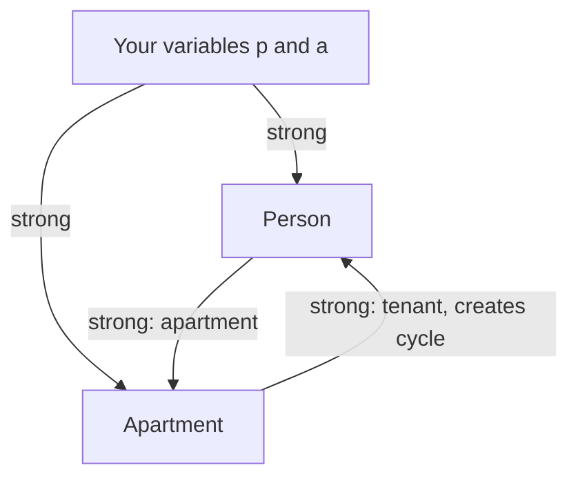
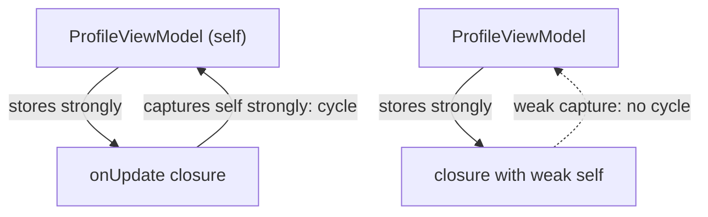
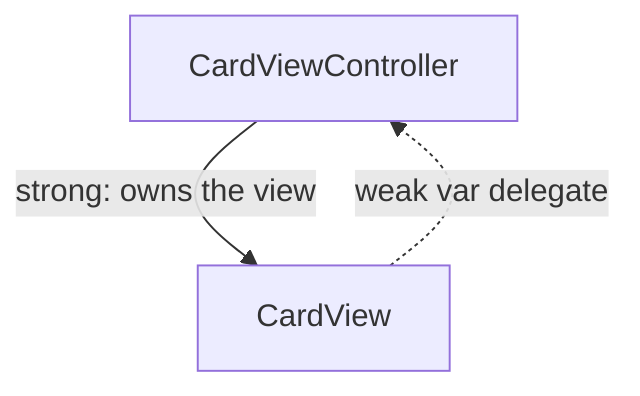
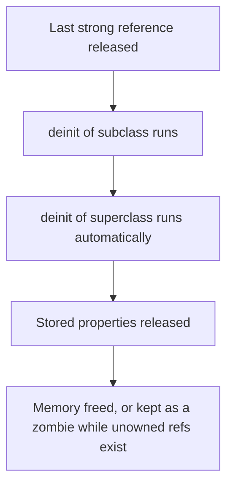
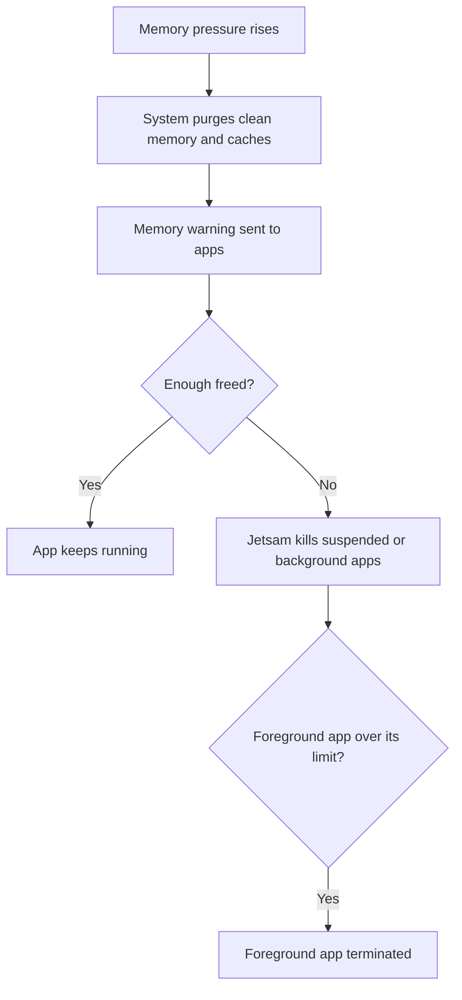
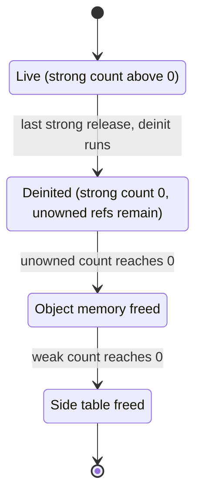

# Memory Management – ARC

[⬅ Back to index](../README.md)

Covers: ARC, strong/weak/unowned, retain cycles in classes, closures and delegates, debugging leaks, autorelease pools, value types.

---

### 1. What is ARC? How does it work?

<details>
<summary>Answer</summary>

**In short:** ARC (Automatic Reference Counting) manages the memory of **class instances**. The compiler inserts `retain`/`release` calls at compile time, each instance tracks how many strong references point to it, and when that count hits zero the instance is deallocated immediately and its `deinit` runs.

#### Why it exists

Before ARC (pre-2011 Objective-C), developers wrote `retain`, `release` and `autorelease` by hand (Manual Retain-Release, MRR). Forgetting a `release` leaked memory; one `release` too many crashed with a dangling pointer. ARC moves that bookkeeping into the compiler, so you get the same deterministic model without writing the calls yourself.

#### How it works

1. When you create an instance (`let vm = ViewModel()`), the runtime allocates heap memory with a strong count of 1.
2. Every new **strong** reference (assigning to a variable, property, array element, or capturing in a closure) increments the count.
3. When a reference goes away (variable goes out of scope, is reassigned or set to `nil`, or its owner is deallocated), the count is decremented.
4. When the count reaches **zero**, `deinit` runs, the instance's own stored properties are released (which can cascade), and the memory is freed.

```swift
class Photo {
    let name: String
    init(name: String) { self.name = name }
    deinit { print("\(name) freed") }
}

var a: Photo? = Photo(name: "beach")  // count = 1
var b = a                             // count = 2
a = nil                               // count = 1
b = nil                               // count = 0 -> "beach freed"
```

The Swift optimizer removes many redundant retain/release pairs, so the real number of operations is often lower than the source suggests. That is also why you should not rely on an object living "until the end of the scope": Swift can release it after its last use.

#### What ARC does not do

- It is **deterministic** (no GC pauses), but it **can't break reference cycles** by itself. Two objects that strongly reference each other keep each other alive forever. You break cycles with `weak` or `unowned`.
- **Value types** (structs, enums, tuples) are not reference counted. But any class references they hold are, so copying a struct that contains a class reference retains that reference.

**Pitfalls**
- Assuming a local object lives until the closing brace; use `withExtendedLifetime` if you really need that.
- Thinking ARC means "no leaks": cycles still leak.

**Likely follow-ups**
- *Is ARC compile-time or runtime?* Both: the compiler inserts the calls, the runtime performs the atomic count updates.
- *Does ARC apply to structs?* No, only to class instances (and closures, which are reference types).

</details>

### 2. ARC vs Garbage Collection?

<details>
<summary>Answer</summary>

**In short:** ARC frees an object the instant its last strong reference goes away, using counts the compiler maintains. A tracing garbage collector (like the JVM's on Android) periodically finds unreachable objects and frees them in batches. ARC is predictable with no collector pauses, but it can't reclaim reference cycles; a GC handles cycles but frees memory at times you don't control.

| | ARC (iOS) | Tracing GC (Android/JVM) |
|---|---|---|
| Mechanism | Compile-time inserted retain/release | Runtime collector traces reachability from roots |
| When memory is freed | Deterministic, immediately at count 0 | Non-deterministic, when the collector runs |
| Pauses | No collector pauses | GC pauses (short with modern concurrent collectors) |
| Reference cycles | **Leak** unless you use `weak`/`unowned` | Collected (unreachable cycles are found) |
| Cost model | Small cost on every reference change (atomic increments/decrements) | Cost concentrated in collection cycles, plus extra heap headroom |
| Memory headroom | Low: garbage doesn't pile up | Needs spare heap so collection isn't constant |
| Cleanup hooks | `deinit` runs at a known time | Finalizers are unreliable; use explicit close |

#### Why Apple chose ARC

Apple actually shipped a garbage collector for Objective-C on macOS and deprecated it. On phones, predictable latency (smooth 60/120 fps scrolling) and low memory overhead matter more than convenience. ARC gives both, and `deinit` can reliably release resources like file handles or observers.

#### The trade-off in one example

```swift
class Node {
    var next: Node?
}
let a = Node(), b = Node()
a.next = b
b.next = a   // ARC: both leak when a and b go out of scope.
             // A tracing GC would see neither is reachable and free both.
```

**Likely follow-ups**
- *Is ARC "free"?* No. Atomic ref-count updates cost CPU, especially across threads; the optimizer removes many of them.
- *Can ARC cause a pause?* Releasing a huge object graph at once (e.g. a giant array of objects) does run all deallocations synchronously at that moment.

</details>

### 3. strong vs weak vs unowned?

<details>
<summary>Answer</summary>

**In short:** `strong` (the default) keeps an object alive. `weak` doesn't keep it alive, is always an optional `var`, and becomes `nil` automatically when the object deallocates. `unowned` doesn't keep it alive either, is non-optional, and assumes the object outlives the reference; accessing it after deallocation crashes.

| | strong | weak | unowned |
|---|---|---|---|
| Increments strong count | Yes | No | No |
| Type | Any | Optional, must be `var` | Non-optional (optional allowed since Swift 5) |
| After object deallocates | N/A (keeps it alive) | Reads `nil` | Access **traps** (crash) |
| Typical use | Ownership | Delegates, parent back-references, `[weak self]` | Child that can't exist without its owner |

#### strong

The default for every property and variable. "I own this; keep it alive while I hold it."

#### weak

Use when the other object may be deallocated first and that is a normal situation. Because the runtime zeroes it out, you must handle `nil`:

```swift
class Apartment {
    weak var tenant: Person?   // tenant may move out (deallocate) any time
}
```

#### unowned

Use when the lifetimes are tied: the referenced object is guaranteed to live at least as long as the reference. The classic example is a `CreditCard` that can't exist without a `Customer`:

```swift
class Customer {
    var card: CreditCard?
}
class CreditCard {
    unowned let customer: Customer   // a card never outlives its customer
    init(customer: Customer) { self.customer = customer }
}
```

`unowned` reads like a normal non-optional, which is nicer than unwrapping, and avoids side-table allocation (see question 16). But if your lifetime assumption is wrong, the app crashes deterministically with "attempted to read an unowned reference but object was already deallocated".

`unowned(unsafe)` skips even that check; using it after deallocation is undefined behaviour (like a dangling C pointer). Only use it for measured performance-critical code.

**Pitfalls**
- Declaring a `weak let`: not allowed, since ARC must be able to set it to `nil`.
- Choosing `unowned` "for convenience" in async code where self can disappear.

**Likely follow-ups**
- *Can a weak reference point to a struct?* No, only to class instances (class-bound types).
- *Which is safer?* `weak`; it fails gracefully as `nil` instead of crashing.

</details>

### 4. What is a retain cycle? Give an example and fix it.

<details>
<summary>Answer</summary>

**In short:** A retain cycle is two or more objects holding **strong references to each other** (directly or through a chain). Their reference counts never reach zero, so even when nothing else points to them they are never deallocated: a leak. You fix it by making one link in the cycle `weak` or `unowned`, usually the "back" reference from child to owner.

#### Why it happens

ARC only frees an object when its count reaches zero. In a cycle, each object's count includes the reference from the other, so after you drop your own references both counts stay at 1.



When `p` and `a` are set to `nil`, the arrows from "Your variables" disappear, but `Person` and `Apartment` still hold each other.

#### The leak

```swift
class Person {
    var apartment: Apartment?
    deinit { print("Person freed") }
}
class Apartment {
    var tenant: Person?            // strong both ways: cycle
    deinit { print("Apt freed") }
}

var p: Person? = Person()
var a: Apartment? = Apartment()
p?.apartment = a
a?.tenant = p
p = nil
a = nil   // neither deinit is printed: both leaked
```

#### The fix

Decide who owns whom. A person owns (rents) an apartment; the apartment just refers back to its tenant. Make the back reference weak:

```swift
class Apartment {
    weak var tenant: Person?       // does not keep Person alive
    deinit { print("Apt freed") }
}
// Now: p = nil  -> "Person freed" (count 0), which releases the apartment's
//      strong ref from Person; a = nil -> "Apt freed".
```

Rule of thumb: ownership flows one way (parent to child, owner to owned). Back-pointers (child to parent, delegate, observer) are weak.

**Pitfalls**
- Cycles through more than two objects (A to B to C to A) are harder to spot; use the Memory Graph Debugger.
- Closures are objects too and are a very common hidden link in a cycle (next question).

**Likely follow-ups**
- *How would you confirm the fix?* Add `deinit` logs or check the Memory Graph for lingering instances.
- *Why not make both sides weak?* Then nothing owns either object, and they'd be freed immediately.

</details>

### 5. How do closures cause retain cycles? How do you fix them?

<details>
<summary>Answer</summary>

**In short:** Closures are reference types that **capture strongly** whatever they use, including `self`. If `self` stores the closure (directly, or via something it owns), you get self → closure → self. Fix it with a capture list, usually `[weak self]`, so the closure doesn't own `self`.

#### Why it happens

When a closure mentions `self.name`, Swift keeps `self` alive for as long as the closure exists, because the closure might run later. That's correct and safe, until `self` also keeps the closure alive.



```swift
class ProfileViewModel {
    var onUpdate: (() -> Void)?
    var name = ""

    func bindLeaky() {
        onUpdate = { print(self.name) }        // cycle: self -> onUpdate -> self
    }

    func bind() {
        onUpdate = { [weak self] in            // fixed
            guard let self else { return }     // Swift 5.7+ shorthand
            print(self.name)
        }
    }
}
```

The `guard let self` creates a temporary strong reference only for the duration of the closure's execution, so self can't disappear halfway through.

#### Indirect cycles

The closure doesn't have to be stored directly on self. These are all cycles too:
- self owns a `cancellables` set, and a Combine `sink` stored there captures self.
- self owns a child view, and the child's `onTap` closure captures self.
- self owns a `Timer` created with a block that captures self.

#### When you don't need `[weak self]`

- **Non-escaping** closures (`map`, `filter`, `forEach`, `UIView.performWithoutAnimation`) run and finish before the function returns; nothing stores them.
- Escaping closures that self doesn't store, like `UIView.animate(withDuration:animations:)` or `DispatchQueue.main.async { self.update() }`. They temporarily extend self's lifetime until they run, then release it. No cycle, though a long delay could keep a dismissed screen alive longer than you expect.

You can also capture just the values you need instead of self:

```swift
let id = userID
service.fetch { [id] result in print(id, result) }   // no self at all
```

**Pitfalls**
- Writing `[weak self]` on the outer closure but strongly capturing `self` in a nested escaping closure created before the guard; the capture list belongs on the closure that is stored.
- Using `[weak self]` everywhere by habit and then silently doing nothing when self is nil, hiding logic bugs.

**Likely follow-ups**
- *Does `guard let self` recreate the cycle?* No, the strong reference is local to that call and released when it returns.
- *Do Swift Concurrency `Task`s need `[weak self]`?* A `Task` isn't stored by self unless you keep the handle, so usually it just extends self's lifetime until it finishes; long-running loops are the exception (see question 8).

</details>

### 6. Why should delegates be `weak`?

<details>
<summary>Answer</summary>

**In short:** Because the delegate is almost always the object that **owns** the delegating object. A view controller owns its table view (or custom view), and the view points back to the controller as its delegate. If that back-pointer were strong, controller and view would form a retain cycle and the screen would never be freed. So delegate protocols are class-bound (`AnyObject`) and the property is `weak`.



```swift
protocol CardViewDelegate: AnyObject {   // AnyObject: only classes can conform,
    func cardViewDidTap(_ view: CardView) // so 'weak' is allowed
}

final class CardView: UIView {
    weak var delegate: CardViewDelegate?

    @objc private func handleTap() {
        delegate?.cardViewDidTap(self)    // optional chaining: no-op if gone
    }
}

final class CardViewController: UIViewController, CardViewDelegate {
    private let cardView = CardView()     // strong: VC owns the view
    override func viewDidLoad() {
        super.viewDidLoad()
        cardView.delegate = self          // weak back-reference
    }
    func cardViewDidTap(_ view: CardView) { /* ... */ }
}
```

#### Why `AnyObject` is required

`weak` only works with class instances, since structs aren't reference counted. Without the `AnyObject` constraint the compiler rejects `weak var delegate: CardViewDelegate?`, because a struct could conform.

UIKit follows the same rule: `UITableView.delegate`, `dataSource`, `UIScrollView.delegate` and most other delegates are weak.

**Pitfalls**
- Delegate disappearing unexpectedly: if nothing else holds the delegate (e.g. you create a helper object just to be the delegate and don't store it), it's freed immediately because the weak reference doesn't keep it alive.
- Exceptions exist: `URLSession` and `CAAnimation` retain their delegates strongly (see question 8).

**Likely follow-ups**
- *Why not `unowned`?* The delegating object can sometimes outlive its delegate (e.g. a view captured elsewhere); `weak` degrades safely to `nil`.
- *What's the modern alternative?* Closures or async sequences, but they need `[weak self]` for the same reason.

</details>

### 7. `[weak self]` vs `[unowned self]` – when to use which?

<details>
<summary>Answer</summary>

**In short:** `[weak self]` is the safe default: self becomes an optional that turns `nil` if the object was deallocated before the closure runs. Use `[unowned self]` only when you can guarantee the closure **can't outlive** self; it avoids the optional, but crashes if you're wrong. When in doubt, use weak.

| | `[weak self]` | `[unowned self]` |
|---|---|---|
| Type inside closure | `Self?` | `Self` |
| If self is gone | `nil`, you return early | Crash (trap) |
| Cost | Slightly higher (side table, optional check) | Slightly cheaper |
| Typical use | Network callbacks, timers, notifications, Combine sinks | Lazy properties or closures owned by and used only during self's lifetime |

#### weak: anything asynchronous or out of your control

```swift
func loadProfile() {
    api.fetchProfile { [weak self] result in
        guard let self else { return }   // screen dismissed: just stop
        self.render(result)
    }
}
```

The user can pop the screen before the network call returns. With weak, the callback quietly does nothing.

#### unowned: lifetime is provably tied

```swift
final class FormatterHolder {
    let prefix = "ID-"
    // The closure is stored on self and only called through self,
    // so it can never run after self is gone.
    lazy var format: (Int) -> String = { [unowned self] id in
        self.prefix + String(id)
    }
}
```

If someone copies `format` out and calls it after the holder is freed, this crashes. That fragility is why many teams ban `unowned` in closures entirely.

**Pitfalls**
- Using `unowned` in a completion handler "because the screen will still be there"; users and tests find the timing where it isn't.
- Strongly re-capturing: `[weak self]` followed by `let strongSelf = self!` crashes just like unowned.

**Likely follow-ups**
- *Is the performance difference meaningful?* Rarely; choose for correctness.
- *Can you capture other objects weakly?* Yes: `[weak delegate, weak cell]` works for any class reference.

</details>

### 8. What other common sources of leaks are there in iOS?

<details>
<summary>Answer</summary>

**In short:** Beyond obvious two-object cycles, leaks usually come from APIs that retain their target or callback strongly: `Timer` and `CADisplayLink` targets, block-based `NotificationCenter` observers, Combine `sink`s stored in self's cancellables, long-running `Task`s, `URLSession` delegates, strong parent/child or coordinator back-references, and singletons that hold onto view controllers.

#### Timers

`Timer.scheduledTimer(timeInterval:target:selector:...)` retains its target, and the run loop retains a repeating timer until it's invalidated. So the view controller can never deinit, and `deinit` (where you'd invalidate it) never runs.

```swift
// Leaks: timer -> self, run loop -> timer
timer = Timer.scheduledTimer(timeInterval: 1, target: self,
                             selector: #selector(tick), userInfo: nil, repeats: true)

// Better: block API with weak capture, and invalidate when done
timer = Timer.scheduledTimer(withTimeInterval: 1, repeats: true) { [weak self] _ in
    self?.tick()
}
deinit { timer?.invalidate() }
```

`CADisplayLink(target:selector:)` has the same problem; use a small weak-proxy object as the target or invalidate it in `viewWillDisappear`.

#### NotificationCenter block observers

`addObserver(forName:object:queue:using:)` returns a token; the center retains the block, and the block retains whatever it captures. Capture `[weak self]` and call `removeObserver(token)` when done. (Selector-based observers don't need manual removal since iOS 9.)

#### Combine

```swift
viewModel.$items
    .sink { [weak self] items in self?.reload(items) }   // self owns cancellables
    .store(in: &cancellables)
```

Without `[weak self]`, self → cancellables → subscription → closure → self. `assign(to: &$property)` (the inout `@Published` version) manages its own lifetime and doesn't create this cycle, unlike `assign(to:on: self)`, which retains self strongly.

#### Swift Concurrency Tasks

```swift
task = Task {
    for await event in stream { self.handle(event) }   // never ends: self lives forever
}
```

A `Task` retains what it captures until it completes. An infinite loop never completes. Cancel the task (in `deinit` won't work if the task is what keeps self alive, so cancel in `viewDidDisappear`/`onDisappear`), or use SwiftUI's `.task {}` modifier, which cancels automatically.

#### Others

- **Parent/child view controllers or coordinators** with strong back-references (`child.parent = self` must be weak).
- **URLSession** retains its delegate strongly until you call `invalidateAndCancel()` or `finishTasksAndInvalidate()`.
- **Singletons or static caches** holding view controllers, views or closures that capture them: anything reachable from a global lives forever.
- **Closures stored in cells** (`cell.onTap = { self.open() }`) where the VC owns the table, which owns the cell.

**Likely follow-ups**
- *How do you find which one it is?* Memory Graph Debugger: select the leaked object and follow the strong references back to the root.
- *Does `DispatchQueue.main.asyncAfter` leak?* No, it releases after running, but it delays deallocation.

</details>

### 9. How do you detect memory leaks?

<details>
<summary>Answer</summary>

**In short:** Use Xcode's **Memory Graph Debugger** to see live objects and what holds them, **Instruments** (Leaks and Allocations with generation marking) to find leaks and growth over time, `deinit` logging to confirm screens are freed, and unit tests that assert an object is deallocated.

#### 1. Memory Graph Debugger (fastest)

Run the app, perform the flow (e.g. push and pop a screen several times), then click the "Debug Memory Graph" button in the debug bar. The left panel lists every live instance by type. If you see five `ProfileViewController`s after popping five times, they leaked. Select one to see a graph of who references it; follow the strong edges back to the cycle. True cycles with no external references get a purple "!" marker. Enable **Malloc Stack Logging** in the scheme's Diagnostics to see where each object was allocated.

#### 2. Instruments

- **Leaks**: periodically scans for memory unreachable from any root (true leaks) and shows the cycle.
- **Allocations** with **Mark Generation**: mark a generation, perform the flow, return to the start state, mark again. Anything that persists in the new generation is growth you didn't expect. This finds abandoned memory too (question 13), which Leaks can't.

#### 3. deinit logging

```swift
deinit { print("\(Self.self) deinit") }
```

Cheap and effective during development: if dismissing a screen doesn't print, something holds it.

#### 4. Automated tests

```swift
func makeSUT(file: StaticString = #filePath, line: UInt = #line) -> ProfileViewModel {
    let sut = ProfileViewModel(service: MockService())
    addTeardownBlock { [weak sut] in
        XCTAssertNil(sut, "Potential memory leak", file: file, line: line)
    }
    return sut
}
```

The test fails if the view model is still alive after the test body finishes, catching cycles in CI before they ship.

#### 5. Runtime signals

Watch the Xcode memory gauge while repeating a flow: steadily climbing memory that never drops points to a leak or unbounded cache. Frequent memory warnings or jetsam terminations from users (in Xcode Organizer or MetricKit) are the production symptoms.

**Pitfalls**
- Checking too early: some objects are released a run-loop later (pending async work), so repeat the flow a few times before concluding.
- Debug-only objects (e.g. the debugger itself) can appear in the graph; focus on your own types.

</details>

### 10. What is an autorelease pool? When do you need `autoreleasepool {}`?

<details>
<summary>Answer</summary>

**In short:** An autorelease pool is an Objective-C mechanism that delays a `release` until the pool **drains**. The main run loop drains its pool once per iteration, so temporary objects returned "autoreleased" from Cocoa APIs pile up within one iteration. In a tight loop that creates many such objects (images, `Data`, strings bridged from Foundation), wrap the body in `autoreleasepool { }` so they're freed each iteration instead of all at the end.

#### Why autorelease exists

In manual memory management, a method that creates and returns an object has a problem: it can't release it (the caller needs it), and the caller didn't create it, so by convention shouldn't release it either. `autorelease` solves this: "release this later, when the current pool drains". ARC still interoperates with this convention for Objective-C APIs.

#### When memory spikes

```swift
// Every iteration may create autoreleased ObjC objects (UIImage, NSData, ...).
// Without a pool they are all freed only when the outer pool drains,
// so peak memory = all 5,000 images.
for url in imageURLs {
    autoreleasepool {
        if let image = UIImage(contentsOfFile: url.path),
           let data = image.jpegData(compressionQuality: 0.7) {
            save(data)
        }
    }   // temporaries from this iteration are released here
}
```

With the pool, peak memory is roughly one iteration's worth.

#### Where pools exist automatically

- The main thread's run loop.
- GCD worker threads (each dispatched block runs inside a pool managed by the queue).
- `Thread`s you create yourself do **not** get one automatically for long-running work; wrap the body in `autoreleasepool`.

#### Relevance today

Pure Swift objects aren't autoreleased; ARC releases them directly. You need `autoreleasepool` mainly when looping over Foundation/UIKit/Core Graphics APIs that may return autoreleased objects. If the Allocations instrument shows a sawtooth with a huge peak during a batch job, this is the fix.

**Likely follow-ups**
- *Does `autoreleasepool` speed anything up?* No, it lowers peak memory; draining has a small cost, so wrap per iteration or per batch, not per line.

</details>

### 11. Do structs suffer from retain cycles?

<details>
<summary>Answer</summary>

**In short:** A struct can't form a cycle **with itself**, because it's a value: it's copied, not referenced, and a struct can't even contain itself directly. But a struct can be part of a cycle when it **holds a class reference or a closure**, e.g. a class stores a struct whose closure captures that class strongly.

#### Why value types are mostly safe

Reference counting only applies to heap objects that are shared. A struct stored in a property lives inline in its owner; there's no count to keep alive. Two structs can't point at each other because each holds a copy, not a pointer.

#### How a struct joins a cycle

```swift
struct ButtonConfig {
    var title: String
    var action: () -> Void        // closure: a reference type
}

final class ScreenController {
    var config: ButtonConfig?

    func setup() {
        // self -> config (struct) -> action closure -> self
        config = ButtonConfig(title: "Save") { self.save() }      // cycle

        config = ButtonConfig(title: "Save") { [weak self] in     // fixed
            self?.save()
        }
    }
    func save() {}
}
```

The struct is just a container: what matters is the strong references inside it. The same applies to a struct holding a class instance that itself references the outer object.

#### SwiftUI note

In SwiftUI, views are structs, so `self` in a view's closures is a value copy and capturing it doesn't create a cycle. The objects that need care are your `ObservableObject`/`@Observable` view models and the closures *they* store.

**Likely follow-ups**
- *Can you use `[weak self]` in a struct?* No; `weak` requires a class instance.
- *Do structs with class members get reference counted?* The class members do: copying the struct retains each class reference it contains.

</details>

### 12. What happens in `deinit`? When is it not called?

<details>
<summary>Answer</summary>

**In short:** `deinit` runs automatically right before a class instance is deallocated, when its strong count hits zero. Use it to clean up things ARC doesn't manage: invalidate timers, remove observers, cancel tasks, close files or sockets. It's **not** called if the object is leaked (e.g. in a retain cycle) or when the app process is killed or terminated.

#### Order of events



You can't call `deinit` yourself, and you don't call `super.deinit`; Swift does it after your body runs. Properties are still valid inside `deinit`.

```swift
final class LiveScoreViewController: UIViewController {
    private var timer: Timer?
    private var task: Task<Void, Never>?
    private var observer: NSObjectProtocol?

    deinit {
        timer?.invalidate()
        task?.cancel()
        if let observer { NotificationCenter.default.removeObserver(observer) }
        print("LiveScoreViewController deinit")
    }
}
```

#### When it isn't called

- **Leaks**: retain cycle, or anything (timer, task, singleton) still holding a strong reference. That's the catch-22 of "invalidate the timer in deinit" when the timer retains self: deinit never comes. Break the strong reference first (weak capture), or stop the work in `viewDidDisappear`.
- **App termination**: when iOS kills a suspended app, or the user force-quits, the process just ends; no deinits run. Never rely on `deinit` to persist data; save at `sceneDidEnterBackground` or immediately.
- **Value types**: structs and enums don't have `deinit`, except noncopyable (`~Copyable`) types, which can declare one because they have unique ownership.

**Pitfalls**
- Starting new async work in `deinit` that captures self: self is being destroyed, so this is invalid.
- Assuming which thread runs `deinit`: it runs on whatever thread released the last reference, which may be a background thread.

**Likely follow-ups**
- *Does `deinit` run on the main thread?* Not necessarily; it's whichever thread dropped the last strong reference.

</details>

### 13. What is the difference between memory leak and abandoned memory?

<details>
<summary>Answer</summary>

**In short:** A **leak** is memory that nothing in your app can reach anymore but that is never freed, typically a retain cycle with no outside references. **Abandoned memory** is memory that's still reachable (something holds a reference), but the app will never use it again, like an ever-growing cache or array. The Leaks instrument finds the first; you need Allocations generation analysis for the second.

| | Leak | Abandoned memory |
|---|---|---|
| Still referenced from app roots? | No | Yes |
| Typical cause | Retain cycle | Unbounded cache, array, history, observers list |
| Leaks instrument shows it? | Yes | No |
| How to find | Leaks, Memory Graph purple "!" | Allocations + Mark Generation, Memory Graph instance counts |
| Fix | Break the cycle with weak/unowned | Bound or clear the storage (`NSCache`, limits, eviction) |

#### Examples

```swift
// Leak: unreachable cycle
var a: Node? = Node(); var b: Node? = Node()
a?.next = b; b?.next = a
a = nil; b = nil            // both unreachable, never freed

// Abandoned memory: reachable but useless
final class ImageStore {
    static let shared = ImageStore()
    private var cache: [URL: UIImage] = [:]   // grows forever, never evicted
    func store(_ img: UIImage, for url: URL) { cache[url] = img }
}
```

The singleton cache is reachable from a global, so it's not a "leak" technically, but memory climbs every time the user scrolls new images and eventually triggers jetsam.

#### Finding abandoned memory with generations

1. Open Instruments → Allocations.
2. Get to a stable state, click **Mark Generation**.
3. Do a flow that should return to the same state (open and close a screen).
4. Mark again; repeat several times.
5. Growth in each generation after the first is abandoned (or leaked) memory. Inspect the allocated types and their stack traces.

In practice abandoned memory causes more real-world memory problems than true leaks, because tools don't flag it automatically.

</details>

### 14. How does the system handle low memory on iOS?

<details>
<summary>Answer</summary>

**In short:** iOS has **no swap** for app memory (dirty memory can't be paged to disk), so under pressure it first sends **memory warnings** so apps can free caches, and if that isn't enough, the kernel's **Jetsam** mechanism kills processes: background apps first, and the foreground app too if it exceeds its memory limit. A jetsam kill isn't a crash, so it doesn't produce a normal crash log.

#### Clean vs dirty memory

- **Clean** memory (mapped code, read-only resources, files mapped from disk) can be discarded and re-read from disk.
- **Dirty** memory (heap objects, decoded images, anything you wrote) must stay in RAM. Compressed memory helps (iOS compresses unused dirty pages), but it's still counted against you.

Your app's footprint is mostly dirty plus compressed memory, and that's what jetsam limits.

#### The escalation



#### Responding to warnings

```swift
// UIViewController
override func didReceiveMemoryWarning() {
    super.didReceiveMemoryWarning()
    imageCache.removeAll()
}

// Anywhere
NotificationCenter.default.addObserver(
    forName: UIApplication.didReceiveMemoryWarningNotification,
    object: nil, queue: .main) { [weak self] _ in
        self?.imageCache.removeAll()
}
```

Also available: `applicationDidReceiveMemoryWarning(_:)` on the app delegate. `NSCache` evicts on its own under pressure, which is one reason to prefer it (question 15).

#### Practical tips

- Use `os_proc_available_memory()` to check how much headroom remains before a big allocation (e.g. loading a large image or ML model).
- Downsample images to display size (ImageIO thumbnails) instead of decoding full-resolution bitmaps; a 12 MP photo decodes to ~48 MB.
- Keep background memory low: a lean suspended app is less likely to be jetsammed, so users return to it intact.
- Jetsam events show up in Xcode Organizer / MetricKit as terminations, and on device in Settings → Privacy → Analytics as `JetsamEvent` reports.

**Likely follow-ups**
- *What happens when your app is killed in the background?* It relaunches cold next time; use state restoration to bring the user back.

</details>

### 15. NSCache vs Dictionary for caching?

<details>
<summary>Answer</summary>

**In short:** `NSCache` is built for caches: it's **thread-safe**, **evicts automatically** under memory pressure, supports `countLimit` and `totalCostLimit`, and doesn't copy its keys. A plain `Dictionary` is none of these: it grows until you clear it, and isn't safe to mutate from multiple threads. Use `NSCache` for in-memory image and data caches.

| | `NSCache` | `Dictionary` |
|---|---|---|
| Thread-safe | Yes | No (needs a lock or actor) |
| Evicts under memory pressure | Yes, automatically | Never |
| Size limits | `countLimit`, `totalCostLimit` (hints, not strict) | None |
| Keys | Not copied (unlike `NSMutableDictionary`) | Value-semantic copies |
| Key/value types | Must be classes (`AnyObject`) | Any `Hashable` key, any value |
| Enumeration | Not supported | Yes |
| Guarantees an entry stays | No, it may vanish any time | Yes |

```swift
final class ImageCache {
    private let cache = NSCache<NSURL, UIImage>()

    init() {
        cache.countLimit = 200
        cache.totalCostLimit = 50 * 1024 * 1024      // ~50 MB
    }

    func image(for url: URL) -> UIImage? {
        cache.object(forKey: url as NSURL)
    }

    func insert(_ image: UIImage, for url: URL) {
        let cost = image.cgImage.map { $0.bytesPerRow * $0.height } ?? 1
        cache.setObject(image, forKey: url as NSURL, cost: cost)
    }
}
```

Because keys and values must be classes, Swift `String`/`URL` keys are bridged to `NSString`/`NSURL`, and struct values are wrapped in a small class box.

#### When a Dictionary is still right

When you need guaranteed presence (it's a store, not a cache), enumeration, or value types without boxing. Protect it with an actor or lock if touched from several threads, and add your own eviction policy if it can grow.

**Pitfalls**
- Treating `NSCache` as storage: always handle a miss by recomputing or refetching.
- The limits are not strict LRU: eviction order isn't documented, so don't rely on a specific policy.

**Likely follow-ups**
- *Where do you put a disk cache?* `Caches` directory (purgeable by the system) or `URLCache` for HTTP responses.

</details>

### 16. How do weak references work internally in Swift (side tables)?

<details>
<summary>Answer</summary>

**In short:** Each Swift object stores its strong and unowned counts inline in its header. When the **first weak reference** is created, the runtime allocates a separate **side table** that holds the strong, unowned and weak counts, and the object header is switched to point at it. Weak references point to the side table, not the object, so after the object dies they can safely read `nil` without touching freed memory.

#### Why a side table

The older Swift design (before Swift 4) had weak references point directly at the object, which then had to stay allocated as a "zombie" until every weak reference was read and cleared. Large objects could linger in memory long after deinit. The side table decouples the two: the big object can be freed while only a small side table survives for the weak references.

#### Object lifecycle



1. **Live**: normal use. Strong count above zero.
2. **Deinited**: strong count hits zero, `deinit` runs. Weak references now load as `nil` (the side table records that the object is gone). If **unowned** references remain, the object's memory stays allocated so that accessing an unowned reference can reliably detect the dead object and trap, instead of reading garbage.
3. **Freed**: when the unowned count reaches zero, the object's memory is released.
4. **Side table freed**: when the weak count reaches zero, the side table itself goes away.

(Simplified: the real runtime has a few more internal states, but this is the level interviews expect.)

#### Consequences

- A weak read is a little slower than a strong read: it goes through the side table and must atomically check liveness and retain.
- `unowned` needs no side table, so it's slightly cheaper, but it pins the object's memory (not the object's life) until all unowned references are gone, and it crashes on use after deinit.
- Creating the first weak reference to an object costs one extra allocation.

**Likely follow-ups**
- *Why does a weak var have to be optional?* Because the runtime can make it `nil` at any time.
- *Is weak thread-safe?* Loading a weak reference is atomic: you either get `nil` or a strong reference that keeps the object alive while you use it.

</details>

---

[⬅ Previous: Swift Advanced](02-swift-advanced.md) · [⬅ Back to index](../README.md) · [Next: GCD & Operations ➡](04-gcd-operations.md)
