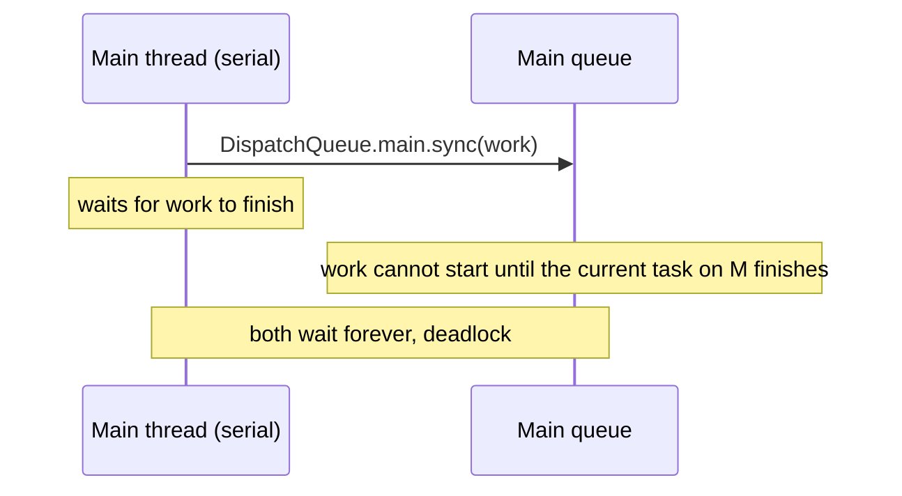
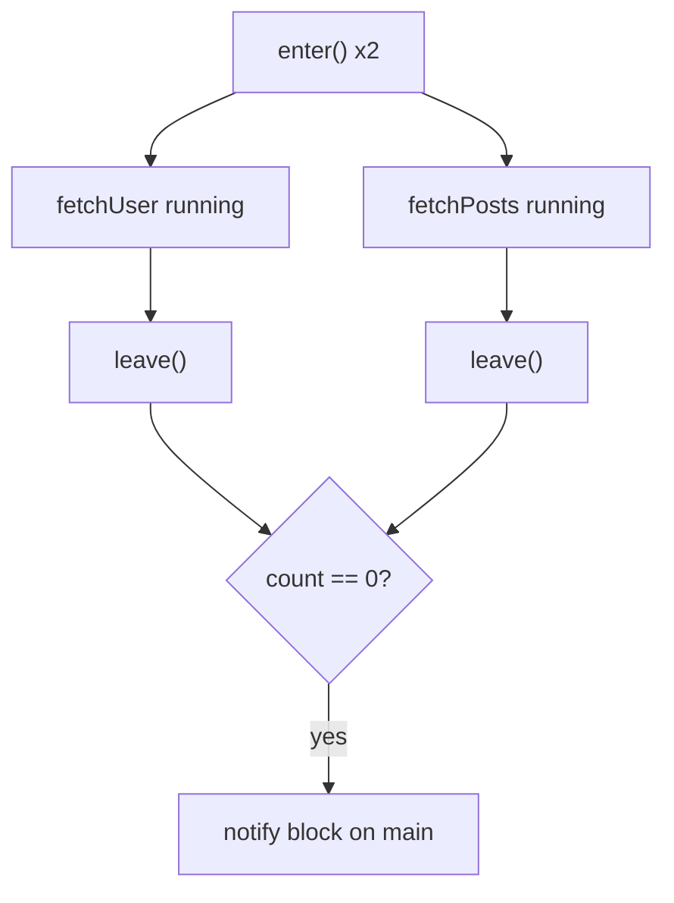
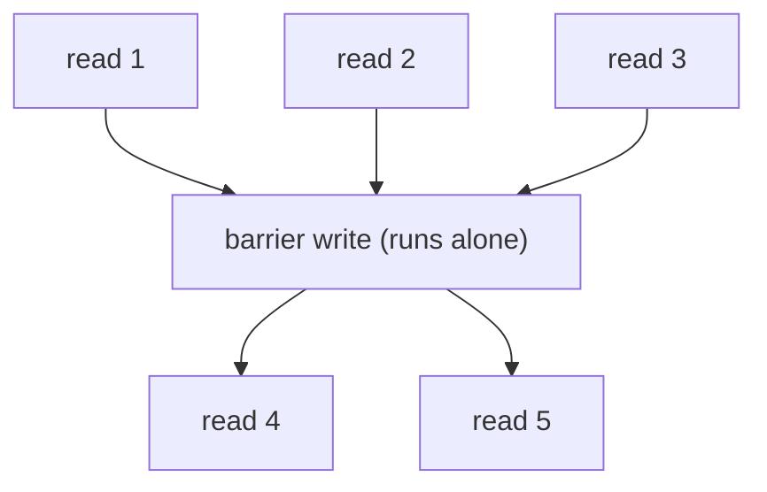
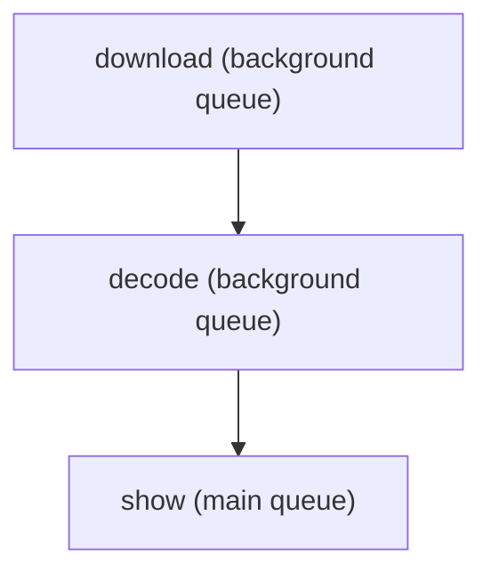
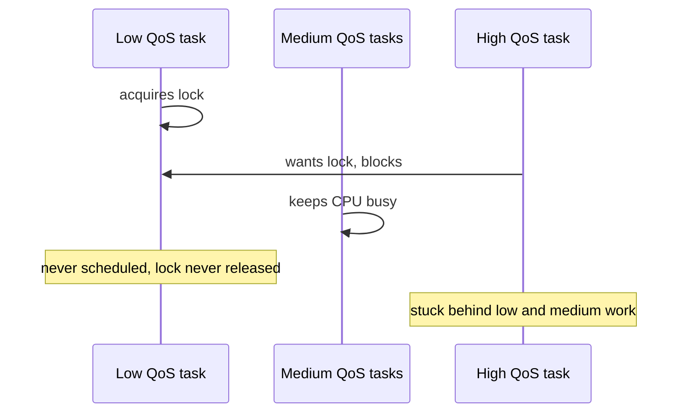
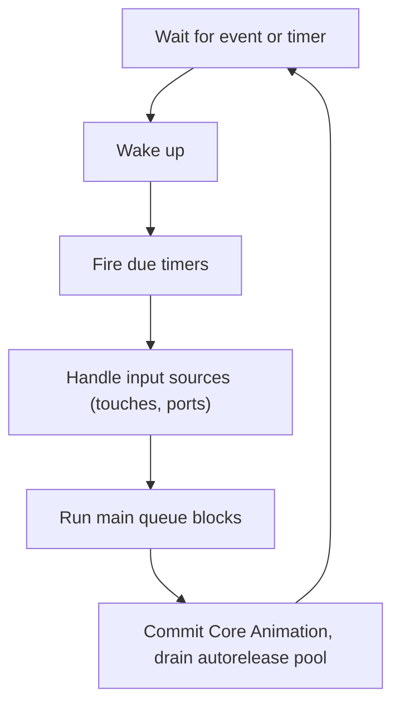

# Multithreading – GCD, Operations & Thread Safety

[⬅ Back to index](../README.md)

Covers: main thread, GCD queues & QoS, sync vs async, deadlocks, DispatchGroup, barriers, semaphores, OperationQueue, locks, race conditions, RunLoop.

---

### 1. Why must UI work happen on the main thread?

<details>
<summary>Answer</summary>

**In short:** UIKit and SwiftUI are not thread-safe, and the main thread owns the main run loop that delivers touches and commits rendering. Touching UI from a background thread can crash or corrupt state; blocking the main thread freezes the app and can get it killed by the watchdog.

#### Why the main thread is special

When your app launches, the system creates the main thread and starts the **main run loop** on it. Every turn of that loop:

1. Receives events (touches, gestures, keyboard, system callbacks like `viewDidLoad` or `scenePhase` changes).
2. Runs your handlers for those events.
3. At the end of the turn, commits any pending **Core Animation transaction**: layout, drawing and layer changes are sent to the render server, which actually draws pixels.

UIKit's view hierarchy, Auto Layout engine and SwiftUI's view graph are all built on the assumption that only this one thread mutates them. There are no internal locks. If a background thread changes a view's frame while the main thread is mid-layout, you get anything from a silent visual glitch to a crash inside UIKit.

```swift
// ❌ Wrong: UI update from a background callback
URLSession.shared.dataTask(with: url) { data, _, _ in
    self.label.text = "Loaded"           // runs on a background queue
}.resume()

// ✅ Right (GCD)
URLSession.shared.dataTask(with: url) { data, _, _ in
    DispatchQueue.main.async { self.label.text = "Loaded" }
}.resume()

// ✅ Right (Swift Concurrency)
@MainActor
func load() async throws {
    let (data, _) = try await URLSession.shared.data(from: url)  // suspends, doesn't block
    label.text = "Loaded \(data.count) bytes"                    // back on main actor
}
```

#### Two separate problems

| Problem | What happens | Tool to catch it |
|---|---|---|
| UI touched off the main thread | Crashes, corrupted layout, undefined behaviour | **Main Thread Checker** (on by default in debug), Swift 6 `@MainActor` checking |
| Main thread blocked (sync network, big JSON parse, `sleep`, `group.wait()`) | Frozen UI, dropped frames, "hangs"; the **watchdog** can terminate an app that is unresponsive too long, e.g. during launch | Instruments (Time Profiler, Hangs), Xcode Organizer hang reports |

Rule of thumb: do heavy work in the background, hop back to the main thread only for the final UI update.

**Common pitfalls**
- Assuming a completion handler runs on the main thread. Many APIs (URLSession, Core Data background contexts, many SDKs) call back on a background queue unless documented otherwise.
- Using `DispatchQueue.main.sync` to "get onto" the main thread from code that may already be on it (deadlock, see Q4).

**Likely follow-ups**
- *How does SwiftUI enforce this?* `View` bodies and `ObservableObject`/`@Observable` UI state are expected to be on the `@MainActor`; publishing changes from a background thread produces runtime warnings.
- *Can you create views off the main thread?* Creating `UIImage`s or doing image decoding off main is fine; creating or mutating `UIView`s is not.

</details>

### 2. What is GCD (Grand Central Dispatch)?

<details>
<summary>Answer</summary>

**In short:** GCD (libdispatch) is Apple's C-level concurrency library. Instead of creating threads, you submit **closures to dispatch queues**, and GCD runs them on a system-managed pool of threads, sized for the device.

#### The problem it solves

Managing threads by hand is hard: creating them is expensive, you have to decide how many to make for each device, and you must synchronize them yourself. GCD flips the model. You describe **units of work** and **which queue** they belong on; the system decides which thread runs them and when.

#### The kinds of queues

| Queue | How you get it | Serial / concurrent | Typical use |
|---|---|---|---|
| Main queue | `DispatchQueue.main` | Serial, always on the main thread | UI updates |
| Global queues | `DispatchQueue.global(qos:)` | Concurrent, shared by the whole process | One-off background work |
| Custom queues | `DispatchQueue(label:)` | Serial by default | Protecting a piece of state, ordering work |
| Custom concurrent | `DispatchQueue(label:, attributes: .concurrent)` | Concurrent | Reader-writer patterns with barriers |

```swift
// Classic "background work, then UI" hop
DispatchQueue.global(qos: .userInitiated).async {
    let image = process()                         // heavy work off main
    DispatchQueue.main.async {
        self.imageView.image = image              // UI back on main
    }
}

// A private serial queue to protect state
final class Counter {
    private var value = 0
    private let queue = DispatchQueue(label: "com.app.counter")
    func increment() { queue.async { self.value += 1 } }
    func current() -> Int { queue.sync { value } }
}
```

#### What else GCD offers

- `asyncAfter` for delayed work, `DispatchWorkItem` for cancellable work (Q9).
- `DispatchGroup` to wait for several tasks (Q6).
- Barriers for reader-writer access (Q7).
- `DispatchSemaphore` to limit concurrency (Q8).
- `DispatchQueue.concurrentPerform` for parallel loops.
- `DispatchSource` for timers, file descriptors and signals.

**Common pitfalls**
- Creating many custom queues "just because". Each queue that's busy can need its own thread; prefer a small number of well-named queues.
- Blocking inside a GCD block (sync I/O, semaphores). GCD then spins up extra threads to keep cores busy, which can lead to thread explosion (Q15).

**Likely follow-ups**
- *Is a queue a thread?* No. A queue is a list of work; GCD picks threads from a pool to drain it (Q15).
- *Should new code use GCD?* Usually prefer Swift Concurrency; GCD remains common in existing code (Q17).

</details>

### 3. Serial vs concurrent queues? Sync vs async?

<details>
<summary>Answer</summary>

**In short:** Serial vs concurrent describes the **queue**: does it run one task at a time or several at once? Sync vs async describes the **call site**: does the caller wait for the task to finish (`sync`) or return immediately (`async`)?

#### The queue axis

- **Serial queue**: runs **one task at a time**, in FIFO order. Task 2 never starts until task 1 finishes. That guarantee is what makes a serial queue a simple lock for shared state.
- **Concurrent queue**: tasks **start** in FIFO order but can **run at the same time** on different threads, so they may finish in any order.

#### The submission axis

- **`sync`**: the calling thread blocks until the closure has run. You can return a value from it.
- **`async`**: the closure is enqueued and the call returns straight away. The closure runs later.

```swift
let serial = DispatchQueue(label: "serial")

serial.async { print("A") }
serial.async { print("B") }
print("C")
// "C" can print before, between or after A/B, but A always prints before B.

let value = serial.sync { 42 }   // caller waits; returns 42
```

#### All four combinations

| | `sync` | `async` |
|---|---|---|
| **Serial queue** | Caller waits; task runs alone. Safe way to *read* protected state. Deadlocks if called from the same queue. | Caller continues; tasks run one by one in order. Typical for *writes* to protected state. |
| **Concurrent queue** | Caller waits; task may run alongside other tasks. | Caller continues; tasks run in parallel. Typical for background work. |

A useful mental model: the queue decides **how tasks relate to each other**; sync/async decides **how the caller relates to the task**.

**Common pitfalls**
- Thinking `async` means "on another thread". `DispatchQueue.main.async` from the main thread still runs on the main thread, just later.
- Thinking `sync` means "on the current thread". It's an optimization detail: GCD often does run a `sync` block on the caller's thread, but you must reason about it as running *on the queue*.
- `sync` onto the current serial queue = deadlock (Q4).

**Likely follow-ups**
- *Is the main queue serial or concurrent?* Serial.
- *Why use `sync` at all?* To read a value protected by a queue and return it to the caller.

</details>

### 4. What causes a deadlock with GCD?

<details>
<summary>Answer</summary>

**In short:** A deadlock happens when two pieces of work each wait for the other to finish, so neither can proceed. The classic GCD case is calling **`sync` on the serial queue you're already running on**: the current task waits for the new one, and the new one can't start until the current one finishes.

#### Walking through the classic case

1. You're on the main thread, running a task from the main queue.
2. You call `DispatchQueue.main.sync { work }`.
3. `sync` blocks the current task until `work` finishes.
4. `work` is queued behind the current task on a **serial** queue, so it can't start until the current task finishes.
5. Both wait forever.



```swift
DispatchQueue.main.sync { }   // ❌ called from main thread → deadlock (crash)

let q = DispatchQueue(label: "serial")
q.async { q.sync { } }        // ❌ deadlock: same serial queue

// Hidden version: the inner sync is in another function
func save() { q.sync { /* write */ } }
q.async { save() }            // ❌ still deadlocks
```

GCD detects the simplest case (sync onto the queue you're currently on) and crashes with an `EXC_BAD_INSTRUCTION`-style trap, which is actually helpful: you get a stack trace instead of a frozen app.

#### Other common deadlocks

| Cause | Example |
|---|---|
| Lock ordering | Thread 1 locks A then B; thread 2 locks B then A |
| Semaphore wait on the signalling thread | `sem.wait()` on main, while the callback that calls `sem.signal()` is dispatched to main |
| Queue A syncs to B while B syncs to A | `a.sync { b.sync { } }` running while `b.sync { a.sync { } }` |
| Non-recursive lock re-entered | `lock.lock()` inside a method called while already holding `lock` |

#### How to avoid them

- Prefer `async` over `sync`. Use `sync` only for short reads, and never from code that might already be on that queue.
- If you need "run on main, now if already there": check `Thread.isMainThread`, or better, mark the code `@MainActor`.
- Always acquire multiple locks in the same global order.
- Don't turn async APIs into sync ones with semaphores.

**Likely follow-ups**
- *Does `sync` on a concurrent queue from that same queue deadlock?* Not by itself, since another task may run concurrently, but it ties up a thread and can still deadlock with barriers.
- *How do you debug a deadlock?* Pause in the debugger and inspect all threads' stacks; look for threads waiting in `dispatch_sync`, `semaphore_wait` or `lock`.

</details>

### 5. What are QoS (Quality of Service) classes?

<details>
<summary>Answer</summary>

**In short:** QoS tells the system how important and time-sensitive work is. Higher QoS gets more CPU priority and runs on faster cores; lower QoS saves energy and can be delayed. Pick the class based on whether the user is waiting.

#### The classes, highest to lowest

| QoS | Meaning | Example |
|---|---|---|
| `.userInteractive` | Must finish almost instantly to keep the UI smooth | Animation math, event handling (main thread runs at this level) |
| `.userInitiated` | The user started it and is waiting for the result | Opening a document, loading a tapped item's details |
| `.default` | Used when no QoS is given | General work |
| `.utility` | Long-running, user may see a progress bar | Downloads, imports |
| `.background` | User isn't aware of it | Backups, prefetching, indexing, cleanup |
| `.unspecified` | No QoS information; the system infers it | Legacy threads |

```swift
DispatchQueue.global(qos: .utility).async { importLargeFile() }

let queue = DispatchQueue(label: "thumbnails", qos: .userInitiated)

let op = BlockOperation { prefetch() }
op.qualityOfService = .background

Task(priority: .background) { await cleanUp() }   // Swift Concurrency equivalent
```

#### What QoS actually affects

- CPU scheduling priority and, on devices with performance and efficiency cores, which cores run the work.
- Timer coalescing and I/O throttling: background work may be delayed or throttled, especially in Low Power Mode.

#### QoS propagation and priority inversion

GCD tries to keep QoS consistent:
- An `async` block **inherits** the submitter's QoS in many cases, unless the queue or work item specifies one.
- When higher-QoS work **waits** on lower-QoS work (for example `sync` onto a queue whose pending work is `.background`), the system can temporarily **raise** the lower work's priority. This avoids priority inversion (Q13).

**Common pitfalls**
- Marking everything `.userInteractive`. If everything is urgent, nothing is; it also wastes battery.
- Using `.background` for something the user is waiting on. It may take a surprisingly long time, especially in Low Power Mode.

**Likely follow-ups**
- *QoS vs Task priority?* `TaskPriority` (`.high`, `.medium`, `.low`, `.userInitiated`, `.utility`, `.background`) maps onto the same QoS system.

</details>

### 6. What is DispatchGroup?

<details>
<summary>Answer</summary>

**In short:** A `DispatchGroup` tracks a set of tasks and tells you when **all of them have finished**. You `enter()` before each task, `leave()` when it completes, and `notify(queue:)` runs a closure once the count returns to zero.

#### How it works

A group is essentially a counter:
- `enter()` increments it.
- `leave()` decrements it.
- When the counter reaches zero, every `notify` block is submitted to its queue, and any `wait()` returns.

```swift
let group = DispatchGroup()
var user: User?
var posts: [Post] = []

group.enter()
api.fetchUser { result in
    user = result
    group.leave()
}

group.enter()
api.fetchPosts { result in
    posts = result
    group.leave()
}

group.notify(queue: .main) {
    render(user, posts)       // runs once, after both callbacks
}
```

For work you submit to GCD directly, you can skip manual enter/leave:

```swift
DispatchQueue.global().async(group: group) { resizeImages() }
```

But that only covers *synchronous* work inside the block. If the block starts an async call and returns, the group considers it done. For async callbacks, use `enter`/`leave`.



#### `notify` vs `wait`

| | `notify(queue:)` | `wait()` / `wait(timeout:)` |
|---|---|---|
| Blocks the caller? | No | Yes |
| Safe on main thread? | Yes | No (hang; deadlock if the tasks need main) |
| Use for | Almost everything | Command-line tools, tests, already-background code |

#### Modern equivalent

```swift
async let user = api.fetchUser()
async let posts = api.fetchPosts()
render(try await user, try await posts)   // or withTaskGroup for a dynamic number
```

**Common pitfalls**
- Unbalanced calls: an extra `leave()` crashes; a missing `leave()` (e.g. an error path that returns early) means `notify` never fires. Use `defer { group.leave() }` inside callbacks.
- Writing to shared variables (`user`, `posts`) from callbacks on different threads is a data race unless the callbacks arrive on the same queue. Collect results on a serial queue or the main queue.

**Likely follow-ups**
- *Can you reuse a group?* Yes; `notify` fires each time the count goes back to zero.
- *How do you add a timeout?* `group.wait(timeout: .now() + 5)` on a background thread, which returns `.timedOut` if it expires.

</details>

### 7. What is a dispatch barrier? (Reader-writer problem)

<details>
<summary>Answer</summary>

**In short:** On a **custom concurrent queue**, a block submitted with the `.barrier` flag waits until every earlier task has finished, then runs **completely alone**, and only after it completes do later tasks start. This gives you **many concurrent readers, one exclusive writer**.

#### The reader-writer problem

Reads of shared data are safe to run in parallel as long as nobody is writing. Writes must be exclusive. A plain serial queue is correct but serializes reads too, which wastes parallelism if reads are frequent. A barrier lets reads overlap while still making writes exclusive.

```swift
final class ThreadSafeCache<K: Hashable, V> {
    private var storage = [K: V]()
    private let queue = DispatchQueue(label: "cache", attributes: .concurrent)

    // Reads: run concurrently with other reads, return a value
    func get(_ k: K) -> V? {
        queue.sync { storage[k] }
    }

    // Writes: barrier = exclusive; async so the caller doesn't wait
    func set(_ v: V, for k: K) {
        queue.async(flags: .barrier) { self.storage[k] = v }
    }
}
```

#### What happens on the queue



Reads 1–3 run in parallel. The barrier waits for all of them, runs by itself, then reads 4–5 can run in parallel again, seeing the new value.

#### Rules

| Queue type | Effect of `.barrier` |
|---|---|
| Custom concurrent queue | Works as described |
| Custom serial queue | No special effect (everything is already exclusive) |
| Global concurrent queue | **Ignored**: behaves like a normal `async`, so you get no protection |

#### Is it worth it?

For small, fast critical sections, a lock (`OSAllocatedUnfairLock`, `Mutex`) is often faster than a concurrent queue with barriers, because dispatching has overhead. In Swift Concurrency code an **actor** is usually the simplest solution, though actors serialize reads too.

**Common pitfalls**
- Using a barrier on `DispatchQueue.global()`. It silently does nothing.
- Using `sync(flags: .barrier)` for writes when `async` would do. It makes callers wait needlessly.
- Returning a reference to mutable internals from `get`, then mutating it outside the queue.

**Likely follow-ups**
- *Why `sync` for reads?* The caller needs the value now; reads are short so waiting is fine.
- *Can a read inside the barrier queue call `get`?* No: `sync` from within the same queue during a barrier deadlocks.

</details>

### 8. What is DispatchSemaphore?

<details>
<summary>Answer</summary>

**In short:** `DispatchSemaphore` is a counting semaphore. `wait()` decrements the count and blocks if it would go below zero; `signal()` increments it and wakes a waiter. Its good use is **capping concurrency** (e.g. at most 3 downloads at once). Avoid it for turning async code into sync code, especially on the main thread or inside Swift Concurrency.

#### How it works

```swift
let semaphore = DispatchSemaphore(value: 3)   // 3 "permits"
```

- `wait()`: if a permit is available, take it and continue; otherwise block until one is returned (or until a timeout).
- `signal()`: return a permit; if someone is waiting, wake them.

#### Good use: limit parallel work

```swift
let semaphore = DispatchSemaphore(value: 3)
let queue = DispatchQueue.global(qos: .utility)

for url in urls {
    queue.async {
        semaphore.wait()                     // at most 3 pass this point at once
        defer { semaphore.signal() }
        download(url)                        // synchronous work
    }
}
```

Note this still blocks GCD threads while waiting. For many items, `OperationQueue` with `maxConcurrentOperationCount = 3` or a Swift `TaskGroup` that adds tasks in batches is cleaner.

#### Bad use: making async synchronous

```swift
// ❌ Blocks the caller; deadlocks if the callback is delivered on the same thread/queue
func fetchSync() -> Data? {
    let sem = DispatchSemaphore(value: 0)
    var result: Data?
    api.fetch { data in result = data; sem.signal() }
    sem.wait()
    return result
}
```

If this runs on the main thread and `api.fetch` calls back on main, the callback can never run: deadlock. Even when it works, it freezes the UI.

#### Why semaphores and Swift Concurrency don't mix

Swift Concurrency uses a **cooperative thread pool** with roughly one thread per CPU core and assumes tasks never block; they suspend at `await` instead. A `semaphore.wait()` inside a `Task` permanently occupies one of those few threads. Do it in enough tasks and the pool runs out of threads, so the task that would `signal()` can never run.

**Common pitfalls**
- Semaphores have **no ownership** (any thread can signal), so the system can't do priority donation (Q13). Don't use them as a general lock.
- Deallocating a semaphore whose current value is lower than its initial value crashes in libdispatch ("semaphore object deallocated while in use").
- Forgetting `signal()` on an error path. Use `defer`.

**Likely follow-ups**
- *Semaphore with value 1 vs a lock?* Behaves like a lock but without ownership or priority inheritance (Q18).
- *Timeout?* `semaphore.wait(timeout: .now() + 2)` returns `.timedOut` if it can't acquire a permit in time.

</details>

### 9. What are `asyncAfter` and DispatchWorkItem?

<details>
<summary>Answer</summary>

**In short:** `asyncAfter(deadline:)` schedules work to run after a delay. A `DispatchWorkItem` wraps a closure in an object you can **cancel**, wait on, or get notified about. Together they're the classic GCD way to **debounce** (e.g. search-as-you-type).

#### `asyncAfter`

```swift
DispatchQueue.main.asyncAfter(deadline: .now() + 0.3) {
    self.hideToast()
}
```

- `deadline:` uses `DispatchTime`, which stops counting while the device sleeps. `wallDeadline:` uses wall-clock time.
- The delay is a minimum, not exact: the block runs once the delay has passed **and** the queue is free.
- A plain closure passed to `asyncAfter` **can't be cancelled**.

#### `DispatchWorkItem`

```swift
let item = DispatchWorkItem { print("work") }
DispatchQueue.global().async(execute: item)
item.notify(queue: .main) { print("done") }   // runs after item finishes
item.cancel()                                 // prevents it running if it hasn't started
```

`cancel()` is **cooperative**: if the item hasn't started, it will be skipped. If it's already running, it keeps running; long work can check `item.isCancelled` itself.

#### Debouncing a search field

```swift
var searchWork: DispatchWorkItem?

func textChanged(_ q: String) {
    searchWork?.cancel()                                   // drop the previous pending search
    let item = DispatchWorkItem { [weak self] in self?.search(q) }
    searchWork = item
    DispatchQueue.main.asyncAfter(deadline: .now() + 0.3, execute: item)
}
```

Each keystroke cancels the pending search and schedules a new one. Only when the user pauses for 300 ms does a search actually run.

| Need | Option |
|---|---|
| Fire once after a delay, never cancel | `asyncAfter` with a closure |
| Delay with the ability to cancel | `asyncAfter` + `DispatchWorkItem` |
| Repeating timer on a background queue | `DispatchSourceTimer` |
| Modern async code | `try await Task.sleep(for: .milliseconds(300))` inside a cancellable `Task` |

**Common pitfalls**
- Capturing `self` strongly in a delayed closure keeps a dismissed view controller alive until the delay ends. Use `[weak self]`.
- Referencing the work item inside its own closure creates a retain cycle.

**Likely follow-ups**
- *Combine version?* `.debounce(for: .milliseconds(300), scheduler: RunLoop.main)`.

</details>

### 10. What is OperationQueue? GCD vs OperationQueue?

<details>
<summary>Answer</summary>

**In short:** `OperationQueue` is a higher-level, object-oriented API built on top of GCD. You add `Operation` objects, which can have **dependencies**, can be **cancelled**, expose **observable state**, and the queue can **limit concurrency**. Use GCD for simple fire-and-forget closures; use OperationQueue for workflows with dependencies, cancellation or throttling.

#### What an Operation gives you

- **Dependencies**: `op2.addDependency(op1)`; op2 won't start until op1 finishes, even if they're on different queues.
- **Cancellation**: `cancel()` sets `isCancelled`; your operation checks it and stops early. `queue.cancelAllOperations()` cancels everything.
- **KVO-observable state**: `isReady`, `isExecuting`, `isFinished`, `isCancelled`.
- **Concurrency limit**: `maxConcurrentOperationCount` (1 = one at a time).
- **Priority and QoS** per operation.
- **Reusable subclasses**: wrap logic like "download image" in a class.

```swift
let queue = OperationQueue()
queue.maxConcurrentOperationCount = 3

let download = BlockOperation { data = fetch(url) }
let decode   = BlockOperation { image = decodeImage(data) }
let show     = BlockOperation { imageView.image = image }

decode.addDependency(download)
show.addDependency(decode)

queue.addOperations([download, decode], waitUntilFinished: false)
OperationQueue.main.addOperation(show)          // dependency works across queues
```



#### Async operations

A plain `Operation` is finished when `main()` returns. For async work (like a network request), you subclass and manage the state yourself: override `isAsynchronous`, `isExecuting` and `isFinished`, and send KVO notifications when they change, so the queue knows when the work really completed. This boilerplate is a common interview topic, and also a reason many teams moved to Swift Concurrency.

#### Comparison

| | GCD | OperationQueue |
|---|---|---|
| Unit of work | Closure | `Operation` object with state |
| Dependencies | Manual (groups, nested callbacks) | Built in, across queues |
| Cancellation | `DispatchWorkItem.cancel()` only before start | `cancel()` + `isCancelled` checks, `cancelAllOperations()` |
| Limit concurrency | Semaphore or serial queue | `maxConcurrentOperationCount` |
| Observability | None | KVO on state, `operationCount`, `progress` |
| Overhead | Very low | Slightly higher (objects, KVO) |
| Good for | Simple background hops, protecting state | Download/processing pipelines, batches you may cancel |

**Common pitfalls**
- Dependency cycles: operations never become ready, so they never run.
- `maxConcurrentOperationCount = 1` runs one at a time but doesn't strictly guarantee FIFO; readiness and priority affect order. Use dependencies if order matters.
- Calling `waitUntilAllOperationsAreFinished()` on the main thread blocks the UI.

**Likely follow-ups**
- *Does cancel stop a running operation?* Only if your code checks `isCancelled`.
- *Can you pause a queue?* Yes, `isSuspended = true` stops new operations starting; running ones continue.

</details>

### 11. What is a race condition? How do you prevent it?

<details>
<summary>Answer</summary>

**In short:** A race condition (data race) happens when multiple threads access the same **shared mutable state** at the same time and at least one of them writes, so the result depends on timing. Prevent it by making sure only one thread touches that state at a time (serial queue, lock, actor), or by not sharing mutable state at all (immutability, value types).

#### Why it happens

Even `count += 1` is three steps: read, add, write. Two threads can interleave them:

| Thread A | Thread B | `count` |
|---|---|---|
| read 0 | | 0 |
| | read 0 | 0 |
| write 1 | | 1 |
| | write 1 | 1 (should be 2) |

With Swift collections it's worse: `Array` and `Dictionary` reallocate storage when they grow, so concurrent writes can corrupt memory and crash, for example with "Collection was mutated while being enumerated" or a bad access inside the stdlib.

```swift
// ❌ Data race
var results: [Int] = []
DispatchQueue.concurrentPerform(iterations: 1000) { i in
    results.append(i)                  // concurrent appends: lost items or a crash
}

// ✅ Protected with a lock
let lock = NSLock()
DispatchQueue.concurrentPerform(iterations: 1000) { i in
    lock.withLock { results.append(i) }
}
```

#### Ways to prevent it

| Technique | How | When it fits |
|---|---|---|
| Serial queue | All access goes through `queue.sync`/`async` | GCD-based code |
| Concurrent queue + barrier | Concurrent reads, exclusive writes (Q7) | Read-heavy shared caches |
| Locks | `NSLock`, `OSAllocatedUnfairLock` (iOS 16), `Mutex` from the `Synchronization` framework (iOS 18) | Short, hot critical sections |
| Actors | Compiler-enforced isolation; access via `await` | Swift Concurrency code |
| `@MainActor` | Confine UI state to the main thread | View models, UI state |
| Immutability / value types | `let`, structs copied per thread | Data passed between threads |

#### Detecting races

- **Thread Sanitizer (TSan)**: enable it in the scheme's Diagnostics tab. It reports races at runtime with both stack traces. It slows the app down, so use it in debug and tests.
- **Swift 6 strict concurrency checking**: the compiler flags non-`Sendable` values crossing isolation boundaries, catching many races at compile time.

**Common pitfalls**
- Protecting writes but not reads. Reads need protection too.
- Check-then-act across two locked calls (`if cache.get(k) == nil { cache.set(...) }`): each call is safe, but the combination isn't atomic.
- Assuming `let` on a class reference makes the object immutable. Only the reference is constant.

**Likely follow-ups**
- *Race condition vs data race?* A data race is unsynchronized concurrent memory access; a race condition is any timing-dependent bug, which can occur even with locks (e.g. check-then-act, or actor reentrancy).

</details>

### 12. What types of locks exist?

<details>
<summary>Answer</summary>

**In short:** iOS offers several locks: `NSLock` (basic mutex), `NSRecursiveLock` (re-entrant), `os_unfair_lock` / `OSAllocatedUnfairLock` (fast, low-level), `Mutex` (Swift-native, iOS 18), plus `NSCondition`, `pthread_mutex`, semaphores and Objective-C `@synchronized`. Pick the simplest that fits, keep critical sections short, and always unlock.

#### The options

| Lock | Availability | Notes |
|---|---|---|
| `NSLock` | Foundation | Simple mutex; must be unlocked by the thread that locked it; has `withLock` |
| `NSRecursiveLock` | Foundation | Same thread can lock it multiple times (must unlock the same number of times) |
| `os_unfair_lock` | C API | Very fast, supports priority donation; awkward and easy to misuse from Swift |
| `OSAllocatedUnfairLock` | iOS 16+, `os` module | Safe Swift wrapper around `os_unfair_lock`; can own the state it protects |
| `Mutex` | iOS 18+, `Synchronization` module | Swift-native, `Sendable`, `withLock` closure API |
| `NSCondition` | Foundation | Lock + `wait()`/`signal()` for "wait until X is true" |
| `pthread_mutex_t` | POSIX | Low level; similar caveats to `os_unfair_lock` in Swift |
| `DispatchSemaphore` | GCD | A counter, not an owned lock (Q18) |
| `@synchronized(obj)` | Objective-C | Recursive, convenient, relatively slow |

```swift
// NSLock with defer
let lock = NSLock()
func add(_ x: Int) {
    lock.lock()
    defer { lock.unlock() }        // unlocks even on early return or throw
    items.append(x)
}

// OSAllocatedUnfairLock owning its state (iOS 16+)
let counter = OSAllocatedUnfairLock(initialState: 0)
counter.withLock { $0 += 1 }

// Mutex (iOS 18+)
import Synchronization
final class Store: Sendable {
    private let cache = Mutex<[String: Data]>([:])
    func put(_ d: Data, for k: String) { cache.withLock { $0[k] = d } }
}
```

#### Why not a raw `os_unfair_lock` in Swift?

The lock must stay at a stable memory address. A Swift `var` property of struct type can be moved or copied by the compiler, which breaks the lock. That's why `OSAllocatedUnfairLock` (which heap-allocates it) and `Mutex` exist.

#### Choosing

- New code on iOS 18+: `Mutex`. On iOS 16+: `OSAllocatedUnfairLock`. Older: `NSLock`.
- You need to call back into locked code from the same thread: redesign first; otherwise `NSRecursiveLock`.
- You're in async/await code: prefer an actor; never hold a lock across an `await`.

**Common pitfalls**
- Forgetting to unlock on an error path. Use `defer` or `withLock`.
- Doing slow work (I/O, network, calling unknown closures) while holding a lock.
- Locking twice on the same non-recursive lock: deadlock.

**Likely follow-ups**
- *Which is fastest?* Unfair locks generally beat `NSLock`, which beats `@synchronized` and queues, but for most apps the difference matters only in hot paths.

</details>

### 13. What is priority inversion?

<details>
<summary>Answer</summary>

**In short:** Priority inversion is when a **high-priority** task is stuck waiting for a resource held by a **low-priority** task, and the low-priority task can't run because **medium-priority** work is using the CPU. The high-priority task is effectively running at the lowest priority. The fix is **priority donation/inheritance**: temporarily boost the holder so it can finish and release the resource.

#### Step by step



1. A `.background` task takes a lock.
2. A `.userInteractive` task (maybe on the main thread) tries to take the same lock and blocks.
3. Plenty of `.utility` work keeps the CPU busy, so the background task barely runs.
4. The UI hangs although nothing "high priority" seems to be running.

#### How Apple platforms handle it

The system can only boost the holder if it **knows who the holder is**:

| Primitive | Knows the owner? | Priority donation |
|---|---|---|
| `os_unfair_lock`, `OSAllocatedUnfairLock`, `Mutex` | Yes | Yes |
| `pthread_mutex` | Yes | Yes |
| Serial `DispatchQueue` with `sync` | Yes (the queue) | Yes, the queue's work is boosted |
| Swift actors | Yes | The runtime can escalate the actor's work |
| `DispatchSemaphore`, `DispatchGroup.wait` | **No** (any thread may signal) | No |

That's a big reason Apple recommends against using semaphores as locks, and against blocking on the main thread waiting for background work: the waiting thread can't lend its priority to whoever will signal.

**Common pitfalls**
- Doing `sem.wait()` on the main thread while the work that signals runs at `.background`. Xcode can show a "thread performance checker" warning for this kind of pattern.
- Mixing QoS levels on the same shared resource without thinking about who waits on whom.

**Likely follow-ups**
- *Real-world example?* Mars Pathfinder (1997) is the famous case: a priority inversion caused repeated system resets until priority inheritance was enabled on a mutex.

</details>

### 14. What is a RunLoop?

<details>
<summary>Answer</summary>

**In short:** A RunLoop is an **event-processing loop** attached to a thread. It waits for input (touches, ports, timers), dispatches it to handlers, and **sleeps** when there's nothing to do, so an idle thread uses no CPU. The main thread's run loop runs automatically; background threads have to run theirs explicitly. RunLoop **modes** control which sources are active, which is why timers pause while scrolling unless added to `.common`.

#### What a run loop does each iteration



Every thread can have one `RunLoop` (`RunLoop.current`), created on demand. The main thread's loop is started by `UIApplicationMain`; it's what keeps your app alive and responsive. A background `Thread` exits as soon as its entry function returns unless you run its loop (`RunLoop.current.run()`), and a run loop with no sources or timers returns immediately.

#### Modes

A mode is a named set of sources and timers. The loop runs in one mode at a time and only services what's registered for that mode.

| Mode | When it's active |
|---|---|
| `.default` | Normal state |
| `.tracking` | While a scroll view is being dragged or decelerating |
| `.common` | Not a real mode, a set that includes default and tracking |

```swift
// ❌ Pauses while the user scrolls (scheduledTimer uses .default)
Timer.scheduledTimer(withTimeInterval: 1, repeats: true) { _ in self.tick() }

// ✅ Keeps firing during scrolling
let timer = Timer(timeInterval: 1, repeats: true) { _ in self.tick() }
RunLoop.main.add(timer, forMode: .common)
```

UIKit switches the main run loop into `.tracking` during scrolling so that only touch-related sources get serviced, keeping scrolling smooth.

#### Where you meet run loops

- `Timer`, `perform(_:with:afterDelay:)`, `CADisplayLink` all need a run loop.
- Combine's `RunLoop.main` scheduler (`receive(on: RunLoop.main)`) delivers in the default mode, so values can be delayed during scrolling; `DispatchQueue.main` doesn't have that delay.
- Autorelease pools on the main thread drain once per loop iteration.

**Common pitfalls**
- Scheduling a `Timer` from a GCD background queue: GCD threads don't run their run loops, so the timer never fires. Use `DispatchSourceTimer` or schedule on main.
- Forgetting to invalidate repeating timers: the run loop keeps a strong reference to the timer, and the timer to its target.

**Likely follow-ups**
- *RunLoop vs DispatchQueue.main?* Both run on the main thread; the main queue's blocks are drained by the main run loop, but they are separate mechanisms with different mode behaviour.

</details>

### 15. Thread vs Queue?

<details>
<summary>Answer</summary>

**In short:** A **thread** is an OS-level execution context with its own stack, scheduled by the kernel. A **queue** is a GCD abstraction: an ordered list of work items. GCD maps queues onto a shared pool of threads, so you think in tasks and queues and let the system manage threads. Only the main queue is tied to a specific thread.

#### The difference

| | Thread | Queue |
|---|---|---|
| What it is | Kernel-scheduled execution context | Data structure of pending work |
| Cost | Expensive to create (stack memory, kernel resources) | Cheap; many queues can share few threads |
| Who manages it | You (`Thread`, pthreads) | GCD |
| Ordering guarantee | Whatever you code | Serial: FIFO, one at a time; concurrent: FIFO start |
| Tied to a thread? | Is one | No, except the main queue |

```swift
// Thread: you create and own it
let t = Thread { doWork() }
t.start()

// Queue: you describe work; GCD picks a thread
let q = DispatchQueue(label: "work")
q.async { doWork() }     // may run on a different thread each time
q.async { doMore() }
```

A serial queue guarantees its tasks never overlap, but **not** that they all run on the same thread. That's why thread-local storage and `Thread.current` checks are unreliable with GCD.

#### Thread explosion

GCD keeps roughly as many active threads as there are CPU cores. If a task **blocks** (sync I/O, a semaphore, a lock held elsewhere), GCD notices a core is idle and spawns another thread to keep work flowing. If many tasks block at once, the process can end up with a large number of threads, each with its own stack, plus heavy context switching. In the worst case the pool hits its limit and work stalls, or the app deadlocks.

Common causes: dispatching hundreds of blocking tasks to a global queue; many custom concurrent queues; `sync` calls nested across queues.

Swift Concurrency avoids this by design: its pool is limited to the number of cores, and tasks **suspend** at `await` instead of blocking threads.

**Common pitfalls**
- Using `Thread.isMainThread` to infer the current queue. Only the main queue maps cleanly to a thread; use `dispatchPrecondition(condition: .onQueue(q))` to assert a queue.

**Likely follow-ups**
- *When would you still use a `Thread`?* For a long-lived thread with its own run loop (some legacy networking or audio code), very rarely in app code.

</details>

### 16. How do you make a singleton thread-safe in Swift?

<details>
<summary>Answer</summary>

**In short:** `static let shared = Manager()` with a `private init()`. Swift initializes global and static stored properties **lazily and exactly once, atomically** (it uses `swift_once`, which is `dispatch_once` on Apple platforms), so creation is thread-safe. But the **mutable state inside** the singleton still needs protection: a serial queue, a lock, or make it an actor.

#### Creation is safe

```swift
final class SessionManager {
    static let shared = SessionManager()   // lazy, once, thread-safe
    private init() {}                      // nobody else can create one
}
```

If two threads hit `SessionManager.shared` for the first time simultaneously, one runs the initializer and the other waits for it. You don't need the Objective-C `dispatch_once` pattern.

#### State inside is not

```swift
// ❌ Singleton is created safely, but this dictionary is raced
final class Cache {
    static let shared = Cache()
    private init() {}
    var items: [String: Data] = [:]
}

// ✅ Option 1: lock-protected state
final class Cache: @unchecked Sendable {
    static let shared = Cache()
    private init() {}
    private let lock = NSLock()
    private var items: [String: Data] = [:]

    func get(_ k: String) -> Data? { lock.withLock { items[k] } }
    func set(_ d: Data, _ k: String) { lock.withLock { items[k] = d } }
}

// ✅ Option 2: an actor
actor ImageCache {
    static let shared = ImageCache()
    private var items: [URL: UIImage] = [:]
    func image(for url: URL) -> UIImage? { items[url] }
    func insert(_ img: UIImage, for url: URL) { items[url] = img }
}
```

In Swift 6 mode, a `static let` of a non-`Sendable` type is an error ("not concurrency-safe"), which pushes you to make the type `Sendable`, an actor, or `@MainActor`.

**Common pitfalls**
- Using `static var shared`: it's still lazily initialized, but anyone can reassign it, and it's flagged as unsafe global mutable state in Swift 6.
- Expensive or blocking work in `init()`: the first caller (maybe the main thread) pays for it, and other callers wait.
- Singletons that call each other in their initializers can deadlock or recurse.

**Likely follow-ups**
- *Downsides of singletons?* Hidden global state, hard to test; inject them via protocols where possible.

</details>

### 17. GCD vs Swift Concurrency – which should you use today?

<details>
<summary>Answer</summary>

**In short:** For new code, prefer **Swift Concurrency** (async/await, `Task`, task groups, actors). It reads like sequential code, has built-in cancellation and structured lifetimes, gives compiler-checked data-race safety in Swift 6, and avoids thread explosion with a cooperative thread pool. GCD is still fine for legacy code, very low-level queue control, and C/Objective-C interop. See [Swift Concurrency](05-swift-concurrency.md).

#### Side by side

```swift
// GCD + callbacks
func loadProfile(completion: @escaping (Profile?) -> Void) {
    DispatchQueue.global().async {
        let user = fetchUserSync()
        let avatar = fetchAvatarSync(user)
        DispatchQueue.main.async { completion(Profile(user, avatar)) }
    }
}

// Swift Concurrency
@MainActor
func loadProfile() async throws -> Profile {
    let user = try await api.fetchUser()
    let avatar = try await api.fetchAvatar(for: user)
    return Profile(user, avatar)
}
```

| | GCD | Swift Concurrency |
|---|---|---|
| Style | Closures, nested callbacks | Linear `async`/`await` |
| Errors | Passed manually through callbacks | `throws` / `try` |
| Cancellation | Manual (`DispatchWorkItem`, flags) | Built in, propagates to child tasks |
| Waiting | Blocks threads (`sync`, semaphores) | Suspends without blocking |
| Threads | Can explode when work blocks | Cooperative pool, about one thread per core |
| Data-race safety | Your responsibility (TSan helps) | Actors, `Sendable`, compile-time checks in Swift 6 |
| Main thread | `DispatchQueue.main.async` | `@MainActor` |
| Fine control (target queues, sources) | Yes | Limited (custom executors exist) |

#### When GCD is still reasonable

- Existing code that works, where a rewrite brings risk without benefit.
- `DispatchSource` (file descriptors, signals), `concurrentPerform` for CPU-bound parallel loops.
- Synchronous APIs that need a lock or queue and can't become `async`.
- Bridging C or Objective-C libraries that expect queues.

#### Migration tips

- Wrap callback APIs with `withCheckedThrowingContinuation`.
- Replace `DispatchQueue.main.async` UI hops with `@MainActor`.
- Replace queue-protected classes with actors (watch out for reentrancy at `await`s).
- Don't block inside `Task`s (no semaphores, no `group.wait()`).

**Likely follow-ups**
- *Does `Task {}` run on a background thread?* Not necessarily: an unstructured `Task` inherits the current actor, so from `@MainActor` code it runs on main. Use `Task.detached` or a nonisolated async function for background work.

</details>

### 18. Semaphore vs mutex vs lock?

<details>
<summary>Answer</summary>

**In short:** A **mutex/lock** gives **mutual exclusion with ownership**: one thread holds it and that same thread must release it. A **semaphore** is a **counter** that lets up to N holders through, and **any thread** can signal it. Use a lock to protect state, a semaphore to limit concurrency or signal between threads, and an actor in Swift Concurrency code.

#### The primitives

- **Mutex / lock** (`NSLock`, `os_unfair_lock`, `OSAllocatedUnfairLock`, `Mutex`): one holder at a time. Ownership lets the system do **priority donation** (Q13) and catch misuse such as unlocking from the wrong thread.
- **Semaphore** (`DispatchSemaphore(value: n)`): up to **n** concurrent holders, **no ownership**. With `value: 1` it acts like a lock, but without priority donation and with easy mistakes (an extra `signal()` silently lets two threads in).
- **Recursive lock** (`NSRecursiveLock`): a mutex that the owning thread can acquire again without deadlocking.
- **Condition** (`NSCondition`): a lock plus wait/signal, for "sleep until some state becomes true" (producer/consumer).

| | Mutex / lock | Semaphore |
|---|---|---|
| Holders at once | 1 | N |
| Ownership | Yes, locker must unlock | No, anyone can signal |
| Priority donation | Yes (unfair lock, pthread mutex) | No |
| Main use | Protect a critical section | Limit concurrency, signal an event |
| Starting value | Unlocked | Any count (0 = "wait for signal") |

```swift
// Lock: protect state
let lock = NSLock()
lock.withLock { balance -= amount }

// Semaphore: max 2 concurrent uploads
let slots = DispatchSemaphore(value: 2)
uploadQueue.async {
    slots.wait()
    defer { slots.signal() }
    upload(file)
}

// Semaphore as a signal (use sparingly, never on main)
let ready = DispatchSemaphore(value: 0)
worker.async { prepare(); ready.signal() }
ready.wait()
```

#### Analogy

A mutex is a single bathroom key: whoever takes it must bring it back. A semaphore is a bouncer with a clicker allowing N people in; anyone can tell the bouncer someone left.

**Common pitfalls**
- Using a semaphore as a lock and hitting priority inversion.
- Holding a lock or waiting on a semaphore across an `await` in async code.

**Likely follow-ups**
- *Spinlock?* A lock that busy-waits; `OSSpinLock` is deprecated on iOS because of priority inversion, replaced by `os_unfair_lock`.

</details>

### 19. What are the different ways to achieve concurrency on iOS?

<details>
<summary>Answer</summary>

**In short:** From lowest to highest level: **pthreads**, **`Thread`**, **GCD**, **`OperationQueue`**, and **Swift Concurrency** (async/await, tasks, actors), plus event-driven tools like Combine and RunLoop timers. Today, Swift Concurrency is the recommended default; the others still appear in existing code and special cases.

#### The layers

1. **POSIX threads (pthreads)**: C API with full manual control over thread creation, attributes and mutexes. Rarely used directly in app code.
2. **`Thread` (NSThread)**: object wrapper over a thread. You manage its lifecycle, run loop and synchronization yourself.
3. **GCD**: submit closures to queues; the system manages a thread pool. Includes groups, barriers, semaphores, sources and `concurrentPerform`.
4. **`OperationQueue` / `Operation`**: object-oriented layer over GCD with dependencies, cancellation, KVO state and max concurrency.
5. **Swift Concurrency**: `async`/`await`, `Task`, `async let`, `TaskGroup`, actors, `@MainActor`, `AsyncSequence`. Structured, cancellable and compiler-checked. **The recommended approach today.**
6. **Combine / RunLoop-based async** (timers, delegates, notifications): for event streams and callbacks rather than raw parallelism.

| Level | Control | Safety help | Typical use today |
|---|---|---|---|
| pthreads | Maximum | None | C libraries |
| `Thread` | High | None | Long-lived thread with own run loop |
| GCD | Medium | TSan | Legacy code, simple hops, locks via queues |
| OperationQueue | Medium | KVO state | Cancellable pipelines with dependencies |
| Swift Concurrency | Lower (system decides) | Actors, `Sendable`, Swift 6 checks | All new async code |
| Combine | Stream-oriented | Schedulers | Reactive UI bindings, event streams |

#### Parallel loops

For CPU-bound work over a collection, `DispatchQueue.concurrentPerform` splits iterations across cores and returns when all are done:

```swift
var results = [Int](repeating: 0, count: inputs.count)
results.withUnsafeMutableBufferPointer { buffer in
    DispatchQueue.concurrentPerform(iterations: inputs.count) { i in
        buffer[i] = expensive(inputs[i])   // each index written by one iteration only
    }
}
```

The Swift Concurrency equivalent is a `withTaskGroup` adding one child task per chunk.

#### Protecting shared state

Whatever you use to run work concurrently, shared mutable state still needs protection: serial queues, locks (`NSLock`, `OSAllocatedUnfairLock`, `Mutex`), `@synchronized` in Objective-C, or actors.

**Likely follow-ups**
- *Which would you choose for a new feature?* Swift Concurrency, dropping to locks for small synchronous critical sections and GCD only where an API requires it.
- *Is concurrency the same as parallelism?* No: concurrency is structuring work to make progress independently; parallelism is actually running at the same time on multiple cores.

</details>

---

[⬅ Previous: Memory Management](03-memory-management.md) · [⬅ Back to index](../README.md) · [Next: Swift Concurrency ➡](05-swift-concurrency.md)
