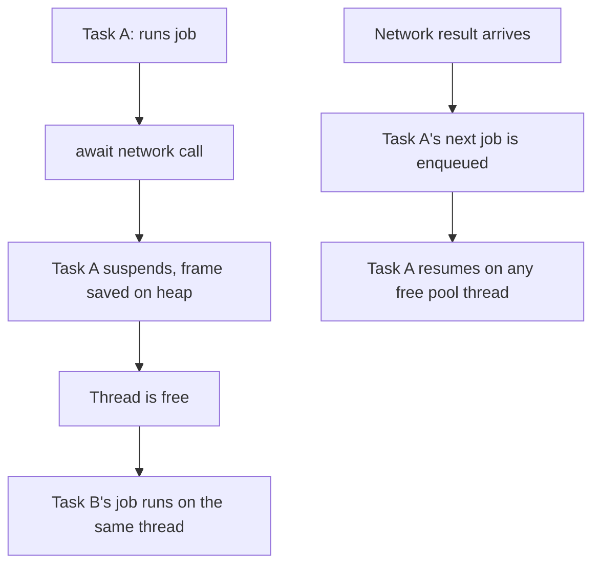
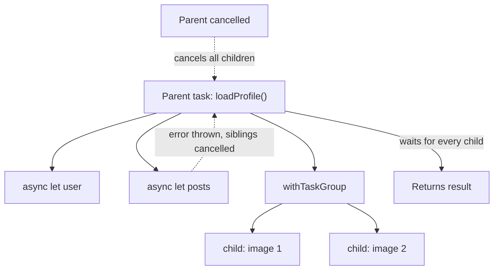
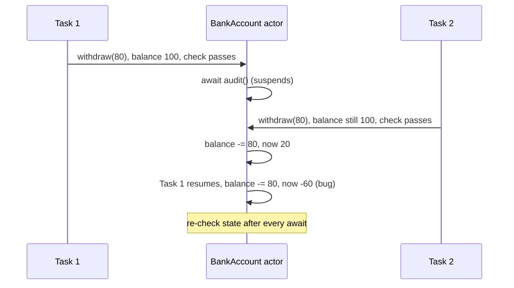
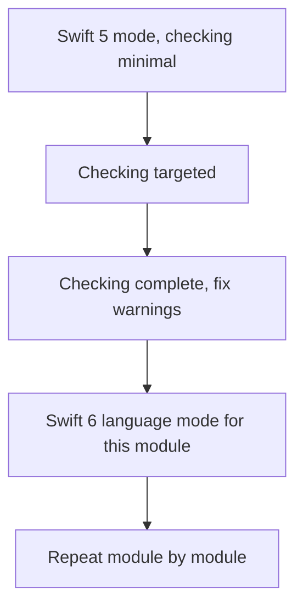
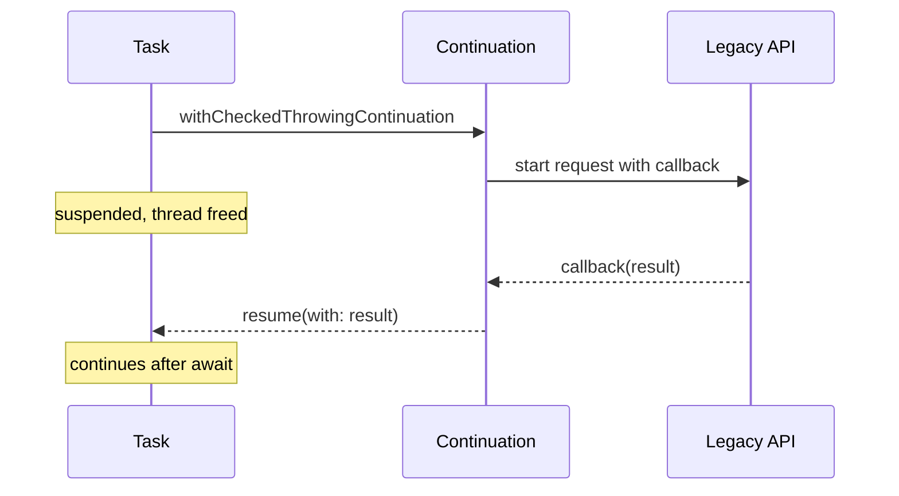
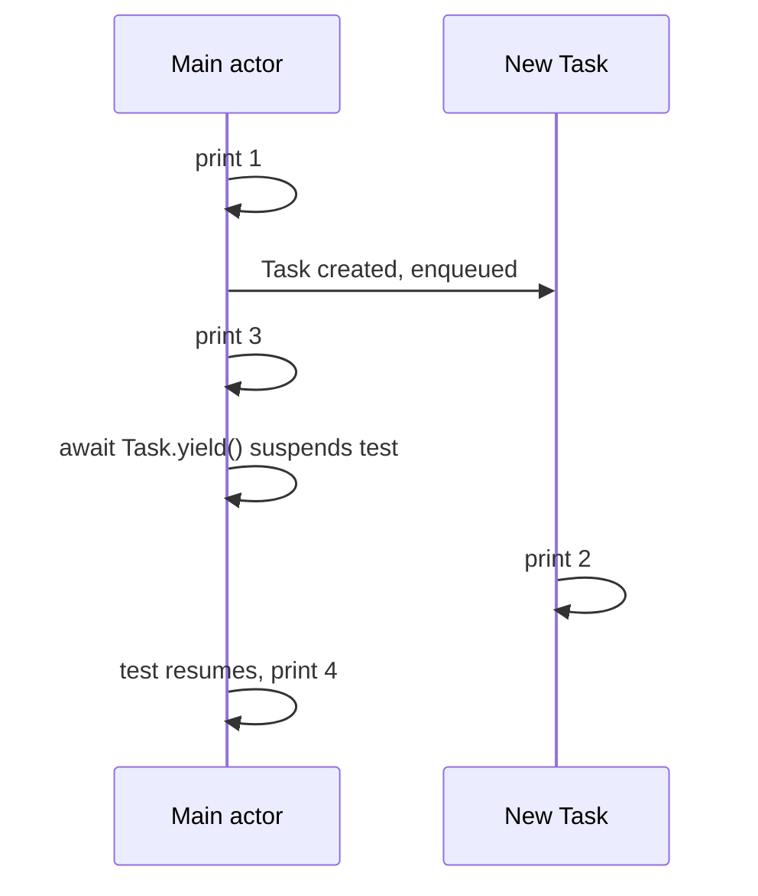

# Swift Concurrency – async/await, Tasks, Actors

[⬅ Back to index](../README.md)

Covers: async/await, Task & structured concurrency, async let, TaskGroup, cancellation, actors, MainActor, Sendable, Swift 6 data-race safety, continuations, AsyncSequence/AsyncStream.

---

## Basics

### 1. What is async/await? What problems does it solve?

<details>
<summary>Answer</summary>

**In short:** `async` marks a function that can **suspend**, and `await` marks each point where it might. Asynchronous code then reads top to bottom like ordinary sequential code. This removes nested completion handlers, makes the compiler check that every path returns or throws, uses normal `throws` for errors, and works with actors so the compiler catches threading mistakes.

#### The problem with completion handlers

Before Swift 5.5, asynchronous work used callbacks:

```swift
// Old style: nested callbacks ("pyramid of doom")
func loadProfile(completion: @escaping (Result<Profile, Error>) -> Void) {
    api.user { userResult in
        switch userResult {
        case .failure(let error):
            completion(.failure(error))
        case .success(let user):
            api.posts(for: user.id) { postsResult in
                switch postsResult {
                case .failure(let error):
                    completion(.failure(error))
                case .success(let posts):
                    completion(.success(Profile(user: user, posts: posts)))
                }
                // Easy to forget `completion` on some branch: the caller hangs forever.
            }
        }
    }
}
```

The same logic with async/await:

```swift
func loadProfile() async throws -> Profile {
    let user = try await api.user()                 // may suspend here
    let posts = try await api.posts(for: user.id)   // and here
    return Profile(user: user, posts: posts)
}
```

#### What it fixes

| Problem with callbacks | How async/await fixes it |
|---|---|
| Deep nesting, hard to read | Straight-line code with `let` bindings |
| Forgetting to call `completion` on some path | The compiler requires a `return` or `throw`, like any function |
| Calling `completion` twice | Impossible: a function returns once |
| Errors passed by hand as `Result` | Ordinary `throws` / `try` / `do-catch` |
| Callbacks arriving on an unknown thread | Actors and `@MainActor` say where code runs, and the compiler checks it |
| Cancellation handled per API | Built-in cooperative cancellation through `Task` |

#### What "suspend" means

When execution reaches an `await` and the result isn't ready, the function **suspends**: its state is saved and **the thread is freed** to run other work. When the result arrives, the function resumes, possibly on a different thread. So `await` does not block a thread. It is closer to "come back to me later".

Calling an async function needs an async context (another async function, or a `Task`). You can't call it straight from a synchronous function like a button action (see question 3).

**Common pitfalls**
- Thinking `await` means "run this on a background thread". It only marks a possible suspension. Where the code runs depends on actor isolation.
- Assuming state is unchanged after an `await`. Other code can run while you're suspended.

**Likely follow-ups**
- *Does `await` block the thread?* No. It suspends the function and frees the thread.
- *Can an async function be called from sync code?* Only by wrapping it in a `Task { }`.
- *Is async/await faster than GCD?* Not necessarily per call, but it uses a fixed thread pool and avoids thread explosion, so it scales better under load.

</details>

### 2. How does async/await work under the hood?

<details>
<summary>Answer</summary>

**In short:** The compiler splits an async function at each `await` into pieces (continuations) and keeps its local state in a heap-allocated **async frame** instead of on the thread stack. Those pieces run as jobs on a **cooperative thread pool** with about one thread per CPU core. At an `await`, a task gives up its thread instead of blocking it, and **executors** decide where each job runs (for example, the main actor's executor is the main thread).

#### Splitting into continuations

Think of this function:

```swift
func loadProfile() async throws -> Profile {
    let user = try await api.user()                // split point 1
    let posts = try await api.posts(for: user.id)  // split point 2
    return Profile(user: user, posts: posts)
}
```

The compiler turns it into roughly three parts: "start until the first await", "resume with `user` until the second await" and "resume with `posts` and return". Local variables that are needed after a split point (`user`) live in the async frame on the heap, so the thread's stack can be reused by someone else while the function waits.

#### The cooperative thread pool



- GCD creates a new thread whenever a queue's work blocks. Under load this can lead to **thread explosion**: hundreds of threads, lots of memory and context switching.
- Swift Concurrency instead uses a **fixed-width pool** (about one thread per core). Threads never block waiting for async results; tasks suspend and other jobs use the thread.
- That only works if everyone cooperates. **Blocking** inside async code (`semaphore.wait()`, `Thread.sleep`, synchronous network or file I/O, waiting on a `DispatchGroup`) takes a pool thread away. Block enough of them and the whole pool stalls, which can deadlock the app.

#### Executors

An **executor** is what actually runs a task's jobs:
- The global concurrent executor runs non-isolated work on the cooperative pool.
- Each actor has a serial executor that runs one job at a time.
- The main actor's executor is the main thread (main dispatch queue).

When code `await`s a call to a function isolated to a different actor, the runtime switches executors (an "actor hop").

**Common pitfalls**
- Using `DispatchSemaphore` to wait for an async result inside an async function. It can deadlock the pool.
- Assuming the code after an `await` runs on the same thread as before. Only the actor (not the thread) is preserved.

**Likely follow-ups**
- *Why is `Thread.current` not useful in async code?* A task may resume on a different thread after each suspension.
- *What is a suspension point?* An `await` where the task may give up its thread. Not every `await` actually suspends.
- *Why not one thread per task?* Threads are expensive (stack memory, context switches). Tasks are cheap heap objects.

</details>

### 3. What is a `Task`? How do you call async code from sync code?

<details>
<summary>Answer</summary>

**In short:** A `Task` is a unit of asynchronous work and the bridge from synchronous to asynchronous code. `Task { }` starts an unstructured task that **inherits** the current actor, priority and task-local values. `Task.detached { }` inherits none of those. Keep a reference if you need to cancel it or read its result. In SwiftUI, prefer the `.task { }` modifier, which cancels automatically when the view disappears.

#### Starting async work from sync code

Button actions, `viewDidLoad` and delegate callbacks are synchronous, so they can't `await`. Wrap the call in a `Task`:

```swift
final class ProfileViewController: UIViewController {
    private var loadTask: Task<Void, Never>?

    override func viewDidLoad() {
        super.viewDidLoad()
        loadTask = Task {
            // Inherits @MainActor from the view controller,
            // so updating UI here is safe.
            await viewModel.load()
        }
    }

    override func viewDidDisappear(_ animated: Bool) {
        super.viewDidDisappear(animated)
        loadTask?.cancel()   // stop work the user no longer needs
    }
}
```

#### `Task {}` vs `Task.detached {}`

| | `Task { }` | `Task.detached { }` |
|---|---|---|
| Actor isolation | Inherits the current actor (e.g. main) | None, runs on the global executor |
| Priority | Inherited | Default unless you pass one |
| Task-local values | Inherited | Not inherited |
| Cancellation from parent | No (unstructured) | No |
| Typical use | Almost always | Rare: work that must not run on the current actor and must not inherit its context |

Neither is a child task, so neither is cancelled automatically when the code that created it is cancelled.

#### Getting the result and cancelling

```swift
let task = Task { try await api.user() }   // Task<User, Error>
// later
task.cancel()
let user = try await task.value            // waits for the result (or throws)
```

Dropping the reference does **not** cancel the task; it keeps running.

#### SwiftUI

```swift
struct ProfileView: View {
    @State private var model = ProfileModel()
    var body: some View {
        content
            .task { await model.load() }               // cancelled when the view disappears
            .task(id: userID) { await model.load() }   // restarted when userID changes
    }
}
```

**Common pitfalls**
- Using `Task.detached` just to "get off the main thread". Usually a non-isolated async function or a separate actor is the cleaner choice.
- Starting a `Task` in a view controller and never cancelling it, so it keeps running (and keeps `self` alive) after the screen is gone.

**Likely follow-ups**
- *Does a `Task` capture `self` strongly?* Yes, the closure captures what it uses. It's released when the task finishes, so it's only a problem for long-running or never-ending tasks.
- *What's the type of a task?* `Task<Success, Failure>`, e.g. `Task<User, Error>`.

</details>

### 4. What is structured concurrency? `async let` vs TaskGroup?

<details>
<summary>Answer</summary>

**In short:** In structured concurrency, child tasks are tied to the scope that created them: the parent **waits** for all children before returning, **cancellation propagates** down to children, and **errors propagate** up. No child outlives its scope. Use `async let` for a **fixed** number of concurrent children, and a TaskGroup for a **dynamic** number.

#### Why "structured"?

It's the same idea as structured programming: control flow has clear boundaries. A function that starts child tasks can't return until they're finished, so you can't leak work or get a result after the caller has moved on.



#### `async let`: a fixed number of children

```swift
func loadProfile() async throws -> Profile {
    async let user = api.user()       // starts immediately, as a child task
    async let posts = api.posts()     // runs at the same time
    // Both requests are in flight; we wait for both here.
    return try await Profile(user: user, posts: posts)
}
```

Compare with sequential awaits, where `posts` only starts after `user` finishes:

```swift
let user = try await api.user()
let posts = try await api.posts()     // total time = sum, not max
```

If you never `await` an `async let`, it is implicitly cancelled and awaited when the scope ends.

#### TaskGroup: a dynamic number of children

```swift
func loadImages(_ urls: [URL]) async throws -> [Int: UIImage] {
    try await withThrowingTaskGroup(of: (Int, UIImage).self) { group in
        for (i, url) in urls.enumerated() {
            group.addTask { (i, try await load(url)) }   // one child per URL
        }
        var result = [Int: UIImage]()
        for try await (i, img) in group {                // completion order
            result[i] = img
        }
        return result
    }
}
```

- Results arrive in **completion order**, not submission order. That's why the index is returned with each image.
- If a child throws and the error leaves the group's closure, the group **cancels the remaining children** and waits for them before rethrowing.
- To limit concurrency (e.g. at most 4 downloads), add 4 tasks first, then add one more each time one finishes.

| | `async let` | TaskGroup |
|---|---|---|
| Number of children | Known at compile time | Decided at runtime |
| Child result types | Can differ | All the same `ChildTaskResult` type |
| Results | Each bound to its own name | Iterated in completion order |
| Typical use | "Fetch user and posts in parallel" | "Download N images" |

**Common pitfalls**
- Expecting group results in the order tasks were added.
- Mutating a shared variable from inside `addTask` closures. Return values from the child instead; the compiler enforces this with `Sendable` checks.

**Likely follow-ups**
- *What's `withDiscardingTaskGroup`?* A group for children whose results you don't need (e.g. a server handling connections); it frees each child as soon as it finishes.
- *Can a child task outlive the group?* No. The group waits for all children before returning.

</details>

### 5. Structured vs unstructured tasks?

<details>
<summary>Answer</summary>

**In short:** Structured tasks (`async let`, TaskGroup children) are bound to the scope that created them: they are awaited and cancelled automatically. Unstructured tasks (`Task {}`, `Task.detached {}`) live on their own: you must keep a reference to cancel them or get their value. Prefer structured concurrency, and use unstructured tasks to bridge from sync code or for work that must outlive the current scope.

| | Structured (`async let`, TaskGroup) | Unstructured (`Task {}`, `Task.detached {}`) |
|---|---|---|
| Lifetime | Bound to the scope | Independent; runs until it finishes |
| Cancellation | Propagated automatically from the parent | Must call `task.cancel()` yourself |
| Waiting | Parent waits automatically | You `await task.value` if you need it |
| Errors | Thrown into the parent | Stored in the task; lost if nobody reads `value` |
| Where you can start it | Only from async code | Anywhere, including sync code |

#### Example of the difference

```swift
func refresh() async {
    // Structured: if refresh() is cancelled, both children are cancelled.
    async let a = fetchA()
    async let b = fetchB()
    _ = await (a, b)

    // Unstructured: NOT cancelled when refresh() is cancelled,
    // and refresh() may return before it finishes.
    Task { await analytics.log("refreshed") }
}
```

#### When unstructured is right

- Starting async work from sync code (`viewDidLoad`, an `@IBAction`, a delegate method).
- Fire-and-forget work that should continue after the current function returns (logging, saving a draft).
- Work owned by an object rather than a call, e.g. a view model that stores a `Task` and cancels it in `deinit` or when a new search starts.

**Common pitfalls**
- Using `Task {}` inside async code for parallelism. You lose cancellation and error propagation; use `async let` or a group.
- Forgetting that errors thrown in an unstructured task are silently dropped unless someone awaits `value`.

**Likely follow-ups**
- *Is `.task {}` in SwiftUI structured?* It's managed by SwiftUI: tied to the view's lifetime and cancelled on disappear, so it behaves like a scoped task.
- *Is a `Task {}` created inside a child task a child?* No, it's unstructured; it only inherits actor, priority and task-locals.

</details>

### 6. How does task cancellation work?

<details>
<summary>Answer</summary>

**In short:** Cancellation is **cooperative**. `task.cancel()` only sets a flag; your code must check it with `Task.isCancelled` or `try Task.checkCancellation()` (which throws `CancellationError`), or react immediately with `withTaskCancellationHandler`. Many system APIs (`URLSession` async methods, `Task.sleep`) check for you and throw. Cancellation propagates to **child tasks**, but not to unstructured `Task {}`s created inside.

#### Why cooperative?

The runtime can't safely stop code at an arbitrary point: it might be halfway through writing a file or holding a resource. So cancelling just marks the task, and the code decides where it is safe to stop.

#### Ways to check

```swift
func processAll(_ items: [Item]) async throws -> [Output] {
    var results: [Output] = []
    for item in items {
        try Task.checkCancellation()        // throws CancellationError if cancelled
        results.append(try await process(item))
    }
    return results
}

func prefetch(_ urls: [URL]) async {
    for url in urls {
        if Task.isCancelled { return }      // non-throwing: just stop early
        await cache.warm(url)
    }
}
```

#### Reacting immediately

`withTaskCancellationHandler` runs `onCancel` right away (on whatever thread called `cancel()`), even while the operation is suspended. Use it to cancel the underlying work of a callback-based API:

```swift
func download(_ url: URL) async throws -> Data {
    let request = LegacyDownloader.Request(url: url)
    return try await withTaskCancellationHandler {
        try await withCheckedThrowingContinuation { continuation in
            request.start { continuation.resume(with: $0) }
        }
    } onCancel: {
        request.cancel()   // legacy request reports a cancellation error,
                           // which resumes the continuation
    }
}
```

#### How it propagates

| Situation | Cancelled? |
|---|---|
| `async let` / group child when the parent is cancelled | Yes |
| Remaining group children when one throws out of the group | Yes |
| `Task {}` created inside a cancelled task | No |
| SwiftUI `.task {}` when the view disappears | Yes |
| A `Task` whose reference you dropped | No, it keeps running |

**Common pitfalls**
- Long CPU loops that never check cancellation, so `cancel()` has no visible effect.
- Treating `CancellationError` as a real failure and showing an error alert to the user.
- Doing heavy or blocking work in `onCancel`; it should be quick and thread-safe.

**Likely follow-ups**
- *What does `Task.sleep` do on cancellation?* It throws `CancellationError` immediately.
- *Can you un-cancel a task?* No. Once set, the flag stays set.

</details>

---

## Actors & Isolation

### 7. What is an actor?

<details>
<summary>Answer</summary>

**In short:** An actor is a **reference type that protects its mutable state from data races**. Only one task at a time runs on an actor, and code outside it must `await` to reach its state. The compiler enforces this isolation, so it's like a serial queue that the compiler checks for you. Actors don't support inheritance.

#### The problem

A class used from several threads at once can corrupt its state:

```swift
final class ImageCache {                      // NOT thread-safe
    private var images: [URL: UIImage] = [:]
    func store(_ image: UIImage, for url: URL) { images[url] = image }
}
// Two threads storing at the same time can crash inside Dictionary.
```

The classic fix was a serial `DispatchQueue` or a lock, but nothing stops you forgetting to use it.

#### The actor version

```swift
actor ImageCache {
    private var images: [URL: UIImage] = [:]

    func image(for url: URL) -> UIImage? { images[url] }
    func store(_ image: UIImage, for url: URL) { images[url] = image }
}

let cache = ImageCache()
let img = await cache.image(for: url)    // must await from outside
await cache.store(downloaded, for: url)
// cache.images[url] = x                 // compile error: actor-isolated
```

#### How it works

- Each actor has a **mailbox** and a serial executor. Calls from outside become jobs that run one at a time.
- Inside the actor, methods call each other synchronously, without `await`.
- From outside, every access is asynchronous because the caller might have to wait its turn. That's why you write `await` even for a non-async method.
- Values passed in and out must be `Sendable`, so non-thread-safe objects can't leak out and be shared.

| | Class | Actor |
|---|---|---|
| Reference type | Yes | Yes |
| Inheritance | Yes | No |
| Protects its state | No | Yes, compiler-enforced |
| External access | Sync | `await` |
| `Sendable` | Only if you make it so | Always |

**Common pitfalls**
- Assuming an actor method runs from start to finish without interruption. At each `await` inside it, other calls can run (see reentrancy, question 8).
- Putting everything in actors. Each external call is a potential hop, which costs more than a plain function call.

**Likely follow-ups**
- *Can actors conform to protocols?* Yes, with isolation rules (protocol requirements must be async or marked `nonisolated`).
- *Is an actor tied to a thread?* No (except the main actor). It's tied to a serial executor that uses pool threads.

</details>

### 8. What is actor reentrancy?

<details>
<summary>Answer</summary>

**In short:** When an actor method reaches an `await`, the actor doesn't sit idle: it can **run other calls** while the first one is suspended. So the actor's state can **change across any `await`**. Re-check your assumptions after every suspension, or finish state changes before suspending.

#### Why actors are reentrant

If an actor stayed locked during an `await`, two actors waiting on each other would deadlock. Reentrancy avoids deadlocks and keeps the actor responsive, at the cost of interleaving.



#### The bug

```swift
actor BankAccount {
    var balance = 100

    func withdraw(_ amount: Int) async {
        guard balance >= amount else { return }
        await audit()              // suspension point: another withdraw may run here!
        balance -= amount          // ❌ may go negative
    }
}
```

There's no data race (only one job touches `balance` at a time), but there is a **logic race**.

#### Fixes

```swift
// Fix 1: change state before suspending
func withdraw(_ amount: Int) async {
    guard balance >= amount else { return }
    balance -= amount              // done synchronously, atomic within the actor
    await audit()
}

// Fix 2: re-check after the await
func withdraw(_ amount: Int) async {
    await audit()
    guard balance >= amount else { return }
    balance -= amount
}
```

#### Deduplicating in-flight work

A common reentrancy case: two callers request the same image while the first download is still running. Store the in-flight `Task` so the second caller awaits the same one:

```swift
actor ImageLoader {
    private var inFlight: [URL: Task<UIImage, Error>] = [:]

    func image(for url: URL) async throws -> UIImage {
        if let existing = inFlight[url] { return try await existing.value }
        let task = Task { try await download(url) }
        inFlight[url] = task                 // set BEFORE awaiting
        defer { inFlight[url] = nil }
        return try await task.value
    }
}
```

**Common pitfalls**
- Checking a condition, awaiting, then acting on the old check.
- Thinking actors make multi-step operations atomic. Only the synchronous code between two `await`s is atomic.

**Likely follow-ups**
- *Does reentrancy cause data races?* No, it causes logic bugs. Data races are still prevented.
- *Can you make an actor non-reentrant?* Not in current Swift. Restructure the code or use a queue of pending work.

</details>

### 9. What is `@MainActor`?

<details>
<summary>Answer</summary>

**In short:** `@MainActor` is the built-in **global actor** for the main thread. Marking a type, function or property with it guarantees that code runs on the main thread, and the compiler enforces it: calling it from elsewhere requires `await`. UIKit views and view controllers and SwiftUI `View` are `@MainActor`. In Swift 6.2 / Xcode 26, app targets can opt into main-actor isolation by default.

#### Why it exists

UI frameworks must only be touched from the main thread. With GCD you had to remember `DispatchQueue.main.async` in every callback, and mistakes showed up as runtime warnings or crashes. `@MainActor` turns that into a compile-time rule.

```swift
@MainActor
final class ProfileViewModel: ObservableObject {
    @Published var name = ""

    func load() async {
        let user = try? await api.user()   // the work inside api runs wherever api is isolated
        name = user?.name ?? ""            // back on main automatically after the await
    }
}
```

After the `await` returns, the function resumes on the main actor because `load()` is isolated to it. No manual dispatching.

#### Ways to use it

| Usage | Effect |
|---|---|
| `@MainActor class` / `struct` | All members run on main (unless marked `nonisolated`) |
| `@MainActor func` | Only that function |
| `@MainActor var` | Only that property |
| `await MainActor.run { ... }` | One-off hop to main from non-main async code |
| `Task { @MainActor in ... }` | Start a task that runs on main |

```swift
func process() async {
    let result = await heavyWork()
    await MainActor.run {
        label.text = result     // one-off UI update
    }
}
```

#### Swift 6.2 "approachable concurrency"

New app targets in Xcode 26 can set **default actor isolation to `MainActor`**. Then all code in the module is main-actor isolated unless you opt out with `nonisolated` or `@concurrent`. This fits most app code, which is UI-driven and mostly single-threaded, and removes many Sendable errors.

**Common pitfalls**
- Doing heavy CPU work inside a `@MainActor` function. It runs on the main thread and freezes the UI. Move it to a non-isolated `@concurrent` function or another actor.
- Assuming `@MainActor` on a protocol or class covers closures passed to old callback APIs; those may be called from other threads (the runtime will trap in Swift 6 mode).

**Likely follow-ups**
- *Is `@MainActor` the same as `DispatchQueue.main`?* Its executor is the main queue, but it's checked by the compiler.
- *Does `@MainActor` make a call synchronous?* Only for callers already on the main actor; others must `await`.

</details>

### 10. What is `nonisolated`?

<details>
<summary>Answer</summary>

**In short:** `nonisolated` marks a member of an actor (or of a `@MainActor` type) as **not isolated** to that actor, so it can be called from anywhere without `await`. Because it runs outside the actor, it can only use immutable or `Sendable` state, such as `let` properties.

#### Why you need it

Actor isolation forces `await` for every external access. That's wrong for members that don't touch mutable state, and it breaks synchronous protocol requirements like `Hashable` or `CustomStringConvertible`:

```swift
actor User: Hashable {
    let id: UUID              // immutable: safe to read from anywhere
    var name: String          // mutable: isolated

    init(id: UUID, name: String) { self.id = id; self.name = name }

    // Hashable requirements are synchronous, so they must be nonisolated.
    nonisolated static func == (lhs: User, rhs: User) -> Bool { lhs.id == rhs.id }
    nonisolated func hash(into hasher: inout Hasher) { hasher.combine(id) }

    nonisolated var description: String { "User \(id)" }   // uses only `let`
    // nonisolated var bad: String { name }                // ❌ error: name is isolated
}
```

#### Uses

- Conforming an actor or `@MainActor` type to a synchronous protocol.
- Pure helpers on a `@MainActor` view model that should run off the main thread.
- In modules with default main-actor isolation (Swift 6.2), marking types or functions that shouldn't be on main.

#### `nonisolated(unsafe)`

A different thing: an escape hatch for a stored variable (often a global) that you promise is safe even though the compiler can't prove it. It switches off checking, so use it sparingly and document why.

**Common pitfalls**
- Marking a member `nonisolated` and then trying to read mutable actor state from it (compile error).
- Using `nonisolated(unsafe)` to silence errors on state that really is shared and mutated.

**Likely follow-ups**
- *Where does a `nonisolated async` function run?* Before Swift 6.2, on the global concurrent pool. With the Swift 6.2 approachable-concurrency setting, on the caller's actor unless marked `@concurrent`.

</details>

### 11. What is `Sendable`?

<details>
<summary>Answer</summary>

**In short:** `Sendable` is a marker protocol for types that are **safe to share across concurrency domains** (between tasks or actors). Value types made of Sendable parts, actors, and immutable `final` classes qualify. The compiler checks every value crossing an isolation boundary, which is how Swift **proves at compile time that there are no data races**.

#### The problem

Passing a mutable class instance from one task to another lets both mutate it at once, which is a data race. `Sendable` lets the compiler reject that.

```swift
final class Counter { var value = 0 }    // not Sendable

let counter = Counter()
Task { counter.value += 1 }              // ❌ Swift 6: capturing non-Sendable value
counter.value += 1                       // in a concurrently executing closure
```

#### What is Sendable

| Type | Sendable? |
|---|---|
| `Int`, `String`, `Array<Int>` and other standard value types | Yes |
| `struct` / `enum` whose stored properties are all Sendable | Yes; inferred for non-public types, declare it explicitly for `public` ones |
| `actor` | Always |
| `final class` with only `let` Sendable properties | Yes, if declared `: Sendable` |
| Class with mutable state protected by a lock | Only as `@unchecked Sendable` (your promise) |
| Ordinary mutable class | No |
| `@Sendable` closure | Yes; it can't capture mutable local state |

```swift
struct User: Sendable {          // value type, Sendable members
    let id: UUID
    var name: String
}

final class Config: Sendable {   // immutable reference type
    let baseURL: URL
    init(baseURL: URL) { self.baseURL = baseURL }
}

final class Store: @unchecked Sendable {     // thread safety done by hand
    private let lock = NSLock()
    private var items: [String] = []
    func add(_ s: String) { lock.withLock { items.append(s) } }
}
```

#### `@Sendable` closures

Closures passed to `Task {}`, `addTask` and similar APIs are `@Sendable` (or `sending`). They can capture only Sendable values and can't capture local `var`s by reference:

```swift
var count = 0
Task { count += 1 }    // ❌ mutation of captured var in concurrently-executing code
```

**Common pitfalls**
- Using `@unchecked Sendable` to silence errors without real locking.
- Forgetting that `public` structs don't get Sendable inferred, so clients see warnings.

**Likely follow-ups**
- *Is `Sendable` checked at runtime?* No, it's purely compile time.
- *What about types from libraries that aren't annotated yet?* `@preconcurrency import` softens the Sendable diagnostics for that module until it adopts concurrency annotations.

</details>

### 12. What changed in Swift 6 (strict concurrency / data-race safety)?

<details>
<summary>Answer</summary>

**In short:** The **Swift 6 language mode** turns data-race checks from warnings into **compile-time errors**: non-Sendable values crossing actor boundaries, unprotected global mutable state, and calling main-actor APIs from non-isolated code. You migrate incrementally (strict concurrency checking minimal → targeted → complete in Swift 5 mode, then Swift 6 mode per module). **Region-based isolation** and `sending` reduce false positives, and **Swift 6.2 "approachable concurrency"** adds default `@MainActor` isolation and makes `nonisolated async` functions run on the caller's actor, with `@concurrent` to move work off it.

#### What the compiler now rejects

```swift
var cache: [String: Data] = [:]     // ❌ global mutable state is not concurrency-safe

final class Session { var token = "" }   // non-Sendable

actor API {
    func use(_ s: Session) { }
}
func f(api: API, s: Session) async {
    await api.use(s)                 // ❌ s is still used below, so sending it is a possible race
    s.token = "x"
}

func notIsolated() {
    label.text = "Hi"                // ❌ main actor-isolated property from nonisolated context
}
```

Fixes: make the global a `let`, isolate it to `@MainActor` or wrap it in an actor; make types `Sendable`; mark functions `@MainActor` or `await` the hop.

#### Migrating



- The setting is per module (target / package), so you can migrate leaf modules first.
- Swift 6 compilers still build Swift 5 mode code; mixing modules in different modes is fine.

#### Region-based isolation and `sending`

Earlier checking rejected passing *any* non-Sendable value across a boundary. Region-based isolation lets the compiler accept it when it can prove the caller doesn't use the value afterwards (the value's "region" is transferred). The `sending` keyword on a parameter or result states this in an API:

```swift
func makeSession() -> sending Session { Session() }   // caller gets an unshared value

let s = Session()
await api.use(s)   // OK if `s` is never touched again after this line
```

#### Escape hatches

| Tool | Use |
|---|---|
| `@preconcurrency import Module` | Silence Sendable diagnostics from a library not yet updated |
| `@unchecked Sendable` | You guarantee thread safety (e.g. a lock) |
| `nonisolated(unsafe) var` | You guarantee a variable is accessed safely |
| `MainActor.assumeIsolated { }` | Sync code you know runs on main (traps at runtime if not) |

#### Swift 6.2 "approachable concurrency"

- **Default `@MainActor` isolation** option for app modules: everything is main-actor unless opted out.
- `nonisolated async` functions now **run on the caller's actor** by default, instead of always hopping to the global pool. This removes many surprising Sendable errors.
- **`@concurrent`** explicitly marks a function that should run off the actor, on the concurrent pool, for heavy work.

```swift
@concurrent
func decode(_ data: Data) async throws -> Feed {   // always off the caller's actor
    try JSONDecoder().decode(Feed.self, from: data)
}
```

**Common pitfalls**
- Turning on Swift 6 mode for a big module at once and drowning in errors.
- Sprinkling `@unchecked Sendable` and `nonisolated(unsafe)` to get a green build, which just hides the races.

**Likely follow-ups**
- *Does Swift 6 mode find races at runtime?* Mostly no: these are compile-time checks, plus some runtime isolation assertions (e.g. a main-actor closure called off main traps). Thread Sanitizer is still useful for runtime races.
- *Can a Swift 6 app use Swift 5 mode packages?* Yes; the mode is per module.

</details>

### 13. What are global actors?

<details>
<summary>Answer</summary>

**In short:** A global actor is an actor used as an **attribute** (like `@MainActor`) so that code spread across many types, functions and properties is all isolated to one shared actor and executor. `@MainActor` is the built-in one; you can define your own with `@globalActor`.

#### Why

A normal actor protects only its own stored properties. Sometimes the state you want to protect is spread around: several classes that all talk to one database, or one subsystem's globals. A global actor gives all of that a single isolation domain, without putting everything inside one actor type.

```swift
@globalActor
actor DatabaseActor {
    static let shared = DatabaseActor()   // the single instance behind the attribute
}

@DatabaseActor
final class UserStore {                   // all members isolated to DatabaseActor
    private var cache: [UUID: User] = [:]
    func save(_ user: User) { cache[user.id] = user }
}

@DatabaseActor
func migrate() { /* runs on DatabaseActor */ }

@DatabaseActor var schemaVersion = 3      // global variable, safely isolated

// From elsewhere:
await migrate()
```

Code isolated to the same global actor calls each other synchronously (no `await`), because it's known to already be on that actor.

| | Instance actor | Global actor |
|---|---|---|
| Isolates | One object's state | Any declaration marked with it |
| Instances | Many | One (`shared`) |
| Example | `actor ImageCache` | `@MainActor`, `@DatabaseActor` |

**Common pitfalls**
- Creating many custom global actors. Each is a serial bottleneck; usually `@MainActor` plus a few plain actors is enough.

**Likely follow-ups**
- *How is `@MainActor` different from a custom global actor?* Its executor is the main thread; custom ones use the cooperative pool.

</details>

### 14. Actor vs serial DispatchQueue vs lock?

<details>
<summary>Answer</summary>

**In short:** All three serialize access to shared state. An **actor** gives compiler-enforced isolation and async access, but watch for reentrancy. A **serial queue** gives only runtime safety (nothing stops you forgetting to use it) and works with callbacks or blocking `sync`. A **lock** (`Mutex`, `OSAllocatedUnfairLock`, `NSLock`) is synchronous and fastest for tiny critical sections, and is safe in async code as long as it's never held across an `await`.

| | Actor | Serial `DispatchQueue` | Lock (`Mutex` etc.) |
|---|---|---|---|
| Safety checked by | Compiler | Developer discipline | Developer (`Mutex` wraps the value, so you can't touch it unlocked) |
| Access from caller | `await` | `async { }` callback or blocking `sync { }` | Synchronous |
| Usable from sync code | No (needs a `Task`) | Yes | Yes |
| Cost per access | Possible actor hop | Queue dispatch | Very small when uncontended |
| Reentrancy issues | Yes, at `await` | No | No (but deadlock if re-locked on the same thread) |
| Works with structured concurrency | Natively | Needs bridging | Yes, if not held across `await` |

```swift
import Synchronization

// Lock: tiny, synchronous critical section
final class Counter: Sendable {
    private let value = Mutex(0)        // Mutex (Synchronization framework, iOS 18+)
    func increment() { value.withLock { $0 += 1 } }
}

// Actor: state with async work around it
actor Downloader {
    private var cache: [URL: Data] = [:]
    func data(for url: URL) async throws -> Data { /* ... */ }
}
```

#### How to choose

- New async code with non-trivial state: **actor**.
- A tiny value that must be read synchronously (counter, flag, cache lookup in a sync API): **lock**.
- Legacy GCD code or C APIs that expect a queue: **serial queue**. An actor can even use a dispatch queue as its custom executor when needed.

**Common pitfalls**
- Holding a lock across an `await`. The task may resume on a different thread while the lock is held. `Mutex.withLock` takes a synchronous closure, which prevents this.
- Calling `queue.sync` from inside async code; it blocks a pool thread.

**Likely follow-ups**
- *Why not `DispatchQueue.sync` inside an actor?* It blocks a cooperative thread and can deadlock.
- *Lock before iOS 18?* `OSAllocatedUnfairLock` (iOS 16+) or `NSLock`.

</details>

---

## Bridging & Streams

### 15. How do you convert a completion-handler API to async/await?

<details>
<summary>Answer</summary>

**In short:** Wrap it in a **continuation**: `withCheckedContinuation` / `withCheckedThrowingContinuation` suspends the task and gives you a continuation object that the callback must **resume exactly once** with a value or error. Checked continuations catch misuse at runtime; unsafe ones skip the checks. Xcode's "Add Async Wrapper" refactoring can generate this for you.

```swift
// Legacy API
func fetchUser(completion: @escaping (Result<User, Error>) -> Void)

// Async wrapper
func fetchUser() async throws -> User {
    try await withCheckedThrowingContinuation { continuation in
        legacyAPI.fetchUser { result in
            continuation.resume(with: result)   // must resume EXACTLY once
        }
    }
}
```

#### How it works

1. `withChecked...Continuation` suspends the current task and runs your closure right away.
2. The closure starts the legacy work and returns; the task stays suspended.
3. When the callback fires, `resume(returning:)`, `resume(throwing:)` or `resume(with:)` schedules the task to continue with that result.



#### The "exactly once" rule

| Mistake | Checked continuation | Unsafe continuation |
|---|---|---|
| Resume twice | Crash (runtime trap) | Undefined behaviour |
| Never resume | Task hangs forever; a warning is logged | Task hangs silently |

So every code path of the callback must resume, including errors and early returns:

```swift
try await withCheckedThrowingContinuation { continuation in
    legacyAPI.load { data, error in
        if let error { continuation.resume(throwing: error); return }
        guard let data else {
            continuation.resume(throwing: LoadError.empty); return   // don't forget this path
        }
        continuation.resume(returning: data)
    }
}
```

#### Variants

- `withCheckedContinuation` / `withCheckedThrowingContinuation`: runtime checks. Use these by default.
- `withUnsafeContinuation` / `withUnsafeThrowingContinuation`: no checks, slightly faster. Use only on proven hot paths.
- For APIs that call back **many times** (delegates, progress), a continuation is the wrong tool; use `AsyncStream` (question 16).

**Common pitfalls**
- Delegate-based APIs where the callback may never fire (e.g. a dismissed dialog): the task hangs.
- Not handling cancellation: combine with `withTaskCancellationHandler` to cancel the legacy work.

**Likely follow-ups**
- *Did Apple do this for its own APIs?* Yes, the Objective-C importer automatically exposes many completion-handler methods as `async` versions.

</details>

### 16. What are AsyncSequence and AsyncStream?

<details>
<summary>Answer</summary>

**In short:** **AsyncSequence** is a sequence whose elements arrive **over time**; you consume it with `for await` / `for try await`. **AsyncStream** and **AsyncThrowingStream** let you build one yourself from callbacks or delegates by calling `continuation.yield(_:)`. Use the **swift-async-algorithms** package for operators like debounce, merge and combineLatest.

#### AsyncSequence

It's the async version of `Sequence`: the iterator's `next()` is `async`, so the loop suspends until the next element is ready, and the loop ends when the sequence finishes.

```swift
// Built-in examples
for try await line in url.lines { print(line) }                 // lines of a file or URL
let (bytes, _) = try await URLSession.shared.bytes(from: url)  // streamed download
for await _ in NotificationCenter.default.notifications(named: UIApplication.didBecomeActiveNotification) {
    refresh()
}
// Also: FileHandle.bytes.lines
```

Familiar operators work on it: `map`, `filter`, `compactMap`, `prefix`, `first(where:)`, `contains`, `reduce`.

#### AsyncStream: bridging callbacks and delegates

```swift
func locationUpdates() -> AsyncStream<CLLocation> {
    AsyncStream { continuation in
        let delegate = LocationDelegate { continuation.yield($0) }   // each update
        continuation.onTermination = { _ in delegate.stop() }        // consumer stopped / cancelled
        delegate.start()
    }
}

for await location in locationUpdates() { update(location) }
```

- `yield(_:)` sends an element; `finish()` (or `finish(throwing:)` for the throwing version) ends the stream.
- `onTermination` runs when the stream finishes or the consuming task is cancelled: clean up there.

`AsyncStream.makeStream(of:)` returns a `(stream, continuation)` pair, which is handy when the producer is an object rather than a closure:

```swift
final class ChatSocket {
    let (messages, continuation) = AsyncStream.makeStream(of: Message.self)
    func didReceive(_ m: Message) { continuation.yield(m) }
}
```

#### Buffering

If the producer yields faster than the consumer reads, elements are buffered. The `bufferingPolicy` decides what happens:

| Policy | Behaviour |
|---|---|
| `.unbounded` (default) | Keep everything (memory can grow) |
| `.bufferingNewest(n)` | Keep the latest n, drop older ones (good for location, UI state) |
| `.bufferingOldest(n)` | Keep the first n, drop new ones |

**Common pitfalls**
- Iterating the same `AsyncStream` from two tasks: elements are split between them, not broadcast to both.
- Forgetting `onTermination`, so the delegate keeps running after the consumer is gone.
- A `for await` loop over an infinite stream never ends, so code after it never runs; put it in its own task.

**Likely follow-ups**
- *AsyncStream vs Combine `PassthroughSubject`?* A subject broadcasts to many subscribers; an AsyncStream is meant for a single consumer.
- *How do you stop consuming?* `break` out of the loop or cancel the task.

</details>

### 17. Combine vs async/await – when to use which?

<details>
<summary>Answer</summary>

**In short:** Use **async/await** for one-shot results (network calls) and linear workflows; it's the default for new APIs. Use **AsyncSequence** for streams you consume in a loop. Use **Combine** for complex reactive pipelines with many operators (combineLatest, debounce on UI input) and for existing `@Published` / `ObservableObject` code. Apple's newer frameworks lean towards async/await and Observation; bridge with `publisher.values`.

| Need | Best fit | Why |
|---|---|---|
| Fetch something once | async/await | Straight-line code, `throws`, cancellation |
| Several requests in parallel | `async let` / TaskGroup | Structured, auto-cancelled |
| A stream of events consumed in order | AsyncSequence | `for await` loop |
| Combining several changing inputs (form validation) | Combine | `combineLatest`, `debounce`, `removeDuplicates` built in |
| Search-as-you-type | Either | Combine `debounce`, or `.task(id:)` with `Task.sleep` |
| SwiftUI state | Observation (`@Observable`) | Replaces most `@Published` use on newer OS versions |

#### Same task, two styles

```swift
// Combine
$query
    .debounce(for: .milliseconds(300), scheduler: RunLoop.main)
    .removeDuplicates()
    .flatMap { api.searchPublisher($0) }
    .receive(on: DispatchQueue.main)
    .sink { [weak self] in self?.results = $0 }
    .store(in: &cancellables)

// async/await (SwiftUI)
.task(id: query) {
    try? await Task.sleep(for: .milliseconds(300))   // cancelled if query changes again
    guard !Task.isCancelled else { return }
    results = (try? await api.search(query)) ?? []
}
```

#### Bridging

- Combine to async: `for await value in publisher.values { }` (`values` turns a publisher into an AsyncSequence).
- Async to Combine: wrap a call in a `Future`, or feed a subject from a `Task`.

**Common pitfalls**
- Rewriting working Combine pipelines just to "modernize"; mixing both in one codebase is fine.
- Combine uses schedulers while async code uses actor isolation; mixing them can hide which thread you're on.

**Likely follow-ups**
- *Is Combine deprecated?* No, but Apple's newer APIs (Observation, async framework APIs) don't build on it.

</details>

### 18. What are task priorities and TaskLocal?

<details>
<summary>Answer</summary>

**In short:** **Priorities** (`.high`, `.medium`, `.low`, `.background`, plus the aliases `.userInitiated` = high and `.utility` = low) tell the scheduler how urgent a task is; the system **escalates** a task's priority when a higher-priority task awaits it. **`@TaskLocal`** values are implicitly passed down to child tasks, like thread-local storage but for tasks: useful for request IDs, loggers or tracing context.

#### Priorities

```swift
Task(priority: .userInitiated) { await loadVisibleImages() }
Task(priority: .background) { await cleanUpCache() }
let current = Task.currentPriority
```

- `Task {}` inherits the priority of the code that creates it.
- Child tasks inherit the parent's priority.
- **Priority escalation:** if a high-priority task awaits a lower-priority task (or waits on an actor busy with lower-priority work), the system raises the priority of that work to avoid priority inversion.
- Priority is a hint, not an ordering guarantee.

#### TaskLocal

```swift
enum RequestContext {
    @TaskLocal static var requestID: String?
}

func handle() async {
    await RequestContext.$requestID.withValue(UUID().uuidString) {
        await fetchData()        // and everything it calls, including child tasks
    }
}

func fetchData() async {
    log("fetching", id: RequestContext.requestID)   // reads the bound value
}
```

- The value is bound only for the duration of `withValue`; outside it, the old value is back.
- Child tasks and `Task {}` inherit it; `Task.detached` does not.
- Values should be `Sendable` and are read-only (rebind with another `withValue` to change).

**Common pitfalls**
- Using `.background` for work the user is waiting on; it can be heavily delayed.
- Expecting a TaskLocal to be visible inside a callback from a non-async API; only task inheritance carries it.

**Likely follow-ups**
- *TaskLocal vs passing a parameter?* Parameters are explicit and preferred for business data; TaskLocal suits cross-cutting context like tracing.

</details>

### 19. What is the output / order? (Common question)

<details>
<summary>Answer</summary>

**In short:** When called from the main actor, the typical output is **1, 3, 2, 4**. `Task { }` only **schedules** work, so "3" prints first. The new task inherits the main actor, which is busy running `test()`, so it can only run when `test()` suspends at `await Task.yield()`. The ordering of unstructured tasks **isn't guaranteed**, so never rely on it in real code.

```swift
@MainActor
func test() async {
    print("1")
    Task { print("2") }      // enqueued on the main actor, not run yet
    print("3")
    await Task.yield()       // suspends test(), letting other main-actor jobs run
    print("4")
}
// Typical output (when called from the main actor): 1, 3, 2, 4
```

#### Step by step



1. `print("1")` runs.
2. `Task { }` creates a job on the main actor's queue. The main actor is busy, so it waits.
3. `print("3")` runs.
4. `Task.yield()` suspends `test()`, giving queued jobs a chance; the task prints "2".
5. `test()` resumes and prints "4".

#### Variations interviewers ask

| Change | Likely result | Why |
|---|---|---|
| Remove `await Task.yield()` | 1, 3, 4, 2 | The main actor isn't released until `test()` ends |
| Use `Task.detached { print("2") }` | "2" can appear anywhere after "1" | Runs on the concurrent pool, in parallel with main |
| `test()` isn't on the main actor | Not deterministic | The task may start right away on another pool thread |

`Task.yield()` only *offers* to let other work run; it doesn't guarantee it, which is why the answer says "typical".

**Common pitfalls**
- Using `Task.yield()` or `Task.sleep` to "fix" ordering bugs in production code. Use structured concurrency or explicit awaits instead.

**Likely follow-ups**
- *How do you guarantee "2" prints before "4"?* Await the task: `let t = Task { print("2") }; await t.value`.

</details>

### 20. How do you test async code?

<details>
<summary>Answer</summary>

**In short:** Both XCTest and Swift Testing support **`async` test functions**, so you just `await` the code under test and assert. Inject dependencies as protocols so tests use fast mocks instead of real networking. For callbacks or Combine, use expectations (`await fulfillment(of:timeout:)` in XCTest) or `confirmation` in Swift Testing. Control time with an injected clock (the `Clock` protocol, a test clock) instead of real sleeps.

#### Async tests

```swift
// XCTest
final class ProfileViewModelTests: XCTestCase {
    @MainActor
    func testLoadSetsName() async throws {
        let sut = ProfileViewModel(api: MockAPI(stubUser: User(name: "Ana")))
        await sut.load()
        XCTAssertEqual(sut.name, "Ana")
    }
}

// Swift Testing
@Test @MainActor
func loadSetsName() async throws {
    let sut = ProfileViewModel(api: MockAPI(stubUser: User(name: "Ana")))
    await sut.load()
    #expect(sut.name == "Ana")
}
```

If the code under test is `@MainActor`, mark the test `@MainActor` too, or `await` each access.

#### Mocking async dependencies

```swift
protocol UserAPI: Sendable {
    func user() async throws -> User
}

struct MockAPI: UserAPI {
    var stubUser: User
    func user() async throws -> User { stubUser }   // returns instantly, no network
}
```

#### Callback or event-based code

```swift
// XCTest
func testDelegateCalled() async {
    let exp = expectation(description: "delegate called")
    sut.onFinish = { exp.fulfill() }
    sut.start()
    await fulfillment(of: [exp], timeout: 1)    // async-safe; don't use wait(for:) in async tests
}

// Swift Testing
@Test func emitsEvent() async {
    await confirmation { confirmed in
        sut.onEvent = { confirmed() }
        await sut.run()
    }
}
```

#### Time

Code that sleeps (debounce, retry with backoff) makes tests slow and flaky. Inject a `Clock`:

```swift
final class Searcher<C: Clock> where C.Duration == Duration {
    let clock: C
    init(clock: C) { self.clock = clock }
    func debounce() async throws { try await clock.sleep(for: .milliseconds(300)) }
}
// Production: Searcher(clock: ContinuousClock())
// Tests: a test clock (your own or from a library) that you advance manually
```

**Common pitfalls**
- Testing unstructured `Task {}`s started inside the code: the test may finish before the task runs. Expose the task, or make the method `async` so the test can await it.
- Using `wait(for:)` inside an `async` test; use `await fulfillment(of:)`.

**Likely follow-ups**
- *How do you test cancellation?* Start a `Task`, cancel it, and assert it throws `CancellationError` or stops early.

</details>

### 21. Common Swift Concurrency mistakes?

<details>
<summary>Answer</summary>

**In short:** The usual ones: blocking inside async code, overusing `Task.detached` or never cancelling tasks, ignoring actor reentrancy, updating UI off the main actor, assuming async functions automatically run in the background, and silencing Sendable errors with `@unchecked Sendable` without real thread safety.

| Mistake | Why it hurts | Fix |
|---|---|---|
| Blocking: `semaphore.wait()`, `Thread.sleep`, `queue.sync`, sync file I/O on the pool | Ties up one of the few pool threads; can deadlock everything | `await`, `Task.sleep`, async APIs; move unavoidable blocking I/O to its own thread or queue |
| `Task.detached` everywhere | Loses priority, task-locals and actor context | Plain `Task {}`, `async let`, or a `@concurrent` function |
| Starting tasks and never cancelling them | Leaks work, keeps objects alive, shows outdated results | Store the `Task` and cancel it; use `.task {}` in SwiftUI |
| Ignoring reentrancy | Actor state changes across `await` (logic races) | Re-check after `await`, mutate before suspending |
| Updating UI from non-main code | Runtime warnings, crashes, glitches | `@MainActor` on UI types, `await MainActor.run` |
| Assuming async means background | With Swift 6.2 semantics a nonisolated async function may run on the caller's actor, e.g. main | Mark heavy work `@concurrent` or put it on another actor |
| `@unchecked Sendable` to silence errors | Hides real data races | Make the type truly safe (actor, lock, immutability) |

#### The "async means background" trap

```swift
@MainActor
final class FeedModel {
    var feed: Feed?

    func refresh() async {
        let data = await fetchData()
        feed = parse(data)                 // ❌ sync call: heavy parsing runs on main
    }
    nonisolated func parse(_ d: Data) -> Feed { /* ... */ }
}

// ✅ Explicitly move heavy work off the actor
@concurrent
nonisolated func parse(_ d: Data) async -> Feed { /* ... */ }
// call site: feed = await parse(data)
```

#### Other gotchas

- Capturing `self` strongly in a never-ending task (e.g. `for await` over notifications), which keeps the object alive forever.
- Treating `CancellationError` as a user-facing error.
- Expecting TaskGroup results in submission order.
- Consuming one `AsyncStream` from several tasks and expecting each to get every element.

**Likely follow-ups**
- *How do you find these issues?* Turn on complete strict concurrency checking, run Thread Sanitizer, and use the Swift Concurrency template in Instruments to inspect tasks and actors.

</details>

---

[⬅ Previous: GCD & Operations](04-gcd-operations.md) · [⬅ Back to index](../README.md) · [Next: Combine ➡](06-combine.md)
