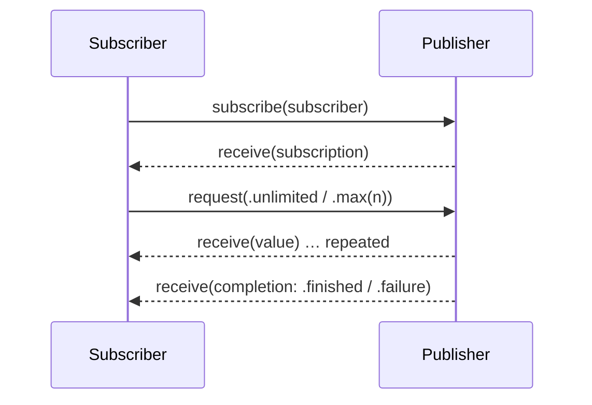
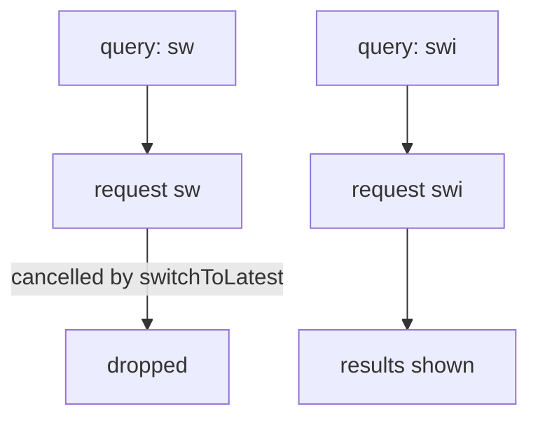
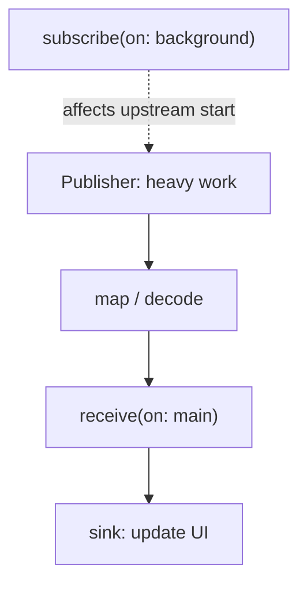
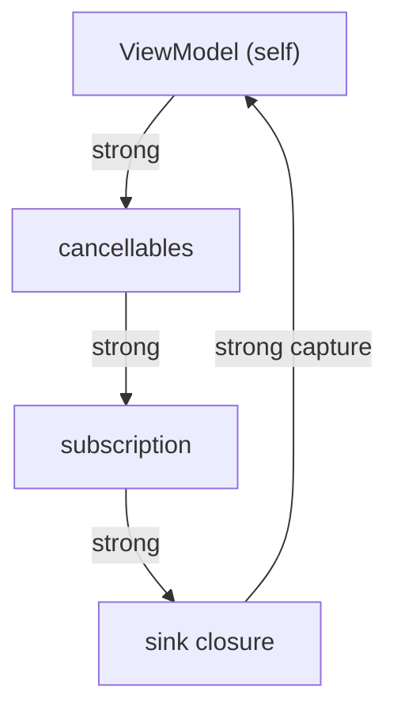

# Combine & Reactive Programming

[⬅ Back to index](../README.md)

Covers: publishers & subscribers, subjects, @Published, operators, schedulers, error handling, memory management, backpressure, Combine vs RxSwift vs async/await.

---

### 1. What is Combine?

<details>
<summary>Answer</summary>

**In short:** Combine is Apple's reactive framework (iOS 13+) for processing values that arrive over time. A **Publisher** emits values and then finishes or fails, **Operators** transform those values, and a **Subscriber** receives the result. You describe *what* should happen to a stream of events declaratively, instead of wiring callbacks by hand.

#### The problem it solves

Apps are full of asynchronous events: text field edits, network responses, notifications, timers, property changes. Before Combine you handled each with a different mechanism (delegates, closures, KVO, NotificationCenter, target-action), and combining them ("search when the user stops typing, but only if the text changed, and cancel the previous request") meant manual timers, flags and cancellation logic. Combine gives all of them one shape, `Publisher<Output, Failure>`, so the same operators work on every source.

#### The three building blocks

| Piece | Role | Examples |
|---|---|---|
| **Publisher** | Emits zero or more `Output` values, then one completion: `.finished` or `.failure(Failure)` | `URLSession.dataTaskPublisher`, `NotificationCenter.publisher(for:)`, `$property` from `@Published`, `Just`, subjects |
| **Operator** | A publisher that wraps an upstream publisher and transforms its output | `map`, `filter`, `debounce`, `removeDuplicates`, `flatMap`, `combineLatest`, `catch` |
| **Subscriber** | Consumes values and controls demand | `sink`, `assign(to:on:)`, `assign(to:)` |

Both the output type and the error type are part of the publisher's signature. `Never` as the failure type means "this stream cannot fail", which the compiler enforces.

#### Example: search-as-you-type

```swift
final class SearchViewModel: ObservableObject {
    @Published var query = ""
    @Published private(set) var results: [Item] = []
    private var cancellables = Set<AnyCancellable>()

    init(api: SearchAPI) {
        $query
            .debounce(for: .milliseconds(300), scheduler: RunLoop.main) // wait for a pause in typing
            .removeDuplicates()                                          // skip if text didn't change
            .filter { $0.count >= 2 }
            .map { query in
                api.search(query)                                        // AnyPublisher<[Item], Error>
                    .replaceError(with: [])                              // keep the outer stream alive
            }
            .switchToLatest()                                            // cancel the previous request
            .receive(on: DispatchQueue.main)
            .assign(to: &$results)                                       // no retain cycle, no cancellable needed
    }
}
```

Nothing runs until a subscriber attaches. Publishers are mostly **lazy** value-type descriptions of work; the subscription is what starts it.

**Pitfalls:**
- Forgetting to keep the `AnyCancellable`, so the pipeline is cancelled straight away.
- Capturing `self` strongly in `sink`, creating a retain cycle.
- Letting an error reach a long-lived stream, which terminates it for good.

**Likely follow-ups:**
- *Is Combine push or pull?* Push, but limited by the subscriber's demand (backpressure).
- *What's `Never` as a Failure type?* A stream that can't fail; `assign` requires it.
- *Is Combine deprecated?* No, but Apple's new APIs favour async/await and Observation (see question 15).

</details>

### 2. What is the Publisher–Subscriber lifecycle?

<details>
<summary>Answer</summary>

**In short:** The subscriber attaches to a publisher, the publisher hands back a **Subscription**, the subscriber **requests** how many values it wants (its demand), the publisher sends up to that many values, and finally sends exactly one completion (`.finished` or `.failure`). Cancelling the subscription stops it at any point.



#### Step by step

1. **Subscribe.** You call `publisher.subscribe(subscriber)` (or `sink`, which creates a subscriber for you). Internally the publisher's `receive(subscriber:)` runs.
2. **Subscription handed over.** The publisher creates a `Subscription` object and calls `subscriber.receive(subscription:)`. The subscription is the link between them; it is also `Cancellable`.
3. **Demand.** The subscriber calls `subscription.request(_:)` with a `Subscribers.Demand`: `.unlimited`, `.max(n)` or `.none`. This is Combine's **backpressure** mechanism: the publisher must not send more than was asked for.
4. **Values.** The publisher calls `subscriber.receive(_ input:)` for each value. That method returns more demand, so a subscriber can say "give me one more" after each value.
5. **Completion.** The publisher calls `receive(completion:)` once, with `.finished` or `.failure(error)`. After that, no values may arrive and the subscription is released.
6. **Cancellation.** Anyone holding the subscription (usually through an `AnyCancellable`) can call `cancel()`, which tears down the chain upstream.

#### What operators do

Each operator is both a subscriber (to its upstream) and a publisher (to its downstream). So a chain like `a.map{}.filter{}.sink{}` creates subscriptions from the bottom up: `sink` subscribes to `filter`, which subscribes to `map`, which subscribes to `a`. Values then flow top down.

#### A custom subscriber showing demand

```swift
final class OneAtATime: Subscriber {
    typealias Input = Int
    typealias Failure = Never
    private var subscription: Subscription?

    func receive(subscription: Subscription) {
        self.subscription = subscription
        subscription.request(.max(1))            // ask for one value to start
    }

    func receive(_ input: Int) -> Subscribers.Demand {
        print("got", input)
        return .max(1)                           // ask for one more
    }

    func receive(completion: Subscribers.Completion<Never>) {
        print("done")
    }
}

(1...3).publisher.subscribe(OneAtATime())
```

**Pitfalls:**
- Values sent by a subject *before* any subscriber exists are lost (except `CurrentValueSubject`'s current value).
- A publisher completes only once; you can't "restart" a finished pipeline without subscribing again.

**Likely follow-ups:**
- *What demand do `sink` and `assign` request?* `.unlimited`.
- *Can demand be reduced?* No, demand is additive; you can only add more or stop by cancelling.

</details>

### 3. What is `AnyCancellable`? Why must you store it?

<details>
<summary>Answer</summary>

**In short:** `sink` and `assign(to:on:)` return an `AnyCancellable`, a token that **cancels the subscription when it is deallocated**. If you don't keep a reference to it, it is freed at the end of the statement and the pipeline stops immediately. You normally store it in a `Set<AnyCancellable>` with `.store(in: &cancellables)`, so all subscriptions live exactly as long as the object that owns them.

#### Why it works this way

Combine ties a subscription's lifetime to an object rather than asking you to remember to unsubscribe. That's the same idea as RxSwift's `DisposeBag`. It prevents the classic leak where an observer keeps receiving events after its screen is gone.

```swift
final class ProfileViewController: UIViewController {
    private var cancellables = Set<AnyCancellable>()

    override func viewDidLoad() {
        super.viewDidLoad()

        // Wrong: the result is discarded, so the subscription is cancelled right away
        // (the compiler warns "result of call to 'sink' is unused").
        viewModel.$name.sink { print($0) }

        // Right: tied to the view controller's lifetime
        viewModel.$name
            .sink { [weak self] name in self?.title = name }
            .store(in: &cancellables)
    }
    // When the VC deinitializes, the set is released, each AnyCancellable
    // calls cancel(), and the subscriptions are torn down.
}
```

#### Ways to manage cancellables

| Approach | When |
|---|---|
| `Set<AnyCancellable>` + `.store(in:)` | Most cases: many subscriptions owned by one object |
| A single `AnyCancellable?` property | When you need to cancel and replace one specific subscription (e.g. a new search cancels the old) |
| `assign(to: &$property)` | Republishing into an `@Published` property; it returns nothing and manages its own lifetime |
| Calling `cancel()` explicitly | Stop early, e.g. on `viewWillDisappear` |

**Pitfalls:**
- Storing the cancellable but capturing `self` strongly in the closure still creates a retain cycle (question 11).
- Resetting `cancellables = []` cancels everything at once, which is sometimes intended but often surprising.

**Likely follow-ups:**
- *Is `AnyCancellable` needed for `assign(to: &$prop)`?* No, that overload ties the subscription to the `@Published` property's lifetime.
- *What does "Any" mean here?* It type-erases any `Cancellable` and adds cancel-on-deinit behaviour.

</details>

### 4. What are Subjects? PassthroughSubject vs CurrentValueSubject?

<details>
<summary>Answer</summary>

**In short:** A Subject is a publisher you can **push values into imperatively** with `send(_:)`, which makes it the bridge between imperative code and Combine pipelines. `PassthroughSubject` has no stored value and only delivers to current subscribers, so it suits **events**. `CurrentValueSubject` stores a current value (`.value`) and replays it to every new subscriber, so it suits **state**.

#### Why subjects exist

Most publishers come from a framework source (a network call, a notification). But often you have plain code ("the user tapped retry", "the socket received a message") and you want to feed it into a pipeline. A subject exposes `send(value)`, `send(completion:)` and is itself a `Publisher`.

| | `PassthroughSubject<Output, Failure>` | `CurrentValueSubject<Output, Failure>` |
|---|---|---|
| Initial value | None | Required in `init` |
| Stores latest value | No | Yes, readable/writable via `.value` |
| New subscriber receives | Only future values | Current value immediately, then future values |
| Good for | Events: taps, "show alert", "did finish" | State: "is logged in", current settings |
| RxSwift equivalent | `PublishSubject` / `PublishRelay` | `BehaviorSubject` / `BehaviorRelay` |

```swift
final class CartStore {
    // State: any screen that subscribes immediately sees the current count
    let itemCount = CurrentValueSubject<Int, Never>(0)

    // Event: only whoever is listening right now should react
    let checkoutCompleted = PassthroughSubject<Order, Never>()

    func add(_ item: Item) {
        itemCount.value += 1          // setting .value also sends to subscribers
    }

    func checkout() {
        let order = Order(/* ... */)
        checkoutCompleted.send(order)
    }
}
```

#### Encapsulation

Don't expose the subject itself, or any caller can `send` into it. Expose a read-only publisher:

```swift
private let _events = PassthroughSubject<Event, Never>()
var events: AnyPublisher<Event, Never> { _events.eraseToAnyPublisher() }
```

**Pitfalls:**
- Sending on a `PassthroughSubject` before anyone subscribes: the value is simply dropped.
- After `send(completion:)` a subject ignores further `send` calls.
- Subjects are not inherently thread-safe for your logic; send from a consistent queue/actor.
- Using `CurrentValueSubject` for one-off events means a new subscriber re-handles an old event (e.g. shows the same alert twice).

**Likely follow-ups:**
- *How is `@Published` related?* It's effectively a `CurrentValueSubject`-like publisher attached to a property, but emitting in `willSet`.
- *Is there a replay subject?* Not built in; you'd write one or use `share()` plus `CurrentValueSubject`.

</details>

### 5. What is `@Published`?

<details>
<summary>Answer</summary>

**In short:** `@Published` is a property wrapper (usable only in classes) that gives a property a publisher, accessed as `$property`. It emits in **`willSet`**, so subscribers receive the new value *before* the stored property changes. Inside an `ObservableObject`, every `@Published` change also fires `objectWillChange`, which is how SwiftUI knew to re-render. From iOS 17 the **Observation framework** (`@Observable`) replaces this pattern for SwiftUI.

#### How it works

```swift
final class LoginViewModel: ObservableObject {
    @Published var email = ""
    @Published var password = ""
    @Published private(set) var isValid = false

    init() {
        Publishers.CombineLatest($email, $password)
            .map { email, password in email.contains("@") && password.count >= 8 }
            .assign(to: &$isValid)       // republish into another @Published, no cycle
    }
}
```

- `email` reads/writes the value normally.
- `$email` is a `Published<String>.Publisher` that emits the current value on subscription, then each new value.
- `ObservableObject` synthesizes `objectWillChange`, and the compiler wires each `@Published` to send on it before changing.

#### The `willSet` gotcha

```swift
viewModel.$email
    .sink { newValue in
        print(newValue)              // the new value
        print(viewModel.email)       // still the OLD value here
    }
```

If you read the property inside the sink rather than using the emitted value, you get stale data. Always use the value passed into the closure.

#### `@Published` vs `@Observable`

| | `ObservableObject` + `@Published` | `@Observable` (iOS 17+) |
|---|---|---|
| Granularity | Any `@Published` change invalidates every view observing the object | Views re-render only for properties they actually read |
| Boilerplate | Mark each property; `@StateObject` / `@ObservedObject` in views | Mark the class; plain properties are tracked; `@State` / plain `let` in views |
| Combine publisher | Yes, `$property` | No built-in publisher |
| Works outside SwiftUI | Yes, via Combine | Via `withObservationTracking` |

**Pitfalls:**
- `@Published` doesn't work in structs or protocols.
- Updating a `@Published` property from a background thread drives SwiftUI off the main thread and triggers runtime warnings; update on the main actor.
- Using `assign(to: \.x, on: self)` to feed a `@Published` creates a retain cycle; use `assign(to: &$x)`.

**Likely follow-ups:**
- *Why `willSet` and not `didSet`?* So SwiftUI can snapshot the old state before the change.
- *How do you get a Combine stream from an `@Observable` model?* There's no `$` publisher; use a separate subject, an `AsyncStream`, or observation tracking.

</details>

### 6. `map` vs `flatMap` vs `switchToLatest`?

<details>
<summary>Answer</summary>

**In short:** `map` transforms each value into another value. `flatMap` transforms each value into a **new publisher** and merges the outputs of all those inner publishers. `map { publisher }.switchToLatest()` also produces inner publishers but keeps only the **latest** one, cancelling the previous, which is exactly what search-as-you-type needs.

#### `map`

A one-to-one value transformation; the stream shape doesn't change.

```swift
$query.map { $0.trimmingCharacters(in: .whitespaces) }   // String -> String
```

#### `flatMap`

Use when each value triggers async work that itself is a publisher (a network call). All inner publishers run and their results are merged in arrival order.

```swift
userIDs.publisher
    .flatMap(maxPublishers: .max(2)) { id in   // at most 2 requests in flight
        api.fetchUser(id: id)                  // AnyPublisher<User, Error>
    }
    .sink(receiveCompletion: { _ in }, receiveValue: { print($0.name) })
    .store(in: &cancellables)
```

`maxPublishers: .max(1)` makes it strictly sequential (like RxSwift's `concatMap`). Without a limit, every value starts work immediately.

#### `switchToLatest`

```swift
$query
    .debounce(for: .milliseconds(300), scheduler: RunLoop.main)
    .map { api.search($0).replaceError(with: []) }  // Publisher of publishers
    .switchToLatest()                               // only the newest request survives
    .receive(on: DispatchQueue.main)
    .assign(to: &$results)
```

If the user types "sw", then "swi", the request for "sw" is cancelled when "swi" arrives. With `flatMap` both would run, and a slow "sw" response could arrive *after* "swi" and overwrite the correct results.



| Operator | Inner publishers | Ordering | Typical use |
|---|---|---|---|
| `map` | None | Same as input | Transform values |
| `flatMap` | All run (up to `maxPublishers`) | Merged by arrival | Parallel requests per item |
| `flatMap(maxPublishers: .max(1))` | One at a time | Sequential | Ordered uploads |
| `map` + `switchToLatest` | Only the newest | Latest wins | Search, latest selection |

**Pitfalls:**
- `flatMap` requires the inner publisher's failure type to match the outer one; use `mapError` or `setFailureType(to:)`.
- An error from an inner publisher in `flatMap` fails the whole outer stream unless you catch it inside.

**Likely follow-ups:**
- *RxSwift names?* `flatMapLatest` = `map` + `switchToLatest`; `concatMap` ≈ `flatMap(maxPublishers: .max(1))`.
- *Does `switchToLatest` require `Failure == Never`?* No, but the inner and outer failures must match.

</details>

### 7. `combineLatest` vs `zip` vs `merge`?

<details>
<summary>Answer</summary>

**In short:** `combineLatest` emits a tuple of the **latest value from each** publisher whenever **any** of them emits (once all have emitted at least once), so it's ideal for form validation. `zip` pairs values **one-to-one by position** and waits until each publisher has a matching value. `merge` interleaves values from several publishers **of the same type** into one stream as they arrive.

#### Visual comparison

Given A emits `1, 2, 3` and B emits `a, b` in this order: `1, a, 2, 3, b`.

| Operator | Output |
|---|---|
| `A.combineLatest(B)` | `(1,a)`, `(2,a)`, `(3,a)`, `(3,b)` |
| `A.zip(B)` | `(1,a)`, `(2,b)` (3 waits forever for a partner) |
| `A.merge(with: C)` (same type) | Values of both in arrival order |

#### `combineLatest`: state that depends on several inputs

```swift
Publishers.CombineLatest3($email, $password, $acceptedTerms)
    .map { email, password, accepted in
        email.isValidEmail && password.count >= 8 && accepted
    }
    .removeDuplicates()
    .assign(to: &$canSubmit)
```

#### `zip`: wait for parallel results that belong together

```swift
api.fetchProfile()
    .zip(api.fetchSettings())          // both requests run; emits once both return
    .sink(receiveCompletion: { _ in },
          receiveValue: { profile, settings in show(profile, settings) })
    .store(in: &cancellables)
```

With async/await you'd write the same thing as `async let profile = ...; async let settings = ...`.

#### `merge`: several sources of the same event

```swift
let refresh = Publishers.Merge3(
    pullToRefresh,                                         // AnyPublisher<Void, Never>
    retryButtonTaps,
    NotificationCenter.default.publisher(for: UIApplication.willEnterForegroundNotification).map { _ in () }
)
refresh.sink { [weak self] in self?.reload() }.store(in: &cancellables)
```

**Pitfalls:**
- `combineLatest` emits nothing until every input has emitted once. Seed sources with initial values (`@Published` and `CurrentValueSubject` already do).
- `zip` buffers unmatched values; if one side emits much faster, memory grows.
- `combineLatest` fails as soon as any input fails, and finishes only when all inputs finish.

**Likely follow-ups:**
- *How many publishers can you combine?* Built-in `CombineLatest`/`Zip` types go up to four (`CombineLatest4`, `Zip4`); `MergeMany` handles any number.
- *How to merge different types?* Map them to a common type, such as an enum of events, first.

</details>

### 8. `subscribe(on:)` vs `receive(on:)`?

<details>
<summary>Answer</summary>

**In short:** `subscribe(on:)` chooses the scheduler on which the **subscription, demand requests and cancellation travel upstream**, which in practice is where the publisher starts its work. `receive(on:)` chooses the scheduler on which **values and completion are delivered downstream** from that point on. The everyday pattern is: do work in the background, then `.receive(on: DispatchQueue.main)` right before touching the UI.

#### Direction is the key idea



- `subscribe(on:)` affects things that go **up** the chain: `subscribe`, `request`, `cancel`. Its position in the chain barely matters.
- `receive(on:)` affects things that go **down** the chain, and only for operators *after* it. Position matters, and you can use it several times.

```swift
let cancellable = Just(fileURL)
    .subscribe(on: DispatchQueue.global(qos: .userInitiated)) // start upstream work off-main
    .tryMap { try Data(contentsOf: $0) }                     // runs on the background queue
    .decode(type: Report.self, decoder: JSONDecoder())
    .receive(on: DispatchQueue.main)                          // everything below is on main
    .sink(receiveCompletion: { _ in },
          receiveValue: { [weak self] report in self?.render(report) })
```

#### Important nuance

Many publishers deliver on their own thread regardless of `subscribe(on:)`. `URLSession.dataTaskPublisher` delivers on URLSession's delegate queue, a subject delivers on whichever thread calls `send`, and `@Published` emits on the thread that set the property. So `subscribe(on:)` often doesn't do what people expect; `receive(on:)` is the one you rely on.

**Pitfalls:**
- Forgetting `receive(on: DispatchQueue.main)` before UI updates: purple main-thread checker warnings or crashes.
- Using `receive(on: DispatchQueue.main)` with `debounce`/`throttle` already on the main run loop is redundant.
- `RunLoop.main` vs `DispatchQueue.main`: `RunLoop.main` in default mode pauses while the user is scrolling (tracking mode), so delivery can be delayed during scrolling; `DispatchQueue.main` doesn't.

**Likely follow-ups:**
- *Does `receive(on:)` guarantee the previous operators ran on that queue?* No, only operators after it.
- *How does this map to Swift Concurrency?* `@MainActor` on the consumer replaces `receive(on: .main)`.

</details>

### 9. How do you handle errors in Combine?

<details>
<summary>Answer</summary>

**In short:** Use `catch` to replace a failure with another publisher, `replaceError(with:)` for a fallback value, `retry(n)` to re-subscribe, `mapError` to convert error types, and `setFailureType(to:)` / `eraseToAnyPublisher()` to make types line up. Crucially, **a failure terminates the stream**, so for long-lived streams (UI input) you handle errors **inside `flatMap`/`switchToLatest`** on the inner publisher, keeping the outer stream alive.

#### Error operators

| Operator | What it does |
|---|---|
| `catch { error in fallbackPublisher }` | Replaces the failed upstream with a new publisher |
| `tryCatch` | Like `catch`, but the closure can throw |
| `replaceError(with: value)` | Emits a value and finishes; output `Failure` becomes `Never` |
| `retry(3)` | Re-subscribes to upstream up to 3 times before passing the failure on |
| `mapError { AppError($0) }` | Converts the error type |
| `setFailureType(to: Error.self)` | Turns a `Never`-failing publisher into one with a failure type, so it can be combined |
| `tryMap`, `tryFilter`, ... | Operators whose closures can throw; errors become `Error` |
| `assertNoFailure()` | Traps on failure (debug only) |

#### The termination pitfall

```swift
// Wrong: the first network error fails the whole chain.
// After that, typing in the search field does nothing ever again.
$query
    .flatMap { api.search($0) }               // AnyPublisher<[Item], Error>
    .catch { _ in Just([]) }                  // outer stream already finished
    .sink(receiveCompletion: { _ in }, receiveValue: { [weak self] in self?.items = $0 })
    .store(in: &cancellables)

// Right: catch on the inner publisher. Each request may fail; the outer stream continues.
$query
    .map { query in
        api.search(query)
            .retry(1)
            .map(SearchState.loaded)
            .catch { error in Just(SearchState.failed(error)) }
    }
    .switchToLatest()                          // Failure == Never
    .receive(on: DispatchQueue.main)
    .sink { [weak self] state in self?.state = state }
    .store(in: &cancellables)
```

Mapping errors into a state value (`.failed(error)`) also lets the UI show the error instead of silently swallowing it.

#### Typed errors

Combine carries the error type in the signature, so a common step is unifying types:

```swift
func load() -> AnyPublisher<User, AppError> {
    URLSession.shared.dataTaskPublisher(for: url)
        .map(\.data)
        .decode(type: User.self, decoder: JSONDecoder())
        .mapError { AppError.from($0) }
        .eraseToAnyPublisher()
}
```

**Pitfalls:**
- `retry` re-subscribes, so it re-runs side effects upstream; with a hot publisher (a subject) it won't replay anything.
- `retry` on a `Future` won't redo the work because `Future` caches its result; wrap it in `Deferred`.
- `replaceError` hides errors; log them first with `handleEvents(receiveCompletion:)` if you need diagnostics.

**Likely follow-ups:**
- *How to retry with a delay?* `catch` + `Fail(...).delay(...)`, or a custom operator; there's no built-in backoff.
- *What does `sink(receiveValue:)` alone require?* `Failure == Never`.

</details>

### 10. What is `eraseToAnyPublisher()` and why use it?

<details>
<summary>Answer</summary>

**In short:** Every operator wraps its upstream in a new generic type, so a chain produces types like `Publishers.Map<Publishers.Filter<Published<String>.Publisher>, Int>`. `eraseToAnyPublisher()` hides that concrete type behind `AnyPublisher<Output, Failure>`. This gives you readable API signatures, hides implementation details, and lets you change the chain without breaking callers.

#### The problem

```swift
// Without erasure, the return type leaks the whole implementation:
func validEmails() -> Publishers.RemoveDuplicates<Publishers.Map<Published<String>.Publisher, Bool>> {
    $email.map { $0.contains("@") }.removeDuplicates()
}
```

If you add a `debounce`, the return type changes and every caller breaks.

#### With type erasure

```swift
protocol UserService {
    func user(id: String) -> AnyPublisher<User, APIError>
}

final class LiveUserService: UserService {
    func user(id: String) -> AnyPublisher<User, APIError> {
        URLSession.shared.dataTaskPublisher(for: .user(id))
            .map(\.data)
            .decode(type: User.self, decoder: JSONDecoder())
            .mapError(APIError.init)
            .eraseToAnyPublisher()
    }
}

final class MockUserService: UserService {
    func user(id: String) -> AnyPublisher<User, APIError> {
        Just(.stub).setFailureType(to: APIError.self).eraseToAnyPublisher()
    }
}
```

Both implementations return the same type even though their chains are completely different, which is what makes protocols and mocks possible. It also hides a subject: exposing `AnyPublisher` means callers can't `send` into it.

#### Alternative: opaque types

`some Publisher<User, APIError>` (primary associated types, Swift 5.7+) also hides the type without the small runtime cost of the type-erasing box. But `some` must resolve to one concrete type per function, so it can't be used when different branches return different chains, and it can't be stored in protocol requirements as easily. `AnyPublisher` is the common default.

**Pitfalls:**
- Erasing inside hot code paths adds a little indirection; negligible in practice.
- Type erasure is "Any" for publishers specifically; `AnyCancellable`, `AnySubscriber` and `AnyView` follow the same idea.

**Likely follow-ups:**
- *Why not just return `Publisher`?* Before Swift 5.7 a protocol with associated types couldn't be used as a return type at all; even now you lose the concrete `Output`/`Failure` unless you specify them.

</details>

### 11. How do retain cycles happen in Combine?

<details>
<summary>Answer</summary>

**In short:** `self` owns `cancellables`, which own the subscription, which owns the `sink` closure, which captures `self` strongly: a cycle, so `self` is never deallocated and the subscription never ends. Break it with `[weak self]` in the closure, or use `assign(to: &$property)` (iOS 14+), which manages lifetime itself. Avoid `assign(to: \.prop, on: self)`, because it retains `self` strongly.



#### Wrong vs right

```swift
final class FeedViewModel: ObservableObject {
    @Published var items: [Item] = []
    @Published var unreadCount = 0
    private var cancellables = Set<AnyCancellable>()

    init(repo: FeedRepository) {
        // Wrong: closure captures self strongly -> cycle
        repo.itemsPublisher
            .sink { items in self.items = items }
            .store(in: &cancellables)

        // Wrong: assign(to:on:) keeps a strong reference to `self`
        repo.unreadPublisher
            .assign(to: \.unreadCount, on: self)
            .store(in: &cancellables)

        // Right: weak capture
        repo.itemsPublisher
            .sink { [weak self] items in self?.items = items }
            .store(in: &cancellables)

        // Right (iOS 14+): no cancellable, no cycle; subscription ends with the @Published property
        repo.unreadPublisher
            .assign(to: &$unreadCount)
    }
}
```

#### How to spot it

- `deinit` never prints when you leave the screen.
- Xcode's **Memory Graph Debugger** shows the view model still alive, with a closure context pointing back to it.
- Instruments' Leaks / Allocations shows instances piling up each time you open the screen.

**Pitfalls:**
- `[unowned self]` avoids the cycle but crashes if a value arrives after `self` is gone; `weak` is safer.
- Capturing `self` in *any* operator closure (`map`, `filter`, `handleEvents`) stored in the chain causes the same cycle, not just in `sink`.
- Subscribing to a singleton or long-lived service without storing the cancellable on the short-lived object leaks the observer.

**Likely follow-ups:**
- *Does `assign(to: &$x)` work for non-`@Published` properties?* No, it's specifically for `@Published` publishers.
- *Is the cycle broken if I cancel manually?* Yes, cancelling releases the closure; but relying on that is fragile.

</details>

### 12. What is backpressure in Combine?

<details>
<summary>Answer</summary>

**In short:** Backpressure is how a slow consumer keeps a fast producer from overwhelming it. In Combine, subscribers signal how many values they want through **`Subscribers.Demand`**, and publishers must not send more than requested. In practice most built-in subscribers (`sink`, `assign`) request `.unlimited`, so you usually manage fast producers with rate-limiting operators: `debounce`, `throttle`, `buffer`, `collect`, and `flatMap(maxPublishers:)`.

#### How demand works

- In `receive(subscription:)` a subscriber calls `request(.max(n))` or `request(.unlimited)`.
- Each `receive(_ input:)` returns additional demand (`.none`, `.max(1)`, ...).
- Demand only accumulates; a publisher that honours it stops when outstanding demand hits zero.

See question 2 for a custom subscriber that requests one value at a time.

#### Practical tools

| Operator | Behaviour | Example |
|---|---|---|
| `debounce(for:scheduler:)` | Emits only after a quiet period | Search text input |
| `throttle(for:scheduler:latest:)` | At most one value per interval | Scroll position, sensor data |
| `collect(.byTime(queue, .seconds(1)))` / `collect(n)` | Batches values into arrays | Analytics event batching |
| `buffer(size:prefetch:whenFull:)` | Stores values while downstream isn't ready; drop oldest/newest or fail when full | Smoothing bursts |
| `flatMap(maxPublishers: .max(n))` | Limits concurrent inner publishers | At most 3 downloads at once |
| `removeDuplicates()` | Skips repeated values | Unchanged state |

```swift
// Upload images with at most 3 in flight, regardless of how fast they're selected
selectedImages.publisher
    .flatMap(maxPublishers: .max(3)) { image in uploader.upload(image) }
    .collect()
    .sink(receiveCompletion: { _ in }, receiveValue: { print("uploaded \($0.count)") })
    .store(in: &cancellables)
```

**Pitfalls:**
- Subjects don't really honour demand; `send` drops values for subscribers with no outstanding demand.
- `buffer` with unbounded size or a fast `zip` side can grow memory without limit.

**Likely follow-ups:**
- *`debounce` vs `throttle`?* Debounce waits for silence then emits the last value; throttle emits at a steady maximum rate during continuous input.
- *How does AsyncSequence handle backpressure?* Naturally: the consumer pulls the next value with `await`, so a producer can't outrun it (except buffered `AsyncStream`s, which have a buffering policy).

</details>

### 13. What are `Future`, `Just`, `Deferred`, `Empty`, `Fail`?

<details>
<summary>Answer</summary>

**In short:** They're convenience publishers. `Just(value)` emits one value and finishes. `Future` wraps a one-shot async callback into a publisher, but it runs **immediately when created** and caches the result, so wrap it in **`Deferred`** to make it lazy. `Empty` finishes without emitting, and `Fail(error:)` fails immediately.

| Publisher | Emits | Typical use |
|---|---|---|
| `Just(value)` | One value, then `.finished`; `Failure == Never` | Default/fallback values, stubs in tests, `catch { _ in Just([]) }` |
| `Future { promise in ... }` | Exactly one value or one error | Wrapping a completion-handler API |
| `Deferred { publisher }` | Whatever the inner publisher emits; created per subscription | Making `Future` (or any eager work) lazy and retryable |
| `Empty()` | Nothing, then `.finished` (or never completes with `completeImmediately: false`) | "Do nothing" branch in `flatMap` |
| `Fail(error:)` | Immediate `.failure` | Returning an error from a function that returns a publisher |

#### `Future` is eager

```swift
func fetchToken() -> AnyPublisher<String, Error> {
    // Wrong: the network call starts right here, even if nobody subscribes,
    // and retry() won't re-run it because Future caches its result.
    Future { promise in
        authClient.fetchToken { result in promise(result) }
    }
    .eraseToAnyPublisher()
}

func fetchTokenLazy() -> AnyPublisher<String, Error> {
    // Right: a new Future is created for each subscription
    Deferred {
        Future { promise in
            authClient.fetchToken { result in promise(result) }
        }
    }
    .retry(2)                          // now actually retries the call
    .eraseToAnyPublisher()
}
```

#### Bridging async/await into Combine

```swift
func profilePublisher() -> AnyPublisher<Profile, Error> {
    Deferred {
        Future { promise in
            Task {
                do { promise(.success(try await api.profile())) }
                catch { promise(.failure(error)) }
            }
        }
    }
    .eraseToAnyPublisher()
}
```

Note that cancelling this subscription won't cancel the inner `Task`; for that you'd need a custom publisher.

#### `Empty` and `Fail` in branching code

```swift
$selectedID
    .flatMap { id -> AnyPublisher<Detail, Never> in
        guard let id else { return Empty().eraseToAnyPublisher() }
        return api.detail(id).replaceError(with: .placeholder).eraseToAnyPublisher()
    }
```

**Pitfalls:**
- Calling `promise` more than once: only the first call counts.
- `Future` replays its cached result to every subscriber, so it acts like a shared, hot one-shot value.

**Likely follow-ups:**
- *What's the RxSwift equivalent of `Future`?* `Single`, though `Single` is lazy by default.
- *Why does `Just` have `Failure == Never`?* It can't fail; use `setFailureType(to:)` to combine it with failing publishers.

</details>

### 14. Combine vs RxSwift?

<details>
<summary>Answer</summary>

**In short:** They share the same reactive concepts: `Observable` ≈ `Publisher`, `BehaviorRelay` ≈ `CurrentValueSubject`, `DisposeBag` ≈ `Set<AnyCancellable>`. Combine is **first-party** (no dependency), has **typed errors**, and integrates with SwiftUI, but needs iOS 13+ and has fewer operators. RxSwift has a larger operator set, **RxCocoa** UIKit bindings, and supports older iOS versions, so it's common in older codebases.

#### Concept mapping

| RxSwift | Combine |
|---|---|
| `Observable<T>` | `Publisher` / `AnyPublisher<T, Error>` |
| `Single<T>` | `Future` (eager) / `Deferred { Future }` |
| `PublishSubject` / `PublishRelay` | `PassthroughSubject` |
| `BehaviorSubject` / `BehaviorRelay` | `CurrentValueSubject` |
| `ReplaySubject` | No direct equivalent |
| `DisposeBag` | `Set<AnyCancellable>` |
| `subscribe(onNext:)` | `sink(receiveValue:)` |
| `observe(on:)` | `receive(on:)` |
| `flatMapLatest` | `map` + `switchToLatest()` |
| `bind(to:)` (RxCocoa) | `assign(to:on:)` / `assign(to:)` |
| `Driver` (RxCocoa) | `receive(on: main)` + `replaceError` + `share()` by hand |

#### Differences that matter

| | Combine | RxSwift |
|---|---|---|
| Distribution | Built into the OS | Third-party package |
| Minimum iOS | 13 | Earlier versions supported |
| Error type | Typed: `Publisher<Output, Failure>` | Untyped `Error` |
| Backpressure | Demand built into the protocol | No backpressure in core RxSwift |
| UIKit bindings | Few built-in (`NotificationCenter`, KVO, `@Published`) | Rich RxCocoa (`rx.text`, `rx.tap`, table bindings) |
| Operators | Smaller set | Very large set |
| Debugging | `print()`, `handleEvents` | `debug()`, resource counting |
| SwiftUI integration | Native (`ObservableObject`, `onReceive`) | Needs bridging |

#### Choosing

- New code: usually async/await + Observation first, Combine where streams and operators help.
- Existing RxSwift codebase: migrating is costly; teams often bridge (wrapping Rx observables as publishers or async sequences) and migrate gradually.

**Pitfalls:**
- Mixing both frameworks in one feature without a clear boundary doubles the mental model.
- Rx's `share()`/`Driver` semantics don't map one-to-one; be careful about hot vs cold behaviour when migrating.

**Likely follow-ups:**
- *Cold vs hot?* Cold publishers start work per subscriber (a network call); hot ones emit regardless of subscribers (a subject, notifications). `share()` turns a cold publisher into a shared one.

</details>

### 15. Is Combine still relevant with async/await and Observation?

<details>
<summary>Answer</summary>

**In short:** Yes, Combine still works, is widely used, and is good for operator-heavy event pipelines (debounce, combineLatest, throttle). But Apple's direction is **async/await + AsyncSequence + Observation**: new frameworks rarely expose Combine APIs, and SwiftUI moved from `ObservableObject`/`@Published` to `@Observable`. In interviews, show you know both and can bridge them (for example `publisher.values` gives an `AsyncSequence`).

#### Where each fits

| Need | Best fit today |
|---|---|
| One-shot async call (network request) | `async`/`await` |
| SwiftUI model state | `@Observable` (iOS 17+), `ObservableObject` for older targets |
| Stream of values consumed in order | `AsyncSequence` / `AsyncStream` |
| Time-based operators: debounce, throttle, combineLatest across sources | Combine (or the Swift Async Algorithms package) |
| Existing Combine-based codebase | Keep Combine, bridge at the edges |

#### Bridging both ways

```swift
// Combine -> async/await (iOS 15+)
for await value in viewModel.$query.values {
    await search(value)
}

// Throwing publisher -> async throwing sequence
for try await user in api.userPublisher().values { ... }

// async/await -> Combine: Deferred + Future + Task (see question 13)

// AsyncStream as a modern replacement for PassthroughSubject
let (stream, continuation) = AsyncStream.makeStream(of: Event.self)
continuation.yield(.tapped)
```

#### Why the shift

- async/await reads like synchronous code, with structured cancellation and compile-time data-race checking through actors and `Sendable`, which Combine doesn't integrate with.
- `@Observable` gives finer-grained SwiftUI updates than `objectWillChange`.
- Combine's operator chains have heavy generic types and can be hard to debug.

**Pitfalls:**
- `.values` on a publisher that never finishes keeps the `for await` loop running; run it in a `Task` you cancel (or `.task` in SwiftUI, which cancels automatically).
- Combine closures aren't checked for `Sendable`, so mixing with strict concurrency may produce warnings.

**Likely follow-ups:**
- *What replaces `debounce` in async code?* Swift Async Algorithms provides `debounce`, `throttle`, `combineLatest`, `merge` for AsyncSequences.
- *Would you start a new project on Combine?* Usually not as the core; use it selectively where its operators clearly help.

</details>

### 16. How do you test Combine pipelines?

<details>
<summary>Answer</summary>

**In short:** Inject the scheduler so you control time (an `AnySchedulerOf` / `TestScheduler` from a library like combine-schedulers, or Combine's `ImmediateScheduler`), inject dependencies as protocols returning `AnyPublisher` so you can return `Just`/`Fail` stubs, then collect outputs with `sink` into an array and assert, using `XCTestExpectation` when values arrive asynchronously. You can also convert to async with `.values` and iterate in an async test.

#### Why scheduler injection matters

A view model that uses `debounce(for: .milliseconds(300), scheduler: DispatchQueue.main)` forces your test to really wait 300 ms, which is slow and flaky. If the scheduler is a parameter, tests pass an immediate or controllable one.

```swift
final class SearchViewModel {
    @Published var query = ""
    @Published private(set) var results: [Item] = []

    init(api: SearchAPI, scheduler: AnySchedulerOf<DispatchQueue> = .main) {
        $query
            .debounce(for: .milliseconds(300), scheduler: scheduler)
            .map { api.search($0).replaceError(with: []) }
            .switchToLatest()
            .receive(on: scheduler)
            .assign(to: &$results)
    }
}
```

#### Test with a controllable scheduler

```swift
func test_search_debouncesAndPublishesResults() {
    let scheduler = DispatchQueue.test                  // TestScheduler from combine-schedulers
    let api = MockSearchAPI(result: Just([.stub]).setFailureType(to: Error.self).eraseToAnyPublisher())
    let sut = SearchViewModel(api: api, scheduler: scheduler.eraseToAnyScheduler())

    sut.query = "swi"
    sut.query = "swift"
    scheduler.advance(by: .milliseconds(300))           // time moves instantly

    XCTAssertEqual(api.searchCalls, ["swift"])          // only the last query searched
    XCTAssertEqual(sut.results, [.stub])
}
```

#### Collecting values with an expectation

```swift
func test_validation() {
    let sut = LoginViewModel()
    var received: [Bool] = []
    let exp = expectation(description: "validity")
    exp.expectedFulfillmentCount = 2

    let cancellable = sut.$isValid.sink { received.append($0); exp.fulfill() }

    sut.email = "a@b.com"
    sut.password = "longpassword"
    wait(for: [exp], timeout: 1)
    XCTAssertEqual(received.last, true)
    cancellable.cancel()
}
```

#### Async style

```swift
func test_firstValue() async throws {
    let value = try await api.userPublisher().values.first(where: { _ in true })
    XCTAssertEqual(value?.name, "Ada")
}
```

**Pitfalls:**
- Forgetting to store the cancellable in the test: nothing is received.
- Hard-coded `DispatchQueue.main` in `receive(on:)` makes values arrive on the next run loop turn, so synchronous asserts fail.
- `@Published` emits its current value on subscription; account for that initial value in your expected array.

**Likely follow-ups:**
- *How to test an error path?* Return `Fail(error:)` from the mock and assert on the completion or the error state.
- *What's `ImmediateScheduler` good for?* Running scheduled work synchronously, but it can't simulate time passing for `debounce`/`delay`.

</details>

---

[⬅ Previous: Swift Concurrency](05-swift-concurrency.md) · [⬅ Back to index](../README.md) · [Next: OOP, SOLID & Design Patterns ➡](07-oop-solid-design-patterns.md)
