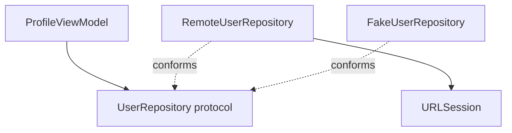
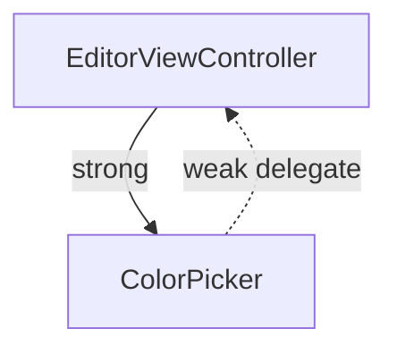
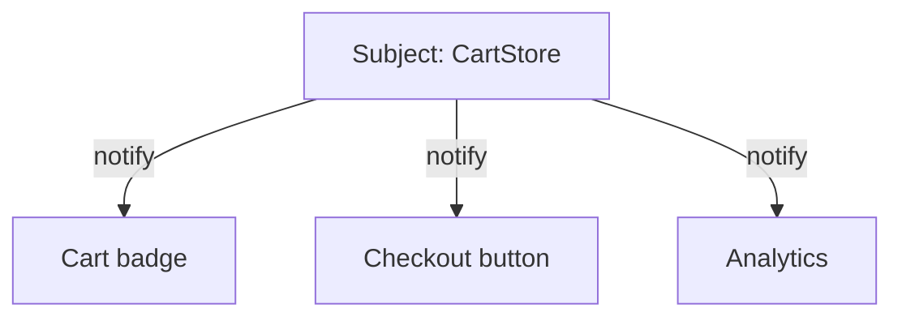
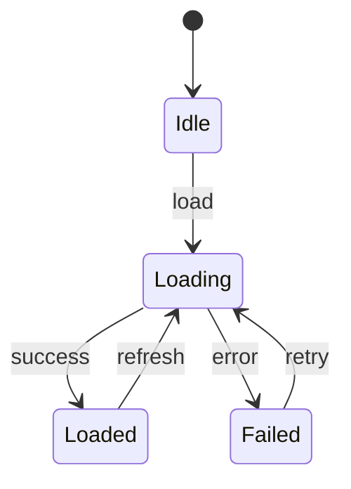
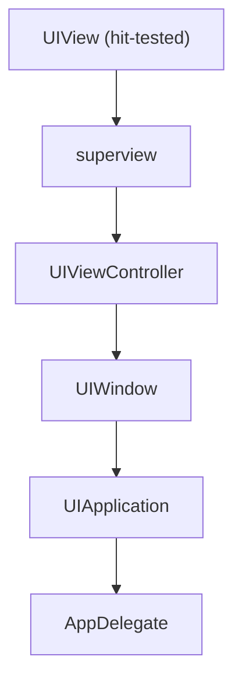
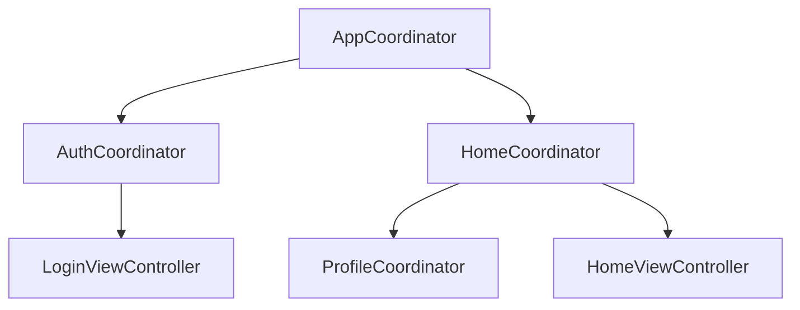
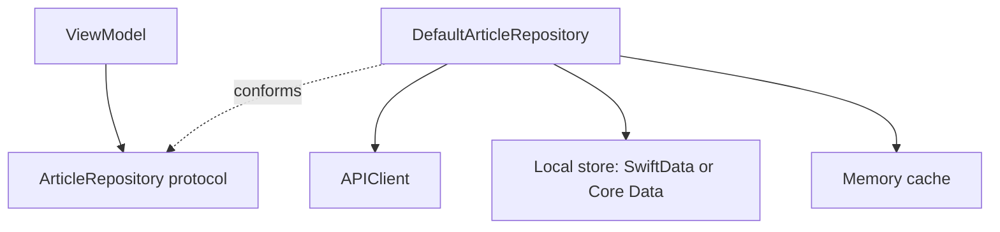
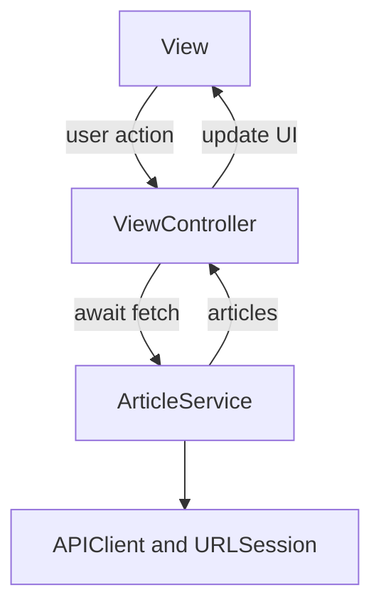

# OOP, SOLID & Design Patterns

[⬅ Back to index](../README.md)

Covers: OOP pillars, SOLID with iOS examples, and the design patterns used across Apple frameworks (Delegation, Singleton, Observer, KVO, Notification, Target-Action, Factory, Builder, Adapter, Facade, Decorator, Strategy, Coordinator…).

---

## OOP & SOLID

### 1. What are the four pillars of OOP?

<details>
<summary>Answer</summary>

**In short:** **Encapsulation** (hide state behind an interface), **Abstraction** (expose *what* something does, hide *how*), **Inheritance** (reuse and specialise behaviour by subclassing) and **Polymorphism** (one interface, many implementations). In Swift you get all four from classes, but idiomatic Swift leans on **protocols, value types and composition** rather than deep inheritance.

#### Encapsulation

Keep an object's state private and allow changes only through methods that preserve its rules (invariants).

```swift
final class BankAccount {
    private(set) var balance: Decimal = 0      // readable outside, writable only inside

    func deposit(_ amount: Decimal) {
        precondition(amount > 0)
        balance += amount
    }

    func withdraw(_ amount: Decimal) throws {
        guard amount <= balance else { throw AccountError.insufficientFunds }
        balance -= amount
    }
}
```

Nobody can set `balance = -500` from outside. Swift's access levels (`private`, `fileprivate`, `internal`, `public`, `open`) are the tools.

#### Abstraction

Callers depend on a simple contract, not the details.

```swift
protocol UserService {
    func currentUser() async throws -> User
}
```

The view model doesn't know whether the user comes from the network, Core Data or a mock.

#### Inheritance

A subclass reuses and overrides a superclass's behaviour. In iOS you mostly meet it through the frameworks: `class ProfileViewController: UIViewController`, `class AvatarView: UIView`. Only classes support it; structs and enums don't.

#### Polymorphism

The same call does different things depending on the concrete type.

```swift
protocol Shape { func area() -> Double }
struct Circle: Shape { let r: Double; func area() -> Double { .pi * r * r } }
struct Square: Shape { let side: Double; func area() -> Double { side * side } }

let shapes: [any Shape] = [Circle(r: 1), Square(side: 2)]
let total = shapes.map { $0.area() }.reduce(0, +)   // each type answers differently
```

Swift supports polymorphism through **class overriding** (dynamic dispatch via a vtable), **protocol conformance** (witness tables), and **generics** (resolved at compile time, often specialised).

| Pillar | Swift tools |
|---|---|
| Encapsulation | Access control, `private(set)`, computed properties |
| Abstraction | Protocols, opaque types (`some`) |
| Inheritance | Class subclassing, protocol inheritance, protocol extensions for shared defaults |
| Polymorphism | `override`, protocol conformances, generics |

**Pitfalls:**
- Deep inheritance trees (`BaseViewController` → `BaseListViewController` → ...) make changes ripple unpredictably.
- Protocol extension methods that aren't protocol requirements are statically dispatched, so "overriding" them in a conforming type doesn't behave polymorphically.

**Likely follow-ups:**
- *Why is Swift called protocol-oriented?* Protocols with extensions give shared behaviour to structs, enums and classes alike, without inheritance.
- *What does `final` do?* Prevents subclassing/overriding, enabling static dispatch and stating intent.

</details>

### 2. Explain SOLID with iOS examples.

<details>
<summary>Answer</summary>

**In short:** SOLID is five design principles that keep code easy to change: **S**ingle Responsibility (one reason to change), **O**pen/Closed (extend without editing), **L**iskov Substitution (any implementation must work wherever the abstraction is expected), **I**nterface Segregation (small, focused protocols), **D**ependency Inversion (depend on abstractions, injected from outside). In iOS they mostly show up as: no Massive View Controller, protocol-based services, and dependency injection.

#### S – Single Responsibility

A type should have one reason to change. The classic violation is a view controller that fetches data, parses JSON, formats dates, validates input and decides navigation.

```swift
// Split by responsibility:
final class ProfileViewController: UIViewController { /* layout + binding only */ }
final class ProfileViewModel { /* presentation state and logic */ }
final class UserRepository { /* fetch + cache users */ }
struct ProfileFormatter { /* dates, display strings */ }
final class ProfileCoordinator { /* navigation */ }
```

#### O – Open/Closed

Open for extension, closed for modification. Adding a new variant shouldn't require editing a central `switch` in many places.

```swift
// Violates OCP: every new payment method edits this function
func pay(_ method: String, amount: Decimal) {
    switch method {
    case "card": break      // ...
    case "applePay": break  // ...
    default: break
    }
}

// Follows OCP: add a new type, existing code is unchanged
protocol PaymentMethod { func pay(amount: Decimal) async throws }
struct CardPayment: PaymentMethod { func pay(amount: Decimal) async throws { /* ... */ } }
struct ApplePayPayment: PaymentMethod { func pay(amount: Decimal) async throws { /* ... */ } }

final class Checkout {
    func complete(with method: any PaymentMethod, amount: Decimal) async throws {
        try await method.pay(amount: amount)
    }
}
```

(A `switch` over a Swift enum is fine when the set of cases is genuinely fixed; the compiler forces you to handle any new case.)

#### L – Liskov Substitution

Every implementation of an abstraction must honour its contract. Code that works with a `DataStore` must work with the Core Data store, the in-memory store and the mock.

```swift
protocol DataStore { func save(_ item: Item) throws; func all() throws -> [Item] }

// Violates LSP: callers that rely on DataStore crash at runtime
final class ReadOnlyStore: DataStore {
    func save(_ item: Item) throws { fatalError("not supported") }
    func all() throws -> [Item] { [] }
}
```

The fix is a better abstraction: split it into `ReadableStore` and `WritableStore`.

#### I – Interface Segregation

Clients shouldn't depend on methods they don't use. UIKit splits table behaviour into `UITableViewDataSource` and `UITableViewDelegate`; Swift splits `Codable` into `Encodable` and `Decodable`. Prefer several small protocols over one giant one. Objective-C protocols also used `optional` methods so conformers implement only what they need.

#### D – Dependency Inversion

High-level code (view models, use cases) depends on abstractions; the concrete implementation is passed in.

```swift
protocol UserRepository { func user(id: String) async throws -> User }

final class ProfileViewModel {
    private let repository: UserRepository
    init(repository: UserRepository) { self.repository = repository }  // injected
}

// Production: ProfileViewModel(repository: RemoteUserRepository(client: apiClient))
// Tests:      ProfileViewModel(repository: FakeUserRepository(user: .stub))
```



**Pitfalls:**
- Over-applying SOLID: a protocol with exactly one implementation and no tests is just ceremony.
- Confusing Dependency Inversion (the principle) with Dependency Injection (the technique usually used to achieve it).

**Likely follow-ups:**
- *Which principle does a Massive View Controller break most?* Single Responsibility.
- *How do you apply DIP in SwiftUI?* Inject dependencies via initializers or the `Environment`.

</details>

### 3. Composition vs inheritance in Swift?

<details>
<summary>Answer</summary>

**In short:** Prefer **composition**: build behaviour from smaller pieces (protocols with extensions, injected collaborators, child view controllers, SwiftUI view composition). Inheritance is fine where the framework requires it (subclassing `UIView`/`UIViewController`), but avoid deep custom hierarchies such as a `BaseViewController` that does everything.

#### Why inheritance becomes a problem

- **Tight coupling:** subclasses depend on the superclass's internals, so changing the base breaks children (the "fragile base class" problem).
- **Single inheritance:** a class has one superclass, so you can't inherit "loading behaviour" and "analytics behaviour" from two different bases.
- **Unwanted baggage:** every subclass gets everything in the base, even what it doesn't need.
- **Classes only:** structs and enums can't inherit.

```swift
// Inheritance: every screen gets everything, whether it needs it or not
class BaseViewController: UIViewController {
    func showLoading() { /* ... */ }
    func trackScreen() { /* ... */ }
    func handleError(_ e: Error) { /* ... */ }
    func setupKeyboardHandling() { /* ... */ }
}
```

#### Composition alternatives

```swift
// 1. Protocol + extension: opt-in behaviour
protocol ErrorPresenting: UIViewController {}
extension ErrorPresenting {
    func showError(_ error: Error) {
        let alert = UIAlertController(title: "Error", message: error.localizedDescription, preferredStyle: .alert)
        alert.addAction(UIAlertAction(title: "OK", style: .default))
        present(alert, animated: true)
    }
}

// 2. Injected collaborators: "has-a" instead of "is-a"
final class ProfileViewController: UIViewController, ErrorPresenting {
    private let analytics: AnalyticsTracking
    private let loader = LoadingIndicatorController()   // child VC for the spinner

    init(analytics: AnalyticsTracking) {
        self.analytics = analytics
        super.init(nibName: nil, bundle: nil)
    }
    required init?(coder: NSCoder) { fatalError("init(coder:) has not been implemented") }
}

// 3. SwiftUI: small views composed together, shared behaviour via modifiers
struct ProfileView: View {
    var body: some View {
        VStack { AvatarView(); NameView() }
            .loadingOverlay(isLoading: false)   // custom ViewModifier
    }
}
```

| | Inheritance | Composition |
|---|---|---|
| Relationship | "is-a" | "has-a" / "can-do" |
| Coupling | Tight, fixed at compile time | Loose, swappable at runtime |
| Works with structs/enums | No | Yes |
| Multiple behaviours | One superclass | Many protocols/collaborators |
| Testing | Hard to isolate base behaviour | Inject fakes |

**Pitfalls:**
- Protocol extensions can't add stored properties; you may need an injected object instead.
- Over-composing into dozens of tiny types hurts readability; aim for meaningful units.

**Likely follow-ups:**
- *When is inheritance the right call?* Framework subclassing, and genuine "is-a" hierarchies where the base is designed for extension (e.g. a custom `UICollectionViewLayout`).
- *What's a child view controller?* A VC embedded with `addChild(_:)` / `didMove(toParent:)`, letting you compose a screen from self-contained pieces.

</details>

---

## Design Patterns in iOS

### 4. What is the Delegation pattern?

<details>
<summary>Answer</summary>

**In short:** Delegation lets one object **hand off decisions or report events to another object** through a protocol. It's **one-to-one** communication and appears everywhere in UIKit: `UITableViewDelegate`/`DataSource`, `UITextFieldDelegate`, `URLSessionDelegate`, `CLLocationManagerDelegate`. Always declare the delegate property `weak`, with a class-bound (`AnyObject`) protocol, to avoid retain cycles.

#### Why it exists

A reusable component (a table view, a picker) shouldn't know about your app. Instead it asks "someone" questions (`numberOfRowsInSection`, `shouldChangeCharactersIn`) and tells them about events (`didSelectRowAt`). That "someone" is the delegate. The component stays generic; the delegate supplies app-specific behaviour.

#### Building one

```swift
protocol ColorPickerDelegate: AnyObject {            // AnyObject so the reference can be weak
    func colorPicker(_ picker: ColorPicker, didSelect color: UIColor)
    func colorPickerShouldAllowCustomColors(_ picker: ColorPicker) -> Bool
}

extension ColorPickerDelegate {                      // default implementation = "optional" in Swift
    func colorPickerShouldAllowCustomColors(_ picker: ColorPicker) -> Bool { false }
}

final class ColorPicker: UIView {
    weak var delegate: ColorPickerDelegate?          // weak: the owner usually holds the picker

    private func userTapped(_ color: UIColor) {
        delegate?.colorPicker(self, didSelect: color)
    }
}

final class EditorViewController: UIViewController, ColorPickerDelegate {
    private let picker = ColorPicker()

    override func viewDidLoad() {
        super.viewDidLoad()
        picker.delegate = self
    }

    func colorPicker(_ picker: ColorPicker, didSelect color: UIColor) {
        view.backgroundColor = color
    }
}
```

Passing the sender as the first parameter (`_ picker: ColorPicker`) is a Cocoa convention that lets one delegate serve several instances.

#### Why `weak`

The view controller strongly owns the picker (through its view hierarchy). If the picker also strongly owned its delegate (the view controller), neither would ever be freed.



**Pitfalls:**
- Forgetting `AnyObject` on the protocol: you can't declare the property `weak`.
- Forgetting `delegate = self`: callbacks silently never fire.
- A `weak` delegate becomes `nil` if nothing else holds it, e.g. a separate delegate object created inline and never stored.

**Likely follow-ups:**
- *Delegate vs data source?* Same mechanism; the data source supplies data, the delegate handles behaviour and events.
- *How do you make a delegate method optional in Swift?* Provide a default in a protocol extension, or use an `@objc` protocol with `@objc optional` methods.

</details>

### 5. Delegate vs Notification vs Closure vs KVO vs Combine — when to use which?

<details>
<summary>Answer</summary>

**In short:** Use a **delegate** for one-to-one communication with several related callbacks, especially ones that return values. Use a **closure** for one or two simple callbacks. Use **NotificationCenter** to broadcast app-wide events to many unknown listeners. Use **KVO** to observe properties of `NSObject` subclasses (mostly Apple's own). Use **Combine/Observation** for state streams and data binding in MVVM/SwiftUI.

| Mechanism | Relationship | Use when |
|---|---|---|
| **Delegate** | 1:1, protocol-based | Many related callbacks, the delegate can return values (`heightForRow`) |
| **Closure/callback** | 1:1 | One or two simple callbacks (completion handlers, button actions) |
| **NotificationCenter** | 1:many, loosely coupled | Broadcasting app-wide events (keyboard shown, logout, app background) |
| **KVO** | 1:many, property changes | Observing properties of NSObject subclasses (`AVPlayer.status`, `WKWebView.estimatedProgress`) |
| **Combine/Observation** | 1:many, reactive | State streams and data binding in MVVM/SwiftUI |
| **async/await, AsyncSequence** | 1:1 result / ordered stream | One-shot async work; sequences of events consumed in a task |

#### The same event, five ways

```swift
// Delegate: structured, discoverable, many methods
protocol UploaderDelegate: AnyObject {
    func uploader(_ u: Uploader, didProgress p: Double)
    func uploaderDidFinish(_ u: Uploader)
}

// Closure: lightweight
uploader.onFinish = { [weak self] in self?.showDone() }

// Notification: anyone in the app can listen
NotificationCenter.default.post(name: .uploadFinished, object: nil)

// KVO: observe an @objc dynamic property (Foundation's Progress supports it)
let token = progress.observe(\.fractionCompleted) { p, _ in print(p.fractionCompleted) }

// Combine / Observation: state the UI binds to
@Published var uploadProgress: Double = 0
```

#### Questions that decide it

1. **How many listeners?** One: delegate or closure. Many or unknown: notification or publisher.
2. **Must the listener return a value?** Delegate (or a closure with a return type).
3. **State over time, or a single event?** State: Combine/Observation. Single result: async/await or a completion closure.
4. **Are the objects far apart in the app?** Notifications decouple them, at the cost of traceability.

**Pitfalls:**
- Using notifications between two objects that already know each other: hard to trace and debug.
- Stored closures that capture `self` strongly on an object `self` owns: retain cycle.
- KVO on plain Swift properties doesn't work; they must be `@objc dynamic` on an `NSObject` subclass.

**Likely follow-ups:**
- *Which is easiest to test?* Closures and protocol delegates: just pass a fake.
- *What would you use for "user logged out, clear everything"?* Commonly a notification or a shared session publisher, since many unrelated parts react.

</details>

### 6. What is the Singleton pattern? What are its pros and cons?

<details>
<summary>Answer</summary>

**In short:** A singleton guarantees **one shared instance** with global access: `static let shared = Manager()` plus a `private init()`. Apple uses shared instances widely (`UIApplication.shared`, `URLSession.shared`, `FileManager.default`, `UserDefaults.standard`). It's convenient, but it introduces global (often mutable) state, hides dependencies and makes testing hard. The better approach is to inject the shared instance behind a protocol.

#### Implementation

```swift
final class AnalyticsManager {
    static let shared = AnalyticsManager()   // lazily initialized exactly once, thread-safely
    private init() {}                        // nobody else can create one

    private var queue: [Event] = []
    func track(_ event: Event) { queue.append(event) }   // NOT thread-safe as written
}
```

Note that several of Apple's `default`/`standard`/`shared` objects are "shared instances" rather than strict singletons: you can still create your own `URLSession` or `FileManager`. `UIApplication` is a true singleton.

#### Pros and cons

| Pros | Cons |
|---|---|
| Easy to reach from anywhere | **Global mutable state**: data races if used from several threads |
| One instance for a truly single resource | **Hidden dependencies**: an initializer doesn't reveal that the type uses `Analytics.shared` |
| Lazy creation | **Hard to test**: can't swap in a fake; state leaks between tests |
| | **Tight coupling**: every call site depends on the concrete type |
| | Lives for the whole app lifetime |

#### Making it testable

```swift
protocol AnalyticsTracking { func track(_ event: Event) }
extension AnalyticsManager: AnalyticsTracking {}

final class CheckoutViewModel {
    private let analytics: AnalyticsTracking
    init(analytics: AnalyticsTracking = AnalyticsManager.shared) {  // default keeps call sites simple
        self.analytics = analytics
    }
}

// In tests:
let spy = AnalyticsSpy()
let sut = CheckoutViewModel(analytics: spy)
```

Same idea for networking: `init(session: NetworkSession = URLSession.shared)`, where `NetworkSession` is a protocol that `URLSession` conforms to.

#### Thread safety

Protect mutable state with an `actor`, a serial queue or a lock. With Swift 6 strict concurrency, a `static let shared` of a non-`Sendable` class is flagged; making the type an `actor` or `@MainActor` is the usual fix.

**Pitfalls:**
- Singletons holding user data must be reset on logout, or data leaks between accounts.
- Singletons that reference each other during initialization can cause recursion or deadlock at startup.

**Likely follow-ups:**
- *Is `static let` thread-safe?* Its initialization is; access to its mutable members isn't unless you make it so.
- *When is a singleton fine?* Stateless helpers or genuinely app-wide resources, ideally still injected where used.

</details>

### 7. What is KVO (Key-Value Observing)?

<details>
<summary>Answer</summary>

**In short:** KVO is an Objective-C runtime mechanism for observing changes to an object's properties. It requires an `NSObject` subclass and `@objc dynamic` properties. In Swift you use the block API `observe(\.keyPath, options:)` and keep the returned `NSKeyValueObservation`; observation stops when that token is deallocated. Under the hood it works by **isa-swizzling**: the runtime creates a hidden subclass whose setter sends change notifications. For your own Swift types, prefer Combine or Observation.

#### Usage

```swift
final class PlayerViewController: UIViewController {
    private let player = AVPlayer(url: videoURL)
    private var statusObservation: NSKeyValueObservation?

    override func viewDidLoad() {
        super.viewDidLoad()
        statusObservation = player.observe(\.status, options: [.initial, .new]) { player, _ in
            if player.status == .readyToPlay { player.play() }
        }
    }
    // When the VC is deallocated, statusObservation is released and observation stops.
}
```

Common real-world targets: `AVPlayer.status`, `AVPlayerItem.status`, `WKWebView.estimatedProgress` / `title`, `Progress.fractionCompleted`, `UIScrollView.contentSize`, `OperationQueue.operationCount`.

#### Making your own property observable

```swift
final class Downloader: NSObject {
    @objc dynamic var progress: Double = 0   // @objc exposes it to the runtime; dynamic forces message dispatch
}
```

#### How isa-swizzling works

1. The first time you observe `progress` on an instance, the runtime creates a subclass such as `NSKVONotifying_Downloader`.
2. It changes that object's `isa` pointer (its class) to the new subclass.
3. The subclass overrides the setter to call `willChangeValue(forKey:)`, the original setter, then `didChangeValue(forKey:)`, which notifies observers.
4. It also overrides `class` to keep returning `Downloader`, hiding the trick.

That's why the property must be `dynamic`: otherwise Swift may call the setter directly and bypass the override.

#### Options

| Option | Meaning |
|---|---|
| `.new` | Include the new value in `change` |
| `.old` | Include the old value |
| `.initial` | Fire once immediately with the current value |
| `.prior` | Fire before and after the change |

**Pitfalls:**
- Not storing the `NSKeyValueObservation`: no callbacks.
- Callbacks arrive on the thread where the property changed, not necessarily the main thread.
- The old string-based API (`addObserver(_:forKeyPath:options:context:)`) crashed when you forgot to remove the observer or removed it twice; the block API avoids this.
- Doesn't work with structs or non-`@objc` properties.

**Likely follow-ups:**
- *Combine version?* `player.publisher(for: \.status)` gives a KVO-backed publisher.
- *How does it relate to KVC?* KVO is built on KVC's key-based access (see question 17).

</details>

### 8. What is NotificationCenter? What are the pitfalls?

<details>
<summary>Answer</summary>

**In short:** NotificationCenter is a **publish-subscribe broadcast** system: anyone can `post` a `Notification.Name`, and every registered observer receives it, without sender and receivers knowing about each other. Pitfalls: it's hard to trace, block-based observers must be removed and should capture `[weak self]`, notifications are delivered **synchronously on the posting thread** by default, and `userInfo` is untyped. Modern alternatives are `notifications(named:)` (an AsyncSequence) and Combine's `publisher(for:)`.

#### Basic usage

```swift
extension Notification.Name {
    static let userDidLogout = Notification.Name("userDidLogout")
}

// Post
NotificationCenter.default.post(name: .userDidLogout, object: nil,
                                userInfo: ["reason": "expired"])

// Observe (block-based)
final class CartViewController: UIViewController {
    private var logoutToken: NSObjectProtocol?

    override func viewDidLoad() {
        super.viewDidLoad()
        logoutToken = NotificationCenter.default.addObserver(
            forName: .userDidLogout, object: nil, queue: .main
        ) { [weak self] _ in
            self?.clearCart()
        }
    }

    deinit {
        if let logoutToken { NotificationCenter.default.removeObserver(logoutToken) }
    }
}
```

System notifications you'll meet: `UIResponder.keyboardWillShowNotification`, `UIApplication.didEnterBackgroundNotification`, `NSManagedObjectContext.didSaveObjectsNotification`, `UIContentSizeCategory.didChangeNotification`.

#### Pitfalls in detail

| Pitfall | Why it hurts | Mitigation |
|---|---|---|
| Implicit coupling | Reading the posting code doesn't tell you who reacts | Use only for genuinely app-wide events |
| Block observers are retained by the center | Leaks, and callbacks after the screen is gone | Store the token, remove it, capture `[weak self]` |
| Synchronous delivery on the posting thread | A post from a background thread runs observer UI code off-main; slow observers block the poster | Pass `queue: .main`, or hop to the main actor |
| Untyped `userInfo` | Typos and bad casts fail at runtime | Wrap in a typed helper, or use a typed publisher |
| String-based names | Collisions, typos | Define names as static constants |

Selector-based observers (`addObserver(_:selector:name:object:)`) have not needed manual removal since iOS 9; block-based observers still do.

#### Modern alternatives

```swift
// AsyncSequence (iOS 15+): the loop ends when the surrounding Task is cancelled
.task {
    for await _ in NotificationCenter.default.notifications(named: .userDidLogout) {
        clearCart()
    }
}

// Combine
NotificationCenter.default.publisher(for: UIApplication.didBecomeActiveNotification)
    .sink { [weak self] _ in self?.refresh() }
    .store(in: &cancellables)
```

**Likely follow-ups:**
- *What does the `queue:` parameter do?* The block runs on that queue; with `nil` it runs on the thread that posted. For fire-and-forget delivery, dispatch the work yourself or use `NotificationQueue`.
- *When would you avoid NotificationCenter?* For communication between a parent and child or two objects that know each other; a delegate or closure is clearer.

</details>

### 9. What is the Target-Action pattern?

<details>
<summary>Answer</summary>

**In short:** A control (`UIButton`, `UISwitch`, `UISlider`) stores a **target object and a selector** and calls that method when an event occurs: `button.addTarget(self, action: #selector(didTap), for: .touchUpInside)`. It relies on the Objective-C runtime, so the method must be `@objc`. Since iOS 14 you can use closure-based `UIAction` instead: `UIButton(primaryAction: UIAction { _ in ... })`.

#### How it works

```swift
final class SettingsViewController: UIViewController {
    private let toggle = UISwitch()
    private let saveButton = UIButton(type: .system)

    override func viewDidLoad() {
        super.viewDidLoad()
        toggle.addTarget(self, action: #selector(toggleChanged(_:)), for: .valueChanged)
        saveButton.addTarget(self, action: #selector(save), for: .touchUpInside)
    }

    @objc private func toggleChanged(_ sender: UISwitch) {   // sender (and event) params are optional
        print("on:", sender.isOn)
    }

    @objc private func save() { /* ... */ }
}
```

1. `UIControl` keeps a list of (target, action, events) entries. The target is **not retained**, so this doesn't cause a retain cycle.
2. When a touch produces `.touchUpInside`, the control calls `sendAction(_:to:for:)`, which forwards to `UIApplication.sendAction(_:to:from:for:)`.
3. The selector is invoked on the target via the Objective-C runtime.

#### Nil target and the responder chain

If you pass `nil` as the target, UIKit walks the **responder chain** from the first responder upward until some object implements the action. This is how edit-menu commands like `copy(_:)` reach the right view.

#### Modern closure API

```swift
let button = UIButton(configuration: .filled(), primaryAction: UIAction(title: "Save") { [weak self] _ in
    self?.save()
})

toggle.addAction(UIAction { [weak self] action in
    guard let sender = action.sender as? UISwitch else { return }
    self?.updateSetting(sender.isOn)
}, for: .valueChanged)
```

| | Target-Action | `UIAction` (iOS 14+) |
|---|---|---|
| Requires `@objc` | Yes | No |
| Logic location | Separate method | Inline closure |
| Retain risk | None (target not retained) | Closure captures `self`; use `[weak self]` |
| Responder chain (`nil` target) | Yes | No |

**Pitfalls:**
- A selector whose method was renamed or removed fails at runtime with "unrecognized selector" if registered by string; `#selector` catches most of this at compile time.
- Gesture recognizers use target-action too, with the same `@objc` requirement.

**Likely follow-ups:**
- *Which pattern is the nil-target lookup?* Chain of Responsibility (question 13).
- *SwiftUI equivalent?* The closure passed to `Button(action:)`.

</details>

### 10. What is the Observer pattern?

<details>
<summary>Answer</summary>

**In short:** The Observer pattern defines a **one-to-many dependency**: when a subject's state changes, all registered observers are notified automatically, without the subject knowing who they are. In iOS it's implemented by **KVO**, **NotificationCenter**, **Combine** (`@Published`, subjects), the **Observation framework** (`@Observable`), and SwiftUI's state system.

#### The idea



The subject keeps a list of observers and notifies them when it changes. Observers can be added and removed at runtime. This decouples "something changed" from "who cares about it".

#### A hand-rolled version (what the frameworks do for you)

```swift
final class CartStore {
    private var observers: [UUID: ([Item]) -> Void] = [:]
    private(set) var items: [Item] = [] {
        didSet { observers.values.forEach { $0(items) } }
    }

    @discardableResult
    func observe(_ handler: @escaping ([Item]) -> Void) -> UUID {
        let id = UUID()
        observers[id] = handler
        handler(items)                 // send current state immediately
        return id
    }

    func removeObserver(_ id: UUID) { observers[id] = nil }
    func add(_ item: Item) { items.append(item) }
}
```

#### iOS implementations

| Mechanism | What is observed | Notes |
|---|---|---|
| KVO | `@objc dynamic` property on an `NSObject` | Runtime-based |
| NotificationCenter | A named event | Broadcast via a central hub |
| Combine | `@Published` properties, subjects | Operators, typed errors |
| Observation (`@Observable`, iOS 17+) | Properties of an `@Observable` class | Tracks exactly which properties a view reads |
| SwiftUI `@State` / `@Binding` | View state | The framework observes and re-renders |

```swift
@Observable
final class CartModel {
    var items: [Item] = []
}

struct CartBadge: View {
    let cart: CartModel
    var body: some View { Text("\(cart.items.count)") }  // re-renders when items changes
}
```

**Pitfalls:**
- Observers that are never removed leak, or receive events after they're gone.
- Notification storms: many small changes trigger many updates; batch or debounce.
- Observers that modify the subject during notification can cause re-entrancy bugs.

**Likely follow-ups:**
- *Observer vs publish-subscribe?* In pub-sub (NotificationCenter) a broker sits between publishers and subscribers; in the classic Observer pattern the subject holds its observers directly.

</details>

### 11. Factory, Builder and Abstract Factory in iOS?

<details>
<summary>Answer</summary>

**In short:** These are creational patterns. A **Factory** encapsulates *which* object to create and how to wire it (`UIButton(type:)`, `UIFont.systemFont(ofSize:)`, a `ViewControllerFactory` used by coordinators). A **Builder** constructs a complex object step by step (`URLComponents`, `UIButton.Configuration`, building `NSAttributedString`/`AttributedString`, a custom `RequestBuilder`). An **Abstract Factory** creates *families* of related objects that must match (for example, all components for one theme).

#### Factory

Centralises creation so callers don't need to know concrete types or their dependencies.

```swift
protocol ViewControllerFactory {
    func makeLogin(onLogin: @escaping () -> Void) -> UIViewController
    func makeProfile(userID: String) -> UIViewController
}

final class DefaultViewControllerFactory: ViewControllerFactory {
    private let container: DependencyContainer
    init(container: DependencyContainer) { self.container = container }

    func makeLogin(onLogin: @escaping () -> Void) -> UIViewController {
        let vm = LoginViewModel(auth: container.authService, onLogin: onLogin)
        return LoginViewController(viewModel: vm)
    }

    func makeProfile(userID: String) -> UIViewController {
        ProfileViewController(viewModel: ProfileViewModel(userID: userID, repo: container.userRepository))
    }
}
```

Coordinators call the factory, so they handle *flow* while the factory handles *construction*. Static factory methods (`static func makeDefault() -> Self`) are the lightweight version.

#### Builder

Useful when an object has many optional parts or needs assembling in steps.

```swift
var components = URLComponents()
components.scheme = "https"
components.host = "api.example.com"
components.path = "/search"
components.queryItems = [URLQueryItem(name: "q", value: "swift")]
let url = components.url

var config = UIButton.Configuration.filled()
config.title = "Buy"
config.image = UIImage(systemName: "cart")
config.imagePadding = 8
let button = UIButton(configuration: config)
```

A custom fluent builder:

```swift
struct RequestBuilder {
    private var request: URLRequest
    init(url: URL) { request = URLRequest(url: url) }

    func method(_ m: String) -> Self { var copy = self; copy.request.httpMethod = m; return copy }
    func header(_ key: String, _ value: String) -> Self {
        var copy = self; copy.request.setValue(value, forHTTPHeaderField: key); return copy
    }
    func body(_ data: Data) -> Self { var copy = self; copy.request.httpBody = data; return copy }
    func build() -> URLRequest { request }
}

let req = RequestBuilder(url: url)
    .method("POST")
    .header("Content-Type", "application/json")
    .body(data)
    .build()
```

In Swift, default parameter values and memberwise initializers often make a Builder unnecessary; use one when construction has real steps or validation.

#### Abstract Factory

```swift
protocol ThemeFactory {
    func makePrimaryButton(title: String) -> UIButton
    func makeCard() -> UIView
}
struct LightThemeFactory: ThemeFactory { /* light variants */ }
struct BrandDarkThemeFactory: ThemeFactory { /* matching dark brand variants */ }
```

The client receives one `ThemeFactory`, and every component it creates is guaranteed to belong to the same family.

| Pattern | Question it answers |
|---|---|
| Factory | "Which concrete object, wired how?" |
| Builder | "How do I assemble this complex object step by step?" |
| Abstract Factory | "How do I create a matching set of related objects?" |

**Pitfalls:**
- A factory that knows every type in the app becomes a god object; split factories per feature.

**Likely follow-ups:**
- *Factory vs DI container?* A container resolves dependencies generically (often at runtime); a factory is explicit, type-safe creation code, frequently backed by a container.

</details>

### 12. Adapter, Facade, Decorator, Proxy in iOS?

<details>
<summary>Answer</summary>

**In short:** These are structural patterns that wrap objects. An **Adapter** converts one interface into the one you expect (a third-party SDK behind your own protocol; `UIViewRepresentable` bringing UIKit into SwiftUI). A **Facade** gives a simple interface over a complex subsystem (a `Repository` hiding networking + caching + Core Data). A **Decorator** adds behaviour without changing the wrapped object (SwiftUI view modifiers, a caching wrapper around a service). A **Proxy** stands in for an object to control access to it (lazy loading, logging, `NSProxy`).

| Pattern | Same interface as the wrapped object? | Purpose |
|---|---|---|
| Adapter | No: translates to a different interface | Make incompatible things fit |
| Facade | No: a new, simpler interface over many objects | Hide complexity |
| Decorator | Yes | Add behaviour |
| Proxy | Yes | Control access (lazy, remote, permissions, logging) |

#### Adapter

```swift
protocol AnalyticsService { func log(_ event: String, params: [String: Any]) }

// Wraps a vendor SDK with a different API; the rest of the app never imports it
struct VendorAnalyticsAdapter: AnalyticsService {
    func log(_ event: String, params: [String: Any]) {
        VendorSDK.shared.trackEvent(named: event, withProperties: params)
    }
}
```

Switching vendors means writing a new adapter, not touching every call site. `UIViewRepresentable` / `UIViewControllerRepresentable` adapt UIKit views to SwiftUI's `View` protocol.

#### Facade

```swift
final class PhotoLibraryFacade {
    // Hides authorization, PHAsset fetching and PHImageManager requests behind one call
    func recentThumbnails(limit: Int) async throws -> [UIImage] { /* ... */ }
}
```

Apple's own examples include `UIImagePickerController` over the camera and photo APIs. A repository combining remote API, cache and database is a facade for view models.

#### Decorator

Wraps an object that conforms to the same protocol and adds behaviour before or after delegating to it.

```swift
protocol UserService { func user(id: String) async throws -> User }

final class CachedUserService: UserService {
    private let wrapped: UserService
    private var cache: [String: User] = [:]
    init(wrapping wrapped: UserService) { self.wrapped = wrapped }

    func user(id: String) async throws -> User {
        if let cached = cache[id] { return cached }
        let user = try await wrapped.user(id: id)
        cache[id] = user
        return user
    }
}

// Decorators stack:
let service: UserService = LoggingUserService(wrapping: CachedUserService(wrapping: RemoteUserService()))
```

SwiftUI modifiers (`.padding().background(.blue).shadow(radius: 4)`) are decorator-like: each wraps the view in a new one. Swift **extensions** are often called decorators in interviews too, though strictly they add methods to a type at compile time rather than wrapping an instance.

#### Proxy

```swift
final class LazyImageProxy {
    private let url: URL
    private var image: UIImage?
    init(url: URL) { self.url = url }

    func load() async throws -> UIImage {
        if let image { return image }                 // load on first access only
        let (data, _) = try await URLSession.shared.data(from: url)
        let loaded = UIImage(data: data) ?? UIImage()
        image = loaded
        return loaded
    }
}
```

`NSProxy` is Foundation's root class for objects that forward messages to another object. A common use is a weak proxy target for `CADisplayLink` or `Timer`, so they don't retain the real target.

**Pitfalls:**
- Decorator vs Proxy is about intent: decorators add features, proxies control access. Explain which you mean.
- Facades growing into god objects; keep each focused on one subsystem.

**Likely follow-ups:**
- *How does Decorator help testing?* You can test caching or logging in isolation by wrapping a fake service.

</details>

### 13. Strategy, State, Command, Chain of Responsibility in iOS?

<details>
<summary>Answer</summary>

**In short:** These are behavioural patterns. **Strategy** makes algorithms interchangeable behind one interface (`UICollectionViewLayout` subclasses such as flow and compositional layouts, sort comparators, cache policies). **State** changes behaviour based on internal state (a `ViewState` enum driving the UI, a player state machine). **Command** wraps an action as an object so it can be queued, undone or replayed (`UndoManager`, `UIAction`, operations in a queue). **Chain of Responsibility** passes a request along a chain until someone handles it (the UIKit **responder chain**).

#### Strategy

```swift
protocol PricingStrategy { func price(for base: Decimal) -> Decimal }
struct RegularPricing: PricingStrategy { func price(for base: Decimal) -> Decimal { base } }
struct MemberPricing: PricingStrategy { func price(for base: Decimal) -> Decimal { base * 0.9 } }

final class Checkout {
    var pricing: PricingStrategy = RegularPricing()   // swappable at runtime
    func total(_ base: Decimal) -> Decimal { pricing.price(for: base) }
}
```

In Swift a strategy is often just a closure: `items.sorted(by: { $0.date > $1.date })`. Swapping a collection view's layout object is the framework example.

#### State

Model screen states explicitly so impossible combinations can't exist.

```swift
enum ViewState<T> {
    case idle
    case loading
    case loaded(T)
    case failed(Error)
}

// Instead of: var isLoading: Bool; var data: [Item]?; var error: Error?
// (which allows "loading and error at the same time")
@Published var state: ViewState<[Item]> = .idle
```



The classic Gang of Four version uses one class per state; in Swift an enum with associated values plus a `switch` is the idiomatic form.

#### Command

```swift
func rename(_ doc: Document, to newName: String) {
    let oldName = doc.name
    doc.name = newName
    undoManager?.registerUndo(withTarget: doc) { target in
        target.name = oldName          // the stored undo command
    }
    undoManager?.setActionName("Rename")
}
```

`UIAction`, `UIKeyCommand`, and `Operation` subclasses in an `OperationQueue` are also commands: objects describing work that something else executes later.

#### Chain of Responsibility: the responder chain

When an event or action isn't handled, UIKit passes it to the `next` responder:



Touches, motion events, key commands and actions sent to a `nil` target travel up this chain until a responder handles them (for actions, one that implements the method and returns true from `canPerformAction(_:withSender:)`). A custom example is an error-handling chain where each handler either handles an error or forwards it.

| Pattern | Key idea | iOS example |
|---|---|---|
| Strategy | Swap algorithms | Collection view layouts, sort closures |
| State | Behaviour depends on state | `ViewState` enum, `AVPlayer` status |
| Command | Action as an object | `UndoManager`, `UIAction`, `Operation` |
| Chain of Responsibility | Pass along until handled | Responder chain |

**Likely follow-ups:**
- *Strategy vs State?* A strategy is chosen from outside; state transitions are driven by the object itself as events happen.

</details>

### 14. What is the Coordinator pattern?

<details>
<summary>Answer</summary>

**In short:** A Coordinator **moves navigation logic out of view controllers** into objects that create, configure and present screens. View controllers only report events ("user logged in"), and the coordinator decides what comes next. Benefits: reusable view controllers, centralised flows, easier deep linking and testable navigation. Typically an `AppCoordinator` owns child coordinators per flow, which must be removed when they finish. In SwiftUI, a router object that owns the `NavigationPath` plays the same role.

#### The problem

```swift
// Inside LoginViewController: it knows its successor and how to build it
func loginSucceeded() {
    let vc = HomeViewController(service: HomeService(client: APIClient()))
    navigationController?.pushViewController(vc, animated: true)
}
```

Now `LoginViewController` can't be reused in another flow (e.g. logging in from checkout), and changing the flow means editing many screens.

#### The coordinator

```swift
protocol Coordinator: AnyObject {
    var childCoordinators: [Coordinator] { get set }
    func start()
}

final class AuthCoordinator: Coordinator {
    var childCoordinators: [Coordinator] = []
    let nav: UINavigationController
    var onFinish: (() -> Void)?

    init(nav: UINavigationController) { self.nav = nav }

    func start() {
        let vm = LoginViewModel(onLogin: { [weak self] in self?.onFinish?() })
        nav.pushViewController(LoginViewController(viewModel: vm), animated: true)
    }
}

final class AppCoordinator: Coordinator {
    var childCoordinators: [Coordinator] = []
    private let window: UIWindow
    private let nav = UINavigationController()
    private let session: SessionStore

    init(window: UIWindow, session: SessionStore) {
        self.window = window
        self.session = session
    }

    func start() {
        window.rootViewController = nav
        window.makeKeyAndVisible()
        session.isLoggedIn ? showHome() : showAuth()
    }

    private func showAuth() {
        let auth = AuthCoordinator(nav: nav)
        auth.onFinish = { [weak self, weak auth] in
            self?.childCoordinators.removeAll { $0 === auth }   // release the finished flow
            self?.showHome()
        }
        childCoordinators.append(auth)                           // keep it alive while running
        auth.start()
    }

    private func showHome() { /* start a HomeCoordinator the same way */ }
}
```



#### SwiftUI equivalent

```swift
enum Route: Hashable { case profile(String) }

@Observable final class Router {
    var path = NavigationPath()
    func showProfile(_ id: String) { path.append(Route.profile(id)) }
    func popToRoot() { path = NavigationPath() }
}

struct RootView: View {
    @State private var router = Router()
    var body: some View {
        NavigationStack(path: $router.path) {
            HomeView()
                .navigationDestination(for: Route.self) { route in
                    switch route {
                    case .profile(let id): ProfileView(id: id)
                    }
                }
        }
        .environment(router)
    }
}
```

**Pitfalls:**
- Forgetting to remove finished child coordinators: they and their screens leak.
- The system Back button pops a VC without the coordinator knowing; use `UINavigationControllerDelegate`'s `navigationController(_:didShow:animated:)` to detect it and clean up.
- Coordinators that also hold business logic become the new "massive" object.

**Likely follow-ups:**
- *How does it help deep linking?* The app coordinator parses the link and starts the right child flow with the right parameters.
- *Coordinator + MVVM?* Often called MVVM-C: the view model exposes navigation events or closures, and the coordinator acts on them.

</details>

### 15. What is the Repository pattern?

<details>
<summary>Answer</summary>

**In short:** A repository is an abstraction over data sources (remote API, local database, in-memory cache) that exposes **domain models** and hides **where the data comes from**. View models and use cases depend on a repository protocol, so you can change the caching strategy or storage without touching them, and tests can inject a fake repository.

#### Shape



```swift
protocol ArticleRepository {
    func articles() async throws -> [Article]
    func refresh() async throws
}

final class DefaultArticleRepository: ArticleRepository {
    private let api: APIClient
    private let store: ArticleStore
    private var memory: [Article]?

    init(api: APIClient, store: ArticleStore) {
        self.api = api
        self.store = store
    }

    func articles() async throws -> [Article] {
        if let memory { return memory }                       // 1. memory cache
        let local = try store.fetchAll()                      // 2. disk
        if !local.isEmpty { memory = local; return local }
        try await refresh()                                   // 3. network
        return memory ?? []
    }

    func refresh() async throws {
        let dtos = try await api.get([ArticleDTO].self, from: .articles)
        let models = dtos.map(Article.init)                   // DTO -> domain model
        try store.replaceAll(with: models)
        memory = models
    }
}
```

#### Key responsibilities

- **Mapping:** turn network DTOs and database entities into domain models, so JSON field names or `NSManagedObject`s never leak into UI code.
- **Caching policy:** cache-first, network-first or stale-while-revalidate, decided in one place.
- **Single source of truth:** often the local database, with the network only updating it.

#### Testing

```swift
struct FakeArticleRepository: ArticleRepository {
    var result: Result<[Article], Error>
    func articles() async throws -> [Article] { try result.get() }
    func refresh() async throws {}
}

let vm = ArticleListViewModel(repository: FakeArticleRepository(result: .success([.stub])))
```

**Pitfalls:**
- A repository that only forwards to the API adds a layer with little value; that can be fine for consistency, but know why it's there.
- Returning `NSManagedObject`s or DTOs from the repository defeats the purpose.
- One giant "AppRepository"; prefer one per domain area.

**Likely follow-ups:**
- *Repository vs service?* Naming varies by team; commonly a service talks to one source (an API), and a repository coordinates sources and caching.
- *Where do use cases fit?* In Clean Architecture they sit between view models and repositories and hold business rules.

</details>

### 16. What is MVC's "Massive View Controller" problem and how do patterns help?

<details>
<summary>Answer</summary>

**In short:** In Apple's MVC the view controller is tightly bound to its view, so it tends to absorb everything else too: networking, data formatting, table data sources, validation and navigation. It grows into thousands of lines and becomes hard to test and change. Fixes: **MVVM** (presentation logic in a view model), **Coordinators** (navigation), **services and repositories** (data), **child view controllers** (compose the UI), separate **data source objects**, and extensions organised by responsibility. See [Architecture](11-architecture.md).

#### Why it happens

`UIViewController` is both the controller and part of the view layer: it owns the view's lifecycle (`viewDidLoad`, appearance, rotation). Since it's the one place with access to everything, each new feature gets added there. Testing it means instantiating UIKit, so teams stop testing it.

#### What ends up inside, and where it should go

| Responsibility | Move it to |
|---|---|
| Network calls, parsing | Service / `APIClient`, Repository |
| Formatting dates, prices, display strings | View model or formatter types |
| Input validation, business rules | View model / use case |
| `UITableViewDataSource` methods | A separate data source object or `UITableViewDiffableDataSource` |
| Navigation (`push`, `present`) | Coordinator / router |
| Large sub-sections of the screen | Child view controllers or custom views |
| Layout code | A custom `UIView` subclass set in `loadView()` |

#### Before and after

```swift
// Before: ~1,500 lines doing everything
final class OrdersViewController: UIViewController, UITableViewDataSource, UITableViewDelegate {
    // URLSession calls, JSON decoding, DateFormatter, validation, pushing the detail screen...
}

// After
final class OrdersViewController: UIViewController {
    private let viewModel: OrdersViewModel                               // state + logic, unit-testable
    private lazy var dataSource = OrdersDataSource(tableView: tableView) // diffable data source
    var onSelectOrder: ((Order.ID) -> Void)?                             // coordinator handles navigation

    override func viewDidLoad() {
        super.viewDidLoad()
        bindViewModel()
        Task { await viewModel.load() }
    }
}
```

The view controller is left with view lifecycle and binding, which is what it's actually good at.

**Pitfalls:**
- Moving the mess into a "Massive View Model"; split view models and extract use cases too.
- Splitting into extensions alone (`extension OrdersViewController: UITableViewDataSource`) improves organisation but not testability or coupling.

**Likely follow-ups:**
- *Is MVC itself bad?* No; the problem is putting everything in the controller. Well-factored MVC with services and child view controllers works fine.
- *How does SwiftUI change this?* Views are lightweight structs and logic naturally goes into `@Observable` models, though "massive views" can still happen.

</details>


### 17. What is KVC (Key-Value Coding)?

<details>
<summary>Answer</summary>

**In short:** KVC is an Objective-C runtime mechanism for **accessing an object's properties indirectly by string key**: `value(forKey: "name")`, `setValue("A", forKey: "name")`, key paths like `"address.city"`, and collection operators like `"@sum.price"` and `"@avg.age"`. It requires `NSObject` subclasses and `@objc` properties. It's the foundation of **KVO**, Core Data's `NSManagedObject` and Cocoa bindings, and storyboards use it for "User Defined Runtime Attributes". A wrong key crashes with `NSUnknownKeyException` ("this class is not key value coding-compliant"), the classic broken-IBOutlet crash. In Swift, prefer type-safe **key paths** (`\User.name`).

#### Usage

```swift
final class Person: NSObject {
    @objc var name: String = ""
    @objc var address: Address?
    @objc var orders: [Order] = []
}

let p = Person()
p.setValue("Ada", forKey: "name")
let name = p.value(forKey: "name") as? String              // "Ada"
let city = p.value(forKeyPath: "address.city") as? String   // traverses a path
let total = p.value(forKeyPath: "orders.@sum.amount")        // collection operator
let average = p.value(forKeyPath: "orders.@avg.amount")
```

Collection operators include `@count`, `@sum`, `@avg`, `@min`, `@max`, `@distinctUnionOfObjects` and `@unionOfObjects`.

#### How a key is resolved

For `value(forKey: "name")` the runtime looks for accessor methods (`getName`, `name`, `isName`, `_name`), then, if `accessInstanceVariablesDirectly` returns `true` (the default), for instance variables (`_name`, `_isName`, `name`, `isName`). If nothing matches, it calls `value(forUndefinedKey:)`, which by default raises `NSUnknownKeyException`.

#### The IBOutlet crash

When a nib or storyboard loads, UIKit uses `setValue(_:forKey:)` for each outlet connection. If you renamed or deleted the `@IBOutlet` in code but the storyboard still has the connection:

```
*** Terminating app due to uncaught exception 'NSUnknownKeyException',
reason: '[<MyApp.LoginViewController ...> setValue:forUndefinedKey:]:
this class is not key value coding-compliant for the key emailField.'
```

Fix: remove the stale connection in Interface Builder's Connections inspector (or restore the outlet).

#### KVC vs Swift key paths

| | KVC (`"address.city"`) | Swift key path (`\Person.address?.city`) |
|---|---|---|
| Checked at compile time | No | Yes |
| Works with structs | No | Yes |
| Requires `NSObject` / `@objc` | Yes | No |
| Result type | `Any?` | Exact type |
| Used by | KVO, Core Data, IB runtime attributes, `NSPredicate`, `NSSortDescriptor` | `map(\.name)`, `KeyPathComparator`, SwiftUI, the Swift KVO API |

**Pitfalls:**
- String keys break silently on rename and only fail at runtime.
- `value(forKey:)` returns `Any?`, so casting mistakes are runtime errors too.

**Likely follow-ups:**
- *Is KVC still used in Swift code?* Mostly indirectly, through Core Data, `NSPredicate` format strings and Interface Builder.

</details>

### 18. In MVC, where should the networking/download code go?

<details>
<summary>Answer</summary>

**In short:** **Not in the view controller, and not in the view.** Put it in the **model layer**, in a service such as an `APIClient` or `Repository` that the controller calls. The service fetches and parses data into model objects and returns them (via async/await or a completion handler); the controller then updates the view. This keeps view controllers thin and lets you test networking on its own. In MVVM, the view model calls the service instead.

#### Layering



#### Code

```swift
// Model layer: networking + parsing
protocol ArticleService {
    func latest() async throws -> [Article]
}

final class RemoteArticleService: ArticleService {
    private let session: URLSession
    private let baseURL: URL
    init(session: URLSession = .shared, baseURL: URL) {
        self.session = session
        self.baseURL = baseURL
    }

    func latest() async throws -> [Article] {
        let (data, response) = try await session.data(from: baseURL.appendingPathComponent("articles"))
        guard (response as? HTTPURLResponse)?.statusCode == 200 else { throw APIError.badStatus }
        return try JSONDecoder().decode([Article].self, from: data)
    }
}

// Controller: asks for data, updates the view
final class ArticlesViewController: UITableViewController {
    private let service: ArticleService
    private var articles: [Article] = []

    init(service: ArticleService) {
        self.service = service
        super.init(style: .plain)
    }
    required init?(coder: NSCoder) { fatalError("init(coder:) has not been implemented") }

    override func viewDidLoad() {
        super.viewDidLoad()
        Task { @MainActor in
            do {
                articles = try await service.latest()
                tableView.reloadData()
            } catch {
                showError(error)
            }
        }
    }
}
```

#### Why not elsewhere

| Location | Problem |
|---|---|
| View (`UIView`, cell) | Views shouldn't fetch data; a reused cell with an in-flight download can show the wrong image |
| View controller | Massive View Controller; can't test networking without UIKit; can't reuse the code on other screens |
| Model-layer service | Reusable, testable with a mock service or a custom `URLProtocol`, swappable |

For images in cells, a shared image loader/cache service is called from the cell's configuration code, and the request is cancelled in `prepareForReuse()`.

**Pitfalls:**
- Updating the UI from a background completion handler; hop to the main thread or `@MainActor`.
- Not cancelling work when the screen goes away; keep the `Task` and cancel it if the result is no longer needed.

**Likely follow-ups:**
- *How do you test the service?* Inject a `URLSession` configured with a custom `URLProtocol` that returns canned responses, or mock it behind the `ArticleService` protocol.

</details>

---

[⬅ Previous: Combine](06-combine.md) · [⬅ Back to index](../README.md) · [Next: iOS Fundamentals ➡](08-ios-fundamentals.md)
