# iOS Fundamentals – App Lifecycle & Platform

[⬅ Back to index](../README.md)

Covers: app states & lifecycle, AppDelegate vs SceneDelegate, SwiftUI App lifecycle, launch sequence, Info.plist, bundle & sandbox, responder chain, deep links, extensions, iOS architecture layers.

---

### 1. What are the iOS app states?

<details>
<summary>Answer</summary>

**In short:** An iOS app is always in one of five states: **Not running**, **Inactive** (on screen but not receiving events), **Active** (on screen and receiving events), **Background** (running code but not visible) and **Suspended** (in memory but not running code). The system can kill a suspended app at any time without warning, so you save state when you go to the background, not when you terminate.

#### Why these states exist

iPhones have limited memory and battery. Desktop operating systems let any number of apps run at once. iOS instead gives the CPU freely only to the app the user is looking at, and quickly freezes everything else. The states describe how much the system currently allows your app to do.

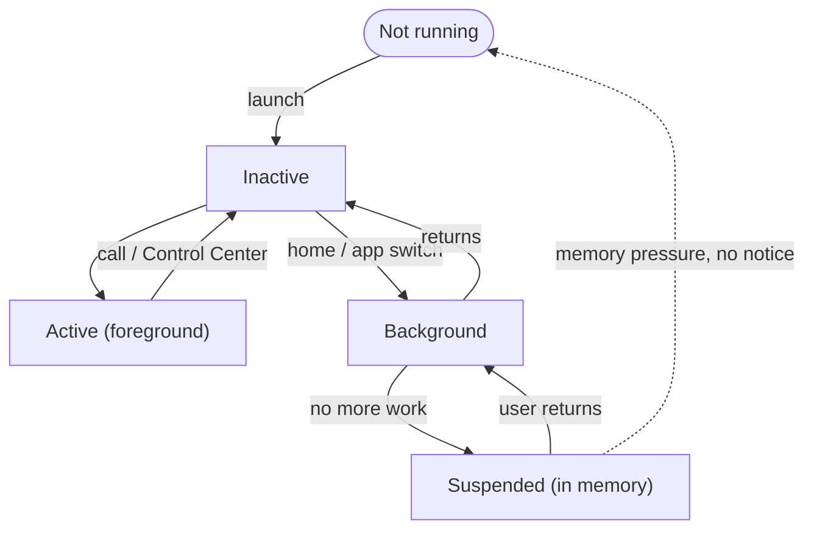

| State | Visible? | Runs code? | Receives touches? | Typical cause |
|---|---|---|---|---|
| Not running | No | No | No | Never launched, or terminated |
| Inactive | Yes | Yes | **No** | Incoming call, Control Center, Notification Center, app switcher, launching |
| Active | Yes | Yes | Yes | Normal use |
| Background | No | Yes, briefly | No | User went home or switched apps |
| Suspended | No | **No** | No | Background work finished |

#### Each state in more detail

- **Not running** – the app was never launched, or the process was terminated (by the user swiping it away, by a crash, or by the system).
- **Inactive** – a short transitional state. The app is in the foreground but events are not delivered to it. You pass through it on launch and on every move between Active and Background. Pause games, timers and video here.
- **Active** – the normal running state. Only the active app gets touch events.
- **Background** – the app is executing code but is off screen. By default you only get a few seconds before suspension. You can ask for more time with `beginBackgroundTask(withName:expirationHandler:)` (typically around 30 seconds, not guaranteed), or keep running with a background mode such as audio, location or VoIP. Some apps launch directly into the background, for example for a silent push or a background fetch, without ever becoming visible.
- **Suspended** – the process stays in memory, but no code runs. Coming back is fast because nothing needs to reload. When memory gets low, the system removes suspended apps **without calling any of your code**. `applicationWillTerminate` is not called in that case.

#### What this means in practice

```swift
// SceneDelegate (UIKit). SwiftUI uses scenePhase instead.
func sceneWillResignActive(_ scene: UIScene) {
    gameLoop.pause()            // Active -> Inactive: stop timers, pause media
}

func sceneDidEnterBackground(_ scene: UIScene) {
    draftStore.saveToDisk()     // Last reliable moment to persist state
    hideSensitiveContent()      // The app-switcher snapshot is taken around now
}
```

**Common pitfalls**
- Saving data only in `applicationWillTerminate`. It usually never runs, because apps are killed while suspended.
- Treating Inactive as "background". A pulled-down Control Center makes you Inactive, but your UI is still visible.
- Assuming your app was launched by the user. Background launches (push, background fetch, location events) also run `didFinishLaunching`.

**Likely follow-ups**
- *How do you get more time in the background?* `beginBackgroundTask` for a finite task, `BGTaskScheduler` for deferred work, or a declared background mode.
- *Does the user swiping the app away call `applicationWillTerminate`?* Only if the app was running (not suspended) at the time. Never rely on it.
- *What state is the app in when a phone call comes in?* Inactive.

</details>

### 2. What are the AppDelegate lifecycle methods?

<details>
<summary>Answer</summary>

**In short:** The AppDelegate gets **process-level** callbacks: launch (`willFinishLaunching` / `didFinishLaunchingWithOptions`), becoming active or inactive, entering the background or foreground, termination, push-notification registration and scene configuration. In apps that use scenes (iOS 13+), the UI-state callbacks move to the **SceneDelegate**, and the AppDelegate keeps the app-wide events.

#### What the AppDelegate is

`UIApplicationMain` creates one `UIApplication` object and one delegate object that conforms to `UIApplicationDelegate`. The system calls the delegate whenever something happens to the **whole app process**. It is the first piece of your code that runs after `main()`.

#### The main methods

| Method | When it's called | Typical use |
|---|---|---|
| `application(_:willFinishLaunchingWithOptions:)` | Very early, before state restoration | Rarely needed; early configuration |
| `application(_:didFinishLaunchingWithOptions:)` | Launch is almost complete | Configure SDKs, crash reporting, appearance, DI container, notification delegate |
| `applicationDidBecomeActive(_:)` | Became Active | Restart paused tasks (pre-scene apps) |
| `applicationWillResignActive(_:)` | About to become Inactive | Pause games, timers (pre-scene apps) |
| `applicationDidEnterBackground(_:)` | Entered the background | Save state, free resources (pre-scene apps) |
| `applicationWillEnterForeground(_:)` | Coming back from the background | Refresh UI data (pre-scene apps) |
| `applicationWillTerminate(_:)` | Process is about to end while running | Last-chance cleanup. **Not called** if the app is killed while suspended |
| `application(_:didRegisterForRemoteNotificationsWithDeviceToken:)` | APNs gave you a device token | Send the token to your server |
| `application(_:didFailToRegisterForRemoteNotificationsWithError:)` | Push registration failed | Log it |
| `application(_:configurationForConnecting:options:)` | A new scene is being created (iOS 13+) | Choose the scene configuration / delegate class |
| `application(_:didDiscardSceneSessions:)` | User closed scenes in the switcher | Clean up data for those scenes |
| `application(_:handleEventsForBackgroundURLSession:completionHandler:)` | Background downloads finished | Reconnect the session and store the completion handler |
| `applicationDidReceiveMemoryWarning(_:)` | Low memory | Drop caches |

```swift
@main
final class AppDelegate: UIResponder, UIApplicationDelegate {
    func application(_ application: UIApplication,
                     didFinishLaunchingWithOptions launchOptions: [UIApplication.LaunchOptionsKey: Any]?) -> Bool {
        CrashReporter.start()                                     // must be early
        UNUserNotificationCenter.current().delegate = NotificationHandler.shared
        application.registerForRemoteNotifications()              // async; token arrives below
        return true
    }

    func application(_ application: UIApplication,
                     didRegisterForRemoteNotificationsWithDeviceToken deviceToken: Data) {
        let token = deviceToken.map { String(format: "%02x", $0) }.joined()
        PushAPI.upload(token: token)
    }
}
```

#### With scenes vs without

If the app's Info.plist has a scene manifest, the app-level methods `applicationDidBecomeActive`, `applicationDidEnterBackground` and so on are **not called**. Their scene versions (`sceneDidBecomeActive`, `sceneDidEnterBackground`) are called on each SceneDelegate instead. App-wide work such as launch, push tokens and background URLSession events stays in the AppDelegate.

**Common pitfalls**
- Doing slow work (network calls, big database migrations) synchronously in `didFinishLaunching`. It delays the first frame, and the watchdog kills apps that take too long to launch.
- Putting UI-state code in AppDelegate methods in a scene-based app and wondering why it never runs.
- Relying on `applicationWillTerminate` to save data.

**Likely follow-ups**
- *What's in `launchOptions`?* The reason for launch, e.g. a URL, a notification or a location event. In scene-based apps most of this arrives in the scene's `connectionOptions` instead.
- *Where do you set `UNUserNotificationCenter.delegate`?* In `willFinishLaunching` or `didFinishLaunching`, so it is set before a notification tap is delivered.

</details>

### 3. AppDelegate vs SceneDelegate? Why were scenes introduced?

<details>
<summary>Answer</summary>

**In short:** Scenes arrived in iOS 13 so that one app process could show **several windows** at once (iPad multi-window, Mac Catalyst). The **AppDelegate** handles the process (launch, push registration, background URLSession events, scene sessions). The **SceneDelegate** handles one window's UI lifecycle (create the window, active/background, deep links). Apple has announced that the scene lifecycle will become mandatory, so all apps should adopt it.

#### The problem scenes solve

Before iOS 13 an app had exactly one UI, so "the app is in the background" and "the UI is in the background" meant the same thing, and the AppDelegate owned both. On iPad, a user can now open two windows of the same app side by side, for example two Notes documents. One window may be in the foreground while another is in the background or closed. A single AppDelegate can't describe that, so UI state was split into **scenes**.

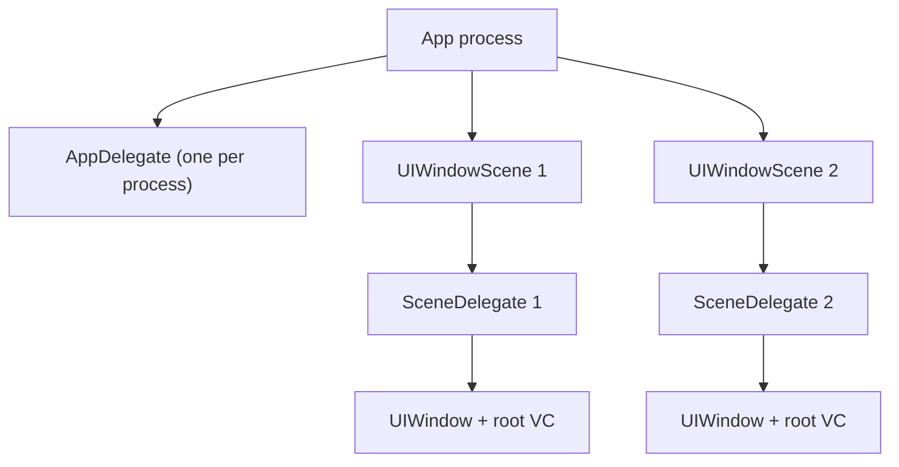

#### Who does what

| AppDelegate (process) | SceneDelegate (one per scene/window) |
|---|---|
| `didFinishLaunchingWithOptions` | `scene(_:willConnectTo:options:)`: create the `UIWindow` and root VC |
| Push token registration | `sceneDidBecomeActive` / `sceneWillResignActive` |
| `configurationForConnecting`: choose a scene configuration | `sceneWillEnterForeground` / `sceneDidEnterBackground` |
| `didDiscardSceneSessions` | `sceneDidDisconnect`: the scene was released (it may be reconnected later) |
| Background URLSession events | `scene(_:openURLContexts:)`: custom URL schemes |
| | `scene(_:continue:)`: Universal Links, Handoff |
| | `stateRestorationActivity(for:)` |

```swift
final class SceneDelegate: UIResponder, UIWindowSceneDelegate {
    var window: UIWindow?

    func scene(_ scene: UIScene, willConnectTo session: UISceneSession,
               options connectionOptions: UIScene.ConnectionOptions) {
        guard let windowScene = scene as? UIWindowScene else { return }
        let window = UIWindow(windowScene: windowScene)
        window.rootViewController = UINavigationController(rootViewController: HomeViewController())
        window.makeKeyAndVisible()
        self.window = window

        // A cold launch from a link delivers the URL here, not in openURLContexts.
        if let url = connectionOptions.urlContexts.first?.url { DeepLinkRouter.handle(url) }
    }
}
```

Scenes are configured in Info.plist under `UIApplicationSceneManifest` (whether multiple scenes are supported, and the delegate class for each configuration).

#### Key terms

- **`UISceneSession`** – the persistent record of a scene. It survives even when the scene is disconnected to save memory, so the system can recreate the window later.
- **`UIScene` / `UIWindowScene`** – the live object that owns windows.
- **Disconnect vs discard** – disconnected scenes can come back. A discarded session (the user closed it in the app switcher) is gone for good.

#### It's becoming mandatory

At WWDC 2025, Apple announced that the UIScene lifecycle will be **mandatory**: in the major release after iOS 26, apps built with the latest SDK that don't adopt scenes won't launch. Migrate legacy AppDelegate-only apps now.

**Common pitfalls**
- Handling deep links only in `openURLContexts`. On a cold launch they arrive in `connectionOptions`.
- Keeping one global "current window" or global UI state. With multiple scenes there is more than one window.
- Treating `sceneDidDisconnect` as app termination. It only means that one scene was released.

**Likely follow-ups**
- *How do you get the key window now that `UIApplication.shared.keyWindow` is deprecated?* Go through `connectedScenes`, find the foreground-active `UIWindowScene`, and use its key window. Better still, pass the window or scene down instead of looking it up globally.
- *Does a SwiftUI app need a SceneDelegate?* No. `WindowGroup` creates scenes for you.

</details>

### 4. What is the SwiftUI App lifecycle?

<details>
<summary>Answer</summary>

**In short:** A SwiftUI app starts from a type marked `@main` that conforms to the **`App`** protocol. Its `body` returns **scenes** such as `WindowGroup`, and lifecycle changes are observed through the **`scenePhase`** environment value (`.active`, `.inactive`, `.background`). Anything that still needs a UIKit app delegate, such as push tokens, is bridged with `@UIApplicationDelegateAdaptor`.

#### How it fits together

Since iOS 14, SwiftUI can own the whole app. You no longer write `UIApplicationMain`, an AppDelegate or a SceneDelegate. SwiftUI creates them internally and gives you a declarative description instead:

```swift
@main
struct MyApp: App {
    @UIApplicationDelegateAdaptor(AppDelegate.self) var appDelegate   // only if needed
    @Environment(\.scenePhase) private var scenePhase
    @State private var store = AppStore()                           // app-wide state lives here

    var body: some Scene {
        WindowGroup {
            ContentView()
                .environment(store)
                .onOpenURL { url in store.route(to: url) }           // custom schemes + Universal Links
        }
        .onChange(of: scenePhase) { _, phase in
            switch phase {
            case .active:     store.refreshIfStale()
            case .inactive:   break                                 // transitional, e.g. Control Center
            case .background: store.save()                          // persist here
            @unknown default: break
            }
        }
    }
}
```

#### The building blocks

| Piece | Role | UIKit equivalent |
|---|---|---|
| `App` protocol + `@main` | Entry point, holds app-wide state | `UIApplicationMain` + AppDelegate |
| `WindowGroup` | A template for windows; on iPad/Mac the user can open several | Scene configuration + SceneDelegate |
| `DocumentGroup` | Document-based apps (open/save/browse) | `UIDocumentBrowserViewController` |
| `Settings` | macOS settings window | n/a |
| `ImmersiveSpace` | visionOS full-space content | n/a |
| `scenePhase` | Active / inactive / background | `sceneDidBecomeActive` etc. |
| `.onOpenURL` | Deep links | `openURLContexts`, `continue userActivity` |
| `.onContinueUserActivity` | Handoff / Spotlight activities | `scene(_:continue:)` |
| `@SceneStorage` | Per-window UI state restoration | `stateRestorationActivity` |

#### Where you read `scenePhase` matters

Read in the `App`, `scenePhase` is an aggregate across all scenes: it is `.active` if any scene is active. Read inside a view, it is the phase of **that view's scene**. On iPad with two windows, those two can differ.

#### When you still need an AppDelegate

Some APIs only exist as delegate callbacks: the APNs device token, background URLSession events, and some third-party SDK setup. `@UIApplicationDelegateAdaptor` creates your `AppDelegate` class and SwiftUI forwards the calls to it. If that class conforms to `ObservableObject`, SwiftUI also puts it in the environment.

**Common pitfalls**
- Doing heavy setup inside `App.init` or `body`. `body` can be re-evaluated; put one-time setup in `init` or the delegate adaptor, and keep it fast.
- Expecting `.background` to fire for every window in the App-level `onChange`. It reflects the combined phase.
- Forgetting that `.onOpenURL` must be attached inside the `WindowGroup` content, not on the scene.

**Likely follow-ups**
- *Can you mix UIKit screens into a SwiftUI app?* Yes, with `UIViewControllerRepresentable` / `UIViewRepresentable`.
- *Can a UIKit app host SwiftUI?* Yes, with `UIHostingController`.

</details>

### 5. What happens when an iOS app launches?

<details>
<summary>Answer</summary>

**In short:** On a tap, SpringBoard asks the system to start the process. The kernel creates it, **dyld** loads and links the binary and its dynamic frameworks and runs static initializers, then `main()` calls **`UIApplicationMain`**, which creates `UIApplication` and the AppDelegate and starts the main run loop. Then `didFinishLaunching` runs, the scene connects and builds the window and root view controller, and the **first frame** replaces the launch screen. Launch optimization means shrinking each of those steps.

#### Step by step

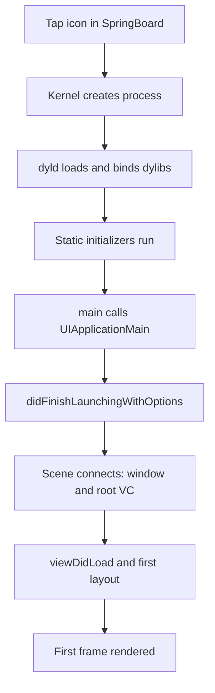

1. **Tap.** SpringBoard (the home screen app) asks the system to launch the app and shows the launch screen right away, so the launch feels instant.
2. **Process creation.** The kernel creates the process, maps the executable into memory and applies ASLR (a random address offset, for security).
3. **dyld, the dynamic linker.** It loads every dynamic library and framework the app links against (system ones come from the shared cache, which is fast; your embedded frameworks are slower). It then **rebases** pointers (fixing them for ASLR) and **binds** symbols (resolving references into other libraries).
4. **Static initializers.** Objective-C `+load` methods, C++ static constructors and runtime class registration run here, before `main()`.
5. **`main()` → `UIApplicationMain`.** Creates the `UIApplication` singleton and your AppDelegate, then starts the **main run loop**, which processes events for the rest of the app's life.
6. **`willFinishLaunching` / `didFinishLaunching`.** Your app-level setup.
7. **Scene connection.** `configurationForConnecting`, then the SceneDelegate's `scene(_:willConnectTo:options:)` creates the `UIWindow` and root view controller (SwiftUI does this for `WindowGroup`).
8. **First frame.** `viewDidLoad`, `viewWillAppear`, Auto Layout, drawing, and Core Animation commits the first frame. The launch screen goes away.

Everything before `main()` is called **pre-main** time. Everything after it up to the first frame is **post-main** time.

#### Types of launch

| Type | What's happening | Speed |
|---|---|---|
| **Cold** | Not in memory, not recently run (e.g. after reboot) | Slowest |
| **Warm** | Not in memory, but parts of it are still cached by the system | Faster |
| **Resume** | App was suspended, comes back to foreground | Fastest; not really a launch |

Apple's guidance (from its WWDC launch-performance talks) is to aim for the first frame in about 400 ms. If launch takes too long, the system watchdog kills the app; such crash reports show the exception code `0x8badf00d`.

#### How to make launch faster

| Phase | What slows it | Fix |
|---|---|---|
| Pre-main | Many embedded dynamic frameworks | Link statically, merge frameworks (Xcode 15+ mergeable libraries) |
| Pre-main | `+load`, heavy static initializers | Move to lazy initialization |
| `didFinishLaunching` | Initializing many SDKs synchronously | Defer non-critical SDKs until after the first frame, or do them on a background queue |
| First screen | Heavy root VC, synchronous network or DB reads | Show cached or placeholder UI; load data asynchronously |

```swift
func application(_ app: UIApplication, didFinishLaunchingWithOptions opts: [UIApplication.LaunchOptionsKey: Any]?) -> Bool {
    CrashReporter.start()                           // needed immediately
    DispatchQueue.main.async {                      // runs after the first frame is scheduled
        Analytics.configure()
        RemoteConfig.fetchInBackground()
    }
    return true
}
```

Measure with the **App Launch** template in Instruments, `XCTApplicationLaunchMetric` in performance tests, and the launch-time metrics in Xcode Organizer for real users. See [Performance](16-performance.md).

**Common pitfalls**
- Measuring launch only in debug builds from Xcode. Debug builds and the attached debugger distort timing; measure release builds.
- Blocking the main thread on a network call or a large database migration during launch.

**Likely follow-ups**
- *Why are dynamic frameworks slower than static ones?* Each one must be found, loaded, mapped and bound by dyld at launch. Static code is already inside the main binary.
- *What is the launch screen for?* It is a static placeholder (a storyboard or the `UILaunchScreen` Info.plist key) shown instantly. It can't run code.

</details>

### 6. What is Info.plist? Name important keys.

<details>
<summary>Answer</summary>

**In short:** Info.plist is a property-list file inside the app bundle that holds the app's **metadata and configuration**: identity (bundle ID, version, build), capabilities the system must know about before your code runs (scenes, background modes, URL schemes, orientations) and **privacy usage descriptions**. If you access a protected resource without its usage-description key, the app is terminated.

#### Why it exists

The system needs to know things about your app **without running it**: what name to show under the icon, which URL schemes it handles, whether it may run audio in the background, what to tell the user when asking for camera access. Info.plist is that declaration. The App Store and the OS both read it.

#### Important keys

| Category | Keys | Notes |
|---|---|---|
| Identity | `CFBundleIdentifier`, `CFBundleDisplayName`, `CFBundleShortVersionString` (marketing version, e.g. 2.3.0), `CFBundleVersion` (build number) | The build number must increase for every upload of the same version |
| Privacy | `NSCameraUsageDescription`, `NSMicrophoneUsageDescription`, `NSPhotoLibraryUsageDescription`, `NSLocationWhenInUseUsageDescription`, `NSContactsUsageDescription`, `NSUserTrackingUsageDescription`, `NSFaceIDUsageDescription` | The text appears in the permission prompt. Missing key = app terminated on access |
| Lifecycle | `UIApplicationSceneManifest`, `UILaunchScreen` / `UILaunchStoryboardName` | Scene setup and launch screen |
| Background | `UIBackgroundModes` (`audio`, `location`, `voip`, `remote-notification`, `fetch`, `processing`), `BGTaskSchedulerPermittedIdentifiers` | Declares which background work you do |
| Links | `CFBundleURLTypes` (custom URL schemes), `LSApplicationQueriesSchemes` (schemes you check with `canOpenURL`) | Universal Links use an entitlement, not Info.plist |
| Networking | `NSAppTransportSecurity` | ATS exceptions to allow non-HTTPS or weaker TLS; App Review may ask you to justify them |
| UI | `UISupportedInterfaceOrientations`, `UIRequiresFullScreen`, `UIUserInterfaceStyle` | Orientation, iPad multitasking opt-out, forced light/dark |
| Other | `ITSAppUsesNonExemptEncryption` | Export compliance answer, saves a question at upload |

```xml
<key>NSCameraUsageDescription</key>
<string>We use the camera to scan receipts.</string>
<key>UIBackgroundModes</key>
<array>
    <string>audio</string>
</array>
```

#### Info.plist in modern Xcode

New Xcode projects often have **no Info.plist file** at all. Many keys are set in **build settings** (`INFOPLIST_KEY_*`, e.g. `INFOPLIST_KEY_NSCameraUsageDescription`), and Xcode generates the plist at build time. Using build settings lets you vary values per configuration, for example a different display name for the beta build. You can read values at runtime:

```swift
let version = Bundle.main.infoDictionary?["CFBundleShortVersionString"] as? String
```

**Common pitfalls**
- Writing a vague usage description ("Needs camera"). App Review rejects descriptions that don't explain the purpose.
- Forgetting the build-number bump, so App Store Connect rejects the upload.
- Confusing Info.plist with **entitlements** (`.entitlements` file: App Groups, Associated Domains, push, Keychain sharing), which are signed into the app and checked by the system.

**Likely follow-ups**
- *What is a privacy manifest?* A separate file, `PrivacyInfo.xcprivacy`, that declares the data you collect and the "required reason" APIs you use. It does not replace usage descriptions.
- *Can you change Info.plist at runtime?* No. The bundle is read-only and code-signed.

</details>

### 7. What is the app sandbox? What are the main directories?

<details>
<summary>Answer</summary>

**In short:** Every iOS app runs inside its **own sandboxed container**: it can read and write only its own directories and can't touch other apps' files or most of the system. Inside the container, **Documents/** holds user data (backed up), **Library/Application Support/** holds app-managed data (backed up, hidden), **Library/Caches/** holds re-creatable data (not backed up, may be purged) and **tmp/** holds short-lived files. Your own apps and extensions can share data through **App Groups** and **Keychain sharing**.

#### Why the sandbox exists

The sandbox is a security boundary enforced by the kernel. If an app is compromised, the attacker is stuck inside that one app's container. It also protects user privacy: access to photos, contacts or location goes through system APIs that ask the user first.

#### The container layout

| Location | Purpose | Backed up? | Purged by system? | Visible to user? |
|---|---|---|---|---|
| App bundle (`Bundle.main`) | Code and shipped resources | No (reinstalled from the store) | No | No |
| `Documents/` | User-created content | Yes | No | Only with `UIFileSharingEnabled` / `LSSupportsOpeningDocumentsInPlace` (Files app) |
| `Library/Application Support/` | App-generated data: databases, downloaded content you need | Yes | No | No |
| `Library/Caches/` | Data you can recreate: image caches, API responses | **No** | **Yes**, when storage is low | No |
| `Library/Preferences/` | `UserDefaults` plists (don't write here directly) | Yes | No | No |
| `tmp/` | Temporary files for the current task | No | Yes, any time the app isn't running | No |

The bundle is **read-only** and code-signed. The data container lives at a separate path that can change between launches and updates, so **never store absolute paths**. Store relative paths and rebuild the full URL each time.

```swift
let fm = FileManager.default
let docs     = URL.documentsDirectory                                     // iOS 16+
let support  = try fm.url(for: .applicationSupportDirectory, in: .userDomainMask,
                          appropriateFor: nil, create: true)               // not created by default
let caches   = URL.cachesDirectory
let temp     = fm.temporaryDirectory

// Keep big re-downloadable files out of iCloud backup
var url = support.appending(path: "offline-maps.bin")
var values = URLResourceValues()
values.isExcludedFromBackup = true
try url.setResourceValues(values)
```

#### Sharing outside the container

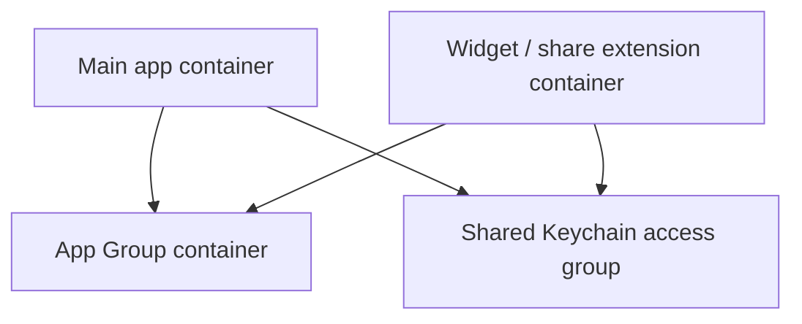

- **App Groups** – a shared container for apps and extensions from the same team: `FileManager.containerURL(forSecurityApplicationGroupIdentifier:)` and `UserDefaults(suiteName:)`.
- **Keychain access groups** – share tokens and passwords.
- With **other** apps: only through user-driven channels such as the share sheet, document picker, URL schemes, the pasteboard or the Files app.

**Common pitfalls**
- Putting large re-downloadable files in Documents. They fill the user's iCloud backup, and App Review has rejected apps for this.
- Storing important data in Caches or tmp and then losing it when the system purges.
- Saving an absolute file path in a database and failing to find the file after an app update.

**Likely follow-ups**
- *How is data protected at rest?* Data Protection classes such as `.complete` encrypt files with keys tied to the device passcode.
- *Where should a SQLite or SwiftData store go?* Application Support.

</details>

### 8. What is the Responder Chain?

<details>
<summary>Answer</summary>

**In short:** The responder chain is a linked list of `UIResponder` objects (views, view controllers, the window, the scene, `UIApplication`, the AppDelegate) that events travel through. For touches, **hit-testing** first finds the deepest view under the finger. If that view doesn't handle an event, the event goes to its `next` responder, step by step up the chain. The same chain is used for the keyboard (first responder), nil-targeted actions, key commands and edit menus.

#### Two separate steps for a touch

1. **Hit-testing: find the target.** UIKit calls `hitTest(_:with:)` on the window. Each view checks `point(inside:with:)` and asks its subviews, front-most first. The deepest view that contains the point wins. Hidden views, views with `isUserInteractionEnabled = false` and views with `alpha < 0.01` are skipped.
2. **Responder chain: find a handler.** The touch is delivered to that view (`touchesBegan` etc.). If it doesn't handle it (for example it calls `super`), the event moves to `next`.

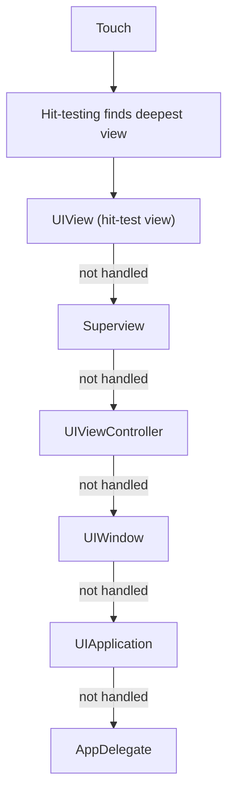

How `next` is chosen:
- A view's `next` is its view controller if it is that VC's root view, otherwise its superview.
- A view controller's `next` is its view's superview, or the presenting view controller.
- The window's `next` is its `UIWindowScene` (iOS 13+), whose `next` is `UIApplication`.
- `UIApplication`'s `next` is the AppDelegate, if the delegate is a `UIResponder` subclass.

#### Other uses of the chain

- **First responder and the keyboard.** The view that receives keyboard input is the *first responder*. `textField.becomeFirstResponder()` shows the keyboard; `resignFirstResponder()` hides it.
- **Nil-targeted actions.** Sending an action to `nil` walks the chain from the first responder until something implements the selector. Handy for dismissing the keyboard from anywhere:

```swift
UIApplication.shared.sendAction(#selector(UIResponder.resignFirstResponder),
                                to: nil, from: nil, for: nil)
```

- **Key commands and menus.** `UIKeyCommand` (hardware keyboard shortcuts) and the edit menu (`canPerformAction(_:withSender:)`, `copy(_:)`, `paste(_:)`) are resolved by walking the chain.
- **Motion events** such as shake (`motionEnded`).

#### Gesture recognizers

Gesture recognizers attached to the hit-test view or its ancestors see the touches **before** the view does. When a recognizer succeeds it cancels the touch for the view by default (`cancelsTouchesInView`). This is why a tap recognizer on a parent can "steal" taps from a child.

**Common pitfalls**
- A subview that sticks out beyond its superview's bounds can't be tapped, because the superview's `point(inside:)` returns false before the subview is asked.
- Setting `alpha = 0` to hide a view and wondering why it no longer receives touches.

**Likely follow-ups**
- *How do you find the view controller for a view?* Walk `next` until you hit a `UIViewController`.
- *What's the SwiftUI equivalent?* SwiftUI hides the chain; you use `@FocusState` for focus and `.contentShape` / `.allowsHitTesting` for hit areas.

</details>

### 9. How do you expand the tappable area of a button / let touches pass through a view?

<details>
<summary>Answer</summary>

**In short:** Both are done by overriding hit-testing. To **expand** a tap area, override `point(inside:with:)` and return true for a rect larger than `bounds`. To **pass touches through** a view to what is underneath, override `hitTest(_:with:)` and return `nil` when the hit view is the view itself (so its subviews still work), or set `isUserInteractionEnabled = false` to ignore touches on the view and all its subviews.

#### Expanding the tap area

Apple's Human Interface Guidelines recommend tap targets of at least 44 × 44 points. A small icon button can keep its visual size and still accept taps around it:

```swift
final class ExpandedButton: UIButton {
    var touchInsets = UIEdgeInsets(top: -12, left: -12, bottom: -12, right: -12)

    override func point(inside point: CGPoint, with event: UIEvent?) -> Bool {
        bounds.inset(by: touchInsets).contains(point)      // negative insets grow the rect
    }
}
```

The superview still has to accept the touch: if the expanded area goes beyond the **superview's** bounds, the superview's own `point(inside:)` returns false first and the touch never reaches the button.

#### Letting touches pass through

A typical case is a transparent overlay container that holds a few buttons, where taps in the empty space should reach the map or scroll view underneath.

```swift
final class PassthroughView: UIView {
    override func hitTest(_ point: CGPoint, with event: UIEvent?) -> UIView? {
        let hit = super.hitTest(point, with: event)
        return hit === self ? nil : hit    // empty area: ignore; subviews: still tappable
    }
}
```

Returning `nil` tells UIKit "not me", and hit-testing continues with the sibling views behind it.

| Approach | Effect |
|---|---|
| `isUserInteractionEnabled = false` | The view **and all its subviews** ignore touches |
| `hitTest` returning `nil` for `self` | Only the empty parts of the view pass touches through |
| `isHidden = true` or `alpha < 0.01` | Also skipped by hit-testing, but the view is invisible too |

SwiftUI has the same tools: `.contentShape(Rectangle())` or `.padding` + `.contentShape` to grow the hit area, and `.allowsHitTesting(false)` to pass touches through.

**Common pitfalls**
- A `UIImageView` has `isUserInteractionEnabled = false` by default, so buttons added inside it don't respond.
- Expanded tap areas overlapping each other. The front-most view wins, which can feel random to users.

**Likely follow-ups**
- *How do you make a subview outside its parent's bounds tappable?* Override the parent's `point(inside:)` or `hitTest` to also check that subview's frame.

</details>

### 10. What are URL schemes vs Universal Links?

<details>
<summary>Answer</summary>

**In short:** A **custom URL scheme** (`myapp://product/42`) is easy to set up, but any app can claim the same scheme, and if the app isn't installed the link just fails. A **Universal Link** is a normal `https://` link to your domain that iOS opens in your app because your website proves ownership with an **`apple-app-site-association`** file and the app has the matching **Associated Domains** entitlement. If the app isn't installed, it opens the website. Universal Links are the secure, preferred choice.

#### Custom URL schemes

You register a scheme in Info.plist under `CFBundleURLTypes`. Any link with that scheme opens your app.

- Easy, works offline, no server needed.
- **Not unique**: another app can register `myapp://` too, and iOS doesn't guarantee which one opens. A malicious app could catch links meant for you, for example OAuth callbacks.
- Fails with an error (or a "cannot open" alert in Safari) when the app isn't installed.
- To check another app's scheme with `canOpenURL`, you must list it in `LSApplicationQueriesSchemes`.

#### Universal Links

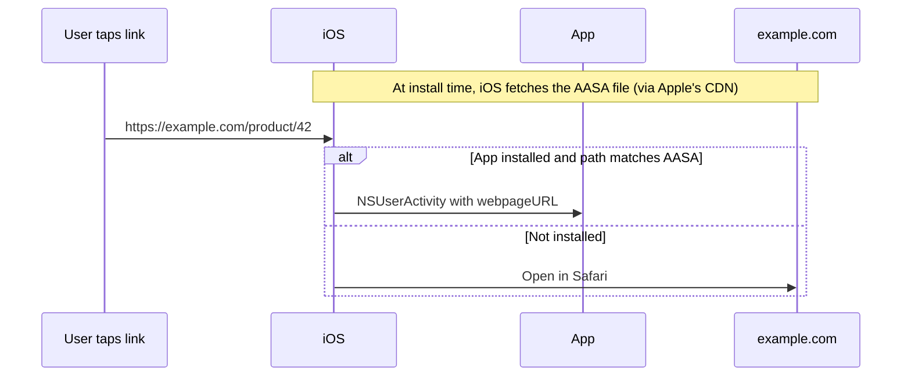

Setup:
1. Host `https://example.com/.well-known/apple-app-site-association` (JSON, served over HTTPS, no redirects) listing your app ID (`TEAMID.bundle.id`) and the paths the app handles.
2. Add the **Associated Domains** capability with `applinks:example.com`.
3. Handle the link in the app.

```json
{
  "applinks": {
    "details": [{
      "appIDs": ["ABCDE12345.com.example.shop"],
      "components": [
        { "/": "/product/*" },
        { "/": "/account/*", "exclude": true }
      ]
    }]
  }
}
```

```swift
// UIKit (SceneDelegate), app already running
func scene(_ scene: UIScene, continue userActivity: NSUserActivity) {
    guard userActivity.activityType == NSUserActivityTypeBrowsingWeb,
          let url = userActivity.webpageURL else { return }
    DeepLinkRouter.handle(url)
}
// Cold launch: check connectionOptions.userActivities in scene(_:willConnectTo:options:)

// SwiftUI: .onOpenURL receives both custom schemes and Universal Links
ContentView().onOpenURL { url in router.handle(url) }
```

| | Custom scheme | Universal Link |
|---|---|---|
| Format | `myapp://...` | `https://yourdomain.com/...` |
| Ownership verified | No | Yes (AASA + entitlement) |
| App not installed | Error | Opens the website |
| Setup | Info.plist only | Server file + entitlement + code |
| Good for | Internal app-to-app calls, dev tools | Marketing links, email, shared content |

**Common pitfalls**
- Universal Links typed into Safari's address bar, or tapped on a page of the same domain, open in Safari instead of the app. This is by design.
- The AASA file is cached by Apple's CDN, so changes don't apply instantly.
- Trusting deep-link parameters. Validate them like any untrusted input; never perform a sensitive action directly from a link.

**Likely follow-ups**
- *How do you handle a deep link when the user must log in first?* Store the pending route, show login, then route after login completes.
- *What about OAuth callbacks?* Use `ASWebAuthenticationSession`, which returns the callback URL directly to your app.

</details>

### 11. What are App Extensions? Name a few.

<details>
<summary>Answer</summary>

**In short:** An app extension is a separate binary bundled inside your app that adds functionality to **system surfaces**: the Home Screen (widgets), the share sheet, notifications, the keyboard, Siri/Shortcuts and more. Each extension runs in its **own process**, with a much tighter memory limit and a restricted API set, and shares data with the main app through **App Groups**.

#### How extensions work

You add an extension as a new **target** in the same Xcode project. It ships inside the app bundle (in `PlugIns/`) and is installed with it. The system, or a *host app* such as Photos showing the share sheet, launches the extension when needed. It does not run your main app.

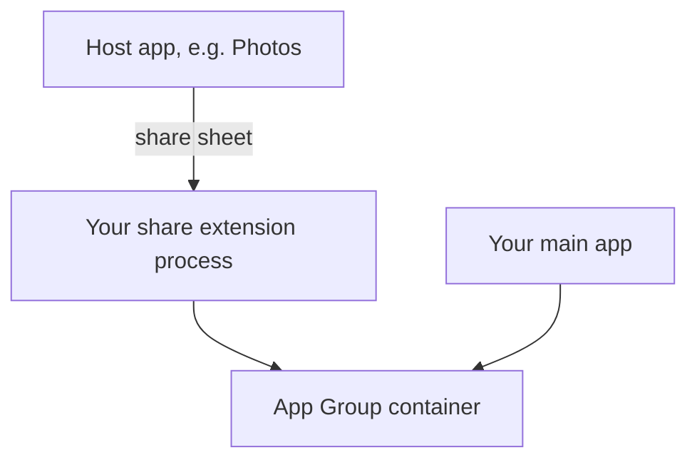

Because the extension is a separate process:
- It doesn't share memory with the main app. Singletons and in-memory caches are **not** shared.
- It has a **lower memory limit**; exceed it and it is killed.
- Some APIs are unavailable, for example `UIApplication.shared` (the build setting "Require Only App-Extension-Safe API" enforces this).
- It can be launched and torn down at any time.

#### Common extension types

| Extension | What it does |
|---|---|
| **Widgets** (WidgetKit) | Home Screen, Lock Screen and StandBy widgets; also **Live Activities** and **Control Center controls** |
| **Share** | Appears in the share sheet to receive content (see question 27) |
| **Action** | Transforms or views content in place from the share sheet |
| **Notification Service** | Modifies a push before it's shown: download an image, decrypt the payload. Needs `mutable-content: 1` in the payload |
| **Notification Content** | Custom UI for an expanded notification |
| **Keyboard** | A custom system-wide keyboard |
| **App Intents / Intents** | Siri, Shortcuts, Spotlight actions |
| **Safari web extensions** | Content blockers, page scripts |
| **File Provider** | Exposes your cloud storage in the Files app |
| **Photo Editing** | Edit photos inside the Photos app |
| **Today** | Old Notification Center widgets, deprecated and replaced by WidgetKit |

#### Sharing data with the main app

```swift
// Both targets enable the same App Group: group.com.example.shop
let shared = UserDefaults(suiteName: "group.com.example.shop")
shared?.set(cartCount, forKey: "cartCount")

// After the app changes data a widget shows:
WidgetCenter.shared.reloadAllTimelines()
```

For files or a database, use `FileManager.default.containerURL(forSecurityApplicationGroupIdentifier:)`. For tokens, use a shared Keychain access group.

**Common pitfalls**
- Linking a large framework into an extension and hitting the memory limit.
- Expecting the extension to see the main app's logged-in state without explicitly sharing the token via App Group or Keychain.
- Two processes writing the same SQLite file at once without coordination.

**Likely follow-ups**
- *Can an extension open its containing app?* Only some types can, via `extensionContext?.open(_:)` (for example Today/widget-style extensions; widgets use `widgetURL` / `Link`).
- *How do you debug an extension?* Choose the extension scheme in Xcode and pick a host app to run it in.

</details>

### 12. What are the iOS architecture layers?

<details>
<summary>Answer</summary>

**In short:** Apple describes iOS as four layers, from top to bottom: **Cocoa Touch** (UIKit, SwiftUI, gestures, notifications), **Media** (Core Graphics, Core Animation, AVFoundation, Metal), **Core Services** (Foundation, Core Data, networking, Core Location) and **Core OS** (the Darwin/XNU kernel, security, file system, drivers). Higher layers build on lower ones, and you should use the highest layer that does the job.

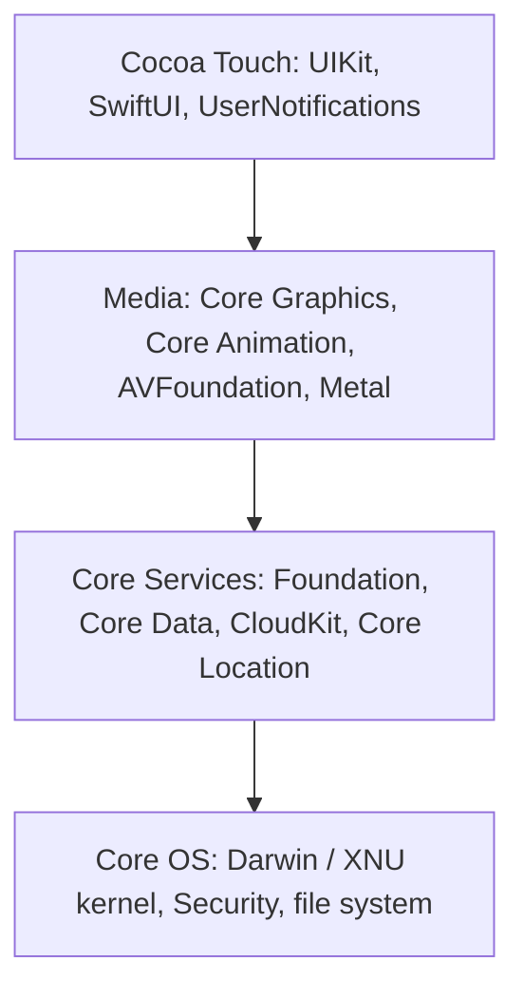

| Layer | Purpose | Examples |
|---|---|---|
| **Cocoa Touch** | App-level frameworks: UI, events, app lifecycle, multitasking | UIKit, SwiftUI, gesture recognizers, UserNotifications, MapKit UI, EventKitUI |
| **Media** | Graphics, animation, audio, video | Core Graphics (2D drawing), Core Animation (layers), Core Image (filters), AVFoundation, Metal (GPU), Core Text |
| **Core Services** | Fundamental non-UI services | Foundation (strings, collections, dates, URLSession), Core Data, SwiftData, CloudKit, Core Location, Core Foundation, StoreKit |
| **Core OS** | Low-level system | XNU kernel (Mach + BSD), memory management, sandbox, Keychain/Security, Bluetooth, file system, networking stack |

#### How it plays out in real code

A `UIButton` (Cocoa Touch) is backed by a `CALayer` (Media, Core Animation), its title uses Core Text and Core Graphics, its target-action and strings come from Foundation (Core Services), and drawing eventually reaches the GPU driver (Core OS). You rarely call the lower layers directly, but knowing them helps with performance work: for example, Core Animation renders layers in a separate render server process, which is why animations stay smooth even while your main thread is briefly busy.

#### Why use higher layers first

Higher layers handle accessibility, Dynamic Type, dark mode, localization and many edge cases for you. Drop down only when you need it: Core Graphics for custom drawing, Metal for heavy GPU work, the Network framework for custom protocols.

**Likely follow-ups**
- *What is Darwin?* The open-source Unix base shared by Apple's platforms: the XNU kernel plus BSD userland.
- *Where does SwiftUI sit?* In the Cocoa Touch layer, next to UIKit; on iOS it uses UIKit and Core Animation underneath.

</details>

### 13. What is the difference between frame and bounds?

<details>
<summary>Answer</summary>

**In short:** **`frame`** is the view's rectangle in its **superview's** coordinate system (where it sits in the parent). **`bounds`** is the rectangle in the view's **own** coordinate system (origin usually `(0, 0)`, plus its size). Use `frame` to position a view inside its parent, and `bounds` for drawing and laying out subviews. When a view has a transform such as rotation, `frame` becomes meaningless for layout while `bounds` stays correct.

#### An analogy

Think of a picture frame hanging on a wall. Its **frame** is "60 cm from the left of the wall, 1 m from the floor, 40 × 30 cm". Its **bounds** describe the picture itself: "my coordinates start at my own top-left corner, and I'm 40 × 30 cm". Moving the frame along the wall doesn't change the bounds.

```swift
let parent = UIView(frame: CGRect(x: 0, y: 0, width: 300, height: 300))
let child  = UIView(frame: CGRect(x: 50, y: 80, width: 100, height: 60))
parent.addSubview(child)

child.frame    // (50, 80, 100, 60)  position in parent
child.bounds   // (0, 0, 100, 60)    own coordinate space
child.center   // (100, 110)         in parent coordinates

child.transform = CGAffineTransform(rotationAngle: .pi / 4)
child.bounds   // still (0, 0, 100, 60)
child.frame    // ~ (43, 57, 113, 113): the bounding box of the rotated view
```

| | `frame` | `bounds` |
|---|---|---|
| Coordinate system | Superview's | The view's own |
| Origin | Position in the parent | Usually `(0, 0)`; changing it shifts the content |
| Changes when moving the view | Yes | No |
| With a transform | Bounding box; Apple says not to rely on it | Unchanged |
| Use it for | Placing the view in its parent | `draw(_:)`, laying out subviews, `layoutSubviews` |

#### How they relate

The frame is **computed** from `center`, `bounds.size` and `transform`. Setting the frame changes `center` and `bounds.size`.

#### Bounds origin and scrolling

Changing `bounds.origin` shifts what part of the view's content is visible, without moving the view. This is exactly how `UIScrollView` works: `contentOffset` **is** `bounds.origin`. Scrolling down by 100 points sets the bounds origin to `(0, 100)`, so subviews appear to move up.

#### Converting between coordinate systems

```swift
let pointInWindow = child.convert(CGPoint.zero, to: nil)       // nil = window
let rectInParent  = child.convert(child.bounds, to: parent)    // same as frame (no transform)
```

**Common pitfalls**
- Setting `frame` on a view that has a transform. Set `bounds` and `center` instead.
- Using `frame` instead of `bounds` when laying out subviews in `layoutSubviews`. Subviews are positioned in your own coordinate space, so a non-zero frame origin offsets them wrongly.
- Reading frames in `viewDidLoad`, before Auto Layout has run. Read them in `viewDidLayoutSubviews`.

**Likely follow-ups**
- *When could `bounds.origin` be non-zero?* In scroll views, or when you set it yourself to shift content.

</details>

### 14. What is `UIApplication.shared` and `UIWindow`?

<details>
<summary>Answer</summary>

**In short:** `UIApplication.shared` is the **singleton that represents your running app**. It owns the main event loop and gives you app-wide services: opening URLs, registering for remote notifications, the app's state, connected scenes and background tasks. A **`UIWindow`** is the root container of a view hierarchy: it holds the `rootViewController`, receives events from the app and dispatches them to views. In iOS 13+, each window belongs to a `UIWindowScene`.

#### UIApplication

`UIApplicationMain` creates exactly one `UIApplication` per process. It receives events from the system, puts them on the main run loop, and sends them to the right window.

```swift
let app = UIApplication.shared
app.open(URL(string: UIApplication.openSettingsURLString)!)   // open your Settings page
app.registerForRemoteNotifications()
app.applicationState                     // .active, .inactive, .background
app.connectedScenes                      // all scenes (windows) of this app
let id = app.beginBackgroundTask { /* time is up: clean up */ }
app.endBackgroundTask(id)
```

You almost never subclass it. You customize behaviour through the AppDelegate.

#### UIWindow

- A window is a `UIView` subclass with no visible content of its own. It hosts the view controller hierarchy through `rootViewController`.
- It receives events from `UIApplication` and starts hit-testing for touches.
- The **key window** receives keyboard and other non-touch events. `makeKeyAndVisible()` makes a window key and shows it.
- Windows have a `windowLevel` (`.normal`, `.alert`, `.statusBar`). Higher levels are drawn on top, which is useful for debug overlays or an in-app toast window.

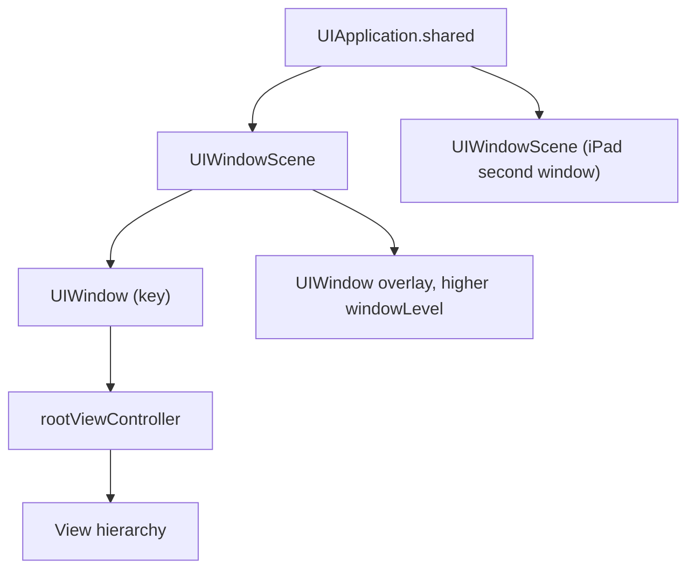

#### In a scene-based app

There is one or more windows **per scene**, not one per app. `UIApplication.shared.keyWindow` and `.windows` are deprecated because "the window" is ambiguous when two scenes are open. Get the window from the scene or from a view (`view.window`).

**Common pitfalls**
- Using `UIApplication.shared` inside an app extension. It is unavailable there.
- Grabbing "the key window" globally to present alerts. Present from the current view controller instead.
- Creating a second `UIWindow` and not keeping a strong reference, so it disappears immediately.

**Likely follow-ups**
- *Is `UIApplication.shared` main-thread only?* Yes, like most of UIKit (it is `@MainActor`).

</details>

### 15. How does state restoration work?

<details>
<summary>Answer</summary>

**In short:** iOS may terminate a suspended app at any time, but users expect to come back to exactly where they were. **State restoration** saves lightweight UI state (which screen, which item, scroll position) and rebuilds it on the next launch. In UIKit, the modern approach is **`NSUserActivity`-based scene restoration**. In SwiftUI, use **`@SceneStorage`** for per-window UI state. Real user data such as drafts must be saved to persistent storage separately.

#### Why it's needed

From the user's point of view, the app never "quit". They switched to the camera, came back an hour later, and the app was gone from memory. If it relaunches on the home screen, it feels like the app crashed. State restoration hides that termination.

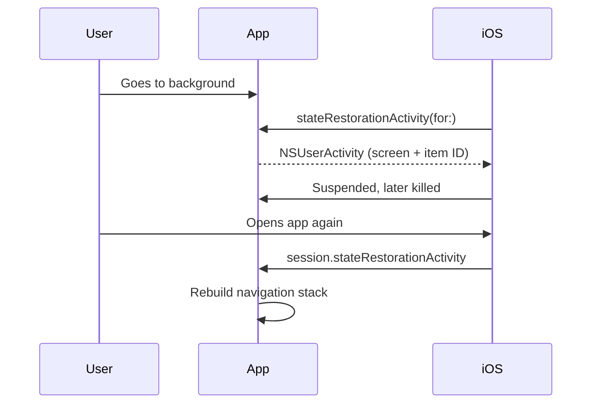

#### UIKit: scene-based restoration

```swift
// SceneDelegate
func stateRestorationActivity(for scene: UIScene) -> NSUserActivity? {
    let activity = NSUserActivity(activityType: "com.example.viewProduct")
    activity.userInfo = ["productID": currentProductID ?? ""]
    return activity                                  // keep it small: IDs, not objects
}

func scene(_ scene: UIScene, willConnectTo session: UISceneSession,
           options connectionOptions: UIScene.ConnectionOptions) {
    // ... set up window ...
    if let activity = session.stateRestorationActivity,
       let id = activity.userInfo?["productID"] as? String, !id.isEmpty {
        router.showProduct(id: id)
    }
}
```

The activity type must be listed under `NSUserActivityTypes` in Info.plist. The older API uses `restorationIdentifier` on view controllers and `encodeRestorableState(with:)` / `decodeRestorableState(with:)`; it still works but is more complex.

#### SwiftUI

```swift
struct ProductListView: View {
    @SceneStorage("selectedProductID") private var selectedID: String?   // per window
    @AppStorage("sortOrder") private var sortOrder = "name"              // app-wide preference
    var body: some View { /* ... */ }
}
```

| Tool | Scope | Stored where | Use for |
|---|---|---|---|
| `@SceneStorage` | One scene (window) | Managed by the system with the scene | Selected tab, selected item, navigation path |
| `@AppStorage` | Whole app | `UserDefaults` | User preferences |
| Your database or files | Whole app | Disk | Real data: drafts, documents |

`NavigationStack(path:)` with a `Codable` path (via `NavigationPath.codable`) lets you save and restore a full navigation stack.

**Common pitfalls**
- Storing whole model objects in the restoration activity. Store IDs and reload the data.
- Relying on state restoration for important data. The system discards restoration data if the user force-quits the app or after a crash.
- Restoring to a screen whose data no longer exists (deleted item). Validate and fall back.

**Likely follow-ups**
- *How do you test it?* Background the app, stop it from Xcode (which simulates a system kill, unlike swiping it away), then relaunch.

</details>

### 16. What is the main bundle and how do you load resources?

<details>
<summary>Answer</summary>

**In short:** A **bundle** is a directory with a known structure that holds code and resources. **`Bundle.main`** is your app's bundle: the executable, Info.plist, asset catalogs, storyboards, localized strings and any files you ship. Load files with `Bundle.main.url(forResource:withExtension:)`, images with `UIImage(named:)` (cached) or `UIImage(contentsOfFile:)` (not cached), and localized text with String Catalogs. Swift packages use `Bundle.module` for their own resources.

#### What's inside the app bundle

```
MyApp.app/
├── MyApp                  (executable)
├── Info.plist
├── Assets.car             (compiled asset catalog)
├── Base.lproj/, en.lproj/ (localized resources)
├── Frameworks/            (embedded dynamic frameworks)
├── PlugIns/               (app extensions)
└── config.json            (your own files)
```

The bundle is **read-only** and code-signed: you can read from it but never write to it. Writable data goes in the sandbox container (Documents, Application Support).

#### Loading resources

```swift
// Arbitrary file
guard let url = Bundle.main.url(forResource: "config", withExtension: "json") else {
    fatalError("config.json missing from bundle")      // usually: file not in target membership
}
let config = try JSONDecoder().decode(Config.self, from: Data(contentsOf: url))

// Images
let icon  = UIImage(named: "logo")                     // asset catalog, cached by the system
let photo = UIImage(contentsOfFile: path)              // file path, not cached, no asset catalog
let image = Image("logo")                              // SwiftUI

// Info.plist values
let build = Bundle.main.object(forInfoDictionaryKey: "CFBundleVersion") as? String

// Localized text
let title = String(localized: "welcome_title")         // looked up in Localizable.xcstrings
```

| API | Caches? | Asset catalog? | Best for |
|---|---|---|---|
| `UIImage(named:)` | Yes | Yes | Icons and images reused often |
| `UIImage(contentsOfFile:)` | No | No | Large images used once |
| `UIImage(named:in:with:)` | Yes | Yes | Images from another bundle (framework) |

#### Bundles other than main

- **Frameworks** have their own bundle: `Bundle(for: SomeClass.self)` finds the bundle that contains that class.
- **Swift packages** with resources get a generated `Bundle.module`. Use it inside the package; `Bundle.main` would look in the app instead.
- **Localization** uses `.lproj` folders, and now **String Catalogs** (`.xcstrings`), which Xcode fills by extracting strings from your code.

**Common pitfalls**
- A file isn't found because it isn't in the target's **Copy Bundle Resources** phase (target membership).
- Using `Bundle.main` from inside a framework or package and getting `nil`.
- Using `UIImage(named:)` for many large one-off images, which keeps them in the cache and raises memory.

**Likely follow-ups**
- *What is an asset catalog?* `.xcassets`, compiled into `Assets.car`. It handles multiple scales (@2x, @3x), dark mode variants, app thinning and colors.

</details>

### 17. What is `Codable`'s role in `UserDefaults` / what is `@AppStorage`?

<details>
<summary>Answer</summary>

**In short:** `UserDefaults` is a small key-value store for **property-list types** only (Bool, Int, Double, String, Data, Date, URL, and arrays or dictionaries of those). To store a custom type, make it `Codable` and encode it to `Data` with `JSONEncoder` (or `PropertyListEncoder`). **`@AppStorage("key")`** is the SwiftUI property wrapper over `UserDefaults` that re-renders views when the value changes. Never put secrets in `UserDefaults`; it is an unencrypted plist, so use the Keychain.

#### How UserDefaults works

`UserDefaults.standard` reads a plist from `Library/Preferences/` into memory at launch and writes changes back to disk automatically. It is meant for **small** values like settings and flags, not datasets.

#### Storing a Codable type

```swift
struct UserSettings: Codable {
    var theme: String
    var notificationsEnabled: Bool
}

extension UserDefaults {
    func setCodable<T: Encodable>(_ value: T, forKey key: String) throws {
        set(try JSONEncoder().encode(value), forKey: key)          // Codable -> Data
    }
    func codable<T: Decodable>(_ type: T.Type, forKey key: String) -> T? {
        guard let data = data(forKey: key) else { return nil }
        return try? JSONDecoder().decode(type, from: data)        // nil if the format changed
    }
}

try UserDefaults.standard.setCodable(UserSettings(theme: "dark", notificationsEnabled: true),
                                     forKey: "settings")
let settings = UserDefaults.standard.codable(UserSettings.self, forKey: "settings")
```

Wrong: `UserDefaults.standard.set(settings, forKey: "settings")` with a custom struct crashes at runtime, because it isn't a property-list type.

#### @AppStorage

```swift
struct SettingsView: View {
    @AppStorage("isDarkMode") private var isDarkMode = false          // default if unset
    @AppStorage("username", store: UserDefaults(suiteName: "group.com.example"))
    private var username = ""                                          // shared with widgets

    var body: some View {
        Toggle("Dark mode", isOn: $isDarkMode)                         // writes to UserDefaults
    }
}
```

`@AppStorage` supports `Bool`, `Int`, `Double`, `String`, `URL`, `Data` and `RawRepresentable` types (such as enums) with `Int` or `String` raw values. For other `Codable` types, store `Data` or add a `RawRepresentable` conformance that encodes to a JSON string.

| Store | Encrypted | Good for | Not for |
|---|---|---|---|
| `UserDefaults` / `@AppStorage` | No | Settings, flags, last-seen version | Tokens, passwords, large data |
| Keychain | Yes | Tokens, passwords, keys | Large data |
| Files / SwiftData / Core Data | Optional (Data Protection) | Real app data | Simple flags |

**Common pitfalls**
- Storing auth tokens in `UserDefaults`. On a jailbroken device or from an unencrypted backup, they are readable.
- Storing large arrays. The whole plist is loaded into memory and rewritten.
- Renaming a `Codable` property, so old saved data no longer decodes. Use `CodingKeys` or a versioned migration.
- Forgetting `register(defaults:)` (or `@AppStorage` defaults) and reading `false`/`0` for unset keys.

**Likely follow-ups**
- *How do widgets read the same settings?* Use `UserDefaults(suiteName:)` with an App Group.
- *Does `UserDefaults` sync across devices?* No. Use `NSUbiquitousKeyValueStore` for small iCloud-synced values.

</details>


---

## Platform & Frameworks

### 18. What is Cocoa / Cocoa Touch? Why do classes start with prefixes like `NS` and `UI`?

<details>
<summary>Answer</summary>

**In short:** **Cocoa** is Apple's macOS application framework stack (**Foundation + AppKit**). **Cocoa Touch** is the iOS equivalent (**Foundation + UIKit**, plus related app-level frameworks). Class names have prefixes like `NS` and `UI` because **Objective-C has no namespaces**, so prefixes prevent name collisions. Swift has module namespaces, so Swift types don't need them.

#### Cocoa vs Cocoa Touch

| | Cocoa (macOS) | Cocoa Touch (iOS, iPadOS) |
|---|---|---|
| Base framework | Foundation | Foundation |
| UI framework | AppKit (`NSView`, `NSWindow`) | UIKit (`UIView`, `UIWindow`) |
| Input model | Mouse, keyboard | Touch, gestures |
| Extra pieces | | Gesture recognizers, push notifications, multitasking |

Cocoa Touch covers app lifecycle, UI, events and multitasking. It **doesn't include** lower-level frameworks like Core Graphics, Core Data or AVFoundation; those sit in the Media and Core Services layers (see question 12). SwiftUI is a newer, cross-platform layer that runs on top of UIKit and AppKit.

#### Where the prefixes come from

Objective-C has one global namespace for class names. If Apple had a class called `View` and your library also had one, the app would fail to link or behave unpredictably. So every framework uses a short prefix:

| Prefix | Origin / framework |
|---|---|
| `NS` | **NeXTSTEP**, the OS from NeXT that macOS grew out of. Used by Foundation and AppKit (`NSString`, `NSArray`) |
| `UI` | UIKit (`UIView`, `UIButton`) |
| `CG` | Core Graphics (`CGRect`, `CGPoint`) |
| `CA` | Core Animation (`CALayer`) |
| `CL` | Core Location (`CLLocationManager`) |
| `MK` | MapKit (`MKMapView`) |
| `AV` | AVFoundation (`AVPlayer`) |

Apple reserves **two-letter** prefixes for itself, so third-party Objective-C code should use **three letters** (for example `AFN` for AFNetworking).

#### Swift

Each Swift module is its own namespace. Your `Logger` type is really `MyApp.Logger`, and it doesn't clash with `os.Logger`; you disambiguate with the module name when needed. That's why new Swift-first APIs drop prefixes (`URL`, `Data`, `Date` are Swift value types that bridge to `NSURL`, `NSData`, `NSDate`).

**Likely follow-ups**
- *Why do `String` and `NSString` both exist?* `String` is the Swift value type; `NSString` is the Objective-C reference type. They bridge automatically.

</details>

### 19. Name important Apple frameworks and what they're used for.

<details>
<summary>Answer</summary>

**In short:** Know the major frameworks by area: **UIKit/SwiftUI** for UI, **Core Graphics/Core Animation/Metal** for drawing and graphics, **AVFoundation** for audio and video, **Core Location/MapKit** for location, **Foundation/Core Data/SwiftData/CloudKit** for data, **URLSession/Network** for networking, **StoreKit** for purchases, and **WidgetKit/App Intents/UserNotifications** for system integration. Interviewers want breadth (what each is for) plus depth in the ones you've actually used.

| Area | Frameworks |
|---|---|
| UI & graphics | UIKit, SwiftUI, **Core Graphics** (2D drawing, paths), **Core Animation** (layers, animations), **Core Image** (image filters), Metal (low-level GPU), PDFKit, Vision (image analysis) |
| Media | **AVFoundation** (camera, audio/video capture and playback, editing), AVKit (player UI), PhotoKit/PhotosUI, MediaPlayer, Core Audio, ReplayKit (screen recording/broadcast) |
| Location & maps | **Core Location** (GPS, geofencing, **iBeacons**: Bluetooth LE proximity beacons), **MapKit** |
| Data | Foundation, Core Data, SwiftData, CloudKit, Core Spotlight |
| Connectivity | Network, URLSession, **CoreBluetooth**, MultipeerConnectivity, Core NFC, WatchConnectivity |
| Games | **SpriteKit** (2D), **SceneKit** (3D, now soft-deprecated in favour of RealityKit), **GameplayKit** (AI, pathfinding, state machines, randomization), **Game Center/GameKit** (leaderboards, achievements, multiplayer) |
| AR/3D | ARKit, **RealityKit** |
| Health & home | **HealthKit** (health data with granular permissions), **HomeKit** (smart home accessories), WorkoutKit |
| Commerce | **StoreKit** (in-app purchases, subscriptions, reviews), **PassKit** (Apple Pay, Wallet passes) |
| System integration | WidgetKit, ActivityKit, App Intents, UserNotifications, BackgroundTasks, CallKit, PushKit, WeatherKit, Foundation Models |

#### How to talk about them

A good answer connects frameworks to features you built. For example: "For the delivery tracker, Core Location gave us significant-change updates, MapKit drew the route, ActivityKit showed a Live Activity on the Lock Screen, and PushKit wasn't needed because we updated the Live Activity with regular APNs pushes."

Some useful distinctions interviewers like:

| Pair | Difference |
|---|---|
| Core Graphics vs Core Animation | CG draws pixels into a context (CPU); CA composites and animates layers (GPU-backed) |
| AVFoundation vs AVKit | AVFoundation is the engine (players, capture, editing); AVKit is ready-made UI (`AVPlayerViewController`, `VideoPlayer`) |
| URLSession vs Network | URLSession for HTTP(S); Network (`NWConnection`) for raw TCP/UDP/QUIC and connectivity monitoring (`NWPathMonitor`) |
| Core Data vs SwiftData | SwiftData is the Swift-native, macro-based layer built on the same storage ideas; Core Data is older and more configurable |
| Core Data vs CloudKit | Core Data stores locally; CloudKit is Apple's cloud database; `NSPersistentCloudKitContainer` / SwiftData can sync between them |
| PushKit vs UserNotifications | PushKit is for VoIP pushes that wake the app (must report a call via CallKit); UserNotifications is for user-visible notifications |

**Common pitfalls**
- Claiming deep experience with a framework you've only read about. Follow-up questions find this quickly.

**Likely follow-ups**
- *What does Foundation Models do?* It gives apps access to Apple's on-device language model (Apple Intelligence) from Swift.

</details>

### 20. What are the different ways to show web content?

<details>
<summary>Answer</summary>

**In short:** There are four main options. **Open in Safari** (`UIApplication.shared.open`), which leaves your app. **`SFSafariViewController`**, an in-app Safari with AutoFill and Reader that your code can't inspect; best for external links. **`WKWebView`** (and SwiftUI's `WebView` in iOS 26), a fully embeddable, scriptable web engine for your own or hybrid content. And **`ASWebAuthenticationSession`** for OAuth and login flows. `UIWebView` is removed and the App Store rejects it.

#### Choosing

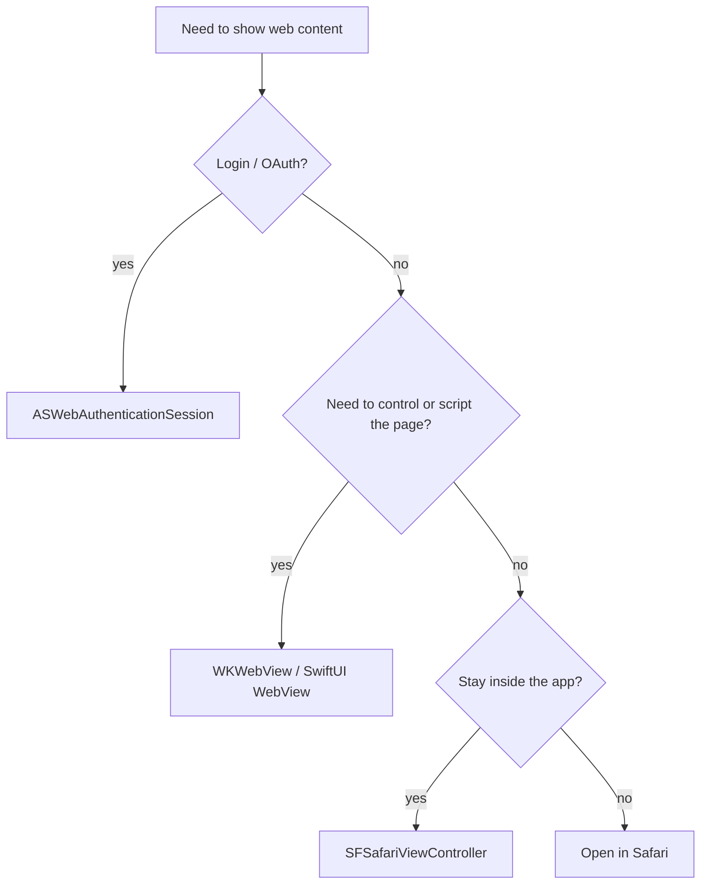

| Option | Stays in app | Your code can read/script the page | Safari features | Typical use |
|---|---|---|---|---|
| `open(url)` / SwiftUI `openURL` | No | No | All | "Open in browser" |
| `SFSafariViewController` | Yes | **No** | AutoFill, Reader, content blockers | Terms of service, articles, external links |
| `WKWebView` | Yes | **Yes** | None by default | Your own HTML, hybrid screens, embedded web apps |
| `ASWebAuthenticationSession` | Yes (system sheet) | No | Shares Safari's cookies for SSO (unless ephemeral) | Sign in with Google/GitHub, any OAuth flow |

#### SFSafariViewController

```swift
let safari = SFSafariViewController(url: URL(string: "https://example.com/terms")!)
present(safari, animated: true)
```

It runs out of process, so your app can't see the URL history, the page content or cookies, which is why users can trust it. Since iOS 11 its website data is kept separate per app rather than shared with Safari, so the user may not be logged in to sites there. SwiftUI has no built-in wrapper; wrap it in `UIViewControllerRepresentable`.

#### WKWebView

```swift
let config = WKWebViewConfiguration()
config.userContentController.add(handler, name: "bridge")    // JS -> Swift messages
let webView = WKWebView(frame: .zero, configuration: config)
webView.navigationDelegate = self                             // allow/deny each navigation
webView.load(URLRequest(url: url))

// Swift -> JS
try await webView.evaluateJavaScript("setTheme('dark')")

// In the page: window.webkit.messageHandlers.bridge.postMessage({ action: "close" })
```

`WKWebView` also runs web content in a separate process, so a crashing page doesn't crash your app (handle `webViewWebContentProcessDidTerminate` by reloading). iOS 26 adds a native SwiftUI `WebView` with a `WebPage` model.

#### ASWebAuthenticationSession

```swift
let session = ASWebAuthenticationSession(url: authURL, callbackURLScheme: "myapp") { callbackURL, error in
    guard let url = callbackURL else { return }        // contains ?code=...
    auth.exchangeCode(from: url)
}
session.presentationContextProvider = self
session.start()
```

Using it for OAuth instead of a `WKWebView` matters: in a web view your app could read the user's password, which is why providers such as Google block OAuth inside embedded web views.

**Common pitfalls**
- Handling login in a `WKWebView`. Insecure, and many identity providers refuse it.
- Retain cycles: `WKUserContentController` holds its message handlers strongly. Remove them, or use a weak proxy.
- Loading untrusted pages into a `WKWebView` with a powerful JS bridge exposed.

**Likely follow-ups**
- *How do you share cookies between `URLSession` and `WKWebView`?* Copy them through `WKWebsiteDataStore.httpCookieStore`; the two don't share storage automatically.

</details>

### 21. How do you work with the file system (list a directory, read and write files)?

<details>
<summary>Answer</summary>

**In short:** Use **`FileManager`** to find directories, list, create, move and delete files, and use `Data(contentsOf:)` / `data.write(to:options:)` to read and write contents. Work with `URL`s rather than string paths, write **atomically**, set a **file protection** level for sensitive data, encode custom objects with `Codable`, and do large I/O **off the main thread**.

#### Common operations

```swift
let fm = FileManager.default
let docs = URL.documentsDirectory                                  // iOS 16+
let notesURL = docs.appending(path: "notes.json")

// Write: atomic = write to a temp file, then rename, so a crash never leaves half a file
try data.write(to: notesURL, options: [.atomic, .completeFileProtection])

// Read
let loaded = try Data(contentsOf: notesURL)

// Exists?
fm.fileExists(atPath: notesURL.path())

// Create a folder
try fm.createDirectory(at: docs.appending(path: "Exports"), withIntermediateDirectories: true)

// List a directory, asking for metadata up front (avoids extra disk lookups)
let files = try fm.contentsOfDirectory(at: docs,
                includingPropertiesForKeys: [.fileSizeKey, .contentModificationDateKey],
                options: [.skipsHiddenFiles])
for url in files {
    let values = try url.resourceValues(forKeys: [.fileSizeKey])
    print(url.lastPathComponent, values.fileSize ?? 0)
}

// Recursive listing
if let e = fm.enumerator(at: docs, includingPropertiesForKeys: nil) {
    for case let url as URL in e { print(url.path()) }
}

// Move, copy, delete
try fm.moveItem(at: tempURL, to: finalURL)
try fm.removeItem(at: oldURL)
```

#### Saving custom objects

```swift
struct Note: Codable { var id: UUID; var text: String }

func save(_ notes: [Note]) async throws {
    try await Task.detached(priority: .utility) {                 // off the main actor
        let data = try JSONEncoder().encode(notes)
        try data.write(to: notesURL, options: .atomic)
    }.value
}
```

`JSONEncoder` gives readable files; `PropertyListEncoder` with binary format is more compact. For large or queryable data, use a database (SwiftData, Core Data, SQLite) instead of rewriting one big file.

#### Write options worth knowing

| Option | Meaning |
|---|---|
| `.atomic` | Write to a temp file then swap, so readers never see a partial file |
| `.completeFileProtection` | Encrypted and unreadable while the device is locked |
| `.completeFileProtectionUnlessOpen` | Files already open stay readable after locking (for background work) |
| `.withoutOverwriting` | Fail if the file exists |

**Common pitfalls**
- Building paths with string concatenation. Use `URL.appending(path:)`.
- Saving absolute paths. The container path can change across updates; save relative names.
- Reading a big file with `Data(contentsOf:)` on the main thread, which freezes the UI. Use a background task or `FileHandle` / `URL.resourceBytes` to stream.
- Using `.completeFileProtection` on a file the app must read in the background while the phone is locked; the read fails.

**Likely follow-ups**
- *How do you let the user pick or export files?* `UIDocumentPickerViewController`, or SwiftUI `.fileImporter` / `.fileExporter`.
- *How do you coordinate access to a file shared with an extension?* `NSFileCoordinator`.

</details>

### 22. How do you play audio or a custom sound?

<details>
<summary>Answer</summary>

**In short:** Pick the API by need. **`AudioServicesPlaySystemSound`** for short UI sounds (under 30 seconds, no control). **`AVAudioPlayer`** for local files with volume, looping and seeking. **`AVPlayer`** for streaming or remote audio and video. **`AVAudioEngine`** for real-time mixing, effects and synthesis. In every case configure **`AVAudioSession`** correctly, handle interruptions, and enable the Audio background mode if playback must continue in the background.

#### Choosing an API

| Need | API | Notes |
|---|---|---|
| Short click or chime | `AudioServicesPlaySystemSound` | Low latency; no volume control; respects silent mode; under 30 s |
| Play a bundled file with control | `AVAudioPlayer` | Volume, `numberOfLoops`, `currentTime`, metering; local files or `Data` only |
| Stream music, podcasts, HLS | `AVPlayer` / `AVQueuePlayer` | Remote URLs, buffering, playlists, AirPlay |
| Mixing, effects, synth, real-time input | `AVAudioEngine` | Graph of nodes (player, mixer, EQ, reverb) |
| Haptics with sound | Core Haptics | Synchronized vibration and audio |

```swift
// Short UI sound
var soundID: SystemSoundID = 0
let url = Bundle.main.url(forResource: "tap", withExtension: "caf")!
AudioServicesCreateSystemSoundID(url as CFURL, &soundID)
AudioServicesPlaySystemSound(soundID)

// Local file with control
final class Player {
    private var player: AVAudioPlayer?                     // must be retained, or playback stops
    func play() throws {
        let url = Bundle.main.url(forResource: "theme", withExtension: "m4a")!
        player = try AVAudioPlayer(contentsOf: url)
        player?.numberOfLoops = -1                         // loop forever
        player?.prepareToPlay()
        player?.play()
    }
}

// Streaming
let streamPlayer = AVPlayer(url: URL(string: "https://example.com/episode.m3u8")!)
streamPlayer.play()
```

#### AVAudioSession: telling iOS how your app uses audio

The audio session decides whether your sound respects the silent switch, mixes with other apps, or keeps playing in the background.

```swift
let session = AVAudioSession.sharedInstance()
try session.setCategory(.playback, mode: .default)    // plays with silent switch on
try session.setActive(true)
```

| Category | Silent switch | Mixes with other audio | Use |
|---|---|---|---|
| `.ambient` | Silenced | Yes | Game sound effects |
| `.soloAmbient` (default) | Silenced | No | Default |
| `.playback` | **Plays** | No (unless `.mixWithOthers`) | Music, podcasts, video |
| `.record` / `.playAndRecord` | n/a | No | Recording, VoIP |

For a full media app you also need:
- **Interruptions**: observe `AVAudioSession.interruptionNotification` to pause on a phone call and maybe resume afterwards.
- **Route changes**: pause when headphones are unplugged (`routeChangeNotification`, reason `.oldDeviceUnavailable`).
- **Background playback**: `UIBackgroundModes` = `audio`, plus the `.playback` category.
- **Lock Screen / Control Center**: `MPNowPlayingInfoCenter` for title and artwork, `MPRemoteCommandCenter` for play/pause/skip.

**Common pitfalls**
- Creating `AVAudioPlayer` as a local variable: it's deallocated and stops immediately.
- Forgetting the session category, so the sound is silent when the ring/silent switch is on.
- Not deactivating the session after playback, so other apps' audio stays ducked.

**Likely follow-ups**
- *How do you play video?* `AVPlayer` with `AVPlayerViewController` (UIKit) or `VideoPlayer` (SwiftUI).

</details>

### 23. What are Handoff, Continuity and iCloud services?

<details>
<summary>Answer</summary>

**In short:** **Handoff** lets a user start something on one Apple device and continue it on another signed in to the same Apple ID; apps implement it by advertising an **`NSUserActivity`**. **Continuity** is the umbrella name for cross-device features (Handoff, Universal Clipboard, Continuity Camera, AirDrop, iPhone Mirroring, Sidecar). **iCloud services** are the developer APIs for syncing data: CloudKit, iCloud Drive documents, key-value storage, iCloud Keychain, and Core Data/SwiftData sync via CloudKit.

#### Handoff

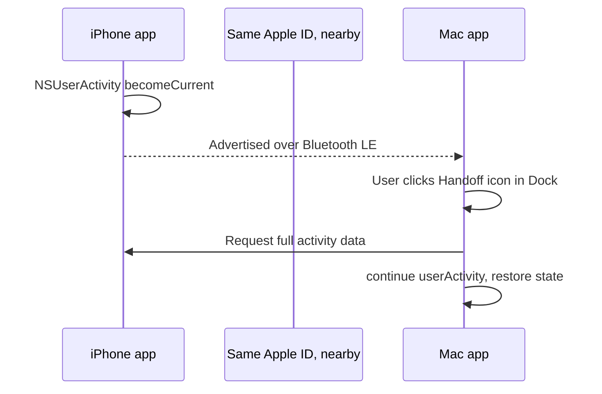

```swift
// Advertise (UIKit)
let activity = NSUserActivity(activityType: "com.example.editNote")
activity.title = "Editing note"
activity.userInfo = ["noteID": note.id.uuidString]           // small, IDs only
activity.isEligibleForHandoff = true
activity.webpageURL = URL(string: "https://example.com/notes/\(note.id)")  // fallback to web
view.window?.windowScene?.userActivity = activity             // or activity.becomeCurrent()

// Receive (SceneDelegate)
func scene(_ scene: UIScene, continue userActivity: NSUserActivity) {
    guard userActivity.activityType == "com.example.editNote",
          let id = userActivity.userInfo?["noteID"] as? String else { return }
    router.openNote(id: id)
}

// SwiftUI
TextEditor(text: $text)
    .userActivity("com.example.editNote") { $0.userInfo = ["noteID": noteID] }
    .onContinueUserActivity("com.example.editNote") { activity in /* restore */ }
```

Requirements: same Apple ID, Bluetooth and Wi-Fi on, the activity type listed under `NSUserActivityTypes` in Info.plist, and apps from the same team. With `webpageURL` and Associated Domains, Handoff also works between your app and your website. The same `NSUserActivity` object also powers Spotlight search, Siri suggestions and state restoration.

#### Continuity features

| Feature | What it does | Developer involvement |
|---|---|---|
| Handoff | Continue an activity on another device | `NSUserActivity` |
| Universal Clipboard | Copy on one device, paste on another | Free, through `UIPasteboard` |
| Continuity Camera | Use iPhone as Mac webcam or document scanner | Mostly automatic |
| AirDrop | Nearby file sharing | Share sheet |
| iPhone Mirroring, Sidecar | Use iPhone from Mac, iPad as Mac display | None |

#### iCloud services

| Service | Use for | Limits / notes |
|---|---|---|
| **CloudKit** | Structured records and files in private, shared or public databases | Free quota tied to user's iCloud; no server code |
| **iCloud Drive / documents** | Document-based apps (`UIDocument`, ubiquity containers) | Files show up in the Files app |
| **Key-value store** (`NSUbiquitousKeyValueStore`) | Small settings synced across devices | About 1 MB total |
| **iCloud Keychain** | Passwords, passkeys | Via AutoFill and `kSecAttrSynchronizable` |
| **Core Data / SwiftData + CloudKit** | Automatic sync of a local database | `NSPersistentCloudKitContainer`; schema limits (no unique constraints, optional or defaulted attributes) |

**Common pitfalls**
- Putting large data in `userInfo` for Handoff. Send an ID, and fetch the content (from iCloud or your server) on the other device.
- Assuming iCloud is always available. The user may be signed out or have iCloud disabled for your app; check `CKContainer.accountStatus`.

**Likely follow-ups**
- *CloudKit vs your own backend?* CloudKit is free and has no server to maintain, but it is Apple-only, so it doesn't work for Android or web clients without extra work.

</details>

### 24. What are App Clips?

<details>
<summary>Answer</summary>

**In short:** An App Clip is a **small, lightweight part of your app** (under 15 MB; up to 50 MB for some cases since iOS 17) that users can launch **instantly without installing** the full app, from an App Clip Code, NFC tag, QR code, Safari banner, Maps or Messages. It's meant for one quick task (pay for parking, rent a scooter, order a coffee). It's a separate target in the same project, can use Sign in with Apple and Apple Pay, is removed after a period of inactivity, and can invite the user to install the full app, passing data over through a shared App Group.

#### Why they exist

Asking someone to download a full app just to pay for a parking meter loses most users. An App Clip removes the install step: tap an NFC tag or scan a code, and a card appears with an **Open** button; the clip launches in seconds.

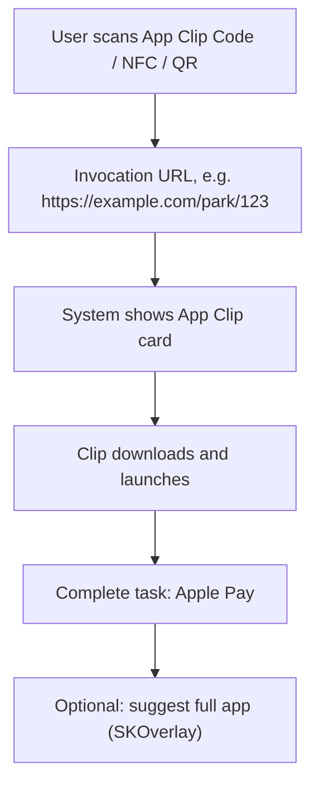

#### How they're built

- A **separate target** in the same Xcode project, sharing code with the main app (keep modules small to fit the size limit).
- Invoked through a **URL** (configured in App Store Connect and Associated Domains with `appclips:`). The clip reads it from an `NSUserActivity` of type `NSUserActivityTypeBrowsingWeb`, so `https://example.com/park/123` takes the user straight to meter 123.
- Uses **Sign in with Apple** and **Apple Pay** so the task needs no account creation or card typing.
- Suggests the full app with `SKOverlay` (a system banner).
- Shares data with the full app through an **App Group**, so after installing, the user is still signed in and sees their history.

```swift
@main
struct ParkingClip: App {
    var body: some Scene {
        WindowGroup {
            MeterView()
                .onContinueUserActivity(NSUserActivityTypeBrowsingWeb) { activity in
                    guard let url = activity.webpageURL else { return }
                    meterStore.load(from: url)              // parse /park/123
                }
        }
    }
}
```

#### Limitations

- Size limit (above). Larger sizes only apply to some invocation types and newer iOS versions.
- Some frameworks and capabilities aren't available (for example certain sensitive data APIs, background activity beyond basics).
- The system removes the clip and its data after a period of inactivity, so anything important must go to your server or the shared App Group.

**Common pitfalls**
- Trying to fit the whole app in the clip. Pick one task and do it fast.
- Forcing account creation before the task. That defeats the purpose.

**Likely follow-ups**
- *How do you test invocation URLs?* Set the `_XCAppClipURL` environment variable in the clip's scheme, or register a Local Experience in the device's Developer settings.

</details>

### 25. What is a sensible minimum iOS deployment target?

<details>
<summary>Answer</summary>

**In short:** A common rule of thumb is **the current major version minus 1 or 2** (in late 2026: iOS 17 or iOS 18), because iOS adoption is fast and the vast majority of active devices run the last two versions. But the real answer is **"decide with data"**: weigh your users' OS distribution, the APIs you need (Observation and SwiftData need iOS 17), the cost of `#available` branches and testing, and which devices each version drops.

#### What the deployment target means

The deployment target (`IPHONEOS_DEPLOYMENT_TARGET`) is the **oldest iOS version** your app runs on. The App Store won't offer the app to older devices (though users can sometimes download the last compatible older version). It's different from the **SDK** you build with, which is always the latest Xcode's.

```swift
// With target iOS 17 and code that uses an iOS 18 API:
if #available(iOS 18, *) {
    MeshGradientBackground()          // newer API
} else {
    LinearGradientBackground()        // fallback, must be tested too
}

@available(iOS 18, *)
struct MeshGradientBackground: View { /* ... */ }
```

#### Factors to weigh

| Factor | Pushes target up | Pushes target down |
|---|---|---|
| User analytics | Few users on old versions | Many users on old versions |
| Audience | Consumer, US/EU | Enterprise fleets, emerging markets with older devices |
| API needs | Observation, SwiftData (iOS 17), newest SwiftUI APIs | Nothing new needed |
| Engineering cost | Fewer `#available` branches, simpler testing | |
| Business | | Every excluded user is lost revenue |
| Hardware | Each new iOS drops older devices; those users can't upgrade anyway | |

#### A practical process

1. Look at analytics for active users by OS version (App Store Connect, your analytics tool).
2. Find which features you want that require a newer version, and estimate the code they'd remove.
3. Raise the target when the users you'd lose fall below an agreed threshold (teams often use a small single-digit percentage), typically once a year after the new iOS ships.
4. Before raising it, release a version that tells old-OS users they won't get new updates.

Raising the target usually lets you delete a lot of compatibility code, and sometimes old third-party workarounds.

**Common pitfalls**
- Forgetting that dependencies (SDKs, packages) have their own minimum targets.
- Not testing the `else` branches of `#available`, which then break on old devices.

**Likely follow-ups**
- *Does a higher deployment target make the app smaller or faster?* It can: the compiler can drop back-deployment shims and use newer runtime features directly.

</details>

### 26. How does multitasking work on iOS?

<details>
<summary>Answer</summary>

**In short:** iOS has two kinds of multitasking. **Process-level:** only the foreground app runs freely; background apps are **suspended** quickly unless they use a specific background mode (audio, location, VoIP, Bluetooth), a finite background task, `BGTaskScheduler` or a background `URLSession`, and the system can kill suspended apps at any time. **UI-level (iPad):** Split View, Slide Over, Stage Manager, fully resizable windows in iPadOS 26, multiple windows per app (scenes) and Picture in Picture, so apps must have flexible layouts and handle each scene's lifecycle independently.

#### Process-level: what can run in the background

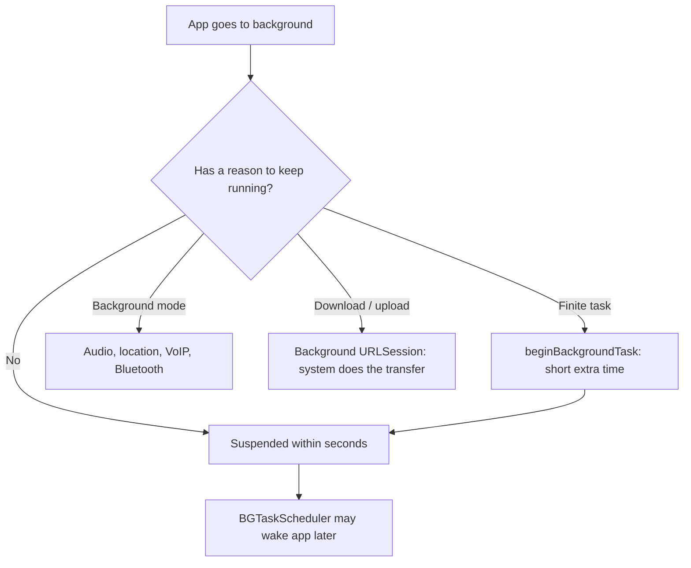

| Mechanism | Use for | Who decides when it runs |
|---|---|---|
| `beginBackgroundTask` | Finishing a save or upload in progress | Starts immediately, limited time |
| Background modes (`UIBackgroundModes`) | Music, navigation, VoIP calls, Bluetooth accessories | Runs while the activity continues |
| Background `URLSession` | Large downloads/uploads | The system, even if your app is killed |
| `BGAppRefreshTask` | Fetch fresh content | The system, based on usage patterns |
| `BGProcessingTask` | Heavy maintenance (DB cleanup, ML) | The system, often while charging and idle |
| Silent push (`content-available`) | Server-triggered refresh | Delivered at low priority, may be throttled |

The system uses heuristics (battery, how often the user opens the app, Low Power Mode) to decide when deferred tasks run, so never depend on exact timing. Details are in [Background tasks & notifications](15-background-notifications.md).

#### UI multitasking on iPad

- **Split View / Slide Over** – two apps side by side, or one floating over another.
- **Stage Manager** – resizable, overlapping windows.
- **Resizable windows** – iPadOS 26 makes free window resizing broadly available.
- **Multiple scenes** – several windows of the same app (see question 3).
- **Picture in Picture** – video keeps playing in a floating window (`AVPictureInPictureController`).

What this means for your code:
- Never assume the window equals the screen size. Use Auto Layout, **size classes** and `viewWillTransition(to:with:)` / SwiftUI layout instead of `UIScreen.main.bounds`.
- Each scene can be in a different state; manage state per scene.
- Test at the narrow (compact) width a window can be resized to.

#### The app switcher snapshot

When the app goes to the background, the system takes a **snapshot** for the app switcher. If the screen shows sensitive data (banking balance, medical info), cover it in `sceneWillResignActive` or `sceneDidEnterBackground`, for example with a blur view, and remove the cover when the app becomes active again.

**Common pitfalls**
- Using `UIScreen.main.bounds` for layout, which breaks in Split View and resizable windows.
- Assuming a background refresh will run at a fixed interval.
- Forgetting to end a background task, which gets the app killed when time runs out.

**Likely follow-ups**
- *Can you opt out of iPad multitasking?* Historically with `UIRequiresFullScreen`; Apple is moving away from allowing this, so design for resizable windows.

</details>

### 27. How do share extensions work, and what are their limits?

<details>
<summary>Answer</summary>

**In short:** A share extension appears in the system **share sheet** and runs in a **separate process** from your app. It receives content through `extensionContext.inputItems` (`NSExtensionItem`s with `NSItemProvider` attachments you load asynchronously), appears only for content types allowed by its **activation rules**, has a **much lower memory limit** than an app, shares data with the main app through an **App Group** and Keychain sharing, uses a **background `URLSession`** for uploads that may outlive it, and must call `completeRequest` or `cancelRequest` when done.

#### The flow

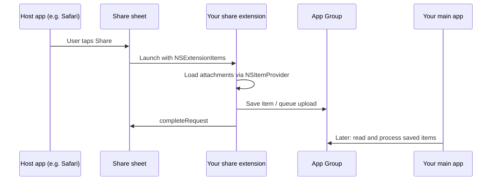

#### Receiving content

```swift
final class ShareViewController: UIViewController {
    override func viewDidLoad() {
        super.viewDidLoad()
        Task { await handleInput() }
    }

    private func handleInput() async {
        guard let item = extensionContext?.inputItems.first as? NSExtensionItem,
              let provider = item.attachments?.first else { return cancel() }

        if provider.hasItemConformingToTypeIdentifier(UTType.url.identifier),
           let url = try? await provider.loadItem(forTypeIdentifier: UTType.url.identifier) as? URL {
            SharedQueue(appGroup: "group.com.example").enqueue(url)   // write to App Group
        }
        extensionContext?.completeRequest(returningItems: nil)       // dismiss the sheet
    }

    private func cancel() {
        extensionContext?.cancelRequest(withError: CocoaError(.userCancelled))
    }
}
```

#### Activation rules

In the extension's Info.plist, `NSExtensionActivationRule` decides when your extension appears. For example, `NSExtensionActivationSupportsWebURLWithMaxCount = 1` and `NSExtensionActivationSupportsImageWithMaxCount = 10`. Using `TRUEPREDICATE` (show for everything) is fine during development, but App Review rejects it.

#### Limits and how to work with them

| Limit | Why | What to do |
|---|---|---|
| Much lower memory limit than apps | Extensions run alongside the host app | Don't load full-size images or videos into memory; use file URLs and downsample |
| Short lifetime | The user expects the sheet to close quickly | Hand off long work |
| Separate process | No shared memory with the app | App Group container, `UserDefaults(suiteName:)`, shared database |
| No `UIApplication.shared` | App-extension-safe API only | Use `extensionContext` |
| Credentials | Separate Keychain by default | Keychain access group shared with the main app |

For uploads that may take longer than the extension lives, create a **background `URLSession`** and set `sharedContainerIdentifier` to your App Group, so the system finishes the transfer and the main app can receive the result.

```swift
let config = URLSessionConfiguration.background(withIdentifier: "com.example.share.upload")
config.sharedContainerIdentifier = "group.com.example"
let session = URLSession(configuration: config, delegate: uploader, delegateQueue: nil)
session.uploadTask(with: request, fromFile: fileInAppGroup).resume()   // file, not Data
```

**Common pitfalls**
- Never calling `completeRequest`, which leaves the share sheet stuck.
- Loading a large video as `Data` and getting killed for exceeding memory.
- Assuming the user is logged in, when the token lives only in the main app's private Keychain.

**Likely follow-ups**
- *How does the main app learn about new shared items?* It reads the App Group queue on launch or foreground; for live updates, Darwin notifications (`CFNotificationCenterGetDarwinNotifyCenter`) can signal across processes.
- *Share extension vs Action extension?* Share sends content somewhere (post, save); Action transforms or displays content in place and can return modified items to the host.

</details>

---

[⬅ Previous: OOP, SOLID & Design Patterns](07-oop-solid-design-patterns.md) · [⬅ Back to index](../README.md) · [Next: UIKit ➡](09-uikit.md)
