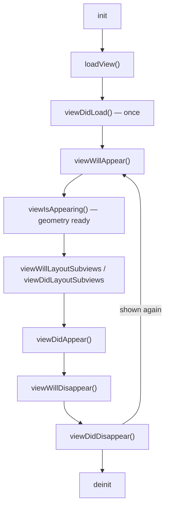
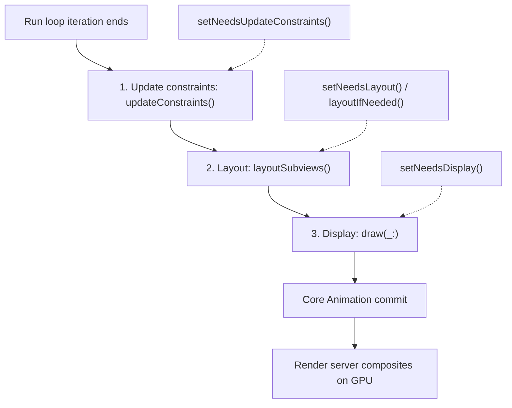
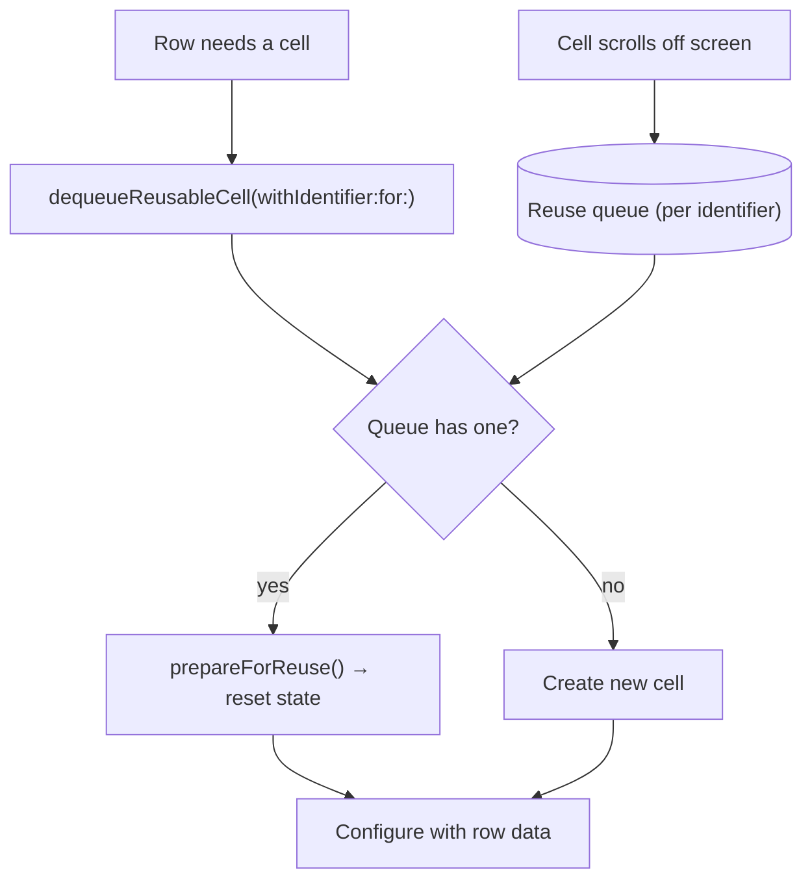
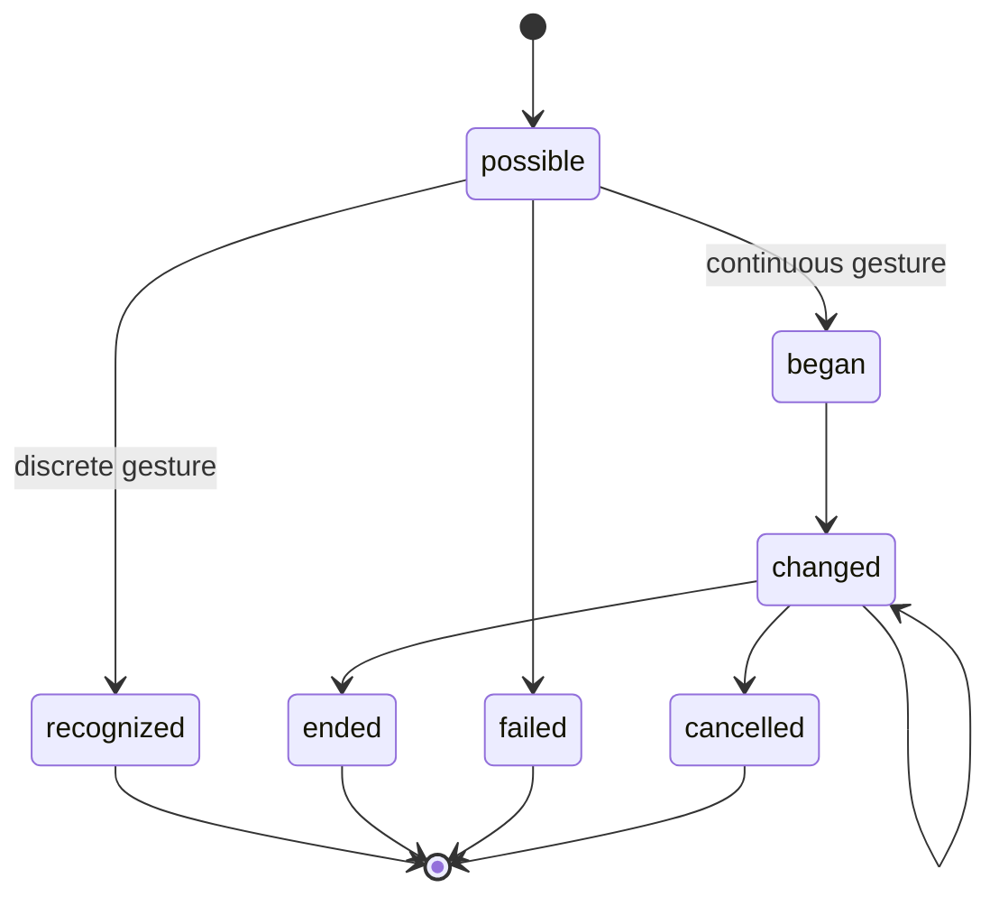
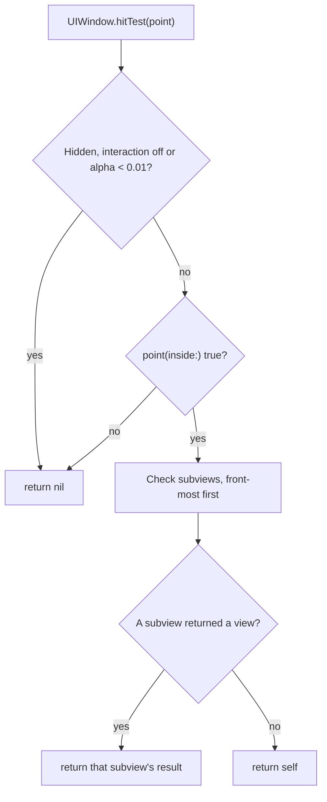
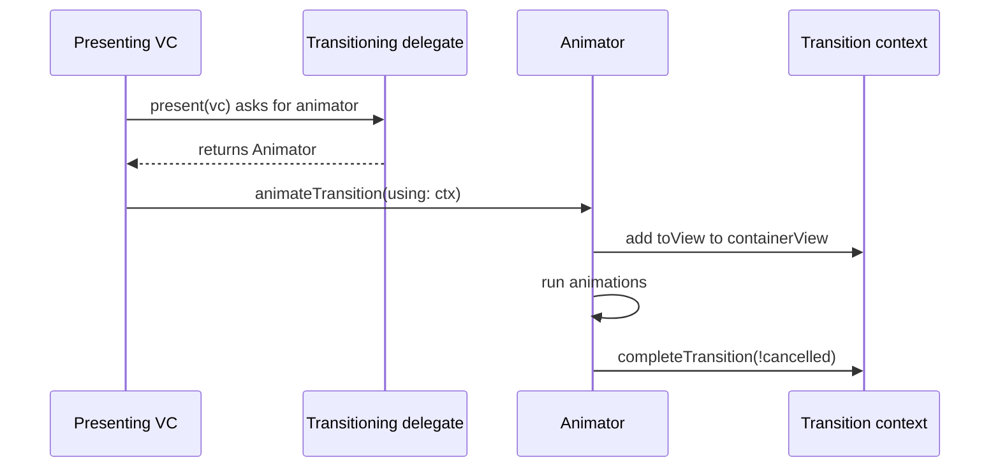

# UIKit – View Controllers, Views, Auto Layout, Lists

[⬅ Back to index](../README.md)

Covers: view controller lifecycle, view lifecycle & rendering, Auto Layout, UITableView/UICollectionView, diffable data sources, navigation, gestures, animations, keyboard handling.

---

## View Controller

### 1. Explain the UIViewController lifecycle.

<details>
<summary>Answer</summary>

**In short:** A view controller is created (`init`), then lazily loads its view (`loadView` → `viewDidLoad`, once). Every time it is shown it goes through `viewWillAppear` → `viewIsAppearing` → layout passes → `viewDidAppear`, and every time it leaves it gets `viewWillDisappear` → `viewDidDisappear`. When nothing holds it any more, `deinit` runs.



#### Step by step

1. **`init(coder:)` / `init(nibName:bundle:)`**: the object is created, from a storyboard (coder) or in code. The view does **not** exist yet. Accessing `view` here forces it to load early, which is a common accidental bug.
2. **`loadView()`**: creates `self.view`. UIKit's default implementation loads the nib/storyboard view or makes an empty `UIView`. Override it only to supply a custom root view in code, and in that case don't call `super`.
3. **`viewDidLoad()`**: called **once**, after the view is in memory. Do one-time setup: add subviews, constraints, bind the view model, kick off the initial data load. Bounds are not final yet.
4. **`viewWillAppear(_:)`**: called **every time** before the view becomes visible (including when you pop back to it). Refresh data, start observers, configure the navigation bar.
5. **`viewIsAppearing(_:)`** (iOS 17 SDK, back-deployed to iOS 13): the view is now in the hierarchy and has **accurate size and trait collection**, but is not yet on screen. This is the best place for appearance-time updates that depend on geometry or traits.
6. **`viewWillLayoutSubviews()` / `viewDidLayoutSubviews()`**: run on each layout pass. Subview frames are final in `viewDidLayoutSubviews`. These can be called many times, so keep them cheap and idempotent.
7. **`viewDidAppear(_:)`**: visible on screen and any transition has finished. Start animations, analytics "screen viewed" events, and work that should only run when the user can actually see the screen.
8. **`viewWillDisappear(_:)` / `viewDidDisappear(_:)`**: the screen is leaving (pushed over, popped, dismissed, tab switched). Stop timers and observers, save drafts, pause video.
9. **`deinit`**: the controller is deallocated. If you pop a screen and `deinit` never runs, you most likely have a retain cycle (a closure capturing `self` strongly, a strong delegate, a timer).

```swift
final class ProfileViewController: UIViewController {
    override func viewDidLoad() {
        super.viewDidLoad()
        setupViews()          // once
        viewModel.loadProfile()
    }

    override func viewWillAppear(_ animated: Bool) {
        super.viewWillAppear(animated)
        navigationController?.setNavigationBarHidden(false, animated: animated)
    }

    override func viewDidAppear(_ animated: Bool) {
        super.viewDidAppear(animated)
        analytics.track(.profileViewed)
    }

    deinit { print("ProfileViewController deinit") } // handy leak check
}
```

#### Historical note

`viewDidUnload` was deprecated in iOS 6. Since then, views are no longer unloaded on memory warnings; use `didReceiveMemoryWarning` to drop caches instead.

**Common pitfalls**
- Forgetting to call `super` in the appearance methods (breaks child view controller forwarding).
- Doing frame math in `viewDidLoad`, where bounds are not final.
- Expecting `viewWillAppear` on the presenting controller when a `.pageSheet` modal is dismissed: with sheet styles the presenter never disappeared, so it doesn't get the appearance callbacks.

**Likely follow-ups**
- *Is `viewDidLoad` called again after a pop and push?* Only if it's a new instance; the same instance loads its view once.
- *Where do you remove observers?* `viewWillDisappear`/`viewDidDisappear` for appearance-scoped ones; block-based observers are removed when their token is released.

</details>

### 2. Where should you put code that depends on view size?

<details>
<summary>Answer</summary>

**In short:** Not in `viewDidLoad`, because the view hasn't been laid out yet. Use `viewIsAppearing` for one-off appearance setup, `viewDidLayoutSubviews` (or a view's `layoutSubviews`) for code that must follow every size change, and `viewWillTransition(to:with:)` or trait-change registration for rotation and size-class changes. Best of all, use Auto Layout so you don't need manual frame math.

#### Why `viewDidLoad` is wrong

When `viewDidLoad` runs, the view has just been created. Its bounds are whatever the storyboard was designed at (for example an iPhone 15 canvas) or zero for a code-made view. It has not been added to a window and hasn't received its real size yet. Anything computed from `view.bounds` here will be wrong on other devices, on iPad split view, or after rotation.

#### Where each kind of code belongs

| Need | Place |
|---|---|
| One-time setup that needs real size/traits at appearance | `viewIsAppearing(_:)` |
| Recompute frames on every layout (e.g. a gradient layer's frame) | `viewDidLayoutSubviews()` or the custom view's `layoutSubviews()` |
| React to rotation or window resize with an animation | `viewWillTransition(to:with:)` |
| React to size class / Dark Mode / Dynamic Type changes | `registerForTraitChanges` (iOS 17), or `traitCollectionDidChange` before that |

```swift
override func viewDidLayoutSubviews() {
    super.viewDidLayoutSubviews()
    gradientLayer.frame = headerView.bounds   // layers don't use Auto Layout
}

override func viewWillTransition(to size: CGSize,
                                 with coordinator: UIViewControllerTransitionCoordinator) {
    super.viewWillTransition(to: size, with: coordinator)
    coordinator.animate { _ in
        self.updateColumns(for: size.width)
    }
}
```

**Common pitfalls**
- `viewDidLayoutSubviews` can fire many times (keyboard, rotation, child changes). Don't add subviews or start network calls there; only set frames.
- Changing constraints inside `viewDidLayoutSubviews` can cause a layout loop.
- `CALayer`s you add manually don't resize with Auto Layout; update their frames in a layout callback.

**Likely follow-ups**
- *Why was `viewIsAppearing` added?* `viewWillAppear` ran before the view had its final size and traits, and `viewDidAppear` ran too late (after the transition), so there was no correct place.
- *How do you avoid this entirely?* Express the layout as constraints or a compositional layout so UIKit recomputes it.

</details>

### 3. What are child view controllers / container view controllers?

<details>
<summary>Answer</summary>

**In short:** A container view controller embeds other view controllers (children) and shows their views inside its own. This lets you compose a screen from small, reusable controllers instead of one Massive View Controller. You must use the containment API (`addChild` → add view → `didMove(toParent:)`) so UIKit forwards lifecycle, rotation and trait events to the child.

#### Why it exists

A complex screen (say a profile with a header, a stats panel and a feed) can grow to thousands of lines in one controller. Splitting it into child controllers gives each part its own lifecycle, its own view model and its own tests. UIKit's own navigation, tab and split controllers are built exactly this way.

#### Adding and removing a child

```swift
func embed(_ child: UIViewController, in container: UIView) {
    addChild(child)                              // 1. establish parent-child relationship
    container.addSubview(child.view)             // 2. add the view
    child.view.translatesAutoresizingMaskIntoConstraints = false
    NSLayoutConstraint.activate([
        child.view.topAnchor.constraint(equalTo: container.topAnchor),
        child.view.bottomAnchor.constraint(equalTo: container.bottomAnchor),
        child.view.leadingAnchor.constraint(equalTo: container.leadingAnchor),
        child.view.trailingAnchor.constraint(equalTo: container.trailingAnchor),
    ])
    child.didMove(toParent: self)                // 3. notify the child
}

func remove(_ child: UIViewController) {
    child.willMove(toParent: nil)                // 1. notify
    child.view.removeFromSuperview()             // 2. remove the view
    child.removeFromParent()                     // 3. break the relationship
}
```

`addChild` calls `willMove(toParent:)` for you, and `removeFromParent` calls `didMove(toParent: nil)` for you; that's why the order is asymmetric.

#### What you get from proper containment

- The child gets `viewWillAppear`/`viewDidAppear` etc. at the right time.
- Trait collection, safe area and size changes propagate to the child.
- `child.parent`, `navigationController` and `tabBarController` are set, so the child can push or present.

**System containers:** `UINavigationController`, `UITabBarController`, `UISplitViewController`, `UIPageViewController`.

**Common pitfalls**
- Adding only `child.view` as a subview without `addChild`: the child misses appearance callbacks and rotation events, and may be deallocated if nothing else holds it.
- Forgetting `didMove(toParent:)`, which some children rely on to finish setup.

**Likely follow-ups**
- *How does a child talk to the parent?* Through a delegate or closure, not by casting `parent`.
- *Can you embed SwiftUI this way?* Yes, a `UIHostingController` is just a child view controller.

</details>

### 4. How do you pass data between view controllers?

<details>
<summary>Answer</summary>

**In short:** Pass data **forward** by injecting it through the initializer or properties before showing the next screen. Pass data **backward** with a delegate, a closure callback, or a shared view model/store. For truly app-wide events use shared state or (sparingly) `NotificationCenter`. In larger apps a coordinator owns this wiring.

#### Forward (A → B)

Initializer injection is preferred because dependencies are explicit and non-optional:

```swift
final class DetailViewController: UIViewController {
    private let item: Item
    init(item: Item) {
        self.item = item
        super.init(nibName: nil, bundle: nil)
    }
    required init?(coder: NSCoder) { fatalError("init(coder:) has not been implemented") }
}

navigationController?.pushViewController(DetailViewController(item: item), animated: true)
```

With storyboards you either set properties in `prepare(for:sender:)` (the properties must be optional or implicitly unwrapped), or use `instantiateViewController(identifier:creator:)` (iOS 13+) which lets you call a custom `init(coder:item:)`.

#### Backward (B → A)

```swift
// Delegate: good for several callbacks, classic UIKit style
protocol EditViewControllerDelegate: AnyObject {
    func editViewController(_ vc: EditViewController, didSave item: Item)
}
final class EditViewController: UIViewController {
    weak var delegate: EditViewControllerDelegate?   // weak to avoid a cycle
}

// Closure: concise for one callback
final class PickerViewController: UIViewController {
    var onPick: ((Color) -> Void)?
}
picker.onPick = { [weak self] color in self?.apply(color) }
```

#### Options compared

| Technique | Direction | Good for | Watch out for |
|---|---|---|---|
| Init/property injection | Forward | Almost always | Storyboards make init injection harder |
| Delegate | Backward | Multiple related callbacks | Must be `weak` |
| Closure | Backward | Single callback | Capture `[weak self]` |
| Shared view model / store | Any | Several screens on the same data | Ownership and lifetime |
| NotificationCenter | Broadcast | App-wide events (logout) | Hard to trace, untyped |

**Common pitfalls**
- Strong delegate properties or closures capturing `self` strongly create retain cycles.
- Reaching into another controller's views (`vc.titleLabel.text = ...`) before its view has loaded crashes on a nil outlet.

**Likely follow-ups**
- *What does a coordinator add?* It creates the controllers, injects dependencies and handles their callbacks, so controllers don't know about each other.

</details>

### 5. push vs present (modal)?

<details>
<summary>Answer</summary>

**In short:** **Push** adds a screen to a `UINavigationController` stack for drill-down, hierarchical navigation, with a back button and swipe-back. **Present** shows a screen modally for a separate, self-contained task (compose, login, picker) that the user finishes or cancels, and it's dismissed rather than popped.

#### Push

```swift
navigationController?.pushViewController(detailVC, animated: true)
navigationController?.popViewController(animated: true)
```

- Requires a navigation controller (`navigationController` is `nil` otherwise and nothing happens).
- The new screen slides in from the trailing edge, shares the navigation bar and gets a back button and the interactive edge-swipe-back gesture for free.
- Use it for "going deeper": list → detail → sub-detail.

#### Present

```swift
let compose = UINavigationController(rootViewController: ComposeViewController())
compose.modalPresentationStyle = .pageSheet
if let sheet = compose.sheetPresentationController {
    sheet.detents = [.medium(), .large()]
    sheet.prefersGrabberVisible = true
}
present(compose, animated: true)
// later, from inside: dismiss(animated: true)
```

Presentation styles:

| Style | Behaviour |
|---|---|
| `.automatic` / `.pageSheet` | Default card from iOS 13, swipe down to dismiss, presenter stays visible behind |
| `.fullScreen` | Covers everything; presenter gets disappear callbacks |
| `.overFullScreen` | Covers the screen but keeps the presenter's views in the hierarchy (good for translucent overlays) |
| `.formSheet` | Centered card on iPad |
| `.popover` | Popover on iPad (adapts to a sheet on iPhone) |

Detents come from `UISheetPresentationController` (`.medium()`, `.large()`, and custom detents from iOS 16).

#### Choosing

Ask "is this part of the current hierarchy, or a separate task interrupting it?" Viewing an order's details is a push; creating a new order is a modal. A modal often wraps its own `UINavigationController` so it can have a title bar with Cancel/Save buttons.

**Common pitfalls**
- Presenting from a controller that isn't in the window hierarchy (logs "whose view is not in the window hierarchy" and does nothing).
- Users swiping away a sheet with unsaved changes; set `isModalInPresentation = true` or use `presentationControllerShouldDismiss` to confirm.

**Likely follow-ups**
- *Can you push inside a modal?* Yes, if the modal is a navigation controller.

</details>

---

## Views & Rendering

### 6. Explain the UIView layout & drawing cycle.

<details>
<summary>Answer</summary>

**In short:** UIKit doesn't lay out or draw immediately when you change something. You mark work as needed, and at the end of the current run-loop iteration UIKit does three passes: **update constraints** (bottom-up), **layout** (`layoutSubviews`, top-down) and **display** (`draw(_:)`). Then Core Animation commits the layer tree to the render server, which composites the frame on the GPU.

#### The deferred "needs" model

Changing ten properties shouldn't trigger ten layouts. So UIKit uses dirty flags: you call `setNeeds…`, and the work is coalesced into one pass before the next frame.



| Pass | Direction | Method you override | Trigger | Force now |
|---|---|---|---|---|
| Update constraints | Bottom-up (subviews first) | `updateConstraints()` | `setNeedsUpdateConstraints()` | `updateConstraintsIfNeeded()` |
| Layout | Top-down (superview first) | `layoutSubviews()` | `setNeedsLayout()` | `layoutIfNeeded()` |
| Display | Per view | `draw(_:)` | `setNeedsDisplay()` | (none, always deferred) |

#### Each pass

1. **Update constraints**: views can update their own constraints. Usually you just change constraints directly, so overriding `updateConstraints()` is rarely needed (Apple suggests it mainly for batching many constraint changes).
2. **Layout**: the Auto Layout engine solves the constraints and assigns frames; `layoutSubviews()` then lets you position things manually or adjust layers. Parents lay out before children.
3. **Display**: views with a custom `draw(_:)` render into their layer's backing store. Most views (labels, image views) don't override `draw` and only set layer contents.

After that, Core Animation packages the changed layer tree in a transaction and sends it to the **render server** (a separate process), which composites and displays it. If the main thread takes too long for any of this, the frame misses its deadline and you see a hitch.

#### Rules

- Never call `layoutSubviews()` or `draw(_:)` directly; call the `setNeeds…` methods.
- In `layoutSubviews`, call `super` first when using Auto Layout, then do your manual adjustments.

**Likely follow-ups**
- *Why is layout top-down but constraints bottom-up?* A child's constraints can affect its parent's size (intrinsic content), but frames have to be set from the parent's bounds down.
- *What is `CATransaction`?* The implicit batch of layer changes that's committed at the end of the run loop.

</details>

### 7. `setNeedsLayout()` vs `layoutIfNeeded()`?

<details>
<summary>Answer</summary>

**In short:** `setNeedsLayout()` just marks a view as dirty and returns; the actual layout happens later, in the next update cycle, so many changes are batched into one pass. `layoutIfNeeded()` performs any pending layout **right now**, synchronously. It's the standard way to animate constraint changes.

#### `setNeedsLayout()`

- Cheap: sets a flag and returns immediately.
- Layout runs once at the end of the current run-loop iteration, no matter how many times you call it.
- Use it when some state changed that affects `layoutSubviews` (for example, you changed a property that your custom view uses to position subviews).

#### `layoutIfNeeded()`

- If the view (or its subtree) has pending layout, it runs `layoutSubviews` immediately; if nothing is pending, it does nothing.
- Use it when you need correct frames right now (to read a size), or inside an animation block so the frame changes are captured by the animation.

#### Animating a constraint change

```swift
// 1. Make sure any earlier pending layout is applied first (so it isn't animated too)
view.layoutIfNeeded()

// 2. Change the model
heightConstraint.constant = isExpanded ? 300 : 120

// 3. Lay out inside the animation block, so the new frames animate
UIView.animate(withDuration: 0.3) {
    self.view.layoutIfNeeded()   // call on the common ancestor, not the changed view
}
```

Why call it on `self.view`? Changing a constraint may move siblings and the parent too. Calling `layoutIfNeeded()` on the top view lays out the whole affected tree inside the animation.

| | `setNeedsLayout()` | `layoutIfNeeded()` |
|---|---|---|
| When layout runs | Next update cycle | Immediately (if pending) |
| Synchronous | No | Yes |
| Batches changes | Yes | No |
| Typical use | Mark state dirty | Animations, reading frames |

**Common pitfalls**
- Calling `layoutIfNeeded()` on the view whose constraint changed instead of the superview: siblings jump without animating.
- Calling `layoutIfNeeded()` in tight loops, which defeats batching and hurts performance.

**Likely follow-ups**
- *What about `setNeedsDisplay()`?* Same idea for redrawing content via `draw(_:)`, not for layout.

</details>

### 8. UIView vs CALayer?

<details>
<summary>Answer</summary>

**In short:** Every `UIView` is backed by a `CALayer` (`view.layer`). The **layer** does the visual work: holding content, borders, corner radius, shadows, transforms and animation (Core Animation). The **view** wraps the layer and adds what an app needs on top: touch handling via `UIResponder`, Auto Layout, gesture recognizers and accessibility. Use bare layers for lightweight visuals that don't need interaction.

#### How they relate

The view is the layer's **delegate**. When you set `view.backgroundColor` or `view.frame`, UIKit forwards to the layer (`frame`, `bounds`, `position` all live on the layer). Core Animation knows nothing about touches; UIKit knows nothing about compositing. The split exists partly for history: Core Animation is shared with macOS, where `NSView` is not always layer-backed.

| | `UIView` | `CALayer` |
|---|---|---|
| Framework | UIKit | Core Animation (QuartzCore) |
| Touches, responder chain | Yes | No |
| Auto Layout | Yes | No (set frames manually) |
| Accessibility | Yes | No |
| Implicit animations | Disabled (except in animation blocks) | Yes, for animatable properties |
| Weight | Heavier | Lighter |
| Visual properties (shadow, border, corner radius) | Via `layer` | Native |

#### Useful layer subclasses

- `CAShapeLayer`: draws a `CGPath` with stroke and fill on the GPU; great for progress rings (animate `strokeEnd`).
- `CAGradientLayer`: gradients without drawing code.
- `CAEmitterLayer`: particle effects (confetti, snow).
- `CATextLayer`, `CAReplicatorLayer`, `CATransformLayer`.

```swift
let ring = CAShapeLayer()
ring.path = UIBezierPath(ovalIn: bounds.insetBy(dx: 4, dy: 4)).cgPath
ring.strokeColor = UIColor.systemBlue.cgColor
ring.fillColor = UIColor.clear.cgColor
ring.lineWidth = 4
ring.strokeEnd = 0.6
layer.addSublayer(ring)
```

**Common pitfalls**
- Layers use `CGColor`, which doesn't adapt to Dark Mode; re-set colors on trait changes.
- Sublayers don't follow Auto Layout; set their frames in `layoutSubviews`.
- Standalone layers animate implicitly (0.25 s) when you change properties; wrap in `CATransaction.setDisableActions(true)` to avoid that.

**Likely follow-ups**
- *Why don't view property changes animate implicitly?* The view, as layer delegate, returns no action outside animation blocks.

</details>

### 9. What is off-screen rendering? How do you avoid it?

<details>
<summary>Answer</summary>

**In short:** Normally the GPU composites layers straight into the frame buffer. Some effects can't be drawn in a single pass, so the GPU first renders the layer into a separate off-screen buffer and then composites that, which costs extra passes and context switches and can cause dropped frames while scrolling. Main causes: corner radius with masking on layers that have content, shadows without a `shadowPath`, masks, group opacity, and misused `shouldRasterize`.

#### Why it happens

To draw a shadow, the GPU must know the exact shape of the layer and all its sublayers. Without a `shadowPath` it has to render the whole subtree first, read its alpha channel, then blur it. Clipping sublayers to rounded corners (`masksToBounds`) similarly needs the content rendered before it can be cut. Doing this for many cells, every frame, adds up.

| Cause | Fix |
|---|---|
| Shadow without a path | Set `layer.shadowPath` (update it on layout) |
| `cornerRadius` + `masksToBounds` with image or sublayer content | Pre-round images, or round only a plain background (no masking), or keep clipping off hot cells |
| `layer.mask` / `mask` views | Avoid in scrolling cells; pre-render the shape |
| Group opacity (`allowsGroupOpacity` with alpha < 1 on a container) | Avoid fading complex hierarchies in lists |
| `shouldRasterize` on content that changes | Only rasterize static, complex content, set `rasterizationScale = UIScreen.main.scale` |

```swift
// Expensive: shadow shape computed from content every frame
card.layer.shadowOpacity = 0.2
card.layer.shadowRadius = 8

// Cheap: give Core Animation the shape
override func layoutSubviews() {
    super.layoutSubviews()
    layer.shadowPath = UIBezierPath(roundedRect: bounds, cornerRadius: 12).cgPath
}
```

Corner radius alone with just a background color is cheap; `cornerCurve = .continuous` gives the iOS "squircle" look without extra cost.

#### How to find it

- **Simulator**: Debug menu → Color Off-screen Rendered (yellow overlays).
- **Instruments**: Core Animation / Animation Hitches templates show hitch time; Xcode's view debugger can also flag issues.

**Likely follow-ups**
- *Is `shouldRasterize` always good?* No; it caches a bitmap, which helps only if the content doesn't change. Otherwise it re-rasterizes every frame and is worse.
- *How do you measure smoothness?* Hitch rate in Instruments or `MetricKit`.

</details>

### 10. How do you create a custom view?

<details>
<summary>Answer</summary>

**In short:** Subclass `UIView`, implement both `init(frame:)` (code) and `init?(coder:)` (storyboard/XIB), build the subviews and constraints in a shared `setup()` method, expose a small `configure(with:)` API, override `intrinsicContentSize` if the view has a natural size, and use `draw(_:)` or layers only for genuinely custom drawing. Make it accessible.

```swift
final class BadgeView: UIView {
    private let label = UILabel()

    override init(frame: CGRect) {
        super.init(frame: frame)
        setup()
    }

    required init?(coder: NSCoder) {
        super.init(coder: coder)
        setup()
    }

    private func setup() {
        backgroundColor = .systemRed
        layer.cornerRadius = 10
        layer.cornerCurve = .continuous

        label.font = .preferredFont(forTextStyle: .caption1)
        label.adjustsFontForContentSizeCategory = true
        label.textColor = .white
        label.translatesAutoresizingMaskIntoConstraints = false
        addSubview(label)
        NSLayoutConstraint.activate([
            label.topAnchor.constraint(equalTo: topAnchor, constant: 2),
            label.bottomAnchor.constraint(equalTo: bottomAnchor, constant: -2),
            label.leadingAnchor.constraint(equalTo: leadingAnchor, constant: 6),
            label.trailingAnchor.constraint(equalTo: trailingAnchor, constant: -6),
        ])

        isAccessibilityElement = true
        accessibilityTraits = .staticText
    }

    func configure(count: Int) {
        label.text = "\(count)"
        accessibilityLabel = "\(count) unread"
        isHidden = count == 0
    }
}
```

#### Design points

- **Both initializers**: `init(frame:)` is used from code, `init?(coder:)` from Interface Builder. If you never use IB, `fatalError` in `init(coder:)` is acceptable.
- **Intrinsic size**: if the view isn't built from constrained subviews (for example it draws itself), override `intrinsicContentSize` and call `invalidateIntrinsicContentSize()` when the content changes, so Auto Layout can size it.
- **Custom drawing**: override `draw(_:)` and call `setNeedsDisplay()` when state changes, or prefer `CAShapeLayer` (GPU-backed, animatable).
- **Layers**: update sublayer frames in `layoutSubviews()`.
- **Previews**: `@IBDesignable`/`@IBInspectable` for Interface Builder, or the `#Preview` macro with a UIKit view in Xcode 15+.
- **Accessibility**: label, traits, Dynamic Type fonts, at least 44 × 44 pt tap targets.

**Common pitfalls**
- Putting setup in only one initializer, so the view looks different from code vs a storyboard.
- Doing heavy work in `layoutSubviews` or `draw(_:)`, which run often.

**Likely follow-ups**
- *XIB-backed custom view?* Load the nib in `setup()` with `Bundle.main.loadNibNamed` and pin its content view to the edges.

</details>

---

## Auto Layout

### 11. What is Auto Layout? How does it work?

<details>
<summary>Answer</summary>

**In short:** Auto Layout is UIKit's constraint-based layout system. Instead of setting frames, you describe relationships as linear equations (`label.leading = superview.leading + 16`), and a solver based on the **Cassowary** algorithm computes frames that satisfy them. This makes layouts adapt automatically to screen sizes, rotation, split view, Dynamic Type and localization (right-to-left, longer strings).

#### The model

Every constraint is an equation (or inequality) of the form:

`item1.attribute1 = multiplier × item2.attribute2 + constant`, with a priority.

For example `button.width >= 44` or `image.height = 0.75 × image.width`. The layout engine collects all constraints, solves them for each view's x, y, width and height, then sets the frames during the layout pass (see the layout cycle question). Views with **intrinsic content size** (labels, buttons) contribute their natural size automatically, so you rarely need fixed widths.

#### Ways to create constraints

| Approach | Notes |
|---|---|
| Layout anchors | Type-safe, the standard in code |
| Interface Builder | Visual, but conflicts in team merges |
| `UIStackView` | Generates constraints for rows and columns |
| Visual Format Language | Old string-based API (`"H:|-[a]-[b]-|"`), not type-checked |
| `NSLayoutConstraint(item:attribute:...)` | Verbose original API |

```swift
let title = UILabel()
title.translatesAutoresizingMaskIntoConstraints = false   // required in code
view.addSubview(title)

NSLayoutConstraint.activate([
    title.topAnchor.constraint(equalTo: view.safeAreaLayoutGuide.topAnchor, constant: 16),
    title.leadingAnchor.constraint(equalTo: view.layoutMarginsGuide.leadingAnchor),
    title.trailingAnchor.constraint(lessThanOrEqualTo: view.layoutMarginsGuide.trailingAnchor),
])
```

#### Why `translatesAutoresizingMaskIntoConstraints = false`

By default UIKit converts a view's old-style autoresizing mask and frame into constraints. If you then add your own constraints, they conflict with the auto-generated ones. Interface Builder sets this to `false` for you; in code you must do it yourself.

**Use leading/trailing, not left/right**, so layouts flip automatically for right-to-left languages.

**Common pitfalls**
- Forgetting to add the view to the hierarchy before activating constraints that reference its superview (crash: "no common ancestor").
- Constraining both a fixed width and leading/trailing edges, causing conflicts.

**Likely follow-ups**
- *What does `NSLayoutConstraint.activate` do?* Sets `isActive = true` on each, which adds it to the nearest common ancestor; it's more efficient than activating one by one.
- *How do you change a layout at runtime?* Keep references to constraints and change `constant`, or deactivate one set and activate another.

</details>

### 12. What are intrinsic content size, content hugging and compression resistance?

<details>
<summary>Answer</summary>

**In short:** **Intrinsic content size** is a view's natural size from its content (a label's text, a button's title plus insets). **Content hugging** priority says how strongly a view resists being made **larger** than that size; **compression resistance** priority says how strongly it resists being made **smaller**. Together they tell Auto Layout which view should stretch and which should truncate when space doesn't match.

#### Intrinsic content size

`UILabel`, `UIButton`, `UIImageView` (the image size), `UISwitch` and others report `intrinsicContentSize`. Auto Layout turns it into implicit constraints, so you only need to position these views, not size them. A plain `UIView` has no intrinsic size (`UIView.noIntrinsicMetric`).

#### Hugging and compression as "springs"

Internally each axis gets two implicit inequality constraints:

- `width <= intrinsicWidth` at the **hugging** priority (default 250 for most views, 251 for labels created in IB).
- `width >= intrinsicWidth` at the **compression resistance** priority (default 750).

When the available space is larger than the content, the view with the **lowest hugging** priority grows. When space is too small, the view with the **lowest compression resistance** shrinks (and truncates).

#### Classic example

A row with a name label (can be long) and a date label (must stay complete):

```swift
// Date should never be truncated and should not stretch
dateLabel.setContentCompressionResistancePriority(.required, for: .horizontal)
dateLabel.setContentHuggingPriority(.defaultHigh, for: .horizontal)

// Name absorbs extra space and truncates first
nameLabel.setContentHuggingPriority(.defaultLow, for: .horizontal)
nameLabel.setContentCompressionResistancePriority(.defaultLow, for: .horizontal)
```

| Situation | Who changes size | Decided by |
|---|---|---|
| Too much space | Lowest hugging grows | Content hugging |
| Too little space | Lowest compression resistance shrinks | Compression resistance |

If two views have equal priorities, the layout is **ambiguous** and IB warns you; the result can differ between runs.

**Common pitfalls**
- Two labels with default priorities side by side: random one stretches. Always break the tie.
- Custom views that draw themselves but don't override `intrinsicContentSize` collapse to zero size.

**Likely follow-ups**
- *How do you tell Auto Layout the intrinsic size changed?* Call `invalidateIntrinsicContentSize()`.

</details>

### 13. What are constraint priorities and ambiguous/unsatisfiable layouts?

<details>
<summary>Answer</summary>

**In short:** Every constraint has a priority from 1 to 1000. 1000 (`.required`) must be satisfied; anything lower is optional and the solver satisfies it as closely as it can. A layout is **unsatisfiable** when required constraints contradict each other (UIKit logs and breaks one), and **ambiguous** when there aren't enough constraints to define a single position and size for some view.

#### Priorities

Named values: `.required` (1000), `.defaultHigh` (750), `.defaultLow` (250), `.fittingSizeLevel` (50). Optional constraints let you express preferences:

```swift
// Prefer 300 pt wide, but never wider than the screen margins
let preferred = card.widthAnchor.constraint(equalToConstant: 300)
preferred.priority = .defaultHigh
NSLayoutConstraint.activate([
    preferred,
    card.widthAnchor.constraint(lessThanOrEqualTo: view.layoutMarginsGuide.widthAnchor),
])
```

You can change a priority at runtime only between optional values; switching between required and optional on an active constraint raises an exception.

#### Unsatisfiable layouts

Example: a view is required to be 100 pt wide and also required to be pinned to both edges of a 375 pt container. The console prints "Unable to simultaneously satisfy constraints", lists them, and says which one it will break. The app keeps running but the layout may be wrong.

Fix: lower one constraint's priority, remove the duplicate, or watch for the autoresizing-mask constraints (`NSAutoresizingMaskLayoutConstraint` in the log means you forgot `translatesAutoresizingMaskIntoConstraints = false`).

#### Ambiguous layouts

Example: a view with leading, top and width, but no height or bottom. The solver picks something, and it may change between runs. Nothing is logged by default.

Debugging tools:
- **Xcode View Debugger** shows purple warnings for ambiguity.
- `view.hasAmbiguousLayout` and `view.exerciseAmbiguityInLayout()` (toggles between valid solutions) in the debugger.
- Symbolic breakpoint on `UIViewAlertForUnsatisfiableConstraints`.

#### Make logs readable

```swift
widthConstraint.identifier = "avatar.width"
view.accessibilityIdentifier = "avatarImageView"
```

These names appear in the constraint conflict log instead of memory addresses.

**Likely follow-ups**
- *Why can't a cell's height constraint be required during an estimated layout?* The temporary cell height (e.g. 44) conflicts with your content; lower the bottom constraint priority to 999 to avoid noisy logs.

</details>

### 14. What is UIStackView? When do you use it?

<details>
<summary>Answer</summary>

**In short:** `UIStackView` lays out its `arrangedSubviews` in a horizontal or vertical line and **creates the Auto Layout constraints for you**, based on `axis`, `distribution`, `alignment` and `spacing`. Hiding an arranged subview removes its space automatically. It's ideal for forms, toolbars, label groups and adaptive layouts; you only constrain the stack itself.

#### Key properties

| Property | What it controls | Common values |
|---|---|---|
| `axis` | Direction | `.horizontal`, `.vertical` |
| `distribution` | Sizing along the axis | `.fill` (uses hugging/compression), `.fillEqually`, `.fillProportionally`, `.equalSpacing`, `.equalCentering` |
| `alignment` | Placement across the axis | `.fill`, `.leading`, `.center`, `.trailing`, `.firstBaseline` |
| `spacing` | Gap between items | Points; `setCustomSpacing(_:after:)` per item |
| `isLayoutMarginsRelativeArrangement` | Inset content by `layoutMargins` | `true` + `directionalLayoutMargins` |

```swift
let stack = UIStackView(arrangedSubviews: [avatar, nameLabel, followButton])
stack.axis = .horizontal
stack.alignment = .center
stack.spacing = 12
stack.translatesAutoresizingMaskIntoConstraints = false
view.addSubview(stack)
// only the stack needs constraints
NSLayoutConstraint.activate([
    stack.leadingAnchor.constraint(equalTo: view.layoutMarginsGuide.leadingAnchor),
    stack.trailingAnchor.constraint(equalTo: view.layoutMarginsGuide.trailingAnchor),
    stack.topAnchor.constraint(equalTo: view.safeAreaLayoutGuide.topAnchor),
])

// Collapse a row with animation
UIView.animate(withDuration: 0.25) { self.errorLabel.isHidden = true }

// Adapt for large accessibility text sizes
stack.axis = traitCollection.preferredContentSizeCategory.isAccessibilityCategory ? .vertical : .horizontal
```

#### Things to know

- It's a **non-rendering** container: historically `backgroundColor` did nothing (it works from iOS 14). Wrap it in a view for borders or shadows on older targets.
- Use `addArrangedSubview`/`removeArrangedSubview`. `removeArrangedSubview` doesn't remove it from the view hierarchy; call `removeFromSuperview()` as well.
- `.fill` distribution relies on hugging and compression priorities to decide who stretches.

**When not to use it:** in very complex, frequently reused cells with deep nesting, since every stack adds constraints and layout work. Profile first; for most screens it's fine.

**Likely follow-ups**
- *SwiftUI equivalent?* `HStack`/`VStack`.

</details>

### 15. Frame-based layout vs Auto Layout — performance?

<details>
<summary>Answer</summary>

**In short:** Manual frame layout in `layoutSubviews` is the fastest option because it's just arithmetic, while Auto Layout pays a constraint-solving cost. Since iOS 12 Apple significantly improved the engine, so independent sibling constraints scale roughly linearly. For almost all screens Auto Layout is fast enough and much easier to maintain; switch to manual frames only for hot paths (complex cells in fast-scrolling lists) after profiling shows layout is the bottleneck.

#### Where the cost comes from

- Building and updating the constraint system (adding/removing constraints is more expensive than changing `constant`).
- Solving it each layout pass.
- Self-sizing cells: each cell is measured with `systemLayoutSizeFitting`, which runs the solver.

#### Comparison

| | Auto Layout | Manual frames |
|---|---|---|
| Speed | Good, solver overhead | Fastest |
| Adapts to size, RTL, Dynamic Type | Automatic | You code it yourself |
| Code size and maintenance | Declarative | Lots of math, easy to break |
| Self-sizing | Built in | Implement `sizeThatFits(_:)` |

```swift
// Manual layout for a hot cell
override func layoutSubviews() {
    super.layoutSubviews()
    let inset: CGFloat = 16
    avatar.frame = CGRect(x: inset, y: inset, width: 40, height: 40)
    let textX = avatar.frame.maxX + 12
    titleLabel.frame = CGRect(x: textX, y: inset,
                              width: bounds.width - textX - inset, height: 20)
}
```

#### Practical optimizations that keep Auto Layout

- Create constraints once; change `constant` or toggle `isActive` instead of removing and re-adding them.
- Avoid deep nesting of stack views in cells.
- Cache computed heights if the content doesn't change.
- Don't call `layoutIfNeeded()` repeatedly.

**Likely follow-ups**
- *How do you find out if layout is the problem?* Time Profiler in Instruments; look for time spent in the layout engine during scrolling.

</details>

---

## Lists

### 16. How does UITableView cell reuse work?

<details>
<summary>Answer</summary>

**In short:** A table view doesn't create a cell per row. It keeps a **reuse queue** per reuse identifier. When a cell scrolls off screen it goes into the queue, and `dequeueReusableCell(withIdentifier:for:)` hands back a recycled cell (or creates a new one if the queue is empty). So memory scales with the number of **visible** rows, not the total. Because cells are recycled, you must fully reset and reconfigure them every time.



#### Setup

```swift
tableView.register(MessageCell.self, forCellReuseIdentifier: MessageCell.reuseID)

func tableView(_ tableView: UITableView, cellForRowAt indexPath: IndexPath) -> UITableViewCell {
    let cell = tableView.dequeueReusableCell(withIdentifier: MessageCell.reuseID,
                                             for: indexPath) as! MessageCell
    cell.configure(with: messages[indexPath.row])
    return cell
}
```

The `for: indexPath` variant always returns a cell (it creates one if needed) and sizes it correctly; the older variant without it can return `nil`.

#### The wrong image problem

Cell A starts downloading an image for row 3, scrolls off, is reused for row 20, and then row 3's download finishes and sets the image on what is now row 20's cell.

```swift
final class MessageCell: UITableViewCell {
    private var imageTask: Task<Void, Never>?
    private var representedID: Message.ID?

    override func prepareForReuse() {
        super.prepareForReuse()
        imageTask?.cancel()              // stop stale work
        avatarView.image = nil           // reset visual state
        badge.isHidden = true
    }

    func configure(with message: Message) {
        representedID = message.id
        titleLabel.text = message.title
        imageTask = Task { [weak self] in
            let image = await ImageLoader.shared.image(for: message.avatarURL)
            guard let self, self.representedID == message.id else { return } // still the same row?
            self.avatarView.image = image
        }
    }
}
```

**Common pitfalls**
- Setting a property only in an `if` branch (e.g. hiding a badge only when count is 0) and never resetting it in the `else`.
- Doing expensive work in `prepareForReuse`; Apple recommends resetting only appearance-related state there, and doing content setup in configuration.
- Storing row state on the cell instead of the model.

**Likely follow-ups**
- *Collection views?* Same mechanism; with iOS 14 `CellRegistration` you don't even manage identifiers.

</details>

### 17. UITableView vs UICollectionView? What is compositional layout?

<details>
<summary>Answer</summary>

**In short:** `UITableView` is a single-column, vertically scrolling list with sections and built-in row features (swipe actions, editing). `UICollectionView` separates data from layout, so a `UICollectionViewLayout` can produce any arrangement: grids, carousels, waterfalls. **Compositional layout** (iOS 13) builds layouts from **items → groups → sections**, supports orthogonally scrolling sections, and with list configuration (iOS 14) can also produce table-style lists. Apple's current advice for new UIKit screens is collection view + compositional layout + diffable data source.

#### Comparison

| | UITableView | UICollectionView |
|---|---|---|
| Layout | One column, vertical | Any, via a layout object |
| Swipe actions, editing, separators | Built in | Via `UICollectionLayoutListConfiguration` |
| Horizontal scrolling sections | No | Yes (orthogonal sections) |
| Self-sizing | `automaticDimension` | Estimated dimensions |
| Cell types | `UITableViewCell` | `UICollectionViewCell`, `UICollectionViewListCell` |

#### Compositional layout building blocks

- **Item**: one cell, sized relative to its group (`.fractionalWidth(0.5)`), absolute, or estimated.
- **Group**: lays out items horizontally, vertically or with a custom closure.
- **Section**: contains a group, plus insets, headers/footers, and `orthogonalScrollingBehavior`.
- **Layout**: one or more sections; a section provider closure can return a different section per index.

```swift
func makeLayout() -> UICollectionViewLayout {
    UICollectionViewCompositionalLayout { sectionIndex, environment in
        if sectionIndex == 0 {
            // Horizontal carousel (App Store style)
            let item = NSCollectionLayoutItem(layoutSize: .init(
                widthDimension: .fractionalWidth(1), heightDimension: .fractionalHeight(1)))
            let group = NSCollectionLayoutGroup.horizontal(layoutSize: .init(
                widthDimension: .fractionalWidth(0.85), heightDimension: .absolute(200)),
                subitems: [item])
            let section = NSCollectionLayoutSection(group: group)
            section.orthogonalScrollingBehavior = .groupPagingCentered
            section.interGroupSpacing = 12
            return section
        } else {
            // Table-like list
            let config = UICollectionLayoutListConfiguration(appearance: .insetGrouped)
            return NSCollectionLayoutSection.list(using: config, layoutEnvironment: environment)
        }
    }
}
```

Before compositional layout, `UICollectionViewFlowLayout` handled grids, and anything custom meant subclassing `UICollectionViewLayout` and computing every attribute yourself.

**Likely follow-ups**
- *Is UITableView deprecated?* No, it's fine for simple lists and existing code.
- *How do you vary layout by width?* Use `environment.container.effectiveContentSize.width` in the section provider.

</details>

### 18. What is a Diffable Data Source?

<details>
<summary>Answer</summary>

**In short:** `UITableViewDiffableDataSource` and `UICollectionViewDiffableDataSource` (iOS 13) replace the index-based `numberOfRows`/`cellForRow` + manual `insertRows`/`deleteRows` approach with **snapshots**. You describe the full current state (sections and item identifiers), call `apply`, and the framework computes the difference from the previous snapshot and animates inserts, deletes and moves. This eliminates the classic "invalid number of rows" crash.

#### The old problem

With a classic data source you had to update your array and call `performBatchUpdates` with exactly matching index paths. One mismatch crashed with `NSInternalInconsistencyException`. Calling `reloadData()` instead was safe but lost animations.

#### The snapshot flow

```swift
enum Section { case main }

var dataSource: UICollectionViewDiffableDataSource<Section, Contact.ID>!

func configureDataSource() {
    let registration = UICollectionView.CellRegistration<UICollectionViewListCell, Contact.ID> {
        [weak self] cell, _, id in
        guard let contact = self?.store.contact(id) else { return }
        var content = cell.defaultContentConfiguration()
        content.text = contact.name
        cell.contentConfiguration = content
    }
    dataSource = UICollectionViewDiffableDataSource(collectionView: collectionView) {
        collectionView, indexPath, id in
        collectionView.dequeueConfiguredReusableCell(using: registration, for: indexPath, item: id)
    }
}

func render(_ contacts: [Contact]) {
    var snapshot = NSDiffableDataSourceSnapshot<Section, Contact.ID>()
    snapshot.appendSections([.main])
    snapshot.appendItems(contacts.map(\.id))
    dataSource.apply(snapshot, animatingDifferences: true)
}
```

#### Identifiers, not models

Items must be `Hashable` and **unique** within the snapshot. Apple recommends using **stable identifiers** (`Contact.ID`) rather than full model structs: if you use the whole struct, editing a contact's name changes its hash, so the diff sees a delete plus an insert instead of an update. With identifiers, when content changes you tell the data source explicitly:

```swift
var snapshot = dataSource.snapshot()
snapshot.reconfigureItems([editedID])   // iOS 15: updates the existing cell in place
dataSource.apply(snapshot)
```

`reconfigureItems` reuses the existing cell (cheap); `reloadItems` dequeues a new one.

**Common pitfalls**
- Duplicate identifiers crash (or warn on newer iOS versions).
- Applying snapshots from different threads; keep it consistent (main thread is simplest).
- Using structs with mutable fields as items, causing flicker on edits.

**Likely follow-ups**
- *Complexity of the diff?* Roughly linear in the number of items; fine for thousands.
- *Section snapshots?* `NSDiffableDataSourceSectionSnapshot` (iOS 14) supports expandable outlines.

</details>

### 19. How do you implement self-sizing cells?

<details>
<summary>Answer</summary>

**In short:** Give the cell's content an **unbroken chain of constraints** from the top of `contentView` to the bottom (and leading to trailing), so Auto Layout can compute the height from the content. In a table view keep `rowHeight = UITableView.automaticDimension` (the default) with a sensible `estimatedRowHeight`. In a compositional layout use `.estimated(…)` dimensions for the item and group.

#### How it works

When a cell is about to be shown, the table or collection view asks it for its size given a fixed width (`systemLayoutSizeFitting` under the hood). If your constraints connect top-to-bottom through the content, the solver can derive a height. The estimate is used for rows not yet measured, so the scroll indicator and content size are approximately right before actual measurement.

```swift
// Inside the cell
contentView.addSubview(titleLabel)
contentView.addSubview(bodyLabel)
bodyLabel.numberOfLines = 0
[titleLabel, bodyLabel].forEach { $0.translatesAutoresizingMaskIntoConstraints = false }

NSLayoutConstraint.activate([
    titleLabel.topAnchor.constraint(equalTo: contentView.layoutMarginsGuide.topAnchor),
    titleLabel.leadingAnchor.constraint(equalTo: contentView.layoutMarginsGuide.leadingAnchor),
    titleLabel.trailingAnchor.constraint(equalTo: contentView.layoutMarginsGuide.trailingAnchor),

    bodyLabel.topAnchor.constraint(equalTo: titleLabel.bottomAnchor, constant: 4),
    bodyLabel.leadingAnchor.constraint(equalTo: titleLabel.leadingAnchor),
    bodyLabel.trailingAnchor.constraint(equalTo: titleLabel.trailingAnchor),
    bodyLabel.bottomAnchor.constraint(equalTo: contentView.layoutMarginsGuide.bottomAnchor),
])

// In the controller
tableView.rowHeight = UITableView.automaticDimension
tableView.estimatedRowHeight = 80
```

Compositional layout:

```swift
let size = NSCollectionLayoutSize(widthDimension: .fractionalWidth(1),
                                  heightDimension: .estimated(80))
let item = NSCollectionLayoutItem(layoutSize: size)
let group = NSCollectionLayoutGroup.vertical(layoutSize: size, subitems: [item])
```

#### Changing height after display

If a cell expands (e.g. "read more"), update the content and then let the list recompute:
- Table view: `tableView.performBatchUpdates(nil)` (or `beginUpdates`/`endUpdates`).
- Collection view: reconfigure the item via a snapshot, or invalidate the layout. iOS 16 added `selfSizingInvalidation` so cells can request resizing themselves.

**Common pitfalls**
- Adding subviews to the cell instead of `contentView`.
- A missing bottom constraint, so height can't be derived (collapses to the estimate).
- `numberOfLines = 1` on labels that should wrap.
- Wildly wrong estimates causing jumpy scroll indicators.

</details>

### 20. How do you make lists scroll smoothly?

<details>
<summary>Answer</summary>

**In short:** Each frame has about 16.7 ms at 60 Hz (8.3 ms at 120 Hz) of main-thread time. Keep cell configuration cheap: reuse cells, never do synchronous I/O or image decoding in `cellForRow`, decode and **downsample images off the main thread**, cache formatted strings and sizes, avoid off-screen rendering, use **prefetching**, and measure with Instruments (Animation Hitches, Time Profiler) instead of guessing.

#### What causes hitches

A hitch happens when a frame isn't ready in time, usually because the main thread is busy during scrolling: creating cells, laying them out, decoding big JPEGs, formatting dates, or because the GPU is stuck on off-screen passes.

#### Checklist

| Area | Do |
|---|---|
| Cells | Dequeue and reuse; register once; keep the view hierarchy shallow |
| Configuration | Only assign precomputed values; no `DateFormatter()` per cell (they are expensive to create) |
| Images | Download async, **downsample** to the display size off the main thread, cache in memory (`NSCache`) |
| Data | Prefetch upcoming rows with `UITableViewDataSourcePrefetching` / `UICollectionViewDataSourcePrefetching` |
| Layout | Accurate estimates; avoid deep stack-view nesting; cache heights if expensive |
| Rendering | `shadowPath`, avoid masks, opaque backgrounds |
| Measure | Instruments: Animation Hitches, Time Profiler, Core Animation |

#### Downsampling images

A 4000 × 3000 photo decoded at full size takes about 48 MB and noticeable time, even if shown at 80 × 80 pt. Decode to the target size instead:

```swift
func downsample(url: URL, to pointSize: CGSize, scale: CGFloat) -> UIImage? {
    let sourceOptions = [kCGImageSourceShouldCache: false] as CFDictionary
    guard let source = CGImageSourceCreateWithURL(url as CFURL, sourceOptions) else { return nil }
    let maxPixels = max(pointSize.width, pointSize.height) * scale
    let options = [
        kCGImageSourceCreateThumbnailFromImageAlways: true,
        kCGImageSourceShouldCacheImmediately: true,      // decode now, on this background thread
        kCGImageSourceCreateThumbnailWithTransform: true,
        kCGImageSourceThumbnailMaxPixelSize: maxPixels,
    ] as CFDictionary
    guard let cg = CGImageSourceCreateThumbnailAtIndex(source, 0, options) else { return nil }
    return UIImage(cgImage: cg)
}
```

iOS 15 also added `UIImage.prepareThumbnail(of:)` / `byPreparingThumbnail(ofSize:)` for the same purpose.

#### Prefetching

```swift
func collectionView(_ cv: UICollectionView, prefetchItemsAt indexPaths: [IndexPath]) {
    indexPaths.forEach { imageLoader.prefetch(items[$0.item].imageURL) }
}
func collectionView(_ cv: UICollectionView, cancelPrefetchingForItemsAt indexPaths: [IndexPath]) {
    indexPaths.forEach { imageLoader.cancel(items[$0.item].imageURL) }
}
```

**Likely follow-ups**
- *How do you test on realistic conditions?* Profile on an older physical device with a release build; the simulator and debug builds mislead.

</details>

---

## Interaction & Animation

### 21. What are gesture recognizers?

<details>
<summary>Answer</summary>

**In short:** A `UIGestureRecognizer` is an object you attach to a view that interprets raw touches as a gesture (tap, pan, pinch, long press, swipe, rotation, screen-edge pan) and calls your action. Each recognizer runs a small **state machine**. You coordinate several recognizers with `require(toFail:)` and `UIGestureRecognizerDelegate` methods such as `shouldRecognizeSimultaneouslyWith`.

#### Built-in recognizers

| Recognizer | Type | Typical use |
|---|---|---|
| `UITapGestureRecognizer` | Discrete | Taps, double taps (`numberOfTapsRequired`) |
| `UILongPressGestureRecognizer` | Continuous | Press and hold, drag to reorder |
| `UIPanGestureRecognizer` | Continuous | Dragging, interactive dismissal |
| `UISwipeGestureRecognizer` | Discrete | Quick swipe in one direction |
| `UIPinchGestureRecognizer` | Continuous | Zoom |
| `UIRotationGestureRecognizer` | Continuous | Rotate |
| `UIScreenEdgePanGestureRecognizer` | Continuous | Swipe from the screen edge |
| `UIHoverGestureRecognizer` | Continuous | Pointer hover (iPad, Mac) |

#### States



`.recognized` is the same value as `.ended`. Discrete gestures (tap) fire once; continuous ones (pan) send updates on every movement.

```swift
let pan = UIPanGestureRecognizer(target: self, action: #selector(handlePan(_:)))
card.addGestureRecognizer(pan)

@objc private func handlePan(_ g: UIPanGestureRecognizer) {
    let translation = g.translation(in: view)
    switch g.state {
    case .changed:
        card.transform = CGAffineTransform(translationX: translation.x, y: translation.y)
    case .ended, .cancelled:
        let velocity = g.velocity(in: view)
        velocity.x > 500 ? dismissCard() : UIView.animate(withDuration: 0.3) { self.card.transform = .identity }
    default: break
    }
}
```

#### Coordinating recognizers

- `singleTap.require(toFail: doubleTap)`: the single tap waits until the double tap fails (adds a short delay).
- `gestureRecognizer(_:shouldRecognizeSimultaneouslyWith:)` returning `true`: allow pinch and rotate together, or your pan alongside a scroll view's pan.
- `gestureRecognizerShouldBegin(_:)`: decide whether to start (for example only horizontal pans).
- `cancelsTouchesInView` (default `true`): when the gesture is recognized, the view's own touch handling gets cancelled.

**Common pitfalls**
- Adding a recognizer to a `UIImageView` or `UILabel` without setting `isUserInteractionEnabled = true` (it's `false` by default for them).
- One recognizer instance can only be attached to one view.

**Likely follow-ups**
- *Recognizers vs `touchesBegan`?* Recognizers get touches first; they're higher-level and composable. Use raw touches only for custom drawing-style input.

</details>

### 22. What animation options exist in UIKit?

<details>
<summary>Answer</summary>

**In short:** From simplest to most powerful: `UIView.animate` (block-based, including spring variants), `UIViewPropertyAnimator` (interruptible, scrubbable, reversible), Core Animation (`CABasicAnimation`, `CAKeyframeAnimation`, `CASpringAnimation` for layer-level control), transitions (`UIView.transition` and custom view controller transitions), and UIKit Dynamics for physics-based behaviour.

#### Options compared

| API | Level | Interruptible/interactive | Good for |
|---|---|---|---|
| `UIView.animate(withDuration:...)` | View | Limited | Fades, moves, constraint changes |
| Spring `animate(...usingSpringWithDamping:...)` | View | Limited | Natural bouncy motion |
| `UIViewPropertyAnimator` | View | Yes: pause, scrub, reverse | Gesture-driven animations |
| `CABasicAnimation` / `CAKeyframeAnimation` | Layer | Partly | Paths, `strokeEnd`, shadow, 3D |
| `UIView.transition(with:...)` | View | No | Flip or cross-dissolve content |
| Custom VC transitions | Controller | Yes (interactive) | Custom push/present |
| UIKit Dynamics (`UIDynamicAnimator`) | Physics | Yes | Gravity, snapping, collisions |

#### Block-based

```swift
UIView.animate(withDuration: 0.4, delay: 0,
               usingSpringWithDamping: 0.7, initialSpringVelocity: 0.5,
               options: [.curveEaseOut, .allowUserInteraction]) {
    self.button.transform = CGAffineTransform(scaleX: 1.1, y: 1.1)
}
```

#### Interactive with UIViewPropertyAnimator

```swift
let animator = UIViewPropertyAnimator(duration: 0.5, curve: .easeInOut) {
    self.panel.transform = CGAffineTransform(translationX: 0, y: -300)
}
animator.pauseAnimation()
// in a pan handler:
animator.fractionComplete = progress           // scrub with the finger
// on release:
animator.isReversed = shouldCancel
animator.continueAnimation(withTimingParameters: nil, durationFactor: 0)
```

#### Core Animation and the model vs presentation layer

A `CAAnimation` only changes what is **drawn** (the presentation layer). The **model layer** keeps its old value, so when the animation is removed the layer snaps back. Set the final value on the model yourself:

```swift
let fade = CABasicAnimation(keyPath: "opacity")
fade.fromValue = 1
fade.toValue = 0
fade.duration = 0.3
layer.opacity = 0                     // update the model first
layer.add(fade, forKey: "fade")
```

(Avoid the `fillMode = .forwards` + `isRemovedOnCompletion = false` hack; it leaves model and screen out of sync.)

**Common pitfalls**
- Animating Auto Layout views by changing `frame` (the next layout pass undoes it); animate constraints with `layoutIfNeeded()` instead.
- Ignoring Reduce Motion: check `UIAccessibility.isReduceMotionEnabled`.

**Likely follow-ups**
- *How do you read a view's current on-screen position mid-animation?* `view.layer.presentation()?.frame`.

</details>

### 23. How do you handle the keyboard covering text fields?

<details>
<summary>Answer</summary>

**In short:** On iOS 15+ constrain your content to **`view.keyboardLayoutGuide.topAnchor`**, and it moves with the keyboard automatically (including animation and floating keyboards). On older versions, observe the keyboard show/hide notifications, read the keyboard frame, and add it to the scroll view's `contentInset` and indicator insets. SwiftUI avoids the keyboard automatically.

#### Modern: keyboard layout guide

```swift
NSLayoutConstraint.activate([
    // The input bar sits on top of the keyboard, or at the bottom safe area when hidden
    inputBar.bottomAnchor.constraint(equalTo: view.keyboardLayoutGuide.topAnchor),
    scrollView.bottomAnchor.constraint(equalTo: inputBar.topAnchor),
])
```

When the keyboard is hidden, the guide's top matches the bottom safe area. `keyboardLayoutGuide.followsUndockedKeyboard = true` makes it follow the floating iPad keyboard.

#### Classic: notifications

```swift
NotificationCenter.default.addObserver(self, selector: #selector(keyboardWillChange(_:)),
    name: UIResponder.keyboardWillChangeFrameNotification, object: nil)

@objc private func keyboardWillChange(_ note: Notification) {
    guard let frameValue = note.userInfo?[UIResponder.keyboardFrameEndUserInfoKey] as? NSValue
    else { return }
    // Convert from screen coordinates and measure the overlap with our view
    let keyboardFrame = view.convert(frameValue.cgRectValue, from: nil)
    let overlap = max(0, view.bounds.maxY - keyboardFrame.minY - view.safeAreaInsets.bottom)
    scrollView.contentInset.bottom = overlap
    scrollView.verticalScrollIndicatorInsets.bottom = overlap
}
```

Then scroll the active field into view with `scrollView.scrollRectToVisible(field.frame, animated: true)` if needed. Using `keyboardWillChangeFrame` covers show, hide and resize (for example the QuickType bar appearing).

#### Dismissing the keyboard

- `view.endEditing(true)`: resign whichever subview is first responder.
- `scrollView.keyboardDismissMode = .interactive` (drag down to dismiss, like Messages) or `.onDrag`.
- A tap gesture on the background with `cancelsTouchesInView = false`.
- Return key: `textFieldShouldReturn` → move to the next field or `resignFirstResponder()`.

**Common pitfalls**
- Using the keyboard height directly without converting coordinates; it breaks on iPad, in split view and with form sheets.
- Forgetting the bottom safe area, which leaves an extra gap above the keyboard.

**Likely follow-ups**
- *Custom accessory above the keyboard?* `inputAccessoryView` on the text field, or override it on the view controller for a persistent input bar.

</details>

### 24. What are size classes and trait collections?

<details>
<summary>Answer</summary>

**In short:** A `UITraitCollection` describes the environment a view lives in: **horizontal and vertical size class** (compact or regular), display scale, light/dark interface style, Dynamic Type size, layout direction, and more. Traits flow down from the window through view controllers and views. You adapt the UI when they change. iOS 17 introduced `registerForTraitChanges(_:handler:)` (replacing the deprecated `traitCollectionDidChange(_:)`) and custom traits.

#### Size classes

Size classes are coarse buckets, not exact sizes, so you design for "narrow" vs "wide" instead of specific devices:

| Context | Horizontal | Vertical |
|---|---|---|
| iPhone portrait | Compact | Regular |
| iPhone landscape (most) | Compact | Compact |
| Large iPhone landscape (Plus/Max) | Regular | Compact |
| iPad full screen | Regular | Regular |
| iPad narrow Split View / Slide Over | Compact | Regular |

#### Other common traits

- `userInterfaceStyle`: `.light` / `.dark`.
- `preferredContentSizeCategory`: Dynamic Type size, including accessibility sizes.
- `displayScale`: 2x or 3x.
- `layoutDirection`: left-to-right or right-to-left.
- `horizontalSizeClass`, `verticalSizeClass`, `userInterfaceIdiom`, `accessibilityContrast`, `legibilityWeight`.

#### Reacting to changes

```swift
// iOS 17+
override func viewDidLoad() {
    super.viewDidLoad()
    registerForTraitChanges([UITraitHorizontalSizeClass.self]) { (self: Self, previous) in
        self.updateLayout(for: self.traitCollection.horizontalSizeClass)
    }
}

// Before iOS 17
override func traitCollectionDidChange(_ previous: UITraitCollection?) {
    super.traitCollectionDidChange(previous)
    if traitCollection.horizontalSizeClass != previous?.horizontalSizeClass {
        updateLayout(for: traitCollection.horizontalSizeClass)
    }
}
```

**Custom traits** (iOS 17) let you push your own values (for example a theme) down the hierarchy via `traitOverrides`, similar to SwiftUI's environment.

**Common pitfalls**
- Checking `UIDevice.current.userInterfaceIdiom == .pad` instead of size class; iPad apps can run in a compact window.
- Assuming traits are final in `viewDidLoad`; use `viewIsAppearing` or trait-change callbacks.

**Likely follow-ups**
- *Size class vs `viewWillTransition(to:)`?* Size class changes are for structural layout switches; `viewWillTransition` gives the exact new size for any resize.

</details>

### 25. How do you support Dark Mode and Dynamic Type?

<details>
<summary>Answer</summary>

**In short:** For **Dark Mode**, use semantic system colors (`.label`, `.systemBackground`, `.secondaryLabel`) or asset-catalog colors with a dark variant, so UIKit resolves them automatically; re-apply `CGColor`s on layers when traits change because layers don't adapt. For **Dynamic Type**, use text-style fonts (`UIFont.preferredFont(forTextStyle:)` or `UIFontMetrics` for custom fonts) with `adjustsFontForContentSizeCategory = true`, allow multi-line labels, and let layouts reflow at large sizes.

#### Dark Mode

UIKit colors like `.systemBackground` are **dynamic**: one `UIColor` object that resolves to different values depending on the current trait collection. Your own dynamic colors:

```swift
// Asset catalog: "Brand" color with Any/Dark appearances
let brand = UIColor(named: "Brand")

// Or in code
let cardBackground = UIColor { traits in
    traits.userInterfaceStyle == .dark ? UIColor(white: 0.15, alpha: 1) : .white
}
```

The catch: `CALayer` properties (`borderColor`, `shadowColor`) take a `CGColor`, which is a fixed snapshot. Re-resolve it on trait change:

```swift
registerForTraitChanges([UITraitUserInterfaceStyle.self]) { (self: Self, _) in
    self.card.layer.borderColor = UIColor.separator.cgColor   // resolved for current traits
}
```

Images: provide dark variants in the asset catalog, or use SF Symbols, which are tinted. Opt a single screen out with `overrideUserInterfaceStyle = .light` (avoid doing it app-wide unless required).

#### Dynamic Type

```swift
titleLabel.font = .preferredFont(forTextStyle: .headline)
titleLabel.adjustsFontForContentSizeCategory = true
titleLabel.numberOfLines = 0

// Custom font that still scales
let base = UIFont(name: "Avenir-Medium", size: 17)!
bodyLabel.font = UIFontMetrics(forTextStyle: .body).scaledFont(for: base)
bodyLabel.adjustsFontForContentSizeCategory = true
```

Layout adaptations at accessibility sizes:
- Switch a horizontal `UIStackView` to vertical when `preferredContentSizeCategory.isAccessibilityCategory`.
- Use self-sizing cells and avoid fixed heights.
- Scale spacing too: `UIFontMetrics.default.scaledValue(for: 16)`.

**Testing:** Xcode's Environment Overrides panel, Accessibility Inspector, and previews with different content size categories.

**Common pitfalls**
- Hard-coded colors like `.white`/`.black` that break in dark mode.
- Fixed-height containers that clip large text.

</details>

### 26. Storyboards vs XIBs vs programmatic UI?

<details>
<summary>Answer</summary>

**In short:** **Storyboards** show many screens and their segues visually but cause merge conflicts and make dependency injection awkward. **XIBs** describe a single view or controller visually, with fewer conflicts, and suit reusable components. **Programmatic UI** gives full control, clean diffs and easy injection at the cost of more code. Many teams use programmatic UIKit (or SwiftUI) plus coordinators for scalability, sometimes with XIBs for visually complex components.

#### Comparison

| | Storyboards | XIBs | Programmatic |
|---|---|---|---|
| Visual editing | Yes, including flow | Yes, one view | No (previews help) |
| Merge conflicts | Frequent (one big XML file) | Fewer (one file per view) | Normal code diffs |
| Code review | XML is hard to review | Hard to review | Easy |
| Dependency injection | Awkward; `instantiateViewController(identifier:creator:)` since iOS 13 helps | Custom `init` possible | Natural `init` injection |
| Reuse | Poor | Good | Good |
| Runtime errors | Typos in identifiers, broken outlets crash at runtime | Broken outlets crash | Mostly caught at compile time |
| Load time | Parses at runtime | Parses at runtime | No parsing |
| Learning curve | Easiest for beginners | Easy | Need Auto Layout fluency |

#### Practical guidance

- **Small team / prototype**: storyboards are quick.
- **Medium-to-large team**: programmatic or one storyboard per screen (a storyboard reference per feature reduces conflicts), with navigation handled by coordinators instead of segues.
- **Launch screen**: still a storyboard (or the Info.plist `UILaunchScreen` configuration).
- **New UI**: often SwiftUI, embedded via `UIHostingController`.

A sound interview answer: "We use programmatic UIKit with small helper extensions for constraints, coordinators for navigation, and XIBs only where visual layout really helps. That keeps diffs reviewable and makes initializer injection natural."

**Likely follow-ups**
- *Biggest storyboard runtime crash?* A stale outlet: "not key value coding-compliant for the key X".
- *How do you avoid boilerplate in code?* Small helpers (e.g. `pinEdges(to:)`), or layout DSLs; avoid heavy third-party dependencies if possible.

</details>

### 27. How do you use SwiftUI in UIKit and vice versa?

<details>
<summary>Answer</summary>

**In short:** To show SwiftUI inside UIKit, wrap it in a **`UIHostingController(rootView:)`** and embed it as a child view controller (or present/push it); for cells use **`UIHostingConfiguration`** (iOS 16). To use UIKit inside SwiftUI, conform to **`UIViewRepresentable`** or **`UIViewControllerRepresentable`** (`makeUIView`, `updateUIView`, and a `Coordinator` for delegates and target-action). This is the standard path for incremental migration.

#### SwiftUI in UIKit

```swift
let host = UIHostingController(rootView: ProfileCardView(viewModel: viewModel))
addChild(host)
view.addSubview(host.view)
host.view.translatesAutoresizingMaskIntoConstraints = false
NSLayoutConstraint.activate([/* pin edges */])
host.didMove(toParent: self)
// iOS 16+: let the host's size follow the SwiftUI content
host.sizingOptions = .intrinsicContentSize
```

Cells:

```swift
cell.contentConfiguration = UIHostingConfiguration {
    HStack { Image(systemName: "star"); Text(item.title) }
}
```

Passing data: give the SwiftUI view an `ObservableObject` / `@Observable` model that UIKit code updates, rather than recreating `rootView` constantly.

#### UIKit in SwiftUI

```swift
struct SearchBar: UIViewRepresentable {
    @Binding var text: String

    func makeUIView(context: Context) -> UISearchBar {
        let bar = UISearchBar()
        bar.delegate = context.coordinator       // UIKit delegate → coordinator
        return bar
    }

    func updateUIView(_ uiView: UISearchBar, context: Context) {
        if uiView.text != text { uiView.text = text }   // SwiftUI state → UIKit
    }

    func makeCoordinator() -> Coordinator { Coordinator(text: $text) }

    final class Coordinator: NSObject, UISearchBarDelegate {
        var text: Binding<String>
        init(text: Binding<String>) { self.text = text }
        func searchBar(_ searchBar: UISearchBar, textDidChange searchText: String) {
            text.wrappedValue = searchText            // UIKit → SwiftUI state
        }
    }
}
```

Lifecycle: `makeUIView` runs once, `updateUIView` runs whenever SwiftUI state that the representable depends on changes, `dismantleUIView` (static) for cleanup. The coordinator lives as long as the view.

**Common pitfalls**
- Creating the UIKit view inside `updateUIView` (it runs many times).
- Unconditionally setting values in `updateUIView`, causing loops or resetting cursor position.
- Forgetting to make the hosting controller a proper child, so appearance events and safe areas are wrong.

**Likely follow-ups**
- *Migration strategy?* New screens or leaf components in SwiftUI first, hosted in the existing UIKit navigation; keep coordinators in UIKit until most screens move.

</details>


---

## More UIKit Questions

### 28. How do you add a shadow and rounded corners to the same view?

<details>
<summary>Answer</summary>

**In short:** Rounded corners that clip content need `masksToBounds = true` (`clipsToBounds`), but clipping also cuts off the shadow, which is drawn outside the bounds. So use **two layers/views**: an outer container that draws the shadow (no clipping) and an inner content view with `cornerRadius` and `clipsToBounds = true`. Always set a `shadowPath` for performance.

#### Why they conflict

A shadow is drawn **outside** the layer's bounds. `masksToBounds` clips everything outside the bounds, including the shadow. You want content clipped but the shadow not clipped, which one layer can't do.

#### The container approach

```swift
final class CardView: UIView {
    let contentView = UIView()

    override init(frame: CGRect) {
        super.init(frame: frame)
        // Outer view: shadow only, no clipping
        layer.shadowColor = UIColor.black.cgColor
        layer.shadowOpacity = 0.15
        layer.shadowOffset = CGSize(width: 0, height: 4)
        layer.shadowRadius = 8
        layer.masksToBounds = false

        // Inner view: rounded and clipped content (e.g. an image at the top)
        contentView.layer.cornerRadius = 12
        contentView.layer.cornerCurve = .continuous
        contentView.clipsToBounds = true
        contentView.backgroundColor = .secondarySystemBackground
        contentView.frame = bounds
        contentView.autoresizingMask = [.flexibleWidth, .flexibleHeight]
        addSubview(contentView)
    }

    required init?(coder: NSCoder) { fatalError() }

    override func layoutSubviews() {
        super.layoutSubviews()
        // Shape the shadow explicitly: cheap and matches the rounded corners
        layer.shadowPath = UIBezierPath(roundedRect: bounds, cornerRadius: 12).cgPath
    }
}
```

#### The simple case

If nothing inside needs clipping (just a background color and some padded labels), one view works: set `cornerRadius` and `backgroundColor` and the shadow, leave `masksToBounds = false`. The background is drawn rounded even without masking.

#### Details

- **`shadowPath`**: without it Core Animation derives the shadow shape from the layer's rendered alpha, an **off-screen render pass** each frame. Update it in `layoutSubviews` because the bounds change.
- **`maskedCorners`**: round only some corners, e.g. `[.layerMinXMinYCorner, .layerMaxXMinYCorner]` for top corners.
- **`cornerCurve = .continuous`**: Apple's smooth "squircle" curve that matches system UI.
- In Dark Mode shadows are often barely visible; consider a border or elevated background instead.

**Likely follow-ups**
- *Why does my shadow look wrong after rotation?* The `shadowPath` wasn't updated with the new bounds.

</details>

### 29. UIImage vs UIImageView? Aspect fit vs aspect fill?

<details>
<summary>Answer</summary>

**In short:** `UIImage` is the image **data** (a model object, not a view). `UIImageView` is a **view** that displays a `UIImage`. How the image is scaled into the view is controlled by `contentMode`: `.scaleAspectFit` shows the whole image (possibly with empty bars), `.scaleAspectFill` fills the view (and crops, so set `clipsToBounds = true`), and `.scaleToFill` stretches and distorts.

#### UIImage

- Immutable, thread-safe to create; can be created off the main thread.
- `UIImage(named:)` looks in the asset catalog and **caches** the result in a system cache, good for icons used repeatedly.
- `UIImage(contentsOfFile:)` and `UIImage(data:)` don't cache, better for large one-off images.
- Supports SF Symbols (`UIImage(systemName:)`), rendering modes (`.alwaysTemplate` to tint), resizable images with cap insets, and animated image sequences.
- Images are stored compressed and decoded lazily the first time they're drawn, which can cause a main-thread hitch for large images (see downsampling in the smooth-scrolling question).

#### UIImageView

- Displays one image or animates an array of images (`animationImages`).
- Has an intrinsic content size equal to the image size, which can unexpectedly stretch layouts; constrain its size explicitly.
- `isUserInteractionEnabled` is `false` by default (gesture recognizers won't fire until you enable it).
- `tintColor` applies to template images and symbols.

#### contentMode

| Mode | Aspect ratio | Fills view | Crops | Empty space |
|---|---|---|---|---|
| `.scaleAspectFit` | Kept | No | No | Possibly (letterbox) |
| `.scaleAspectFill` | Kept | Yes | Yes (needs `clipsToBounds`) | No |
| `.scaleToFill` (default) | **Distorted** | Yes | No | No |
| `.center`, `.top`, `.left`, ... | Kept | No scaling | If larger | If smaller |

Typical choices: aspect fill for avatars and photo thumbnails (with `clipsToBounds = true`), aspect fit for product images and logos where nothing must be cut off.

**Common pitfalls**
- Aspect fill without clipping: the image spills outside the view.
- Loading huge images into small image views at full resolution, wasting memory.

</details>

### 30. What are segues, storyboard IDs, `@IBOutlet` and `@IBAction`?

<details>
<summary>Answer</summary>

**In short:** `@IBOutlet` marks a property that Interface Builder connects to a view; `@IBAction` marks a method that a control calls when an event happens. A **segue** is a storyboard-defined transition between view controllers (push, modal, popover, unwind). A **Storyboard ID** lets you instantiate a specific view controller from code. All of these are wired by string-based names at runtime, so mistakes show up as crashes, not compile errors.

#### Outlets and actions

```swift
final class LoginViewController: UIViewController {
    @IBOutlet private weak var emailField: UITextField!
    @IBOutlet private var fieldLabels: [UILabel]!          // outlet collection

    @IBAction private func didTapLogin(_ sender: UIButton) {
        viewModel.login(email: emailField.text ?? "")
    }
}
```

- Outlets are usually `weak` because the view hierarchy already owns the subviews. `strong` is also fine (and Apple's newer templates use it); it matters only if you remove a view and want to re-add it later.
- They're implicitly unwrapped (`!`) because they're `nil` until the view loads; accessing them before `viewDidLoad` crashes.
- Under the hood, outlets are set with key-value coding when the nib is loaded.

#### Segues

Types: **Show** (push if in a navigation controller), **Present Modally**, **Popover**, **Show Detail** (split view), **Custom**, and **unwind segues** to go back to an earlier screen.

```swift
override func prepare(for segue: UIStoryboardSegue, sender: Any?) {
    if segue.identifier == "showDetail",
       let detail = segue.destination as? DetailViewController {
        detail.item = selectedItem          // property injection
    }
}

// trigger manually
performSegue(withIdentifier: "showDetail", sender: self)

// unwind target: any @IBAction taking a UIStoryboardSegue, on the screen you return to
@IBAction func unwindToList(_ segue: UIStoryboardSegue) { }
```

#### Storyboard ID and initializer injection (iOS 13+)

```swift
let storyboard = UIStoryboard(name: "Main", bundle: nil)
let detail = storyboard.instantiateViewController(identifier: "Detail") { coder in
    DetailViewController(coder: coder, item: item)       // custom init(coder:item:)
}
```

**Classic crash:** renaming or deleting an outlet in code but not in the storyboard leaves a stale connection, causing "this class is not key value coding-compliant for the key X" at launch of that screen. Fix it in the Connections inspector.

**Likely follow-ups**
- *Why do many teams avoid segues?* Navigation logic is spread across `prepare(for:)` string checks; coordinators centralize it.

</details>

### 31. What are the pros and cons of `viewWithTag()`?

<details>
<summary>Answer</summary>

**In short:** `viewWithTag(_:)` returns the first view in a subtree (including the receiver) whose integer `tag` matches, using a recursive search. It's quick for prototypes, but it relies on magic numbers, needs type casts, can return the wrong view when tags collide, and is hard to refactor. Prefer outlets, stored properties or custom view subclasses.

```swift
// Tag-based (fragile)
let label = cell.contentView.viewWithTag(101) as? UILabel
label?.text = item.title

// Typed property (preferred)
final class ItemCell: UITableViewCell {
    let titleLabel = UILabel()
}
cell.titleLabel.text = item.title
```

#### Pros

- No subclass or outlet needed, handy in quick prototypes or old prototype-cell code.
- Can locate views created dynamically without keeping references.

#### Cons

| Problem | Why it hurts |
|---|---|
| Magic numbers | `101` means nothing to the next developer |
| No type safety | Returns `UIView?`; you cast and hope |
| Collisions | Default tag is 0, and any subview with the same tag (even deep inside) can match first |
| Search cost | Walks the subtree each call; repeated calls in `cellForRow` add up |
| Refactoring | Changing a tag in IB silently breaks code; no compiler help |
| Testing | Hard to reason about and assert against |

Note: the receiver itself is checked too, so `view.viewWithTag(0)` usually returns `view`.

**Better alternatives:** outlets, stored properties on a custom view or cell subclass, a dictionary keyed by an enum if you truly need lookup, or `accessibilityIdentifier` for UI tests.

**Acceptable uses:** quick experiments, and a few legitimate cases like temporarily tagging a view you add and later remove (e.g. a loading overlay) where you don't want to keep a property, though even then a property is cleaner.

</details>

### 32. How does UIScrollView work?

<details>
<summary>Answer</summary>

**In short:** A scroll view is a view whose **`bounds.origin` moves**: `contentOffset` *is* the bounds origin. Subviews keep their frames, and changing the origin shifts which part of the content is visible, like moving a window over a large canvas. `contentSize` defines how far you can scroll, `contentInset` adds padding, and a built-in pan (plus pinch for zoom) gesture recognizer drives it all, with deceleration and bouncing handled by the scroll view.

#### Bounds vs frame, the key idea

A view's `frame` is its position in the superview; its `bounds` is its own coordinate system. Normally `bounds.origin` is (0, 0). If you set it to (0, 100), everything inside is drawn 100 points higher, which is exactly what scrolling down looks like. `scrollView.contentOffset = CGPoint(x: 0, y: 100)` does that.

#### Content size with Auto Layout

```swift
scrollView.addSubview(contentStack)
contentStack.translatesAutoresizingMaskIntoConstraints = false
NSLayoutConstraint.activate([
    // Edges to the content guide define contentSize
    contentStack.topAnchor.constraint(equalTo: scrollView.contentLayoutGuide.topAnchor),
    contentStack.bottomAnchor.constraint(equalTo: scrollView.contentLayoutGuide.bottomAnchor),
    contentStack.leadingAnchor.constraint(equalTo: scrollView.contentLayoutGuide.leadingAnchor),
    contentStack.trailingAnchor.constraint(equalTo: scrollView.contentLayoutGuide.trailingAnchor),
    // Width equals the visible frame: vertical scrolling only
    contentStack.widthAnchor.constraint(equalTo: scrollView.frameLayoutGuide.widthAnchor),
])
```

- **`contentLayoutGuide`**: the scrollable content area; constraining to it sets `contentSize`.
- **`frameLayoutGuide`**: the scroll view's visible frame; use it for fixed widths or non-scrolling overlays.

#### Insets

- `contentInset`: extra scrollable space around the content (e.g. for the keyboard or a floating bar).
- `adjustedContentInset`: `contentInset` plus safe-area insets that the system adds based on `contentInsetAdjustmentBehavior`.
- `verticalScrollIndicatorInsets`: keep the indicator aligned.

#### Gestures and touches

- `panGestureRecognizer` drives scrolling; `pinchGestureRecognizer` handles zoom when you return a view from `viewForZooming(in:)` and set `minimumZoomScale`/`maximumZoomScale`.
- `delaysContentTouches` (default `true`): waits briefly to see if a touch is a scroll before passing it to subviews (buttons).
- `canCancelContentTouches`: lets a scroll cancel a touch already sent to a subview.

#### Delegate highlights

- `scrollViewDidScroll(_:)`: every offset change (parallax headers, infinite loading). Keep it cheap.
- `scrollViewWillEndDragging(_:withVelocity:targetContentOffset:)`: change `targetContentOffset.pointee` for custom snapping.
- `scrollViewDidEndDecelerating(_:)`: scrolling settled.
- `isPagingEnabled`: snaps to multiples of the scroll view's size.

#### Related facts

- `UITableView`, `UICollectionView` and `UITextView` are scroll view subclasses.
- While the user scrolls, the main run loop runs in `.tracking` mode, so a `Timer` scheduled only in `.default` mode pauses; add it to `.common` to keep it firing.

**Likely follow-ups**
- *"Scrollable content size ambiguity" warning?* The content has no unbroken constraint chain to all edges of the content guide, or no width/height.

</details>

### 33. What events can UIControls (buttons, switches) respond to?

<details>
<summary>Answer</summary>

**In short:** `UIControl` subclasses (buttons, switches, sliders, text fields, segmented controls, date pickers) send **events** (`UIControl.Event`) to registered targets or `UIAction` closures. The important ones: `.touchUpInside` (a normal tap), `.valueChanged` (switches, sliders, pickers), the editing events of `UITextField`, and `.primaryActionTriggered` (the control's main action). Controls also have **states** (normal, highlighted, selected, disabled) used for styling.

#### Event groups

| Group | Events | Used by |
|---|---|---|
| Touch | `.touchDown`, `.touchDownRepeat`, `.touchDragInside`, `.touchDragOutside`, `.touchDragEnter`, `.touchDragExit`, `.touchUpInside`, `.touchUpOutside`, `.touchCancel` | Buttons, custom controls |
| Value | `.valueChanged` | `UISwitch`, `UISlider`, `UISegmentedControl`, `UIDatePicker`, `UIStepper`, `UIRefreshControl` |
| Editing | `.editingDidBegin`, `.editingChanged`, `.editingDidEnd`, `.editingDidEndOnExit` | `UITextField` |
| Primary | `.primaryActionTriggered` | Button tap, Return in a text field |
| Menu (iOS 14+) | `.menuActionTriggered` | Controls showing a menu |

`.touchUpInside` is the standard tap because it lets users cancel by dragging their finger off the button before lifting.

#### Target-action vs UIAction

```swift
// Target-action (classic)
button.addTarget(self, action: #selector(didTapSave), for: .touchUpInside)

// UIAction closures (iOS 14+)
let save = UIAction(title: "Save") { [weak self] _ in self?.save() }
let button = UIButton(configuration: .filled(), primaryAction: save)

toggle.addAction(UIAction { [weak self] action in
    let isOn = (action.sender as? UISwitch)?.isOn ?? false
    self?.viewModel.setNotifications(isOn)
}, for: .valueChanged)

searchField.addAction(UIAction { [weak self] _ in
    self?.viewModel.query = self?.searchField.text ?? ""
}, for: .editingChanged)
```

#### States

`.normal`, `.highlighted` (touch is down), `.selected`, `.disabled`, `.focused`. With classic buttons you set per-state titles/images (`setTitle(_:for:)`). With `UIButton.Configuration` (iOS 15) you style via the configuration and `configurationUpdateHandler`, which also gives built-in styles (`.filled()`, `.tinted()`, `.plain()`), activity indicators and subtitles.

**Common pitfalls**
- Changing a slider or switch value programmatically does **not** send `.valueChanged`; only user interaction does, so update dependent state yourself.
- `UIAction` closures capturing `self` strongly: the control holds the action, the controller holds the control.

**Likely follow-ups**
- *How do you build a custom control?* Subclass `UIControl`, track touches (`beginTracking`, `continueTracking`, `endTracking`) and call `sendActions(for: .valueChanged)`.

</details>

### 34. What are UIActivityViewController, UIVisualEffectView and UIEditMenuInteraction for?

<details>
<summary>Answer</summary>

**In short:** `UIActivityViewController` is the system **share sheet** (share, AirDrop, copy, save, other apps). `UIVisualEffectView` applies **blur and vibrancy** effects to whatever is behind it (and in iOS 26, `UIGlassEffect` provides the Liquid Glass material). `UIEditMenuInteraction` (iOS 16) shows the **copy/paste edit menu**, replacing the deprecated `UIMenuController`; `UIContextMenuInteraction` gives long-press context menus with previews.

#### UIActivityViewController

```swift
let items: [Any] = [article.title, article.url]
let share = UIActivityViewController(activityItems: items, applicationActivities: nil)
share.excludedActivityTypes = [.assignToContact]

// Required on iPad, otherwise it crashes because it's presented as a popover
share.popoverPresentationController?.sourceView = shareButton
share.popoverPresentationController?.sourceRect = shareButton.bounds

present(share, animated: true)
```

- Custom actions: subclass `UIActivity` and pass via `applicationActivities`.
- Rich previews and per-activity content: conform to `UIActivityItemSource`.
- `completionWithItemsHandler` tells you what the user did.
- SwiftUI: `ShareLink`.

#### UIVisualEffectView

```swift
let blur = UIVisualEffectView(effect: UIBlurEffect(style: .systemMaterial))
blur.frame = view.bounds
view.addSubview(blur)

// Vibrancy: content that "glows" through the blur; add to the vibrancy view's contentView
let vibrancy = UIVisualEffectView(effect: UIVibrancyEffect(blurEffect: UIBlurEffect(style: .systemMaterial)))
blur.contentView.addSubview(vibrancy)
vibrancy.contentView.addSubview(label)
```

- Add subviews to `contentView`, not directly to the effect view.
- System material styles (`.systemThinMaterial`, `.systemMaterial`, ...) adapt to Dark Mode.
- Blur is relatively expensive; avoid many layered blurs, especially in scrolling content.
- In iOS 26, `UIGlassEffect` provides the Liquid Glass material for custom elements.

#### Menus

- **`UIEditMenuInteraction`** (iOS 16): add it to a view, call `presentEditMenu(with:)`, and supply custom actions through its delegate. Text views and fields already have it.
- **`UIContextMenuInteraction`** (iOS 13): long-press menu with an optional preview, built from `UIMenu` and `UIAction`. Collection and table views offer delegate methods for per-item context menus.

**Likely follow-ups**
- *Why did `UIMenuController` get replaced?* It didn't fit pointer and touch menus across devices; the new API is interaction-based and works with `UIMenu`.

</details>

### 35. Safe area vs layout margins?

<details>
<summary>Answer</summary>

**In short:** The **safe area** is the part of a view not covered by system UI or hardware: notch/Dynamic Island, status bar, home indicator, navigation and tab bars. Constrain interactive content to it so nothing is hidden, but usually let backgrounds extend edge to edge. **Layout margins** are inner padding for content inside any view (system default about 16–20 pt, adapting to size class), used to keep consistent spacing; `readableContentGuide` additionally limits text width on wide screens.

#### Safe area

- `view.safeAreaLayoutGuide` for constraints, `view.safeAreaInsets` for the numbers.
- Changes when bars appear or hide, on rotation, and in multitasking; observe `safeAreaInsetsDidChange()` / `viewSafeAreaInsetsDidChange()`.
- `additionalSafeAreaInsets` on a view controller adds your own reserved area, e.g. above a custom floating player bar, so children lay out above it.
- Scroll views adjust their insets for the safe area automatically (`contentInsetAdjustmentBehavior`).

#### Layout margins

- `layoutMarginsGuide`, `directionalLayoutMargins` (leading/trailing, RTL-aware).
- A view controller's root view gets system minimum margins; `viewRespectsSystemMinimumLayoutMargins = false` lets you go smaller.
- `insetsLayoutMarginsFromSafeArea` (default `true`): margins are measured from the safe area, so margin-based content is also safe.
- `preservesSuperviewLayoutMargins`: a subview uses at least its parent's margins.

#### readableContentGuide

Limits a column to a comfortable reading width (based on Dynamic Type size), so text isn't 1000 pt wide on an iPad in landscape.

```swift
NSLayoutConstraint.activate([
    // Background: full bleed, ignores safe area
    background.topAnchor.constraint(equalTo: view.topAnchor),
    background.bottomAnchor.constraint(equalTo: view.bottomAnchor),
    // Button: above the home indicator
    button.bottomAnchor.constraint(equalTo: view.safeAreaLayoutGuide.bottomAnchor, constant: -16),
    // Text: padded and readable width
    body.leadingAnchor.constraint(equalTo: view.readableContentGuide.leadingAnchor),
    body.trailingAnchor.constraint(equalTo: view.readableContentGuide.trailingAnchor),
])
```

| | Safe area | Layout margins |
|---|---|---|
| Purpose | Avoid system UI and hardware | Consistent inner padding |
| Set by | System (plus `additionalSafeAreaInsets`) | You (with system defaults) |
| Applies to | Mostly the controller's view and descendants | Any view |

**Likely follow-ups**
- *SwiftUI equivalent?* Views respect the safe area by default; `.ignoresSafeArea()` and `.padding()`/`.safeAreaInset` cover the rest.

</details>

### 36. What are CGAffineTransform and CADisplayLink used for?

<details>
<summary>Answer</summary>

**In short:** `CGAffineTransform` is a 2D matrix that **scales, rotates and translates** a view (`view.transform`) without changing its layout; it's the backbone of many UIKit animations. `CADisplayLink` is a timer **synchronized with the screen refresh**, calling you once per frame for custom frame-by-frame animation, games or drawing. It retains its target, so you must `invalidate()` it.

#### CGAffineTransform

It's a 3×3 matrix (6 meaningful values) that maps each point of the view to a new position. Transforms are applied around the view's `center` (more precisely its layer's `anchorPoint`).

```swift
// Pop effect
UIView.animate(withDuration: 0.15, animations: {
    self.heartButton.transform = CGAffineTransform(scaleX: 1.3, y: 1.3)
}) { _ in
    UIView.animate(withDuration: 0.15) { self.heartButton.transform = .identity }
}

// Combine: order matters (matrix multiplication isn't commutative)
view.transform = CGAffineTransform(scaleX: 1.2, y: 1.2).rotated(by: .pi / 8)

// Shake for invalid input
let shake = CAKeyframeAnimation(keyPath: "transform.translation.x")
shake.values = [-10, 10, -6, 6, -2, 2, 0]
shake.duration = 0.4
passwordField.layer.add(shake, forKey: "shake")
```

Key facts:
- When a transform isn't identity, **`frame` is undefined**; use `bounds` and `center` instead.
- Auto Layout ignores transforms: siblings won't move out of the way.
- Reset with `.identity`. `CATransform3D` on the layer gives 3D (perspective via `m34`).

#### CADisplayLink

```swift
final class Ticker {
    private var link: CADisplayLink?

    func start() {
        link = CADisplayLink(target: self, selector: #selector(step(_:)))
        link?.preferredFrameRateRange = CAFrameRateRange(minimum: 60, maximum: 120, preferred: 120)
        link?.add(to: .main, forMode: .common)   // keep running during scrolling
    }

    @objc private func step(_ link: CADisplayLink) {
        let dt = link.targetTimestamp - link.timestamp   // time per frame
        advanceAnimation(by: dt)
    }

    func stop() {
        link?.invalidate()     // releases the target
        link = nil
    }
}
```

- Better than `Timer` for animation because it fires in sync with frames, avoiding judder.
- `preferredFrameRateRange` (iOS 15) lets ProMotion displays run at up to 120 Hz, or lower to save battery.
- `isPaused` stops callbacks without destroying it.
- **Leak risk**: the run loop retains the display link, which retains its target, so the owner never deallocs until you call `invalidate()`. Use a weak proxy target or stop it in `viewWillDisappear`.
- Your callback must finish within the frame budget, or you'll drop frames.

**Likely follow-ups**
- *When to use CADisplayLink over Core Animation?* When the value isn't a layer property or depends on custom physics or game state each frame.

</details>

### 37. How do you work with styled text (NSAttributedString / AttributedString)?

<details>
<summary>Answer</summary>

**In short:** `NSAttributedString` (Foundation, reference type, Objective-C era) is a string plus **attributes applied to ranges**: fonts, colors, links, paragraph styles, attachments. It's what `UILabel.attributedText` and `UITextView` use. `AttributedString` (iOS 15+) is the Swift value-type replacement with type-safe attributes, Swift ranges and Markdown parsing, and it works directly with SwiftUI `Text`. You can convert between them.

#### NSAttributedString

```swift
let text = NSMutableAttributedString(string: "Price: $49 ", attributes: [
    .font: UIFont.preferredFont(forTextStyle: .body),
    .foregroundColor: UIColor.label,
])
text.append(NSAttributedString(string: "$79", attributes: [
    .strikethroughStyle: NSUnderlineStyle.single.rawValue,
    .foregroundColor: UIColor.secondaryLabel,
]))

let paragraph = NSMutableParagraphStyle()
paragraph.lineSpacing = 4
text.addAttribute(.paragraphStyle, value: paragraph,
                  range: NSRange(location: 0, length: text.length))

priceLabel.attributedText = text
```

- Attributes are a `[NSAttributedString.Key: Any]` dictionary, so wrong value types fail silently.
- Ranges are `NSRange` in **UTF-16** units; convert from Swift with `NSRange(range, in: string)` or emoji will shift your ranges.
- Images inline: `NSTextAttachment`.
- Links (`.link`) are tappable in `UITextView`, not in `UILabel`.

#### AttributedString

```swift
var title = AttributedString("Welcome back, Sam")
title.font = .headline
if let range = title.range(of: "Sam") {
    title[range].foregroundColor = .blue
    title[range].underlineStyle = .single
}

let markdown = try AttributedString(markdown: "Read the **terms** and [privacy policy](https://example.com)")
```

- Value semantics (safe to copy, `Sendable`-friendly), typed attribute scopes (UIKit, SwiftUI, Foundation).
- Swift `String.Index`-style ranges and character views.
- Markdown init supports inline styles and links (not full block Markdown in UI).
- iOS 26 adds rich-text editing in SwiftUI's `TextEditor` with `AttributedString`.

#### Conversion

```swift
let ns = NSAttributedString(title)                              // to UIKit
let swiftValue = try AttributedString(ns, including: \.uiKit)   // from UIKit
```

| | NSAttributedString | AttributedString |
|---|---|---|
| Type | Class (with mutable subclass) | Struct |
| Available | All iOS | iOS 15+ |
| Attribute typing | Untyped dictionary | Typed properties |
| Ranges | `NSRange` (UTF-16) | Swift indices |
| Markdown | No | Yes |
| Used by | UIKit text views, labels | SwiftUI `Text`, convertible to UIKit |

</details>

### 38. `viewDidLoad` vs `viewDidAppear` – where should you load remote data?

<details>
<summary>Answer</summary>

**In short:** Start the **initial** data load in `viewDidLoad` (asynchronously), because it runs once per controller; show a loading state immediately. Use `viewWillAppear`/`viewDidAppear`, which run **every** time the screen appears, only for **refreshing** data that may have changed, or for work that matters only while visible. Never block either with synchronous calls; ideally the view model owns loading and a staleness policy.

#### Why `viewDidLoad` for the first load

- It's called once, so you don't fire the same request every time the user comes back from a detail screen.
- It's early: starting the request before the push animation finishes saves perceived time. Waiting for `viewDidAppear` delays the request by the length of the transition (around 0.3–0.5 s).

#### Why appearance methods for refreshes

- Coming back from an edit screen, the data may be outdated.
- Things like analytics "screen viewed", starting location updates or a live timer only make sense while the user can see the screen.

```swift
final class OrdersViewController: UIViewController {
    private var loadTask: Task<Void, Never>?

    override func viewDidLoad() {
        super.viewDidLoad()
        showSpinner()
        loadTask = Task { await viewModel.load() }   // once
    }

    override func viewWillAppear(_ animated: Bool) {
        super.viewWillAppear(animated)
        viewModel.refreshIfStale(maxAge: 60)          // cheap no-op if fresh
    }

    override func viewDidAppear(_ animated: Bool) {
        super.viewDidAppear(animated)
        analytics.track(.ordersViewed)
    }

    override func viewDidDisappear(_ animated: Bool) {
        super.viewDidDisappear(animated)
        if isMovingFromParent { loadTask?.cancel() }  // popped off: stop work
    }
}
```

| Method | Runs | Use for |
|---|---|---|
| `viewDidLoad` | Once | Initial async load, setup |
| `viewWillAppear` | Every appearance, before visible | Refresh stale data, update UI state |
| `viewDidAppear` | Every appearance, after transition | Analytics, animations, visible-only work |

**Common pitfalls**
- Loading in `viewWillAppear` without a staleness check, causing repeated requests and flicker.
- Sheet presentations: when a `.pageSheet` is dismissed, the presenter doesn't get `viewWillAppear`, so a refresh placed there won't run; use a delegate/callback instead.
- Not cancelling work when the screen is dismissed.

</details>

### 39. What happens when UIColor/Color values are outside 0–1?

<details>
<summary>Answer</summary>

**In short:** Since iOS 10, `UIColor` uses an **extended-range sRGB** color space, so components below 0 or above 1 are **not clamped** when you create the color. Those values describe colors **outside the sRGB gamut** that wide-color (**Display P3**) screens can show, such as more saturated reds and greens. On displays that can't show them they're clamped at render time. The common bug is passing 0–255 values directly instead of dividing by 255.

#### Why this exists

Modern iPhones and iPads have Display P3 screens, which show a wider range of colors than sRGB. Rather than adding a separate type, Apple let sRGB components go beyond 0…1: a value like red 1.09 in extended sRGB is a valid, more intense red that only P3 can display.

#### The classic bug

```swift
// Wrong: 255 is interpreted as 255.0, way out of range
let brand = UIColor(red: 255, green: 99, blue: 71, alpha: 1)
// Not clamped at creation; renders as an unexpected, oversaturated or white-ish color

// Right
let brand = UIColor(red: 255 / 255, green: 99 / 255, blue: 71 / 255, alpha: 1)
```

#### Working with wide color deliberately

```swift
// Specify a color directly in the P3 space
let vivid = UIColor(displayP3Red: 1.0, green: 0.2, blue: 0.1, alpha: 1)
```

- Asset catalogs let you define Display P3 values (and sRGB fallbacks) per color.
- SwiftUI: `Color(.displayP3, red:green:blue:)`.
- Images: wide-gamut images need to be saved with a P3 profile; Xcode asset catalogs can keep both.

| Display | Out-of-range component |
|---|---|
| sRGB screen | Clamped when rendered |
| Display P3 screen | Shown as a more saturated color, if within P3 |

**Likely follow-ups**
- *Does `CGColor` behave the same?* It depends on the color space you create it in; `UIColor.cgColor` keeps the extended sRGB space.

</details>

### 40. How does hit-testing work in UIKit? How do you enlarge a button's tap area?

<details>
<summary>Answer</summary>

**In short:** When a touch begins, UIKit asks the window `hitTest(_:with:)`, which checks `point(inside:with:)` and recurses into subviews **front-most first** (reverse subview order). The deepest view containing the point becomes the **hit-test view** and receives the touches; events it doesn't handle then travel up the **responder chain**. To enlarge a tap area without changing the visuals, override `point(inside:with:)` to accept points slightly outside the bounds.

#### The algorithm



Roughly, the default implementation is:

```swift
override func hitTest(_ point: CGPoint, with event: UIEvent?) -> UIView? {
    guard !isHidden, isUserInteractionEnabled, alpha >= 0.01,
          self.point(inside: point, with: event) else { return nil }
    for subview in subviews.reversed() {
        let converted = subview.convert(point, from: self)
        if let hit = subview.hitTest(converted, with: event) { return hit }
    }
    return self
}
```

Consequence: if a child is drawn **outside** its parent's bounds (`clipsToBounds = false`), touches there never reach it, because the parent's `point(inside:)` fails first.

#### Enlarging a tap area (44 × 44 pt guideline)

```swift
final class LargeTapButton: UIButton {
    var extraInset: CGFloat = 12
    override func point(inside point: CGPoint, with event: UIEvent?) -> Bool {
        bounds.insetBy(dx: -extraInset, dy: -extraInset).contains(point)
    }
}
```

The enlarged area must still lie inside the superview's bounds, for the reason above.

#### Other uses of overriding `hitTest`

```swift
// Pass-through overlay: touches on empty areas go to views underneath
final class PassThroughView: UIView {
    override func hitTest(_ point: CGPoint, with event: UIEvent?) -> UIView? {
        let hit = super.hitTest(point, with: event)
        return hit === self ? nil : hit
    }
}
```

- Making a subview that sticks out of its parent tappable (parent overrides `hitTest` to check that child).
- In SwiftUI, control the tappable region with `.contentShape(Rectangle())` and padding.

#### After hit-testing: the responder chain

If the hit-test view doesn't handle an event (e.g. `touchesBegan`, or an action sent with a `nil` target), it goes to its `next` responder: superview → view controller → window → application → app delegate. Gesture recognizers on the hit view and its ancestors get the touches first.

**Likely follow-ups**
- *Why does a button in a cell not respond?* Commonly it was added to the cell instead of `contentView`, it's outside its parent's bounds, or a parent has `isUserInteractionEnabled = false`.

</details>

### 41. How do you create custom view controller transitions?

<details>
<summary>Answer</summary>

**In short:** Provide an animator object conforming to **`UIViewControllerAnimatedTransitioning`** through a **`UIViewControllerTransitioningDelegate`** (present/dismiss) or a **`UINavigationControllerDelegate`** (push/pop). The animator adds views to the transition context's `containerView`, animates them, and calls **`completeTransition(_:)`**. For interactive transitions add a `UIPercentDrivenInteractiveTransition` driven by a gesture; for custom sizing or dimming use a `UIPresentationController`. Newer built-ins (the iOS 18 zoom transition) cover many common cases.

#### The pieces



#### A fade-and-scale present animator

```swift
final class FadeScaleAnimator: NSObject, UIViewControllerAnimatedTransitioning {
    let isPresenting: Bool
    init(isPresenting: Bool) { self.isPresenting = isPresenting }

    func transitionDuration(using ctx: UIViewControllerContextTransitioning?) -> TimeInterval { 0.35 }

    func animateTransition(using ctx: UIViewControllerContextTransitioning) {
        let container = ctx.containerView
        if isPresenting {
            guard let toView = ctx.view(forKey: .to) else { return }
            container.addSubview(toView)
            toView.alpha = 0
            toView.transform = CGAffineTransform(scaleX: 0.9, y: 0.9)
            UIView.animate(withDuration: transitionDuration(using: ctx), animations: {
                toView.alpha = 1
                toView.transform = .identity
            }) { _ in ctx.completeTransition(!ctx.transitionWasCancelled) }
        } else {
            guard let fromView = ctx.view(forKey: .from) else { return }
            UIView.animate(withDuration: transitionDuration(using: ctx), animations: {
                fromView.alpha = 0
            }) { _ in ctx.completeTransition(!ctx.transitionWasCancelled) }
        }
    }
}

extension DetailPresenter: UIViewControllerTransitioningDelegate {
    func animationController(forPresented presented: UIViewController, presenting: UIViewController,
                             source: UIViewController) -> UIViewControllerAnimatedTransitioning? {
        FadeScaleAnimator(isPresenting: true)
    }
    func animationController(forDismissed dismissed: UIViewController)
        -> UIViewControllerAnimatedTransitioning? {
        FadeScaleAnimator(isPresenting: false)
    }
}

detailVC.modalPresentationStyle = .custom
detailVC.transitioningDelegate = presenter   // keep a strong reference; this property is weak
present(detailVC, animated: true)
```

#### Interactive transitions

Return a `UIPercentDrivenInteractiveTransition` from `interactionControllerForDismissal(using:)` (or the navigation delegate equivalent). In a pan handler call `update(progress)`, then `finish()` or `cancel()` on release. If cancelled, the animator's completion must pass `false` to `completeTransition`.

#### UIPresentationController

Controls the **frame** of the presented view (half-height card), adds chrome such as a dimming view, and reacts to size changes. Return it from `presentationController(forPresented:presenting:source:)`. Often `UISheetPresentationController` with custom detents is enough.

#### Built-ins first

- **Zoom transition** (iOS 18+): `preferredTransition = .zoom { context in sourceView }` in UIKit, `.navigationTransition(.zoom(sourceID:in:))` in SwiftUI.
- SwiftUI `matchedGeometryEffect` for in-screen hero animations.

**Common pitfalls**
- Forgetting `completeTransition`, which leaves the app frozen and unresponsive to touches.
- The `transitioningDelegate` is `weak`, so a delegate created inline is deallocated and the default animation runs.
- Using `.fullScreen` with a custom animator removes the presenter's view; use `.custom` or `.overFullScreen` if it should stay visible.

</details>

---

[⬅ Previous: iOS Fundamentals](08-ios-fundamentals.md) · [⬅ Back to index](../README.md) · [Next: SwiftUI ➡](10-swiftui.md)
