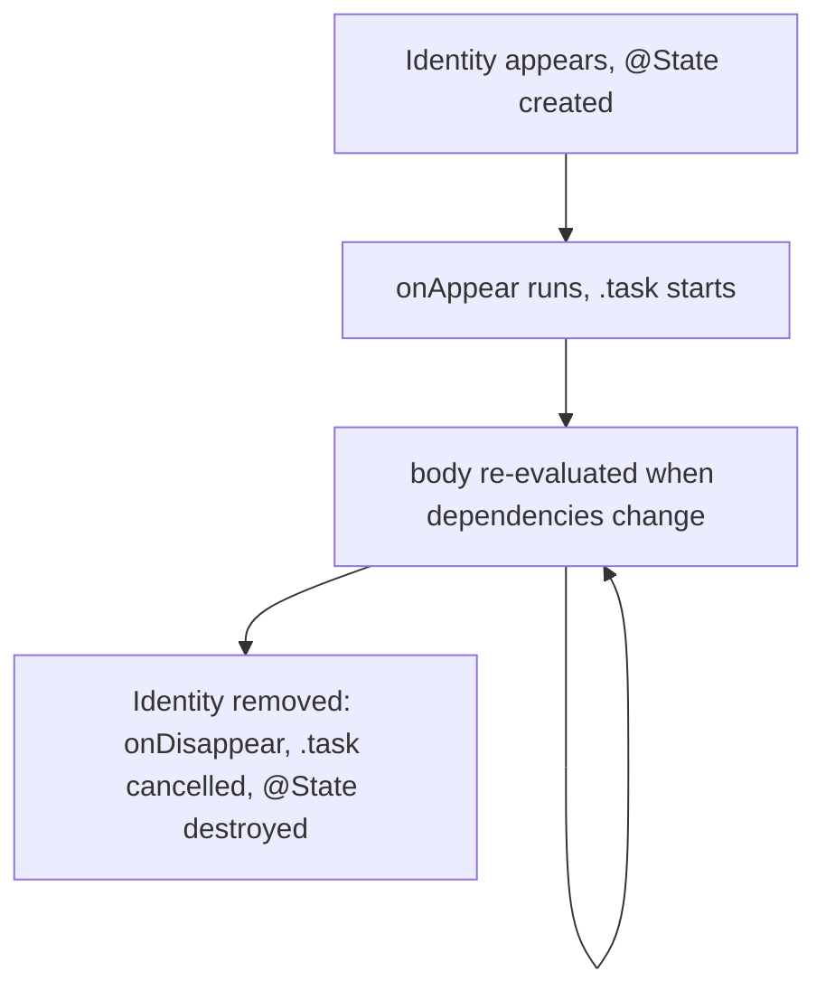
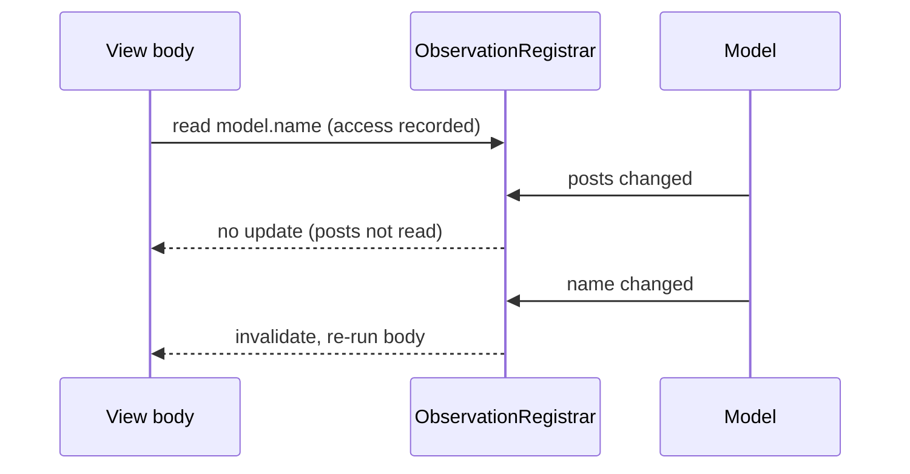
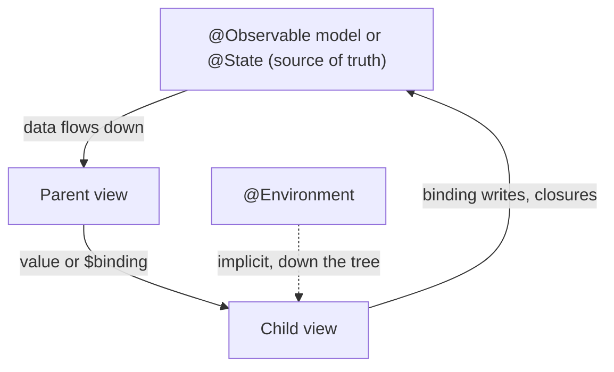
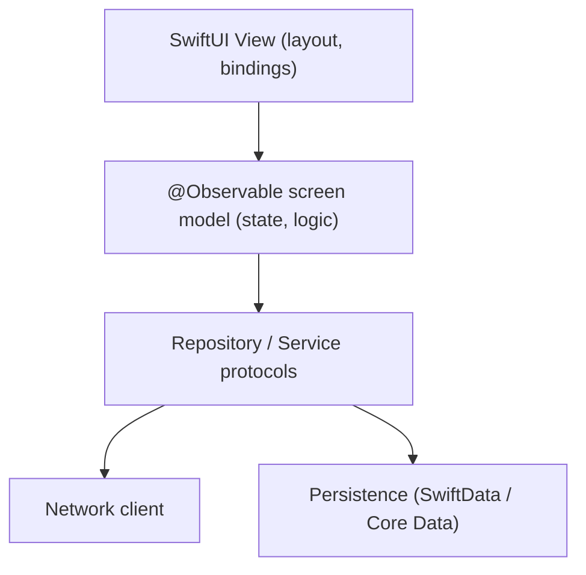
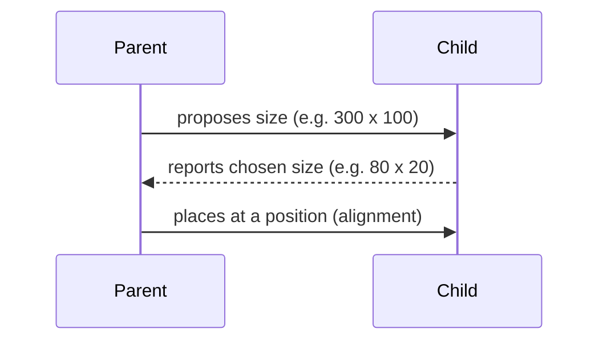
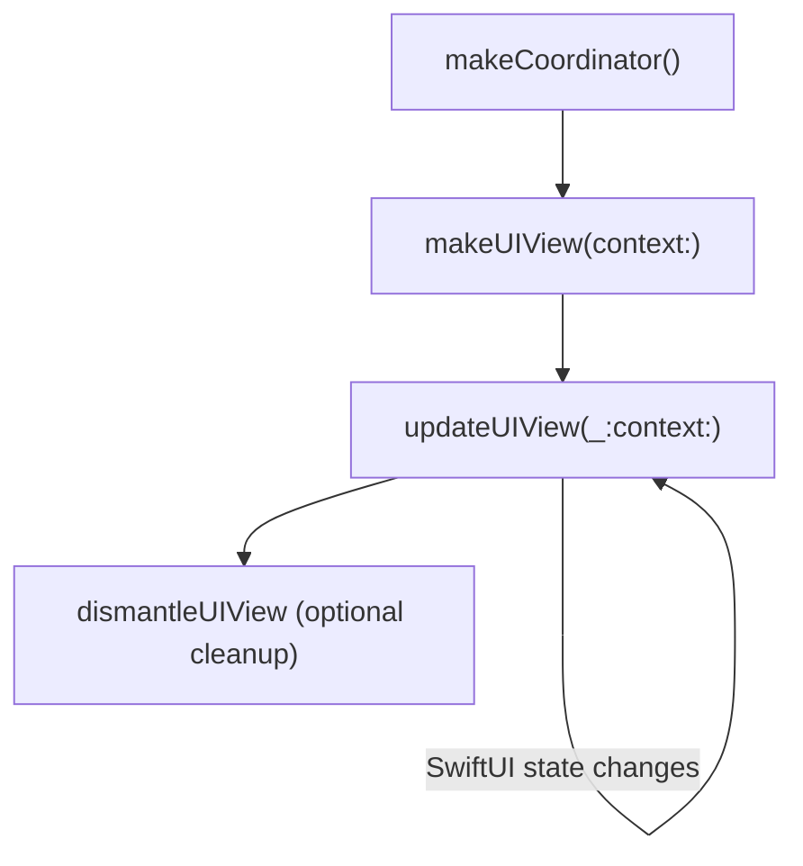
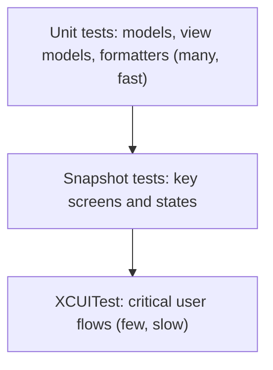
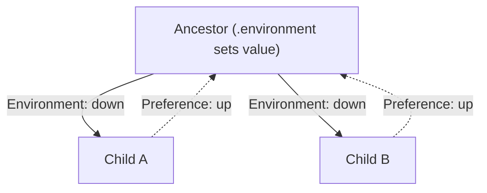
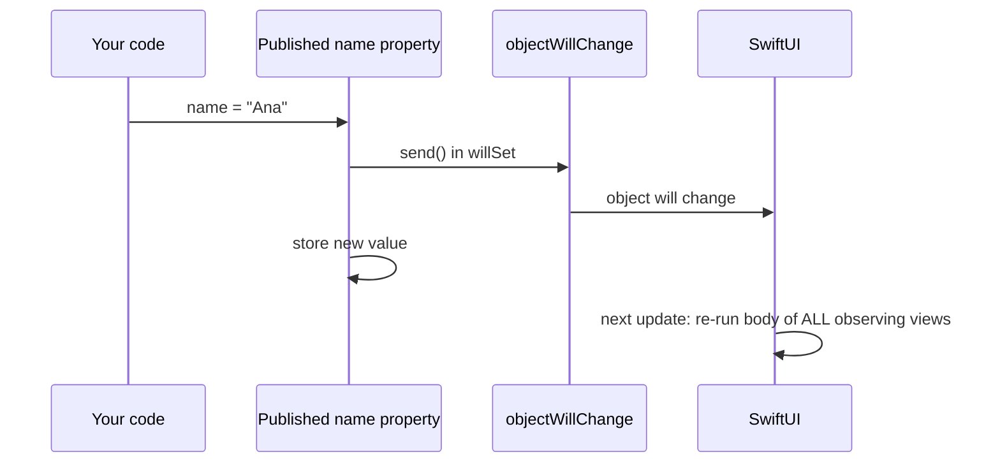

# SwiftUI

[⬅ Back to index](../README.md)

Covers: fundamentals, view identity & lifecycle, state management (@State, @Binding, @Observable, @Environment, legacy ObservableObject), data flow, navigation, lists & performance, layout, modifiers, animations, interop, testing.

---

## Fundamentals

### 1. What is SwiftUI? Declarative vs imperative?

<details>
<summary>Answer</summary>

**In short:** SwiftUI is Apple's **declarative UI framework** (iOS 13+) for all Apple platforms. You describe **what the UI should look like for a given state**, and SwiftUI works out how to update the screen when that state changes. In imperative UIKit you create views yourself and **mutate** them step by step (`label.text = …`, `button.isHidden = true`).

#### The problem it solves

In imperative UI code, the screen is a pile of objects whose properties you change over time. Every event handler has to remember to update every affected view. Miss one path (an error arrives while a loading spinner is shown) and the UI ends up in a state that no longer matches your data. Bugs like "the badge still shows 3 after I cleared the inbox" are almost always this kind of sync bug.

Declarative UI removes that whole category: the UI is a **function of state**. You change the state; SwiftUI re-runs your `body` and figures out the minimal set of real changes.

```swift
// Imperative (UIKit): you own every transition
func didFinishLoading(items: [Item]) {
    spinner.stopAnimating()
    spinner.isHidden = true
    tableView.isHidden = items.isEmpty
    emptyLabel.isHidden = !items.isEmpty
    tableView.reloadData()
}

// Declarative (SwiftUI): you describe each state once
var body: some View {
    switch model.state {
    case .loading:            ProgressView()
    case .loaded(let items) where items.isEmpty: Text("Nothing here")
    case .loaded(let items):  List(items) { ItemRow(item: $0) }
    case .failed(let error):  ErrorView(error: error)
    }
}
```

| | Imperative (UIKit) | Declarative (SwiftUI) |
|---|---|---|
| You write | Steps to change the UI | What the UI is for each state |
| Views are | Long-lived reference objects | Cheap value descriptions, recreated often |
| State sync | Manual, easy to get wrong | Automatic from a single source of truth |
| Layout | Auto Layout constraints / frames | Stacks, modifiers, size negotiation |
| Previews | Limited | Live `#Preview` canvas |

#### Benefits and trade-offs

- Less code, a **single source of truth**, live **Previews**, one framework for iOS/macOS/watchOS/tvOS/visionOS, and Dark Mode, Dynamic Type, accessibility and animations mostly for free.
- Trade-offs: some advanced customizations still need UIKit (via `UIViewRepresentable`), behaviour and available APIs differ between OS versions (so your deployment target matters a lot), and debugging "why did this re-render?" needs new tools and mental models.

**Likely follow-ups:**
- *Can you mix SwiftUI and UIKit?* Yes: `UIHostingController` puts SwiftUI in UIKit; `UIViewRepresentable` / `UIViewControllerRepresentable` go the other way.
- *Is SwiftUI built on UIKit?* On iOS, many SwiftUI controls are rendered with UIKit under the hood, but that's an implementation detail you shouldn't rely on.

</details>

### 2. Why are SwiftUI views structs? What is `body`?

<details>
<summary>Answer</summary>

**In short:** SwiftUI views are **lightweight value-type descriptions** of UI, not the rendered views themselves. They're cheap to create and are recreated all the time; SwiftUI compares the new description with the previous one and updates its own long-lived render tree (often called the "attribute graph"). `body` is a computed property returning `some View` that SwiftUI calls whenever the view's dependencies change, so it must be **fast and free of side effects**.

#### Why structs

A `UIView` is a heavy class: it owns a `CALayer`, has an identity in memory, and lives as long as it's on screen. A SwiftUI `View` struct is closer to a **recipe**: "a VStack with this text and that button". Making it a struct means:

- **Cheap**: often stack-allocated, no reference counting, so creating thousands per second is fine.
- **No hidden shared state**: a value can't be mutated from somewhere else behind your back.
- **Easy to diff**: SwiftUI can compare the old and new values to see what changed.

The real, persistent things (the rendered layers, `@State` storage, gesture recognizers) live inside SwiftUI and are tied to the view's **identity**, not to the struct instance.

#### What `body` is

```swift
struct ProfileHeader: View {
    let user: User                // plain input, comes from the parent
    @State private var isExpanded = false   // persistent storage managed by SwiftUI

    var body: some View {         // called whenever `user` or `isExpanded` changes
        VStack {
            Text(user.name).font(.title)
            if isExpanded { Text(user.bio) }
            Button(isExpanded ? "Less" : "More") { isExpanded.toggle() }
        }
    }
}
```

- `body` can be called many times per second (scrolling, animations, parent updates). Treat it like a pure function of inputs and state.
- Because the struct is recreated, a plain `var count = 0` stored property would be **reset** every time. Anything that must survive goes in SwiftUI-managed storage: `@State`, `@StateObject`, `@Environment`, etc.

**Pitfalls:**
- Doing work in `body` (sorting, `DateFormatter()` creation, network calls, logging analytics) — it runs far more often than you expect.
- Expecting a view's `init` to run once. It runs every time the parent's `body` runs.

**Likely follow-ups:**
- *Can a view be a class?* No, `View` is meant for value types; reference semantics break SwiftUI's diffing assumptions.
- *How does SwiftUI know when to call `body`?* It records which state/observable properties `body` read and re-invokes it when one of them changes.

</details>

### 3. What does `some View` mean?

<details>
<summary>Answer</summary>

**In short:** `some View` is an **opaque return type**: "this returns one specific concrete type that conforms to `View`; the compiler knows exactly what it is, the caller doesn't need to". It gives you full static typing and performance without spelling out huge generic types. Every code path must return the **same** concrete type, which is why `@ViewBuilder` wraps `if/else` in `_ConditionalContent`. Use `AnyView` only as a last resort.

#### Why it exists

SwiftUI composes views using generics. A modest view's real type looks like this:

```swift
// What `body` actually returns, roughly:
// ModifiedContent<VStack<TupleView<(Text, ModifiedContent<Button<Text>, _PaddingLayout>)>>, _BackgroundStyleModifier<Color>>
```

Nobody wants to write that, and it changes whenever you edit the view. `some View` lets the compiler infer it while keeping it **static**. That matters because SwiftUI uses the static type structure to know which parts of the tree can change, which makes diffing cheap.

#### Opaque vs existential vs `AnyView`

| | `some View` | `any View` / `AnyView` |
|---|---|---|
| Concrete type known to compiler | Yes (hidden from caller) | No, erased at runtime |
| Branches can differ in type | No (unless `@ViewBuilder`) | Yes |
| Diffing / performance | Best: structure is static | Worse: SwiftUI can't see the structure, often rebuilds |

```swift
// ❌ Won't compile without a builder: two different return types
func badge(isNew: Bool) -> some View {
    if isNew { return Text("NEW") }
    return Image(systemName: "star")
}

// ✅ @ViewBuilder turns branches into _ConditionalContent<Text, Image>
@ViewBuilder
func badge(isNew: Bool) -> some View {
    if isNew { Text("NEW") } else { Image(systemName: "star") }
}

// ⚠️ Works, but erases type information
func badge(isNew: Bool) -> AnyView {
    isNew ? AnyView(Text("NEW")) : AnyView(Image(systemName: "star"))
}
```

`body` is implicitly a `@ViewBuilder`, so `if`, `switch` and `ForEach` just work there. For helper functions or computed properties, add `@ViewBuilder` yourself, or use `Group { … }`.

**Likely follow-ups:**
- *When is `AnyView` acceptable?* For genuinely heterogeneous, runtime-determined content (e.g. a plugin/registry of screens) where generics are impractical.
- *Is `some` only for return types?* No, since Swift 5.7 you can also write `some` in parameter position (`func show(_ v: some View)`), which is shorthand for a generic parameter.

</details>

### 4. What is view identity? Structural vs explicit identity?

<details>
<summary>Answer</summary>

**In short:** Identity is how SwiftUI decides whether a view in the new `body` is the **same view** as before (keep its state, animate its changes) or a **new view** (destroy the old state, run a removal/insertion transition). **Structural identity** comes from the view's type and position in the hierarchy; **explicit identity** comes from `id`s in `ForEach` or the `.id(_:)` modifier. Changing identity resets state.

#### Why it matters

Since view structs are recreated constantly, SwiftUI needs another way to match "the toggle from last frame" with "the toggle now". Identity is that key, and everything persistent is attached to it: `@State` storage, `.task` lifetimes, `onAppear` calls, focus, scroll position, and animations.

#### Structural identity

SwiftUI uses the static type structure of `body`. Each branch of an `if/else` is a different slot in a `_ConditionalContent`, so they are **different views**:

```swift
// ❌ Two identities: flipping `isHighlighted` destroys one Card and creates another.
// Any @State inside Card resets, and you get a fade transition instead of a smooth change.
if isHighlighted {
    Card(item: item).border(.yellow)
} else {
    Card(item: item)
}

// ✅ One identity: only a modifier value changes, so state is kept and the change animates.
Card(item: item)
    .border(isHighlighted ? .yellow : .clear)
```

#### Explicit identity

- **`ForEach(items)`** uses `Identifiable.id` (or `id: \.someKey`) so rows keep their state when the array is reordered, inserted into, or deleted from.
- **`.id(value)`** gives a view a custom identity. When `value` changes, the view is treated as brand new.

```swift
// Force a fresh detail view (and fresh @State) whenever a different user is selected
UserDetail(user: selected)
    .id(selected.id)
```

| | Structural | Explicit |
|---|---|---|
| Source | Type + position in `body` | `ForEach` ids, `.id(_:)` |
| Typical trap | `if/else` creating two views | Unstable ids (array index, `UUID()` in body) |
| Useful for | Default behaviour | Resetting state on purpose, scrolling to a view |

**Pitfalls:**
- Generating `id: UUID()` inside `body` or in a computed property: every update creates a new identity, so rows constantly reset and animations break.
- Using array indices as ids for mutable lists: deleting row 2 makes row 3 inherit row 2's state.
- `AnyView` hides structure, making identity harder for SwiftUI to track.

**Likely follow-ups:**
- *How do you reset a form after submit?* Change an `.id` on it, so all child `@State` is recreated.
- *What's the lifetime of `@State`?* Exactly the lifetime of the view's identity.

</details>

### 5. What is the SwiftUI view lifecycle?

<details>
<summary>Answer</summary>

**In short:** A SwiftUI view's lifecycle follows its **identity**, not its struct instance. When an identity first appears, its `@State` is created and `onAppear` / `.task` run; while it lives, `body` is re-evaluated whenever its dependencies change; when the identity is removed, `onDisappear` runs, `.task` is cancelled and `@State` is destroyed. The struct itself (and its `init`) may be recreated many times in between.



#### The pieces

- **Lifetime of identity**: from when a view with a given identity is inserted into the hierarchy until it's removed. `@State`, `@StateObject` and `.task` lifetimes all match this.
- **`init`**: runs whenever the parent's `body` produces this view, which can be often. Not a lifecycle event — just struct construction.
- **`onAppear` / `onDisappear`**: called when the view appears or disappears. They can run **multiple times** for the same identity (switching tabs, pushing and popping in a `NavigationStack`, scrolling in lazy containers).
- **`.task { }`**: starts async work when the view appears and **cancels it automatically** when it disappears. `.task(id: value)` cancels and restarts when `value` changes.
- **`onChange(of:)`**: runs when a specific value changes (iOS 17 form gives you `oldValue, newValue`).

```swift
struct OrderView: View {
    let orderID: Order.ID
    @State private var order: Order?

    var body: some View {
        content
            .task(id: orderID) {                 // reloads when orderID changes, cancelled on disappear
                order = try? await api.order(orderID)
            }
            .onChange(of: order?.status) { old, new in
                if new == .delivered { Haptics.success() }
            }
    }
}
```

#### Lifecycle vs UIKit

| UIKit | SwiftUI approximation |
|---|---|
| `viewDidLoad` | First `onAppear` / `.task` (no exact equivalent) |
| `viewWillAppear` / `viewDidAppear` | `onAppear` |
| `viewDidDisappear` | `onDisappear` |
| `deinit` of the VC | Identity removed (`@State` destroyed) |

**Pitfalls:**
- Starting work in `init`: it runs repeatedly, even for views that never appear.
- Assuming `onAppear` runs once: guard with a flag or use `.task(id:)` if you need "load once".
- In `List`/`LazyVStack`, rows appear and disappear as you scroll, so their `onAppear` fires repeatedly.

**Likely follow-ups:**
- *Where should data loading go?* `.task`, because it is async and auto-cancelled.
- *Does `onDisappear` mean the view is destroyed?* Not necessarily; in a tab view the identity often stays alive while hidden.

</details>

---

## State & Data Flow

### 6. What property wrappers manage state in SwiftUI?

<details>
<summary>Answer</summary>

**In short:** `@State` owns local values (and, on iOS 17+, `@Observable` model instances the view creates); `@Binding` is a two-way reference to someone else's state; `@Observable` classes are shared models; `@Bindable` makes bindings to them; `@Environment` reads values injected down the tree. The legacy `ObservableObject` world uses `@StateObject`, `@ObservedObject` and `@EnvironmentObject`. The key question for each one is: **does this view own the data or not?**

| Wrapper | Owns data? | Use |
|---|---|---|
| `@State` | ✅ | Private, local **value** state of a view (and, on iOS 17+, an `@Observable` model instance the view owns) |
| `@Binding` | ❌ | **Two-way reference** to state owned by a parent |
| `@Observable` class (iOS 17+) | — | Shared model; views track only the properties they read |
| `@Bindable` | ❌ | Create bindings (`$model.name`) to properties of an `@Observable` object |
| `@Environment` | ❌ | Read system values (`\.colorScheme`, `\.dismiss`) or injected objects (`@Environment(Model.self)`) |
| `@StateObject` (legacy) | ✅ | Own an `ObservableObject`, created once |
| `@ObservedObject` (legacy) | ❌ | Observe an `ObservableObject` passed in from outside |
| `@EnvironmentObject` (legacy) | ❌ | `ObservableObject` injected through the environment |
| `@AppStorage` / `@SceneStorage` | ✅ | UserDefaults / per-scene restoration |
| `@FocusState`, `@GestureState`, `@Namespace` | — | Focus, transient gesture state, matched geometry |

#### Why so many wrappers

Views are structs that get recreated, so they can't hold mutable state themselves. Each wrapper tells SwiftUI **where the real storage lives** and **how to notice changes**:

- *Owning* wrappers (`@State`, `@StateObject`) allocate storage tied to the view's identity, created once.
- *Referencing* wrappers (`@Binding`, `@ObservedObject`, `@Bindable`) point at storage owned elsewhere.
- *Injected* wrappers (`@Environment`, `@EnvironmentObject`) look up storage provided by an ancestor.

#### Picking one (iOS 17+)

```swift
@Observable final class CartModel { var items: [Item] = [] }

struct ShopRoot: View {
    @State private var cart = CartModel()             // owns the model
    var body: some View {
        CartScreen(cart: cart)
            .environment(cart)                        // or inject for deep descendants
    }
}

struct CartScreen: View {
    let cart: CartModel                               // just reading: plain property
    var body: some View { Text("\(cart.items.count) items") }
}

struct CouponField: View {
    @Bindable var cart: CartModel                     // needs $cart.something bindings
    @State private var code = ""                      // local UI value
    var body: some View { TextField("Coupon", text: $code) }
}
```

**Pitfalls:**
- `@State` with a reference type that is **not** `@Observable`: SwiftUI won't see its mutations.
- Forgetting `private` on `@State`: it signals the parent could set it, but values passed in after the first init are ignored.
- Mixing old and new: an `ObservableObject` needs `@StateObject`/`@ObservedObject`; an `@Observable` class needs `@State`/plain/`@Bindable`.

**Likely follow-ups:**
- *`@AppStorage` vs `@SceneStorage`?* `@AppStorage` is backed by `UserDefaults` and shared app-wide; `@SceneStorage` is per-scene state restoration (e.g. selected tab per window).
- *What's `@GestureState`?* State that automatically resets when the gesture ends, ideal for drag offsets.

</details>

### 7. `@State` vs `@Binding`?

<details>
<summary>Answer</summary>

**In short:** `@State` **owns** a piece of value state for a view; SwiftUI stores it outside the struct, keeps it for the view's identity, and re-renders when it changes. `@Binding` **doesn't own** anything: it's a two-way reference (a getter + setter) to state owned by someone else, usually a parent. You create a binding from state with the `$` prefix.

```swift
struct Parent: View {
    @State private var isOn = false                   // source of truth
    var body: some View { ToggleRow(isOn: $isOn) }    // pass a binding with $
}
struct ToggleRow: View {
    @Binding var isOn: Bool                           // reads & writes parent's state
    var body: some View { Toggle("Wi-Fi", isOn: $isOn) }
}
```

#### How they work

- `@State` is a property wrapper whose real storage lives in SwiftUI's graph. `isOn` reads the current value; `$isOn` is its **projected value**, a `Binding<Bool>`.
- A `Binding<Value>` is essentially `get: () -> Value` and `set: (Value) -> Void`. When the child writes through it, the parent's `@State` changes, and **both** views re-render.
- Bindings can be derived: `$user.name` on a binding to a struct gives a binding to one field; `Binding(get:set:)` lets you build custom ones (e.g. to transform or validate).

| | `@State` | `@Binding` |
|---|---|---|
| Owns storage | Yes | No |
| Initial value | Set once per identity | Given by the parent |
| Access level | Should be `private` | Internal (parent passes it) |
| Typical use | Toggles, text input, local UI flags | Reusable controls editing parent data |

#### The "initialized once" rule

`@State` is initialized only once per view identity. Later values from `init` are **ignored**:

```swift
// ❌ Looks fine, but `count` won't follow later changes to `initial`
struct Counter: View {
    @State private var count: Int
    init(initial: Int) { _count = State(initialValue: initial) }
    var body: some View { Text("\(count)") }
}

// ✅ If the parent owns the value, take a Binding (or a plain `let`)
struct Counter: View {
    @Binding var count: Int
    var body: some View { Stepper("\(count)", value: $count) }
}
```

**Pitfalls:**
- Copying a parent's value into the child's `@State` creates two sources of truth that drift apart.
- `.constant(true)` bindings are great for previews but make a control read-only.

**Likely follow-ups:**
- *How do you preview a view that needs a Binding?* Use `.constant(...)`, or in Xcode 16+ the `@Previewable @State` macro inside `#Preview`.
- *Is `@State` thread-safe?* Mutate it on the main actor; SwiftUI views are main-actor isolated.

</details>

### 8. What is the Observation framework (`@Observable`)? How is it better than ObservableObject?

<details>
<summary>Answer</summary>

**In short:** `@Observable` (iOS 17, Swift's Observation framework) is a **macro** that makes a class observable without `@Published`. Its big win is **fine-grained tracking**: a view re-renders only when a property it **actually read in `body`** changes, while with `ObservableObject` any `@Published` change invalidates every observing view. It also simplifies the wrappers: `@State` to own, a plain property to pass in, `@Bindable` for bindings, `@Environment(Type.self)` to inject.

```swift
@Observable final class ProfileModel {
    var name = ""
    var posts: [Post] = []
    func load() async { ... }
}
struct ProfileView: View {
    @State private var model = ProfileModel()      // view owns it
    var body: some View { Text(model.name) }       // tracks ONLY `name`
}
```

#### How it works under the hood

1. The macro rewrites each stored property into a computed property backed by private storage, and adds an `ObservationRegistrar`.
2. Every **read** calls `registrar.access(...)`; every **write** calls `withMutation(...)`.
3. When SwiftUI evaluates `body`, it does so inside `withObservationTracking { … }`, which records exactly which properties of which objects were accessed.
4. When one of those properties changes, SwiftUI invalidates just that view and re-runs its `body`.



#### Comparison

| | `ObservableObject` + `@Published` | `@Observable` |
|---|---|---|
| Availability | iOS 13+ | iOS 17+ |
| Change granularity | Whole object (`objectWillChange`) | Per property actually read |
| Boilerplate | `@Published` on each property | None (`@ObservationIgnored` to opt out) |
| Owning wrapper | `@StateObject` | `@State` |
| Passing in | `@ObservedObject` | Plain `let`/`var` |
| Bindings | `$vm.name` via `@ObservedObject` | `@Bindable var vm` then `$vm.name` |
| Environment | `.environmentObject` / `@EnvironmentObject` | `.environment(obj)` / `@Environment(Type.self)` |
| Nested objects, optionals, arrays of models | Awkward (nested changes not propagated) | Tracked naturally |
| Combine dependency | Yes | No |

**Pitfalls:**
- Owning an `@Observable` model with a plain `let model = Model()` inside the view: it's recreated with the struct. Use `@State`.
- `@State var model = Model()` still calls `Model()`'s init each time the view struct is created (the extra instances are discarded), so keep model `init` cheap.
- Reading a property outside `body` (e.g. in a closure run later) isn't tracked for that view.
- Use `@MainActor` on UI models so mutations happen on the main thread.

**Likely follow-ups:**
- *Can I use it outside SwiftUI?* Yes, with `withObservationTracking(_:onChange:)`, though it fires once per registration; iOS 26 adds an `Observations` async sequence for continuous observation.
- *How do you migrate?* Replace `ObservableObject` with `@Observable`, drop `@Published`, swap `@StateObject` → `@State`, `@ObservedObject` → plain/`@Bindable`, `@EnvironmentObject` → `@Environment(Type.self)`.

</details>

### 9. `@StateObject` vs `@ObservedObject`? (Classic bug)

<details>
<summary>Answer</summary>

**In short:** `@StateObject` means the view **creates and owns** the `ObservableObject`; SwiftUI creates it **once** per view identity and keeps it across `body` recomputations. `@ObservedObject` means the object is **owned elsewhere** and passed in; SwiftUI just subscribes to it. The classic bug is `@ObservedObject var vm = ViewModel()`: every time the parent re-renders, a new view model is created and the screen's state is lost.

#### Why the bug happens

A view struct is rebuilt whenever its parent's `body` runs. With `@ObservedObject`, the default value expression runs on **every** construction, so you get a fresh object each time:

```swift
// ❌ A new SearchViewModel every time the parent re-renders:
// typed query, results and loading state randomly reset.
struct SearchScreen: View {
    @ObservedObject var vm = SearchViewModel()
    var body: some View { ... }
}

// ✅ Created once per identity, survives parent re-renders
struct SearchScreen: View {
    @StateObject private var vm = SearchViewModel()
    var body: some View { ... }
}

// ✅ Owned by someone else, just observed here
struct SearchResultsList: View {
    @ObservedObject var vm: SearchViewModel     // no default value
    var body: some View { ... }
}
```

`@StateObject`'s initializer takes an `@autoclosure`, so SwiftUI only evaluates `SearchViewModel()` the first time the identity appears and reuses the stored instance afterwards. That's what makes it safe.

| | `@StateObject` | `@ObservedObject` |
|---|---|---|
| Who creates the object | This view | Someone else |
| Lifetime | Tied to this view's identity | Whatever the owner decides |
| Default value `= Model()` | Correct | Bug: recreated on each parent update |
| Re-renders on `objectWillChange` | Yes | Yes |

#### Passing parameters into a `@StateObject`

```swift
struct DetailScreen: View {
    @StateObject private var vm: DetailViewModel
    init(id: Item.ID) {
        _vm = StateObject(wrappedValue: DetailViewModel(id: id))  // autoclosure: runs once
    }
    var body: some View { ... }
}
```

Note: if `id` later changes for the same identity, the view model is **not** recreated. Add `.id(id)` on the view if you need that.

**The modern equivalent:** with `@Observable`, the rule becomes "own it with `@State`, pass it as a plain property".

**Likely follow-ups:**
- *Why does the bug often go unnoticed?* It only shows when the parent re-renders, e.g. after an unrelated state change, so it looks like random data loss.
- *Does `@State` with an `@Observable` model have the same autoclosure behaviour?* No, `@State`'s initial value expression is evaluated on every init (extra instances are discarded), so keep the model's `init` light.

</details>

### 10. How does data flow work in SwiftUI? What is a single source of truth?

<details>
<summary>Answer</summary>

**In short:** Every piece of data has **one owner**, the source of truth; everyone else reads it or gets a **binding** to it. Data flows **down** (initializer parameters, environment) and changes flow **up** (bindings, closures, model methods). Duplicating state, for example copying a parent value into a child's `@State`, makes the two copies drift apart. Keep state as high as it needs to be, and no higher.



#### Why a single source of truth

In UIKit, it's common for a value to live in the model, in a view controller property and in a label's text at the same time. Every update has to touch all three. In SwiftUI, the view is derived from state, so if there's exactly one copy of a value, the UI cannot disagree with itself.

#### Ways data moves

| Direction | Mechanism | Example |
|---|---|---|
| Down | Plain `let` parameter | `Row(item: item)` |
| Down (implicit) | `@Environment` | theme, locale, `dismiss`, injected services |
| Up / two-way | `@Binding` | `Toggle(isOn: $settings.wifi)` |
| Up (events) | Closure parameter | `Row(item: item, onDelete: { … })` |
| Shared | `@Observable` model passed or injected | `CartModel` read by several screens |
| Up (layout data) | `PreferenceKey` | child reports its size |

```swift
// ❌ Two sources of truth: child copies the value once and never syncs back
struct NameEditor: View {
    @State private var name: String
    init(name: String) { _name = State(initialValue: name) }
    ...
}

// ✅ Child edits the parent's value directly
struct NameEditor: View {
    @Binding var name: String
    var body: some View { TextField("Name", text: $name) }
}
```

#### Where to put state

- Used by one view only → `@State` in that view.
- Shared by siblings → lift it to their closest common parent.
- Shared across screens or long-lived → an `@Observable` model owned near the top (or by the app/scene) and passed or injected.
- Persisted → the model/persistence layer (SwiftData, a repository), not views.

A legitimate exception is a **draft**: an edit screen may deliberately copy the value into local state and only write back on "Save".

**Likely follow-ups:**
- *Why not put everything in one global store?* Every view would depend on it, making updates broad and code coupled; keep state local by default.
- *How do child events reach the parent without bindings?* Pass closures (`onSelect:`), which keeps the child reusable.

</details>

### 11. What is the Environment? How do you inject dependencies with it?

<details>
<summary>Answer</summary>

**In short:** The environment is a set of values that propagates **implicitly down the view tree**. SwiftUI uses it for system values (`\.colorScheme`, `\.locale`, `\.dismiss`, `\.openURL`), and you can add custom keys or inject `@Observable` objects with `.environment(model)` and read them with `@Environment(Model.self)`. It's convenient for app-wide dependencies, but explicit initializer injection is easier to see and test.

#### How it works

Every view has an `EnvironmentValues` (a type-keyed dictionary-like struct). A modifier such as `.environment(\.locale, …)` creates a copy with that value changed for **its subtree only**. Descendants read it with `@Environment`, and they re-render when a value they read changes.

```swift
// 1. Declare a custom value (iOS 18 @Entry macro; the older way is an EnvironmentKey)
extension EnvironmentValues {
    @Entry var analytics: Analytics = .live
}

// 2. Override it for a subtree (e.g. in tests or previews)
ContentView().environment(\.analytics, .mock)

// 3. Read it anywhere below
struct BuyButton: View {
    @Environment(\.analytics) private var analytics
    var body: some View {
        Button("Buy") { analytics.track("buy_tapped") }
    }
}
```

Before `@Entry`, you'd write a key type by hand:

```swift
private struct AnalyticsKey: EnvironmentKey { static let defaultValue: Analytics = .live }
extension EnvironmentValues {
    var analytics: Analytics {
        get { self[AnalyticsKey.self] }
        set { self[AnalyticsKey.self] = newValue }
    }
}
```

#### Injecting observable models

```swift
@main struct ShopApp: App {
    @State private var session = SessionModel()
    var body: some Scene {
        WindowGroup { RootView().environment(session) }
    }
}

struct AccountBadge: View {
    @Environment(SessionModel.self) private var session   // crashes if not provided
    var body: some View { Text(session.user?.name ?? "Guest") }
}
```

| | Environment | Init injection |
|---|---|---|
| Boilerplate through intermediate views | None | Pass through every level |
| Visibility of dependencies | Hidden | Explicit in the signature |
| Missing value | Default value, or crash for `@Environment(Type.self)` | Compile error |
| Good for | Theme, services, session, system actions | Screen-specific data and view models |

**Pitfalls:**
- Forgetting to inject an object read with `@Environment(Model.self)` (or the legacy `@EnvironmentObject`) crashes at runtime, often only in a preview or a sheet.
- Sheets and other presentations do inherit the environment on modern iOS, but on old iOS versions they didn't, so older codebases re-inject explicitly.
- Overusing it hides dependencies; a view that reads ten environment values is hard to reason about.

**Likely follow-ups:**
- *Optional injection?* `@Environment(Model.self) private var model: Model?` reads it as optional instead of crashing.
- *How does `\.dismiss` work?* It's an environment action that dismisses the nearest presentation (sheet or pushed view).

</details>

### 12. Where should business logic live in SwiftUI? Is MVVM still needed?

<details>
<summary>Answer</summary>

**In short:** Keep views focused on layout and binding to state. Put logic in an **`@Observable` model or view model** (testable, no UI code), and data access in services or repositories. Whether that's called MVVM, "MV" or TCA is a team choice. A good interview answer: "Simple screens can use `@State` and small models; complex screens get an observable view model with injected dependencies; data access lives in a separate layer." See [Architecture](11-architecture.md).

#### The debate

- **"MV" (Model-View)**: SwiftUI views already behave like view models (they hold state and derive UI from it), and `@Observable` models can be used directly. Adding a view model per screen can be ceremony.
- **MVVM**: a per-screen `@Observable` view model holds screen state, formats data, and calls services. Views become thin; logic is unit-testable without rendering UI.
- **TCA / unidirectional (Redux-like)**: state, actions and reducers with explicit side-effect handling. Very testable and predictable, with a learning curve and more structure.

#### A pragmatic layering



```swift
@MainActor @Observable
final class OrdersModel {
    enum State { case idle, loading, loaded([Order]), failed(String) }
    private(set) var state: State = .idle
    private let repo: OrdersRepository            // protocol → mockable in tests

    init(repo: OrdersRepository) { self.repo = repo }

    func load() async {
        state = .loading
        do { state = .loaded(try await repo.fetchOrders()) }
        catch { state = .failed(error.localizedDescription) }
    }
}

struct OrdersScreen: View {
    @State private var model: OrdersModel
    init(repo: OrdersRepository) { _model = State(initialValue: OrdersModel(repo: repo)) }
    var body: some View {
        content.task { await model.load() }
    }
    @ViewBuilder private var content: some View { /* switch on model.state */ }
}
```

The test then needs no UI at all: create `OrdersModel(repo: MockRepo())`, `await load()`, assert on `state`.

| Approach | Strength | Cost |
|---|---|---|
| State in views + models | Least code | Logic harder to test if it creeps into views |
| MVVM with `@Observable` | Testable, familiar | Some boilerplate |
| TCA | Very predictable, strong testing story | Dependency, learning curve |

**Pitfalls:**
- Putting `URLSession` calls, formatting or validation directly in views.
- View models that import SwiftUI and hold `Color`/`Font`: keep them platform-agnostic where you can.
- A single giant "app view model" shared by every screen.

**Likely follow-ups:**
- *How do you inject dependencies?* Through initializers (protocols), or the environment for app-wide services.
- *How do you navigate from a view model?* Expose navigation state (a path or an enum route) the view binds to, or use a coordinator/router object.

</details>

---

## Navigation, Lists, Layout

### 13. How does navigation work in SwiftUI (NavigationStack)?

<details>
<summary>Answer</summary>

**In short:** `NavigationView` is **deprecated**. Use **`NavigationStack`** (iOS 16+) with **value-based** navigation: links push a *value*, `.navigationDestination(for:)` maps value types to screens, and the stack's contents are a `path` you own in state. Because the path is just data, you get **programmatic navigation**, deep linking and state restoration. `NavigationSplitView` handles multi-column layouts on iPad and Mac.

```swift
@State private var path = NavigationPath()   // or [Route]
NavigationStack(path: $path) {
    List(products) { p in NavigationLink(p.name, value: p) }
        .navigationDestination(for: Product.self) { ProductDetail(product: $0) }
}
// programmatic: path.append(product); path.removeLast(); path = NavigationPath() (pop to root)
```

#### Why the change from `NavigationView`

The old `NavigationLink(destination:)` built destination views eagerly and tied navigation to `isActive` booleans scattered across views, which made pop-to-root and deep links painful. The new model separates **what is on the stack** (data) from **how each item is shown** (destinations).

#### A typed route enum

For apps with several destination types, a typed `[Route]` path is clearer than `NavigationPath`:

```swift
enum Route: Hashable {
    case product(Product.ID)
    case cart
    case checkout(orderID: String)
}

@Observable final class Router {
    var path: [Route] = []
    func open(_ url: URL) {                         // deep link → whole stack at once
        if let id = url.productID { path = [.product(id)] }
    }
    func popToRoot() { path.removeAll() }
}

struct ShopRoot: View {
    @State private var router = Router()
    var body: some View {
        NavigationStack(path: $router.path) {
            HomeView()
                .navigationDestination(for: Route.self) { route in
                    switch route {
                    case .product(let id):          ProductDetail(id: id)
                    case .cart:                     CartView()
                    case .checkout(let orderID):    CheckoutView(orderID: orderID)
                    }
                }
        }
        .environment(router)
        .onOpenURL { router.open($0) }
    }
}
```

| | `NavigationPath` | `[Route]` |
|---|---|---|
| Element types | Any `Hashable`, mixed | One enum |
| Inspect contents | Limited (`count`) | Full array access |
| Restoration | `CodableRepresentation` if elements are `Codable` | Make `Route` `Codable` |

#### Other presentation styles

Modals are separate from the stack and also state-driven: `.sheet(item:)`, `.fullScreenCover`, `.popover`, `.alert`, `.confirmationDialog`, `.inspector`.

**Pitfalls:**
- Putting `.navigationDestination` inside a lazy container (e.g. on a `List` row): it may not be registered when needed. Attach it to the stack's content.
- Nesting `NavigationStack` inside another stack's destination leads to odd double bars.
- Pushing heavy view models as values; push IDs and let the destination load data.

**Likely follow-ups:**
- *How do tabs fit?* Each tab usually gets its own `NavigationStack` and its own path.
- *`NavigationSplitView`?* Sidebar/content/detail columns that collapse into a stack on iPhone.

</details>

### 14. List vs LazyVStack vs VStack?

<details>
<summary>Answer</summary>

**In short:** `VStack` creates **all** children immediately — fine for small, fixed content. `LazyVStack` (inside a `ScrollView`) creates children **as they come on screen** and gives you full styling control, but doesn't recycle the underlying views the way a table does. `List` is backed by platform collection views, so it **reuses** rows and gives you swipe actions, selection, edit mode, sections, pull-to-refresh and system styling — best for large data sets with platform behaviour.

| | `VStack` | `LazyVStack` in `ScrollView` | `List` |
|---|---|---|---|
| Creates children | All up front | On demand while scrolling | On demand, with cell reuse |
| Scrolls by itself | No | Via `ScrollView` | Yes |
| Memory with 10k rows | High | Grows as you scroll (rows kept once created) | Bounded |
| Swipe actions, edit mode, selection | No | Build yourself | Built in |
| Styling | Full control | Full control | System styles (`.listStyle`, `listRowInsets`, etc.) |
| Good for | Forms, cards, < ~50 items | Custom feeds, card layouts | Settings-style and large data lists |

```swift
// Small, static: VStack
VStack(alignment: .leading, spacing: 8) {
    Text(user.name); Text(user.email)
}

// Custom-looking feed: LazyVStack
ScrollView {
    LazyVStack(spacing: 12, pinnedViews: .sectionHeaders) {
        ForEach(posts) { post in PostCard(post: post) }
    }
    .padding()
}

// Platform list with behaviour
List(selection: $selection) {
    ForEach(messages) { m in
        MessageRow(message: m)
            .swipeActions { Button("Delete", role: .destructive) { delete(m) } }
    }
}
.refreshable { await reload() }
```

`LazyVGrid` / `LazyHGrid` are the grid equivalents, configured with `GridItem` columns (`.fixed`, `.flexible`, `.adaptive(minimum:)`). The non-lazy `Grid` (iOS 16) is for small, aligned table-like layouts.

#### Identity in `ForEach`

Use stable **`id`s** (an `Identifiable` model ID), never array indices for mutable data. With indices, deleting an item shifts identities, so state and animations attach to the wrong rows, and `ForEach(0..<items.count)` doesn't even update correctly when the count changes.

**Pitfalls:**
- Putting a `VStack` with hundreds of rows inside a `ScrollView`: everything is built up front, causing slow first render.
- Expensive row views in a `LazyVStack`: once created, they stay in memory, so long feeds can grow large.
- Infinite scroll: trigger "load more" with `.onAppear` on the last rows (or `.task`) and guard against duplicate loads.

**Likely follow-ups:**
- *How do you scroll to an item?* `ScrollViewReader` + `proxy.scrollTo(id)`, or iOS 17's `.scrollPosition(id:)`.
- *Why is my `List` slow?* Usually heavy row `body`s, unstable ids, or `AnyView` rows.

</details>

### 15. How does SwiftUI layout work?

<details>
<summary>Answer</summary>

**In short:** Layout is a three-step negotiation: (1) the **parent proposes a size** to the child; (2) the **child chooses its own size** (it may ignore the proposal); (3) the **parent places the child** in its coordinate space according to alignment. Modifiers like `.frame` and `.padding` are themselves views that take part in this negotiation.



#### The key idea: children decide their size

Unlike Auto Layout, there are no constraints solved globally. Each view answers "given this proposal, how big are you?":

- `Text` uses its ideal size and wraps or truncates if the proposal is smaller.
- `Image` uses its fixed pixel size unless `.resizable()`.
- `Color`, `Rectangle`, `Spacer` take whatever they're offered (flexible).
- Stacks divide space among children, giving it first to the **least flexible** ones, and use `layoutPriority` to break ties.

#### Modifiers are layout wrappers

```swift
Text("Hello")
    .padding(16)                 // proposes (offer - 32) to Text, reports text size + 32
    .frame(width: 200)           // proposes 200 wide, then centers the child in 200
    .background(.blue)           // takes the size of the view it wraps
```

`.frame(width: 200)` doesn't "set the text's width": it creates a 200-pt container that proposes 200 to the text and aligns it inside.

#### Tools

| Tool | What it does |
|---|---|
| `Spacer` | Flexible empty space in stacks |
| `layoutPriority(_:)` | Gets space first in a stack |
| `fixedSize()` | Child uses its ideal size, ignoring the proposal (e.g. no truncation) |
| `.frame(maxWidth: .infinity)` | Makes a view flexible / fill available width |
| `GeometryReader` | Reads the proposed size; use sparingly |
| `containerRelativeFrame` (iOS 17) | Size relative to the nearest container (e.g. 80% of scroll view width) |
| `ViewThatFits` | Picks the first child that fits |
| `Layout` protocol (iOS 16) | Write your own container |

**Pitfalls:**
- Expecting `.frame(width:)` after `.background` to resize the background — order matters.
- `GeometryReader` greedily takes all offered space, which often breaks a layout.
- Text truncation inside `HStack`: use `layoutPriority(1)` or `fixedSize(horizontal: false, vertical: true)`.

**Likely follow-ups:**
- *What does `.frame(maxWidth: .infinity)` do?* Accepts any proposed width up to infinity, so it fills the parent horizontally.
- *How does alignment work across views?* Alignment guides; custom `AlignmentID`s let unrelated views line up.

</details>

### 16. Why does modifier order matter?

<details>
<summary>Answer</summary>

**In short:** Each modifier **wraps** the view in a new view (`ModifiedContent`), so the chain builds nested layers from the inside out. Changing the order changes which layer sees which size, so the visual result changes.

```swift
Text("Hi").padding().background(.red)   // red includes padding
Text("Hi").background(.red).padding()   // red only behind text
```

#### Why: modifiers are nested views

The first line is roughly `Background(Padding(Text))`: the background wraps a view that already includes padding, so it fills the padded area. The second is `Padding(Background(Text))`: the background only wraps the text, and padding is added outside it, transparently.

More examples:

```swift
// Tap area: only the visible circle vs the whole padded frame
Image(systemName: "heart")
    .padding(20)
    .contentShape(Rectangle())   // whole padded area is tappable
    .onTapGesture { like() }

// Clip then shadow: shadow gets clipped too (often unwanted)
card.clipShape(.rect(cornerRadius: 12)).shadow(radius: 4)   // ✅ shadow outside the clip
card.shadow(radius: 4).clipShape(.rect(cornerRadius: 12))   // ❌ shadow cut off

// Frame then border vs border then frame
Text("A").border(.green).frame(width: 100)   // border hugs the text
Text("A").frame(width: 100).border(.green)   // border is 100 pt wide
```

Not every modifier creates a layout layer. **Environment modifiers** like `.font()`, `.foregroundStyle()` or `.tint()` set values that flow down to children, so for them order mostly doesn't matter (the innermost explicit value wins).

#### Custom modifiers

```swift
struct CardStyle: ViewModifier {
    func body(content: Content) -> some View {
        content
            .padding()
            .background(.background, in: .rect(cornerRadius: 12))
            .shadow(radius: 2)
    }
}
extension View {
    func cardStyle() -> some View { modifier(CardStyle()) }
}

Text("Order #42").cardStyle()
```

**Pitfalls:**
- Putting `.onTapGesture` before `.padding` and wondering why the padding isn't tappable.
- Applying `.frame` after `.background` and expecting the background to grow.

**Likely follow-ups:**
- *Do many modifiers hurt performance?* Each is a small value type; the cost is low compared to work done in `body`.
- *`ViewModifier` vs a `View` extension function?* Use a `ViewModifier` when it needs its own state (`@State`, `@Environment`); a plain extension is enough for simple chains.

</details>

### 17. How do animations work in SwiftUI?

<details>
<summary>Answer</summary>

**In short:** SwiftUI animates by **interpolating between the before and after states** of a change. You choose *when* to animate either **implicitly** (`.animation(_:value:)` on a view) or **explicitly** (`withAnimation { state change }`). Views that are inserted or removed (identity changes, such as `if` branches) don't interpolate; they run a **transition**.

#### Implicit vs explicit

```swift
// Implicit: animate whatever changes in this view when `isExpanded` changes
RoundedRectangle(cornerRadius: 12)
    .frame(height: isExpanded ? 300 : 100)
    .animation(.spring, value: isExpanded)

// Explicit: animate every view affected by this state change
Button("Toggle") {
    withAnimation(.easeInOut(duration: 0.3)) { isExpanded.toggle() }
}
```

| | Implicit `.animation(_:value:)` | Explicit `withAnimation` |
|---|---|---|
| Scope | That view subtree, when `value` changes | Everything the state change affects |
| Where you declare it | On the view | At the place the state changes |
| Good for | Self-contained components | User actions affecting many views |

The old `.animation(_:)` without `value:` is deprecated because it animated *any* change, including unrelated ones.

#### Transitions

```swift
if showBanner {
    Banner()
        .transition(.move(edge: .top).combined(with: .opacity))
}
// must be triggered inside an animation, e.g. withAnimation { showBanner.toggle() }
```

Built-ins include `.opacity`, `.slide`, `.scale`, `.move(edge:)`, `.push(from:)`, and `.asymmetric(insertion:removal:)`.

#### More advanced tools

- **`matchedGeometryEffect`** with a `@Namespace`: hero animations between two views that represent the same thing.
- **`PhaseAnimator` / `KeyframeAnimator`** (iOS 17): multi-step and keyframe-based animations.
- **`Animatable`** protocol: expose `animatableData` so custom shapes or modifiers can interpolate their own values.
- **Navigation zoom transitions** (iOS 18): `.navigationTransition(.zoom(sourceID:in:))` with `.matchedTransitionSource`.
- Spring animations are the default style in modern SwiftUI (`.spring`, `.bouncy`, `.snappy`, `.smooth`).

**Pitfalls:**
- Using `if/else` where you wanted a smooth change: you get a fade transition instead of interpolation (see view identity).
- Transitions not running because the state change wasn't animated.
- Changing `.id` on a view during an animation resets it.

**Likely follow-ups:**
- *How do you disable an animation for one change?* Use a `Transaction` with `disablesAnimations`, or `withAnimation(nil)`.
- *Do animations run on the main thread?* SwiftUI computes them, and Core Animation renders much of the work off the main thread, but heavy `body` work during animation still causes hitches.

</details>

---

## Performance, Interop, Testing

### 18. How do you optimize SwiftUI performance?

<details>
<summary>Answer</summary>

**In short:** Make SwiftUI do less work: keep `body` **cheap and pure**, limit **how many views are invalidated** per change (fine-grained `@Observable` models, small subviews, passing only the data a view needs), keep **identity stable** (proper `id`s, no needless `if/else` or `AnyView`), use lazy containers for big data, and **measure** with `Self._printChanges()` and Instruments before guessing.

#### Where the cost comes from

A SwiftUI update has two costs: **how many** `body`s are re-evaluated, and **how expensive** each one is. Most slowdowns are one of:

1. One state change invalidating a huge view (or many views).
2. Expensive work inside `body` (formatting, sorting, filtering, image decoding).
3. Identity churn that forces SwiftUI to tear down and rebuild views instead of updating them.

#### Techniques

- **Pure, cheap `body`**: precompute in the model; reuse formatters (`Date.FormatStyle` / `.formatted()` is fine; creating a `DateFormatter()` per render is not).
- **`@Observable`** so a view only updates when the properties it reads change.
- **Split big views** into subviews. Each subview is its own invalidation scope: if its inputs didn't change, SwiftUI can skip its `body`.
- **Pass only what's needed**: `PriceLabel(price: item.price)` re-renders less than `PriceLabel(item: item)`.
- **Lazy containers / `List`** for large data sets, with **stable `id`s**.
- **Avoid `AnyView`** and needless branching that changes identity.
- **Avoid heavy `GeometryReader`** usage; prefer `containerRelativeFrame`, `onGeometryChange`, `visualEffect`.
- **`.drawingGroup()`** flattens complex vector drawings into a single Metal-rendered layer.
- **Images**: downsample large images off the main thread; `AsyncImage` doesn't cache aggressively, so many apps use a caching loader.

```swift
// ❌ Every keystroke in `query` re-sorts and re-filters 10k items in body
var body: some View {
    List(items.filter { $0.name.contains(query) }.sorted { $0.date > $1.date }) { ItemRow(item: $0) }
}

// ✅ Model derives results once per change (and can debounce)
@Observable final class SearchModel {
    var query = "" { didSet { recompute() } }
    private(set) var results: [Item] = []
    private var all: [Item] = []
    private func recompute() { results = all.filter { $0.name.localizedStandardContains(query) } }
}
```

#### Measuring

- **`let _ = Self._printChanges()`** at the top of `body` prints which property triggered the update (debug only, underscored API).
- **Instruments**: the SwiftUI instrument (redesigned in Xcode 26) shows long view body updates and what caused them; the Hitches / Animation Hitches and Time Profiler instruments show dropped frames and hot code.
- Test on real, older devices with realistic data volumes.

**Pitfalls:**
- Optimizing without profiling.
- A single "app state" `ObservableObject` read by every view: any change re-renders everything.

**Likely follow-ups:**
- *Does `Equatable` on views help?* Conforming a view to `Equatable` (and `.equatable()`) can let SwiftUI skip updates for views with complex inputs, but it's rarely needed with `@Observable`.
- *Why do lists hitch while scrolling?* Expensive row bodies, synchronous image decoding, or unstable ids.

</details>

### 19. How do you use UIKit inside SwiftUI?

<details>
<summary>Answer</summary>

**In short:** Wrap UIKit views with **`UIViewRepresentable`** (or view controllers with **`UIViewControllerRepresentable`**). You implement `makeUIView` (create once), `updateUIView` (push SwiftUI state into the UIKit view whenever it changes) and optionally `makeCoordinator` (an object that acts as the delegate/target and pushes UIKit events back into SwiftUI, usually via bindings). For the opposite direction, use `UIHostingController`.

```swift
struct MapViewWrapper: UIViewRepresentable {
    @Binding var region: MKCoordinateRegion

    func makeUIView(context: Context) -> MKMapView {
        let map = MKMapView()
        map.delegate = context.coordinator          // UIKit → SwiftUI via coordinator
        return map
    }

    func updateUIView(_ map: MKMapView, context: Context) {
        // SwiftUI → UIKit. Called on every relevant state change, so avoid redundant work.
        if !map.region.isApproximatelyEqual(to: region) {   // your own helper
            map.setRegion(region, animated: true)
        }
    }

    func makeCoordinator() -> Coordinator { Coordinator(self) }

    final class Coordinator: NSObject, MKMapViewDelegate {
        var parent: MapViewWrapper
        init(_ parent: MapViewWrapper) { self.parent = parent }

        func mapView(_ mapView: MKMapView, regionDidChangeAnimated animated: Bool) {
            parent.region = mapView.region           // write back through the binding
        }
    }
}
```

#### The lifecycle



- `makeUIView` runs **once** per identity; `updateUIView` runs after it and whenever inputs change.
- The **Coordinator** lives as long as the representable's identity, so it's the right place for delegates, target-actions, and caching.
- `context.environment` and `context.transaction` give access to SwiftUI environment values and the current animation.
- `sizeThatFits(_:uiView:context:)` (iOS 16+) lets you report a custom size.

#### SwiftUI inside UIKit

```swift
let host = UIHostingController(rootView: ProfileView(model: model))
navigationController?.pushViewController(host, animated: true)
// iOS 16+: UIHostingConfiguration for SwiftUI content inside UICollectionView/UITableView cells
cell.contentConfiguration = UIHostingConfiguration { ItemRow(item: item) }
```

**Pitfalls:**
- Writing back to a binding inside `updateUIView` (causes update loops and "Modifying state during view update" warnings).
- Setting values in `updateUIView` unconditionally, which can reset scroll positions or restart animations.
- Capturing the struct `self` in closures expecting it to stay current; keep the latest parent in the coordinator (`context.coordinator.parent = self` in `updateUIView`).

**Likely follow-ups:**
- *When would you still need UIKit?* Missing APIs (some camera/text features), advanced collection view layouts, or mature existing screens.
- *How do you size a hosted SwiftUI view in Auto Layout?* `UIHostingController` supports `sizingOptions = .intrinsicContentSize` (iOS 16+).

</details>

### 20. How do you handle async work in SwiftUI?

<details>
<summary>Answer</summary>

**In short:** Use **`.task { await model.load() }`**: it starts when the view appears, is **cancelled automatically** when the view disappears, and runs on the main actor by default (the view is `@MainActor`), so you can update state directly after `await`. `.task(id:)` cancels and restarts when the id changes (ideal for search queries or a selected item), and `.refreshable { }` gives pull-to-refresh. Model loading, error and empty states as an enum in the model.

#### Why `.task` instead of `onAppear` + `Task {}`

```swift
// ❌ Unstructured task: keeps running after the user leaves; may write to a dead screen
.onAppear { Task { await model.load() } }

// ✅ Structured to the view's lifetime: cancelled on disappear
.task { await model.load() }
```

Cancellation is cooperative: `URLSession`'s async APIs throw `CancellationError` (or a cancelled `URLError`) when the task is cancelled; your own loops should check `Task.isCancelled` or call `try Task.checkCancellation()`.

#### Debounced search with `.task(id:)`

```swift
struct SearchView: View {
    @State private var query = ""
    @State private var results: [Item] = []

    var body: some View {
        List(results) { ItemRow(item: $0) }
            .searchable(text: $query)
            .task(id: query) {                         // previous task cancelled on each keystroke
                try? await Task.sleep(for: .milliseconds(300))   // debounce
                guard !Task.isCancelled else { return }
                results = (try? await api.search(query)) ?? []
            }
    }
}
```

#### Representing state

```swift
enum LoadState<Value> { case idle, loading, loaded(Value), failed(Error) }

@MainActor @Observable final class FeedModel {
    var state: LoadState<[Post]> = .idle
    func load() async {
        state = .loading
        do { state = .loaded(try await api.feed()) }
        catch is CancellationError { /* view went away: ignore */ }
        catch { state = .failed(error) }
    }
}

List { ... }
    .task { if case .idle = model.state { await model.load() } }   // avoid reloading on every appear
    .refreshable { await model.load() }                           // spinner stays until load returns
```

**Pitfalls:**
- Showing an error alert for `CancellationError` when the user simply navigated away.
- Heavy CPU work inside `.task` still runs on the main actor; move it to a `@concurrent` / nonisolated function or a background actor.
- `.task` runs again each time the view reappears (e.g. tab switches); guard if you only want the first load.

**Likely follow-ups:**
- *Button-triggered async work?* `Button { Task { await model.save() } }` — store the task in the model if it must be cancellable.
- *How do you observe an `AsyncSequence` (e.g. notifications)?* `for await` inside `.task`; it's cancelled with the view.

</details>

### 21. How do you test SwiftUI views?

<details>
<summary>Answer</summary>

**In short:** Put most logic in **models/view models** and unit-test those (Swift Testing or XCTest). Use **`#Preview`s** with mock data for every state, **snapshot tests** to catch visual regressions, and **XCUITest** for a few end-to-end flows via `accessibilityIdentifier`. Libraries like ViewInspector allow introspection-based view tests, but they rely on SwiftUI internals.

#### Why the layering

SwiftUI views are declarative descriptions with no public API to inspect what's rendered, so testing them directly is awkward. The more logic you move into plain Swift types, the more you can test fast and deterministically.



#### Unit testing a model (Swift Testing)

```swift
import Testing
@testable import Shop

@MainActor
struct OrdersModelTests {
    @Test func loadSuccessShowsOrders() async {
        let model = OrdersModel(repo: MockOrdersRepo(result: .success([.sample])))
        await model.load()
        guard case .loaded(let orders) = model.state else { Issue.record("not loaded"); return }
        #expect(orders.count == 1)
    }
}
```

#### Previews as visual checks

```swift
#Preview("Loading") { OrdersScreen(repo: MockOrdersRepo(delay: .seconds(100))) }
#Preview("Error")   { OrdersScreen(repo: MockOrdersRepo(result: .failure(TestError.offline))) }
#Preview("Large text, dark") {
    OrdersScreen(repo: MockOrdersRepo(result: .success(.samples)))
        .environment(\.dynamicTypeSize, .accessibility3)
        .preferredColorScheme(.dark)
}
```

| Technique | Catches | Cost |
|---|---|---|
| Unit tests on models | Logic and state bugs | Low, fast |
| Previews | Layout issues during development | Not automated |
| Snapshot tests (e.g. swift-snapshot-testing) | Visual regressions | Reference images to maintain; device/OS sensitive |
| ViewInspector | View structure and bindings | Can break with SwiftUI changes |
| XCUITest | End-to-end flows | Slow, flaky if overused |

**Pitfalls:**
- Logic hidden in views (`if items.filter(...).count > 3`) that no test can reach.
- Snapshot tests recorded on a different simulator/OS than CI uses.
- UI tests that find elements by visible text, which breaks with localization; use `accessibilityIdentifier`.

**Likely follow-ups:**
- *How do you inject mocks for UI tests?* Launch arguments/environment (`app.launchArguments = ["-uiTesting"]`) that switch the app to mock dependencies.
- *Accessibility testing?* Accessibility Inspector, and XCUITest's `performAccessibilityAudit()` (iOS 17+).

</details>

### 22. What are PreferenceKeys and how do they differ from Environment?

<details>
<summary>Answer</summary>

**In short:** The environment passes data **down** the tree (ancestor → descendants). **Preferences** pass data **up**, from children to ancestors, e.g. a child reporting its size or a title. Children set a value with `.preference(key:value:)`, the key's `reduce` combines values from multiple children, and an ancestor reads the result with `.onPreferenceChange`. `navigationTitle` and `toolbar` work this way. For reading geometry, iOS 18's `onGeometryChange` is often simpler.



#### Example: equal-width labels

```swift
struct MaxWidthKey: PreferenceKey {
    static let defaultValue: CGFloat = 0
    static func reduce(value: inout CGFloat, nextValue: () -> CGFloat) {
        value = max(value, nextValue())               // combine values from all children
    }
}

struct FormLabels: View {
    @State private var labelWidth: CGFloat = 0
    var body: some View {
        VStack(alignment: .leading) {
            ForEach(["Name", "Email address", "Phone"], id: \.self) { title in
                Text(title)
                    .background(GeometryReader { proxy in
                        Color.clear.preference(key: MaxWidthKey.self, value: proxy.size.width)
                    })
                    .frame(width: labelWidth == 0 ? nil : labelWidth, alignment: .leading)
            }
        }
        .onPreferenceChange(MaxWidthKey.self) { labelWidth = $0 }
    }
}
```

The same thing with iOS 18's API is shorter: `.onGeometryChange(for: CGFloat.self) { $0.size.width } action: { width in … }`.

| | Environment | Preferences |
|---|---|---|
| Direction | Down | Up |
| Set with | `.environment(...)` | `.preference(key:value:)` |
| Read with | `@Environment` | `.onPreferenceChange`, `overlayPreferenceValue`, `backgroundPreferenceValue` |
| Multiple sources | Nearest ancestor wins | Combined by `reduce` |
| Typical use | Theme, services, dismiss | Sizes, anchors, titles, toolbar items |

**Pitfalls:**
- Writing to `@State` from `onPreferenceChange` that then changes the preference again, causing layout loops ("Bound preference tried to update multiple times per frame").
- Forgetting a meaningful `reduce`: the default pattern `value = nextValue()` keeps only the last child.

**Likely follow-ups:**
- *What are anchor preferences?* `anchorPreference` passes an `Anchor<CGRect>` up, which an ancestor resolves with a `GeometryProxy` to draw something (e.g. a highlight) over a child.
- *When to use preferences over a binding?* When a parent shouldn't know which or how many children will report values.

</details>

### 23. What are common SwiftUI mistakes?

<details>
<summary>Answer</summary>

**In short:** Most SwiftUI bugs come from misunderstanding **ownership** (who creates state), **identity** (what makes a view "the same"), and **how often `body`/`init` run**. The classics: `@ObservedObject` for an object the view creates, heavy work in `body` or `init`, index-based `ForEach` ids, initializing `@State` from parameters, `if/else` instead of conditional modifiers, overusing `AnyView`/`GeometryReader`, unstructured tasks in `onAppear`, and giant views.

| Mistake | Why it's wrong | Fix |
|---|---|---|
| `@ObservedObject var vm = VM()` | Recreated on every parent update; state lost | `@StateObject` (or `@State` with `@Observable`) |
| Heavy work in `body` or view `init` | Both run very often | Precompute in the model; load in `.task` |
| `ForEach(items.indices, id: \.self)` on mutable data | Identity shifts on delete/insert | Use `Identifiable` model ids |
| `@State` initialized from a parameter | Only the first value is used | `@Binding`, a `let`, or `.id(param)` to reset |
| Non-private `@State` | Suggests outside ownership | Mark `private` |
| `if/else` to toggle a style | Two identities: state reset, fade transition | Conditional modifier value |
| `AnyView` everywhere | Type erasure hurts diffing | `@ViewBuilder`, generics, `Group` |
| `GeometryReader` for everything | Greedy sizing, extra layout passes | `containerRelativeFrame`, `onGeometryChange`, `Layout` |
| `onAppear { Task { … } }` | Never cancelled | `.task { … }` |
| Huge `body` | Hard to read, broad invalidation | Extract subviews |

#### Two of these in code

```swift
// ❌ State initialized from a parameter: later `title` changes are ignored
struct Header: View {
    @State var title: String
    var body: some View { Text(title) }
}
// ✅ Just a value
struct Header: View {
    let title: String
    var body: some View { Text(title) }
}

// ❌ Unstable identity: a new UUID on each render resets rows
ForEach(names, id: \.self) { ... }           // duplicates collide
ForEach(names.map { (UUID(), $0) }, id: \.0) { ... }   // new ids every time
// ✅ Stable model ids
ForEach(people) { person in PersonRow(person: person) }   // Person: Identifiable
```

Other frequent ones:
- Mutating state during a view update (e.g. in `body` or `updateUIView`), causing "Modifying state during view update" warnings.
- Mutating observable state from a background thread instead of the main actor.
- Forgetting to inject an environment object, which crashes at runtime.
- Using `NavigationView` or `NavigationLink(isActive:)` in new code.

**Likely follow-ups:**
- *How do you find which mistake is causing extra renders?* `Self._printChanges()` and the SwiftUI instrument.
- *Is `AnyView` always bad?* No, but it should be a deliberate choice, not a default.

</details>

### 24. What's new in SwiftUI recently?

<details>
<summary>Answer</summary>

**In short:** iOS 17 brought **Observation** (`@Observable`), SwiftData integration and new scroll/animation APIs; iOS 18 added the **`@Entry` macro**, zoom navigation transitions, mesh gradients, scroll-geometry APIs, custom containers and a new `Tab` API; iOS 26 introduced the **Liquid Glass** design, a native `WebView`, rich-text editing, 3D charts and new SwiftUI performance instruments.

#### iOS 17

- **Observation (`@Observable`)**: per-property dependency tracking, replacing most `ObservableObject` usage.
- **SwiftData integration**: `@Query` in views, `.modelContainer(...)` on scenes.
- **Scrolling**: `scrollPosition`, `scrollTargetBehavior` (paging, view-aligned snapping).
- **Animations**: phase and keyframe animators (`PhaseAnimator`, `KeyframeAnimator`), spring animations by default.
- **Layout**: `containerRelativeFrame`.
- **Inspector**: a trailing inspector panel (`.inspector(isPresented:)`).

#### iOS 18

- **`@Entry` macro**: one-line custom environment (and other) values instead of a hand-written key type.
- **Zoom navigation transitions**: `.navigationTransition(.zoom(...))` for hero-style pushes and sheets.
- **Mesh gradients** (`MeshGradient`).
- **`onScrollGeometryChange`** and related scroll observation APIs.
- **Custom containers**: `ForEach(subviews:)` / `Group(subviews:)` to build your own `List`-like containers from arbitrary content.
- **New `Tab` API** for `TabView`, including sidebar-adaptable tabs on iPad.

#### iOS 26

- **Liquid Glass** design: `.glassEffect()` for custom views, and automatic adoption in system bars and controls when you build with the new SDK.
- A native **`WebView`** for SwiftUI.
- Rich-text editing with **`AttributedString` in `TextEditor`**.
- **3D charts** in Swift Charts.
- New **SwiftUI performance instruments** in Xcode/Instruments.

#### How to talk about it in an interview

Interviewers usually care less about memorizing lists and more about whether you know **why** a feature matters and how you adopt it safely:

```swift
// Adopting a newer API while supporting older OS versions
if #available(iOS 26, *) {
    content.glassEffect()
} else {
    content.background(.ultraThinMaterial, in: .capsule)
}
```

- Your minimum deployment target decides what you can use freely; gate newer APIs with `#available`.
- Prefer migrating incrementally (e.g. new screens use `@Observable`, old ones keep `ObservableObject`).

See [What's New](21-whats-new-trending.md).

</details>


---

## More SwiftUI Questions

### 25. What is the difference between a view's initializer, `onAppear()` and `.task`?

<details>
<summary>Answer</summary>

**In short:** A view's **`init`** runs every time its parent's `body` is evaluated — often, and even for views that never appear — so it should only assign properties. **`onAppear`** runs synchronously when the view appears on screen and can fire many times. **`.task`** is the async version of `onAppear` that is **automatically cancelled** on disappear (and restarted by `.task(id:)` when the id changes), making it the preferred place to load data.

#### Each one in detail

- **`init`**: plain struct construction. SwiftUI may create the struct for diffing, for views off screen in a `List`, or for destinations of older `NavigationLink(destination:)` APIs. Doing a network call here means you fire it for every rebuild, possibly dozens of times.
- **`onAppear`**: called when the view is about to appear. It can run **multiple times** for the same identity (tab switches, navigation pops back, lazy rows scrolling in). Synchronous: no `await`.
- **`.task { }`**: starts an async task tied to the view's lifetime. Cancelled when the view disappears; with `.task(id:)`, also cancelled and restarted when `id` changes. You can set `priority:`.

| | `init` | `onAppear` | `.task` |
|---|---|---|---|
| When | Every parent `body` evaluation | View appears | View appears (and on `id` change) |
| Frequency | Very often | Possibly several times | Possibly several times |
| Async | No | No | Yes |
| Auto-cancellation | — | — | Yes |
| Good for | Assigning properties | Quick sync work, analytics "screen viewed" | Loading data, observing async sequences |

```swift
struct ProductScreen: View {
    let productID: Product.ID
    @State private var product: Product?

    init(productID: Product.ID) {
        self.productID = productID           // ✅ trivial assignment only
        // ❌ api.fetch(productID)  — would run on every parent re-render
    }

    var body: some View {
        content
            .onAppear { analytics.screenViewed("product") }      // sync, quick
            .task(id: productID) {                               // async, cancellable
                product = try? await api.product(productID)
            }
    }
}
```

**Pitfalls:**
- Expecting `onAppear` to behave like `viewDidLoad` (once).
- Expensive `@State var model = Model()` default values: the `Model()` expression runs on every init even though SwiftUI discards the extra instances.

**Likely follow-ups:**
- *Is `.task` run on the main actor?* Yes, it inherits the view's main-actor isolation; `await` calls can still hop elsewhere.
- *How to load only once?* Check a state flag inside `.task`, or keep the loaded data in a model owned higher up.

</details>

### 26. How does an `ObservableObject` announce changes to SwiftUI?

<details>
<summary>Answer</summary>

**In short:** An `ObservableObject` has an **`objectWillChange`** publisher (an `ObservableObjectPublisher` from Combine). SwiftUI subscribes to it for every `@StateObject`, `@ObservedObject` and `@EnvironmentObject`. `@Published` properties call `objectWillChange.send()` in their `willSet`, so the event fires **before** the change, and SwiftUI schedules a re-render. Any change invalidates **every** view observing the object, which is the main performance difference from `@Observable`'s per-property tracking.

#### Step by step



1. You assign to a `@Published` property.
2. Its `willSet` calls `objectWillChange.send()` (the compiler synthesizes `objectWillChange` if you don't declare it).
3. SwiftUI, subscribed to that publisher, marks every view observing the object as needing an update.
4. On the next render pass (after the value is set), those views re-run `body` and read the new value.

Sending *before* the change lets SwiftUI capture the old state for animations and coalesce multiple changes in one pass.

#### Manual notification

```swift
@MainActor
final class SettingsStore: ObservableObject {
    @Published var username = ""                     // automatic

    private var defaults = UserDefaults.standard
    var notificationsEnabled: Bool {                 // not @Published: backed by other storage
        get { defaults.bool(forKey: "notif") }
        set {
            objectWillChange.send()                  // must be BEFORE the mutation
            defaults.set(newValue, forKey: "notif")
        }
    }
}
```

**Pitfalls:**
- **Coarse invalidation**: one `@Published` change re-renders every view that observes the object, even if it only reads an unrelated property. Split big objects or move to `@Observable`.
- **Background mutations**: publishing from a background thread triggers "Publishing changes from background threads is not allowed" warnings. Mark the class `@MainActor`.
- **Nested `ObservableObject`s**: changes inside a child object don't propagate to views observing the parent unless you forward its `objectWillChange`.
- Mutating a `@Published` property during a view update causes "Publishing changes from within view updates" warnings.

**Likely follow-ups:**
- *Why `willChange` and not `didChange`?* So SwiftUI can snapshot the current state before the change and diff/animate correctly.
- *Can you use `@Published` outside SwiftUI?* Yes, `$property` is a Combine publisher you can subscribe to.

</details>

### 27. What are ButtonStyle and other style protocols? How do you create reusable modifiers?

<details>
<summary>Answer</summary>

**In short:** **Style protocols** separate a control's **behaviour** from its **appearance**. `ButtonStyle` lets you fully restyle a button while keeping its tap handling and accessibility, with access to `configuration.isPressed`; `PrimitiveButtonStyle` also lets you customize the interaction. Similar protocols exist for toggles, labels, text fields, progress views, lists and more. For general reuse, write a **`ViewModifier`** plus a `View` extension. Styles and modifiers are the building blocks of a SwiftUI **design system**.

```swift
struct PrimaryButtonStyle: ButtonStyle {
    func makeBody(configuration: Configuration) -> some View {
        configuration.label
            .padding().frame(maxWidth: .infinity)
            .background(.blue, in: .rect(cornerRadius: 12)).foregroundStyle(.white)
            .opacity(configuration.isPressed ? 0.7 : 1)
    }
}
extension ButtonStyle where Self == PrimaryButtonStyle { static var primary: Self { .init() } }
Button("Continue") { }.buttonStyle(.primary)    // applies to all buttons in a subtree if set on a container
```

#### Why styles instead of custom button views

A custom `MyButton` view has to re-implement accessibility traits, disabled state, keyboard/focus behaviour and roles. A `ButtonStyle` only changes how the label is drawn; the system `Button` still handles everything else. And because styles are passed through the **environment**, one line on a container restyles every button inside it:

```swift
VStack {
    Button("Save") { save() }
    Button("Share") { share() }
}
.buttonStyle(.primary)          // both buttons use PrimaryButtonStyle
```

You can read environment values inside a style to react to state:

```swift
struct PrimaryButtonStyle: ButtonStyle {
    @Environment(\.isEnabled) private var isEnabled
    func makeBody(configuration: Configuration) -> some View {
        configuration.label
            .padding()
            .background(isEnabled ? Color.blue : Color.gray, in: .capsule)
            .scaleEffect(configuration.isPressed ? 0.97 : 1)
            .animation(.snappy, value: configuration.isPressed)
    }
}
```

| Protocol | Customizes |
|---|---|
| `ButtonStyle` | Look of a button (has `isPressed`, `role`) |
| `PrimitiveButtonStyle` | Look **and** interaction (you call `configuration.trigger()`) |
| `ToggleStyle` | Toggle look, e.g. a checkbox (`configuration.isOn`) |
| `LabelStyle` | How icon + title are arranged |
| `TextFieldStyle`, `ProgressViewStyle`, `GaugeStyle`, `ListStyle`, etc. | Their respective controls |

#### Reusable `ViewModifier`

```swift
struct CardModifier: ViewModifier {
    @Environment(\.colorScheme) private var scheme
    func body(content: Content) -> some View {
        content
            .padding()
            .background(.background, in: .rect(cornerRadius: 16))
            .shadow(color: .black.opacity(scheme == .dark ? 0 : 0.1), radius: 8)
    }
}
extension View { func cardStyle() -> some View { modifier(CardModifier()) } }
```

**Pitfalls:**
- Forgetting a visual pressed/disabled state in a custom style: buttons feel dead.
- Building a `MyButton` view wrapper instead of a style, losing environment-based theming.

**Likely follow-ups:**
- *`ButtonStyle` vs `PrimitiveButtonStyle`?* Use `PrimitiveButtonStyle` only when you need a different gesture (e.g. long-press to trigger).
- *How do you theme a whole app?* Custom styles + environment values for tokens (colors, spacing), applied at the root.

</details>

### 28. When should you use GeometryReader? What are the alternatives?

<details>
<summary>Answer</summary>

**In short:** `GeometryReader` gives you the **proposed size and coordinates** of its container (`proxy.size`, `proxy.frame(in:)`, `proxy.safeAreaInsets`). Use it only when layout genuinely depends on available space (proportional sizing, custom charts, parallax). Its drawbacks: it **takes all the space offered**, often breaking layouts, and heavy use hurts performance and readability. Modern alternatives cover most cases: `containerRelativeFrame`, `ViewThatFits`, the `Layout` protocol, `onGeometryChange`, `visualEffect` and `scrollTransition`.

#### Why it's tricky

`GeometryReader` is a flexible view: it accepts the full proposal, and places its content at the **top-leading** corner (not centered). Dropping it into a `VStack` makes it grab all remaining space. And if you use it to *read* a size and store it in `@State`, you trigger a second layout pass and risk feedback loops.

```swift
// ❌ Reading size via GeometryReader in the hierarchy: greedy, changes layout
VStack {
    GeometryReader { proxy in
        Text("Width: \(proxy.size.width)")
    }
    Text("Below")        // pushed to the bottom
}

// ✅ Read geometry without affecting layout (iOS 18+)
Text("Header")
    .onGeometryChange(for: CGFloat.self) { proxy in proxy.size.width } action: { width in
        headerWidth = width
    }

// ✅ Proportional sizing without GeometryReader (iOS 17+)
ScrollView(.horizontal) {
    LazyHStack {
        ForEach(cards) { card in
            CardView(card: card)
                .containerRelativeFrame(.horizontal, count: 5, span: 4, spacing: 12)  // 80% width
        }
    }
}
```

#### Alternatives

| Need | Use |
|---|---|
| Size relative to a container | `containerRelativeFrame` (iOS 17) |
| Pick a layout that fits (e.g. horizontal vs vertical) | `ViewThatFits` |
| Custom arrangement of children | `Layout` protocol (iOS 16) |
| Read a view's size/position without changing layout | `onGeometryChange(for:of:action:)` (iOS 18) |
| Geometry-based visual effects (scale, blur, offset) | `.visualEffect { content, proxy in … }` (iOS 17) |
| Effects as items scroll in and out | `.scrollTransition { … }` (iOS 17) |
| Still need raw geometry (e.g. custom chart drawing) | `GeometryReader`, usually in a `.background` or `.overlay` so it doesn't affect layout |

**Pitfalls:**
- Using `proxy.frame(in: .global)` inside scroll views and storing it in state on every frame: expensive.
- Forgetting the content is top-leading aligned inside `GeometryReader`.

**Likely follow-ups:**
- *Why put `GeometryReader` in `.background`?* The background takes the size of the view it's attached to, so the reader measures that view without changing its layout.
- *Coordinate spaces?* `.coordinateSpace(.named("scroll"))` on an ancestor, then `proxy.frame(in: .named("scroll"))`.

</details>

### 29. How do you handle forms, focus and the keyboard in SwiftUI?

<details>
<summary>Answer</summary>

**In short:** Build inputs inside a `Form` (or custom layout), track focus with **`@FocusState`** (often an enum of fields) and `.focused(_:equals:)`, move between fields with `.submitLabel` + `.onSubmit`, configure keyboards and **AutoFill** with `keyboardType` / `textContentType`, and dismiss the keyboard by setting focus to `nil` or with `.scrollDismissesKeyboard`. SwiftUI avoids the keyboard automatically via the keyboard safe area. Validation belongs in the model.

```swift
enum Field { case email, password }
@FocusState private var focused: Field?

Form {
    TextField("Email", text: $email)
        .textContentType(.emailAddress).keyboardType(.emailAddress)
        .textInputAutocapitalization(.never).autocorrectionDisabled()
        .focused($focused, equals: .email).submitLabel(.next)
        .onSubmit { focused = .password }
    SecureField("Password", text: $password)
        .focused($focused, equals: .password).submitLabel(.go)
        .onSubmit(login)
}
.toolbar { ToolbarItemGroup(placement: .keyboard) { Spacer(); Button("Done") { focused = nil } } }
.scrollDismissesKeyboard(.interactively)
```

#### Focus

- `@FocusState` is a property wrapper that SwiftUI keeps in sync with the actual first responder. Assigning to it moves focus; setting it to `nil` dismisses the keyboard.
- Use a `Bool` for a single field, or an optional `Hashable` enum for several.
- Focus on appear: set it in `.onAppear` or `.task` (some versions need a tiny delay when inside sheets or navigation transitions). iOS 17+ also has `.defaultFocus` on some platforms.

#### Keyboard and AutoFill

| Modifier | Purpose |
|---|---|
| `.keyboardType(.emailAddress / .numberPad / .decimalPad)` | Keyboard layout |
| `.textContentType(.username / .password / .newPassword / .oneTimeCode)` | AutoFill: passwords, strong-password suggestions, SMS codes |
| `.textInputAutocapitalization(.never)` / `.autocorrectionDisabled()` | Turn off for emails and usernames |
| `.submitLabel(.next / .go / .done)` | Return key label |
| `.onSubmit { }` | Return key action |
| `.scrollDismissesKeyboard(.interactively)` | Drag to dismiss |
| `.ignoresSafeArea(.keyboard)` | Opt out of keyboard avoidance |

#### Validation in the model

```swift
@Observable final class LoginModel {
    var email = ""
    var password = ""
    var emailError: String? {
        email.isEmpty || email.contains("@") ? nil : "Enter a valid email"
    }
    var canSubmit: Bool { emailError == nil && !email.isEmpty && password.count >= 8 }
}

// In the view
TextField("Email", text: $model.email)        // via @Bindable var model
if let error = model.emailError {
    Text(error).font(.footnote).foregroundStyle(.red)
}
Button("Log in", action: login).disabled(!model.canSubmit)
```

**Pitfalls:**
- Forgetting `textContentType` for passwords, so Keychain AutoFill and strong-password suggestions don't appear.
- No way to dismiss a number pad (it has no return key): add a keyboard toolbar "Done".
- Showing validation errors on every keystroke before the user has finished typing; show them after submit or when the field loses focus.

**Likely follow-ups:**
- *How do you format input (e.g. currency)?* `TextField(value:format:)` with a `FormatStyle`, e.g. `.currency(code: "USD")`.
- *Accessibility?* Give fields labels (not just placeholders) and announce errors (`AccessibilityNotification.Announcement`).

</details>

### 30. How do you present alerts, sheets and dialogs in SwiftUI?

<details>
<summary>Answer</summary>

**In short:** Presentations are **state-driven**: instead of calling `present()`, you attach a modifier like `.sheet`, `.alert` or `.fullScreenCover` and bind it to state (a `Bool` or an optional item). Setting the state shows it; SwiftUI sets it back when the user dismisses. Prefer **item-based** APIs when the presentation needs data, dismiss from inside with `@Environment(\.dismiss)`, and customize sheets with `presentationDetents` and friends.

```swift
@State private var selectedItem: Item?          // item-based → sheet shows when non-nil
.sheet(item: $selectedItem) { item in DetailView(item: item) }
.sheet(isPresented: $showSettings) { SettingsView().presentationDetents([.medium, .large]) }
.fullScreenCover(isPresented: $showOnboarding) { OnboardingView() }
.alert("Delete item?", isPresented: $showDelete, presenting: item) { item in
    Button("Delete", role: .destructive) { delete(item) }
} message: { item in Text(item.name) }
.confirmationDialog("Options", isPresented: $showOptions) { … }
.popover(isPresented: $showTip) { TipView() }
```

#### Why item-based is safer

```swift
// ❌ Bool + separate data: the sheet can open before `selected` is set,
// or show a stale value from the previous tap
@State private var showDetail = false
@State private var selected: Item?
.sheet(isPresented: $showDetail) { DetailView(item: selected!) }

// ✅ The item IS the presentation state: non-nil means shown, and the data comes with it
@State private var selected: Item?           // Item: Identifiable
.sheet(item: $selected) { item in DetailView(item: item) }
```

Changing the item to a different value (different `id`) dismisses and re-presents with the new data.

#### Options at a glance

| Modifier | Use |
|---|---|
| `.sheet` | Card-style modal; supports detents |
| `.fullScreenCover` | Full-screen modal (onboarding, camera) |
| `.popover` | Popover on iPad/Mac; becomes a sheet on compact iPhone unless adapted (`presentationCompactAdaptation`) |
| `.alert` | Short message with a few actions |
| `.confirmationDialog` | Action sheet-style choices |
| `.inspector` | Side panel (iPad/Mac), sheet on iPhone |

#### Inside the presented view

```swift
struct SettingsView: View {
    @Environment(\.dismiss) private var dismiss
    @State private var hasChanges = false
    var body: some View {
        NavigationStack {
            Form { ... }
                .toolbar { Button("Done") { dismiss() } }
        }
        .presentationDetents([.medium, .large])
        .presentationDragIndicator(.visible)
        .interactiveDismissDisabled(hasChanges)    // block swipe-to-dismiss with unsaved edits
    }
}
```

**Pitfalls:**
- Attaching several `.sheet` modifiers to the same view and expecting them all to work reliably; prefer one `.sheet(item:)` with an enum of destinations.
- Force-unwrapping optional data inside an `isPresented` sheet.
- Presenting from a view inside a lazy container that may be unloaded; attach presentations higher in the tree.

**Likely follow-ups:**
- *How do you show a sheet from a view model?* Expose an optional "destination" property the view binds to with `.sheet(item:)`.
- *How do you react to dismissal?* `onDismiss:` parameter of `.sheet`, or `onDisappear` in the presented view.

</details>

### 31. How do you build a custom layout in SwiftUI? What is the `Layout` protocol?

<details>
<summary>Answer</summary>

**In short:** The **`Layout` protocol** (iOS 16+) lets you write your own container like `HStack` — for example a flow/tag layout that wraps items onto new lines. You implement two methods: **`sizeThatFits`** (measure subviews for a proposal and return the container's size) and **`placeSubviews`** (position each subview). Optional caching avoids repeated measurement, `LayoutValueKey` passes per-child values, and `AnyLayout` lets you switch layouts while keeping identity so the change animates.

#### The two required methods

- **`sizeThatFits(proposal:subviews:cache:)`**: given the parent's proposed size, measure subviews (`subview.sizeThatFits(...)`) and return the container's size.
- **`placeSubviews(in:proposal:subviews:cache:)`**: position each subview with `subview.place(at:anchor:proposal:)` inside the `bounds` rectangle you're given.

Subviews are proxies: you can measure and place them, but not read their content, which keeps layout fast and side-effect free.

#### A flow layout (tags that wrap)

```swift
struct FlowLayout: Layout {
    var spacing: CGFloat = 8

    func sizeThatFits(proposal: ProposedViewSize, subviews: Subviews, cache: inout ()) -> CGSize {
        let maxWidth = proposal.width ?? .infinity
        var x: CGFloat = 0, y: CGFloat = 0, rowHeight: CGFloat = 0, widest: CGFloat = 0
        for subview in subviews {
            let size = subview.sizeThatFits(.unspecified)        // each tag's ideal size
            if x + size.width > maxWidth, x > 0 {                // wrap to next row
                x = 0; y += rowHeight + spacing; rowHeight = 0
            }
            x += size.width + spacing
            rowHeight = max(rowHeight, size.height)
            widest = max(widest, x - spacing)
        }
        return CGSize(width: widest, height: y + rowHeight)
    }

    func placeSubviews(in bounds: CGRect, proposal: ProposedViewSize, subviews: Subviews, cache: inout ()) {
        var x = bounds.minX, y = bounds.minY, rowHeight: CGFloat = 0
        for subview in subviews {
            let size = subview.sizeThatFits(.unspecified)
            if x + size.width > bounds.maxX, x > bounds.minX {
                x = bounds.minX; y += rowHeight + spacing; rowHeight = 0
            }
            subview.place(at: CGPoint(x: x, y: y), anchor: .topLeading, proposal: ProposedViewSize(size))
            x += size.width + spacing
            rowHeight = max(rowHeight, size.height)
        }
    }
}

// Usage: just like a stack
FlowLayout {
    ForEach(tags, id: \.self) { Text($0).padding(8).background(.thinMaterial, in: .capsule) }
}
```

#### Extras

- **Cache**: implement `makeCache(subviews:)` to store measurements computed in `sizeThatFits` and reuse them in `placeSubviews` (SwiftUI may call `sizeThatFits` several times with different proposals).
- **`LayoutValueKey`**: children attach values with `.layoutValue(key:value:)` (e.g. a column span or priority) that the layout reads from `subview[Key.self]`.
- **`AnyLayout`**: switch layouts while keeping view identity, so children animate to their new positions instead of being recreated:

```swift
@Environment(\.horizontalSizeClass) private var sizeClass
var body: some View {
    let layout = sizeClass == .compact ? AnyLayout(VStackLayout()) : AnyLayout(HStackLayout())
    layout { Avatar(); Details(); Actions() }
        .animation(.default, value: sizeClass)
}
```

#### Related tools

- **`ViewThatFits`** picks the first child that fits the available space (e.g. a horizontal arrangement, falling back to vertical).
- **`containerRelativeFrame`** sizes views relative to their container.
- **`GeometryReader`** remains the fallback when you need raw sizes.

**Pitfalls:**
- Ignoring `nil` proposal dimensions (meaning "ideal size"); handle them, as in `proposal.width ?? .infinity`.
- Placing subviews relative to `.zero` instead of `bounds.minX/minY`.
- A `Layout` can't be lazy; for thousands of items, use `LazyVGrid` or a `List`.

**Likely follow-ups:**
- *`Layout` vs `GeometryReader`?* `Layout` participates properly in the size negotiation; `GeometryReader` only reads the proposal and is greedy.
- *Can you animate a custom layout?* Yes, changes in placement animate like any other layout change; properties can be animatable via `animatableData`.

</details>

---

[⬅ Previous: UIKit](09-uikit.md) · [⬅ Back to index](../README.md) · [Next: Architecture ➡](11-architecture.md)
