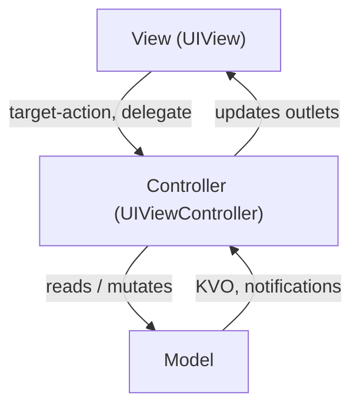
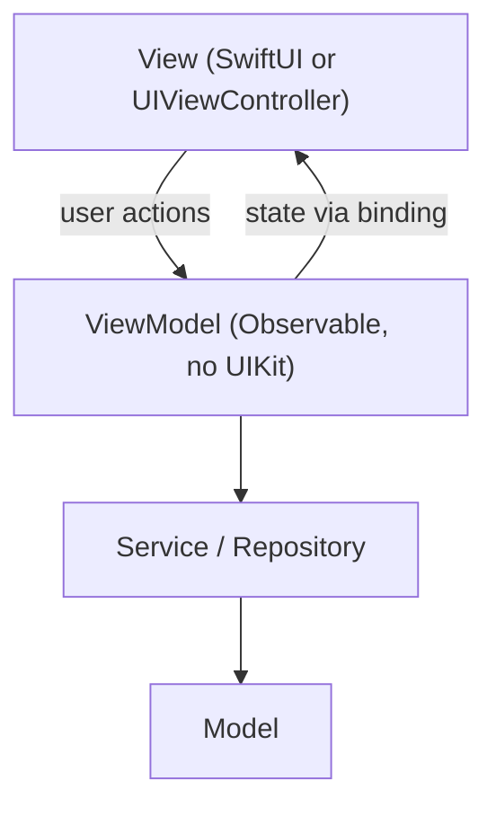
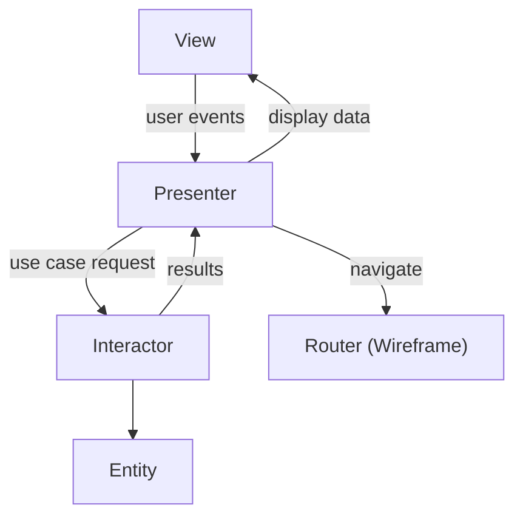
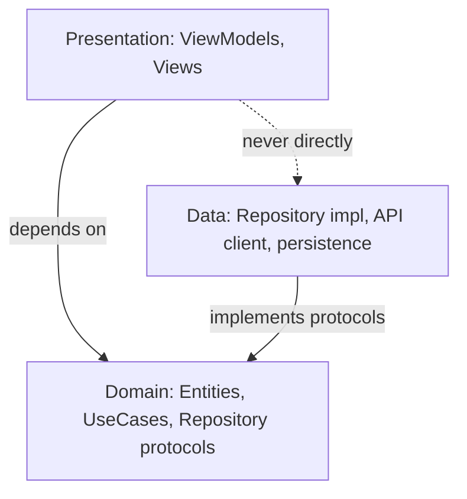
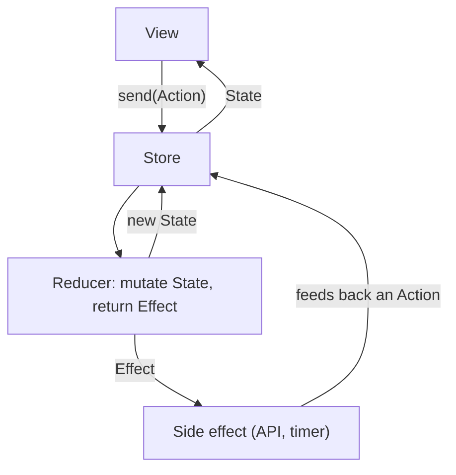
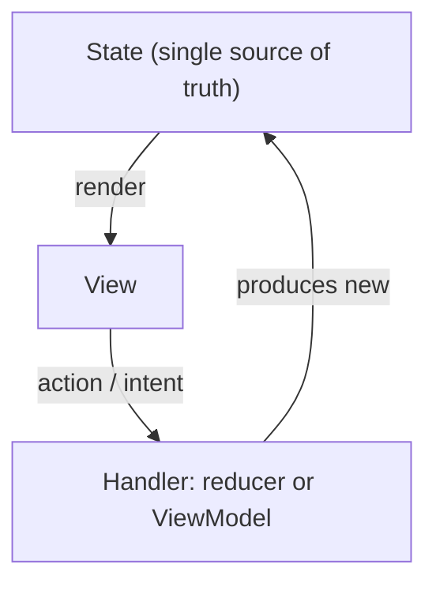
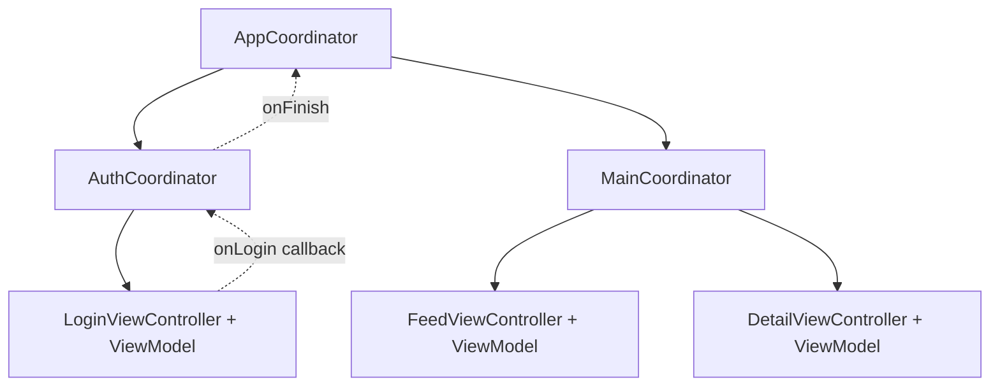
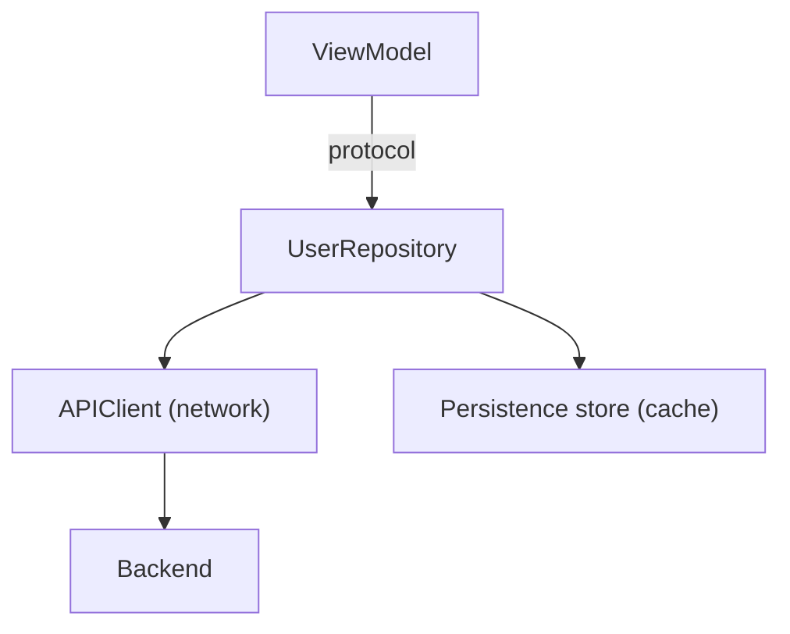
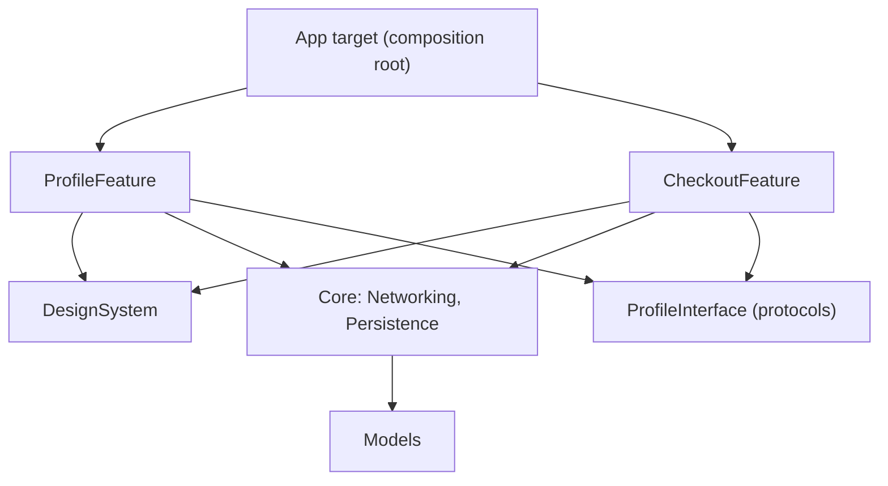
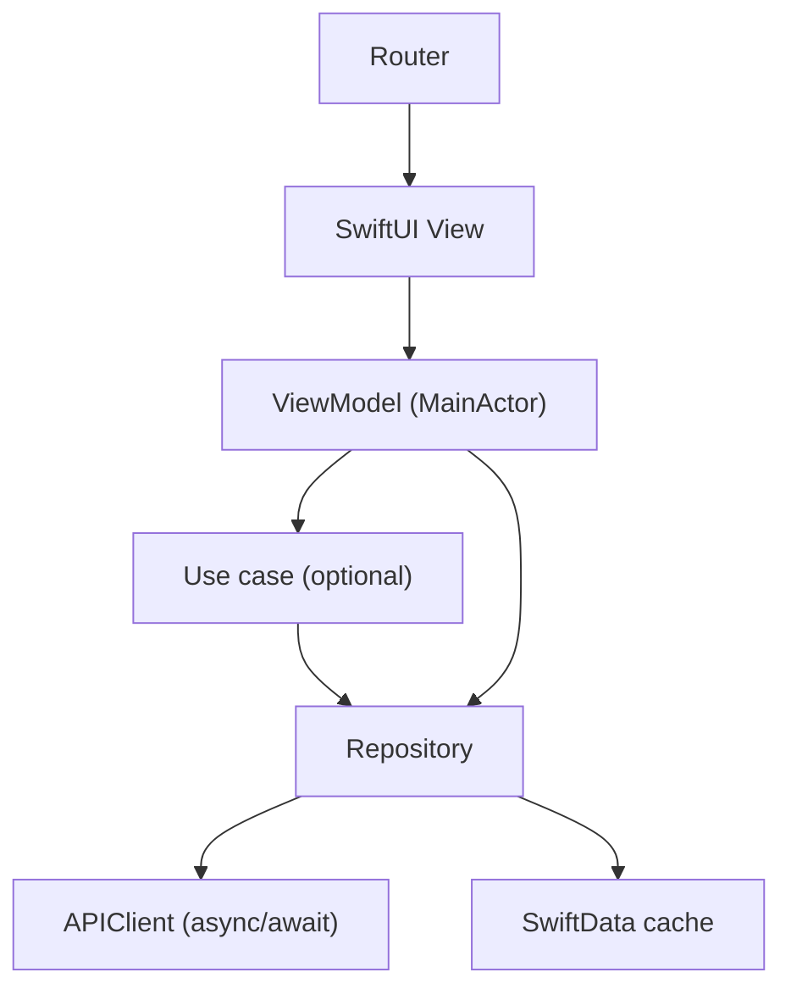

# App Architecture

[⬅ Back to index](../README.md)

Covers: MVC, MVP, MVVM, VIPER, Clean Architecture, TCA, Coordinators, unidirectional data flow, choosing an architecture, modularization.

---

### 1. Why does architecture matter in iOS apps?

<details>
<summary>Answer</summary>

**In short:** Architecture decides where each kind of code lives. A good one gives you separation of concerns, logic you can test without UI, code that stays maintainable as the app and team grow, and lets people work in parallel. Without it you end up with the Massive View Controller: one 2,000-line class that does networking, parsing, formatting and navigation.

#### The problem it solves

A new iOS project starts small, and putting everything in the view controller feels fine. Then features pile up. A typical unstructured `ProfileViewController` ends up:

- building a `URLRequest` and calling `URLSession`,
- decoding JSON and saving it to Core Data,
- formatting dates and prices for labels,
- deciding which screen to push next,
- managing the keyboard, analytics and error alerts.

Each of these changes for a different reason, but they all sit in one file. A change to the date format risks breaking networking. You can't unit test the formatting without loading a view controller. Two developers editing the same screen get merge conflicts.

#### What a good architecture gives you

| Benefit | What it means in practice |
|---|---|
| Separation of concerns | Networking, persistence, presentation logic and navigation each have their own type |
| Testability | Business and presentation logic run in plain XCTest / Swift Testing, with no simulator UI |
| Maintainability | You know where to find and change code; changes stay local |
| Parallel development | Teams own modules or layers with clear contracts between them |
| Consistency | Every screen follows the same shape, so onboarding is faster |
| Replaceability | Swapping the API client or moving from UIKit to SwiftUI touches one layer |

#### A small example of the payoff

```swift
// Testable without any UI: the formatting rule lives in a plain type
struct PriceFormatter {
    func display(cents: Int, currency: String) -> String {
        let value = Decimal(cents) / 100
        return value.formatted(.currency(code: currency))
    }
}
```

If this lived in `cellForRowAt`, the only way to test it would be through the UI.

**Common pitfalls**
- Treating architecture as a goal in itself. It exists to make change cheap; too much of it slows you down (see Q15).
- Mixing patterns per screen with no team agreement, which loses the consistency benefit.

**Likely follow-ups**
- *What's a Massive View Controller?* A VC that has absorbed every responsibility because UIKit makes the VC the natural place to put code.
- *How do you measure whether an architecture is working?* Test coverage of logic, how local changes are, build times, and how fast new people ship their first feature.

</details>

### 2. Explain Apple's MVC. What's wrong with it?

<details>
<summary>Answer</summary>

**In short:** In Apple's MVC, the Model holds data and business logic, the View shows UI, and the Controller sits between them. In UIKit, `UIViewController` is tightly coupled to its view (it owns the view's lifecycle and outlets), so View and Controller merge into one thing. Everything ends up in the VC: the "Massive View Controller", which is hard to test and hard to reuse.

#### The roles

- **Model**: data and business logic (`User`, `Order`, validation rules, sometimes the service that loads them).
- **View**: UI elements (`UIView`, `UILabel`, cells). Ideally dumb and reusable.
- **Controller**: receives user actions from the view, updates the model, and updates the view when the model changes.

In Apple's version (unlike classic Smalltalk MVC), the View and Model never talk directly; the controller mediates everything.



#### What goes wrong in practice

1. **The VC owns the view.** `viewDidLoad`, `viewWillAppear`, outlets, layout, table data source and delegate methods all live in the controller. It is effectively part of the view layer.
2. **No obvious home for other code.** Networking, formatting, validation and navigation have nowhere else to go by default, so they land in the VC.
3. **Hard to unit test.** To test logic in a VC you have to instantiate it, load its view and fake the lifecycle. Many teams just don't.
4. **Poor reuse.** Logic bound to a specific VC can't be reused on another screen or in a widget.

```swift
// Typical Massive View Controller smell
final class ProfileViewController: UIViewController, UITableViewDataSource {
    override func viewDidLoad() {
        super.viewDidLoad()
        URLSession.shared.dataTask(with: url) { data, _, _ in      // networking
            let user = try? JSONDecoder().decode(User.self, from: data!) // parsing
            DispatchQueue.main.async {
                self.nameLabel.text = user?.name.uppercased()       // formatting
                if user?.isNew == true {                           // navigation
                    self.present(OnboardingViewController(), animated: true)
                }
            }
        }.resume()
    }
}
```

#### MVC is not "wrong"

For small screens, MVC with a few extracted helpers (a separate data source, a service, a formatter) is fine. The problem is that MVC gives no guidance on where to put non-UI logic, so discipline erodes over time. MVVM, MVP and VIPER are all attempts to pull logic out of the VC.

**Likely follow-ups**
- *How would you slim a massive VC without switching pattern?* Extract data sources, child view controllers, services, formatters and a coordinator for navigation.
- *Is SwiftUI MVC?* Not really. SwiftUI views are value descriptions of state; the "controller" role is replaced by state and observation.

</details>

### 3. What is MVVM? How do you bind the ViewModel to the View?

<details>
<summary>Answer</summary>

**In short:** In Model–View–ViewModel, the ViewModel holds presentation state and logic: it turns models into display-ready data (formatted strings, `isLoading`), handles user actions and calls services. It doesn't import UIKit and doesn't reference the view, so it's unit-testable. The view binds to it: automatically in SwiftUI via `@Observable`/`ObservableObject`, and with Combine, closures or a small observable box in UIKit.

#### The roles

- **Model**: domain data and the services or repositories that load it.
- **ViewModel**: state for one screen plus the logic that produces it. Exposes read-only state and intent methods (`load()`, `didTapRetry()`).
- **View**: renders the ViewModel's state and forwards user events. Contains no business decisions.



The key difference from MVP: the ViewModel **doesn't know the view exists**. It just publishes state; whoever is interested observes it.

#### A ViewModel

```swift
@MainActor @Observable
final class ProfileViewModel {
    enum State { case idle, loading, loaded(Profile), failed(String) }
    private(set) var state: State = .idle
    private let service: ProfileService
    init(service: ProfileService) { self.service = service }

    func load() async {
        state = .loading
        do { state = .loaded(try await service.fetch()) }
        catch { state = .failed(error.localizedDescription) }
    }
}
```

Using a single `State` enum rather than several booleans (`isLoading`, `error`, `profile`) makes impossible combinations (loading and failed at once) unrepresentable.

#### Binding options

**SwiftUI**: observation is built in. With `@Observable` (iOS 17+), SwiftUI tracks which properties `body` reads and re-renders when they change.

```swift
struct ProfileView: View {
    @State private var viewModel: ProfileViewModel
    init(viewModel: ProfileViewModel) { _viewModel = State(initialValue: viewModel) }

    var body: some View {
        switch viewModel.state {
        case .idle, .loading: ProgressView()
        case .loaded(let p): Text(p.name)
        case .failed(let msg): Text(msg)
        }
    }
    // .task { await viewModel.load() } attached in practice
}
```

Before iOS 17, use `ObservableObject` + `@Published` with `@StateObject` / `@ObservedObject`.

**UIKit**: you wire the binding yourself. Common choices:

| Mechanism | Notes |
|---|---|
| Combine (`@Published` + `sink`) | Standard, cancellable, works with `receive(on:)` |
| Closures (`var onStateChange: ((State) -> Void)?`) | Simplest, no framework; watch for retain cycles |
| Custom `Observable<T>` box | Tiny generic wrapper with a listener closure |
| `@Observable` in UIKit | `withObservationTracking` works but is low-level; recent UIKit versions can also track `@Observable` reads automatically in layout/update methods |
| RxSwift / delegates | Legacy or team preference |

```swift
// UIKit + Combine binding
final class ProfileViewController: UIViewController {
    private let viewModel: ProfileViewModelCombine
    private var cancellables = Set<AnyCancellable>()

    override func viewDidLoad() {
        super.viewDidLoad()
        viewModel.$state
            .receive(on: DispatchQueue.main)
            .sink { [weak self] state in self?.render(state) }
            .store(in: &cancellables)
    }
    private func render(_ state: ProfileViewModelCombine.State) { /* update labels */ }
}
```

**Common pitfalls**
- Importing UIKit in the ViewModel and returning `UIColor`/`UIImage`. Return semantic values (an enum, a string) and let the view map them.
- The "Massive ViewModel": moving everything from the VC into the VM. Push business rules down into services or use cases.
- Forgetting `[weak self]` in UIKit closure bindings.

**Likely follow-ups**
- *How do you test it?* Inject a mock service, call `await vm.load()`, assert on `vm.state`.
- *Does SwiftUI need MVVM?* Not always; small views can keep state in `@State` and call services directly ("MV"). ViewModels earn their place when logic needs testing.

</details>

### 4. MVC vs MVP vs MVVM?

<details>
<summary>Answer</summary>

**In short:** All three separate UI from logic but differ in where the logic lives and how it reaches the view. In MVC the controller (the VC) holds it and owns the view. In MVP a Presenter holds it and pushes updates to the view through a protocol. In MVVM a ViewModel holds it and the view observes its state, so the ViewModel holds no reference to the view.

| | MVC | MVP | MVVM |
|---|---|---|---|
| Logic lives in | Controller (VC) | **Presenter** | **ViewModel** |
| View ↔ logic | VC owns the view | Presenter calls the view through a **protocol** (`view.showName()`) | View **observes/binds** to ViewModel state |
| Reference to the view | Yes | Yes (weak, protocol) | **No** |
| Testability | Low | High | High |
| Boilerplate | Low | Medium (view protocols) | Medium (binding) |
| Natural fit | Small UIKit apps | UIKit without a reactive framework | SwiftUI; UIKit with Combine |

#### MVP in code

The Presenter is imperative: it tells the view what to show.

```swift
protocol ProfileView: AnyObject {
    func showLoading()
    func show(name: String)
    func show(error: String)
}

final class ProfilePresenter {
    weak var view: ProfileView?             // weak to avoid a retain cycle
    private let service: ProfileService
    init(service: ProfileService) { self.service = service }

    func viewDidLoad() {
        view?.showLoading()
        Task { @MainActor in
            do { view?.show(name: try await service.fetch().name) }
            catch { view?.show(error: error.localizedDescription) }
        }
    }
}
```

Testing: give the presenter a `MockProfileView` that records calls, then assert `mockView.shownName == "Ana"`.

#### MVVM in contrast

The ViewModel is declarative: it exposes `state`, and the view decides how to render it. Testing asserts on state, not on recorded calls. That's simpler, and it lets several views share one ViewModel.

#### How to choose between them

- **MVP** is explicit and needs no binding framework, which suits UIKit codebases without Combine. The cost is a view protocol with a method per UI change.
- **MVVM** suits anything with good observation (SwiftUI, Combine). The cost is binding code in UIKit and the risk of hard-to-trace reactive chains.
- **MVC** is fine for simple screens, as long as you extract helpers.

**Likely follow-ups**
- *Why is the presenter's view reference weak?* The view (VC) owns the presenter; a strong back-reference creates a retain cycle.
- *Where does navigation go in each?* Ideally none of them: a Coordinator or Router (Q9).

</details>

### 5. What is VIPER?

<details>
<summary>Answer</summary>

**In short:** VIPER splits each screen (a "module") into five roles: View, Interactor (business logic), Presenter (presentation logic), Entity (plain data) and Router (navigation and assembly). Every piece talks to its neighbours through protocols. It's very testable and scales to large teams, but costs a lot of boilerplate and is overkill for simple screens.

#### The five parts

- **V**iew: displays what the presenter tells it and forwards user input. Passive.
- **I**nteractor: business logic and use cases; talks to services and repositories. Knows nothing about UI.
- **P**resenter: presentation logic. Receives view events, asks the interactor for data, formats results for the view, and asks the router to navigate.
- **E**ntity: plain data models used by the interactor.
- **R**outer (Wireframe): creates the module (wires all the parts together) and performs navigation to other modules.



#### What it looks like

```swift
protocol LoginViewInput: AnyObject { func showError(_ message: String) }
protocol LoginPresenterInput { func didTapLogin(email: String, password: String) }
protocol LoginInteractorInput { func login(email: String, password: String) async throws -> User }
protocol LoginRouterInput { func showHome(for user: User) }

final class LoginPresenter: LoginPresenterInput {
    weak var view: LoginViewInput?
    let interactor: LoginInteractorInput
    let router: LoginRouterInput
    init(interactor: LoginInteractorInput, router: LoginRouterInput) {
        self.interactor = interactor; self.router = router
    }

    func didTapLogin(email: String, password: String) {
        Task { @MainActor in
            do { router.showHome(for: try await interactor.login(email: email, password: password)) }
            catch { view?.showError("Login failed") }
        }
    }
}
```

The Router usually has a static `build()` / `createModule()` that instantiates the view, presenter, interactor and router and connects them.

#### Trade-offs

| Pros | Cons |
|---|---|
| Very clear responsibilities; each class is small | 5+ files and several protocols per screen |
| Each part testable in isolation with mocks | Lots of pass-through code for simple screens |
| Works well for big teams with strict conventions | Steep onboarding; often needs code-generation templates |
| Navigation is fully out of the view layer | Fits poorly with SwiftUI's state-driven model |

VIPER is less popular now. SwiftUI's declarative, state-driven views don't fit the passive "presenter tells view what to do" style, and most teams get similar benefits from MVVM + Coordinators + use cases with less ceremony.

**Likely follow-ups**
- *Presenter vs Interactor?* The Interactor answers "what does the app do" (log in, validate); the Presenter answers "how do we show it" (strings, errors, which screen).
- *How do you reduce VIPER boilerplate?* Xcode file templates or code generators, and skipping the Interactor for screens with no real business logic.

</details>

### 6. What is Clean Architecture in iOS?

<details>
<summary>Answer</summary>

**In short:** Clean Architecture organizes code into layers with one rule: dependencies point inward. The Domain layer (entities, use cases, repository protocols) is pure Swift and knows nothing about UIKit, networking or databases. The Data layer implements the domain's protocols, and the Presentation layer (view models and views) depends only on the domain. You get testable business logic and swappable data sources, at the cost of more layers and mapping code.

#### The layers

- **Domain** (innermost): entities (`User`, `Order`), **use cases** (`PlaceOrderUseCase`), and repository **protocols** (`OrderRepository`). Pure Swift, with no UIKit, networking or persistence imports.
- **Data**: repository implementations, API clients, Core Data / SwiftData stores, DTOs and mappers from DTOs to domain entities.
- **Presentation**: view models or presenters, and views.



#### The dependency rule and inversion

Without care, the natural direction is "ViewModel → Repository → APIClient", so business logic depends on networking details. Clean Architecture flips that with **Dependency Inversion**: the domain *declares* the protocol it needs, and the data layer *conforms* to it.

```swift
// Domain (no imports beyond Foundation)
struct Order { let id: String; let total: Decimal }
protocol OrderRepository { func placeOrder(cart: Cart) async throws -> Order }

struct PlaceOrderUseCase {
    let repository: OrderRepository
    func execute(cart: Cart) async throws -> Order {
        guard !cart.items.isEmpty else { throw OrderError.emptyCart }   // business rule
        return try await repository.placeOrder(cart: cart)
    }
}

// Data
struct OrderDTO: Decodable { let order_id: String; let total_cents: Int }
final class RemoteOrderRepository: OrderRepository {
    let client: APIClient
    init(client: APIClient) { self.client = client }
    func placeOrder(cart: Cart) async throws -> Order {
        let dto: OrderDTO = try await client.send(.placeOrder(cart))
        return Order(id: dto.order_id, total: Decimal(dto.total_cents) / 100)  // mapping
    }
}

// Presentation
@MainActor @Observable final class CheckoutViewModel {
    let placeOrder: PlaceOrderUseCase
    init(placeOrder: PlaceOrderUseCase) { self.placeOrder = placeOrder }
}
```

The composition root (app start) is the only place that knows `RemoteOrderRepository` exists.

#### Benefits and costs

| Benefits | Costs |
|---|---|
| Business rules testable with simple fakes | More types: DTO + entity + mapper per model |
| Swap the backend, cache or database without touching domain | Pass-through use cases that just call the repository |
| Framework independence (UIKit → SwiftUI touches only presentation) | Harder to navigate for newcomers |
| Layers map cleanly to SPM modules | Overkill for CRUD-only apps |

It's often combined with MVVM and Coordinators ("Clean MVVM + C").

**Common pitfalls**
- Use cases that only forward to a repository. Add them when there is real logic or the logic is shared, not by reflex.
- Leaking DTOs (`Codable` server types) into view models, which ties the UI to the API shape.

**Likely follow-ups**
- *Is the domain allowed to import Foundation?* Usually yes (`Date`, `Decimal`, `URL`); what it avoids is UIKit, SwiftUI, networking and persistence frameworks.
- *How do you enforce the rule?* Put each layer in its own SPM target; the compiler rejects imports that aren't declared dependencies.

</details>

### 7. What is The Composable Architecture (TCA)?

<details>
<summary>Answer</summary>

**In short:** TCA is a Point-Free library that implements unidirectional data flow, inspired by Redux and Elm. Each feature has a `State` struct, an `Action` enum, and a `Reducer` that takes the current state and an action, mutates the state, and returns `Effect`s for side effects. Effects feed new actions back in. A `Store` runs it all, and dependencies come through `@Dependency`. It's very predictable and exhaustively testable, but has a learning curve and is a big third-party dependency.

#### The building blocks

- **State**: the feature's data (a struct).
- **Action**: everything that can happen: user events and effect responses.
- **Reducer**: logically `(inout State, Action) -> Effect<Action>`. Pure state mutation plus a description of side effects.
- **Effect**: async work (API calls, timers) that eventually sends actions back.
- **Store**: holds state, receives actions, runs the reducer and effects.
- **Dependencies**: injected with `@Dependency(\.apiClient)`, overridable in tests and previews.



#### A small feature

```swift
import ComposableArchitecture

@Reducer
struct CounterFeature {
    @ObservableState
    struct State: Equatable {
        var count = 0
        var fact: String?
    }
    enum Action {
        case incrementTapped
        case factButtonTapped
        case factResponse(String)
    }
    @Dependency(\.numberFact) var numberFact

    var body: some ReducerOf<Self> {
        Reduce { state, action in
            switch action {
            case .incrementTapped:
                state.count += 1
                return .none
            case .factButtonTapped:
                return .run { [count = state.count] send in
                    await send(.factResponse(try await numberFact.fetch(count)))
                }
            case let .factResponse(fact):
                state.fact = fact
                return .none
            }
        }
    }
}
```

The view reads `store.count` and calls `store.send(.incrementTapped)`.

#### Testing

`TestStore` is TCA's standout feature. It's exhaustive: you must state every state change and every action an effect produces, or the test fails.

```swift
@Test func fact() async {
    let store = TestStore(initialState: CounterFeature.State()) {
        CounterFeature()
    } withDependencies: {
        $0.numberFact.fetch = { "\($0) is a good number" }
    }
    await store.send(.factButtonTapped)
    await store.receive(\.factResponse) { $0.fact = "0 is a good number" }
}
```

#### Trade-offs

| Pros | Cons |
|---|---|
| Single, predictable way to change state | Learning curve (reducers, effects, scoping) |
| Exhaustive tests catch unexpected changes | Large third-party dependency tied to its release cycle |
| Features compose (parent scopes child stores) | Macros and generics add compile time |
| Built-in dependency system and navigation tools | Can feel heavy for simple screens |

**Likely follow-ups**
- *How do features compose?* A parent's state contains child state and its action has a child case; `Scope` runs the child reducer on that slice.
- *TCA vs MVVM?* MVVM lets each view model mutate state however it likes; TCA forces all changes through actions and a reducer, trading flexibility for predictability.

</details>

### 8. What is unidirectional data flow (UDF)?

<details>
<summary>Answer</summary>

**In short:** State flows down to the view; actions (events) flow up. The view only renders state and sends actions, and one place (a reducer, view model or store) is allowed to change the state. This makes behaviour predictable, easy to debug (log every action), and free of conflicting two-way updates. TCA, Redux-style stores, MVI and SwiftUI's own state model all use it.

#### How the loop works



1. The view renders the current state.
2. The user taps something; the view sends an action (`.loginTapped`) rather than changing anything itself.
3. The handler decides how state changes (and starts side effects).
4. The new state flows back down; the view re-renders.

#### Why it helps

With two-way binding or scattered mutation, a text field, a VM and a cache can all write the same value, and you have to work out which write won. With UDF there is exactly one writer, so:

- **Predictable**: the same state + action always produces the same new state.
- **Debuggable**: log each action and the resulting state to reproduce a bug; tools can even "time-travel".
- **Testable**: send actions, assert on state. No UI needed.

#### A minimal UDF view model

```swift
@MainActor @Observable
final class LoginViewModel {
    struct State { var email = ""; var isSubmitting = false; var error: String? }
    enum Action { case emailChanged(String), submitTapped }

    private(set) var state = State()        // only this class writes it

    func send(_ action: Action) {
        switch action {
        case .emailChanged(let email): state.email = email
        case .submitTapped:
            state.isSubmitting = true
            Task { await submit() }
        }
    }
    private func submit() async { /* call service, then update state */ }
}
```

SwiftUI itself follows this: `@State` is the source of truth, views get values or `Binding`s passed down, and changes go back through the owner.

**Common pitfalls**
- Letting views mutate shared state directly "just this once", which brings back multiple writers.
- Storing derived values in state that can go out of sync; compute them instead.

**Likely follow-ups**
- *Isn't SwiftUI's `Binding` two-way?* It's a controlled write path back to the single owner of the state, so the owner still holds the source of truth.
- *Where do side effects go?* In the handler (an effect in TCA, an async method in a VM), never in the view's body.

</details>

### 9. How does the Coordinator pattern fit into the architecture?

<details>
<summary>Answer</summary>

**In short:** Coordinators own navigation, so view controllers and view models don't know which screen comes next. A coordinator creates screens (injecting their dependencies), pushes or presents them, handles deep links, and manages multi-screen flows like onboarding, auth or checkout. Combined with MVVM it's called MVVM-C. In SwiftUI, an `@Observable` Router/Coordinator usually owns the `NavigationPath`. See [Design Patterns Q14](07-oop-solid-design-patterns.md).

#### The problem

In plain UIKit, a VC does `navigationController?.pushViewController(DetailViewController(item: item), animated: true)`. That means the feed screen knows about the detail screen, has to build it (and its dependencies), and can't be reused in a different flow. Navigation logic is spread across every screen.

#### How coordinators fix it

Screens report *what happened* ("user selected item", "login finished") through callbacks or delegates. The coordinator decides *what to do next*.



```swift
protocol Coordinator: AnyObject { func start() }

final class MainCoordinator: Coordinator {
    private let navigation: UINavigationController
    private let dependencies: AppDependencies
    init(navigation: UINavigationController, dependencies: AppDependencies) {
        self.navigation = navigation; self.dependencies = dependencies
    }

    func start() {
        let vm = FeedViewModel(repository: dependencies.feedRepository)
        vm.onSelect = { [weak self] item in self?.showDetail(item) }  // screen reports an event
        navigation.setViewControllers([FeedViewController(viewModel: vm)], animated: false)
    }

    private func showDetail(_ item: FeedItem) {
        let vm = DetailViewModel(item: item, repository: dependencies.feedRepository)
        navigation.pushViewController(DetailViewController(viewModel: vm), animated: true)
    }
}
```

The app coordinator holds child coordinators in an array and removes them when their flow finishes, so they aren't deallocated early or leaked.

#### In SwiftUI

Navigation is state, so the "coordinator" becomes an object owning that state:

```swift
@MainActor @Observable
final class Router {
    enum Route: Hashable { case detail(FeedItem.ID), settings }
    var path = NavigationPath()
    func show(_ route: Route) { path.append(route) }
    func popToRoot() { path = NavigationPath() }
}
// NavigationStack(path: $router.path) { ... }
//   .navigationDestination(for: Router.Route.self) { route in factory.view(for: route) }
```

Deep links become "parse URL → set `path`".

**Common pitfalls**
- Child coordinators not removed when their flow ends (memory leaks), or not retained (the flow dies instantly).
- Back-button pops in UIKit bypass the coordinator; handle them with `UINavigationControllerDelegate` to clean up.

**Likely follow-ups**
- *Coordinator vs Router in VIPER?* Same idea; VIPER has one router per module, coordinators usually manage whole flows.
- *How do you handle deep links?* The app coordinator parses the link and asks the relevant child coordinator to build the screen stack.

</details>

### 10. How do you choose an architecture?

<details>
<summary>Answer</summary>

**In short:** There's no single best architecture. Choose based on team size, app complexity, the UI framework, testing needs and the existing codebase. A good default answer is: "MVVM with Coordinators or a Router, plus a repository layer; I add use cases when business logic is shared, and I keep it consistent across the team."

#### The factors

| Factor | How it pushes the decision |
|---|---|
| Team size and experience | Large teams benefit from strict boundaries (modules, VIPER, TCA); small teams from less ceremony |
| App complexity | A simple CRUD app → MVVM or SwiftUI "MV"; complex domain rules → Clean layers with use cases |
| UI framework | SwiftUI fits MVVM, TCA or MV; UIKit fits MVVM-C, MVP or VIPER |
| Testing needs | Heavy logic or regulated domains → architecture that isolates logic for unit tests |
| Existing codebase | Migrate incrementally; a half-migrated mix of three patterns is worse than one consistent older one |
| Lifetime | A 3-month prototype doesn't need what a 5-year product does |

#### A way to reason about it in the interview

1. **Start simple**: MVVM per screen, a service or repository layer, and DI through initializers.
2. **Add layers when pain appears**: use cases when two view models duplicate logic; coordinators when navigation gets tangled; modules when build times or team boundaries hurt.
3. **Prefer team conventions** over personal favourites, and write them down (templates, an ADR).

#### Example answer

"For a new SwiftUI app with a team of five, I'd use `@Observable` view models, a Router per tab owning `NavigationPath`, repositories over an async API client, and SPM feature modules. I wouldn't start with TCA unless the team already knows it, because the learning curve slows the first months. If logic like pricing gets shared across screens, I'd extract use cases into a domain module."

**Common pitfalls**
- Picking an architecture for the CV rather than the problem.
- Rewriting the whole app into a new pattern instead of applying it to new features and migrating screens as they're touched.

**Likely follow-ups**
- *When would you pick TCA?* Complex, state-heavy features where exhaustive testing matters and the team is willing to learn it.
- *How do you migrate from MVC?* Screen by screen: new screens in the new pattern, old ones converted when you next work on them.

</details>

### 11. What is the Repository + Service layer?

<details>
<summary>Answer</summary>

**In short:** It's the data layer that sits below the view models. The API client (network service) builds requests and decodes responses; a persistence store handles Core Data, SwiftData or files; and the Repository is the single access point that combines them, applies a caching policy, maps DTOs to domain models, and exposes a protocol to the rest of the app. View models depend on the repository protocol, which makes them easy to mock.

#### The pieces

- **API Client / Network service**: knows HTTP. Builds `URLRequest`s, adds auth headers, decodes JSON into DTOs, maps HTTP errors.
- **Persistence store**: knows the database or file format (Core Data, SwiftData, SQLite, files, Keychain).
- **Repository**: knows neither UI nor transport details from the caller's view. Decides *where* data comes from (cache first? network first?) and returns domain models.



#### Example

```swift
protocol UserRepository {
    func user(id: String) async throws -> User
}

final class DefaultUserRepository: UserRepository {
    private let api: APIClient
    private let store: UserStore
    init(api: APIClient, store: UserStore) { self.api = api; self.store = store }

    func user(id: String) async throws -> User {
        if let cached = try? store.user(id: id), !cached.isStale {   // cache-first policy
            return cached
        }
        let dto: UserDTO = try await api.send(.user(id: id))
        let user = User(dto: dto)                                    // DTO → domain mapping
        try? store.save(user)
        return user
    }
}
```

In tests:

```swift
struct StubUserRepository: UserRepository {
    var result: Result<User, Error>
    func user(id: String) async throws -> User { try result.get() }
}
```

#### Why bother

- View models don't care whether data came from the network, cache or a mock.
- Caching and offline policy live in one place, not in every screen.
- Changing backend or database touches only the data layer.

**Common pitfalls**
- Repositories that return DTOs or `NSManagedObject`s, leaking storage details upward.
- One giant `DataManager` singleton for everything; prefer one repository per domain area.

**Likely follow-ups**
- *Service vs repository?* A service usually wraps one source (the API); a repository coordinates sources and owns the data policy.
- *How do you expose updates?* Return an `AsyncStream`/`AsyncSequence` (or a Combine publisher) that emits cached data, then fresh data.

</details>

### 12. How do you modularize an iOS app?

<details>
<summary>Answer</summary>

**In short:** Split code into local Swift packages (or frameworks): core modules (networking, persistence, utilities), a design system, shared models, and feature modules that don't depend on each other and talk through interfaces or the app's coordinator. Heavy modules get an interface/implementation split. You get faster incremental builds, clear ownership, compiler-enforced boundaries and isolated testing. Watch launch time if you use many dynamic frameworks.

#### A typical module graph



- **Core**: networking, persistence, logging, utilities.
- **DesignSystem**: colours, fonts, reusable components.
- **Models**: shared domain types.
- **Feature modules** (`ProfileFeature`, `CheckoutFeature`): screens and their view models. They **must not import each other**.
- **Interface modules** (`ProfileInterface`): protocols and lightweight types other features use, with the implementation injected by the app.

#### Setting it up with SPM

```swift
// swift-tools-version: 6.0
// Packages/Features/Package.swift (the tools-version line must stay first)
import PackageDescription

let package = Package(
    name: "Features",
    platforms: [.iOS(.v17)],
    products: [
        .library(name: "ProfileFeature", targets: ["ProfileFeature"]),
        .library(name: "CheckoutFeature", targets: ["CheckoutFeature"]),
    ],
    dependencies: [.package(path: "../Core"), .package(path: "../DesignSystem")],
    targets: [
        .target(name: "ProfileFeature", dependencies: ["Core", "DesignSystem"]),
        .target(name: "CheckoutFeature", dependencies: ["Core", "DesignSystem"]),
        .testTarget(name: "ProfileFeatureTests", dependencies: ["ProfileFeature"]),
    ]
)
```

Each module exposes only what's `public`; everything else is `internal` by default, or `package` to share within the package.

#### Benefits

| Benefit | Why |
|---|---|
| Faster incremental builds | Changing a feature recompiles only it and its dependents |
| Enforced boundaries | A missing import fails to compile, so architecture rules can't silently erode |
| Ownership | Teams own modules; code review and CODEOWNERS map to folders |
| Reuse | Share modules with app extensions, widgets or a second app |
| Isolated testing and demo apps | Run a feature in a tiny "showcase" app without the whole product |

**Common pitfalls**
- **Launch time**: many dynamic frameworks each cost dyld work at launch. Prefer static linking (the SPM default) or mergeable libraries.
- A bloated `Core` that everything depends on, so touching it rebuilds the world. Split it.
- Feature-to-feature imports that create cycles; route through interfaces instead (see [DI Q11](12-dependency-injection-modularization.md)).

**Likely follow-ups**
- *How do features navigate to each other?* Through the app's coordinator or a router protocol in an interface module.
- *How do you start in an existing monolith?* Extract leaf code first (DesignSystem, Networking), then one feature at a time.

</details>

### 13. How do you handle state across screens / global state?

<details>
<summary>Answer</summary>

**In short:** Put shared state (session, cart, settings) in an observable store or service that is created once and injected, through initializers or the SwiftUI environment. Alternatives are a single app-wide store (TCA/Redux) or using persistence as the source of truth. Avoid singletons with mutable state and avoid NotificationCenter as the main data flow.

#### The options

| Approach | How | Good for |
|---|---|---|
| Shared `@Observable` store, injected | `CartStore` created at the composition root, passed to view models or put in `.environment` | Most apps |
| Single app store (TCA, Redux-style) | One state tree; screens get scoped slices | Apps already using UDF/TCA |
| Persistence as source of truth | Screens observe the database (SwiftData `@Query`, Core Data fetched results); writes go to the DB | Offline-first, data-heavy apps |
| Singleton with mutable state | `CartManager.shared` | Avoid: hidden dependency, hard to reset in tests, data races |
| NotificationCenter | Post on change, observe everywhere | Only for loose system-style events, not core data flow |

#### Example: an injected shared store

```swift
@MainActor @Observable
final class CartStore {
    private(set) var items: [CartItem] = []
    var count: Int { items.reduce(0) { $0 + $1.quantity } }
    func add(_ item: CartItem) { items.append(item) }
}

@main
struct ShopApp: App {
    @State private var cart = CartStore()          // created once
    var body: some Scene {
        WindowGroup {
            RootView().environment(cart)           // available to every view below
        }
    }
}

struct CartBadge: View {
    @Environment(CartStore.self) private var cart
    var body: some View { Text("\(cart.count)") }  // updates when items change
}
```

In UIKit, pass the same `CartStore` instance into every view model that needs it and observe it with Combine or closures.

#### Rules of thumb

- **One owner per piece of state.** Other screens read it or send intents to the owner.
- **Keep it as local as possible.** Only lift state up to shared when two or more screens really need it.
- **Make it `@MainActor`** (or an actor) so concurrent writes can't race.

**Likely follow-ups**
- *Why not a singleton?* It hides the dependency, can't be swapped for a fake in tests, and carries state between tests.
- *How do you reset state on logout?* Recreate the session-scoped stores (a new object graph per session) rather than clearing fields one by one.

</details>

### 14. Explain your current project's architecture. (How to answer)

<details>
<summary>Answer</summary>

**In short:** Answer top-down in a fixed order (UI framework, pattern, layers, DI, modules, concurrency, testing) in about two minutes, then name one trade-off you made and one thing you'd improve. Interviewers are checking that you understand *why* the structure exists, not just its names.

#### A structure to follow

1. **UI:** "SwiftUI with some UIKit (UIHostingController/Representable)".
2. **Pattern:** "MVVM with `@Observable` view models, coordinator/router navigation".
3. **Layers:** "Repositories over an async/await API client and a SwiftData/Core Data cache".
4. **DI:** "constructor injection with a composition root".
5. **Modules:** "SPM feature packages".
6. **Concurrency:** "Swift 6 strict concurrency, `@MainActor` view models".
7. **Testing:** "unit tests on view models with mocked repositories, UI tests for critical flows".

End with **one trade-off** you made and **one improvement** you'd like to make.

#### Sketch the data flow if there's a whiteboard



#### Example answer

"Our app is mostly SwiftUI, with a couple of UIKit screens wrapped in `UIViewControllerRepresentable`. Each screen has an `@Observable`, `@MainActor` view model that exposes a state enum. Navigation is owned by a router per tab that holds a `NavigationPath`, which also makes deep links simple. View models depend on repository protocols; repositories combine an async/await API client with a SwiftData cache and map DTOs to domain models. We build the object graph in an `AppDependencies` composition root and inject through initializers. Code is split into about 15 SPM packages: Core, DesignSystem, and feature modules that don't import each other. We test view models with stub repositories and keep a few UI tests for login and checkout.

One trade-off: we skipped a separate use-case layer to move faster, so some logic is duplicated between two view models. I'd like to extract a pricing module and add snapshot tests for the design system."

**Common pitfalls**
- Listing buzzwords without the reasons ("we use Clean Architecture" with no explanation of the layers).
- Claiming a perfect architecture. A sensible trade-off shows judgement.
- Not knowing details you mention; expect drill-downs on any term you use.

**Likely follow-ups**
- *Why that pattern?* Have one concrete reason (testability, team familiarity, SwiftUI fit).
- *What would you change if starting again?* Pick something real and specific.

</details>

### 15. What are the drawbacks of over-architecting?

<details>
<summary>Answer</summary>

**In short:** Too much architecture means boilerplate (protocols with a single implementation, pass-through use cases, VIPER files for trivial screens), slower onboarding and delivery, and layers of indirection that make code harder to read and debug. Add structure where it pays off (testing, reuse, team boundaries), not by default.

#### What it looks like

```swift
// Five types to show a static About screen
protocol AboutViewProtocol: AnyObject {}
protocol AboutPresenterProtocol { func viewDidLoad() }
protocol AboutInteractorProtocol { func fetchVersion() -> String }
protocol AboutRouterProtocol {}
protocol GetAppVersionUseCaseProtocol { func execute() -> String }
// ...plus implementations and a builder, all to show one label
```

versus

```swift
struct AboutView: View {
    let version: String
    var body: some View { Text("Version \(version)") }
}
```

#### The costs

| Cost | Effect |
|---|---|
| Boilerplate | More code to write, review and keep in sync |
| Indirection | "Jump to definition" lands on a protocol; finding real behaviour takes several hops |
| Slower onboarding | New developers have to learn the ceremony before shipping |
| Slower delivery | Small changes touch many files |
| False flexibility | Abstractions for swaps that never happen (a protocol for a type with one implementation and no test fake) |
| Build time | More types, generics and modules can slow compilation |

#### How to decide whether a layer is worth it

Ask what it buys you:
- **Testability**: do you actually need to fake this in tests? Then a protocol earns its place.
- **Reuse**: is this logic used in two or more places? Then extract it.
- **Team boundaries**: do separate teams own these parts? Then a module boundary helps.
- **Volatility**: is this likely to change (a third-party SDK, the backend)? Then isolate it.

If none apply, keep it simple. You can always add a layer later; removing a widely used one is much harder.

**Likely follow-ups**
- *Under-architecting vs over-architecting?* Under-architecting fails slowly (massive VCs, untestable code); over-architecting slows you from day one. Aim for "as simple as possible, with seams where you need them."
- *What's YAGNI?* "You aren't gonna need it": don't build abstractions for hypothetical future needs.

</details>


### 16. Software architecture vs software design? Class vs object?

<details>
<summary>Answer</summary>

**In short:** Software architecture is the high-level structure of the whole system (layers, modules, how data flows, major technology choices), which is expensive to change. Software design is the lower-level structure inside components (classes, protocols, patterns, APIs, algorithms). A class (or struct type) is the blueprint that defines properties and behaviour; an object (instance) is a concrete realization of that blueprint in memory with its own state.

#### Architecture vs design

| | Architecture | Design |
|---|---|---|
| Scope | Whole system | One component or feature |
| Examples | MVVM + Coordinators, Clean layers, SPM modularization, offline-first, choosing SwiftData vs Core Data | A `Cache` protocol, using the Strategy pattern for pricing, the API of `ImageLoader`, a retry algorithm |
| Cost to change | High: touches many parts | Lower: usually local |
| Who decides | Leads / the team, often documented (ADRs) | The developer building the feature, in code review |

The line is fuzzy: a rule of thumb is that architecture is the set of decisions that are hard to reverse.

#### Class vs object

```swift
// The class is the blueprint
final class BankAccount {
    let owner: String
    private(set) var balance: Decimal
    init(owner: String, balance: Decimal) { self.owner = owner; self.balance = balance }
    func deposit(_ amount: Decimal) { balance += amount }
}

// Objects are instances, each with its own state
let a = BankAccount(owner: "Ana", balance: 100)
let b = BankAccount(owner: "Ben", balance: 50)
a.deposit(20)   // a.balance == 120, b.balance still 50
```

In Swift, "type vs instance" is the more precise phrasing: structs and enums are also blueprints, but their instances are **values** (copied on assignment), while class instances are **references** (shared, reference-counted).

**Likely follow-ups**
- *Can an object exist without a class?* In Swift every instance has a type (class, struct, enum or actor).
- *What's a static member?* It belongs to the type itself, not to any instance (`BankAccount.maxBalance`).

</details>

---

[⬅ Previous: SwiftUI](10-swiftui.md) · [⬅ Back to index](../README.md) · [Next: Dependency Injection & SPM ➡](12-dependency-injection-modularization.md)
