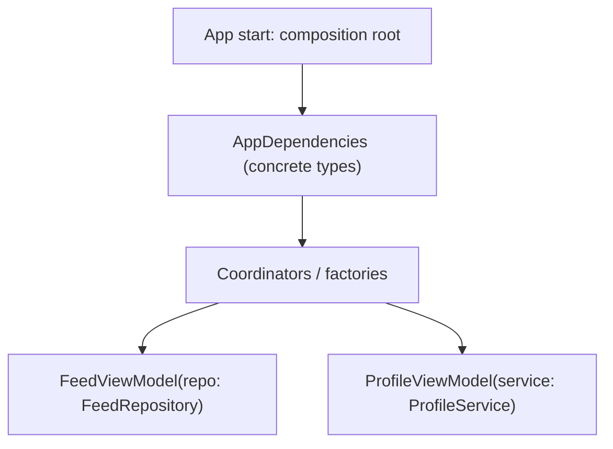
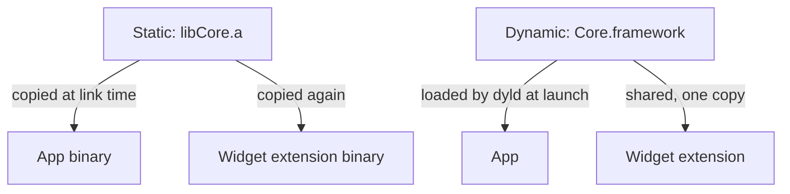
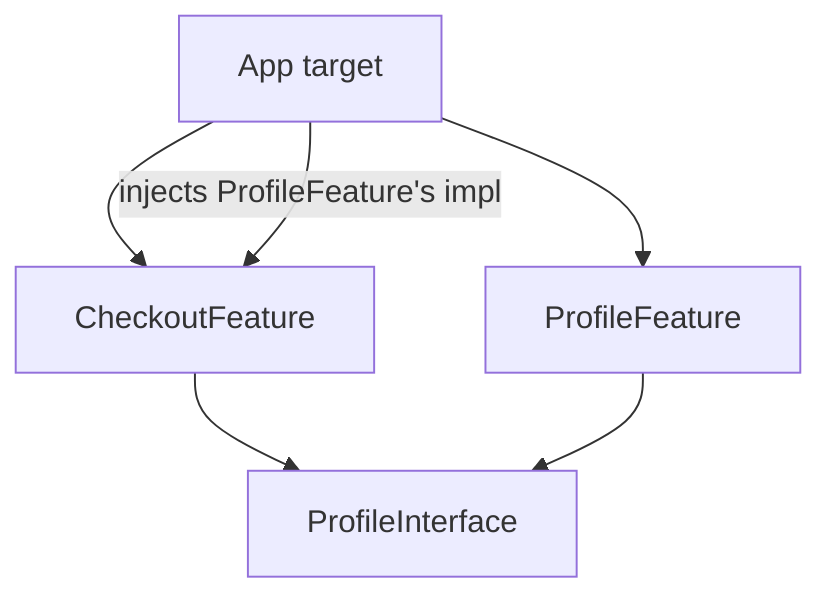

# Dependency Injection, SPM & Modularization

[⬅ Back to index](../README.md)

Covers: DI types, composition root, DI containers, protocol-based injection, Swift Package Manager vs CocoaPods vs Carthage, static vs dynamic frameworks, XCFrameworks.

---

### 1. What is Dependency Injection? Why use it?

<details>
<summary>Answer</summary>

**In short:** Dependency Injection means an object receives the things it depends on from outside (usually through its initializer) instead of creating them itself. That makes dependencies explicit, lets you pass mocks in tests, keeps types loosely coupled, and lets you configure behaviour (staging vs production) in one place.

#### The problem

```swift
// ❌ Hidden, untestable
final class ProfileViewModel {
    private let api = APIClient()          // decides its own dependency
    func load() async throws -> Profile { try await api.fetchProfile() }
}
```

`ProfileViewModel` is welded to the real `APIClient`. A unit test of it hits the real network, you can't simulate an error response, and nothing in the type's signature tells you it needs the network at all.

#### The fix

```swift
// ✅ Injected through a protocol
protocol ProfileServiceProtocol {
    func fetchProfile() async throws -> Profile
}

final class ProfileViewModel {
    private let service: ProfileServiceProtocol
    init(service: ProfileServiceProtocol) { self.service = service }
}

// Production
let vm = ProfileViewModel(service: RemoteProfileService(client: apiClient))

// Test
struct FailingProfileService: ProfileServiceProtocol {
    func fetchProfile() async throws -> Profile { throw URLError(.notConnectedToInternet) }
}
let testVM = ProfileViewModel(service: FailingProfileService())
```

Note that DI is about *who creates* the dependency; protocols are what make the dependency *swappable*. They're usually used together.

#### Benefits

| Benefit | Why |
|---|---|
| Testability | Inject mocks, stubs and fakes to cover success, failure and edge cases |
| Loose coupling | The view model depends on a contract, not a concrete class |
| Configurability | Choose staging vs production, or a mock backend for UI tests, at startup |
| Explicit dependencies | The initializer documents what a type needs |
| Lifetime control | The creator decides whether things are shared or per-screen |

An analogy: a lamp with a plug (injected power) versus a lamp wired straight into the wall. The plug lets you test it on any socket.

**Common pitfalls**
- Injecting a huge "container" object into everything (service locator), which hides the real dependencies again.
- Initializers with 10+ parameters: a sign the type does too much, not that DI is wrong.

**Likely follow-ups**
- *DI vs Dependency Inversion?* Inversion (the "D" in SOLID) says to depend on abstractions; injection is the technique for supplying the concrete implementation.
- *Is a singleton compatible with DI?* Yes, if you inject the shared instance rather than reaching for `.shared` inside the type.

</details>

### 2. What are the types of DI?

<details>
<summary>Answer</summary>

**In short:** Initializer (constructor) injection is preferred: dependencies are required and can be immutable `let`s. Property injection sets a `var` after creation (needed for storyboard VCs, but easy to forget). Method injection passes a dependency only to the method that needs it. Ambient context provides values implicitly, such as SwiftUI's `@Environment` or task-local values.

#### Initializer injection (preferred)

```swift
final class CheckoutViewModel {
    private let payments: PaymentService       // immutable, guaranteed set
    init(payments: PaymentService) { self.payments = payments }
}
```

The compiler forces callers to provide everything, so the object is never half-configured.

#### Property injection

```swift
final class LegacyViewController: UIViewController {
    var service: ProfileService!               // set after init
}
// let vc = storyboard.instantiateViewController(...) as! LegacyViewController
// vc.service = profileService                // forget this → crash on first use
```

Needed when you don't control initialization (older storyboard flows). Also useful for optional dependencies with a sensible default, such as `var logger: Logger = .disabled`.

#### Method injection

```swift
struct ReceiptRenderer {
    func render(_ order: Order, formatter: NumberFormatter) -> String {
        formatter.string(from: order.total as NSNumber) ?? ""
    }
}
```

Good when the dependency varies per call or is only needed by one method.

#### Ambient context

```swift
struct ProfileScreen: View {
    @Environment(\.analytics) private var analytics   // provided by an ancestor view
    var body: some View { Text("Hi").onAppear { analytics.track("profile_viewed") } }
}

private struct AnalyticsKey: EnvironmentKey {
    static let defaultValue: Analytics = NoopAnalytics()
}
extension EnvironmentValues {
    var analytics: Analytics {
        get { self[AnalyticsKey.self] }
        set { self[AnalyticsKey.self] = newValue }
    }
}
```

Task-local values (`@TaskLocal`) are the concurrency equivalent: a value scoped to a task tree, used by libraries like swift-dependencies.

| Type | Required? | Immutable? | Typical use |
|---|---|---|---|
| Initializer | Yes | Yes | Default for everything |
| Property | No | No | Storyboards, optional dependencies |
| Method | Per call | n/a | Per-call variations |
| Ambient | Implicit | Scoped | Cross-cutting values in SwiftUI or task trees |

**Common pitfalls**
- Ambient context hides dependencies; use it for cross-cutting concerns, not core business services.
- Implicitly unwrapped property injection crashes at runtime when wiring is missed.

**Likely follow-ups**
- *Why is initializer injection preferred?* Compile-time completeness, `let` immutability, and the dependency list is visible.

</details>

### 3. What is a composition root?

<details>
<summary>Answer</summary>

**In short:** The composition root is the single place where the object graph is built: usually at app start (the `App` struct, App/SceneDelegate or an `AppDependencies` container), with coordinators and factories continuing it for each flow. Concrete types like `URLSessionAPIClient` or `CoreDataStore` are chosen only here; everything else depends on protocols. It keeps the "new-ing" of concrete types in one place.

#### Why it matters

If any class can create concrete dependencies, you lose the benefits of DI: types again hide what they use, and swapping an implementation means hunting through the codebase. A composition root concentrates those decisions.



#### Example

```swift
@MainActor
final class AppDependencies {
    let apiClient: APIClient
    let store: PersistenceStore
    lazy var feedRepository: FeedRepository = DefaultFeedRepository(api: apiClient, store: store)

    init(environment: AppEnvironment) {
        apiClient = URLSessionAPIClient(baseURL: environment.baseURL)   // concrete choice
        store = CoreDataStore(name: "Model")                            // concrete choice
    }

    // Factory methods: the only place screens are assembled
    func makeFeedViewModel() -> FeedViewModel { FeedViewModel(repository: feedRepository) }
}

@main
struct MyApp: App {
    @State private var deps = AppDependencies(environment: .current)
    var body: some Scene {
        WindowGroup { FeedView(viewModel: deps.makeFeedViewModel()) }
    }
}
```

For UI tests or previews you build a different root (`AppDependencies(environment: .mock)`), and the rest of the app is unchanged.

#### Scopes

Some objects live for the whole app (API client), some for a session (user repository, recreated on logout), some per screen (view models). The composition root and its factories are where those lifetimes are decided.

**Common pitfalls**
- Passing the whole `AppDependencies` into every view model, turning it into a service locator. Pass only what each type needs.
- A single factory file that grows to thousands of lines; split factories per feature module.

**Likely follow-ups**
- *Where is the composition root in a modular app?* In the app target, the only module that knows all concrete implementations.

</details>

### 4. DI container vs manual DI? Which libraries exist?

<details>
<summary>Answer</summary>

**In short:** Manual DI (initializers plus factories) is compile-time safe, has no magic, and is enough for most apps. A DI container lets you register and resolve dependencies to cut wiring boilerplate, but it can hide dependencies and, with runtime containers, turn a missing registration into a crash. Common libraries are Swinject (runtime), Factory (lightweight, compile-time safe), Needle (Uber, code-generated) and swift-dependencies (Point-Free, used by TCA).

#### Manual DI

```swift
let api = URLSessionAPIClient()
let repo = DefaultUserRepository(api: api)
let vm = ProfileViewModel(repository: repo)
```

Everything is checked by the compiler. The downside is wiring code that grows with the app, which you organize with factories per feature.

#### Containers

**Swinject**: register closures by type, resolve at runtime.

```swift
let container = Container()
container.register(APIClient.self) { _ in URLSessionAPIClient() }.inObjectScope(.container)
container.register(UserRepository.self) { r in DefaultUserRepository(api: r.resolve(APIClient.self)!) }
let repo = container.resolve(UserRepository.self)!   // nil → crash if not registered
```

**Factory**: dependencies are computed properties on a container, so a missing one is a compile error.

```swift
extension Container {
    var userRepository: Factory<UserRepository> {
        self { DefaultUserRepository(api: self.apiClient()) }.singleton
    }
}
// In a type: @Injected(\.userRepository) private var repository
```

**swift-dependencies**: `@Dependency(\.apiClient)` with live, test and preview values; overrides scoped with `withDependencies`.

**Needle**: Uber's library that generates the dependency tree code at build time, so wiring errors are caught at compile time; aimed at very large apps.

#### Comparison

| | Manual | Swinject | Factory | swift-dependencies | Needle |
|---|---|---|---|---|---|
| Errors caught | Compile time | Runtime | Compile time | Compile time (keys) | Compile time (codegen) |
| Boilerplate | Highest | Low | Low | Low | Medium (setup) |
| Dependencies visible in init | Yes | Optional | No (property wrappers) | No | Yes (component) |
| Extra tooling | None | None | None | None | Code generator |

**Common pitfalls**
- Resolving from the container deep inside business code (service locator anti-pattern), which hides dependencies.
- Adopting a container before the wiring pain exists.

**Likely follow-ups**
- *When would you introduce a container?* When manual wiring across many modules becomes repetitive, and the team agrees on one library.
- *Service locator vs DI?* A locator lets objects *pull* dependencies from a global registry; DI *pushes* them in. DI makes them visible.

</details>

### 5. How do you inject dependencies into storyboard view controllers?

<details>
<summary>Answer</summary>

**In short:** Before iOS 13 you could only use property injection, typically in `prepare(for:sender:)`. Since iOS 13, `UIStoryboard.instantiateViewController(identifier:creator:)` lets you call your own `init?(coder:service:)`, which gives proper initializer injection with `let` properties. Alternatively, build the screen programmatically or in SwiftUI.

#### The problem

The storyboard creates the VC with `init?(coder:)`, which you don't call, so you can't pass parameters to it.

#### Old way: property injection

```swift
final class DetailViewController: UIViewController {
    var service: DetailService!      // must be set before viewDidLoad
}

// In the source VC
override func prepare(for segue: UIStoryboardSegue, sender: Any?) {
    if let detail = segue.destination as? DetailViewController {
        detail.service = service
    }
}
```

Risks: forgetting to set it crashes at runtime, and the property must be a mutable `var`.

#### iOS 13+: creator closure

```swift
final class DetailViewController: UIViewController {
    private let service: DetailService

    init?(coder: NSCoder, service: DetailService) {
        self.service = service
        super.init(coder: coder)
    }
    required init?(coder: NSCoder) { fatalError("Use init(coder:service:)") }
}

let storyboard = UIStoryboard(name: "Main", bundle: nil)
let vc = storyboard.instantiateViewController(identifier: "Detail") { coder in
    DetailViewController(coder: coder, service: service)
}
```

For segues, the equivalent is an `@IBSegueAction` method, which receives the coder and returns the VC built with your initializer.

```swift
@IBSegueAction func makeDetail(_ coder: NSCoder) -> DetailViewController? {
    DetailViewController(coder: coder, service: service)
}
```

#### Or avoid the problem

Programmatic UIKit (`DetailViewController(service:)` with `init(nibName:bundle:)`) or SwiftUI views have normal initializers.

**Likely follow-ups**
- *Why the `fatalError` in `init?(coder:)`?* It makes accidental instantiation without dependencies fail loudly during development.

</details>

### 6. How do you make code testable with protocols?

<details>
<summary>Answer</summary>

**In short:** Define protocols at the boundaries of your code: network, persistence, time, randomness, analytics, location. Inject them, and in tests provide mock, stub or fake implementations. Even `URLSession` can be abstracted behind a small protocol with `data(for:)`, or intercepted with a `URLProtocol` subclass.

#### Why boundaries

Logic is testable when it's deterministic. Anything that reaches outside the process (network, disk, clock, sensors) makes it non-deterministic, so you put a protocol at that seam and control it in tests.

```swift
protocol Clock { var now: Date { get } }
struct SystemClock: Clock { var now: Date { Date() } }
struct FixedClock: Clock { let now: Date }

struct TrialChecker {
    let clock: Clock
    func isExpired(startedAt: Date) -> Bool {
        clock.now.timeIntervalSince(startedAt) > 14 * 24 * 3600
    }
}

// Test: fully deterministic
let checker = TrialChecker(clock: FixedClock(now: Date(timeIntervalSince1970: 2_000_000)))
```

#### Test doubles

| Double | What it does | Example |
|---|---|---|
| Stub | Returns canned data | `StubUserRepo` always returns `User.mock` |
| Mock | Records calls so you can assert on them | `MockAnalytics.trackedEvents == ["login"]` |
| Fake | Working lightweight implementation | In-memory store instead of Core Data |
| Spy | Real behaviour plus recording | Wraps a real object and logs calls |

```swift
final class MockAnalytics: Analytics {
    private(set) var events: [String] = []
    func track(_ name: String) { events.append(name) }
}
```

#### Abstracting URLSession

Option 1: a narrow protocol that `URLSession` already satisfies.

```swift
protocol HTTPClient {
    func data(for request: URLRequest) async throws -> (Data, URLResponse)
}
extension URLSession: HTTPClient {}   // URLSession already has this method

struct StubHTTPClient: HTTPClient {
    let data: Data
    func data(for request: URLRequest) async throws -> (Data, URLResponse) {
        (data, HTTPURLResponse(url: request.url!, statusCode: 200, httpVersion: nil, headerFields: nil)!)
    }
}
```

Option 2: keep the real `URLSession` but register a `URLProtocol` subclass in its configuration (`config.protocolClasses = [MockURLProtocol.self]`) that returns canned responses. This also tests your request building and decoding end to end.

**Common pitfalls**
- Protocols for everything, including pure value types that need no faking (see over-architecting).
- Mocks that mirror implementation details, so tests break on every refactor. Assert on outcomes where possible.

**Likely follow-ups**
- *Protocol vs closure-based dependencies?* A struct of closures (`var fetch: () async throws -> User`) is a lighter alternative that's easy to override per test; swift-dependencies uses this style.

</details>

---

## Dependencies & Packaging

### 7. Swift Package Manager vs CocoaPods vs Carthage?

<details>
<summary>Answer</summary>

**In short:** Swift Package Manager is Apple's official tool, built into Xcode, and the recommended choice today. CocoaPods is a Ruby-based third-party tool that generates a workspace and modifies your project; its trunk becomes read-only from late 2026, so no new pods or updates. Carthage builds frameworks you link yourself and is rarely used now. Interview answer: "SPM for new projects; migrate existing CocoaPods dependencies to SPM."

| SPM | CocoaPods | Carthage |
|---|---|---|
| **Apple's official**, integrated into Xcode | Third-party (Ruby) | Third-party |
| `Package.swift`, no workspace changes | Generates a `.xcworkspace`, modifies the project | Builds frameworks; you link them manually |
| Source-based, supports binary targets (XCFrameworks), resources, plugins and macros | Huge legacy library ecosystem | Decentralized, minimal |
| The recommended choice today | **CocoaPods trunk is read-only from late 2026**: no new pods or updates | Rarely used now |

#### How each works

- **SPM**: you add packages in Xcode or declare them in `Package.swift`. Xcode resolves versions, writes `Package.resolved`, fetches sources and builds them as part of your build. No extra tooling to install.
- **CocoaPods**: a `Podfile` lists pods; `pod install` downloads them, generates a `Pods` project, and creates an `.xcworkspace` that you must open instead of the `.xcodeproj`. It needs Ruby and a gem install. Very flexible, which is why it dominated for years.
- **Carthage**: a `Cartfile` lists dependencies; `carthage update` builds them into frameworks (now XCFrameworks), and you drag them into your project yourself. It doesn't touch the project file, but you do the linking and build-phase work.

#### Why SPM won

- First-party, no Ruby setup on CI or developer machines.
- Works for both apps and libraries, and for server-side Swift.
- Supports resources, binary targets, build plugins and macros, closing the gaps that kept teams on CocoaPods.
- Local packages are also the standard way to modularize your own code.

#### Migrating from CocoaPods

1. Check which pods have SPM support (most popular ones do).
2. Add them as packages, remove them from the `Podfile` one at a time, and verify the build.
3. For pods without SPM support, wrap a prebuilt XCFramework in a `binaryTarget`, find an alternative, or vendor the source.
4. When the `Podfile` is empty, run `pod deintegrate` and return to the plain `.xcodeproj`.

**Likely follow-ups**
- *Any SPM downsides?* Package resolution can be slow on large graphs, and build settings are less customizable than with CocoaPods.

</details>

### 8. What does a Package.swift look like?

<details>
<summary>Answer</summary>

**In short:** `Package.swift` is a Swift manifest that declares the package name, supported platforms, products (what others can import), dependencies on other packages, and targets (source modules and tests). The first line must be the `swift-tools-version` comment. `Package.resolved` pins the exact resolved versions; commit it for apps.

```swift
// swift-tools-version: 6.0
import PackageDescription

let package = Package(
    name: "Networking",
    platforms: [.iOS(.v16)],                       // minimum OS for this package
    products: [
        // What clients can depend on
        .library(name: "Networking", targets: ["Networking"])
    ],
    dependencies: [
        // Remote package with a semantic version range: 1.5.0 ..< 2.0.0
        .package(url: "https://github.com/apple/swift-log", from: "1.5.0")
    ],
    targets: [
        .target(
            name: "Networking",
            dependencies: [.product(name: "Logging", package: "swift-log")]
        ),
        .testTarget(name: "NetworkingTests", dependencies: ["Networking"])
    ]
)
```

#### The parts

- **`swift-tools-version`**: the minimum Swift toolchain that can read the manifest; it also sets the language mode default (6.0 → Swift 6 mode).
- **`platforms`**: deployment targets. A client app with a lower target can't use the package.
- **`products`**: `.library` (static by default, or `type: .dynamic`), `.executable`, `.plugin`.
- **`dependencies`**: other packages, remote (URL) or local (`.package(path: "../Core")`).
- **`targets`**: by convention, sources live in `Sources/<TargetName>` and tests in `Tests/<TargetName>`. Targets can also declare `resources: [.process("Assets")]` and `swiftSettings`.

#### Version requirements

| Requirement | Meaning |
|---|---|
| `from: "1.5.0"` | Up to next major: `1.5.0 ..< 2.0.0` (the usual choice) |
| `.upToNextMinor(from: "1.5.0")` | `1.5.0 ..< 1.6.0` |
| `exact: "1.5.2"` | Only that version |
| `branch: "main"` | Latest commit on a branch (avoid for releases) |
| `revision: "a1b2c3..."` | A specific commit |

#### Package.resolved

It records the exact version and commit for every dependency in the graph. Commit it for **apps** so every developer and CI build uses the same versions. Libraries often don't commit it, because their clients do their own resolution.

**Common pitfalls**
- Branch-based dependencies, which make builds non-reproducible.
- Forgetting to declare resources, so `Bundle.module` can't find them at runtime.

**Likely follow-ups**
- *How do you access resources in a package?* With `Bundle.module`, which SPM generates for targets that declare resources.

</details>

### 9. Static vs dynamic libraries/frameworks?

<details>
<summary>Answer</summary>

**In short:** A static library is copied into the app binary at link time: launch is faster and the linker can strip unused code, but the same code duplicated into the app and its extensions increases total size. A dynamic framework is loaded at runtime by dyld: it can be shared between the app and its extensions, but each one adds launch time. SPM library products are static by default unless declared `.dynamic`. Mergeable libraries (Xcode 15) build dynamic in debug and merge into the binary in release.

#### How they differ



| | Static | Dynamic |
|---|---|---|
| When code is linked | Build time, into the executable | Launch time, by dyld |
| Launch cost | None extra | Each framework adds load, rebase/bind and init work |
| Dead-code stripping | Yes, unused symbols removed | No, the whole framework ships |
| Sharing with extensions | Duplicated in each binary | One copy in the app bundle, shared |
| Resources | Need a separate bundle | Can carry its own resources |
| Debug iteration | Relinks the whole app on change | Only the framework rebuilds/relinks |

#### Practical guidance

- **Default to static** (the SPM default). Most apps launch faster this way.
- **Use dynamic** when significant code is shared between the app and several extensions and the size matters, or a vendor ships only a dynamic framework.
- **Mergeable libraries** (Xcode 15) give you both: dynamic linking in debug builds for fast incremental builds, and in release the libraries are merged into the app binary so there's no dyld cost at launch.

```swift
// Forcing a dynamic product in SPM
.library(name: "SharedKit", type: .dynamic, targets: ["SharedKit"])
```

**Common pitfalls**
- Dozens of dynamic frameworks in a modular app, which noticeably slows cold launch.
- Linking the same static library into two dynamic frameworks that both end up in the app: duplicate symbols and two copies of global state.

**Likely follow-ups**
- *How do you measure the launch impact?* Instruments' App Launch template, or Xcode's launch metrics in Organizer.
- *Library vs framework?* A library is just compiled code; a framework is a bundle that can also contain headers, module maps and resources.

</details>

### 10. What is an XCFramework?

<details>
<summary>Answer</summary>

**In short:** An XCFramework is a bundle that contains a framework or library built separately for several platforms and architectures (device arm64, simulator arm64/x86_64, macOS, Mac Catalyst). It replaced "fat" universal frameworks, which couldn't hold arm64 for both device and simulator. It's the standard way to distribute closed-source binary SDKs, shipped through SPM's `binaryTarget`. Since Xcode 15, XCFrameworks can be signed so you can verify who built them.

#### Why it was needed

A fat framework merged slices into one binary by architecture using `lipo`. Once Apple Silicon Macs arrived, the simulator also ran on arm64. A fat binary can only have one arm64 slice, so it couldn't hold both "arm64 device" and "arm64 simulator". An XCFramework stores each platform variant as a separate folder, so there's no conflict.

```
MySDK.xcframework/
  Info.plist
  ios-arm64/MySDK.framework
  ios-arm64_x86_64-simulator/MySDK.framework
  macos-arm64_x86_64/MySDK.framework
```

#### Building one

You archive the framework per platform, then combine the archives:

```
xcodebuild archive -scheme MySDK -destination "generic/platform=iOS" -archivePath build/ios BUILD_LIBRARY_FOR_DISTRIBUTION=YES SKIP_INSTALL=NO
xcodebuild archive -scheme MySDK -destination "generic/platform=iOS Simulator" -archivePath build/sim BUILD_LIBRARY_FOR_DISTRIBUTION=YES SKIP_INSTALL=NO
xcodebuild -create-xcframework -framework build/ios.xcarchive/Products/Library/Frameworks/MySDK.framework -framework build/sim.xcarchive/Products/Library/Frameworks/MySDK.framework -output MySDK.xcframework
```

`BUILD_LIBRARY_FOR_DISTRIBUTION=YES` turns on module stability (a `.swiftinterface` file), so the binary works with newer Swift compilers than the one that built it.

#### Distributing through SPM

```swift
.binaryTarget(
    name: "MySDK",
    url: "https://example.com/MySDK-1.2.0.xcframework.zip",
    checksum: "..."  // computed with `swift package compute-checksum`
)
```

**Common pitfalls**
- Building without library evolution enabled, so the SDK breaks when clients upgrade Xcode.
- Forgetting the simulator slice, so the SDK only builds for device.

**Likely follow-ups**
- *Why sign an XCFramework?* Xcode records the signer and warns if a later version is signed by someone else, which protects against a tampered binary dependency.

</details>

### 11. How do modules communicate without depending on each other?

<details>
<summary>Answer</summary>

**In short:** Feature modules depend on lightweight interface modules (protocols only), and the app target injects the real implementations. The app's coordinator or router wires features together; URL-based deep link routing can connect them; and shared types live in a `Core` or `Models` module. This avoids circular dependencies and keeps each feature buildable and testable in isolation.

#### The problem

`CheckoutFeature` needs to show the user's profile; `ProfileFeature` needs to start checkout. If each imports the other, you get a cycle, which SPM rejects, and even without a cycle, every change in one rebuilds the other.

#### Interface modules



```swift
// ProfileInterface module: tiny, rarely changes
public protocol ProfileRouting {
    @MainActor func makeProfileView(userID: String) -> AnyView
}

// CheckoutFeature: depends only on the interface
public struct CheckoutView: View {
    let profileRouting: ProfileRouting
    public var body: some View {
        NavigationLink("Edit account") { profileRouting.makeProfileView(userID: "me") }
    }
}

// ProfileFeature: implements it
public struct ProfileRouter: ProfileRouting {
    public init() {}
    public func makeProfileView(userID: String) -> AnyView { AnyView(ProfileView(userID: userID)) }
}

// App target (composition root): the only place that knows both
CheckoutView(profileRouting: ProfileRouter())
```

#### Other techniques

| Technique | How | Trade-off |
|---|---|---|
| Coordinator in the app | Features expose callbacks (`onCheckoutRequested`); the app coordinator decides what to show | Simple; the app target knows all flows |
| URL / deep link routing | Features open `myapp://profile/42`; a router maps URLs to screens | Very decoupled, but stringly typed |
| Shared `Core`/`Models` module | Common types (User, Money) live below all features | Risk of a bloated Core |
| Event bus / NotificationCenter | Broadcast events | Loose but hard to trace; use sparingly |

**Common pitfalls**
- Interface modules that grow implementation code, so they change often and trigger rebuilds.
- Putting everything shared into `Core` until every feature depends on everything.

**Likely follow-ups**
- *Why does this speed up builds?* Features depend on small stable interfaces, so changing one feature's implementation doesn't recompile the others.

</details>

### 12. What are SPM plugins and macros?

<details>
<summary>Answer</summary>

**In short:** SPM supports three kinds of extension. Build tool plugins run automatically during the build (code generation such as SwiftGen or protobuf, or linting with SwiftLint). Command plugins run on demand (for example a formatting command). Macro targets let you distribute Swift macros as packages, implemented with SwiftSyntax.

#### Build tool plugins

They run as part of each build and can generate source files that are compiled into the target.

```swift
.target(
    name: "App",
    plugins: [.plugin(name: "SwiftGenPlugin", package: "SwiftGenPlugin")]
)
```

Typical uses: generating type-safe asset and string accessors, protobuf or OpenAPI client code, and lint checks that show warnings in Xcode. Plugins run in a sandbox and must declare their outputs, which lets the build system skip them when inputs haven't changed.

#### Command plugins

Run explicitly, from Xcode's package context menu or the command line:

```
swift package plugin --list
swift package format-source-code
```

They can be granted permission to write to the package directory, which is why they suit formatters and code-maintenance tasks.

#### Macro targets

Swift macros (Swift 5.9) are compiler plugins: a macro's implementation runs at compile time, receives the syntax tree and returns new code. They ship as a `.macro` target that depends on SwiftSyntax, plus a normal library target that declares the public macro.

```swift
// In the library target: the public declaration
@freestanding(expression)
public macro stringify<T>(_ value: T) -> (T, String) = #externalMacro(module: "MyMacros", type: "StringifyMacro")
```

`@Observable`, `#Preview` and `@Model` are macros from Apple's frameworks.

**Common pitfalls**
- Macro packages depend on SwiftSyntax, which can add noticeable build time the first time it compiles.
- Xcode asks the user to trust plugins and macros from third-party packages before running them; CI may need that validation disabled explicitly.

**Likely follow-ups**
- *Build plugin vs Run Script build phase?* Plugins are sandboxed, declare inputs/outputs and work in packages; scripts are project-only and run unsandboxed unless configured otherwise.

</details>

### 13. What is the `package` access modifier?

<details>
<summary>Answer</summary>

**In short:** `package` (Swift 5.9) makes a declaration visible to every module in the same Swift package, but not to clients outside it. It's useful for sharing internals between targets of a modular package without making them `public`.

#### Where it fits

| Modifier | Visible to |
|---|---|
| `private` | The enclosing declaration (and its extensions in the same file) |
| `fileprivate` | The same file |
| `internal` (default) | The same module (target) |
| **`package`** | All modules in the same package |
| `public` | Any module that imports it (no subclassing/overriding outside) |
| `open` | Any module, including subclassing and overriding |

#### Why it was added

Before `package`, if `NetworkingCore` needed to expose a helper to `NetworkingAuth` in the same package, it had to be `public`, which also made it part of the API for every app using the package. Teams worked around this with underscore prefixes (`_internalHelper`) or `@_spi`.

```swift
// Target: NetworkingCore
package struct RequestSigner {               // visible to NetworkingAuth, not to apps
    package func sign(_ request: inout URLRequest, token: String) {
        request.setValue("Bearer \(token)", forHTTPHeaderField: "Authorization")
    }
}

public struct APIClient { /* public API for apps */ }

// Target: NetworkingAuth (same package)
import NetworkingCore
let signer = RequestSigner()                 // ✅ allowed
```

In an app that imports the package, `RequestSigner` simply isn't visible.

**Common pitfalls**
- It works per package, so splitting modules into separate packages (for example a separate package per feature) means `package` no longer reaches across them.

**Likely follow-ups**
- *Does it work in Xcode projects without SPM?* Xcode needs to know which targets belong to the same package; outside SPM that's set with a package-name build setting, so in practice it's mostly used in Swift packages.

</details>

### 14. How do you speed up builds in a large iOS project?

<details>
<summary>Answer</summary>

**In short:** Measure first (Build Timeline, build timing summary), then: modularize for parallel and incremental builds; help the type checker with explicit types and find slow functions with compiler warnings; make build-phase scripts skippable by declaring inputs/outputs; use binary dependencies for heavy third-party code; take advantage of explicitly built modules (Xcode 16) and compilation caching; keep debug settings fast; and in large organizations use remote caching (Tuist, Bazel).

#### 1. Measure

- **Build Timeline** in Xcode's report navigator shows what ran, in parallel or not, and for how long.
- **Product → Perform Action → Build With Timing Summary** lists time per phase.
- Fix the biggest bars first.

#### 2. Modularize

Many independent modules compile in parallel, and a change only rebuilds the changed module and those depending on it. A long chain (A → B → C → D) builds serially, so prefer a wide, shallow graph.

#### 3. Help the type checker

Complex expressions with literals, overloaded operators and closures can take seconds to type-check.

```swift
// Slow: the compiler tries many overload combinations
let total = a + b * 2 + (c ?? 0) + Double(d) / 3 + e.reduce(0, +)

// Faster: explicit types and smaller steps
let scaled: Double = b * 2
let extra: Double = (c ?? 0) + Double(d) / 3
let total: Double = a + scaled + extra + e.reduce(0, +)
```

Find slow spots with Swift compiler flags in *Other Swift Flags*:

```
-Xfrontend -warn-long-function-bodies=100
-Xfrontend -warn-long-expression-type-checking=100
```

#### 4. Scripts and dependencies

- Run Script phases without declared input/output files run on **every** build. Declare them so Xcode can skip the script when nothing changed, or turn off "Based on dependency analysis" only where truly needed.
- Large third-party code (analytics SDKs, big libraries) can be consumed as prebuilt XCFrameworks so you don't compile it.

#### 5. Build settings

| Setting (Debug) | Why |
|---|---|
| Optimization `-Onone` | Optimization is slow and unneeded for debugging |
| Compilation mode: Incremental | Recompiles only changed files |
| Debug info: DWARF (no dSYM) | Skips generating dSYMs |
| Build active architecture only: Yes | One architecture instead of several |
| Explicitly built modules (Xcode 16) | Module dependencies built as separate, parallel, reusable tasks |
| Compilation caching | Reuses compiled outputs when inputs haven't changed |

#### 6. Organization-scale

Tuist (project generation plus binary caching of modules) or Bazel (hermetic builds with remote caching) let CI and developers reuse each other's build outputs.

**Common pitfalls**
- Optimizing without measuring; the slow part is often one script or one file.
- Deep, serial module chains that remove the parallelism modularization was meant to give.

**Likely follow-ups**
- *Why do clean builds take much longer than incremental ones?* Everything is recompiled, including dependencies; caching and binary dependencies target exactly that.

</details>

---

[⬅ Previous: Architecture](11-architecture.md) · [⬅ Back to index](../README.md) · [Next: Networking ➡](13-networking.md)
