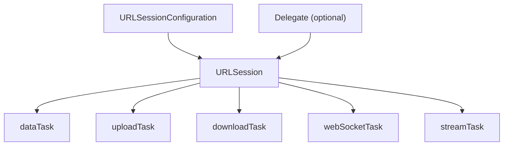
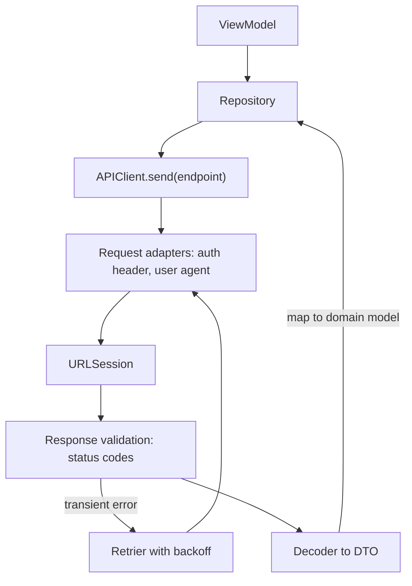
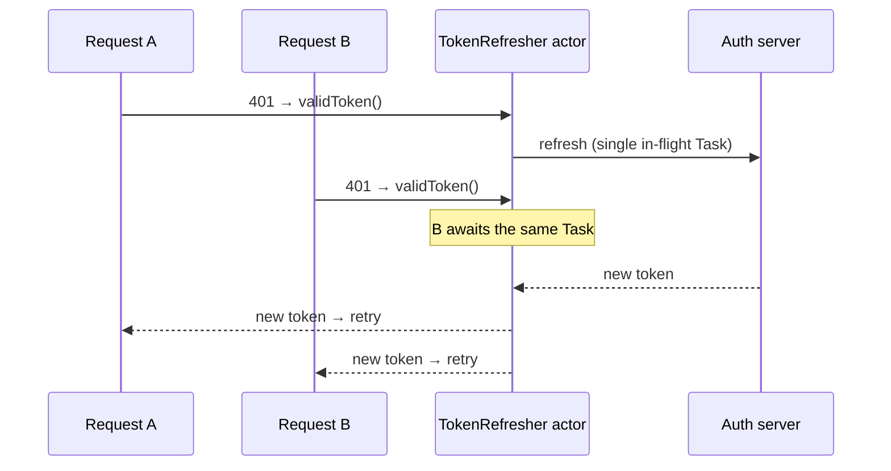
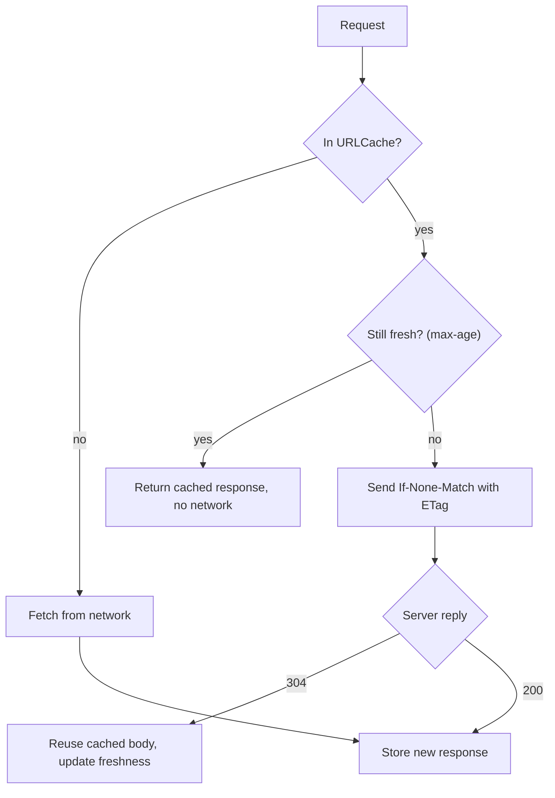
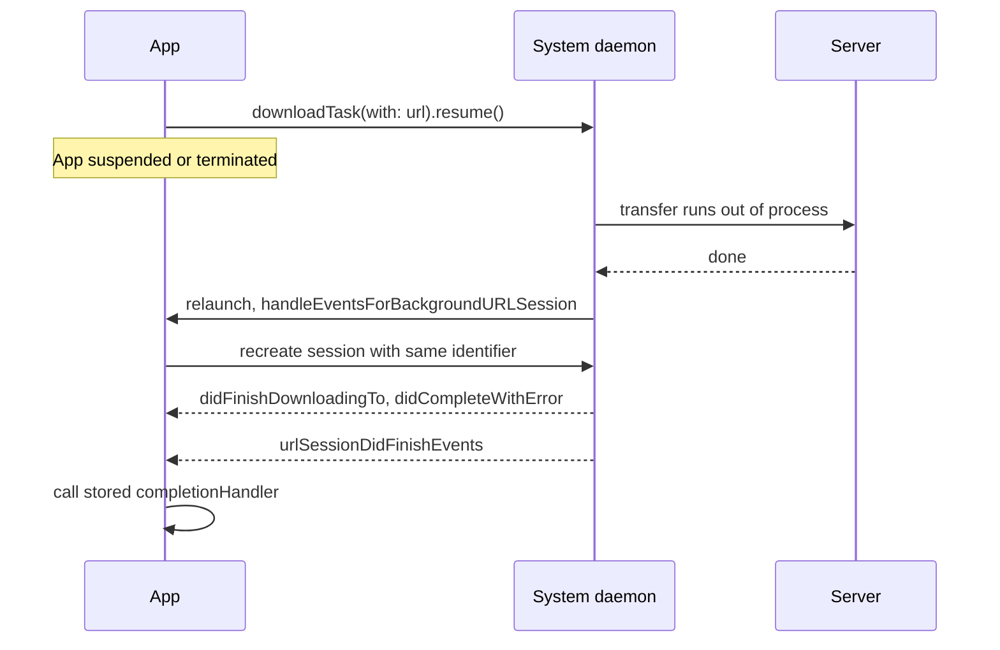
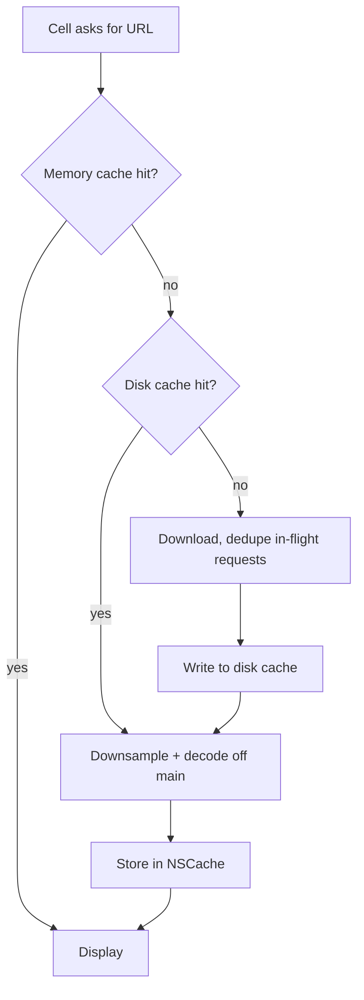
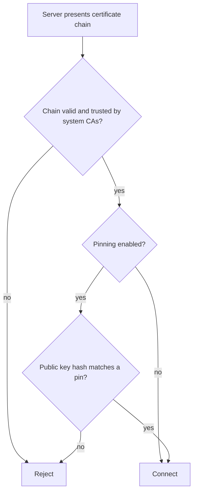
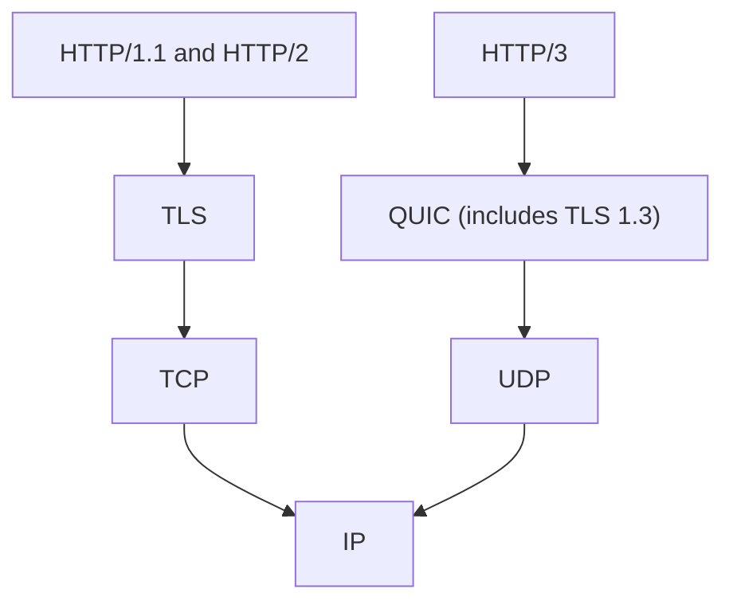

# Networking

[⬅ Back to index](../README.md)

Covers: HTTP/REST basics, URLSession, async networking, building a network layer, Codable decoding, error handling, auth & token refresh, caching, background transfers, WebSockets, image loading, ATS & pinning.

---

### 1. What are the HTTP methods and status codes you should know?

<details>
<summary>Answer</summary>

**In short:** The core methods are `GET` (read), `POST` (create or trigger an action), `PUT` (replace), `PATCH` (partial update) and `DELETE`. `GET`, `PUT` and `DELETE` are **idempotent** (repeating them has the same effect as doing them once); `POST` is not. Status codes are grouped by first digit: 2xx success, 3xx redirect/cache, 4xx client error, 5xx server error. The ones to know cold are 200, 201, 204, 304, 400, 401, 403, 404, 409, 429, 500 and 503.

#### Methods

| Method | Meaning | Safe (no side effects)? | Idempotent? | Has body? |
|---|---|---|---|---|
| `GET` | Read a resource | Yes | Yes | No |
| `HEAD` | Like GET, headers only | Yes | Yes | No |
| `POST` | Create a resource / run an action | No | **No** | Yes |
| `PUT` | Replace the whole resource | No | Yes | Yes |
| `PATCH` | Change some fields | No | Not guaranteed | Yes |
| `DELETE` | Remove a resource | No | Yes | Usually no |

**Why idempotency matters on mobile:** networks drop. If a request times out you don't know if the server processed it. Retrying an idempotent request is safe; retrying a `POST /payments` could charge twice. That's why many APIs accept an **idempotency key** header (a client-generated UUID) on `POST`, so the server can recognise and ignore duplicates.

#### Status codes

| Code | Meaning | What the app usually does |
|---|---|---|
| 200 OK | Success with body | Decode it |
| 201 Created | Resource created | Decode the new resource / read `Location` |
| 204 No Content | Success, empty body | Don't try to decode JSON |
| 301 / 302 / 307 / 308 | Redirect | URLSession follows automatically |
| 304 Not Modified | Cached copy is still valid | Use the cache (URLCache handles it) |
| 400 Bad Request | Malformed input | Show validation error, don't retry |
| **401 Unauthorized** | Not authenticated (missing/expired token) | Refresh the token, then retry |
| **403 Forbidden** | Authenticated, but not allowed | Show "no access"; refreshing won't help |
| 404 Not Found | Resource doesn't exist | Show empty/missing state |
| 409 Conflict | Version/state conflict | Re-fetch and merge, or ask the user |
| 422 Unprocessable | Validation failed | Show field errors |
| **429 Too Many Requests** | Rate limited | Back off; respect `Retry-After` |
| 500 Internal Server Error | Server bug | Retry maybe, show generic error |
| 502 / 503 / 504 | Gateway / unavailable / timeout | Retry with backoff |

**Pitfalls:**
- Confusing **401 vs 403**: 401 means "who are you?", 403 means "I know who you are and the answer is no".
- Decoding a 204 response as JSON throws a decoding error on empty data.
- Treating every non-2xx as retryable. 4xx errors (other than 408/429) won't fix themselves.

**Likely follow-ups:**
- *PUT vs PATCH?* PUT sends the full representation and replaces it; PATCH sends only the changed fields.
- *Is POST ever idempotent?* Not by definition, but you can make it effectively idempotent with an idempotency key.
- *What does "safe" mean?* The method doesn't change server state (GET, HEAD, OPTIONS).

</details>

### 2. What is URLSession? What are its task types and configurations?

<details>
<summary>Answer</summary>

**In short:** `URLSession` is Apple's Foundation API for HTTP(S) and other network transfers. A **session** is created from a **configuration** (`.default`, `.ephemeral`, `.background(withIdentifier:)`) that controls caching, cookies, timeouts and headers, and it creates **tasks** (`data`, `upload`, `download`, `webSocket`, `stream`) that do the actual work. Reuse sessions; one session per request is wasteful.

#### The three layers



- **Configuration**: the policy. Cache, cookie storage, credential storage, timeouts, extra headers, cellular/expensive network rules, HTTP/2 connection limits.
- **Session**: owns a connection pool and shares it between its tasks. Created once and reused. Its configuration is copied at creation, so changing the config object afterwards has no effect.
- **Tasks**: one per transfer. Created suspended in the completion-handler API (you must call `resume()`); the async/await methods start them for you.

#### Task types

| Task | Result | Typical use | Background session? |
|---|---|---|---|
| `dataTask` | `Data` in memory | JSON APIs | No (only while app is running) |
| `uploadTask` | Sends `Data` or a file | Photo/video upload | Yes, **from a file** |
| `downloadTask` | Writes to a temp file | Large files, podcasts | Yes, and resumable |
| `webSocketTask` | Message stream | Chat, live updates | No |
| `streamTask` | Raw TCP stream | Custom protocols | No |

A download task gives you a temporary file URL; you must **move it** before the delegate method or completion handler returns, because the system deletes it afterwards.

#### Configurations

| Configuration | Stores on disk | Use |
|---|---|---|
| `.default` | Cache, cookies, credentials | Most apps |
| `.ephemeral` | Nothing (all in memory) | Private browsing, sensitive flows |
| `.background(withIdentifier:)` | Transfer state, managed by a system daemon | Uploads/downloads that must survive suspension or termination |

Useful configuration properties:

```swift
let config = URLSessionConfiguration.default
config.timeoutIntervalForRequest = 30      // idle time between packets
config.timeoutIntervalForResource = 300    // whole transfer limit
config.waitsForConnectivity = true         // wait instead of failing when offline
config.allowsExpensiveNetworkAccess = true
config.httpAdditionalHeaders = ["User-Agent": "MyApp/1.0"]
config.urlCache = URLCache(memoryCapacity: 20_000_000, diskCapacity: 100_000_000)

let session = URLSession(configuration: config)   // create once, inject everywhere
```

#### shared vs custom

`URLSession.shared` is fine for simple GETs. It has no delegate and you can't change its configuration. Create a **custom session** when you need timeouts, headers, `waitsForConnectivity`, a delegate (auth challenges, pinning, progress, metrics) or a custom cache.

**Pitfalls:**
- Creating a new session per request loses connection reuse (extra TLS handshakes) and, with a delegate, leaks memory: a session **retains its delegate strongly** until you call `invalidateAndCancel()` or `finishTasksAndInvalidate()`.
- Forgetting `resume()` on completion-handler tasks: nothing happens.

**Likely follow-ups:**
- *Request vs resource timeout?* Request timeout resets every time data arrives; resource timeout caps the whole transfer.
- *How do you get progress?* `task.progress` (a `Progress` object) or the delegate's `didSendBodyData` / `didWriteData` callbacks.
- *How do you see timing?* `urlSession(_:task:didFinishCollecting:)` gives `URLSessionTaskMetrics` (DNS, TLS, request/response times).

</details>

### 3. How do you make a network request with async/await?

<details>
<summary>Answer</summary>

**In short:** Build a `URLRequest`, call `try await session.data(for: request)`, cast the response to `HTTPURLResponse`, **check the status code yourself** (URLSession does not throw for 4xx/5xx), then decode. The async APIs (iOS 15+) integrate with Swift concurrency: cancelling the surrounding `Task` cancels the network request.

```swift
func fetchUser(id: Int) async throws -> User {
    var request = URLRequest(url: baseURL.appending(path: "users/\(id)"))
    request.setValue("application/json", forHTTPHeaderField: "Accept")
    let (data, response) = try await session.data(for: request)
    guard let http = response as? HTTPURLResponse else { throw NetworkError.invalidResponse }
    guard (200..<300).contains(http.statusCode) else { throw NetworkError.http(http.statusCode, data) }
    return try decoder.decode(User.self, from: data)
}
```

#### What happens step by step

1. `URLRequest` holds the URL, method, headers, body, cache policy and timeout.
2. `session.data(for:)` creates and starts a data task and **suspends** the current task (it doesn't block a thread) until the response is complete.
3. It **throws** only for transport problems: no connection, timeout, DNS failure, TLS failure, cancellation. These arrive as `URLError`.
4. Any HTTP response, including 404 or 500, is a *successful* transport result. So you must validate `statusCode`.
5. Decoding happens on whatever executor the function runs on. If this function is not `@MainActor`, decoding is already off the main thread.

#### The other async APIs

```swift
// Upload
let (data, response) = try await session.upload(for: request, from: bodyData)

// Download to a temp file (move it before returning)
let (tempURL, response) = try await session.download(for: request)

// Stream bytes / lines as they arrive (large responses, Server-Sent Events)
let (bytes, response) = try await session.bytes(for: request)
for try await line in bytes.lines { handle(line) }
```

#### Cancellation

```swift
// SwiftUI: the .task modifier cancels automatically when the view disappears
.task(id: userID) { await viewModel.load(userID) }

// UIKit: keep the handle and cancel it yourself
loadTask = Task { await viewModel.load(userID) }
loadTask?.cancel()
```

A cancelled request throws `URLError(.cancelled)` (or `CancellationError` if you check `Task.checkCancellation()` yourself). Treat both as "do nothing", not as an error to show.

**Pitfalls:**
- Not checking the status code, then getting a confusing decoding error when the server returned an HTML 500 page.
- Updating UI from a non-main context. Mark the view model `@MainActor` so state changes are safe.
- Using these async methods with a **background** `URLSession`: background sessions require delegate-based tasks.

**Likely follow-ups:**
- *How did you do this before iOS 15?* `dataTask(with:completionHandler:)` + `resume()`, or wrap it in `withCheckedThrowingContinuation`.
- *Does `await` block the main thread?* No. The function suspends and the thread is free to do other work.
- *How do you run requests in parallel?* `async let` for a fixed number, `withThrowingTaskGroup` for a dynamic number.

</details>

### 4. How do you design a scalable network layer?

<details>
<summary>Answer</summary>

**In short:** Describe each API call as an **`Endpoint` value** (path, method, query, body), send it through one generic **`APIClient`** protocol that builds the request, applies **interceptors** (auth header, logging), sends it, **validates** the status code, maps errors to a domain type, retries transient failures and decodes into **DTOs**. Repositories call the client and map DTOs to **domain models**. Everything is behind protocols so it can be mocked in tests.

#### Request flow



#### The building blocks

```swift
enum HTTPMethod: String { case get = "GET", post = "POST", put = "PUT", patch = "PATCH", delete = "DELETE" }

protocol Endpoint {
    var path: String { get }
    var method: HTTPMethod { get }
    var queryItems: [URLQueryItem] { get }
    var body: Encodable? { get }
}

// One endpoint per API call: easy to read, easy to test
struct GetUser: Endpoint {
    let id: Int
    var path: String { "users/\(id)" }
    var method: HTTPMethod { .get }
    var queryItems: [URLQueryItem] { [] }
    var body: Encodable? { nil }
}

protocol RequestInterceptor {
    func adapt(_ request: URLRequest) async throws -> URLRequest
}

protocol APIClient { func send<T: Decodable>(_ endpoint: Endpoint, as: T.Type) async throws -> T }

final class URLSessionAPIClient: APIClient {
    private let session: URLSession
    private let baseURL: URL
    private let decoder: JSONDecoder
    private let encoder = JSONEncoder()
    private let interceptors: [RequestInterceptor]   // auth headers, logging

    init(session: URLSession, baseURL: URL, decoder: JSONDecoder, interceptors: [RequestInterceptor]) {
        self.session = session; self.baseURL = baseURL
        self.decoder = decoder; self.interceptors = interceptors
    }

    func send<T: Decodable>(_ endpoint: Endpoint, as: T.Type) async throws -> T {
        // 1. Build
        var components = URLComponents(url: baseURL.appending(path: endpoint.path), resolvingAgainstBaseURL: false)!
        if !endpoint.queryItems.isEmpty { components.queryItems = endpoint.queryItems }
        var request = URLRequest(url: components.url!)
        request.httpMethod = endpoint.method.rawValue
        if let body = endpoint.body {
            request.httpBody = try encoder.encode(body)
            request.setValue("application/json", forHTTPHeaderField: "Content-Type")
        }
        // 2. Adapt
        for interceptor in interceptors { request = try await interceptor.adapt(request) }
        // 3. Send + validate
        let (data, response) = try await session.data(for: request)
        guard let http = response as? HTTPURLResponse else { throw NetworkError.invalidResponse }
        guard (200..<300).contains(http.statusCode) else { throw NetworkError.http(http.statusCode, data) }
        // 4. Decode
        return try decoder.decode(T.self, from: data)
    }
}
```

The repository then hides all of this:

```swift
final class UserRepository {
    private let client: APIClient
    init(client: APIClient) { self.client = client }

    func user(id: Int) async throws -> User {
        let dto = try await client.send(GetUser(id: id), as: UserDTO.self)
        return User(dto)   // DTO -> domain mapping lives here
    }
}
```

#### Why each piece exists

| Piece | Problem it solves |
|---|---|
| Endpoint types | No string-building scattered through the app; each call is self-describing |
| Generic `send` | One place for building, sending, validating, decoding |
| Interceptors | Auth headers, user agent, logging added once, not per call |
| Validation + error mapping | UI deals with `NetworkError`, not `URLError` and raw codes |
| Retrier | Transient failures (timeouts, 5xx, 429) handled with backoff in one place |
| DTO vs domain model | Backend renames don't ripple through the UI; domain models stay clean |
| Protocols + DI | View models and repositories test against a mock `APIClient` |

**Pitfalls:**
- A giant `enum API` with a `switch` over every endpoint in one file: it becomes a merge-conflict hotspot. Separate types scale better across modules.
- Logging full request bodies and tokens in release builds.
- Singletons (`APIClient.shared`) everywhere, which makes testing hard. Inject the client.

**Likely follow-ups:**
- *Would you use Alamofire?* It's fine (interceptors, retriers, multipart are built in), but URLSession + async/await covers most needs with no dependency.
- *Where do you handle 401?* In an auth interceptor/retrier that refreshes the token once and replays the request (see Q7).
- *How do you support multiple environments?* Inject `baseURL` from build configuration.

</details>

### 5. How do you parse JSON with Codable? How do you handle tricky JSON?

<details>
<summary>Answer</summary>

**In short:** Make the model `Decodable` and call `JSONDecoder().decode(User.self, from: data)`. Configure the decoder (`keyDecodingStrategy = .convertFromSnakeCase`, `dateDecodingStrategy = .iso8601`), rename keys with `CodingKeys`, and write a custom `init(from:)` for anything irregular: nested objects you want flattened, default values, polymorphic payloads, or arrays where some elements are invalid. Make fields that can be missing **optional** so one missing key doesn't fail the whole response.

#### The basics

```swift
struct User: Decodable {
    let id: Int
    let fullName: String          // "full_name" via convertFromSnakeCase
    let avatarURL: URL?           // optional: key may be missing or null
    let createdAt: Date
}

let decoder = JSONDecoder()
decoder.keyDecodingStrategy = .convertFromSnakeCase
decoder.dateDecodingStrategy = .iso8601
let user = try decoder.decode(User.self, from: data)
```

The compiler synthesises `init(from:)` and a `CodingKeys` enum from the property names. Decoding fails with a `DecodingError` if a non-optional key is missing, a type doesn't match, or the data isn't valid JSON.

#### Renaming keys

```swift
struct Product: Decodable {
    let id: String
    let title: String
    enum CodingKeys: String, CodingKey {
        case id = "product_id"
        case title = "display_name"
    }
}
```

Note: when you combine `convertFromSnakeCase` with custom `CodingKeys`, the strategy is applied to the JSON key first, so your raw values must be the camelCase result (for example `"productId"`). Mixing them is a common source of "key not found" errors.

#### Custom `init(from:)` for tricky JSON

```swift
// JSON: { "id": 1, "profile": { "name": "Ana" }, "role": null }
struct Member: Decodable {
    let id: Int
    let name: String
    let role: String

    enum CodingKeys: String, CodingKey { case id, profile, role }
    enum ProfileKeys: String, CodingKey { case name }

    init(from decoder: Decoder) throws {
        let c = try decoder.container(keyedBy: CodingKeys.self)
        id = try c.decode(Int.self, forKey: .id)
        // Flatten a nested object
        let profile = try c.nestedContainer(keyedBy: ProfileKeys.self, forKey: .profile)
        name = try profile.decode(String.self, forKey: .name)
        // Default value when missing or null
        role = try c.decodeIfPresent(String.self, forKey: .role) ?? "member"
    }
}
```

**Polymorphic payloads** (a `type` field decides the shape):

```swift
enum FeedItem: Decodable {
    case post(Post), ad(Ad), unknown

    enum CodingKeys: String, CodingKey { case type }

    init(from decoder: Decoder) throws {
        let type = try decoder.container(keyedBy: CodingKeys.self).decode(String.self, forKey: .type)
        switch type {
        case "post": self = .post(try Post(from: decoder))
        case "ad":   self = .ad(try Ad(from: decoder))
        default:     self = .unknown          // new server types don't crash old apps
        }
    }
}
```

**Lossy arrays** (skip bad elements instead of failing everything):

```swift
struct LossyArray<Element: Decodable>: Decodable {
    let elements: [Element]
    private struct Skip: Decodable {}

    init(from decoder: Decoder) throws {
        var container = try decoder.unkeyedContainer()
        var result: [Element] = []
        while !container.isAtEnd {
            if let value = try? container.decode(Element.self) { result.append(value) }
            else { _ = try? container.decode(Skip.self) }   // advance past the bad element
        }
        elements = result
    }
}
```

The `Skip` trick matters: a failed `decode` doesn't advance the unkeyed container, so without it the loop never ends.

#### Debugging decoding errors

Catch `DecodingError` and log the case: `.keyNotFound(key, context)`, `.typeMismatch(type, context)`, `.valueNotFound`, `.dataCorrupted`. `context.codingPath` tells you exactly which field failed.

**Pitfalls:**
- Dates: `.iso8601` doesn't accept fractional seconds. Use a custom strategy (`.custom` or a formatter) if the server sends them.
- Numbers as strings (`"price": "9.99"`) need custom decoding.
- Decoding very large payloads on the main actor causes hitches. Decode in a non-`@MainActor` function.
- Using `Double` for money; prefer `Decimal` (decoding JSON numbers into `Decimal` can still lose precision, so some APIs send money as strings or integer cents).

**Likely follow-ups:**
- *Codable vs Decodable?* `Codable` = `Decodable & Encodable`; use only what you need.
- *How do you handle an unknown enum value?* Custom `init(from:)` with an `unknown` fallback case.
- *How do you decode a top-level wrapper like `{ "data": [...] }`?* A generic `struct Envelope<T: Decodable>: Decodable { let data: T }`.

</details>

### 6. How do you handle network errors properly?

<details>
<summary>Answer</summary>

**In short:** Map every low-level failure (`URLError`, HTTP status codes, `DecodingError`) into **one domain error type**, decide per case whether it's retryable, show a **user-friendly message** in the view model, **retry only transient errors** (timeouts, connection lost, 5xx, 429) with exponential backoff, silently ignore **cancellations**, and log the technical details for diagnostics.

#### A domain error type

```swift
enum NetworkError: Error {
    case offline, timeout, unauthorized, server(code: Int), decoding(Error), cancelled, unknown(Error)

    var isRetryable: Bool {
        switch self {
        case .timeout, .offline: return true
        case .server(let code): return code >= 500 || code == 429
        default: return false
        }
    }
}
```

#### Mapping the three error sources

```swift
func map(_ error: Error) -> NetworkError {
    if let e = error as? NetworkError { return e }
    if error is CancellationError { return .cancelled }
    if let url = error as? URLError {
        switch url.code {
        case .notConnectedToInternet, .networkConnectionLost, .dataNotAllowed: return .offline
        case .timedOut: return .timeout
        case .cancelled: return .cancelled
        default: return .unknown(url)
        }
    }
    if error is DecodingError { return .decoding(error) }
    return .unknown(error)
}

// Status codes are mapped right after the request:
switch http.statusCode {
case 200..<300: break
case 401: throw NetworkError.unauthorized
default: throw NetworkError.server(code: http.statusCode)
}
```

#### Retry with exponential backoff

```swift
func withRetry<T>(maxAttempts: Int = 3, _ operation: () async throws -> T) async throws -> T {
    var attempt = 0
    while true {
        do { return try await operation() }
        catch {
            let mapped = map(error)
            attempt += 1
            guard mapped.isRetryable, attempt < maxAttempts else { throw mapped }
            // 0.5s, 1s, 2s ... plus jitter so many clients don't retry in lockstep
            let delay = 0.5 * pow(2, Double(attempt - 1)) + Double.random(in: 0...0.3)
            try await Task.sleep(for: .seconds(delay))
        }
    }
}
```

For 429, prefer the server's `Retry-After` header over your own delay. Only retry requests that are safe to repeat (idempotent, or protected with an idempotency key).

#### In the view model

```swift
@MainActor @Observable final class ProfileViewModel {
    var state: LoadState<User> = .idle
    func load() async {
        state = .loading
        do { state = .loaded(try await repo.user()) }
        catch NetworkError.cancelled { /* view went away, do nothing */ }
        catch let e as NetworkError { state = .failed(message(for: e)) }
        catch { state = .failed("Something went wrong.") }
    }
    private func message(for e: NetworkError) -> String {
        switch e {
        case .offline: return "You're offline. Check your connection."
        case .timeout: return "The server took too long. Try again."
        default: return "Something went wrong."
        }
    }
}
```

**Pitfalls:**
- Showing raw `error.localizedDescription` ("The operation couldn't be completed. (NSURLErrorDomain error -1001.)") to users.
- Showing an error alert when the user just navigated away (cancellation).
- Retrying 400/403/404 forever; they won't succeed.
- Retrying a non-idempotent `POST` after a timeout, creating duplicates.

**Likely follow-ups:**
- *Where should the retry live?* In the network layer (one policy), not in each view model.
- *How do you surface errors to the user?* A view state (`.failed(message)`) with a retry button, not ad-hoc alerts.
- *What about server error bodies?* Decode the error JSON (for example `{ "message": ... }`) into the `server` case for better messages.

</details>

### 7. How do you implement authentication and token refresh?

<details>
<summary>Answer</summary>

**In short:** Keep the access and refresh tokens in the **Keychain**, attach `Authorization: Bearer <token>` in a request interceptor, and when a request gets **401**, refresh the token **exactly once** even if many requests fail at the same moment. An **actor** holding a single in-flight refresh `Task` makes concurrent callers await the same refresh. Then replay the original request with the new token; if the refresh itself fails, log the user out. For login, use **OAuth 2 + PKCE** via `ASWebAuthenticationSession`, and consider **passkeys**.

#### Why "refresh once" matters

Access tokens are short-lived (minutes to an hour). When one expires, several requests in flight all get 401 at roughly the same time. If each one starts its own refresh, you send several refresh calls; with **refresh token rotation** (each refresh invalidates the old refresh token) all but the first fail, and the user gets logged out for no reason.



#### The refresher

```swift
actor TokenRefresher {
    private var refreshTask: Task<String, Error>?
    func validToken(refresh: @escaping @Sendable () async throws -> String) async throws -> String {
        if let task = refreshTask { return try await task.value }   // join the refresh in flight
        let task = Task { try await refresh() }
        refreshTask = task
        defer { refreshTask = nil }
        return try await task.value
    }
}
```

The actor serialises access to `refreshTask`. The first caller creates the task; while it is suspended on `await`, the actor is free to accept other callers (actor reentrancy), and they find the existing task and await its value too. When it finishes, everyone gets the same token.

#### Using it in the client

```swift
func send<T: Decodable>(_ endpoint: Endpoint, as type: T.Type) async throws -> T {
    do {
        return try await perform(endpoint, token: try tokenStore.accessToken())
    } catch NetworkError.unauthorized {
        let newToken = try await refresher.validToken { try await self.authAPI.refresh() }
        return try await perform(endpoint, token: newToken)   // retry once only
    }
}
```

If `authAPI.refresh()` throws (refresh token expired or revoked), clear the Keychain and route to the login screen.

#### Storage and login

- **Keychain**, never `UserDefaults` (plain-text plist, included in unencrypted backups). Choose an accessibility level like `kSecAttrAccessibleAfterFirstUnlockThisDeviceOnly` so tokens don't migrate to other devices.
- **OAuth 2 + PKCE** for third-party or your own identity provider: open the authorize URL in `ASWebAuthenticationSession`, receive the code via a callback URL scheme, and exchange it plus the `code_verifier` for tokens. PKCE stops a stolen authorization code from being usable.
- **Passkeys** (`ASAuthorizationController` with platform public-key credentials) remove passwords entirely and resist phishing.

**Pitfalls:**
- A request that started with the *old* token may get 401 after the refresh has already finished; it would trigger a second refresh. Compare the token the request used with the current one, and only refresh if they're the same.
- Retrying in a loop: retry the original request **once** after refresh, otherwise a misconfigured server causes infinite 401 loops.
- Embedding client secrets in the app; anything in the binary can be extracted.

**Likely follow-ups:**
- *Proactive vs reactive refresh?* You can also refresh just before `exp` (read from the JWT), but you still need the 401 path as a fallback.
- *Why not a serial DispatchQueue or a lock?* You can, but an actor fits async/await without blocking threads.
- *Where do you keep the session state for the UI?* An `@Observable` auth/session object that the root view observes to switch between login and the main app.

</details>

### 8. How does caching work with URLSession?

<details>
<summary>Answer</summary>

**In short:** `URLSession` uses a `URLCache` (memory + disk) that follows standard **HTTP caching headers**: `Cache-Control` / `Expires` decide how long a response is fresh, and `ETag` / `Last-Modified` let the client revalidate with `If-None-Match` / `If-Modified-Since`, getting a cheap **304 Not Modified** if nothing changed. You choose behaviour per request with a **cache policy** and set the cache size on the configuration. For offline-first apps, persist data in **Core Data / SwiftData / SQLite** instead of relying on the HTTP cache.

#### How HTTP caching flows



The server controls this. For example, `Cache-Control: max-age=300` plus an `ETag` means "use it for 5 minutes, then check cheaply". `Cache-Control: no-store` means never cache.

#### Configuring it

```swift
let cache = URLCache(memoryCapacity: 20 * 1024 * 1024,   // 20 MB
                     diskCapacity: 200 * 1024 * 1024)    // 200 MB
let config = URLSessionConfiguration.default
config.urlCache = cache
config.requestCachePolicy = .useProtocolCachePolicy
let session = URLSession(configuration: config)

// Per request override
var request = URLRequest(url: url)
request.cachePolicy = .returnCacheDataElseLoad   // e.g. show something while offline
```

| Policy | Behaviour |
|---|---|
| `.useProtocolCachePolicy` (default) | Follow HTTP headers |
| `.reloadIgnoringLocalCacheData` | Always hit the network |
| `.returnCacheDataElseLoad` | Use cache even if stale, else network |
| `.returnCacheDataDontLoad` | Cache only; fail if missing (offline mode) |

#### HTTP cache vs app persistence

| | URLCache | Core Data / SwiftData / files |
|---|---|---|
| Controlled by | Server headers | Your code |
| Granularity | Whole responses by URL | Individual entities |
| Can be evicted | Yes, any time | No, unless you delete |
| Queryable / editable | No | Yes |
| Best for | Images, static config, GETs with good headers | Offline-first, edits queued while offline |

**Pitfalls:**
- Responses larger than roughly 5% of the cache size are not cached at all, so a tiny default disk cache silently caches nothing big.
- Only GET responses are cached; POST isn't.
- Expecting caching when the backend sends `no-cache`/`no-store` or no validators. Check the headers before blaming the client.
- `.ephemeral` sessions keep the cache in memory only.

**Likely follow-ups:**
- *How do you clear it?* `URLCache.shared.removeAllCachedResponses()` or remove one with `removeCachedResponse(for:)`.
- *How would you implement stale-while-revalidate?* Show persisted data immediately, fetch in the background, update the store, and let the UI observe the store.
- *Does `AsyncImage` cache?* It uses the shared URL cache, so only what HTTP headers allow, and only while it stays in the cache.

</details>

### 9. How do background uploads and downloads work?

<details>
<summary>Answer</summary>

**In short:** Create a session with `URLSessionConfiguration.background(withIdentifier:)` and use **file-based** upload or download tasks with a **delegate** (completion handlers and async/await methods aren't supported). A system daemon (`nsurlsessiond`) performs the transfer, so it continues **even if your app is suspended or terminated by the system**. When transfers finish, iOS relaunches the app in the background and calls `application(_:handleEventsForBackgroundURLSession:completionHandler:)`; you recreate the session with the **same identifier**, receive the delegate callbacks, and then call the stored completion handler.

#### Lifecycle



#### Code

```swift
final class BackgroundTransfer: NSObject, URLSessionDownloadDelegate {
    static let shared = BackgroundTransfer()
    var backgroundCompletionHandler: (() -> Void)?

    lazy var session: URLSession = {
        let config = URLSessionConfiguration.background(withIdentifier: "com.example.app.bg")
        config.isDiscretionary = false            // true lets iOS wait for Wi-Fi and power
        config.sessionSendsLaunchEvents = true    // relaunch the app when done
        return URLSession(configuration: config, delegate: self, delegateQueue: nil)
    }()

    func download(_ url: URL) { session.downloadTask(with: url).resume() }

    func urlSession(_ session: URLSession, downloadTask: URLSessionDownloadTask,
                    didFinishDownloadingTo location: URL) {
        // Move the file now: the temp file is deleted when this method returns
        let dest = FileManager.default.urls(for: .documentDirectory, in: .userDomainMask)[0]
            .appending(path: downloadTask.originalRequest?.url?.lastPathComponent ?? UUID().uuidString)
        try? FileManager.default.moveItem(at: location, to: dest)
    }

    func urlSessionDidFinishEvents(forBackgroundURLSession session: URLSession) {
        DispatchQueue.main.async {
            self.backgroundCompletionHandler?()   // tells iOS it can snapshot & suspend again
            self.backgroundCompletionHandler = nil
        }
    }
}

// AppDelegate
func application(_ application: UIApplication,
                 handleEventsForBackgroundURLSession identifier: String,
                 completionHandler: @escaping () -> Void) {
    BackgroundTransfer.shared.backgroundCompletionHandler = completionHandler
    _ = BackgroundTransfer.shared.session   // reconnect to the session
}
```

#### Rules to remember

- **Uploads must come from a file** (`uploadTask(with:fromFile:)`), not from in-memory `Data`, because your process may be gone.
- Create **one** session per identifier; creating two with the same identifier is an error.
- The app gets limited background time when relaunched; do only quick work in the callbacks.
- `isDiscretionary = true` lets the system delay transfers for better conditions (Wi-Fi, charging); transfers started while the app is in the background are treated as discretionary anyway.
- If the **user force-quits** the app from the app switcher, the system cancels its background transfers and won't relaunch it.
- Download tasks can be resumed after failure using the resume data in the error's `userInfo` (`NSURLSessionDownloadTaskResumeData`).

**Pitfalls:**
- Using `URLSession.shared` or completion handlers and wondering why transfers stop when the app is backgrounded.
- Forgetting to call the stored completion handler, which keeps the app awake longer and can affect future background launches.
- Not moving the downloaded file before `didFinishDownloadingTo` returns.

**Likely follow-ups:**
- *Background session vs `beginBackgroundTask`?* `beginBackgroundTask` gives a short extra time window for any work; background sessions hand the transfer to the system with no time limit.
- *How do you show progress?* `didWriteData` / `didSendBodyData` delegate callbacks, or `task.progress`.
- *What about SwiftUI apps?* Use `@UIApplicationDelegateAdaptor`, or the `.backgroundTask(.urlSession(...))` scene modifier.

</details>

### 10. How do you monitor network connectivity?

<details>
<summary>Answer</summary>

**In short:** Use `NWPathMonitor` from the Network framework. Its `pathUpdateHandler` gives an `NWPath` with `status` (`.satisfied` means usable), `isExpensive` (cellular or personal hotspot) and `isConstrained` (Low Data Mode). Wrap it in an `AsyncStream` or an `@Observable` object for the UI. For requests, set `waitsForConnectivity = true` on the session so they wait for a connection instead of failing at once. Don't use reachability as a gate *before* requests; just send them and handle failures.

#### Wrapping NWPathMonitor

```swift
import Network
import Observation

@MainActor @Observable
final class ConnectivityMonitor {
    private(set) var isOnline = true
    private(set) var isExpensive = false
    private(set) var isConstrained = false

    private let monitor = NWPathMonitor()

    init() {
        monitor.pathUpdateHandler = { [weak self] path in
            Task { @MainActor in
                self?.isOnline = path.status == .satisfied
                self?.isExpensive = path.isExpensive
                self?.isConstrained = path.isConstrained
            }
        }
        monitor.start(queue: DispatchQueue(label: "connectivity"))
    }

    deinit { monitor.cancel() }
}
```

As an async sequence instead:

```swift
func pathUpdates() -> AsyncStream<NWPath> {
    AsyncStream { continuation in
        let monitor = NWPathMonitor()
        monitor.pathUpdateHandler = { continuation.yield($0) }
        continuation.onTermination = { _ in monitor.cancel() }
        monitor.start(queue: DispatchQueue(label: "path"))
    }
}
```

#### Why not check before every request?

"Reachable" doesn't mean the request will succeed: there may be a captive portal, a dead server, DNS problems or a VPN. And "unreachable" may change a millisecond later. So the reliable pattern is:

1. Always attempt the request (with `waitsForConnectivity = true` if waiting is acceptable, plus `timeoutIntervalForResource` to cap the wait).
2. Handle `URLError.notConnectedToInternet` / `.networkConnectionLost` as an "offline" error.
3. Use `NWPathMonitor` for **UI hints** (an offline banner) and to **trigger a retry** of queued work when the path becomes satisfied.

#### Respecting data budgets

- `isExpensive`: avoid prefetching large media or auto-playing video.
- `isConstrained` (Low Data Mode): reduce image quality, skip background sync.
- You can enforce this per session: `config.allowsExpensiveNetworkAccess = false` and `config.allowsConstrainedNetworkAccess = false`. Requests then fail with a `URLError` whose `networkUnavailableReason` tells you why, so you can fall back.

**Pitfalls:**
- A monitor that's been cancelled can't be restarted; create a new instance.
- Forgetting to keep a strong reference to the monitor: it stops reporting when deallocated.
- Updating UI directly from the handler's background queue.
- Using the old third-party `Reachability` (SCNetworkReachability based) in new code.

**Likely follow-ups:**
- *How do you monitor only Wi-Fi?* `NWPathMonitor(requiredInterfaceType: .wifi)`, or check `path.usesInterfaceType(.wifi)`.
- *How do you build an offline queue?* Persist pending mutations, replay them when the path becomes satisfied, with idempotency keys to avoid duplicates.
- *Does `waitsForConnectivity` work for background sessions?* Background sessions always wait for connectivity; the property matters for foreground sessions.

</details>

### 11. WebSockets vs polling vs push notifications?

<details>
<summary>Answer</summary>

**In short:** Use a **WebSocket** (`URLSessionWebSocketTask`) for real-time, two-way traffic while the app is in the foreground (chat, live collaboration, trading). Use **polling** only when updates are rare and simplicity matters, because it wastes requests and battery. Use **Server-Sent Events** for one-way server-to-client streams over plain HTTP. Use **APNs push notifications** to reach the app when it's in the background or not running. Real apps usually **combine** them: a socket in the foreground, push in the background.

#### Comparison

| | Polling | Long polling / SSE | WebSocket | APNs push |
|---|---|---|---|---|
| Direction | Client asks | Server to client | Both ways | Server to device |
| Latency | Up to the interval | Low | Lowest | Usually seconds, not guaranteed |
| Works in background | No | No | No (socket is closed on suspension) | **Yes** |
| Battery / data cost | High (many empty responses) | Medium | Low per message, but keeps radio active | Very low (one shared system connection) |
| Complexity | Very low | Low | Medium (reconnects, heartbeats, state) | Medium (server certs/keys, tokens) |
| Example | Order status every 30s | Live scores, LLM token streaming | Chat, multiplayer, collaborative editing | New message alert, silent sync trigger |

#### WebSocket with URLSession

```swift
final class ChatSocket {
    private var task: URLSessionWebSocketTask?
    private let session = URLSession(configuration: .default)

    func connect(url: URL) {
        task = session.webSocketTask(with: url)
        task?.resume()
        Task { await receiveLoop() }
    }

    func send(_ text: String) async throws {
        try await task?.send(.string(text))
    }

    private func receiveLoop() async {
        guard let task else { return }
        do {
            while true {
                switch try await task.receive() {
                case .string(let text): handle(text)
                case .data(let data):   handle(data)
                @unknown default: break
                }
            }
        } catch {
            scheduleReconnect()   // exponential backoff + jitter
        }
    }

    func disconnect() { task?.cancel(with: .goingAway, reason: nil) }
}
```

Production concerns:
- **Heartbeats**: call `sendPing(pongReceiveHandler:)` periodically to detect dead connections (mobile networks drop sockets silently).
- **Reconnect with backoff** and re-subscribe/re-sync after reconnecting; messages sent while disconnected are lost unless the server supports resuming from a sequence number.
- **Lifecycle**: close on `scenePhase == .background`, reconnect on `.active`. iOS suspends the app soon after backgrounding, so the socket dies anyway.

#### Server-Sent Events

SSE is just a long-lived HTTP response of `text/event-stream` lines, so you can consume it with `bytes(for:)`:

```swift
let (bytes, _) = try await session.bytes(for: request)
for try await line in bytes.lines where line.hasPrefix("data:") {
    handle(String(line.dropFirst(5)).trimmingCharacters(in: .whitespaces))
}
```

#### Push notifications

APNs uses one system-wide connection, so it costs your app nothing while it's not running. A **visible** notification alerts the user; a **silent** (`content-available: 1`) notification wakes the app briefly to fetch data, but it's throttled by the system and **not guaranteed** to be delivered. So push is a signal ("something changed"), not a data pipe.

**Pitfalls:**
- Assuming a WebSocket stays open in the background.
- Treating silent push as reliable sync.
- Polling at a fixed short interval from every client, which hammers the backend.

**Likely follow-ups:**
- *How does a chat app work end to end?* WebSocket while open, APNs for messages when backgrounded, and a "fetch since last ID" sync on reconnect so nothing is missed.
- *Third-party option?* Libraries like Starscream exist, but `URLSessionWebSocketTask` covers most needs.
- *What about Live Activities?* They are updated via APNs push too (a special push type), not through a socket.

</details>

### 12. How do you load images efficiently from the network?

<details>
<summary>Answer</summary>

**In short:** For simple cases use `AsyncImage` (SwiftUI; basic, no dedicated image cache). For real lists use a library such as **Kingfisher**, **Nuke** or **SDWebImage**, or build a loader with: an **`NSCache` memory cache + disk cache**, **request deduplication** (an actor holding in-flight tasks), **downsampling** to the displayed size, **decoding off the main thread**, **cancellation** when cells are reused, and **prefetching**. Downsampling is the biggest win: memory depends on pixel dimensions, not file size.

#### Why images are expensive

A JPEG might be 300 KB on disk, but once decoded it costs `width × height × 4 bytes`. A 4000×3000 photo is about **48 MB** in memory, even if shown in a 100×100 pt thumbnail. Decoding also happens lazily on the main thread the first time the image is drawn, which causes scroll hitches.

#### Pipeline



#### Downsampling with ImageIO

```swift
import ImageIO
import UIKit

func downsample(data: Data, to pointSize: CGSize, scale: CGFloat) -> UIImage? {
    let sourceOptions = [kCGImageSourceShouldCache: false] as CFDictionary   // don't decode full image
    guard let source = CGImageSourceCreateWithData(data as CFData, sourceOptions) else { return nil }
    let maxPixels = max(pointSize.width, pointSize.height) * scale
    let options = [
        kCGImageSourceCreateThumbnailFromImageAlways: true,
        kCGImageSourceShouldCacheImmediately: true,          // decode now, on this thread
        kCGImageSourceCreateThumbnailWithTransform: true,    // respect EXIF orientation
        kCGImageSourceThumbnailMaxPixelSize: maxPixels
    ] as CFDictionary
    guard let cg = CGImageSourceCreateThumbnailAtIndex(source, 0, options) else { return nil }
    return UIImage(cgImage: cg)
}
```

On iOS 15+, `UIImage.preparingThumbnail(of:)` (resize + decode) and `byPreparingForDisplay()` (decode only) are simpler alternatives, with async versions.

#### Deduplication and caching

```swift
actor ImageLoader {
    private let cache = NSCache<NSURL, UIImage>()
    private var inFlight: [URL: Task<UIImage, Error>] = [:]

    func image(for url: URL, size: CGSize, scale: CGFloat) async throws -> UIImage {
        if let cached = cache.object(forKey: url as NSURL) { return cached }
        if let task = inFlight[url] { return try await task.value }   // same URL already loading

        let task = Task {
            let (data, _) = try await URLSession.shared.data(from: url)
            guard let image = downsample(data: data, to: size, scale: scale) else { throw URLError(.cannotDecodeContentData) }
            return image
        }
        inFlight[url] = task
        defer { inFlight[url] = nil }
        let image = try await task.value
        cache.setObject(image, forKey: url as NSURL)
        return image
    }
}
```

`NSCache` evicts automatically under memory pressure and is thread-safe. For a disk cache, either rely on a `URLCache` with a large disk capacity (if the CDN sends good cache headers) or write files to the Caches directory keyed by a hash of the URL.

#### In lists

- **Cancel** the load in `prepareForReuse` (UIKit) or rely on `.task` cancelling when the SwiftUI view disappears, otherwise a reused cell can show the wrong image.
- Check that the URL still matches when the image arrives.
- **Prefetch** with `UICollectionViewDataSourcePrefetching` / `UITableViewDataSourcePrefetching`, and cancel in `cancelPrefetchingForItemsAt`.
- Ask the server for the right size (many image CDNs accept width parameters), so you download fewer bytes too.

**Pitfalls:**
- Using `UIImage(data:)` on full-size photos for thumbnails: memory spikes and possible termination.
- Assuming `AsyncImage` has its own cache; it reloads more often than people expect in long lists.
- Keying the memory cache only by URL when the same URL is displayed at different sizes.

**Likely follow-ups:**
- *Why an actor?* It serialises access to the in-flight dictionary without locks.
- *How do you handle memory warnings?* `NSCache` already reacts; you can also set `totalCostLimit` with cost = bytes.
- *Library choice?* Nuke and Kingfisher both handle caching, deduplication, downsampling and prefetching; pick one rather than reinventing it unless you have special needs.

</details>

### 13. What is App Transport Security (ATS)?

<details>
<summary>Answer</summary>

**In short:** App Transport Security is an iOS policy, on by default since iOS 9, that makes connections made through `URLSession` (and higher-level APIs built on it) use **HTTPS with TLS 1.2 or later and forward-secrecy ciphers**, with a valid, trusted certificate. Plain `http://` requests fail. You can add exceptions in Info.plist (`NSAppTransportSecurity` → `NSAllowsArbitraryLoads` or per-domain `NSExceptionDomains`), but they should be as narrow as possible and may need justification in App Review.

#### What ATS requires by default

- HTTPS, no cleartext HTTP.
- TLS **1.2 or newer**.
- Cipher suites with **forward secrecy** (ECDHE key exchange), so a leaked server key can't decrypt past traffic.
- Certificates signed with SHA-256 or stronger, with RSA keys of at least 2048 bits or ECC keys of at least 256 bits.

If a request violates this, it fails with a `URLError` (for example `.appTransportSecurityRequiresSecureConnection`) and a console message mentioning ATS.

#### Exceptions

```xml
<key>NSAppTransportSecurity</key>
<dict>
    <!-- Prefer this: an exception for one domain only -->
    <key>NSExceptionDomains</key>
    <dict>
        <key>legacy.example.com</key>
        <dict>
            <key>NSExceptionAllowsInsecureHTTPLoads</key>
            <true/>
            <key>NSIncludesSubdomains</key>
            <true/>
        </dict>
    </dict>
</dict>
```

| Key | Effect | Notes |
|---|---|---|
| `NSAllowsArbitraryLoads` | Turns ATS off globally | Avoid; needs a strong justification in review |
| `NSExceptionDomains` | Per-domain rules | The right tool for a legacy server |
| `NSExceptionAllowsInsecureHTTPLoads` | Allow HTTP for that domain | |
| `NSExceptionMinimumTLSVersion` | Allow an older TLS version for that domain | |
| `NSAllowsLocalNetworking` | Allow HTTP to local addresses (`.local`, IPs) | For talking to devices on the LAN |
| `NSAllowsArbitraryLoadsInWebContent` | Relax ATS only for web views | For browsers / showing arbitrary web pages |

#### Why it exists

Before ATS, many apps sent logins and tokens over plain HTTP, readable on any public Wi-Fi. ATS makes the secure option the default, so developers have to opt *out* deliberately, and reviewers can see it.

**Pitfalls:**
- Adding `NSAllowsArbitraryLoads` to "fix" one dev server and shipping it.
- Using a self-signed certificate on staging: ATS still rejects it. Fix the cert or handle trust in a debug-only delegate.
- Thinking ATS is the same as pinning. ATS checks that the certificate is valid and the connection is strong; it still trusts every CA in the trust store (see Q14).

**Likely follow-ups:**
- *Does ATS apply to WKWebView?* Yes by default; `NSAllowsArbitraryLoadsInWebContent` relaxes it for web content only.
- *Does it apply to sockets via the Network framework?* ATS is enforced for URL loading (URLSession and friends), not for lower-level sockets; securing those is your job (use TLS options in `NWParameters`).
- *How do you debug ATS failures on macOS?* `nscurl --ats-diagnostics https://host` reports which settings a server needs.

</details>

### 14. What is SSL/certificate pinning? How do you implement it?

<details>
<summary>Answer</summary>

**In short:** Pinning makes the app trust **only specific certificates or public keys** for your server, instead of any certificate signed by any CA in the device's trust store. That blocks man-in-the-middle attacks that use a compromised CA or a user-installed root certificate (the way proxy tools like Charles work). Implement it in the session delegate's `urlSession(_:didReceive:completionHandler:)` by comparing the server's public key hash to your pinned hashes, or declaratively with **`NSPinnedDomains`** in Info.plist (iOS 14+). Pin **public keys** (they survive certificate renewal), ship **backup pins**, and plan rotation, or a certificate change locks every user out.

#### Normal TLS vs pinned TLS



Normal TLS only asks "is this certificate signed by someone the device trusts?". If an attacker gets a certificate from any trusted CA, or convinces the user to install their root CA, normal validation passes. Pinning adds "...and is it *our* key?".

#### Option 1: Info.plist (`NSPinnedDomains`, iOS 14+)

```xml
<key>NSAppTransportSecurity</key>
<dict>
    <key>NSPinnedDomains</key>
    <dict>
        <key>api.example.com</key>
        <dict>
            <key>NSIncludesSubdomains</key>
            <true/>
            <key>NSPinnedLeafIdentities</key>
            <array>
                <dict>
                    <key>SPKI-SHA256-BASE64</key>
                    <string>primaryKeyHashBase64=</string>
                </dict>
                <dict>
                    <key>SPKI-SHA256-BASE64</key>
                    <string>backupKeyHashBase64=</string>
                </dict>
            </array>
        </dict>
    </dict>
</dict>
```

You can pin the leaf (`NSPinnedLeafIdentities`) or a CA in the chain (`NSPinnedCAIdentities`). The value is the base64 SHA-256 of the certificate's SubjectPublicKeyInfo. No code needed.

#### Option 2: in code

```swift
import CryptoKit
import Security

final class PinningDelegate: NSObject, URLSessionDelegate {
    private let pinnedKeyHashes: Set<String>   // base64 SHA-256 of the key data, primary + backup

    init(pinnedKeyHashes: Set<String>) { self.pinnedKeyHashes = pinnedKeyHashes }

    func urlSession(_ session: URLSession, didReceive challenge: URLAuthenticationChallenge,
                    completionHandler: @escaping (URLSession.AuthChallengeDisposition, URLCredential?) -> Void) {
        guard challenge.protectionSpace.authenticationMethod == NSURLAuthenticationMethodServerTrust,
              let trust = challenge.protectionSpace.serverTrust else {
            return completionHandler(.performDefaultHandling, nil)
        }
        // 1. Normal system validation first
        guard SecTrustEvaluateWithError(trust, nil),
              let key = SecTrustCopyKey(trust),                                   // leaf public key
              let keyData = SecKeyCopyExternalRepresentation(key, nil) as Data? else {
            return completionHandler(.cancelAuthenticationChallenge, nil)
        }
        // 2. Compare the hash with our pins
        let hash = Data(SHA256.hash(data: keyData)).base64EncodedString()
        if pinnedKeyHashes.contains(hash) {
            completionHandler(.useCredential, URLCredential(trust: trust))
        } else {
            completionHandler(.cancelAuthenticationChallenge, nil)
        }
    }
}
```

Note: `SecKeyCopyExternalRepresentation` returns the raw key bytes, not the full SPKI structure, so this hash is **not** the same value `openssl` or `NSPinnedDomains` use unless you prepend the ASN.1 SPKI header for the key type. Whichever you choose, generate your pins the same way you check them. Libraries like TrustKit handle these details.

#### What to pin

| Pin | Survives cert renewal? | Risk |
|---|---|---|
| Leaf certificate | No | Every renewal needs an app update |
| Leaf **public key** | Yes, if the key is reused | Lockout if the key is rotated without a backup pin |
| Intermediate/CA key | Yes | Weaker: trusts anything that CA issues |

**Pitfalls:**
- **No backup pin**: when the server key changes, every installed app fails until users update. Always ship at least one backup key you control.
- Pinning breaks debugging proxies; that's expected. Allow disabling pins only in debug builds.
- Skipping the normal trust evaluation and only comparing hashes.
- Pinning doesn't protect a jailbroken device where the attacker hooks your code; it raises the bar, it isn't absolute.

**Likely follow-ups:**
- *Is pinning always worth it?* For banking, health and high-risk apps, yes. For many apps the operational risk of lockout outweighs the benefit; it's a judgement call.
- *How do you rotate?* Ship the new key as a backup pin first, wait until most users update, then switch the server.
- *ATS vs pinning?* ATS enforces strong TLS; pinning restricts *which* certificates are trusted.

</details>

### 15. REST vs GraphQL on iOS?

<details>
<summary>Answer</summary>

**In short:** **REST** exposes many resource URLs (`/users/1`, `/users/1/posts`) using HTTP verbs; it's simple, works with standard HTTP caching and tooling, but a screen may need several calls (**under-fetching**) or get fields it doesn't use (**over-fetching**). **GraphQL** exposes one endpoint where the client sends a query describing exactly the fields it needs, backed by a **typed schema**; on iOS you usually use **Apollo iOS**, which generates Swift types from your queries. GraphQL fits complex, nested, fast-changing UIs; the cost is more complex caching, error handling and server-side work.

#### The same screen both ways

A profile screen needs the user's name, avatar and their last 3 posts' titles.

**REST:** two or more round trips, full objects returned.

```text
GET /users/42            -> { id, name, avatarURL, email, bio, settings, ... }
GET /users/42/posts?limit=3  -> [ { id, title, body, comments, ... }, ... ]
```

**GraphQL:** one round trip, only the requested fields.

```graphql
query Profile($id: ID!) {
  user(id: $id) {
    name
    avatarURL
    posts(first: 3) { title }
  }
}
```

With Apollo iOS, code generation turns that into a type-safe Swift query:

```swift
let result = try await apollo.fetch(query: ProfileQuery(id: "42"))
let titles = result.data?.user?.posts.map(\.title)   // generated, typed properties
```

#### Comparison

| | REST | GraphQL |
|---|---|---|
| Endpoints | Many | One (usually `POST /graphql`) |
| Response shape | Defined by server | Defined by client query |
| Over/under-fetching | Common | Avoided |
| HTTP caching | Works naturally (GET + Cache-Control/ETag) | Mostly not (POST); needs a **normalized client cache** (Apollo's) |
| Type safety | Codable models written by hand or generated from OpenAPI | Generated from schema + queries |
| Errors | HTTP status codes | Usually HTTP 200 with an `errors` array; partial data possible |
| Versioning | `/v2/` URLs | Evolve schema, deprecate fields |
| Real-time | WebSocket/SSE separately | Subscriptions (often over WebSocket) |
| Tooling cost | Low | Schema, codegen step in the build, server resolvers |

#### When to choose which

- **REST**: simple CRUD apps, public APIs, heavy use of CDN/HTTP caching, small team.
- **GraphQL**: many clients (iOS, Android, web) needing different shapes, deeply nested data, frequent UI changes without backend releases.
- Often decided by the backend team; as an iOS dev you should be able to work with both.

**Pitfalls:**
- Treating HTTP 200 as success in GraphQL: always check the `errors` field.
- Very large or deeply nested queries can be slow on the server; the client doesn't see the cost.
- Forgetting to re-run code generation after changing a query or schema.

**Likely follow-ups:**
- *What's a normalized cache?* Objects are stored once by `__typename` + `id`, so updating a user in one query updates every screen showing that user.
- *Can REST avoid over-fetching?* Partially, with field selection params (`?fields=name,avatar`) or backend-for-frontend endpoints.
- *What about gRPC?* Binary Protocol Buffers over HTTP/2 with generated clients; common for internal services, less common directly from iOS apps.

</details>

### 16. How do you test networking code?

<details>
<summary>Answer</summary>

**In short:** Test in layers. For **view models and repositories**, inject an `APIClient` protocol and use a mock that returns canned values or errors. For the **client itself**, register a **`URLProtocol` subclass** in a custom `URLSessionConfiguration` (`protocolClasses`) so URLSession returns canned responses without touching the network, and assert on the outgoing request (URL, method, headers, body). For **decoding**, keep real JSON **fixtures** in the test bundle. Tests must never hit a real server: they'd be slow, flaky and dependent on data you don't control.

#### Layer 1: mock the protocol

```swift
final class MockAPIClient: APIClient {
    var result: Result<Any, Error> = .failure(NetworkError.offline)
    private(set) var sentEndpoints: [Endpoint] = []

    func send<T: Decodable>(_ endpoint: Endpoint, as: T.Type) async throws -> T {
        sentEndpoints.append(endpoint)
        return try result.get() as! T
    }
}

@MainActor
func test_load_showsOfflineMessage() async {
    let client = MockAPIClient()
    client.result = .failure(NetworkError.offline)
    let vm = ProfileViewModel(repo: UserRepository(client: client))
    await vm.load()
    XCTAssertEqual(vm.state, .failed("You're offline. Check your connection."))
}
```

This tests behaviour (loading states, error messages, mapping) fast and deterministically.

#### Layer 2: intercept URLSession with URLProtocol

```swift
final class MockURLProtocol: URLProtocol {
    // Set per test: inspect the request, return response + data, or throw
    nonisolated(unsafe) static var handler: ((URLRequest) throws -> (HTTPURLResponse, Data))?

    override class func canInit(with request: URLRequest) -> Bool { true }
    override class func canonicalRequest(for request: URLRequest) -> URLRequest { request }

    override func startLoading() {
        guard let handler = Self.handler else { fatalError("handler not set") }
        do {
            let (response, data) = try handler(request)
            client?.urlProtocol(self, didReceive: response, cacheStoragePolicy: .notAllowed)
            client?.urlProtocol(self, didLoad: data)
            client?.urlProtocolDidFinishLoading(self)
        } catch {
            client?.urlProtocol(self, didFailWithError: error)
        }
    }
    override func stopLoading() {}
}

func makeSession() -> URLSession {
    let config = URLSessionConfiguration.ephemeral
    config.protocolClasses = [MockURLProtocol.self]
    return URLSession(configuration: config)
}

func test_fetchUser_buildsRequestAndDecodes() async throws {
    MockURLProtocol.handler = { request in
        XCTAssertEqual(request.url?.path, "/users/42")
        XCTAssertEqual(request.value(forHTTPHeaderField: "Authorization"), "Bearer test-token")
        let response = HTTPURLResponse(url: request.url!, statusCode: 200, httpVersion: nil, headerFields: nil)!
        return (response, try fixture("user.json"))
    }
    let client = URLSessionAPIClient(session: makeSession(), /* ... */)
    let user = try await client.send(GetUser(id: 42), as: UserDTO.self)
    XCTAssertEqual(user.id, 42)
}
```

This exercises the real request building, interceptors, status-code validation, error mapping and decoding. Also test the unhappy paths: 401 triggers one refresh, 500 is retried, a `URLError(.notConnectedToInternet)` maps to `.offline`.

#### Layer 3: decoding with fixtures

```swift
func fixture(_ name: String) throws -> Data {
    let url = Bundle(for: FixtureToken.self).url(forResource: name, withExtension: nil)!
    return try Data(contentsOf: url)
}

func test_userDecodes() throws {
    let user = try makeDecoder().decode(UserDTO.self, from: fixture("user.json"))
    XCTAssertEqual(user.fullName, "Ana Silva")
}
```

Copy real responses from the API into fixtures, including edge cases (missing optional fields, nulls, unknown enum values).

| What to test | Tool |
|---|---|
| View model logic, states | Mock `APIClient` |
| Request building, headers, retries, errors | `URLProtocol` stub |
| JSON mapping | Fixtures + `JSONDecoder` |
| Real server contract | A few separate integration/contract tests, not in the unit suite |

**Pitfalls:**
- Inside `URLProtocol`, `request.httpBody` is often `nil` because the body was converted to `httpBodyStream`; read the stream to assert on the body.
- The static handler is shared state; reset it in `tearDown` and don't run these tests in parallel.
- Using `URLSession.shared` inside the client, which makes injection impossible.

**Likely follow-ups:**
- *Why not a stubbing library?* OHHTTPStubs and similar are built on the same `URLProtocol` mechanism; a small hand-written one is often enough.
- *How do you test async code?* `async` test methods with `await`, or Swift Testing's `@Test func ... async throws`.
- *How do you test UI against the network?* Launch arguments that switch the app to a stubbed client or a local mock server.

</details>

### 17. How do you handle pagination?

<details>
<summary>Answer</summary>

**In short:** Prefer **cursor-based** pagination (`?after=<cursor>&limit=20`) over **offset-based** (`?page=3` or `?offset=40`), because cursors stay correct when items are inserted or deleted while the user scrolls. In the view model, keep `items`, `nextCursor`, `isLoading` and `hasMore`; load the next page when one of the last few rows appears; guard against duplicate concurrent loads; and **deduplicate items by ID**.

#### Offset vs cursor

| | Offset / page number | Cursor |
|---|---|---|
| Request | `?offset=40&limit=20` | `?after=eyJpZCI6MTIzfQ&limit=20` |
| New item inserted at top while scrolling | Everything shifts: you see a **duplicate** | Unaffected |
| Item deleted | You **skip** an item | Unaffected |
| Jump to page 50 | Easy | Not possible |
| Server cost on deep pages | Grows (DB scans and skips rows) | Constant (index seek) |
| Typical use | Admin tables, search results with page numbers | Feeds, chats, infinite scroll |

The cursor is an opaque token from the server (often an encoded "last seen ID/timestamp"). The client just passes it back.

#### View model

```swift
struct Page<T: Decodable>: Decodable {
    let items: [T]
    let nextCursor: String?          // nil = no more pages
}

@MainActor @Observable
final class FeedViewModel {
    private(set) var items: [Post] = []
    private(set) var isLoading = false
    private(set) var hasMore = true
    private(set) var error: String?
    private var nextCursor: String?
    private let repo: FeedRepository

    init(repo: FeedRepository) { self.repo = repo }

    func loadNextPageIfNeeded(currentItem: Post?) async {
        // Only trigger near the end of the list
        if let currentItem, let index = items.firstIndex(where: { $0.id == currentItem.id }),
           index < items.count - 5 { return }
        guard !isLoading, hasMore else { return }        // no duplicate or useless loads

        isLoading = true
        defer { isLoading = false }
        do {
            let page = try await repo.feed(after: nextCursor, limit: 20)
            let existing = Set(items.map(\.id))
            items += page.items.filter { !existing.contains($0.id) }   // dedupe
            nextCursor = page.nextCursor
            hasMore = page.nextCursor != nil
            error = nil
        } catch {
            self.error = "Couldn't load more."           // show a retry row; keep existing items
        }
    }

    func refresh() async {
        nextCursor = nil; hasMore = true; items = []
        await loadNextPageIfNeeded(currentItem: nil)
    }
}
```

```swift
List {
    ForEach(vm.items) { post in
        PostRow(post: post)
            .task { await vm.loadNextPageIfNeeded(currentItem: post) }
    }
    if vm.isLoading { ProgressView() }
}
.task { await vm.loadNextPageIfNeeded(currentItem: nil) }
.refreshable { await vm.refresh() }
```

In UIKit, use `UICollectionViewDataSourcePrefetching` or `willDisplay` to trigger loads, and a diffable data source so appending items animates cleanly.

**Pitfalls:**
- Triggering on the **last** item only: the user hits the bottom and waits. Trigger a few rows early.
- No `isLoading` guard: fast scrolling fires the same page several times.
- Clearing `items` on a failed next-page load. Keep what you have and show a retry.
- `refresh()` racing with an in-flight next-page load; cancel the old load or ignore its result.
- Duplicate IDs in a SwiftUI `ForEach` cause undefined behaviour and visual glitches.

**Likely follow-ups:**
- *How do you combine pagination with offline caching?* Store pages in a local database and have the UI observe it; the network only fills the store.
- *Bidirectional pagination (chat)?* Keep both a `before` and an `after` cursor and load older messages when scrolling up.
- *How do you know there's no more data?* The server returns a null cursor (or `hasMore: false`); don't infer it from a short page.

</details>


---

## More Networking Questions

### 18. TCP vs UDP? What are sockets? REST vs SOAP?

<details>
<summary>Answer</summary>

**In short:** **TCP** is connection-oriented and gives a **reliable, ordered** byte stream (handshake, acknowledgements, retransmission); HTTP/1.1, HTTP/2 and WebSockets run on it. **UDP** is connectionless with **no delivery or ordering guarantees** but lower latency; it's used for real-time audio/video, DNS, games and **QUIC**, which underlies **HTTP/3** (supported by URLSession). A **socket** is an endpoint (IP address + port + protocol) that a program reads and writes; on iOS the modern socket API is the **Network framework** (`NWConnection`, `NWListener`). **REST** is a lightweight, resource-oriented style over HTTP (usually JSON); **SOAP** is a heavier XML protocol with a strict WSDL contract, mostly found in legacy enterprise systems.

#### TCP vs UDP

| | TCP | UDP |
|---|---|---|
| Connection | Yes (3-way handshake) | No |
| Delivery | Guaranteed, retransmits lost packets | Best effort, packets can be lost |
| Order | Preserved | Not preserved |
| Flow/congestion control | Yes | No (app's job) |
| Overhead / latency | Higher | Lower |
| Used by | HTTP/1.1, HTTP/2, TLS, WebSockets, email | DNS, VoIP, video calls (WebRTC), games, QUIC/HTTP/3 |

**Why real-time media prefers UDP:** in a video call, a packet that arrives late is useless. TCP would stall everything behind it waiting for a retransmission (**head-of-line blocking**); UDP lets the app skip it and keep going.

**Why HTTP/3 moved to QUIC over UDP:** HTTP/2 multiplexes many requests over one TCP connection, so one lost packet stalls all of them. QUIC implements reliable streams itself on top of UDP, so a loss only stalls its own stream. It also combines the transport and TLS 1.3 handshakes into fewer round trips and can survive network changes (Wi-Fi to cellular) via connection IDs. That's a real win on mobile.



#### Sockets on iOS

```swift
import Network

let connection = NWConnection(host: "chat.example.com", port: 443, using: .tls)   // .udp, .tcp also
connection.stateUpdateHandler = { state in
    if case .ready = state { print("connected") }
}
connection.start(queue: .global())

connection.send(content: Data("hello".utf8), completion: .contentProcessed { error in })
connection.receive(minimumIncompleteLength: 1, maximumLength: 64 * 1024) { data, _, isComplete, error in
    // handle bytes
}
```

| API | Level | Use |
|---|---|---|
| `URLSession` | HTTP(S), WebSocket | Almost everything |
| Network framework (`NWConnection`, `NWListener`, `NWBrowser`) | TCP/UDP/TLS/QUIC sockets | Custom protocols, local network, Bonjour |
| `URLSessionStreamTask` | TCP stream via URLSession | Rare |
| `CFStream` / `InputStream`/`OutputStream`, BSD sockets | Legacy / low level | Avoid in new code |

#### REST vs SOAP

| | REST | SOAP |
|---|---|---|
| Type | Architectural style | Protocol |
| Format | Usually JSON (any format allowed) | XML envelope only |
| Contract | Informal or OpenAPI | WSDL (strict) |
| Transport | HTTP verbs on resource URLs | Usually HTTP POST to one endpoint |
| Caching | HTTP caching works | Generally not |
| Built-in standards | Few | WS-Security, transactions, etc. |
| Where you see it | Modern mobile/web APIs | Banking, government, older enterprise systems |

On iOS there is no built-in SOAP client; you build the XML envelope, POST it, and parse the response with `XMLParser` or a library.

**Pitfalls:**
- Saying UDP is "unreliable so it's bad". It's a deliberate trade-off for latency.
- Thinking TCP guarantees the server *processed* the request; it only guarantees bytes were delivered.

**Likely follow-ups:**
- *What's the TCP handshake?* SYN, SYN-ACK, ACK; TLS adds more round trips on top (fewer with TLS 1.3).
- *What does iOS 14+ require for local network sockets?* Local network privacy: an `NSLocalNetworkUsageDescription` string (and `NSBonjourServices` for Bonjour), and the user must allow it.
- *Does your app need to do anything to get HTTP/3?* Mostly no; URLSession negotiates it when the server supports it.

</details>

### 19. What are the pros and cons of JSON? What alternatives exist?

<details>
<summary>Answer</summary>

**In short:** JSON is **human-readable, universally supported** (Codable, every backend language, browser dev tools) and flexible, which makes it the default. Its downsides are **size** (field names repeated in every object), **parse speed** compared with binary formats, **no schema or type guarantees** (mismatches show up as runtime decoding errors), and **no native date or binary types** (dates need an agreed string format, binary data needs Base64, which adds about 33%). Alternatives: **Protocol Buffers** (binary, schema-first, smaller and faster, backward compatible; `swift-protobuf`, often with gRPC), **FlatBuffers** (read without parsing), **MessagePack** (binary JSON), and **property lists** (Apple-native). Use JSON by default; switch to a binary format when payload size, speed or strict contracts really matter.

#### JSON trade-offs in detail

| Pro | Con |
|---|---|
| Readable in logs, proxies, curl | Field names repeated: `"created_at"` sent 1,000 times in a list |
| No schema needed to start | No schema means the contract lives in docs; drift breaks clients at runtime |
| Codable support built in | Number precision: everything is a "number" (int vs float vs decimal is a convention) |
| Easy to evolve (add fields) | No date type: ISO 8601 vs epoch seconds vs milliseconds must be agreed |
| Compresses well with gzip/brotli | Binary data as Base64 is about a third bigger |

Compression narrows the size gap a lot: HTTP responses are usually gzip/brotli compressed, and URLSession decompresses them automatically.

#### Protocol Buffers example

The schema is the contract, shared by client and server:

```protobuf
syntax = "proto3";
message User {
  int64 id = 1;
  string name = 2;
  optional string avatar_url = 3;
}
```

`protoc` with the Swift plugin generates a `User` struct:

```swift
import SwiftProtobuf

let data = try await fetchBytes()                       // application/x-protobuf
let user = try User(serializedBytes: data)              // binary decode
let back: Data = try user.serializedData()              // binary encode
```

Fields are identified by **numbers**, not names, so payloads are small, and old clients simply ignore new field numbers, which makes adding fields backward compatible. (Older swift-protobuf versions use `User(serializedData:)`.)

#### Comparison

| Format | Encoding | Schema | Readable | Notes |
|---|---|---|---|---|
| JSON | Text | Optional (JSON Schema / OpenAPI) | Yes | Default for public/mobile APIs |
| Protocol Buffers | Binary | Required (`.proto`) | No | Small, fast, codegen; used by gRPC |
| FlatBuffers | Binary | Required | No | Access fields without a parse step; games, large data |
| MessagePack | Binary | No | No | "Binary JSON", same model, smaller |
| Property list | XML or binary | No | XML yes | `PropertyListEncoder`; Apple-to-Apple only |

**When to move off JSON:** very large or frequent payloads (sync engines, telemetry), bandwidth-sensitive markets, strict cross-team contracts with codegen, or an existing gRPC backend.

**Pitfalls:**
- Assuming binary is always faster end to end: network latency often dominates, and debugging gets harder.
- Removing or renumbering protobuf fields breaks old clients; only add new numbers and mark old ones `reserved`.
- In JSON, relying on key order or on `null` vs missing meaning the same thing without agreeing on it.

**Likely follow-ups:**
- *How do you avoid JSON contract drift?* Generate models from an OpenAPI spec, or add contract tests with fixtures.
- *What's gRPC?* An RPC framework using protobuf over HTTP/2 with streaming; on iOS via grpc-swift.
- *Is Codable slow?* It's fine for typical payloads; for huge ones, decode off the main thread and paginate.

</details>

### 20. How do you upload files (multipart) with URLSession?

<details>
<summary>Answer</summary>

**In short:** `multipart/form-data` sends files and ordinary form fields in **one request body**, split into parts by a unique **boundary** string declared in the `Content-Type` header. Each part has its own headers (`Content-Disposition` with the field name and filename, and `Content-Type`). Build the body, then send it with `session.upload(for:from:)`. For **large files**, write the body to a temporary file and use `uploadTask(with:fromFile:)`, which streams from disk and is the only option that works in a **background session**.

#### What the body looks like on the wire

```text
Content-Type: multipart/form-data; boundary=Boundary-1234

--Boundary-1234
Content-Disposition: form-data; name="caption"

Sunset at the beach
--Boundary-1234
Content-Disposition: form-data; name="file"; filename="photo.jpg"
Content-Type: image/jpeg

<binary JPEG bytes>
--Boundary-1234--
```

Rules: every line ends with `\r\n`; each part starts with `--` + boundary; a blank line separates part headers from content; the body ends with `--` + boundary + `--`. The boundary must not appear inside the data, which is why a UUID is used.

#### Building it

```swift
let boundary = "Boundary-\(UUID().uuidString)"
var request = URLRequest(url: uploadURL); request.httpMethod = "POST"
request.setValue("multipart/form-data; boundary=\(boundary)", forHTTPHeaderField: "Content-Type")

var body = Data()
body.append("--\(boundary)\r\n".data(using: .utf8)!)
body.append("Content-Disposition: form-data; name=\"file\"; filename=\"photo.jpg\"\r\n".data(using: .utf8)!)
body.append("Content-Type: image/jpeg\r\n\r\n".data(using: .utf8)!)
body.append(imageData)
body.append("\r\n--\(boundary)--\r\n".data(using: .utf8)!)

let (data, response) = try await URLSession.shared.upload(for: request, from: body)
```

A small reusable builder keeps this tidy when you have several fields:

```swift
struct MultipartForm {
    let boundary = "Boundary-\(UUID().uuidString)"
    private(set) var body = Data()

    mutating func addField(_ name: String, _ value: String) {
        body.append(Data("--\(boundary)\r\nContent-Disposition: form-data; name=\"\(name)\"\r\n\r\n\(value)\r\n".utf8))
    }

    mutating func addFile(_ name: String, filename: String, mimeType: String, data: Data) {
        body.append(Data("--\(boundary)\r\nContent-Disposition: form-data; name=\"\(name)\"; filename=\"\(filename)\"\r\n".utf8))
        body.append(Data("Content-Type: \(mimeType)\r\n\r\n".utf8))
        body.append(data)
        body.append(Data("\r\n".utf8))
    }

    func finalized() -> Data { body + Data("--\(boundary)--\r\n".utf8) }
    var contentType: String { "multipart/form-data; boundary=\(boundary)" }
}
```

#### Large files and background uploads

Holding a 500 MB video in a `Data` can get the app killed for memory. Instead:

1. Write the multipart body to a temporary file (write the header part, stream the file contents in chunks with `FileHandle`, then the closing boundary).
2. Upload from that file:

```swift
let task = backgroundSession.uploadTask(with: request, fromFile: bodyFileURL)
task.resume()
// Progress: urlSession(_:task:didSendBodyData:totalBytesSent:totalBytesExpectedToSend:)
// or observe task.progress.fractionCompleted
```

3. Delete the temp file when `didCompleteWithError` fires.

Background sessions **require** file-based uploads, because the system daemon reads the file after your app may have been suspended (see Q9).

#### Alternatives for big media

| Approach | How | Why |
|---|---|---|
| Presigned URL | Backend returns a short-lived URL; app `PUT`s the raw file directly to S3/GCS | No multipart, offloads your servers |
| Resumable / chunked upload | Upload in chunks (for example tus protocol, or the cloud provider's multipart API) | Survives network drops without restarting |
| Plain binary body | `PUT` with `Content-Type: image/jpeg` and the file as the body | Simpler when no extra fields are needed |

**Pitfalls:**
- Using `\n` instead of `\r\n`, or missing the final `--boundary--`: servers reject the body or lose the last part.
- Forgetting `boundary=` in the `Content-Type` header, or using a different boundary than the body.
- Uploading full-resolution photos when the server will resize anyway; compress/resize first.
- Using `uploadTask(with:from: Data)` in a background session: not supported.

**Likely follow-ups:**
- *How do you show upload progress in SwiftUI?* Observe `task.progress` (KVO or a delegate) and publish `fractionCompleted` from an `@Observable` model.
- *How do you pick the MIME type?* `UTType(filenameExtension:)?.preferredMIMEType` from UniformTypeIdentifiers.
- *Why not Base64 inside JSON?* About 33% larger and the whole thing must be held in memory; fine only for tiny files.

</details>

---

[⬅ Previous: DI & SPM](12-dependency-injection-modularization.md) · [⬅ Back to index](../README.md) · [Next: Data Persistence ➡](14-data-persistence.md)
