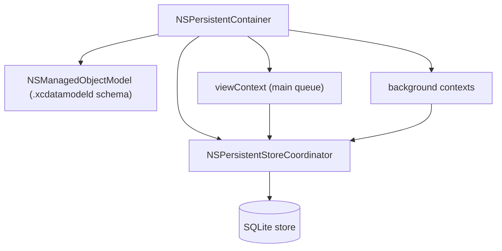
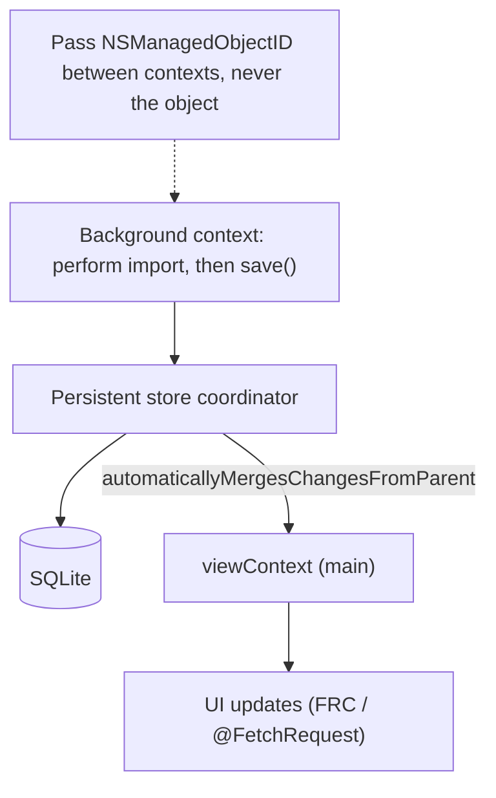
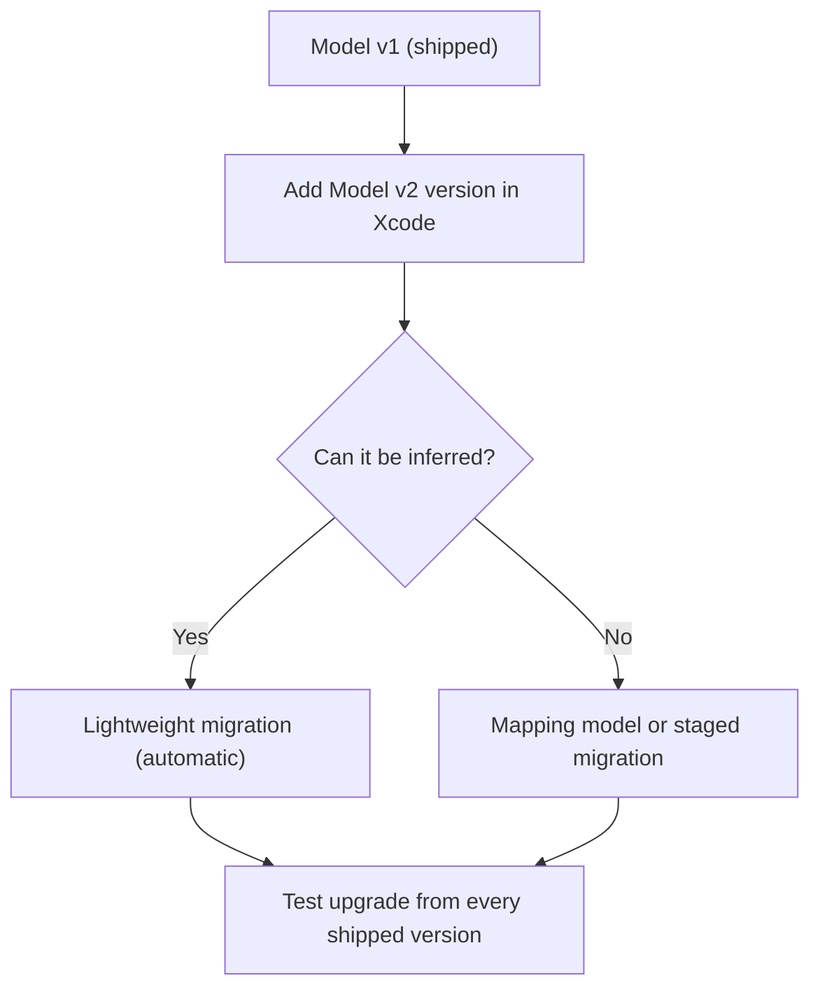
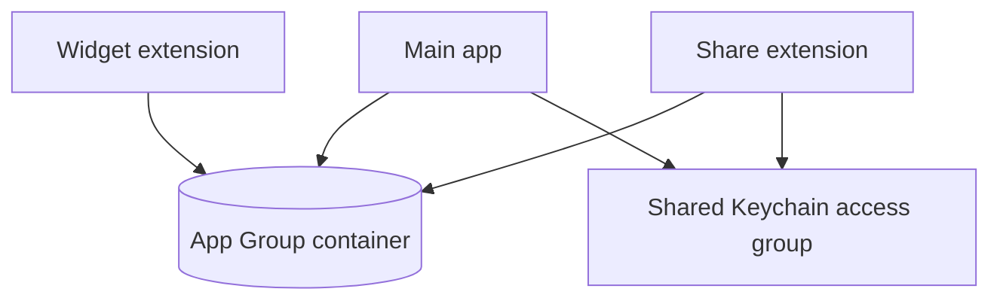
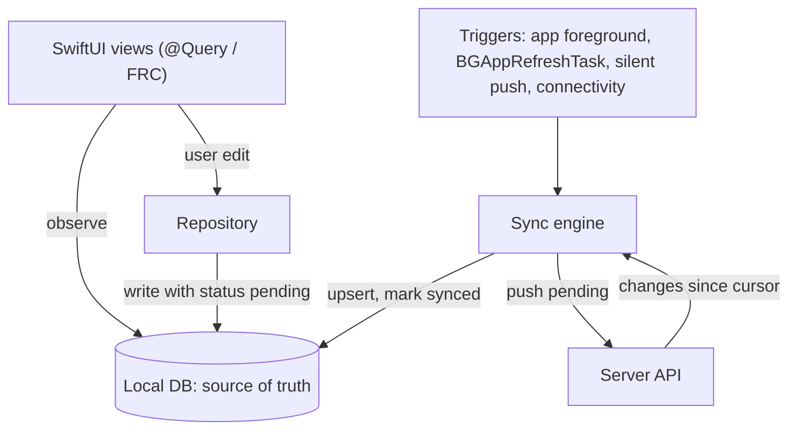

# Data Persistence – UserDefaults, Keychain, Core Data, SwiftData

[⬅ Back to index](../README.md)

Covers: storage options, UserDefaults, Keychain, file system, Core Data stack, contexts & concurrency, migrations, SwiftData, SQLite/GRDB, CloudKit sync, choosing a store.

---

### 1. What are the persistence options in iOS?

<details>
<summary>Answer</summary>

**In short:** Pick the store by the shape and sensitivity of the data: UserDefaults for small settings, the Keychain for secrets, the file system for documents and blobs, SwiftData / Core Data / SQLite for structured, queryable data, CloudKit for syncing across a user's devices, and an App Group container for anything shared with extensions.

| Need | Option |
|---|---|
| Small preferences/flags | **UserDefaults** / `@AppStorage` |
| Secrets (tokens, passwords) | **Keychain** |
| Documents, images, JSON blobs | **File system** (FileManager + Codable) |
| Structured, relational, queryable data | **SwiftData** (iOS 17+) / **Core Data** / SQLite (GRDB) |
| Sync across a user's devices | **CloudKit** (`NSPersistentCloudKitContainer` / SwiftData with CloudKit), `NSUbiquitousKeyValueStore` |
| Shared with extensions | **App Groups** container |

#### How to reason about the choice

Interviewers want to see that you pick a store based on a few questions, not habit:

1. **How big is it?** UserDefaults is read into memory as a whole, so it is only for a handful of small values. Anything that grows with usage (messages, history, cached feeds) needs a database or files.
2. **Is it sensitive?** UserDefaults and plain files are readable by anyone with access to an unencrypted backup or a jailbroken device. Tokens, passwords and keys belong in the Keychain, which is encrypted and tied to device security.
3. **Do you need to query it?** If you filter, sort, page or follow relationships, a database (SwiftData, Core Data, GRDB) beats loading and scanning a JSON file.
4. **Does it need to sync?** CloudKit gives free, user-private sync with no backend. A custom backend gives you cross-platform sync and server-side logic.
5. **Who else reads it?** Widgets, share extensions and watch apps run in separate processes, so data must live in an App Group container.

**Example:** a notes app might store the "sort order" setting in UserDefaults, the sync token in the Keychain, the notes themselves in SwiftData (synced with CloudKit), and attached images as files in Application Support, with the store placed in an App Group so the widget can read recent notes.

**Likely follow-ups:**
- *Where does `@AppStorage` store data?* In UserDefaults (standard or a suite you pass); it is just a SwiftUI property wrapper that observes a key.
- *What about caching network responses?* `URLCache` for HTTP responses, `NSCache` for in-memory objects, the Caches directory for re-creatable files.

</details>

### 2. What is UserDefaults? What shouldn't you store there?

<details>
<summary>Answer</summary>

**In short:** UserDefaults is a key-value store for small property-list values like settings and flags. It is saved as an unencrypted plist in the app container and loaded into memory, so never put secrets, large data or complex object graphs in it.

#### How it works

UserDefaults stores property-list types only: `String`, `Int`, `Double`, `Bool`, `Date`, `Data`, `URL`, and arrays/dictionaries of those. The data is written to a `.plist` file in `Library/Preferences` inside your app's sandbox. The system caches it in memory and writes changes to disk for you, so `synchronize()` is no longer needed.

```swift
let defaults = UserDefaults.standard
defaults.set(true, forKey: "hasSeenOnboarding")
let seen = defaults.bool(forKey: "hasSeenOnboarding")   // false if missing

// Register defaults at launch so reads have sensible fallbacks
defaults.register(defaults: ["fontSize": 14])

// SwiftUI: a view re-renders when the value changes
struct SettingsView: View {
    @AppStorage("fontSize") private var fontSize = 14
    var body: some View { Stepper("Size \(fontSize)", value: $fontSize) }
}

// Shared with extensions through an App Group
let shared = UserDefaults(suiteName: "group.com.example.app")
```

#### What not to store

| Don't store | Why | Use instead |
|---|---|---|
| Tokens, passwords, API keys | Unencrypted plist, included in backups | Keychain |
| Large data (images, big arrays, caches) | Whole plist is loaded into memory; slows launch | Files or a database |
| Complex model graphs | Needs manual encoding, no querying, no migrations | SwiftData / Core Data / Codable files |
| Data that must be queried | No filtering or sorting | A database |

**Pitfalls:**
- Storing a custom type requires encoding it to `Data` (e.g. `JSONEncoder`) first; storing a non-plist type directly crashes.
- Keys are stringly typed; centralise them in an enum or extension to avoid typos.
- It is thread-safe, but it is not a transactional store: there's no way to atomically update several keys.

**Likely follow-ups:**
- *Is UserDefaults deleted when the app is deleted?* Yes, unlike the Keychain.
- *How do you observe changes?* KVO on a `@objc dynamic` property extension, `UserDefaults.didChangeNotification`, or `@AppStorage` in SwiftUI.

</details>

### 3. What is the Keychain?

<details>
<summary>Answer</summary>

**In short:** The Keychain is a system-managed, encrypted store for small secrets: passwords, tokens, keys and certificates. You control when items are readable with accessibility levels, can require biometrics with access control, can share items across your apps with access groups, and items survive app deletion.

#### Why it exists

Files and UserDefaults are protected only by the app sandbox. The Keychain is encrypted with keys tied to the device (and Secure Enclave-backed hardware) and to the passcode, so secrets stay protected even if someone gets the app container or an unencrypted backup.

#### Using it

The raw API is a C-style dictionary API: `SecItemAdd`, `SecItemCopyMatching`, `SecItemUpdate`, `SecItemDelete`. Most teams wrap it (or use a library such as KeychainAccess).

```swift
func saveToken(_ token: String) throws {
    let data = Data(token.utf8)
    let query: [String: Any] = [
        kSecClass as String: kSecClassGenericPassword,
        kSecAttrService as String: "com.example.auth",
        kSecAttrAccount as String: "accessToken"
    ]
    SecItemDelete(query as CFDictionary)              // replace any existing item
    var attrs = query
    attrs[kSecValueData as String] = data
    attrs[kSecAttrAccessible as String] = kSecAttrAccessibleAfterFirstUnlockThisDeviceOnly
    let status = SecItemAdd(attrs as CFDictionary, nil)
    guard status == errSecSuccess else { throw KeychainError(status) }
}

func readToken() -> String? {
    let query: [String: Any] = [
        kSecClass as String: kSecClassGenericPassword,
        kSecAttrService as String: "com.example.auth",
        kSecAttrAccount as String: "accessToken",
        kSecReturnData as String: true,
        kSecMatchLimit as String: kSecMatchLimitOne
    ]
    var result: AnyObject?
    guard SecItemCopyMatching(query as CFDictionary, &result) == errSecSuccess,
          let data = result as? Data else { return nil }
    return String(decoding: data, as: UTF8.self)
}
```

#### Key concepts

- **Accessibility levels** decide when the item can be decrypted:
  - `kSecAttrAccessibleWhenUnlocked` – only while the device is unlocked (the default).
  - `kSecAttrAccessibleAfterFirstUnlock` – after the first unlock since boot; needed if background tasks read the item while the device is locked.
  - `...ThisDeviceOnly` variants – not migrated to a new device through backups.
- **Access control**: `SecAccessControlCreateWithFlags` with `.biometryCurrentSet` or `.userPresence` requires Face ID / Touch ID / passcode to read the item. `.biometryCurrentSet` invalidates the item if biometrics are re-enrolled.
- **Access groups**: apps from the same team can share items via the Keychain Sharing capability (`kSecAttrAccessGroup`).
- **Persistence after deletion**: Keychain items survive uninstalling the app. On reinstall you may find a stale token; a common fix is a "first launch" flag in UserDefaults (which *is* deleted) and clearing the Keychain if it's missing.

**Pitfalls:**
- Reading a `WhenUnlocked` item from a background task while the device is locked fails with `errSecInteractionNotAllowed`.
- `SecItemAdd` returns `errSecDuplicateItem` if the item exists; update or delete first.
- The Keychain is for small secrets, not bulk data. Encrypt large data with a key stored in the Keychain instead.

**Likely follow-ups:**
- *Is the Keychain available in the Simulator?* Yes, but behaviour around access groups and biometrics differs; test on a device.
- *How do you store a private key securely?* Generate it in the Secure Enclave (`kSecAttrTokenIDSecureEnclave`) so it never leaves the hardware.

</details>

### 4. How do you save files? Which directory should you use?

<details>
<summary>Answer</summary>

**In short:** Use `FileManager` to find a directory and `Data.write(to:options:)` with `.atomic` (and a file-protection option) to write. Put user-created content in Documents, app-managed data in Application Support, re-creatable data in Caches, and scratch files in tmp.

#### The sandbox directories

| Directory | Use for | Backed up? | Can the system delete it? |
|---|---|---|---|
| **Documents** | User-created content (can be shown in the Files app if enabled) | Yes | No |
| **Library/Application Support** | App data the user doesn't manage directly (databases, downloaded content you need) | Yes | No |
| **Library/Caches** | Re-creatable data (thumbnails, response caches) | No | Yes, when storage is low |
| **tmp** | Short-lived scratch files | No | Yes, any time the app isn't running |

```swift
struct Profile: Codable { var name: String; var avatarURL: URL? }

func save(_ profile: Profile) throws {
    let dir = URL.applicationSupportDirectory                    // iOS 16+
    try FileManager.default.createDirectory(at: dir, withIntermediateDirectories: true)
    let url = dir.appending(path: "profile.json")
    let data = try JSONEncoder().encode(profile)
    // .atomic writes to a temp file then renames, so a crash never leaves a half-written file
    try data.write(to: url, options: [.atomic, .completeFileProtection])
}
```

#### Data protection

File protection classes decide when a file is encrypted at rest:
- `.completeFileProtection` – unreadable while the device is locked. Most secure, but background code can't read it when locked.
- `.completeFileProtectionUntilFirstUserAuthentication` – the default; readable after first unlock.

#### Backups

Large, re-downloadable files in Documents or Application Support bloat the user's iCloud backup, and App Review can reject that. Mark them excluded:

```swift
var values = URLResourceValues()
values.isExcludedFromBackup = true
try fileURL.setResourceValues(values)   // fileURL must be `var`
```

**Pitfalls:**
- Application Support doesn't exist by default; create it before writing.
- Never store absolute paths: the container path can change between launches and updates. Store relative paths or file names.
- Don't do large file I/O on the main thread.

**Likely follow-ups:**
- *Where should downloaded podcast episodes go?* Application Support (or Documents) excluded from backup, since the user expects them to stay; Caches could be purged.
- *How do you show files in the Files app?* Set `UIFileSharingEnabled` and `LSSupportsOpeningDocumentsInPlace` in Info.plist; Documents becomes visible.

</details>

### 5. What is Core Data? Is it a database?

<details>
<summary>Answer</summary>

**In short:** Core Data is an object graph and persistence framework, not a database. It manages model objects, their relationships, change tracking, undo, validation, faulting and migrations, and usually persists them to SQLite.

#### Why the distinction matters

A database stores rows and answers queries. Core Data sits above that: you work with Swift objects (`NSManagedObject` subclasses), and Core Data tracks every change you make to them in a context. When you call `save()`, it works out the SQL to write. It also gives you things a database doesn't:

- **Change tracking and undo** – the context knows what's inserted, updated and deleted.
- **Relationship management** – set one side of an inverse relationship and Core Data maintains the other; delete rules (cascade, nullify, deny) run automatically.
- **Faulting** – objects are loaded lazily, so you can work with huge graphs without loading everything.
- **Validation** – attribute constraints checked on save.
- **Migrations** – schema versioning with automatic lightweight migration.
- **CloudKit sync** via `NSPersistentCloudKitContainer`.

#### Store types

| Store | Notes |
|---|---|
| SQLite | The default and the one you'll use in practice; supports partial loading and fetching. |
| In-memory | Great for unit tests and previews. |
| Binary / XML | Whole store loaded into memory; XML is macOS-only. Rarely used. |

Core Data has been on iOS since iOS 3, is very mature, and is the engine underneath SwiftData.

**Pitfalls:**
- Don't treat it like SQL: you can't easily run arbitrary joins or aggregates the way you would in SQLite, and you shouldn't open its SQLite file directly.
- It has a learning curve: contexts, threading rules and faulting trip people up.

**Likely follow-ups:**
- *Can you use Core Data without persistence?* Yes, with an in-memory store, as a pure object graph with undo and change tracking.
- *Is Core Data slow?* Not inherently; problems usually come from fetching on the main thread, N+1 faults, or loading too many objects.

</details>

### 6. Explain the Core Data stack.

<details>
<summary>Answer</summary>

**In short:** The model (`NSManagedObjectModel`) describes the schema, the coordinator (`NSPersistentStoreCoordinator`) connects that model to the store file, and contexts (`NSManagedObjectContext`) are scratchpads where you change objects and then save. `NSPersistentContainer` sets all of this up for you.



#### The pieces

- **NSManagedObjectModel** – the schema, built from the `.xcdatamodeld` file: entities, attributes, relationships, fetch requests, and model versions.
- **NSPersistentStoreCoordinator** – maps the model to one or more persistent stores (normally one SQLite file). Contexts talk to the store through it; it serialises access to the file.
- **NSManagedObjectContext** – an in-memory scratchpad. You fetch, insert, change and delete `NSManagedObject`s in a context; nothing hits disk until you call **`save()`**. Each context is tied to a queue.
- **NSPersistentContainer** (iOS 10+) – a convenience wrapper that loads the model, creates the coordinator, opens the stores and gives you:
  - `viewContext` – a main-queue context for the UI.
  - `newBackgroundContext()` / `performBackgroundTask(_:)` – private-queue contexts for heavy work.

```swift
final class PersistenceController {
    static let shared = PersistenceController()
    let container: NSPersistentContainer

    init(inMemory: Bool = false) {
        container = NSPersistentContainer(name: "Model")   // matches Model.xcdatamodeld
        if inMemory {
            container.persistentStoreDescriptions.first?.url = URL(fileURLWithPath: "/dev/null")
        }
        container.loadPersistentStores { _, error in
            if let error { fatalError("Store failed to load: \(error)") }   // handle properly in production
        }
        container.viewContext.automaticallyMergesChangesFromParent = true
        container.viewContext.mergePolicy = NSMergeByPropertyObjectTrumpMergePolicy
    }
}
```

**Analogy:** the store is the warehouse, the coordinator is the loading dock, and each context is a shopping cart: you fill and edit the cart, and `save()` checks it out into the warehouse.

**Pitfalls:**
- Forgetting to call `save()` (or calling it when `hasChanges` is false; check first).
- Using `viewContext` for large imports, which blocks the UI.

**Likely follow-ups:**
- *What's a child context?* A context whose parent is another context instead of the coordinator; saving pushes changes to the parent only. Useful for editing screens you can discard.
- *What's `NSPersistentCloudKitContainer`?* A subclass of `NSPersistentContainer` that also mirrors the store to CloudKit.

</details>

### 7. How does Core Data handle concurrency?

<details>
<summary>Answer</summary>

**In short:** Managed objects and contexts are not thread-safe. Each context is bound to a queue (main for `viewContext`, private for background contexts); you only touch a context and its objects inside `perform`, and you pass `NSManagedObjectID`s, not objects, between contexts.



#### The model

- `viewContext` – main-queue context. Use it for reading data the UI shows and small user edits.
- Background contexts (`newBackgroundContext()` or `performBackgroundTask`) – private-queue contexts for imports, sync and other heavy work.

When a background context saves, the changes go to the store. With `automaticallyMergesChangesFromParent = true`, the `viewContext` merges them in and the UI updates.

```swift
// Import on a background context
func importItems(_ dtos: [ItemDTO]) async throws {
    let context = container.newBackgroundContext()
    context.mergePolicy = NSMergeByPropertyObjectTrumpMergePolicy
    try await context.perform {
        for dto in dtos {
            let item = Item(context: context)
            item.id = dto.id
            item.title = dto.title
        }
        if context.hasChanges { try context.save() }
    }
}

// Wrong: using an object fetched on one context from another thread
let item = try viewContext.fetch(request).first!
Task.detached { item.title = "x" }               // data race, possible crash

// Right: pass the ID and refetch in the other context
let id = item.objectID
try await bgContext.perform {
    let bgItem = try bgContext.existingObject(with: id) as! Item
    bgItem.title = "x"
    try bgContext.save()
}
```

#### Rules

- Access a context only inside **`perform { }`**, **`performAndWait { }`**, or `await context.perform { }`. (`viewContext` may be used directly on the main thread.)
- **Never pass `NSManagedObject`s across contexts or threads.** `NSManagedObjectID` is thread-safe; refetch with `object(with:)` or `existingObject(with:)`.
- Set a **merge policy** so conflicting saves don't fail; `NSMergeByPropertyObjectTrumpMergePolicy` lets in-memory changes win per property.
- Turn on `-com.apple.CoreData.ConcurrencyDebug 1` as a launch argument in debug builds. Core Data then traps on any wrong-queue access.

**Pitfalls:**
- A temporary object ID (before first save) isn't usable in other contexts; save first or call `obtainPermanentIDs(for:)`.
- `performAndWait` on the main thread with a context that waits on main can deadlock.
- Many long-lived background contexts with stale data; create short-lived ones for each job.

**Likely follow-ups:**
- *How do you make background changes show up in the UI?* `automaticallyMergesChangesFromParent`, or persistent history tracking for changes from batch requests or other processes.
- *How does SwiftData handle this?* `ModelContext` isn't sendable; use `@ModelActor` for background work and pass `PersistentIdentifier`s.

</details>

### 8. What is faulting in Core Data?

<details>
<summary>Answer</summary>

**In short:** A fault is a placeholder object whose property values haven't been loaded yet. Core Data loads ("fires") the fault the first time you access a property, which keeps memory low with large object graphs, but can cause many small queries (N+1) if you're careless.

#### How it works

When you fetch `Author` objects, Core Data doesn't need to load each author's `books`. The relationship is a fault: an object that knows its identity but has no data. Accessing `author.books` fires the fault, and Core Data runs a query to fill it in. Similarly, objects can be turned back into faults (`refresh(_:mergeChanges:)`) to free memory.

This is why you can fetch 100,000 rows with `fetchBatchSize` and scroll smoothly: only the rows you touch are fully materialised.

#### The N+1 problem

```swift
// Slow: 1 query for authors + 1 query per author for books
let authors = try context.fetch(Author.fetchRequest())
for author in authors {
    print(author.books?.count ?? 0)       // fires a fault each time
}

// Better: prefetch the relationship in the same fetch
let request = Author.fetchRequest()
request.relationshipKeyPathsForPrefetching = ["books"]
request.fetchBatchSize = 50               // load rows in batches as you iterate
let prefetched = try context.fetch(request)
```

#### Tuning options

| Setting | Effect |
|---|---|
| `relationshipKeyPathsForPrefetching` | Loads related objects up front, avoiding per-object queries. |
| `fetchBatchSize` | Returns a proxy array that loads objects in batches as accessed. |
| `returnsObjectsAsFaults = false` | Fully loads objects now, when you know you'll use every property. |
| `propertiesToFetch` + `.dictionaryResultType` | Fetch just a few columns, without managed objects. |

**Pitfalls:**
- "Fault cannot be fulfilled" crashes happen when you access an object whose row was deleted (often by another context). Refetch, or check `isDeleted` / use `existingObject(with:)`.
- Use Instruments' Core Data template to spot excessive fault firing.

**Likely follow-ups:**
- *Is a fault the same as a nil value?* No. A fault is a real object that just hasn't loaded its data; reading a property loads it.
- *How do you reduce memory after a big import?* Call `context.reset()` or refresh objects into faults periodically.

</details>

### 9. What is NSFetchedResultsController?

<details>
<summary>Answer</summary>

**In short:** `NSFetchedResultsController` (FRC) runs a fetch request, keeps the results up to date as the context changes, groups them into sections, and tells its delegate what changed so a table or collection view can animate updates. In SwiftUI, `@FetchRequest` (Core Data) and `@Query` (SwiftData) do the same job.

#### Why it exists

Without it, you'd fetch, display, then have to listen for `NSManagedObjectContextObjectsDidChange` and work out yourself which rows were inserted, deleted or moved. FRC does that diffing and memory management (it works with `fetchBatchSize`) for you.

```swift
final class NotesViewController: UITableViewController, NSFetchedResultsControllerDelegate {
    private var dataSource: UITableViewDiffableDataSource<String, NSManagedObjectID>!
    private lazy var frc: NSFetchedResultsController<Note> = {
        let request = Note.fetchRequest()
        request.sortDescriptors = [NSSortDescriptor(keyPath: \Note.createdAt, ascending: false)]
        request.fetchBatchSize = 30
        let frc = NSFetchedResultsController(fetchRequest: request,
                                             managedObjectContext: viewContext,
                                             sectionNameKeyPath: nil,   // or a key path for sections
                                             cacheName: nil)
        frc.delegate = self
        return frc
    }()

    override func viewDidLoad() {
        super.viewDidLoad()
        // configure dataSource with a cell provider that looks objects up by ID ...
        try? frc.performFetch()
    }

    // Modern delegate method: hands you a ready diffable snapshot of object IDs
    func controller(_ controller: NSFetchedResultsController<NSFetchRequestResult>,
                    didChangeContentWith snapshot: NSDiffableDataSourceSnapshotReference) {
        let snapshot = snapshot as NSDiffableDataSourceSnapshot<String, NSManagedObjectID>
        dataSource.apply(snapshot, animatingDifferences: true)
    }
}
```

SwiftUI equivalent:

```swift
@FetchRequest(sortDescriptors: [SortDescriptor(\.createdAt, order: .reverse)])
private var notes: FetchedResults<Note>
```

**Pitfalls:**
- The fetch request must have at least one sort descriptor; the section key path must match the first sort key.
- The snapshot contains object IDs; an object that changes but doesn't move needs a reconfigure/reload of its item.
- It observes one context (usually `viewContext`); background saves must be merged into that context to show up.

**Likely follow-ups:**
- *What did people use before the snapshot API?* `controllerWillChangeContent` / `didChange anObject` / `controllerDidChangeContent` with `beginUpdates`/`endUpdates`.
- *Does FRC work with SwiftData?* No; use `@Query` or fetch with `FetchDescriptor` and observe changes.

</details>

### 10. How do you handle Core Data migrations?

<details>
<summary>Answer</summary>

**In short:** When the model changes, add a new model version (never edit a shipped one) and mark it current. Simple changes are migrated automatically by lightweight migration; complex ones need a mapping model with custom migration policies, or staged migrations (iOS 17). Test upgrades from every version you've shipped.

#### Why migration is needed

The SQLite store on a user's device was created with an older schema. If the app loads a different model without migrating, loading fails and the app usually crashes or loses data. Core Data compares the store's model hash with your current model and migrates if they differ.

#### Types of migration

| Type | When | How |
|---|---|---|
| **Lightweight (inferred)** | Add/remove attributes, make optional, add entities, rename (with a renaming ID), simple relationship changes | Automatic; on by default with `NSPersistentContainer` (`shouldMigrateStoreAutomatically`, `shouldInferMappingModelAutomatically`) |
| **Heavyweight / custom** | Split or merge entities, transform values, change types in ways that can't be inferred | A mapping model (`.xcmappingmodel`) + `NSEntityMigrationPolicy` subclasses |
| **Staged** (iOS 17) | Multi-step changes that need custom code between steps | `NSStagedMigrationManager` with `NSLightweightMigrationStage` and `NSCustomMigrationStage` |



**Renaming example:** if you rename `Note.body` to `Note.content`, set the **Renaming ID** of `content` to `body` in the model inspector. Without it, lightweight migration sees a deleted attribute and a new one, and the data is lost.

**Pitfalls:**
- Editing the existing model version instead of adding a new one: works in development (after reinstall) and crashes for real users.
- Adding a non-optional attribute without a default value breaks lightweight migration.
- Heavyweight migrations load data into memory and can be slow on big stores; run them off the main thread and show progress.
- CloudKit-backed stores only allow lightweight, additive changes once the schema is deployed to production.

**Likely follow-ups:**
- *How does SwiftData do it?* `VersionedSchema` for each version and a `SchemaMigrationPlan` with `.lightweight` or `.custom` stages.
- *How do you test migrations?* Keep sample stores from each shipped version in your test bundle and run the migration on them in unit tests.

</details>

### 11. How do you do batch operations efficiently?

<details>
<summary>Answer</summary>

**In short:** `NSBatchInsertRequest`, `NSBatchUpdateRequest` and `NSBatchDeleteRequest` run directly against the SQLite store without loading managed objects into memory, so they are much faster for large imports and deletes. Because they skip the context, you must merge their changes into your contexts yourself.

#### Why

Inserting 50,000 rows the normal way creates 50,000 managed objects in memory, tracks each change, then saves. A batch request turns into SQL executed at the store level: far less memory and time.

```swift
// Batch insert from dictionaries (iOS 13+)
func importQuakes(_ items: [[String: Any]]) throws {
    let context = container.newBackgroundContext()
    try context.performAndWait {
        let request = NSBatchInsertRequest(entity: Quake.entity(), objects: items)
        request.resultType = .objectIDs
        let result = try context.execute(request) as? NSBatchInsertResult
        let ids = result?.result as? [NSManagedObjectID] ?? []
        // Contexts don't know about these rows yet: merge them into viewContext
        NSManagedObjectContext.mergeChanges(fromRemoteContextSave: [NSInsertedObjectsKey: ids],
                                            into: [container.viewContext])
    }
}

// Batch delete everything older than a date
let fetch: NSFetchRequest<NSFetchRequestResult> = Quake.fetchRequest()
fetch.predicate = NSPredicate(format: "time < %@", cutoff as NSDate)
let delete = NSBatchDeleteRequest(fetchRequest: fetch)
delete.resultType = .resultTypeObjectIDs
```

#### Trade-offs

| | Batch requests | Normal context operations |
|---|---|---|
| Memory | Very low | One object per row |
| Speed | Fast (direct SQL) | Slower for large sets |
| Validation | Skipped | Runs |
| Relationships | Can't set relationships in a batch insert | Fully managed |
| UI updates | Need manual merge or persistent history | Automatic via context merge |

#### Persistent history tracking

A more robust way to pick up batch changes (and changes from extensions) is to enable `NSPersistentHistoryTrackingKey` on the store description, listen for `NSPersistentStoreRemoteChange` notifications, fetch history transactions since your last token, and merge them into the view context.

**Pitfalls:**
- Forgetting to merge: the UI shows stale or deleted objects, and you get "fault cannot be fulfilled" crashes.
- Batch insert requires constraint-compatible data; use unique constraints plus a merge policy to upsert.

**Likely follow-ups:**
- *Can you upsert with batch insert?* Yes, with a uniqueness constraint on the entity and a merge policy like `NSMergeByPropertyObjectTrumpMergePolicy` on the context.
- *SwiftData equivalent?* `context.delete(model:where:)` for batch deletes; batch inserts are still done with normal inserts in a background `@ModelActor`.

</details>

### 12. What is SwiftData?

<details>
<summary>Answer</summary>

**In short:** SwiftData (iOS 17) is a Swift-native persistence framework built on Core Data's engine. You declare models in code with the `@Model` macro, store them in a `ModelContainer`, change them through a `ModelContext`, and query them in SwiftUI with `@Query` and type-safe `#Predicate`s.

#### Why it exists

Core Data needs a visual model file, `NSManagedObject` subclasses, string predicates and queue-based concurrency. SwiftData keeps Core Data's proven storage, but exposes it through plain Swift classes, macros, Swift concurrency and SwiftUI integration.

```swift
@Model final class Trip {
    var name: String
    var startDate: Date
    @Relationship(deleteRule: .cascade) var stops: [Stop] = []
    init(name: String, startDate: Date) { self.name = name; self.startDate = startDate }
}

@main struct TripsApp: App {
    var body: some Scene { WindowGroup { ContentView() }.modelContainer(for: Trip.self) }
}

struct TripList: View {
    @Query(sort: \Trip.startDate) private var trips: [Trip]
    @Environment(\.modelContext) private var context
    var body: some View {
        List(trips) { Text($0.name) }
        Button("Add") { context.insert(Trip(name: "Goa", startDate: .now)) }   // autosaves
    }
}
```

#### The pieces

| SwiftData | Role | Core Data equivalent |
|---|---|---|
| `@Model` class | Persistent model; the macro generates storage and observation | `NSManagedObject` subclass + entity |
| `ModelContainer` | Schema + store configuration | `NSPersistentContainer` |
| `ModelContext` | Tracks changes; **autosaves** in the main context | `NSManagedObjectContext` |
| `@Query` | Live, auto-updating fetch in SwiftUI | `@FetchRequest` / FRC |
| `#Predicate`, `FetchDescriptor` | Type-safe, compiler-checked queries | `NSPredicate`, `NSFetchRequest` |
| `PersistentIdentifier` | Sendable ID to pass between actors | `NSManagedObjectID` |

#### Background work

```swift
@ModelActor
actor TripImporter {
    func importTrips(_ dtos: [TripDTO]) throws {
        for dto in dtos { modelContext.insert(Trip(name: dto.name, startDate: dto.date)) }
        try modelContext.save()      // background contexts: save explicitly
    }
}
let importer = TripImporter(modelContainer: container)
```

#### Other features

- CloudKit sync (private database) via the model configuration.
- `VersionedSchema` + `SchemaMigrationPlan` for migrations.
- `#Unique` and `#Index` (iOS 18), `@Attribute(.unique)`, `@Attribute(.externalStorage)` for large blobs, `@Transient` for non-persisted properties.
- Model inheritance (iOS 26).

**Pitfalls:**
- Models are classes and not `Sendable`; don't pass them across actors, pass `PersistentIdentifier`s.
- Autosave timing isn't immediate; call `save()` before something depends on data being on disk (e.g. a widget reload).
- `#Predicate` supports a subset of Swift; complex expressions can fail to compile or fail at runtime.

**Likely follow-ups:**
- *Can SwiftData read an existing Core Data store?* Yes, if the models match; they can even coexist on the same store.
- *How do you preview with SwiftData?* Create an in-memory `ModelContainer` (`ModelConfiguration(isStoredInMemoryOnly: true)`) and insert sample data.

</details>

### 13. SwiftData vs Core Data?

<details>
<summary>Answer</summary>

**In short:** SwiftData is the modern, code-first, SwiftUI-friendly API for iOS 17+, built on Core Data. Core Data is older, supports more OS versions and has more advanced features. Choose SwiftData for new SwiftUI apps on iOS 17+, Core Data for older OS support, advanced features or existing stores.

| SwiftData | Core Data |
|---|---|
| Code-first models with `@Model` (no `.xcdatamodeld`) | Visual model editor + `NSManagedObject` subclasses |
| Deep SwiftUI integration (`@Query`), Swift concurrency | Works with UIKit and SwiftUI; queue-based concurrency |
| iOS 17+ only; newer, so fewer advanced features | iOS 3+; mature, with every feature (batch requests, fine-grained control, persistent history) |
| `#Predicate` type-safe queries | `NSPredicate` strings |

#### How to decide in practice

- **New SwiftUI app, iOS 17+ minimum, straightforward model:** SwiftData. Less code, compile-time checked queries, easy previews.
- **Need iOS 16 or below:** Core Data (SwiftData simply isn't available).
- **Heavy data work:** large batch imports, persistent history processing, fetched results controllers in UIKit, derived attributes, fine-grained fetch tuning. Core Data gives you more control.
- **Existing Core Data app:** don't rewrite. You can adopt SwiftData gradually; both can point at the same store if the entity definitions match, and `NSPersistentContainer` can keep running the older parts.

#### Why it matters in interviews

Interviewers often probe whether you know SwiftData's limits, e.g. it's newer, some APIs changed between releases, and performance tuning options are fewer. A balanced answer ("SwiftData for new code, Core Data where I need its control or OS reach") shows judgment.

**Pitfalls:**
- Assuming SwiftData is a different database; it uses the same SQLite-backed Core Data engine underneath.
- Mixing them without matching schemas, which can corrupt expectations or trigger migrations.

**Likely follow-ups:**
- *Is SwiftData thread-safe?* `ModelContainer` is `Sendable`; `ModelContext` and models are not, so use `@ModelActor` for background work.
- *What about GRDB?* A third option when you want SQL control (see the next question).

</details>

### 14. What about SQLite directly, GRDB or Realm?

<details>
<summary>Answer</summary>

**In short:** SQLite's C API gives full control but lots of boilerplate. GRDB is a popular Swift toolkit over SQLite with type-safe records, migrations and observation, good when you want SQL control. Realm is an object database whose Atlas Device Sync was deprecated by MongoDB, so it's less recommended for new projects.

#### Comparison

| Option | Model | Strengths | Weaknesses |
|---|---|---|---|
| **SQLite (C API)** | Tables + SQL | Full control, no dependencies, ships with iOS | Verbose C API, manual mapping, manual threading |
| **GRDB** | Tables + SQL, Codable records | Swift-friendly, migrations, `ValueObservation`, database pools with concurrent reads, write-ahead logging | Third-party dependency; you write a relational schema |
| **Core Data / SwiftData** | Object graph | Apple-supported, CloudKit sync, SwiftUI integration | Less SQL control, threading rules |
| **Realm** | Object database | Simple API, live objects | Large dependency; sync product deprecated, uncertain future |

#### GRDB example

```swift
struct Player: Codable, FetchableRecord, PersistableRecord {
    var id: Int64?
    var name: String
    var score: Int
}

let dbQueue = try DatabaseQueue(path: dbPath)
var migrator = DatabaseMigrator()
migrator.registerMigration("v1") { db in
    try db.create(table: "player") { t in
        t.autoIncrementedPrimaryKey("id")
        t.column("name", .text).notNull()
        t.column("score", .integer).notNull()
    }
}
try migrator.migrate(dbQueue)

try dbQueue.write { db in try Player(id: nil, name: "Ana", score: 10).insert(db) }
let top = try dbQueue.read { db in
    try Player.order(Column("score").desc).limit(10).fetchAll(db)
}
```

#### When to pick GRDB

- Your team thinks in SQL, or the data is naturally relational with complex queries, aggregates or full-text search (SQLite FTS).
- You share a schema with Android or a server (same SQLite tables).
- You want value types (structs) instead of managed classes.

**Pitfalls:**
- Raw SQLite connections aren't safe to share across threads without care; GRDB's `DatabaseQueue`/`DatabasePool` handle this.
- Never build SQL with string interpolation of user input; use bound arguments.

**Likely follow-ups:**
- *Why not Realm today?* Its sync service (Atlas Device Sync) was deprecated; the local database still works, but it's a big dependency with an uncertain roadmap.
- *What's WAL mode?* Write-ahead logging lets readers continue while a writer writes; GRDB's `DatabasePool` uses it.

</details>

### 15. How do you sync data with iCloud?

<details>
<summary>Answer</summary>

**In short:** Use `NSPersistentCloudKitContainer` (Core Data) or SwiftData with CloudKit for automatic syncing of the user's private database, CloudKit directly (`CKContainer`, `CKRecord`) for custom or public/shared data, and `NSUbiquitousKeyValueStore` for small settings. Handle conflicts, account changes and quota limits.

#### Options

| Option | Best for | Notes |
|---|---|---|
| **`NSPersistentCloudKitContainer`** / **SwiftData + CloudKit** | Mirroring a local store to the user's iCloud | Almost no code; model constraints apply |
| **CloudKit directly** | Custom sync, public data, sharing between users | `CKRecord`, `CKQuery`, subscriptions; `CKSyncEngine` (iOS 17) handles much of the sync plumbing |
| **`NSUbiquitousKeyValueStore`** | Small key-value settings across devices | About 1 MB total; like UserDefaults over iCloud |
| **iCloud Documents** | Document-based apps | `UIDocument`, ubiquity container |

#### Model constraints for automatic sync

CloudKit mirroring has rules, because records may arrive in any order and partially:
- All attributes must be **optional or have default values**.
- **No unique constraints** (`@Attribute(.unique)` / `#Unique` aren't supported).
- All relationships must be **optional** and have inverses; no `deny` delete rule; no ordered relationships.
- Once the schema is deployed to production in the CloudKit dashboard, only additive changes are allowed.

```swift
// SwiftData: sync is enabled when the iCloud + CloudKit capability and a container are set up
let config = ModelConfiguration(cloudKitDatabase: .private("iCloud.com.example.app"))
let container = try ModelContainer(for: Note.self, configurations: config)
```

#### Things you must handle

- **Conflicts:** automatic mirroring uses last-writer-wins per record; if that isn't acceptable, use CloudKit directly.
- **Account changes:** the user may sign out or switch accounts (`CKAccountChanged` notification, `accountStatus`).
- **Quota:** data counts against the user's iCloud storage; handle `quotaExceeded`.
- **Duplicates:** without unique constraints, the same logical object created on two devices can duplicate; de-duplicate in code.
- **Not real-time:** sync can take seconds to minutes and depends on silent pushes.

**Pitfalls:**
- Forgetting to deploy the development schema to production before release; production users won't sync.
- Testing only in the Simulator; test with two real devices on the same account.

**Likely follow-ups:**
- *Can CloudKit sync with Android or web?* Only via CloudKit JS / web services; usually a custom backend is better for cross-platform.
- *How do users share data with each other?* `CKShare` on the shared database; `NSPersistentCloudKitContainer` supports sharing too.

</details>

### 16. How do you share data between an app and its extensions/widgets?

<details>
<summary>Answer</summary>

**In short:** Enable an App Group for the app and its extensions, then put shared files and databases in the group container, small values in `UserDefaults(suiteName:)`, and secrets in a shared Keychain access group. After the app changes data a widget shows, call `WidgetCenter.shared.reloadTimelines`.

#### Why it's needed

Each extension (widget, share extension, notification service extension, watch complication) runs in its **own process with its own sandbox**. It can't see the app's Documents folder or its standard UserDefaults. An App Group creates a shared container that all members can read and write.

```swift
let groupID = "group.com.example.notes"

// 1. Files and databases
let containerURL = FileManager.default
    .containerURL(forSecurityApplicationGroupIdentifier: groupID)!
let storeURL = containerURL.appending(path: "Notes.store")

// SwiftData store in the shared container
let config = ModelConfiguration(url: storeURL)
let container = try ModelContainer(for: Note.self, configurations: config)

// Core Data equivalent
// container.persistentStoreDescriptions.first?.url = storeURL

// 2. Small values
let shared = UserDefaults(suiteName: groupID)
shared?.set(Date.now, forKey: "lastSync")

// 3. After the app writes data the widget displays
WidgetCenter.shared.reloadTimelines(ofKind: "RecentNotesWidget")
```

For secrets, enable Keychain Sharing and set `kSecAttrAccessGroup` to a shared access group.



**Pitfalls:**
- **Moving an existing store** into the group container: you must migrate the file (e.g. `replacePersistentStore` / `migratePersistentStore`) on first launch, or users lose data.
- **Concurrent writers:** two processes writing the same SQLite store is supported, but the app won't see the extension's changes automatically; use persistent history tracking (Core Data) or refetch when the app becomes active.
- Extensions have tight memory limits (widgets especially); read only what you need.
- The App Group ID must be added to every target's entitlements and to the provisioning profiles.

**Likely follow-ups:**
- *How does a widget get fresh data?* It reads the shared store in its `TimelineProvider`; the app triggers a reload after changes.
- *Can extensions talk to the app directly?* Not generally; they communicate through shared storage (and Darwin notifications for simple signals).

</details>

### 17. How do you design an offline-first data layer?

<details>
<summary>Answer</summary>

**In short:** Make the local database the single source of truth. The UI only observes the database; the network only syncs into it. User writes go to the database first, marked as pending, and a sync engine pushes them when online and pulls server changes, resolving conflicts with timestamps or versions. See [System Design](20-system-design.md).



#### Building blocks

1. **Local schema with sync metadata:** each record gets a stable client-generated `id` (UUID), `updatedAt`, a server `version`, and a `syncStatus` (`synced`, `pendingCreate`, `pendingUpdate`, `pendingDelete`). Deletes are soft (tombstones) until the server confirms.
2. **Repository:** the only thing the UI calls. `save(note)` writes locally with `pending` status and returns immediately, so the UI is instant even offline.
3. **Sync engine (an actor):**
   - **Push:** send pending changes (often as an outbox queue in order), mark synced on success, keep pending and retry with exponential backoff on failure.
   - **Pull:** ask the server for changes since the last cursor/timestamp, upsert them locally, store the new cursor.
4. **Triggers:** app launch/foreground, `NWPathMonitor` connectivity changes, `BGAppRefreshTask`, silent pushes from the server.
5. **Conflict resolution:** pick a policy per data type:

| Strategy | How | Good for |
|---|---|---|
| Last-writer-wins | Compare `updatedAt` or server version | Simple fields, settings |
| Server wins | Server rejects stale version; client re-fetches | Financial or shared data |
| Field-level merge | Merge non-overlapping field changes | Profiles, forms |
| Ask the user / CRDTs | Show both versions, or use merge-friendly data types | Collaborative docs |

```swift
actor SyncEngine {
    func pushPending() async {
        for change in await store.pendingChanges() {
            do {
                let serverVersion = try await api.send(change)
                await store.markSynced(change.id, version: serverVersion)
            } catch APIError.conflict(let serverCopy) {
                await store.resolve(change, with: serverCopy)     // apply your policy
            } catch {
                break      // offline or server error: retry later with backoff
            }
        }
    }
}
```

**Pitfalls:**
- Letting views read straight from the network: you get two sources of truth and flickering states.
- Server-generated IDs only: offline-created items have no ID; use client UUIDs.
- Clock skew when comparing device timestamps; prefer server-assigned versions.
- Make server endpoints idempotent so retries don't create duplicates.

**Likely follow-ups:**
- *How do you show sync state?* Expose `syncStatus` in the model so the UI can show a "pending" badge.
- *What if the app is killed mid-sync?* Pending status lives in the database, so the next sync resumes; nothing is lost.

</details>


### 18. What is NSFetchRequest? How do NSPredicate and NSSortDescriptor work?

<details>
<summary>Answer</summary>

**In short:** An `NSFetchRequest<T>` describes what to fetch from Core Data: an entity, an optional `NSPredicate` to filter, `NSSortDescriptor`s to order, plus tuning options like `fetchLimit` and `fetchBatchSize`. You run it with `context.fetch(request)` on the context's queue.

#### Building a request

```swift
let request = User.fetchRequest()                       // NSFetchRequest<User>
request.predicate = NSPredicate(format: "age >= %d AND name CONTAINS[cd] %@", 18, query)
request.sortDescriptors = [
    NSSortDescriptor(keyPath: \User.lastName, ascending: true),
    NSSortDescriptor(keyPath: \User.firstName, ascending: true)
]
request.fetchLimit = 20          // page size
request.fetchOffset = 40         // page 3
request.fetchBatchSize = 20      // load objects lazily in batches

let users = try await context.perform { try context.fetch(request) }
```

#### NSPredicate

A predicate is a filter expression that Core Data translates to a SQL `WHERE` clause.
- Comparisons: `==`, `!=`, `<`, `>=`, `BETWEEN`, `IN`.
- Strings: `BEGINSWITH`, `CONTAINS`, `LIKE`, `MATCHES` (regex); `[c]` = case-insensitive, `[d]` = diacritic-insensitive, so `[cd]` matches "José" with "jose".
- Relationships: `ANY tags.name == %@`, `SUBQUERY(...)`, `@count`.
- Combine with `AND`/`OR`/`NOT` or `NSCompoundPredicate`.

```swift
// Wrong: string interpolation breaks on quotes and allows injection-style bugs
NSPredicate(format: "name == '\(query)'")
// Right: format arguments are escaped properly
NSPredicate(format: "name == %@", query)
// Key paths as arguments use %K
NSPredicate(format: "%K == %@", #keyPath(User.email), email)
```

#### NSSortDescriptor

Sort descriptors define `ORDER BY`, applied in order (last name, then first name above). They can also sort arrays (`NSArray.sortedArray(using:)`). Swift-native equivalents are `SortDescriptor` and `KeyPathComparator`.

#### Other options

| Property | Purpose |
|---|---|
| `propertiesToFetch` + `resultType = .dictionaryResultType` | Fetch only some columns as dictionaries |
| `.countResultType` / `context.count(for:)` | Count without loading objects |
| `relationshipKeyPathsForPrefetching` | Avoid N+1 fault firing |
| `includesPendingChanges` | Include unsaved changes in the context (default true) |

SwiftData's equivalent is `FetchDescriptor` with `#Predicate` and `SortDescriptor`, which the compiler checks:

```swift
let descriptor = FetchDescriptor<User>(predicate: #Predicate { $0.age >= 18 },
                                       sortBy: [SortDescriptor(\.lastName)])
```

**Pitfalls:**
- Typos in predicate format strings crash at runtime, not compile time.
- Predicates on transient or computed properties don't work in SQLite fetches (they're not in the store).

**Likely follow-ups:**
- *How do you fetch just the count?* `try context.count(for: request)`.
- *How do you paginate?* `fetchLimit` + `fetchOffset`, or simply `fetchBatchSize` for a scrolling list.

</details>

### 19. When would you use Core Data instead of UserDefaults? How do you persist an array of custom objects?

<details>
<summary>Answer</summary>

**In short:** Use Core Data or SwiftData when the data is structured, large, relational or needs querying, changes often, or needs migrations or sync. Use UserDefaults only for small settings and flags, since the whole plist is loaded into memory. For a small-to-medium array of custom objects, make them `Codable` and write JSON to a file.

#### The decision

| Question | UserDefaults | Codable file | Core Data / SwiftData |
|---|---|---|---|
| Size | A few KB | Up to a few MB | Any |
| Querying (filter/sort/page) | No | Load all, filter in memory | Yes, in the store |
| Partial updates | Rewrite the value | Rewrite the whole file | Update one row |
| Relationships | No | Manual | Built in |
| Migrations | Manual | Codable versioning by hand | Built in |
| Sync | `NSUbiquitousKeyValueStore` | Manual | CloudKit integration |

#### Persisting an array simply

```swift
struct Note: Codable { let id: UUID; var text: String }

let url = URL.applicationSupportDirectory.appending(path: "notes.json")

func save(_ notes: [Note]) throws {
    try FileManager.default.createDirectory(at: .applicationSupportDirectory,
                                            withIntermediateDirectories: true)
    try JSONEncoder().encode(notes).write(to: url, options: .atomic)
}

func load() -> [Note] {
    guard let data = try? Data(contentsOf: url) else { return [] }   // first launch
    return (try? JSONDecoder().decode([Note].self, from: data)) ?? []
}
```

This is fine for something like a few hundred favourites. Do the I/O off the main thread if the file grows.

#### The tempting wrong answer

```swift
// Works, but it's the wrong store: grows the plist loaded at every launch
let data = try JSONEncoder().encode(notes)
UserDefaults.standard.set(data, forKey: "notes")
```

It's acceptable for a tiny list (e.g. five recent searches), not for user content.

**Pitfalls:**
- Adding a new non-optional property to a `Codable` struct makes old files fail to decode; make new properties optional or write a custom `init(from:)`.
- Rewriting the whole file for every small change gets slow as data grows; that's the point to move to a database.

**Likely follow-ups:**
- *What about `NSKeyedArchiver`?* The older way for `NSCoding` classes; use `NSSecureCoding` if you must. `Codable` is preferred.
- *When do you move to GRDB or SwiftData?* When you need queries, partial updates, relationships, or the file gets large.

</details>

---

[⬅ Previous: Networking](13-networking.md) · [⬅ Back to index](../README.md) · [Next: Background Tasks & Notifications ➡](15-background-notifications.md)
