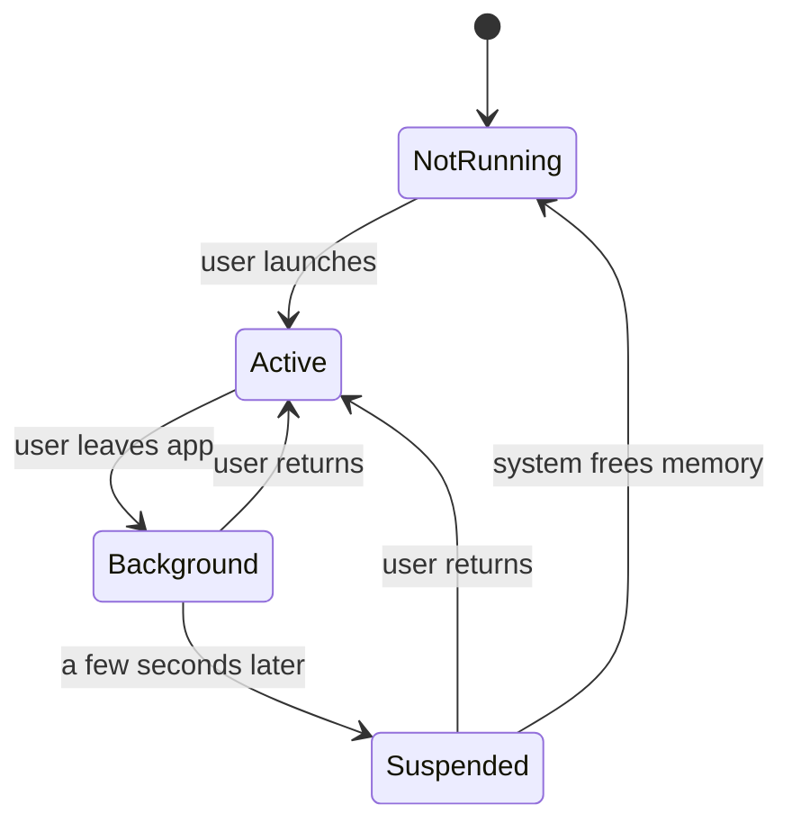
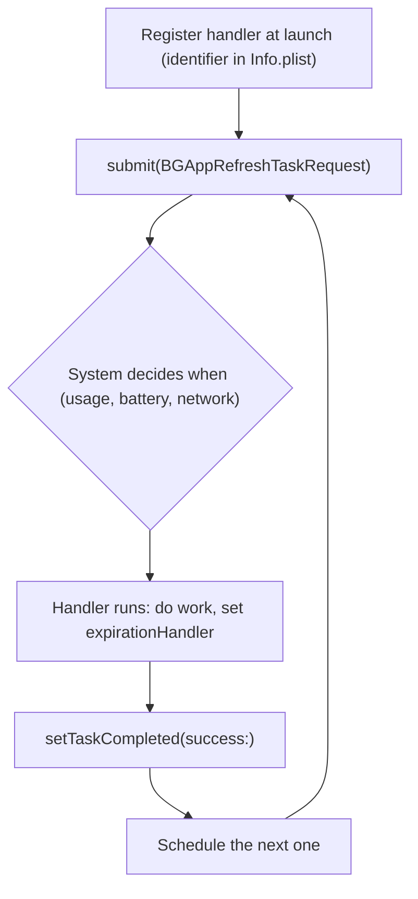
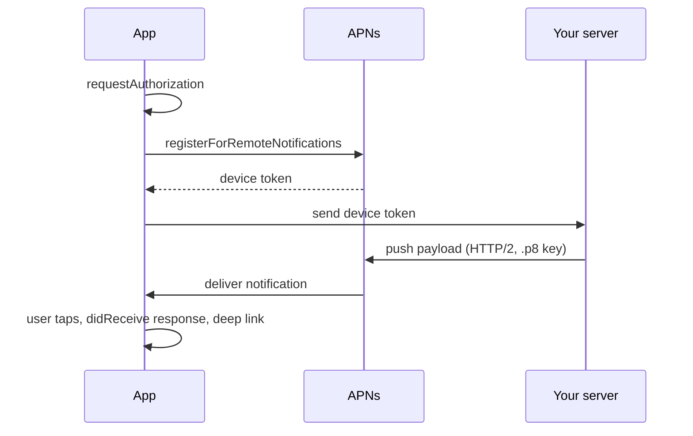
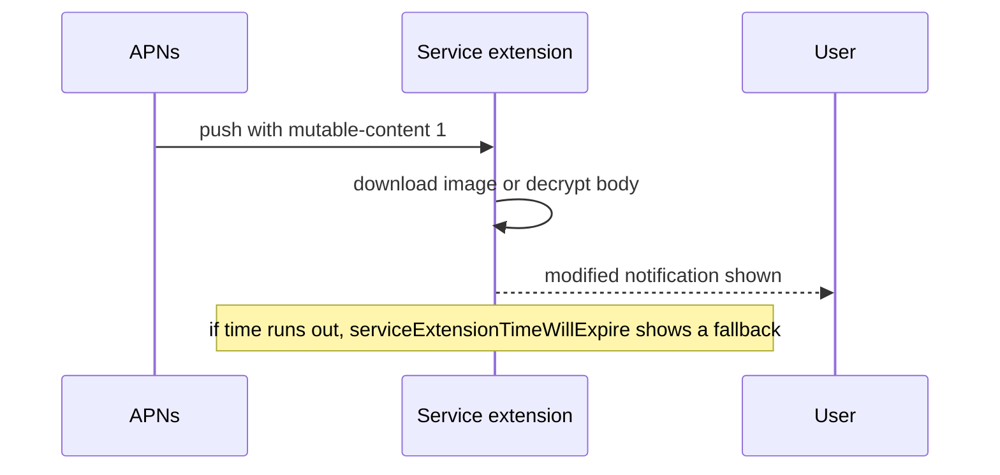
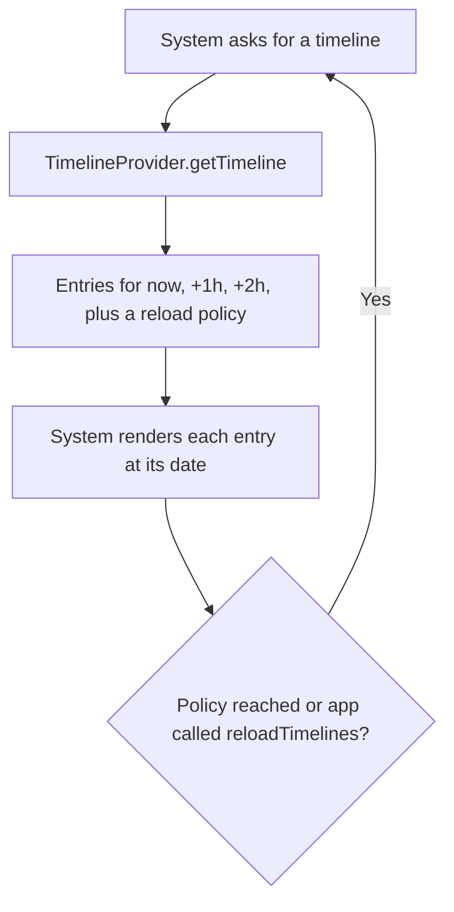
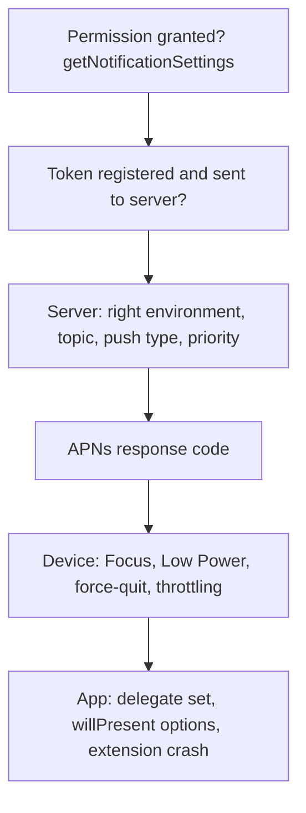

# Background Execution & Notifications

[⬅ Back to index](../README.md)

Covers: background execution limits, background modes, BGTaskScheduler, background URLSession, push notifications (APNs), silent pushes, notification extensions, local notifications, Live Activities & widgets.

---

## Background Execution

### 1. What can an iOS app do in the background?

<details>
<summary>Answer</summary>

**In short:** By default an app is suspended a few seconds after it goes to the background. To keep working you must use a specific mechanism: a short background task (`beginBackgroundTask`), a declared background mode (audio, location, VoIP, Bluetooth...), `BGTaskScheduler` for deferred work, a background `URLSession` for transfers, or silent pushes. There's no general-purpose long-running background service like on Android.

#### The app states



A **suspended** app stays in memory but executes no code. The system can terminate it at any time to reclaim memory, without notifying it. iOS does this to protect battery life and keep the foreground app fast.

#### Ways to get background time

| Mechanism | Use for | Limits |
|---|---|---|
| **`beginBackgroundTask(withName:expirationHandler:)`** | Finishing a short task (save, small upload) after the user leaves | Roughly 30 seconds; not guaranteed. Always call `endBackgroundTask` |
| **Background modes** (capabilities) | Audio playback, location updates, VoIP (CallKit + PushKit), Bluetooth central/peripheral, external accessory, remote notifications, background fetch, background processing | Only for the matching purpose; App Review checks |
| **`BGTaskScheduler`** | Deferred refresh and maintenance | System decides when; not guaranteed |
| **Background `URLSession`** | Large uploads/downloads | Done by a system daemon, continues even if the app is suspended or killed |
| **Silent push** | Server tells the app to fetch new data | Throttled, about 30 s of runtime |

```swift
// Finish saving after the user leaves the app
func sceneDidEnterBackground(_ scene: UIScene) {
    var taskID: UIBackgroundTaskIdentifier = .invalid
    taskID = UIApplication.shared.beginBackgroundTask(withName: "SaveDraft") {
        UIApplication.shared.endBackgroundTask(taskID)       // time's up: clean up
        taskID = .invalid
    }
    Task {
        await draftStore.flush()
        UIApplication.shared.endBackgroundTask(taskID)
        taskID = .invalid
    }
}
```

**Pitfalls:**
- Not calling `endBackgroundTask`: the system kills the app when time runs out and logs it as a background-time violation.
- Enabling a background mode you don't really use (e.g. silent audio to stay alive) gets the app rejected.

**Likely follow-ups:**
- *How do you check remaining time?* `UIApplication.shared.backgroundTimeRemaining` (debug only; don't rely on it).
- *What happens if the user force-quits?* Most background mechanisms stop; silent pushes and background fetch aren't delivered until the user opens the app again.

</details>

### 2. What is BGTaskScheduler? Refresh vs processing tasks?

<details>
<summary>Answer</summary>

**In short:** The `BackgroundTasks` framework (iOS 13) lets you register work that the system runs later at a good time, based on usage patterns, battery and network. `BGAppRefreshTask` is short (about 30 s) content refresh; `BGProcessingTask` is longer, deferrable maintenance that usually runs while charging and idle. Execution is never guaranteed.

#### Task types

| Type | Duration | Typical use | Conditions |
|---|---|---|---|
| **`BGAppRefreshTask`** | ~30 seconds | Fetch the latest feed so it's fresh when the user opens the app | Scheduled around when the user usually opens the app |
| **`BGProcessingTask`** | Minutes | DB cleanup, indexing, ML training, large sync | Can require external power / network; usually while charging and idle |
| **`BGContinuedProcessingTask`** (iOS 26) | Until done (user-visible) | Continue a **user-initiated** task (e.g. an export) after the app is backgrounded | Shows system progress UI; user can cancel |



#### Steps

1. Enable the "Background fetch" and/or "Background processing" background modes, and add task identifiers to Info.plist under `BGTaskSchedulerPermittedIdentifiers`.
2. **Register handlers at launch**, before `application(_:didFinishLaunchingWithOptions:)` returns.
3. **Submit a request** with an `earliestBeginDate` (a "not before" hint, not a schedule).
4. In the handler: do the work, set an `expirationHandler` to cancel it, call `setTaskCompleted(success:)`, and schedule the next request.

```swift
let refreshID = "com.example.app.refresh"

func application(_ app: UIApplication,
                 didFinishLaunchingWithOptions opts: [UIApplication.LaunchOptionsKey: Any]?) -> Bool {
    BGTaskScheduler.shared.register(forTaskWithIdentifier: refreshID, using: nil) { task in
        self.handleRefresh(task as! BGAppRefreshTask)
    }
    return true
}

func scheduleRefresh() {
    let request = BGAppRefreshTaskRequest(identifier: refreshID)
    request.earliestBeginDate = Date(timeIntervalSinceNow: 15 * 60)
    try? BGTaskScheduler.shared.submit(request)
}

func handleRefresh(_ task: BGAppRefreshTask) {
    scheduleRefresh()                                  // chain the next one
    let work = Task {
        do { try await feedRepository.refresh(); task.setTaskCompleted(success: true) }
        catch { task.setTaskCompleted(success: false) }
    }
    task.expirationHandler = { work.cancel() }         // system is out of patience
}
```

In SwiftUI you can use the `.backgroundTask(.appRefresh("id")) { ... }` scene modifier instead of registering manually.

**Debugging:** pause in the debugger after submitting and run
`e -l objc -- (void)[[BGTaskScheduler sharedScheduler] _simulateLaunchForTaskWithIdentifier:@"id"]`.

**Pitfalls:**
- Registering after launch finishes throws an exception.
- Expecting the task to run at `earliestBeginDate`: it may run hours later or never (e.g. the user rarely opens the app, Low Power Mode, or force-quit).
- Not calling `setTaskCompleted`, which hurts future scheduling.

**Likely follow-ups:**
- *What replaced `setMinimumBackgroundFetchInterval`?* `BGAppRefreshTask`; the old background fetch API is deprecated.
- *How do you guarantee something runs at an exact time?* You can't in the background; use a server push or a local notification to prompt the user.

</details>

### 3. How does continuous location tracking work in the background?

<details>
<summary>Answer</summary>

**In short:** Enable the "Location updates" background mode, get the right authorization (Always, or When In Use with updates started in the foreground, which shows the blue indicator), and receive updates with `CLLocationUpdate.liveUpdates()` (iOS 17) or `CLLocationManager`. For battery efficiency prefer significant-location changes, region monitoring (`CLMonitor`) or visits, which can relaunch a terminated app.

#### Options by battery cost

| Service | Accuracy | Battery | Relaunches a terminated app? |
|---|---|---|---|
| Continuous updates (`liveUpdates` / `startUpdatingLocation`) | High (GPS) | High | No (must be running or resumed) |
| **Significant-location change** | ~500 m | Low | Yes |
| **Region monitoring / geofencing** (`CLMonitor`, iOS 17) | Region entry/exit | Low | Yes |
| **Visits** monitoring | Places the user stays | Very low | Yes |

#### Continuous tracking (e.g. a running or delivery app)

```swift
let manager = CLLocationManager()
manager.requestWhenInUseAuthorization()          // or requestAlwaysAuthorization()

// iOS 17+: async sequence of updates
Task {
    for try await update in CLLocationUpdate.liveUpdates() {
        guard let location = update.location else { continue }
        await tracker.record(location)
    }
}

// Classic API: allow updates to continue in the background
manager.allowsBackgroundLocationUpdates = true      // requires the background mode
manager.showsBackgroundLocationIndicator = true
manager.pausesLocationUpdatesAutomatically = true
manager.startUpdatingLocation()
```

When In Use authorization is enough for background tracking **if the session was started while the app was in the foreground**; the user sees the blue status bar / Dynamic Island indicator. iOS 17+ also has `CLBackgroundActivitySession` to keep such a session alive.

**Pitfalls:**
- Asking for Always authorization up front lowers grant rates; ask for When In Use first and explain why you need more.
- Continuous GPS drains battery fast; lower `desiredAccuracy`, set `distanceFilter`, and stop updates when not needed.
- App Review rejects background location without a clear user-facing feature, and Info.plist usage descriptions are required.

**Likely follow-ups:**
- *How does a geofence wake the app?* The system monitors regions and relaunches the app in the background on entry/exit, giving it a few seconds to respond.
- *What's the max number of monitored regions?* 20 per app, so swap regions dynamically if you need more.

</details>

### 4. What happens to timers and network requests when the app goes to the background?

<details>
<summary>Answer</summary>

**In short:** Once the app is suspended, no code runs: timers stop firing and in-flight data tasks may fail or stall. Save state when you enter the background, use `beginBackgroundTask` to finish short work, and use a background `URLSession` for transfers that must complete.

#### What actually happens

- **Timers** (`Timer`, `DispatchSourceTimer`) don't fire while suspended. When the app resumes, a repeating timer fires once (not once per missed interval). Don't use timers to measure elapsed time; store a start `Date` and compute the difference.
- **Regular `URLSession` data tasks** continue only while the app has background time. After suspension they may time out or fail with an error such as `NSURLErrorNetworkConnectionLost` when the app resumes. Retry logic should handle this.
- **Sockets** (WebSockets etc.) are typically closed by the system; reconnect on foreground.
- **Background `URLSession`** transfers are handed to a system daemon and keep going even if the app is suspended or terminated.

```swift
// Background transfer that survives suspension
let config = URLSessionConfiguration.background(withIdentifier: "com.example.uploads")
config.isDiscretionary = false              // true lets the system wait for Wi-Fi/power
config.sessionSendsLaunchEvents = true      // relaunch the app when done
let session = URLSession(configuration: config, delegate: self, delegateQueue: nil)
session.uploadTask(with: request, fromFile: fileURL).resume()   // must be from a file

// When the app is relaunched for completed transfers
func application(_ application: UIApplication,
                 handleEventsForBackgroundURLSession identifier: String,
                 completionHandler: @escaping () -> Void) {
    backgroundCompletionHandler = completionHandler   // call it in urlSessionDidFinishEvents
}
```

#### Checklist when the app moves to the background

1. Save unsaved user data in `sceneDidEnterBackground` (or `.onChange(of: scenePhase)` in SwiftUI).
2. Wrap the save/upload in `beginBackgroundTask` if it might take a few seconds.
3. Pause timers, animations and media that shouldn't continue.
4. Move large transfers to a background session.

**Pitfalls:**
- Background sessions only support upload *from a file* and download tasks, and require a delegate (no completion handlers).
- Using one background session identifier from two places; recreate the session with the same identifier at relaunch to receive events.

**Likely follow-ups:**
- *Do async/await tasks keep running in the background?* Only while the process gets CPU time; Swift concurrency doesn't change suspension rules.
- *How do you implement a countdown that survives backgrounding?* Store the end date, recompute on foreground, and schedule a local notification for the end.

</details>

---

## Push Notifications

### 5. How do remote push notifications work (APNs flow)?

<details>
<summary>Answer</summary>

**In short:** The app asks permission, registers with APNs, and gets a device token which it sends to your server. Your server sends a payload to APNs over HTTP/2 (authenticated with a .p8 key or certificate) targeting that token; APNs delivers it to the device, where the system shows it or wakes the app.



#### Step by step

1. **Ask permission:** `UNUserNotificationCenter.current().requestAuthorization(options: [.alert, .sound, .badge])`.
2. **Register with APNs:** `UIApplication.shared.registerForRemoteNotifications()`. This works even without permission (for silent pushes).
3. **Get the device token** in `application(_:didRegisterForRemoteNotificationsWithDeviceToken:)`. Convert it to hex and **send it to your server**. Tokens can change (reinstall, restore, new device), so send it on every launch.
4. **Server sends the push** to APNs (`api.push.apple.com` or the sandbox host) over HTTP/2, authenticated with a **.p8 token key** (JWT, doesn't expire, works for all your apps) or a per-app certificate. Important headers: `apns-topic` (bundle ID), `apns-push-type` (`alert`, `background`, `liveactivity`, `voip`...), `apns-priority` (10 immediate, 5 power-friendly), `apns-expiration`, `apns-collapse-id`.
5. **APNs delivers** to the device, storing it briefly if the device is offline (only the latest per app is kept). The system displays it, or wakes the app for silent pushes.
6. **User taps it**, and the app handles `userNotificationCenter(_:didReceive:withCompletionHandler:)` to deep link.

```swift
func application(_ application: UIApplication,
                 didRegisterForRemoteNotificationsWithDeviceToken deviceToken: Data) {
    let token = deviceToken.map { String(format: "%02x", $0) }.joined()
    Task { try? await api.registerPushToken(token) }
}

func application(_ application: UIApplication,
                 didFailToRegisterForRemoteNotificationsWithError error: Error) {
    print("APNs registration failed: \(error)")   // e.g. missing entitlement, Simulator issues
}
```

Example payload:

```json
{
  "aps": {
    "alert": { "title": "New message", "body": "Ana: are you free?" },
    "badge": 3,
    "sound": "default",
    "thread-id": "chat-42"
  },
  "chatId": "42"
}
```

**Limits and environments:** payload limit is **4 KB** (5 KB for VoIP). Development builds use the **sandbox** APNs environment; App Store/TestFlight builds use **production**. A token from one doesn't work in the other.

**Pitfalls:**
- Converting the token with `String(describing:)` instead of hex.
- Not handling APNs `410 Unregistered` responses on the server; delete those tokens.
- Putting sensitive data in the payload; it's visible on the lock screen and to Apple's servers unless encrypted (see Notification Service Extension).

**Likely follow-ups:**
- *Is delivery guaranteed?* No; APNs is best effort and keeps only the latest notification for offline devices.
- *What do FCM or other providers do?* They wrap APNs; on iOS everything still goes through APNs.

</details>

### 6. How do you handle notifications in foreground vs background?

<details>
<summary>Answer</summary>

**In short:** Set `UNUserNotificationCenter.current().delegate` at launch. When a notification arrives while the app is in the foreground, `willPresent` decides whether to show it. When the user taps a notification in any state (including a cold launch), `didReceive response` is called so you can route to the right screen.

#### The delegate methods

| Situation | Callback | What you do |
|---|---|---|
| Notification arrives, app in **foreground** | `userNotificationCenter(_:willPresent:withCompletionHandler:)` | Return `[.banner, .sound, .list, .badge]` to show it, or `[]` to handle it silently (e.g. you're already in that chat) |
| App in **background**, notification arrives | No callback (the system shows it) | Nothing, unless it's a silent push |
| User **taps** or picks an action (any state) | `userNotificationCenter(_:didReceive:withCompletionHandler:)` | Read `userInfo`, handle `actionIdentifier`, deep link |
| App **launched** by tapping a notification | Same `didReceive`, delivered after the delegate is set | Route once the UI is ready |

```swift
final class AppDelegate: NSObject, UIApplicationDelegate, UNUserNotificationCenterDelegate {
    func application(_ app: UIApplication,
                     didFinishLaunchingWithOptions opts: [UIApplication.LaunchOptionsKey: Any]?) -> Bool {
        UNUserNotificationCenter.current().delegate = self     // must be set before launch finishes
        return true
    }

    // Foreground
    func userNotificationCenter(_ center: UNUserNotificationCenter,
                                willPresent notification: UNNotification) async
        -> UNNotificationPresentationOptions {
        let chatID = notification.request.content.userInfo["chatId"] as? String
        return chatID == router.currentChatID ? [] : [.banner, .sound]
    }

    // Tap or action
    func userNotificationCenter(_ center: UNUserNotificationCenter,
                                didReceive response: UNNotificationResponse) async {
        let info = response.notification.request.content.userInfo
        switch response.actionIdentifier {
        case UNNotificationDefaultActionIdentifier:   // plain tap
            await router.open(deepLink: info)
        case "MARK_READ":
            await messages.markRead(info)
        default: break
        }
    }
}
```

In a SwiftUI app, attach this with `@UIApplicationDelegateAdaptor`.

**Pitfalls:**
- Setting the delegate late (e.g. in a view's `onAppear`): a cold launch from a notification loses the tap.
- Routing before the UI is ready on cold launch; store the pending deep link and apply it once the root view exists.
- Forgetting to call the completion handler in the non-async versions.

**Likely follow-ups:**
- *What about silent pushes?* They go to `application(_:didReceiveRemoteNotification:fetchCompletionHandler:)`, not these delegate methods.
- *How do you clear the badge?* `UNUserNotificationCenter.current().setBadgeCount(0)` (iOS 16+).

</details>

### 7. What is a silent push (background notification)?

<details>
<summary>Answer</summary>

**In short:** A silent push is a payload with `"content-available": 1` and no alert, sent with `apns-push-type: background` and priority 5. It wakes the app in the background via `application(_:didReceiveRemoteNotification:fetchCompletionHandler:)` with about 30 seconds to fetch data. It needs the "Remote notifications" background mode, and delivery is throttled and not guaranteed.

#### Payload and headers

```json
{
  "aps": { "content-available": 1 },
  "syncReason": "newMessages"
}
```

Headers: `apns-push-type: background`, `apns-priority: 5`. Apple requires priority 5 for background pushes.

```swift
func application(_ application: UIApplication,
                 didReceiveRemoteNotification userInfo: [AnyHashable: Any]) async
    -> UIBackgroundFetchResult {
    do {
        let changed = try await syncEngine.pull()
        return changed ? .newData : .noData
    } catch {
        return .failed
    }
}
```

#### Why it isn't reliable

The system treats silent pushes as low priority and applies a budget:
- A few per hour is the commonly cited safe rate; more get coalesced or dropped.
- Delivery is reduced in **Low Power Mode** and when the device is busy or on poor battery.
- If the user **force-quit** the app from the app switcher, silent pushes aren't delivered until they open it again.
- APNs keeps only the latest one for an offline device.

So use silent pushes as a **hint** ("there's new data, sync when you can"), not as a delivery channel for critical information.

**Pitfalls:**
- Forgetting the "Remote notifications" background mode: nothing is delivered.
- Not returning the completion result (or taking too long): the system penalises future wakeups.
- Including an alert in a "silent" push: then it's a visible notification and goes through different rules.

**Likely follow-ups:**
- *How do you get critical data to the user reliably?* Send a visible alert notification; optionally a Notification Service Extension can fetch or decrypt content.
- *Does a silent push launch a terminated app?* Yes (in the background), unless the user force-quit it.

</details>

### 8. What are Notification Service and Content extensions?

<details>
<summary>Answer</summary>

**In short:** A Notification Service Extension intercepts a remote push marked `"mutable-content": 1` before it's shown and has about 30 seconds to modify it: attach images, decrypt end-to-end-encrypted content, or change text. A Notification Content Extension provides a custom UI for the expanded notification.

#### Notification Service Extension



```swift
final class NotificationService: UNNotificationServiceExtension {
    private var contentHandler: ((UNNotificationContent) -> Void)?
    private var bestAttempt: UNMutableNotificationContent?

    override func didReceive(_ request: UNNotificationRequest,
                             withContentHandler contentHandler: @escaping (UNNotificationContent) -> Void) {
        self.contentHandler = contentHandler
        bestAttempt = request.content.mutableCopy() as? UNMutableNotificationContent
        guard let content = bestAttempt else { return contentHandler(request.content) }

        Task {
            // Decrypt E2E-encrypted text with a key from the shared Keychain
            if let cipher = content.userInfo["ciphertext"] as? String {
                content.body = (try? Crypto.decrypt(cipher)) ?? "New message"
            }
            // Attach an image
            if let urlString = content.userInfo["imageURL"] as? String,
               let url = URL(string: urlString),
               let attachment = try? await downloadAttachment(from: url) {
                content.attachments = [attachment]
            }
            contentHandler(content)
        }
    }

    override func serviceExtensionTimeWillExpire() {
        // Out of time: deliver whatever we have
        if let contentHandler, let bestAttempt { contentHandler(bestAttempt) }
    }
}
```

Common uses: rich media (images, GIFs, video), **end-to-end encryption** (messaging apps send encrypted payloads; only the device can decrypt), localising or personalising text, delivery analytics.

#### Notification Content Extension

A separate target with a view controller (`UNNotificationContentExtension`) that draws a custom UI when the user long-presses/expands a notification of a given **category** (set via `UNNotificationExtensionCategory` in its Info.plist). Examples: a map for a ride update, a mini chat thread, a calendar invite preview. It can react to action buttons and update its UI.

| | Service Extension | Content Extension |
|---|---|---|
| Runs when | Before display | When the user expands it |
| Purpose | Change the content | Custom UI |
| Trigger | `"mutable-content": 1` | Notification category |
| Works for local notifications? | No (remote only) | Yes |

**Pitfalls:**
- Extensions are separate processes with tight memory limits; share data/keys through an App Group and Keychain access group.
- Forgetting `mutable-content` in the payload: the extension never runs.
- Never calling the content handler: the original content is shown after the timeout.

**Likely follow-ups:**
- *Can the service extension suppress a notification?* Only with a special entitlement (`com.apple.developer.usernotifications.filtering`) that Apple grants on request.
- *Do silent pushes go through the service extension?* No, only alert pushes with `mutable-content`.

</details>

### 9. What are notification categories, actions and interruption levels?

<details>
<summary>Answer</summary>

**In short:** Categories group notifications and attach action buttons (like Reply or Mark as Read) defined with `UNNotificationAction`. Interruption levels (iOS 15) set how urgently a notification is delivered: passive, active, time-sensitive (breaks through Focus) and critical (needs Apple approval). `thread-id` groups notifications, and provisional authorization lets you deliver quietly without asking first.

#### Categories and actions

```swift
let reply = UNTextInputNotificationAction(identifier: "REPLY", title: "Reply",
                                          options: [], textInputButtonTitle: "Send",
                                          textInputPlaceholder: "Message")
let markRead = UNNotificationAction(identifier: "MARK_READ", title: "Mark as read", options: [])
let block = UNNotificationAction(identifier: "BLOCK", title: "Block", options: [.destructive])

let messageCategory = UNNotificationCategory(identifier: "MESSAGE",
                                             actions: [reply, markRead, block],
                                             intentIdentifiers: [], options: [])
UNUserNotificationCenter.current().setNotificationCategories([messageCategory])
```

The payload selects the category with `"category": "MESSAGE"` in `aps` (or `content.categoryIdentifier` locally). The chosen action arrives in `didReceive response` (`response.actionIdentifier`; for text input, cast to `UNTextInputNotificationResponse` and read `userText`). Action options include `.foreground` (open the app), `.destructive` and `.authenticationRequired`.

#### Interruption levels

| Level | Behaviour | Requirements |
|---|---|---|
| `.passive` | Added silently to Notification Center, no sound or wake | None |
| `.active` | Default: sound, banner | None |
| `.timeSensitive` | Can break through Focus and appear prominently | Time Sensitive Notifications capability; user can turn it off |
| `.critical` | Plays sound even when muted / Do Not Disturb | Special entitlement Apple approves (health, safety, security) |

Set it with `content.interruptionLevel` or `"interruption-level"` in the `aps` payload.

#### Grouping and ordering

- **`thread-id`** (`threadIdentifier`) groups related notifications, e.g. one group per chat.
- **`relevance-score`** (0–1) helps the system pick which notification to highlight in the notification summary.

#### Provisional authorization

```swift
try await UNUserNotificationCenter.current()
    .requestAuthorization(options: [.alert, .sound, .badge, .provisional])
```

No prompt is shown; notifications are delivered quietly to Notification Center with "Keep" / "Turn Off" buttons. It's a good way to prove value before asking for full permission.

**Pitfalls:**
- Registering categories after a notification arrives: its actions won't show. Register at launch.
- Overusing `.timeSensitive` for marketing; users can disable it, and Apple discourages it.

**Likely follow-ups:**
- *Can actions run without opening the app?* Yes, actions without `.foreground` run in the background with a short time window.
- *How do you add communication notifications with avatars?* Donate an `INSendMessageIntent` and update the content with `content.updating(from: intent)` in the service extension.

</details>

### 10. How do you schedule local notifications?

<details>
<summary>Answer</summary>

**In short:** Create a `UNMutableNotificationContent`, a trigger (time interval, calendar or location), and wrap them in a `UNNotificationRequest` with an identifier, then add it to `UNUserNotificationCenter`. No server is involved. Each app can have up to 64 pending local notifications.

```swift
let content = UNMutableNotificationContent()
content.title = "Workout reminder"; content.sound = .default
let trigger = UNCalendarNotificationTrigger(dateMatching: DateComponents(hour: 7), repeats: true)
let request = UNNotificationRequest(identifier: "workout", content: content, trigger: trigger)
try await UNUserNotificationCenter.current().add(request)
```

#### Trigger types

| Trigger | Example | Notes |
|---|---|---|
| `UNTimeIntervalNotificationTrigger` | "In 25 minutes" (Pomodoro) | Repeating requires at least 60 seconds |
| `UNCalendarNotificationTrigger` | "Every day at 07:00" | Uses `DateComponents`; respects the user's time zone |
| `UNLocationNotificationTrigger` | "When I arrive at the gym" | Needs location authorization; uses a `CLCircularRegion` |
| `nil` trigger | Deliver immediately | |

#### Managing them

```swift
let center = UNUserNotificationCenter.current()
// Same identifier replaces an existing request (handy for "update the reminder")
center.removePendingNotificationRequests(withIdentifiers: ["workout"])
let pending = await center.pendingNotificationRequests()
center.removeDeliveredNotifications(withIdentifiers: ["workout"])
```

#### The 64 limit

iOS keeps only the 64 soonest-firing local notifications per app; extra ones are dropped. For apps like medication reminders with many future dates, use repeating calendar triggers where possible, schedule a rolling window (e.g. the next week), and top it up when the app runs (or from a `BGAppRefreshTask`).

**Pitfalls:**
- Forgetting to request authorization first; `add` succeeds but nothing appears.
- Local notifications in the foreground aren't shown unless `willPresent` returns presentation options.
- Using a time-interval trigger for "every day at 7" drifts with DST; use a calendar trigger.

**Likely follow-ups:**
- *Local vs remote?* Local is scheduled on device for predictable events; remote comes from a server for events the device can't know about.
- *Can you add actions and images to local notifications?* Yes: set `categoryIdentifier` and `attachments` (with a local file URL).

</details>

### 11. What are Live Activities?

<details>
<summary>Answer</summary>

**In short:** Live Activities (iOS 16.1, ActivityKit) show real-time, glanceable updates on the Lock Screen and in the Dynamic Island, such as delivery tracking, sports scores or timers. The UI is built with WidgetKit and SwiftUI; you start them in the app (or remotely with push-to-start since iOS 17.2) and update them locally or with ActivityKit push notifications.

#### Building one

1. Define `ActivityAttributes`: static data plus a nested `ContentState` with the changing data.
2. Build the UI in a widget extension with `ActivityConfiguration`: a Lock Screen view and Dynamic Island regions (compact leading/trailing, minimal, expanded).
3. Start, update and end it with `Activity`.

```swift
struct DeliveryAttributes: ActivityAttributes {
    struct ContentState: Codable, Hashable {
        var status: String
        var etaMinutes: Int
    }
    var orderID: String
}

// Start in the app (must be in the foreground, or via push-to-start)
let activity = try Activity.request(
    attributes: DeliveryAttributes(orderID: "A123"),
    content: .init(state: .init(status: "Preparing", etaMinutes: 30), staleDate: nil),
    pushType: .token                                     // ask for a push token for updates
)

// Send activity.pushTokenUpdates values to your server
Task { for await token in activity.pushTokenUpdates { await api.register(token, for: "A123") } }

// Local update / end
await activity.update(.init(state: .init(status: "On the way", etaMinutes: 10), staleDate: nil))
await activity.end(nil, dismissalPolicy: .default)
```

#### Updating from a server

Send a push to the activity's push token with `apns-push-type: liveactivity`, topic `<bundleID>.push-type.liveactivity`, and an `aps` containing `event` (`update` / `end` / `start`), `timestamp` and `content-state` matching your `ContentState`. Since iOS 17.2, **push-to-start** lets the server start an activity without the app running.

#### Limits

- Active for up to **8 hours**, then the system ends it; it can stay on the Lock Screen for up to **4 more hours** after ending.
- Static + dynamic data limited to about **4 KB**.
- The UI can't do network requests itself; all data comes from updates. Images must be bundled or in the App Group.
- Users can disable Live Activities per app.
- iOS 18+ shows them in the Apple Watch Smart Stack; iOS 26 brings them to CarPlay and macOS.

**Pitfalls:**
- Sending updates too often at priority 10; there's a budget, and Apple recommends priority 5 for non-urgent updates.
- Not ending activities: users see stale data until the system times it out.

**Likely follow-ups:**
- *Live Activity vs widget?* A Live Activity tracks one ongoing event in real time; a widget shows periodically refreshed content.
- *Can Live Activities be interactive?* Yes, buttons and toggles can run App Intents (iOS 17+).

</details>

### 12. How do widgets update?

<details>
<summary>Answer</summary>

**In short:** Widgets don't run continuously. A `TimelineProvider` returns a timeline of entries (snapshots for future dates) and a reload policy; the system renders each entry at its date. The app triggers refreshes with `WidgetCenter.shared.reloadTimelines(ofKind:)`, refreshes are budgeted (roughly 40–70 a day), and interactive widgets (iOS 17) run App Intents. Data is shared with the app via App Groups.

#### How it works



The widget extension wakes up only to produce the timeline; the system then archives the SwiftUI views and shows them at the right times. That's why a widget can't run timers or animations of its own (but `Text(date, style: .timer)` and similar views count down without updates).

```swift
struct Provider: TimelineProvider {
    func placeholder(in context: Context) -> NoteEntry { .sample }
    func getSnapshot(in context: Context, completion: @escaping (NoteEntry) -> Void) { completion(.sample) }

    func getTimeline(in context: Context, completion: @escaping (Timeline<NoteEntry>) -> Void) {
        let notes = SharedStore.recentNotes()           // read from the App Group container
        let entry = NoteEntry(date: .now, notes: notes)
        let next = Calendar.current.date(byAdding: .hour, value: 1, to: .now)!
        completion(Timeline(entries: [entry], policy: .after(next)))
    }
}

// In the app, after the data changes
WidgetCenter.shared.reloadTimelines(ofKind: "RecentNotes")
```

#### Reload policies and triggers

| Trigger | Notes |
|---|---|
| `.atEnd` | Ask again after the last entry |
| `.after(date)` | Ask again after a date |
| `.never` | Only when the app calls `reloadTimelines` |
| `WidgetCenter.reloadTimelines(ofKind:)` / `reloadAllTimelines()` | From the app; doesn't count against the budget when the app is in the foreground |
| Interactive widget intent | Button/toggle runs an `AppIntent`, then the widget reloads |

**Budget:** a frequently viewed widget gets roughly 40–70 refreshes a day (about every 15–60 minutes). Pre-compute multiple entries for predictable changes (e.g. hourly weather) instead of reloading often.

**Interactive widgets (iOS 17):** `Button(intent:)` and `Toggle(isOn:intent:)` run an App Intent in the widget's process, which updates shared data; the widget then reloads.

**Pitfalls:**
- Doing slow network work in `getTimeline`; keep it quick and prefer data the app already stored.
- Forgetting the App Group: the widget reads an empty store.
- Expecting real-time updates; use a Live Activity for that.

**Likely follow-ups:**
- *Can a server update a widget?* The usual approach is indirect: a push wakes the app (or a background task runs), the app writes new data to the shared store and calls `reloadTimelines`.
- *How do you support different sizes?* `supportedFamilies` and `@Environment(\.widgetFamily)` in the view.

</details>

### 13. What is PushKit / VoIP push?

<details>
<summary>Answer</summary>

**In short:** PushKit delivers high-priority VoIP pushes that launch or wake the app immediately to handle an incoming call. Since iOS 13, the app must report every VoIP push to CallKit as an incoming call right away, or the system terminates it and may stop delivering VoIP pushes. Use it only for calls.

#### Why it exists

Calls need to ring instantly, even if the app was terminated. Regular pushes are subject to throttling, and silent pushes aren't reliable. PushKit pushes are delivered with high priority and launch the app in the background so it can show the native call UI through CallKit.

#### Why the CallKit rule

Before iOS 13, many apps abused VoIP pushes to keep themselves running in the background (messaging, tracking). Apple closed that by requiring each VoIP push to result in a `reportNewIncomingCall` call. If the app fails to report, iOS kills it, and after repeated failures stops delivering VoIP pushes to it.

```swift
final class CallManager: NSObject, PKPushRegistryDelegate {
    private let registry = PKPushRegistry(queue: .main)
    private let provider = CXProvider(configuration: CXProviderConfiguration())

    func start() {
        registry.delegate = self
        registry.desiredPushTypes = [.voIP]
    }

    func pushRegistry(_ registry: PKPushRegistry, didUpdate credentials: PKPushCredentials,
                      for type: PKPushType) {
        // Send this VoIP token to the server (it's different from the APNs alert token)
    }

    func pushRegistry(_ registry: PKPushRegistry, didReceiveIncomingPushWith payload: PKPushPayload,
                      for type: PKPushType, completion: @escaping () -> Void) {
        let update = CXCallUpdate()
        update.remoteHandle = CXHandle(type: .generic, value: payload.dictionaryPayload["caller"] as? String ?? "Unknown")
        // Must happen immediately, before any network work
        provider.reportNewIncomingCall(with: UUID(), update: update) { _ in completion() }
    }
}
```

#### Setup notes

- Enable the "Voice over IP" background mode.
- The server sends with `apns-push-type: voip` and topic `<bundleID>.voip`.
- The VoIP token is separate from the regular APNs device token.

**Pitfalls:**
- Doing network calls (e.g. fetching caller info) before reporting the call; report first, update details later with `reportCall(with:updated:)`.
- If the call was already cancelled by the time the push arrives, still report it and then immediately end it.

**Likely follow-ups:**
- *What if I just need to wake the app for messages?* Use regular or silent pushes, or a Notification Service Extension.
- *What about push-to-talk?* Use the PushToTalk framework (iOS 16), which has its own push type.

</details>

### 14. How would you debug push notifications not arriving?

<details>
<summary>Answer</summary>

**In short:** Work along the delivery path: is permission granted, was a current device token sent to the server, does the server use the right APNs environment, topic, push type and priority, what did APNs respond, and is the device suppressing it (Focus, throttling, force-quit)? Test with Apple's Push Notifications Console or by sending pushes to the Simulator.



#### Checklist

| Area | What to check |
|---|---|
| **Permission** | `await UNUserNotificationCenter.current().notificationSettings()`: `authorizationStatus`, `alertSetting`; the user may have turned off banners only |
| **Token** | `didRegisterForRemoteNotificationsWithDeviceToken` actually called? Token converted to hex? Server has the latest one? |
| **Environment** | Debug builds = **sandbox**, TestFlight/App Store = **production**; mismatch gives `BadDeviceToken` |
| **Headers** | `apns-topic` must be the bundle ID (with `.voip` / `.push-type.liveactivity` suffix where needed); `apns-push-type` must match the payload; background pushes must use priority 5 |
| **Payload** | Under 4 KB, valid JSON, `aps` keys spelled correctly, `mutable-content` / `content-available` as intended |
| **APNs response** | `200` means APNs accepted it. Errors: `400 BadDeviceToken`, `403 InvalidProviderToken`/`ExpiredProviderToken` (JWT problem), `410 Unregistered` (app removed; delete the token), `413 PayloadTooLarge`, `429 TooManyRequests` |
| **Device** | Focus / Do Not Disturb, Low Power Mode, notification summary scheduling, the app force-quit (silent pushes), silent push throttling |
| **App code** | Delegate set early; `willPresent` returns options in the foreground; Notification Service Extension crashing or never calling the handler |
| **Entitlements** | Push Notifications capability present; `aps-environment` in the signed build |

#### Tools

- **Push Notifications Console** (Apple's web tool in the developer account): send test pushes and view delivery logs for a token.
- **Simulator:** drag an `.apns` file onto it, or run `xcrun simctl push <device> <bundle-id> payload.apns`.
- **Console.app** on a connected device: filter by `apsd` and your process to see system-side delivery logs.
- `apns-id` from the server response helps trace a specific push in the console.

**Pitfalls:**
- Assuming a `200` from APNs means the user saw it; it only means APNs accepted it.
- Testing silent pushes after force-quitting the app from the app switcher.

**Likely follow-ups:**
- *How do you know the user received it?* Track it in a Notification Service Extension (alert pushes) or on open; there's no delivery receipt from APNs.
- *Why does it work in debug but not TestFlight?* Almost always the sandbox vs production environment or a stale token.

</details>

---

[⬅ Previous: Data Persistence](14-data-persistence.md) · [⬅ Back to index](../README.md) · [Next: Performance ➡](16-performance.md)
