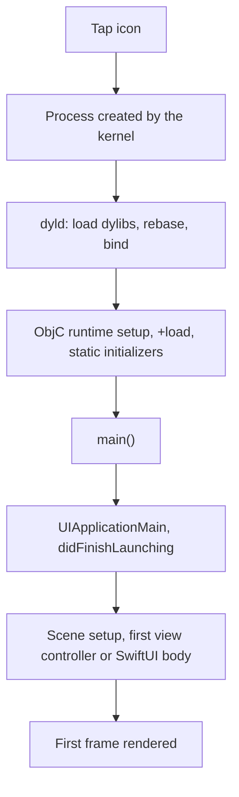
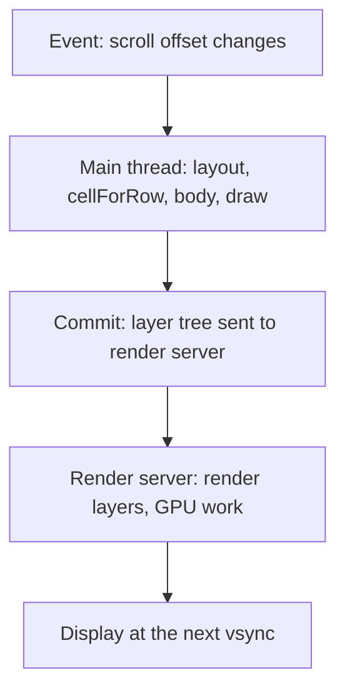
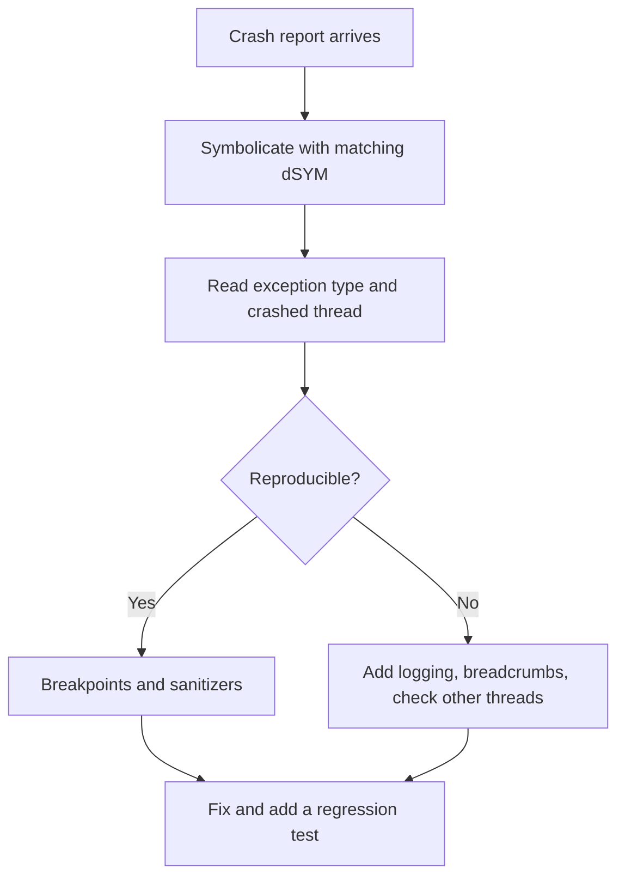
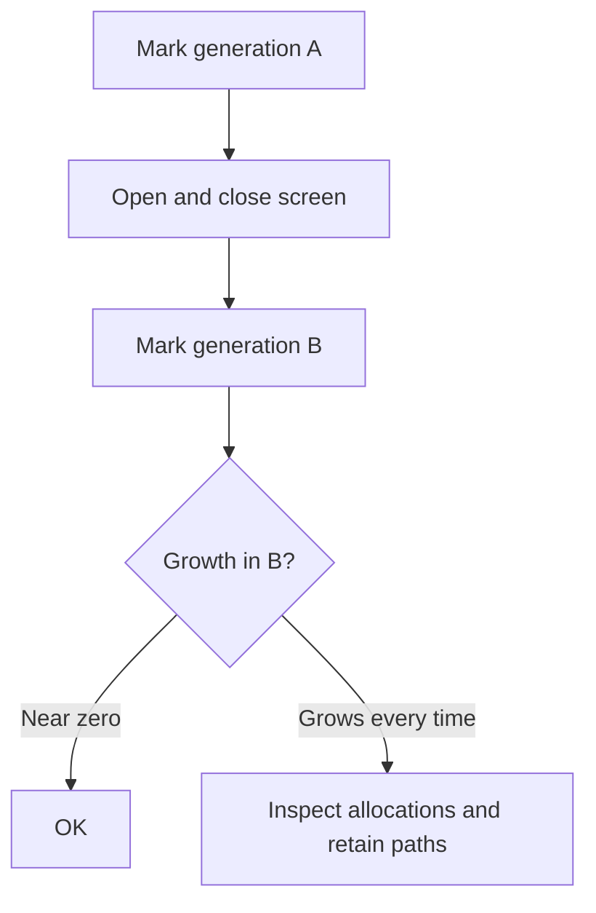
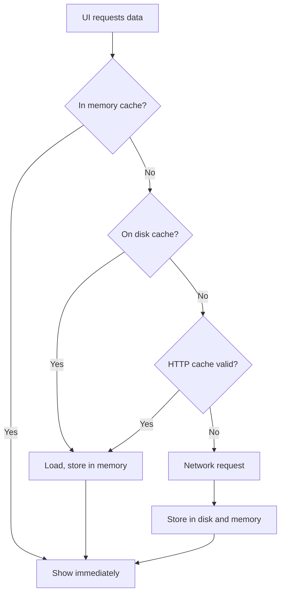

# Performance & Instruments

[⬅ Back to index](../README.md)

Covers: app launch time, hangs, scrolling hitches, memory & images, battery & energy, app size, Instruments tools, MetricKit & Xcode Organizer, crash debugging.

---

### 1. How do you measure and improve app launch time?

<details>
<summary>Answer</summary>

**In short:** Launch runs through pre-main (dyld loading and binding libraries, ObjC setup, static initializers), then `main`, then `didFinishLaunching`, then the first frame. I measure it with the Instruments **App Launch** template, the Organizer **Launch Time** metric and `XCTApplicationLaunchMetric`, aim for a first frame within about **400 ms**, and improve it by cutting dynamic frameworks, deferring work out of launch, and keeping the first screen simple.

#### The phases of a launch



- **Pre-main** is everything before your `main` runs. Its cost grows with the number of **dynamic frameworks** (each one must be found, mapped, and have its symbols bound) and with code that runs at load time (`+load` methods, C++ static constructors, global initializers that do work).
- **Post-main** is your code: `application(_:didFinishLaunchingWithOptions:)`, scene setup, and building the first screen until it is drawn.

The user sees the launch as "done" when the first real frame appears, so that is the moment to optimize for.

#### Cold, warm and resume

| Type | What it means | Cost |
|---|---|---|
| **Cold** | App not in memory, often after a reboot or long time unused | Slowest; dyld and disk work are fully paid |
| **Warm** | App was terminated but parts are still in the system's caches | Faster |
| **Resume** | App was suspended in the background and comes back | Not really a launch; no `didFinishLaunching` |

Always measure cold and warm launches separately; resume is mostly about `sceneWillEnterForeground` work.

#### How to measure

- **Instruments → App Launch** template: shows each phase, the main thread's activity, and what blocked it.
- **Xcode Organizer → Launch Time**: real-world percentiles from users who share analytics, per app version and device class.
- **MetricKit**: `MXAppLaunchMetric` in the daily payload (time-to-first-draw histograms).
- **Performance tests**: catch regressions in CI.

```swift
func testLaunchPerformance() throws {
    measure(metrics: [XCTApplicationLaunchMetric()]) {
        XCUIApplication().launch()
    }
}
```

The system's **watchdog** kills an app that takes far too long to launch (around 20 seconds); the crash report shows the termination code `0x8badf00d`.

#### How to improve

1. **Fewer dynamic frameworks.** Link dependencies statically where possible, or use **mergeable libraries** (Xcode 15+), which let you build dynamic frameworks in debug and merge them into the binary for release.
2. **Do nothing heavy at load time.** Avoid `+load` and static initializers that do work.
3. **Slim `didFinishLaunching`.** Defer analytics, ads and secondary SDKs until after the first frame, initialize services lazily, and move non-UI work to background tasks.

```swift
// Wrong: everything blocks the first frame
func application(_ app: UIApplication, didFinishLaunchingWithOptions o: [UIApplication.LaunchOptionsKey: Any]?) -> Bool {
    Analytics.start()          // network + disk
    AdsSDK.configure()
    database.migrateIfNeeded() // could take seconds
    return true
}

// Better: only what the first screen needs, the rest later
func application(_ app: UIApplication, didFinishLaunchingWithOptions o: [UIApplication.LaunchOptionsKey: Any]?) -> Bool {
    CrashReporter.start()      // must be early to catch launch crashes
    Task.detached(priority: .utility) {
        Analytics.start()
        AdsSDK.configure()
    }
    return true
}
```

4. **Simple first screen.** Show cached data immediately, then refresh from the network. Avoid huge storyboards for the initial screen.
5. **No synchronous I/O or network** on the main thread during launch.

#### Common pitfalls

- Measuring only in debug builds on the simulator: debug builds are slower and the simulator does not reflect real disk or CPU speed.
- Moving work to a background queue that the first screen then waits on synchronously, which keeps the delay.
- Third-party SDKs that do work in their own initializers you never see.

#### Likely follow-ups

- **How does static linking help?** dyld has fewer images to load and bind, so pre-main time drops.
- **What's the difference between first frame and "fully usable"?** First frame is the launch metric; extended launch work (loading data) should show placeholders and be measured separately, e.g. with signposts.
- **What is `0x8badf00d`?** A watchdog termination, usually a main thread blocked during launch or a state transition.

</details>

### 2. What is a hang? How do you detect it?

<details>
<summary>Answer</summary>

**In short:** A hang is when the main thread is blocked and cannot respond to user input for more than about **250 ms** (Apple calls 100–250 ms a "microhang"). I detect hangs with Xcode's hang detection during development, Instruments (Hangs, Time Profiler), the Organizer **Hangs** report and MetricKit `MXHangDiagnostic` in production, and fix them by moving work off the main thread.

#### Why it matters

The main thread handles touches, runs your UI code, and commits changes to the render server. If it is busy for a quarter of a second, taps feel ignored and animations freeze. Longer hangs make users force-quit, and very long ones during launch or a state change get the app killed by the watchdog.

#### Common causes

- Synchronous **network**, **file** or **database** work on the main thread (`Data(contentsOf:)` on a URL, a Core Data fetch of thousands of rows on the view context).
- Heavy computation: JSON decoding of large payloads, image processing, sorting big arrays.
- **Lock contention**: the main thread waits on a lock or semaphore held by a background thread.
- `DispatchQueue.main.sync` from a background thread while main is waiting on that thread (deadlock or long stall).
- Layout thrashing: repeated forced layout passes, very complex Auto Layout.

```swift
// Wrong: blocks the main thread until the file is read and decoded
@IBAction func refresh() {
    let data = try! Data(contentsOf: bigFileURL)
    items = try! JSONDecoder().decode([Item].self, from: data)
    tableView.reloadData()
}

// Better: do the work off the main actor, update UI on it
@MainActor
func refresh() async {
    let items = await Task.detached(priority: .userInitiated) {
        let data = try? Data(contentsOf: bigFileURL)
        return (try? JSONDecoder().decode([Item].self, from: data ?? Data())) ?? []
    }.value
    self.items = items
    tableView.reloadData()
}
```

#### How to detect

| Tool | When |
|---|---|
| Xcode **hang detection** (debug navigator / runtime issues) | While developing on a device |
| **Thread Performance Checker** (scheme diagnostics) | Flags priority inversions and non-UI work on main |
| Instruments **Hangs** + **Time Profiler** | Shows hang intervals and the stack that was running |
| Xcode Organizer **Hangs** report | Aggregated real-user hangs with stack traces |
| MetricKit `MXHangDiagnostic` | Hang stack traces delivered to your app |

To fix one: find the main-thread stack during the hang, then either remove the work, make it smaller (paging, caching), or move it off main with async/await, a background actor, or a background queue.

#### Pitfalls

- Using a semaphore to "wait for" an async result on main: it turns async code back into a hang.
- Assuming `async` means "off the main thread": an `async` function on a `@MainActor` type still runs on main between suspension points.

#### Likely follow-ups

- **Hang vs crash?** A hang is unresponsiveness; it only becomes a crash if the watchdog kills the app.
- **What is a priority inversion?** A high-priority thread (main) waits on work running at low priority; the Thread Performance Checker reports this.

</details>

### 3. What causes scrolling jank (hitches)? How do you fix it?

<details>
<summary>Answer</summary>

**In short:** At 60 Hz each frame has 16.7 ms, at 120 Hz (ProMotion) 8.3 ms; a **hitch** is a frame shown later than expected. Commit hitches come from too much main-thread work per frame (cell setup, layout, image decoding); render hitches come from expensive rendering (off-screen passes for shadows, masks, blurs). I measure with the Instruments **Animation Hitches** tool and fix by doing less per frame and avoiding off-screen rendering.

#### How a frame is produced



If either the **commit** (app side) or the **render** (render server / GPU side) misses its deadline, the frame is late and the user sees a stutter. Apple's metric is the **hitch time ratio**: milliseconds of hitches per second of scrolling.

#### Two kinds of hitch

| Kind | Where | Typical causes |
|---|---|---|
| **Commit hitch** | Your app's main thread | Expensive `cellForRowAt` or SwiftUI `body`, complex Auto Layout, text measurement, synchronous image decoding, creating views instead of reusing them |
| **Render hitch** | Render server / GPU | Off-screen rendering: shadows without `shadowPath`, `mask`, `cornerRadius` with `masksToBounds` on complex content; many large blended (non-opaque) layers; heavy blur effects |

#### Fixes

- **Reuse cells** and keep their configuration cheap; precompute formatted strings and heights in the model layer.
- **Decode and downsample images off the main thread** (see the next question), and use **prefetching** (`UITableViewDataSourcePrefetching`, `UICollectionViewDataSourcePrefetching`) to start loading before the cell appears.
- Give shadows an explicit path so the render server doesn't have to compute it from the layer's alpha:

```swift
// Off-screen pass every frame
cell.layer.shadowOpacity = 0.3
cell.layer.shadowRadius = 6

// Cheap: tell Core Animation the shape
cell.layer.shadowPath = UIBezierPath(roundedRect: cell.bounds, cornerRadius: 12).cgPath
```

- Avoid masks; prefer `cornerRadius` on simple layers or pre-rounded images. Use opaque backgrounds where possible.
- In SwiftUI, keep `body` cheap, use `LazyVStack`/`List`, and give `ForEach` stable identities so views are not rebuilt.

#### Measuring

- Instruments **Animation Hitches** template: shows each hitch and whether it was commit or render.
- Xcode Organizer **Scrolling** hitch-rate metric from real users.
- XCTest: `XCTOSSignpostMetric.scrollDecelerationMetric` to catch regressions.
- Simulator / Core Animation debug options ("Color Off-screen Rendered") to spot off-screen passes.

#### Likely follow-ups

- **Why is off-screen rendering expensive?** The GPU must render the content into a separate buffer first, then composite it, which costs extra passes and memory every frame.
- **Does ProMotion make hitches worse?** The budget halves to 8.3 ms, so work that was fine at 60 Hz may hitch at 120 Hz.

</details>

### 4. How do you handle large images efficiently?

<details>
<summary>Answer</summary>

**In short:** A decoded image costs **width × height × 4 bytes** no matter how small the file is, so a 4032×3024 photo takes about 48 MB in memory. I **downsample** images to the size they're displayed at (ImageIO thumbnails or `preparingThumbnail(of:)`), decode them **off the main thread**, cache the small versions in an `NSCache`, and use vectors for icons.

#### Why file size is misleading

A JPEG or HEIC on disk is compressed. To draw it, the system decodes it into a bitmap with (usually) 4 bytes per pixel. A 2 MB photo becomes 4032 × 3024 × 4 ≈ 48 MB. Showing a grid of a dozen such photos as 100-point thumbnails can push the app past its memory limit and get it killed (jetsam), and decoding them on the main thread causes scroll hitches.

#### Downsample with ImageIO

ImageIO can decode straight to a smaller size without ever creating the full bitmap:

```swift
import ImageIO
import UIKit

func downsample(at url: URL, to pointSize: CGSize, scale: CGFloat) -> UIImage? {
    // Don't decode yet when creating the source
    let sourceOptions = [kCGImageSourceShouldCache: false] as CFDictionary
    guard let source = CGImageSourceCreateWithURL(url as CFURL, sourceOptions) else { return nil }

    let maxPixel = max(pointSize.width, pointSize.height) * scale
    let options = [
        kCGImageSourceCreateThumbnailFromImageAlways: true,
        kCGImageSourceShouldCacheImmediately: true,     // decode now, at the small size
        kCGImageSourceCreateThumbnailWithTransform: true, // respect EXIF orientation
        kCGImageSourceThumbnailMaxPixelSize: maxPixel
    ] as CFDictionary

    guard let cgImage = CGImageSourceCreateThumbnailAtIndex(source, 0, options) else { return nil }
    return UIImage(cgImage: cgImage)
}
```

On iOS 15+, UIKit offers simpler APIs: `UIImage.preparingThumbnail(of:)` (downsample and decode) and `byPreparingForDisplay()` / `prepareForDisplay()` (decode only), all safe to call off the main thread.

```swift
Task.detached(priority: .userInitiated) {
    let thumb = await image.byPreparingThumbnail(ofSize: CGSize(width: 200, height: 200))
    await MainActor.run { imageView.image = thumb }
}
```

#### Cache the right thing

- Cache the **downsampled, decoded** image, keyed by URL plus target size, in an `NSCache` (it is thread-safe and evicts under memory pressure). Set `totalCostLimit` using the byte size as cost.
- Keep the original data in a disk cache if needed, not in memory.
- Clear or reduce caches on memory warnings.

#### Assets

- Put bundled images in **asset catalogs** so app thinning ships only the right scale per device.
- Use **SF Symbols** and vector assets (PDF/SVG) for icons instead of many PNG sizes.

#### Pitfalls

- `UIImage(named:)` caches images in a system cache, which is fine for small UI assets but wrong for large one-off photos; use `UIImage(contentsOfFile:)` or ImageIO.
- Resizing by drawing into a new context still decodes the full image first, so peak memory stays high; ImageIO thumbnails avoid that.
- Cells that start loading an image and get reused: check that the result still belongs to the cell (compare an ID) before assigning it.

#### Likely follow-ups

- **What does `kCGImageSourceShouldCache: false` do?** It stops the source from decoding and caching the full-size image when created.
- **Why decode off the main thread?** Decoding is lazy and otherwise happens at first draw, on main, during scrolling.

</details>

### 5. Which Instruments do you use and for what?

<details>
<summary>Answer</summary>

**In short:** Time Profiler for CPU hotspots, Allocations and Leaks for memory, Hangs and Animation Hitches for responsiveness, App Launch for startup, Network for HTTP traffic, Energy/Power Profiler for battery, plus the SwiftUI and Swift Concurrency instruments and `os_signpost` for my own intervals. I always profile a **release** build on a **real device**.

#### The main tools

| Instrument | What it answers | Typical use |
|---|---|---|
| **Time Profiler** | Where is CPU time spent? | Samples call stacks; use "Invert Call Tree" and "Hide System Libraries" to find the heaviest frames of your code |
| **Allocations** | What is allocated and what grows? | Mark **generations** before/after repeating an action to find abandoned memory |
| **Leaks** | What memory is unreachable? | Finds leaked objects; retain cycles are often easier to see in Xcode's Memory Graph |
| **Hangs / Animation Hitches** | Is the UI responsive and smooth? | Shows hang intervals and commit/render hitches |
| **App Launch** | What happens during startup? | Phase breakdown of a launch |
| **Network** | What requests run and how long do they take? | HTTP traffic, timings, connection reuse |
| **Energy Log / Power Profiler** | What drains the battery? | CPU, network, location, GPU activity over time |
| **Core Animation / GPU** | Is rendering expensive? | Frame rate, GPU utilization, off-screen passes |
| **SwiftUI** (Xcode 26) | Which views update and why? | View body updates and the causes behind them |
| **Swift Concurrency** | What are tasks and actors doing? | Task lifetimes, actor contention, blocked tasks |
| **os_signpost / Points of Interest** | How long does *my* code take? | Custom intervals visible on the timeline |

#### Custom intervals with signposts

```swift
import os

let signposter = OSSignposter(subsystem: "com.example.app", category: "Feed")

func loadFeed() async {
    let state = signposter.beginInterval("LoadFeed")
    defer { signposter.endInterval("LoadFeed", state) }
    // ... fetch, decode, render
}
```

These intervals show up in Instruments alongside the system tracks, so you can correlate "my feed load" with CPU spikes or hitches. They can also be measured in tests with `XCTOSSignpostMetric`.

#### A typical workflow

1. Reproduce the problem on a device with a release build (Product → Profile does this by default).
2. Start with a broad template (Time Profiler, or the template matching the symptom).
3. Narrow the time range to the slow moment, then look at the heaviest stacks.
4. Change one thing, profile again, and compare.

#### Pitfalls

- Debug builds disable optimizations, so the hotspots you see may not exist in release.
- The simulator uses your Mac's CPU and GPU, so timings and rendering behavior are not representative.
- Leaks does not catch everything: memory that is still referenced (e.g. by an ever-growing cache) is "abandoned", not leaked; use Allocations generations for that.

#### Likely follow-ups

- **Leaks vs Memory Graph?** Memory Graph (in Xcode) shows the object graph and retain paths at a moment; Leaks samples over time during a recording.
- **How do you find a CPU hotspot fast?** Time Profiler with inverted call tree and system libraries hidden.

</details>

### 6. What are MetricKit and the Xcode Organizer?

<details>
<summary>Answer</summary>

**In short:** Both report performance from **real users' devices**. The Xcode Organizer shows aggregated, anonymized metrics (launch time, hangs, memory, battery, disk writes, scroll hitches, terminations) and crash/energy reports, with no code needed. **MetricKit** delivers the same kind of data to your app as daily `MXMetricPayload`s and `MXDiagnosticPayload`s (crashes, hangs, CPU and disk-write exceptions with call stacks) so you can send it to your own backend.

#### Why you need field data

Instruments shows you what happens on your device, today, in the scenario you thought to test. Real users run older devices, have full disks, poor networks and different usage patterns. Field metrics tell you where the app is actually slow and whether a release made things better or worse.

#### Xcode Organizer

- Data comes from users who opted in to share analytics with developers.
- Metrics are shown per app version, as percentiles (typical and top), per device class.
- Includes **Crashes**, **Energy** reports, **Hangs** with stack traces, **Launch Time**, **Memory**, **Disk Writes**, **Scrolling** and **Terminations** (e.g. how often the app was killed for memory in the background).
- No code needed; available from the Window → Organizer menu.

#### MetricKit

```swift
import MetricKit

final class MetricsSubscriber: NSObject, MXMetricManagerSubscriber {
    override init() {
        super.init()
        MXMetricManager.shared.add(self)
    }

    // Aggregated metrics, delivered about once a day
    func didReceive(_ payloads: [MXMetricPayload]) {
        for payload in payloads {
            upload(payload.jsonRepresentation())
        }
    }

    // Diagnostics: crashes, hangs, CPU and disk-write exceptions, with call stacks
    func didReceive(_ payloads: [MXDiagnosticPayload]) {
        for payload in payloads {
            upload(payload.jsonRepresentation())
        }
    }

    private func upload(_ data: Data) { /* send to your backend */ }
}
```

| | Organizer | MetricKit |
|---|---|---|
| Setup | None | Subscribe in code |
| Where data lives | Apple / Xcode | Your app, then your backend |
| Granularity | Aggregated across users | Per device, daily |
| Custom slicing (by feature flag, account type) | No | Yes, attach your own context |
| Latency | Delayed aggregation | About a day |

#### Combining with third-party tools

Crashlytics or Sentry give **near real-time** crash reports, breadcrumbs and custom logs. MetricKit and the Organizer add things those SDKs cannot easily see, like watchdog and memory terminations and system-measured energy. Teams commonly use both.

#### Likely follow-ups

- **Why can't a crash SDK catch jetsam kills?** The process is killed by the system without a signal handler running; only the OS knows, which is why the Organizer/MetricKit report them.
- **Can MetricKit measure custom code?** Yes, `mxSignpost` intervals appear in the metric payload.

</details>

### 7. How do you reduce battery usage?

<details>
<summary>Answer</summary>

**In short:** Do less work, less often, and let the system schedule it: batch and defer networking (`isDiscretionary`, `BGTaskScheduler`), use push instead of polling, use the lowest location accuracy you need and stop updates when done, avoid timers that keep waking the CPU, reduce GPU work, and respect **Low Power Mode**. Measure with the Xcode energy gauge, Instruments (Energy Log / Power Profiler) and the Organizer battery metrics.

#### What drains the battery

Energy use comes from hardware staying awake: CPU, the cellular/Wi-Fi radio, GPS, the GPU and the screen. The key idea is **fixed cost**: every time the radio or CPU wakes up, it stays in a high-power state for a while afterwards. Ten small requests spread over a minute cost far more than one batched request.

#### Techniques

| Area | Do this |
|---|---|
| **Networking** | Batch requests; prefetch in one go; use background `URLSession` with `isDiscretionary = true` for non-urgent transfers; cache responses |
| **Polling** | Replace with push notifications (or silent pushes) |
| **Background work** | Use `BGTaskScheduler` (`BGAppRefreshTask`, `BGProcessingTask` with `requiresExternalPower`) so the system picks a good time |
| **Location** | Lowest `desiredAccuracy` that works; significant-change or region monitoring instead of continuous GPS; stop updates when done |
| **Timers** | Avoid frequent repeating timers; set `tolerance` so the system can coalesce wake-ups; invalidate when off screen |
| **GPU** | Avoid unnecessary animations, blurs and high frame rates for static content |
| **Low Power Mode** | Check `ProcessInfo.processInfo.isLowPowerModeEnabled` and reduce optional work |

```swift
// Coalescable timer instead of a precise one
let timer = Timer(timeInterval: 60, repeats: true) { _ in refreshBadge() }
timer.tolerance = 10                 // let the system batch wake-ups
RunLoop.main.add(timer, forMode: .common)

// React to Low Power Mode
NotificationCenter.default.addObserver(
    forName: .NSProcessInfoPowerStateDidChange, object: nil, queue: .main
) { _ in
    autoplayVideos = !ProcessInfo.processInfo.isLowPowerModeEnabled
}
```

#### Measuring

- Xcode's **Energy Impact** gauge while running on a device.
- Instruments **Energy Log** / **Power Profiler** for a recording of CPU, network, location and display activity.
- The Organizer **Battery** metrics and **Energy** reports from real users, plus MetricKit's CPU, location and network metrics.

#### Pitfalls

- Keeping location updates on "just in case" after the user leaves the screen.
- Retrying failed requests in a tight loop with no backoff.
- Animations that keep running in views that are hidden or off screen.

#### Likely follow-ups

- **Why batch network calls?** The radio stays in a high-power state for seconds after each transfer, so fewer, larger transfers are cheaper.
- **What does `isDiscretionary` do?** It lets the system delay the transfer until conditions are good (Wi-Fi, charging).

</details>

### 8. How do you reduce app size?

<details>
<summary>Answer</summary>

**In short:** Rely on **App Thinning** (slicing per device, on-demand resources), keep assets in asset catalogs and compressed, remove unused assets and code, avoid heavy dependencies for small features, strip symbols and dead code in release, and measure with the **App Size Report** and App Store Connect's size info.

#### Why size matters

Larger apps take longer to download, may hit the cellular download limit prompt, use storage users want for photos, and are more likely to be deleted when space runs out. Binary size also affects launch time a little, since more code must be mapped.

#### Download size vs install size

- **Download size** is the compressed size users fetch from the App Store.
- **Install size** is how much space it takes on the device.
- Both vary by device because of thinning, so always look at per-device numbers, not the size of the universal `.ipa`.

#### Techniques

| Area | What to do |
|---|---|
| **App Thinning: slicing** | The App Store delivers only the assets and architecture for the user's device; works automatically for asset catalogs |
| **On-demand resources** | Tag rarely used content (later game levels, tutorials) so it is downloaded only when needed |
| **Bitcode** | Deprecated since Xcode 14; no longer part of the story |
| **Assets** | Use asset catalogs; compress images (HEIC where supported); prefer SF Symbols and vector assets; remove unused images (tools like FengNiao) |
| **Code** | Remove dead code (tools like Periphery); avoid large dependencies for a single small feature |
| **Build settings** | Strip debug symbols in release (`STRIP_INSTALLED_PRODUCT`), dead-code stripping (`DEAD_CODE_STRIPPING`), and consider `-Osize` (Optimize for Size) where speed isn't critical |
| **Resources** | Download big data files (ML models, videos) at runtime or use Background Assets instead of bundling |

#### Measuring

1. Archive the app.
2. In the Organizer, **Distribute App** → export with **App Thinning: All compatible device variants**.
3. Read the generated **App Thinning Size Report.txt**: compressed and uncompressed sizes per device variant.
4. After upload, App Store Connect shows download and install sizes per device.

To see what's inside, unzip the `.ipa` and look at the largest files, or inspect the linker map file (enable "Write Link Map File") to see which modules contribute most to the binary.

#### Pitfalls

- Assets added loose to the bundle (not in an asset catalog) skip slicing, so every device gets every scale.
- Many dynamic frameworks each carry their own overhead; static linking can reduce size and launch time.
- Dependencies that pull in large transitive dependencies (a whole analytics stack for one event).

#### Likely follow-ups

- **`-Osize` vs `-O`?** `-Osize` trades a bit of speed for smaller code by limiting inlining and specialization.
- **What happened to bitcode?** Apple deprecated it in Xcode 14; the App Store no longer accepts bitcode submissions.

</details>

### 9. How do you debug and symbolicate crashes?

<details>
<summary>Answer</summary>

**In short:** Read the crash log's **exception type** and the crashed thread's stack: `EXC_BAD_ACCESS`/`SIGSEGV` is a bad memory access, `EXC_BREAKPOINT`/`SIGTRAP` is a Swift runtime trap (force-unwrapping nil, index out of range, `fatalError`), `0x8badf00d` is a watchdog kill, `0xdead10cc` is holding a file lock while suspended, and jetsam is a memory-limit kill. Symbolicate with the build's **dSYM** files, then reproduce with breakpoints and sanitizers.

#### Reading a crash report

A crash report contains: the exception type and codes, a termination reason, the thread that crashed with its backtrace, all other threads, and the list of loaded binary images with their UUIDs.

| Signal / code | Meaning | Typical cause |
|---|---|---|
| `EXC_BAD_ACCESS` (`SIGSEGV`, `SIGBUS`) | Access to invalid memory | Dangling pointer, `unowned` reference to a deallocated object, unsafe pointer misuse, data race |
| `EXC_BREAKPOINT` (`SIGTRAP`) | Swift runtime trap | Force-unwrapping nil, array index out of range, integer overflow, failed `as!`, `fatalError`, `precondition` |
| `EXC_CRASH` (`SIGABRT`) | Process aborted | Uncaught Objective-C exception (e.g. `NSInvalidArgumentException`), `abort()` |
| `0x8badf00d` | Watchdog timeout ("ate bad food") | Main thread blocked during launch, resume or background transition |
| `0xdead10cc` | Holding a file lock while suspended ("dead lock") | SQLite/Core Data file in a shared app group locked when the app was suspended |
| Jetsam | Killed for exceeding memory limits | Huge images, unbounded caches; logged as a jetsam event, not a normal crash report |

#### Symbolication

A release binary has no symbol names, so the backtrace contains raw addresses. **Symbolication** maps those addresses back to function names, files and line numbers using the **dSYM** (debug symbols) generated for that exact build; the binary image UUID in the crash report must match the dSYM's UUID.

- Xcode's Organizer symbolicates crashes for archives on your Mac automatically.
- Crash SDKs (Crashlytics, Sentry) need you to **upload dSYMs** for every build, usually via a build phase script or the CI pipeline.
- Manually, `atos` can symbolicate a single address given the dSYM and load address.

#### Reproducing and debugging

- **Exception breakpoint** and **Swift error breakpoint** to stop where an error is thrown rather than where it ends up.
- **Address Sanitizer**: finds use-after-free, buffer overflows and other memory corruption.
- **Thread Sanitizer**: finds data races (often the real cause of "random" `EXC_BAD_ACCESS`).
- **Zombie Objects**: keeps deallocated Objective-C objects around and reports messages sent to them.
- **Main Thread Checker**: reports UIKit calls from background threads.



#### Pitfalls

- Losing dSYMs for a shipped build means its crashes can never be symbolicated; archive them in CI.
- The crashed line is not always the cause: a race or memory corruption earlier can make an unrelated line crash.

#### Likely follow-ups

- **Why is `unowned` risky?** Accessing an `unowned` reference after the object is gone traps; `weak` becomes nil instead.
- **How do you debug a crash you can't reproduce?** Look at other threads in the report, add breadcrumbs/logging around the area, check MetricKit diagnostics, and run with Thread Sanitizer.

</details>

### 10. What are common causes of crashes in iOS apps?

<details>
<summary>Answer</summary>

**In short:** The usual suspects are Swift runtime traps (force-unwrapping nil, out-of-bounds index, failed `as!`), threading bugs (UI updates off the main thread, data races, Core Data used on the wrong queue), table/collection view inconsistency exceptions, watchdog kills from a blocked main thread, memory-limit (jetsam) kills, unrecognized selectors in Objective-C, missing privacy usage descriptions, and stack overflows from infinite recursion.

#### The common causes, grouped

| Category | Example | Prevention |
|---|---|---|
| **Optionals and casts** | `user!.name` when `user` is nil; `json as! [String: Any]` | `guard let`, `if let`, `as?`, `XCTUnwrap`/`#require` in tests |
| **Collections** | `items[index]` with a stale index | Check `indices.contains(index)`; avoid caching indexes |
| **Threading** | Updating UI from a background queue; mutating a dictionary while another thread enumerates it | `@MainActor`, actors, serial queues; run Thread Sanitizer |
| **Table/collection view updates** | "Invalid update: invalid number of rows" when the data source and `performBatchUpdates` disagree | **Diffable data sources**, which compute the changes for you |
| **Watchdog** | Slow launch or blocked main thread (`0x8badf00d`) | Move work off main, defer launch work |
| **Memory (jetsam)** | Loading full-size images, unbounded caches | Downsample, `NSCache`, release on memory warnings |
| **Core Data** | Using a managed object on a different context's queue | `perform {}`, pass `NSManagedObjectID` between contexts |
| **Objective-C** | `unrecognized selector sent to instance` from a wrong selector or an object of the wrong type | Swift types, `#selector` checked at compile time |
| **Privacy** | Accessing camera/location without an `NS...UsageDescription` key in Info.plist | Add the key; the system terminates the app otherwise |
| **Recursion** | Infinite recursion, e.g. a `didSet` that sets itself, or a getter calling itself | Code review, tests |
| **Arithmetic** | Integer overflow traps in Swift | `&+` only when wrapping is intended; validate inputs |

#### A typical example

```swift
// Crashes if the response is missing or the cast fails
let user = try! JSONSerialization.jsonObject(with: data) as! [String: Any]
let name = user["name"] as! String

// Safe and still clear
struct User: Decodable { let name: String }
do {
    let user = try JSONDecoder().decode(User.self, from: data)
    show(user.name)
} catch {
    showError(error)
}
```

#### How teams keep crash rates down

- Lint rules that ban `!`, `try!` and `as!` outside tests (e.g. SwiftLint `force_unwrapping`).
- Swift 6 strict concurrency checking to catch data races at compile time.
- Sanitizers in CI test plans.
- Crash-free-users rate tracked per release with staged rollout, so regressions are caught early.

#### Likely follow-ups

- **Why do diffable data sources prevent crashes?** You apply a snapshot and UIKit computes the inserts/deletes, so the counts can never disagree.
- **Is a force-unwrap ever acceptable?** When failure is truly a programmer error (e.g. a bundled resource that must exist), and crashing early is better than continuing; many teams still prefer `guard` with a clear `fatalError` message.

</details>

### 11. How do you write performance tests?

<details>
<summary>Answer</summary>

**In short:** In XCTest, wrap the code in `measure(metrics:)` with metrics like `XCTClockMetric`, `XCTMemoryMetric` and `XCTCPUMetric`, then set a **baseline** so the test fails when performance regresses. UI tests can measure launch with `XCTApplicationLaunchMetric` and scrolling with `XCTOSSignpostMetric`. Run them on real devices with release-like builds, in a consistent CI environment.

#### Why performance tests

Performance degrades slowly, one small change at a time, and nobody notices until users complain. Performance tests turn "it feels slower" into a number that is checked on every build.

#### Unit-level measurement

```swift
import XCTest

final class ParserPerformanceTests: XCTestCase {
    func testParsingLargeFeed() throws {
        let data = try fixture("feed-10k-items.json")

        let options = XCTMeasureOptions()
        options.iterationCount = 10

        measure(metrics: [XCTClockMetric(), XCTCPUMetric(), XCTMemoryMetric()], options: options) {
            _ = try? FeedParser().parse(data)
        }
    }
}
```

`measure` runs the block several times and reports average and standard deviation for each metric. In Xcode you can then **set a baseline** for that test on that device; future runs fail if the result is worse than the baseline by more than the allowed deviation. Baselines are stored per device in the project, so they only compare like with like.

#### UI-level measurement

```swift
final class AppPerformanceUITests: XCTestCase {
    func testLaunch() {
        measure(metrics: [XCTApplicationLaunchMetric()]) {
            XCUIApplication().launch()
        }
    }

    func testFeedScrolling() {
        let app = XCUIApplication()
        app.launch()
        let feed = app.collectionViews["feed"]

        let options = XCTMeasureOptions()
        options.invocationOptions = [.manuallyStop]

        measure(metrics: [XCTOSSignpostMetric.scrollDecelerationMetric], options: options) {
            feed.swipeUp(velocity: .fast)
            stopMeasuring()
            feed.swipeDown(velocity: .fast)   // reset position, not measured
        }
    }
}
```

You can also measure your own signpost intervals with `XCTOSSignpostMetric(subsystem:category:name:)`, which links Instruments signposts and tests.

#### Making results trustworthy

- **Real device**, not the simulator; same device model in CI each time.
- **Release-like build** configuration (optimizations on).
- Quiet environment: no other heavy processes; consistent network (or stubbed).
- Multiple iterations; look at standard deviation, not just the mean.

#### Pitfalls

- Baselines recorded on one machine and compared on another produce false failures.
- Measuring code that hits the network measures the network, not your code.
- Swift Testing does not support performance metrics; these stay in XCTest.

#### Likely follow-ups

- **Where else do you watch performance?** Organizer and MetricKit in production, because tests cover only scripted scenarios.

</details>

### 12. What is the impact of Swift language choices on performance?

<details>
<summary>Answer</summary>

**In short:** Prefer value types (no reference counting or heap allocation for small structs), enable static dispatch with `final`/`private` and Whole Module Optimization, use generics and `some` instead of `any` existentials in hot paths, avoid needless copies of large values (copy-on-write, `borrowing`/`consuming`, noncopyable types), reserve capacity when filling arrays, and avoid repeated `String` indexing, which is O(n).

#### Why these choices matter

Most app code is not CPU-bound, so these matter mainly in **hot paths**: parsing, rendering, large loops, real-time audio or graphics. Always measure with Time Profiler first.

#### Dispatch

| Kind | How a call is resolved | Cost |
|---|---|---|
| **Static** | Known at compile time; can be inlined | Cheapest |
| **Table (vtable / witness table)** | Lookup through a table for class methods and protocol requirements | Small cost; prevents inlining |
| **Message (`objc`/`dynamic`)** | Objective-C runtime lookup | Most expensive |

Marking classes or methods `final`, or `private`/`fileprivate`, lets the compiler prove there are no overrides and use static dispatch. **Whole Module Optimization** (the default for release builds) lets it see all of a module at once, so it can infer this for `internal` code too.

#### Value vs reference types

- A struct of plain values is stored inline (on the stack or inside its container): no heap allocation, no ARC retain/release.
- A class instance is heap-allocated and every new reference costs atomic retain/release operations.
- But a struct containing many reference-typed properties (strings, arrays, classes) still has ARC traffic on copy, so "struct" is not automatically faster.

#### Generics vs existentials

```swift
protocol Shape { func area() -> Double }

// Existential: each element is boxed, calls go through a witness table at runtime
func total(_ shapes: [any Shape]) -> Double {
    shapes.reduce(0) { $0 + $1.area() }
}

// Generic: the compiler can specialize for the concrete type and inline area()
func total<S: Shape>(_ shapes: [S]) -> Double {
    shapes.reduce(0) { $0 + $1.area() }
}
```

`some Shape` (opaque type) also keeps the concrete type known to the compiler. Use `any` when you truly need a heterogeneous collection.

#### Copies and memory

- Standard collections use **copy-on-write**: copying an array is cheap until one copy is mutated.
- `borrowing` and `consuming` parameter modifiers and **noncopyable types** (`~Copyable`) let you avoid copies and control ownership in hot code.
- `ContiguousArray` guarantees contiguous storage without Objective-C bridging overhead for class elements; for non-class elements `Array` already behaves similarly.
- Call `reserveCapacity(_:)` before appending many elements to avoid repeated reallocations.

```swift
var results: [Int] = []
results.reserveCapacity(input.count)
for value in input { results.append(transform(value)) }
```

#### Strings

Swift `String` is Unicode-correct: a `Character` is a grapheme cluster of variable length, so jumping to the nth character is **O(n)**. Avoid integer-indexing loops; iterate directly, or work on `utf8` views when you only need bytes.

#### Likely follow-ups

- **Why does `final` help?** It enables static dispatch and inlining because no subclass can override the method.
- **When is `any` fine?** Outside hot loops, or when you need heterogeneous values; the cost is small per call.

</details>

### 13. How do you detect excessive memory usage?

<details>
<summary>Answer</summary>

**In short:** Watch the Xcode memory gauge, inspect the **Memory Graph** for leaked objects, and use Instruments **Allocations** with generations (repeat an action and check memory returns to baseline) and **VM Tracker** (dirty memory, which counts toward the jetsam limit). In production, check the Organizer memory metrics and jetsam terminations; at runtime `os_proc_available_memory()` tells you how much headroom is left.

#### Why memory matters on iOS

iOS has no swap for apps in the usual sense. When the system runs low, it kills apps (**jetsam**), starting with background ones; a foreground app that crosses its own limit is killed too. A high memory footprint therefore means more background terminations (users lose their state) and possibly foreground crashes.

The number that counts is the **footprint**: mostly **dirty** memory (pages your app wrote to) plus compressed memory. Clean memory (mapped files, code) can be dropped and reloaded by the system.

#### Tools

| Tool | What it shows |
|---|---|
| Xcode **memory gauge** | Live footprint while debugging |
| Xcode **Memory Graph** debugger | All live objects and who retains them; flags leaks with a purple marker |
| Instruments **Allocations** | Every allocation with stack; **Mark Generation** to see what an action left behind |
| Instruments **Leaks** | Unreachable memory |
| Instruments **VM Tracker** | Dirty vs clean memory by region (e.g. image data, malloc) |
| Organizer / MetricKit | Peak memory and memory-related terminations from real users |

#### The generation technique

1. Start Allocations, let the app settle, then **Mark Generation**.
2. Perform an action that should leave no trace (open a screen and close it).
3. Mark another generation. Repeat a few times.
4. Each generation should be close to zero growth. Anything that keeps growing (e.g. a view controller per round trip) is a leak or abandoned memory.



#### Checking headroom at runtime

```swift
import os

let available = os_proc_available_memory()   // bytes before hitting the limit
if available < 200 * 1024 * 1024 {
    imageCache.removeAllObjects()            // be conservative
}
```

Also respond to `UIApplication.didReceiveMemoryWarningNotification` by clearing caches.

#### Common culprits

- Image caches without a cost limit, or caching full-size decoded images.
- Leaked view controllers from retain cycles (closures capturing `self`, strong delegates, timers).
- Loading large data sets all at once instead of paging or streaming.

#### Likely follow-ups

- **Leak vs abandoned memory?** A leak is unreachable; abandoned memory is still referenced but never used again (like a growing cache). Leaks finds the first, generations find both.
- **Why can't you catch jetsam with a crash reporter?** The system kills the process without running your code; check Organizer terminations or MetricKit instead.

</details>


### 14. Why are caching and compression important on mobile devices?

<details>
<summary>Answer</summary>

**In short:** Mobile networks are slow, unreliable and often metered, and the radio is one of the biggest battery consumers. **Caching** avoids repeat downloads (instant UI, offline support, fewer radio wake-ups, less server load), and **compression** means fewer bytes per download (gzip/brotli responses, efficient image formats, images sized for the screen). Together they make the app faster and cheaper in data and battery, and you should also respect **Low Data Mode**.

#### The constraints

- **Network:** high and variable latency, dropped connections, users paying per megabyte.
- **Battery:** each request wakes the radio, which then stays in a high-power state for seconds.
- **Memory and storage:** limited, so caches must be bounded.

#### Caching in layers



- **Memory:** `NSCache` for decoded images and parsed models; evicts under pressure.
- **Disk:** files in `Caches/`, or a database for structured data you want offline.
- **HTTP cache:** `URLCache` honors `Cache-Control` and `ETag` headers; a revalidation that returns `304 Not Modified` costs only headers.

```swift
let config = URLSessionConfiguration.default
config.urlCache = URLCache(memoryCapacity: 20 * 1024 * 1024,
                           diskCapacity: 200 * 1024 * 1024)
config.requestCachePolicy = .useProtocolCachePolicy
let session = URLSession(configuration: config)
```

A common pattern is **stale-while-revalidate**: show cached data instantly, fetch fresh data in the background, then update the UI.

**Invalidation** is the hard part: use server cache headers, explicit versioning, time-to-live values, and clear user-specific caches on logout.

#### Compression

- **Responses:** servers send gzip or brotli; `URLSession` advertises support and decodes automatically.
- **Images:** HEIC or WebP where supported, and request sizes that match the display (a server-side resize parameter) instead of downloading originals.
- **Payloads:** paginate, request only needed fields, and avoid sending the same data repeatedly.

#### Respect the user's network settings

```swift
var request = URLRequest(url: prefetchURL)
request.allowsConstrainedNetworkAccess = false   // skip when Low Data Mode is on
request.allowsExpensiveNetworkAccess = false     // skip on cellular / personal hotspot
```

Non-essential work (prefetching, high-resolution media, analytics uploads) should yield to Low Data Mode and expensive networks.

#### Pitfalls

- Unbounded caches that grow until the app is killed or the disk fills.
- Caching personal data without clearing it on logout.
- Forgetting that `Caches/` can be purged by the system, so it must never hold the only copy of important data.

#### Likely follow-ups

- **What is an ETag?** A version identifier for a resource; the client sends `If-None-Match`, and the server replies `304` if unchanged.
- **Memory vs disk cache?** Memory is fastest but small and lost on termination; disk survives relaunches but needs I/O.

</details>

---

[⬅ Previous: Background & Notifications](15-background-notifications.md) · [⬅ Back to index](../README.md) · [Next: Testing ➡](17-testing.md)
