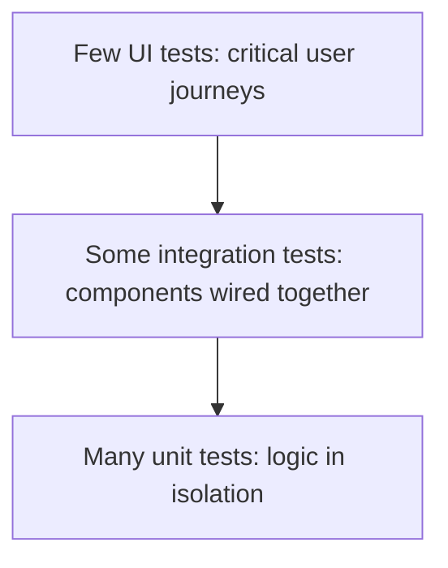
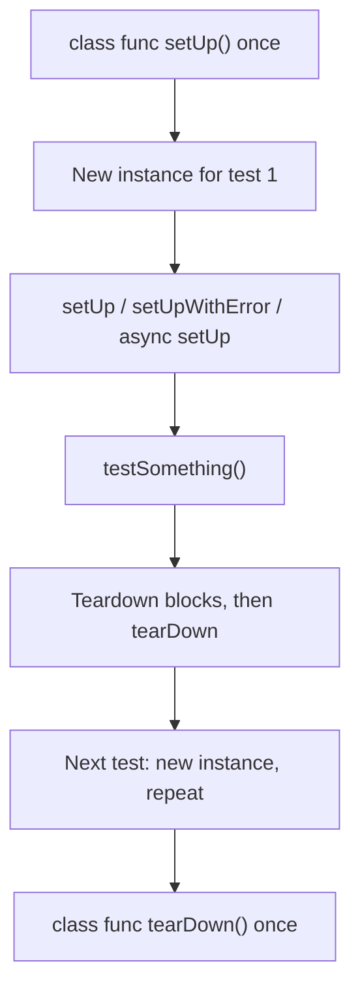
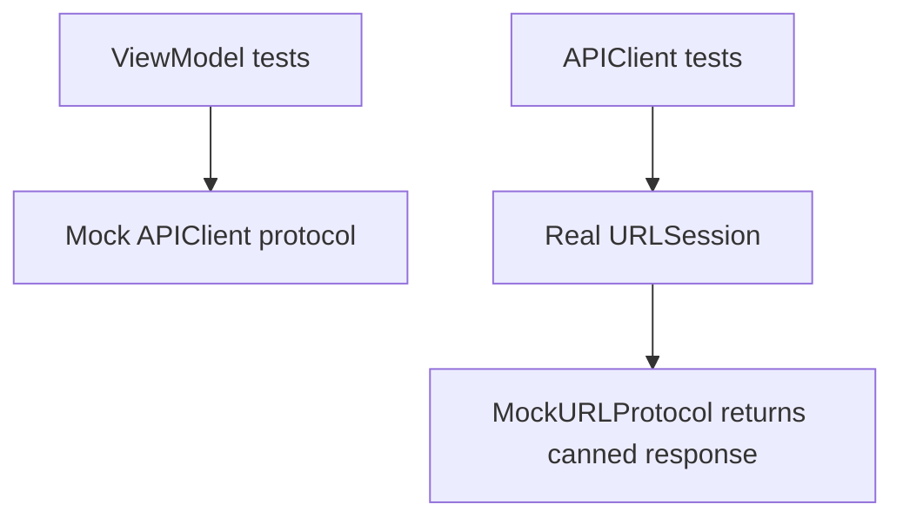
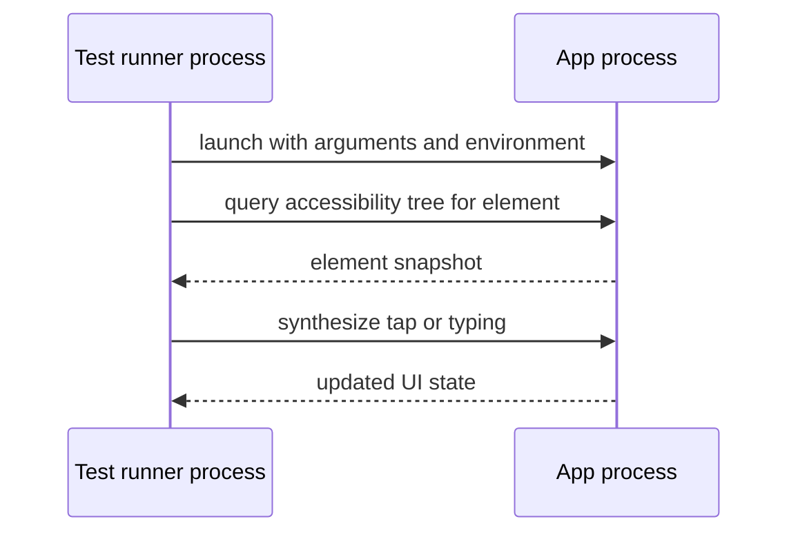
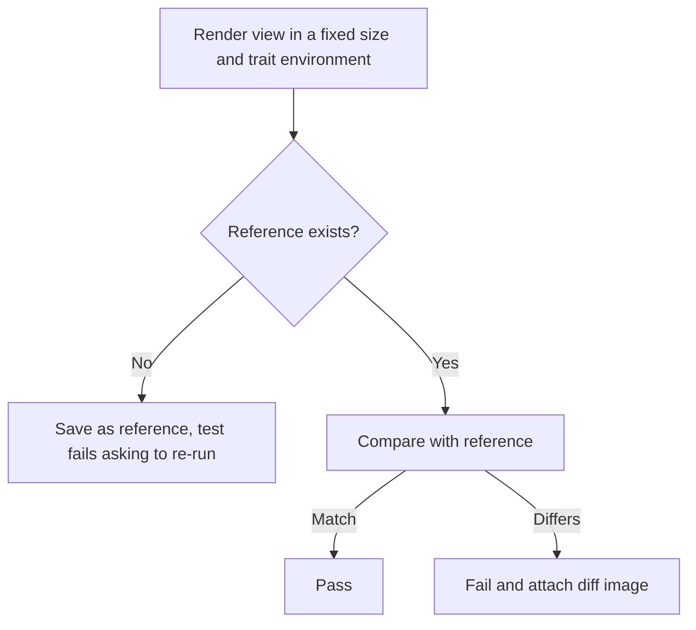
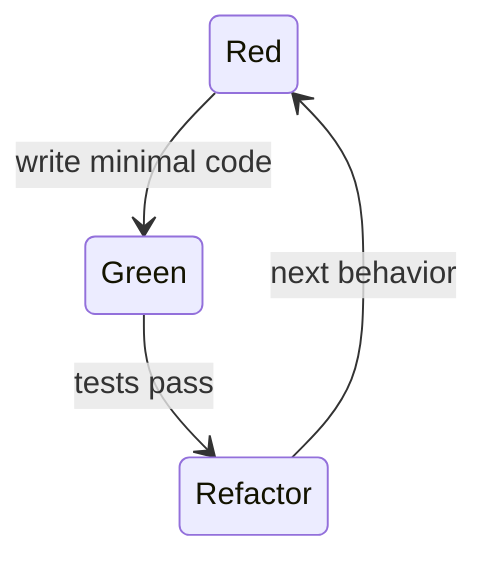
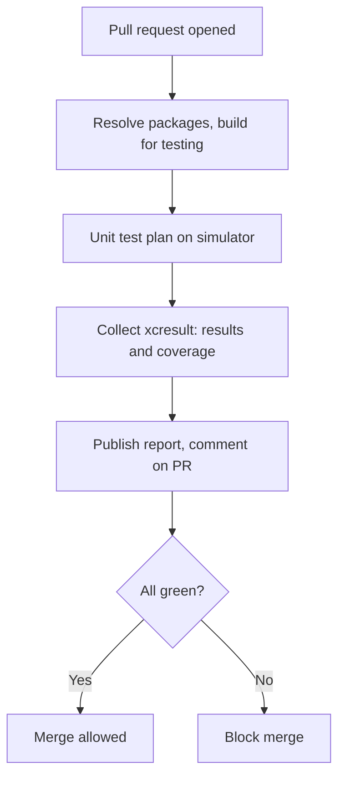

# Testing – XCTest, Swift Testing, UI Tests

[⬅ Back to index](../README.md)

Covers: testing pyramid, XCTest, Swift Testing, test doubles, testing async code, network tests, UI tests, snapshot tests, TDD, code coverage, CI.

---

### 1. What types of tests do iOS apps have?

<details>
<summary>Answer</summary>

**In short:** **Unit tests** check logic in isolation and should be the majority; **integration tests** check several real components together; **UI tests** (XCUITest) drive the app like a user and are kept for critical flows; **snapshot tests** compare rendered UI to reference images; **performance tests** measure against baselines. The **testing pyramid** says: many unit tests, fewer integration tests, few UI tests.

#### The kinds of tests

| Type | What it tests | Speed | Flakiness | Example |
|---|---|---|---|---|
| **Unit** | One type in isolation, dependencies replaced by doubles | Milliseconds | Very low | View model state, a parser, a price calculator |
| **Integration** | Several real components together | Fast to medium | Low | Repository + in-memory Core Data store; API client + `URLProtocol` stub |
| **UI (XCUITest)** | The whole app through the accessibility layer | Seconds per test | Higher | Login → home screen → purchase |
| **Snapshot** | How a view looks | Fast | Medium (rendering differences) | A cell in dark mode at large Dynamic Type |
| **Performance** | Speed and resource use | Varies | Needs a stable device | Parsing a 10k-item feed, launch time |

#### The testing pyramid



Why this shape: unit tests are fast, reliable and point at the exact broken line, so they give the most feedback per second. UI tests catch wiring problems that nothing else catches, but they are slow, more fragile and harder to debug, so you keep them for flows where a break would be serious (sign-in, checkout, onboarding).

#### What to test where

- **Business logic** (validation, formatting, state transitions): unit tests.
- **Persistence and networking code**: integration tests with an in-memory store or stubbed `URLProtocol`.
- **Layouts and visual states**: snapshot tests.
- **End-to-end flows**: a small set of UI tests.

#### Pitfalls

- The "ice-cream cone": mostly UI tests, few unit tests, leading to slow and flaky CI.
- Unit tests that mock everything, including the logic you meant to test.

#### Likely follow-ups

- **Which frameworks?** XCTest for all types; Swift Testing for unit and integration tests; XCUITest (part of XCTest) for UI.
- **Why are UI tests slow?** They launch the app in a separate process and wait for real UI and animations.

</details>

### 2. What is XCTest? Explain the test lifecycle.

<details>
<summary>Answer</summary>

**In short:** XCTest is Apple's original testing framework. You subclass `XCTestCase` and write methods whose names start with `test`. For **each** test method, XCTest creates a **new instance** of the class, calls `setUp`, runs the test, then calls `tearDown`; class-level `setUp`/`tearDown` run once around the whole class. Assertions are functions like `XCTAssertEqual` and `XCTUnwrap`.

#### The lifecycle



- **`setUp()` / `setUpWithError()` / `setUp() async throws`**: run before each test; create the system under test (SUT) and its doubles.
- **`tearDown()` / `tearDownWithError()` / `tearDown() async throws`**: run after each test; clean up files, reset state.
- **`addTeardownBlock { }`**: registers cleanup from inside a test or helper; teardown blocks run before `tearDown()` in reverse order of registration.
- **`class func setUp()` / `class func tearDown()`**: once per test class, for expensive shared setup.

Because each test gets a new instance, instance properties don't leak between tests. Static or global state still does, which is a common source of order-dependent failures.

#### Example

```swift
import XCTest
@testable import Shop

final class CartTests: XCTestCase {
    private var sut: Cart!
    private var storage: InMemoryCartStorage!

    override func setUpWithError() throws {
        storage = InMemoryCartStorage()
        sut = Cart(storage: storage)
    }

    override func tearDownWithError() throws {
        sut = nil
        storage = nil
    }

    func test_add_increasesTotal() {
        sut.add(Item(price: 10))
        XCTAssertEqual(sut.total, 10)
    }

    func test_load_throwsWhenStorageCorrupt() throws {
        storage.isCorrupt = true
        XCTAssertThrowsError(try sut.load())
    }

    func test_firstItem_hasPrice() throws {
        sut.add(Item(price: 5))
        let first = try XCTUnwrap(sut.items.first)   // fails the test cleanly instead of crashing
        XCTAssertEqual(first.price, 5)
    }
}
```

#### Common assertions

| Assertion | Use |
|---|---|
| `XCTAssertEqual(a, b)` / `XCTAssertNotEqual` | Equality (with `accuracy:` for floating point) |
| `XCTAssertTrue` / `XCTAssertFalse` | Boolean conditions |
| `XCTAssertNil` / `XCTAssertNotNil` | Optionals |
| `XCTAssertThrowsError` / `XCTAssertNoThrow` | Error paths |
| `XCTUnwrap` | Unwrap an optional or fail the test |
| `XCTFail("message")` | Unconditional failure (e.g. unexpected branch) |

`@testable import` gives tests access to `internal` symbols of the module.

#### Pitfalls

- Setting `continueAfterFailure = false` is useful in UI tests so a failure stops the test instead of cascading.
- Forgetting to nil out properties isn't a leak between tests (new instance each time), but XCTest keeps test case instances alive until the run ends, so heavy objects should be released in `tearDown`.

#### Likely follow-ups

- **Why a new instance per test?** Isolation: no test sees another's instance state.
- **What does `@testable` do?** Compiles the module with testing enabled so tests can access `internal` declarations.

</details>

### 3. What is Swift Testing? How is it different from XCTest?

<details>
<summary>Answer</summary>

**In short:** **Swift Testing** (Xcode 16, open source) is Apple's modern, macro-based test framework. Tests are `@Test` functions, often grouped in `struct` suites where `init`/`deinit` replace setUp/tearDown; one `#expect` macro replaces the many `XCTAssert*` functions; `#require` stops the test on failure; tests can be parameterized and tagged with traits; and they run in parallel by default. It coexists with XCTest, but **UI tests and performance tests still use XCTest**.

#### Example

```swift
import Testing

@Suite("Cart")
struct CartTests {
    let cart = Cart()          // fresh instance per test (init = setUp)

    @Test("Adding item increases total")
    func addItem() {
        cart.add(.init(price: 10))
        #expect(cart.total == 10)
    }

    @Test(arguments: [0, 1, 5])
    func quantity(_ count: Int) throws {
        let item = try #require(Item.sample(count: count))
        #expect(item.count == count)
    }
}
```

#### How it works

- `@Test` and `@Suite` are **macros**; the framework discovers tests at compile time instead of relying on Objective-C runtime reflection and `test` name prefixes.
- A suite is usually a `struct`. Each test runs on a **new instance**, so stored properties initialized in `init` act as per-test setup, and a class or actor suite can use `deinit` for teardown.
- `#expect(cart.total == 10)` captures the **expression itself**, so a failure prints both sides (`cart.total → 8`), without needing `XCTAssertEqual` vs `XCTAssertGreaterThan` variants.
- `#require` throws when its condition fails, ending the test; with an optional it unwraps the value.

#### Differences from XCTest

| | XCTest | Swift Testing |
|---|---|---|
| Declaring tests | `XCTestCase` subclass, `test` prefix | `@Test` functions, any name, optional `@Suite` |
| Setup / teardown | `setUp` / `tearDown` | `init` / `deinit` |
| Assertions | Many `XCTAssert*` functions | `#expect`, `#require` |
| Parameterized tests | Loops or duplicated tests | `@Test(arguments:)`; each argument shows as its own case |
| Organization | Classes, test plans | Suites, **tags**, traits |
| Conditional / disabled | `XCTSkip`, renaming | `.enabled(if:)`, `.disabled("reason")`, `.bug(...)`, `.timeLimit(...)` |
| Parallelism | Opt in, multiple processes | **In-process, parallel by default**; `.serialized` to opt out |
| Async events | `XCTestExpectation` | `confirmation { }` |
| UI and performance tests | Yes | No, use XCTest |

#### Traits in practice

```swift
extension Tag { @Tag static var networking: Self }

@Test(.tags(.networking), .timeLimit(.minutes(1)))
func fetchesProfile() async throws { /* ... */ }

@Test(.enabled(if: FeatureFlags.newCheckout))
func newCheckoutFlow() { /* ... */ }

@Test(.disabled("Flaky on CI"), .bug("https://example.com/issues/123"))
func syncConflict() { /* ... */ }
```

#### Migration

Both frameworks can live in the same test target, so teams typically write new unit tests in Swift Testing and migrate old ones gradually. Don't mix them inside one test: `XCTAssert` inside an `@Test` function isn't the intended usage.

#### Pitfalls

- Parallel-by-default exposes tests that share global state (singletons, `UserDefaults.standard`, files); fix the isolation or mark the suite `.serialized`.
- `#expect` doesn't stop the test; use `#require` when later lines depend on the condition.

#### Likely follow-ups

- **Why `struct` suites?** Value semantics and a fresh instance per test make isolation the default.
- **Can Swift Testing run in Xcode Cloud / `xcodebuild`?** Yes, it integrates with Xcode's test runner and `swift test`.

</details>

### 4. What are test doubles? Mock vs Stub vs Fake vs Spy?

<details>
<summary>Answer</summary>

**In short:** Test doubles are stand-ins for real dependencies. A **dummy** only fills a parameter, a **stub** returns canned data, a **spy** records calls so you can assert on them, a **mock** is set up with expectations and verifies the interactions itself, and a **fake** is a working lightweight implementation like an in-memory repository. In Swift they are usually hand-written protocol conformances, since there is no runtime mocking like Mockito.

#### Why doubles exist

A unit test should be fast, deterministic and focused on one type. Real dependencies (network, database, clock, analytics) are slow, flaky or have side effects. Replacing them lets you control inputs ("the server returns 500") and observe outputs ("the error was logged once").

#### The five kinds

| Double | Behavior | Used to check | Example |
|---|---|---|---|
| **Dummy** | Nothing; never called | Nothing; satisfies a signature | `Logger` passed to an initializer the test doesn't care about |
| **Stub** | Returns predefined values | **State** of the SUT given that input | `getUser()` always returns `.sample` |
| **Spy** | Records calls and arguments | **Interactions**, asserted by the test afterwards | `saveCallCount == 1`, `lastSavedUser == user` |
| **Mock** | Preconfigured expectations; verifies itself | **Interactions**, verified by the double | `mock.expect(save: user)` then `mock.verify()` |
| **Fake** | Real, simplified logic | Behavior with a realistic collaborator | In-memory repository backed by a dictionary |

In everyday speech, many developers call all of these "mocks"; in interviews it's worth showing you know the difference, especially **stub (controls inputs) vs spy/mock (checks outputs)**.

#### Swift example

```swift
protocol UserRepository {
    func user(id: String) async throws -> User
    func save(_ user: User) async throws
}

// Stub + spy in one hand-written type (very common in practice)
final class UserRepositorySpy: UserRepository {
    var stubbedUser: Result<User, Error> = .success(.sample)
    private(set) var savedUsers: [User] = []

    func user(id: String) async throws -> User { try stubbedUser.get() }
    func save(_ user: User) async throws { savedUsers.append(user) }
}

// Fake: actually works, just not with a real database
actor InMemoryUserRepository: UserRepository {
    private var storage: [String: User] = [:]
    func user(id: String) async throws -> User {
        guard let user = storage[id] else { throw NotFound() }
        return user
    }
    func save(_ user: User) async throws { storage[user.id] = user }
}
```

#### Why hand-written in Swift

Swift (for pure Swift types) has no runtime that lets a library intercept arbitrary method calls the way Mockito does on the JVM. So you design for testability with **protocols** (or closures) and write conformances. Code generators like **Sourcery**, or Swift macros from third-party libraries, can generate the boilerplate.

#### Pitfalls

- Over-mocking: verifying every internal call ties tests to implementation details and makes refactoring painful. Prefer checking state where possible.
- Fakes that drift from the real implementation; cover the real one with integration tests.

#### Likely follow-ups

- **When would you use a fake over a stub?** When the SUT does several reads and writes that should be consistent, e.g. save then load.
- **Closures instead of protocols?** A struct of closures (`var fetch: () async throws -> User`) is a lightweight alternative that makes per-test overrides easy.

</details>

### 5. How do you unit test a ViewModel?

<details>
<summary>Answer</summary>

**In short:** Inject the view model's dependencies as protocols, replace them with test doubles, call its inputs (methods), and assert on its **state outputs**. Cover success and error paths, and make async work **awaitable** (make the method `async` or return the `Task`) so the test doesn't have to guess when it finished.

#### The view model under test

```swift
protocol ProfileService {
    func fetch() async throws -> Profile
}

@MainActor
@Observable
final class ProfileViewModel {
    enum State: Equatable { case idle, loading, loaded(Profile), failed(String) }

    private(set) var state: State = .idle
    private let service: ProfileService

    init(service: ProfileService) { self.service = service }

    func load() async {                // async, so tests can await it
        state = .loading
        do {
            state = .loaded(try await service.fetch())
        } catch {
            state = .failed("Couldn't load profile")
        }
    }
}
```

#### The tests

```swift
final class MockProfileService: ProfileService {
    var result: Result<Profile, Error> = .success(.sample)
    private(set) var fetchCount = 0
    func fetch() async throws -> Profile { fetchCount += 1; return try result.get() }
}

@MainActor
struct ProfileViewModelTests {
    @Test func loadSuccess() async {
        let service = MockProfileService()
        let sut = ProfileViewModel(service: service)
        await sut.load()
        #expect(sut.state == .loaded(.sample))
        #expect(service.fetchCount == 1)
    }

    @Test func loadFailureShowsError() async {
        let service = MockProfileService(); service.result = .failure(URLError(.notConnectedToInternet))
        let sut = ProfileViewModel(service: service)
        await sut.load()
        guard case .failed = sut.state else { Issue.record("Expected failure"); return }
    }
}
```

#### What makes this testable

1. **Dependency injection**: the service comes in through `init` as a protocol, so the test controls its result.
2. **State as output**: the view model exposes one `state` value that the view renders. Tests assert on it instead of inspecting UI.
3. **Awaitable work**: because `load()` is `async`, the test awaits it and then asserts. If the view model starts work internally with `Task { }` and returns immediately, the test has no reliable way to know when to check.

```swift
// Hard to test: fire-and-forget
func onAppear() { Task { await load() } }

// Testable alternative: return the task so tests can await it
@discardableResult
func onAppear() -> Task<Void, Never> { Task { await load() } }
// In the test: await sut.onAppear().value
```

4. **Main actor**: the view model is `@MainActor`, so the test suite is too, and accessing `state` needs no hops.

#### What to cover

- Initial state.
- Success, failure, and empty results.
- Intermediate states (e.g. `.loading`) if the UI depends on them; a controllable service (one that suspends until the test resumes it) lets you observe them.
- User actions: retry after failure, pull to refresh, input validation.

#### Pitfalls

- Using `sleep` or arbitrary delays to "wait for" async work.
- Testing the view model through the view (slow, brittle) instead of directly.

#### Likely follow-ups

- **How do you test a Combine/`@Published` view model?** Collect values from the publisher (or `$state.values`) and assert on the sequence.
- **Should the view model know about UIKit/SwiftUI?** Ideally not, which keeps it testable without a UI.

</details>

### 6. How do you test asynchronous code?

<details>
<summary>Answer</summary>

**In short:** For async/await code, make the test `async` and `await` the call. For callbacks and delegates in XCTest, create an `expectation`, `fulfill()` it in the callback, and `await fulfillment(of:timeout:)`. In Swift Testing, use `confirmation { }`. For Combine, collect values or iterate `publisher.values`. Control time by injecting a `Clock` or scheduler; never use real sleeps.

#### async/await: the simple case

```swift
@Test func fetchesUser() async throws {
    let sut = UserLoader(api: StubAPI(user: .sample))
    let user = try await sut.load()
    #expect(user == .sample)
}
```

Both XCTest (`func testX() async throws`) and Swift Testing support this directly.

#### Callbacks and delegates in XCTest

```swift
func test_download_callsCompletion() async {
    let exp = expectation(description: "completion called")
    var received: Data?

    sut.download(url) { data in
        received = data
        exp.fulfill()
    }

    await fulfillment(of: [exp], timeout: 1)   // in non-async tests: wait(for: [exp], timeout: 1)
    XCTAssertNotNil(received)
}
```

Useful options: `expectedFulfillmentCount` (must fire N times) and `isInverted = true` (fails if it **is** fulfilled, to check something does *not* happen).

#### Swift Testing: confirmations

```swift
@Test func notifiesObserverOnce() async {
    let sut = Store()
    await confirmation(expectedCount: 1) { confirm in
        sut.onChange = { confirm() }
        await sut.update(value: 42)
    }
}
```

A confirmation must be confirmed the expected number of times **before the closure returns**; it doesn't wait for later events, so the work inside must be awaitable.

#### Combine

```swift
func test_search_emitsResults() async {
    let sut = SearchViewModel(api: StubAPI())
    var iterator = sut.$results.values.makeAsyncIterator()

    sut.query = "swift"
    _ = await iterator.next()                 // initial value
    let results = await iterator.next()
    XCTAssertEqual(results?.count, 3)
}
```

Alternatively, `sink` into an array and fulfill an expectation when enough values arrive.

#### Controlling time

Code that waits (debounce, retry with backoff, timeouts) should take its clock as a dependency so tests don't actually wait.

```swift
struct Retrier<C: Clock> where C.Duration == Duration {
    let clock: C
    func run(_ op: () async throws -> Void) async throws {
        for attempt in 0..<3 {
            do { return try await op() }
            catch { try await clock.sleep(for: .seconds(1 << attempt)) }
        }
    }
}
// Production: Retrier(clock: ContinuousClock())
// Tests: a test clock that advances instantly (e.g. from swift-clocks), or a custom Clock
```

For Combine, the same idea uses an injected scheduler (e.g. a test scheduler from a library such as combine-schedulers).

#### Pitfalls

- Timeouts that are too short pass locally and fail on slow CI machines; too long makes failures slow.
- Forgetting to await: the test ends before the work runs and passes falsely.
- `Task { }` started inside the SUT with no handle to await.

#### Likely follow-ups

- **What's an inverted expectation?** One that fails the test if it is fulfilled within the timeout.
- **Why is `sleep` bad in tests?** It is slow and still not guaranteed to be long enough, so it causes flakiness.

</details>

### 7. How do you test networking without hitting the server?

<details>
<summary>Answer</summary>

**In short:** Test the layers **above** the network with a mock `APIClient` protocol. Test the network client **itself** with a `URLProtocol` subclass registered in an ephemeral `URLSessionConfiguration`, which intercepts requests and returns canned responses, so the real `URLSession`, request building and decoding are all exercised. Keep sample JSON as **fixtures** in the test bundle.

#### Two levels



- **View models, repositories:** depend on an `APIClient` protocol; tests pass a stub returning models or errors. No HTTP at all.
- **The API client:** needs to prove it builds the right request (method, path, headers, body) and handles responses (status codes, decoding). For that, intercept at the URL loading system.

#### `URLProtocol` stub

```swift
final class MockURLProtocol: URLProtocol {
    nonisolated(unsafe) static var handler: ((URLRequest) throws -> (HTTPURLResponse, Data))?
    override class func canInit(with request: URLRequest) -> Bool { true }
    override class func canonicalRequest(for r: URLRequest) -> URLRequest { r }
    override func startLoading() {
        do {
            let (response, data) = try Self.handler!(request)
            client?.urlProtocol(self, didReceive: response, cacheStoragePolicy: .notAllowed)
            client?.urlProtocol(self, didLoad: data)
            client?.urlProtocolDidFinishLoading(self)
        } catch { client?.urlProtocol(self, didFailWithError: error) }
    }
    override func stopLoading() {}
}
```

#### Using it

```swift
final class APIClientTests: XCTestCase {
    private var sut: APIClient!

    override func setUp() {
        let config = URLSessionConfiguration.ephemeral
        config.protocolClasses = [MockURLProtocol.self]
        sut = APIClient(session: URLSession(configuration: config),
                        baseURL: URL(string: "https://api.example.com")!)
    }

    override func tearDown() { MockURLProtocol.handler = nil }

    func test_fetchUser_buildsRequestAndDecodes() async throws {
        MockURLProtocol.handler = { request in
            XCTAssertEqual(request.url?.path, "/users/42")
            XCTAssertEqual(request.httpMethod, "GET")
            let response = HTTPURLResponse(url: request.url!, statusCode: 200,
                                           httpVersion: nil, headerFields: nil)!
            return (response, try fixture("user.json"))
        }

        let user = try await sut.user(id: 42)
        XCTAssertEqual(user.name, "Ada")
    }

    func test_fetchUser_mapsServerError() async {
        MockURLProtocol.handler = { request in
            (HTTPURLResponse(url: request.url!, statusCode: 500, httpVersion: nil, headerFields: nil)!, Data())
        }
        do {
            _ = try await sut.user(id: 42)
            XCTFail("Expected error")
        } catch {
            XCTAssertEqual(error as? APIError, .server(status: 500))
        }
    }
}
```

#### Fixtures

Store real-looking JSON responses (`user.json`, `feed-empty.json`, `feed-malformed.json`) in the test bundle and load them with `Bundle(for:)` or `Bundle.module` (SwiftPM). They double as decoding tests and documentation of the API contract.

#### Pitfalls

- The static `handler` is shared global state: tests using it must not run in parallel with each other (in Swift Testing, mark the suite `.serialized`), and it must be reset after each test.
- When the request has a body sent as a stream, `request.httpBody` may be nil inside the protocol; read `httpBodyStream` instead.
- Testing against a live staging server in unit tests makes them slow and flaky; keep that for separate end-to-end suites.

#### Likely follow-ups

- **Why not just mock `URLSession`?** Mocking the session skips the real request handling; `URLProtocol` tests the client with the real session.
- **How do you stub the network in UI tests?** Launch arguments tell the app to use a local stub server or a mock client.

</details>

### 8. How do UI tests (XCUITest) work?

<details>
<summary>Answer</summary>

**In short:** UI tests run in a **separate process** from the app and drive it through the **accessibility layer**: they find elements by type and identifier, tap and type, and assert on what's on screen. Good UI tests use stable `accessibilityIdentifier`s, launch arguments to stub the network and reset state, `waitForExistence` instead of sleeps, and the Page Object pattern, and cover only critical journeys.

#### How it works



Because the test is a different process, it **cannot** call your code or read your objects. It only sees what accessibility exposes: element types (buttons, text fields, static texts), identifiers, labels and values. That makes UI tests "black box": they test what a user experiences.

#### A basic test

```swift
let app = XCUIApplication()
app.launchArguments = ["-uiTesting"]          // switch to mock data
app.launch()
app.textFields["emailField"].tap()
app.textFields["emailField"].typeText("a@b.com")
app.buttons["loginButton"].tap()
XCTAssertTrue(app.staticTexts["Welcome"].waitForExistence(timeout: 5))
```

In the app, set identifiers that don't change with language or copy:

```swift
emailField.accessibilityIdentifier = "emailField"   // UIKit
TextField("Email", text: $email).accessibilityIdentifier("emailField")   // SwiftUI
```

And read the launch argument to swap in test dependencies:

```swift
let isUITesting = ProcessInfo.processInfo.arguments.contains("-uiTesting")
let api: APIClient = isUITesting ? StubAPIClient() : LiveAPIClient()
```

#### Page Object pattern

Wrap each screen's elements and actions in a type so tests read like user stories and selectors live in one place:

```swift
struct LoginScreen {
    let app: XCUIApplication
    var email: XCUIElement { app.textFields["emailField"] }
    var loginButton: XCUIElement { app.buttons["loginButton"] }

    @discardableResult
    func login(email value: String) -> HomeScreen {
        email.tap(); email.typeText(value)
        loginButton.tap()
        return HomeScreen(app: app)
    }
}

func test_login_showsHome() {
    let home = LoginScreen(app: app).login(email: "a@b.com")
    XCTAssertTrue(home.welcome.waitForExistence(timeout: 5))
}
```

#### Best practices

- **Stable identifiers**, not visible text, which changes with localization.
- **Deterministic state:** launch arguments/environment to stub the network, reset persisted data, skip onboarding, and disable animations.
- **Wait for conditions** (`waitForExistence(timeout:)`, or `XCTNSPredicateExpectation`) instead of `sleep`.
- **Few tests**, focused on critical journeys; push logic checks down to unit tests.
- `continueAfterFailure = false` so a failure stops the test before it causes confusing follow-on failures.
- Xcode can **record** UI interactions to generate starter code, which you then clean up.

#### Pitfalls

- Elements not found because they lack accessibility (custom drawn views) or are combined into one accessibility element.
- System alerts (permissions) block the flow; handle them with `addUIInterruptionMonitor` or pre-grant state.
- Tests depending on each other's leftover state.

#### Likely follow-ups

- **Why are UI tests flaky?** Timing, animations, real network, shared state and system dialogs.
- **Can UI tests access app code?** No, only through launch arguments, environment variables and what accessibility exposes.

</details>

### 9. What is snapshot testing?

<details>
<summary>Answer</summary>

**In short:** Snapshot testing renders a view or view controller and compares the result **pixel by pixel** (or as a text dump) to a stored reference. The first run records the reference; later runs fail if the output differs. It catches unintended visual changes across devices, Dynamic Type sizes, dark mode and locales. The popular library is **swift-snapshot-testing** (Point-Free). Record on a fixed simulator and OS version to avoid noise.

#### Why it's useful

Unit tests check logic; UI tests check flows. Neither notices that a label is now clipped at the largest text size, or that a color changed in dark mode. Snapshot tests make the **appearance** of a screen a reviewable artifact: when it changes, the diff shows exactly what changed, and the reviewer decides whether it was intended.

#### How it works



#### Example with swift-snapshot-testing

```swift
import SnapshotTesting
import XCTest
@testable import Shop

final class ProductCellSnapshotTests: XCTestCase {
    func test_productCell_states() {
        let view = ProductCell(product: .sample)   // SwiftUI view

        assertSnapshot(of: view, as: .image(layout: .device(config: .iPhone13)))

        assertSnapshot(of: view,
                       as: .image(layout: .device(config: .iPhone13),
                                  traits: .init(userInterfaceStyle: .dark)),
                       named: "dark")

        assertSnapshot(of: view,
                       as: .image(layout: .device(config: .iPhone13),
                                  traits: .init(preferredContentSizeCategory: .accessibilityExtraLarge)),
                       named: "xl-text")
    }
}
```

References are stored as image files next to the tests and committed to the repository. Besides images, the library has text strategies such as `.dump` and `.recursiveDescription` (view hierarchy), and you can snapshot JSON or `URLRequest`s too.

#### What to snapshot

- Reusable components in each state (loading, empty, error, long text).
- Accessibility sizes, dark mode, right-to-left layouts.
- Screens filled with fixed sample data.

#### Pitfalls

- **Rendering noise:** different simulator models, OS versions or CPU architectures can produce slightly different pixels. Pin the simulator and OS in CI, and use a small `precision`/`perceptualPrecision` tolerance if needed.
- Dynamic content (dates, random images, network images) must be stubbed.
- Re-recording every failure without looking turns the test into a rubber stamp; review the diffs.
- Large reference images bloat the repository; keep the number of snapshots focused.

#### Likely follow-ups

- **Snapshot vs UI test?** Snapshots check appearance quickly without launching the app; UI tests check behavior across screens.
- **How do you update references?** Run with recording enabled (the library's record mode), then review and commit the new images.

</details>

### 10. How do you make code testable?

<details>
<summary>Answer</summary>

**In short:** Inject dependencies (preferably as protocols or closures) instead of reaching for singletons, keep logic in **pure functions** and view models separate from UI, inject sources of non-determinism (**time, randomness, UUIDs, locale, file system**), keep types small with one responsibility, and avoid static mutable state.

#### The core idea

Code is hard to test when it **creates or grabs its own dependencies** or depends on things the test can't control. Testable code receives what it needs, so a test can hand it doubles and predictable inputs.

#### Before and after

```swift
// Hard to test: hidden dependencies on singletons, the clock and the network
final class SubscriptionChecker {
    func isActive() async -> Bool {
        let user = try? await APIClient.shared.currentUser()
        return (user?.expiry ?? .distantPast) > Date()
    }
}

// Testable: dependencies injected, logic is pure
struct SubscriptionChecker {
    let fetchUser: () async throws -> User
    let now: () -> Date

    func isActive() async -> Bool {
        guard let user = try? await fetchUser() else { return false }
        return Self.isActive(expiry: user.expiry, now: now())
    }

    // Pure function: trivially testable with many inputs
    static func isActive(expiry: Date, now: Date) -> Bool { expiry > now }
}

// Production
let checker = SubscriptionChecker(fetchUser: APIClient.shared.currentUser, now: Date.init)

// Test
@Test func expiredSubscriptionIsInactive() async {
    let checker = SubscriptionChecker(fetchUser: { .init(expiry: .init(timeIntervalSince1970: 0)) },
                                      now: { .init(timeIntervalSince1970: 100) })
    #expect(await checker.isActive() == false)
}
```

#### Techniques

| Technique | Why it helps |
|---|---|
| **Initializer injection** of protocols or closures | Tests pass doubles; dependencies are visible |
| **Default arguments** (`init(api: APIClient = .live)`) | Easy call sites in production, still overridable |
| **Pure functions** for business rules | Same input, same output, no setup needed |
| **View models / presenters** separate from views | Test logic without rendering UI |
| **Inject time, randomness, UUIDs, locale** | Deterministic results (`now: () -> Date`, `Clock`, seeded generator) |
| **Abstract the file system and `UserDefaults`** | Use a temp directory or a suite-specific `UserDefaults(suiteName:)` |
| **Small types, single responsibility** | Fewer dependencies per test, clearer failures |
| **No static mutable state** | Tests don't interfere with each other, can run in parallel |

#### Pitfalls

- Creating a protocol for every type "for testability" adds noise; abstract real boundaries (network, persistence, system services), not plain value logic.
- Wrapping a singleton in a protocol but still calling `.shared` internally.

#### Likely follow-ups

- **Protocols or closures?** Protocols suit larger dependencies with several methods; closures are lighter for one or two functions.
- **How do you test code that uses `Date()`?** Inject a `now` closure or a `Clock` and pass fixed values in tests.

</details>

### 11. What is TDD?

<details>
<summary>Answer</summary>

**In short:** **Test-Driven Development** is a cycle: **Red** (write a small failing test for the next bit of behavior), **Green** (write the minimal code to make it pass), **Refactor** (clean up while the tests stay green), then repeat. It gives you testable design, regression safety and tests that document behavior. In interviews, show you understand it, even if you apply it pragmatically.

#### The cycle



#### A small worked example

Requirement: a password is valid if it has at least 8 characters and one digit.

**Red:** write the first test; it doesn't compile or fails.

```swift
@Test func shortPasswordIsInvalid() {
    #expect(PasswordValidator.isValid("abc1") == false)
}
```

**Green:** simplest code that passes.

```swift
enum PasswordValidator {
    static func isValid(_ password: String) -> Bool { password.count >= 8 }
}
```

**Red** again, for the next rule:

```swift
@Test func passwordWithoutDigitIsInvalid() {
    #expect(PasswordValidator.isValid("abcdefgh") == false)
}
```

**Green:**

```swift
static func isValid(_ password: String) -> Bool {
    password.count >= 8 && password.contains(where: \.isNumber)
}
```

**Refactor:** e.g. extract named rules if the list grows, keeping all tests green.

#### Why it helps

- **Design:** writing the test first forces you to define the API from the caller's point of view and to inject dependencies, which leads to decoupled code.
- **Confidence:** every behavior has a test, so refactoring is safe.
- **Focus:** small steps keep you from building more than needed.
- **Documentation:** the tests describe what the code does.

#### Where it's harder in iOS

- UI layout and animations are awkward to test-drive; TDD fits view models, services, parsers and business rules best.
- Exploratory work (spikes, prototypes) is often done without tests, then rewritten test-first.

#### Pitfalls

- Writing big tests that need lots of code before going green defeats the short feedback loop.
- Skipping the refactor step, which leaves "minimal" code messy.
- Testing implementation details, which makes the tests break on every refactor.

#### Likely follow-ups

- **Do you use TDD every day?** A pragmatic answer: for logic-heavy code and bug fixes (write a failing test reproducing the bug first), less for UI.
- **TDD vs writing tests after?** Both produce tests; test-first tends to produce more testable designs and avoids skipping tests under time pressure.

</details>

### 12. What is code coverage and how much is enough?

<details>
<summary>Answer</summary>

**In short:** Code coverage is the percentage of code executed while the tests run. Enable "Gather coverage" in the scheme or test plan, view it in Xcode's report, and export it with `xccov` (or tools like Slather) in CI. Aim for meaningful coverage of **business logic** (view models, services, parsers) rather than a number; 100% isn't the goal, because coverage shows **untested** code, not test **quality**.

#### How to get it

1. Edit the scheme (or test plan) → Test → Options → **Code Coverage** → gather coverage for the relevant targets.
2. Run the tests. Open the **Report navigator** → the test run → **Coverage** to see percentages per file and function; in the editor, the gutter shows how many times each line ran (red stripes mark lines never executed).
3. In CI, the data is inside the `.xcresult` bundle:

```bash
xcodebuild test -scheme App -testPlan Unit \
  -destination 'platform=iOS Simulator,name=iPhone 16' \
  -resultBundlePath build/Unit.xcresult

xcrun xccov view --report build/Unit.xcresult                         # human-readable report
xcrun xccov view --report --json build/Unit.xcresult > coverage.json  # JSON for dashboards or gates
```

Tools like Slather convert coverage to formats that services such as Codecov or SonarQube read.

#### Why a high number can lie

```swift
func discount(for total: Double) -> Double {
    total > 100 ? total * 0.1 : 0
}

@Test func discountRuns() {
    _ = discount(for: 150)     // line is covered, nothing is asserted
}
```

That test executes the function but checks nothing. Coverage also doesn't tell you whether edge cases (exactly 100, negative totals) are tested.

#### How much is enough?

| Code | Sensible target |
|---|---|
| Business logic, view models, parsers, formatters | High (often 80%+) |
| Networking and persistence glue | Covered by integration tests |
| Views and layout code | Low via coverage; use snapshot/UI tests for critical screens |
| Generated code, simple pass-through | Exclude or ignore |

Useful team practices: track the trend over time, and look at coverage of **changed lines** in pull requests instead of a global threshold that people game.

#### Pitfalls

- UI tests inflate coverage numbers because they execute lots of code without asserting on most of it.
- A hard global gate (e.g. "must be 90%") encourages assertion-free tests.

#### Likely follow-ups

- **What does coverage not measure?** Assertion quality, edge cases, concurrency issues and whether the behavior is correct.
- **How else can you judge test quality?** Mutation testing (change the code and see whether tests fail), and how often bugs reach production in covered areas.

</details>

### 13. How do you test for memory leaks in unit tests?

<details>
<summary>Answer</summary>

**In short:** After the test, check that the objects you created have been deallocated. Register a teardown block that holds a **weak** reference to the instance and asserts it's `nil`; if something (usually a retain cycle) still holds it, the test fails. Call this helper on the SUT and its collaborators in each test.

#### The helper

```swift
extension XCTestCase {
    func trackForMemoryLeaks(_ instance: AnyObject, file: StaticString = #filePath, line: UInt = #line) {
        addTeardownBlock { [weak instance] in
            XCTAssertNil(instance, "Instance should have been deallocated. Potential memory leak.", file: file, line: line)
        }
    }
}
```

#### How it works

1. The test creates the SUT, usually in a factory method, and calls `trackForMemoryLeaks(sut)`.
2. The test runs, then its local variables go out of scope.
3. Teardown blocks run after the test body. If nothing else holds the object, ARC has released it and the weak reference is `nil`.
4. If a retain cycle exists, the object is still alive and the assertion fails, pointing at the line where tracking started (thanks to `file`/`line`).

#### Example catching a cycle

```swift
final class FeedViewModel {
    var onUpdate: (() -> Void)?
    let loader: FeedLoader
    init(loader: FeedLoader) {
        self.loader = loader
        loader.onFinish = { self.onUpdate?() }   // leak: loader -> closure -> self -> loader
        // Fix: loader.onFinish = { [weak self] in self?.onUpdate?() }
    }
}

final class FeedViewModelTests: XCTestCase {
    func test_init_doesNotLeak() {
        let sut = makeSUT()
        _ = sut   // exercise as needed
    }

    private func makeSUT(file: StaticString = #filePath, line: UInt = #line) -> FeedViewModel {
        let loader = FeedLoader()
        let sut = FeedViewModel(loader: loader)
        trackForMemoryLeaks(loader, file: file, line: line)
        trackForMemoryLeaks(sut, file: file, line: line)
        return sut
    }
}
```

With the strong `self` capture, both assertions fail; with `[weak self]`, they pass.

#### Notes

- If the test case itself holds the SUT in a stored property, nil it out in `tearDown` or create it locally; otherwise the test instance keeps it alive and the check is meaningless.
- Objects retained by asynchronous work that hasn't finished yet (a running `Task`, a pending network callback) will also be reported; make sure the work completes or is cancelled before teardown.
- Swift Testing has no `addTeardownBlock`; a similar effect is possible with a weak reference checked at the end of the test, or by keeping leak tests in XCTest.

#### Complementary tools

Xcode's **Memory Graph** debugger and Instruments **Leaks** find leaks interactively; this unit-test technique prevents them from coming back.

#### Likely follow-ups

- **Most common iOS retain cycles?** Closures capturing `self` strongly, strong delegate properties, and timers/observers retaining their targets.
- **Why `weak` and not `unowned` in the teardown block?** `unowned` would crash when accessed after deallocation; `weak` safely becomes `nil`.

</details>

### 14. What are Test Plans and how do you run tests in CI?

<details>
<summary>Answer</summary>

**In short:** A **Test Plan** (`.xctestplan`) describes which tests to run and under which **configurations** (languages, regions, sanitizers, environment variables, launch arguments), plus options like parallelization, repetition and coverage. In CI, you run `xcodebuild test` with a scheme, test plan and destination on Xcode Cloud, GitHub Actions or Bitrise, keep the `.xcresult` bundle, and publish results and coverage.

#### What a test plan gives you

- **Test selection:** include or skip targets, classes or individual tests (e.g. a fast "Unit" plan for every PR and a full "Nightly" plan).
- **Configurations:** run the same tests several times with different settings, for example English and Arabic (right-to-left), or with **Address Sanitizer** and then **Thread Sanitizer**.
- **Environment:** launch arguments and environment variables per configuration.
- **Execution options:** parallel execution, randomized order, **test repetition** (until failure, retry on failure, fixed iterations) to find or tolerate flaky tests, code coverage targets, and timeouts.

A scheme can have several test plans; `xcodebuild` picks one with `-testPlan`.

#### Running in CI

```bash
xcodebuild test \
  -scheme App \
  -testPlan Unit \
  -destination 'platform=iOS Simulator,name=iPhone 16' \
  -resultBundlePath build/Unit.xcresult
```

Faster variant for larger projects: build once, test separately (useful for sharding across machines):

```bash
xcodebuild build-for-testing -scheme App -destination 'platform=iOS Simulator,name=iPhone 16'
xcodebuild test-without-building -scheme App -testPlan Unit \
  -destination 'platform=iOS Simulator,name=iPhone 16'
```

#### A typical pipeline



Nightly or pre-release, a larger plan can run UI tests, snapshot tests and sanitizer configurations, possibly on real devices.

#### CI platforms

- **Xcode Cloud:** Apple's hosted CI, configured in Xcode/App Store Connect; uses schemes and test plans directly and can distribute to TestFlight.
- **GitHub Actions, Bitrise, CircleCI, Jenkins:** run `xcodebuild` (often via fastlane `scan`) on macOS machines.

#### The `.xcresult` bundle

Contains test results, logs, screenshots and attachments from failing UI tests, and coverage. Read it with `xcrun xcresulttool` and `xcrun xccov`, or convert it to JUnit format for the CI dashboard.

#### Pitfalls

- Hard-coding a simulator name that the CI image doesn't have; pin Xcode and simulator versions.
- No cached dependencies, making each run slow.
- Ignoring flaky tests instead of tracking and fixing them; retries should be a temporary measure.

#### Likely follow-ups

- **How do you speed up CI tests?** Parallel testing, sharding with `test-without-building`, caching packages, and keeping UI tests in a separate, less frequent plan.
- **Why run with sanitizers in a separate configuration?** They slow execution and change memory layout, so they run as their own pass.

</details>

### 15. How do you deal with flaky tests?

<details>
<summary>Answer</summary>

**In short:** Find the source of non-determinism and remove it: no `sleep` (use expectations, awaitable APIs and injected clocks), isolate shared state (reset `UserDefaults` and databases, avoid singletons), stub the network, disable animations in UI tests, and make tests order-independent. Use test repetition ("run until failure") to reproduce flakiness, and quarantine flaky tests while they're fixed instead of ignoring them.

#### Why flaky tests are harmful

A test that sometimes fails without a code change teaches the team to rerun CI and ignore red builds. Then real failures get ignored too. Flaky tests must be treated as bugs.

#### Common causes and fixes

| Cause | Symptom | Fix |
|---|---|---|
| **Timing** | Passes locally, fails on slow CI | Await the actual work; use expectations and `waitForExistence`; inject a `Clock` for delays and debounce |
| **Shared state** | Fails only when run with other tests or in a different order | Fresh instances per test; temp directories; `UserDefaults(suiteName:)` cleared in teardown; no static mutable state |
| **Real network** | Fails when a server is slow or down | Stub with `URLProtocol` or mock clients |
| **Parallelism** | Fails only with parallel execution | Remove shared globals; in Swift Testing, `.serialized` for suites that must share a resource |
| **Animations and UI** | UI test taps before the element is ready | Disable animations via a launch argument (`UIView.setAnimationsEnabled(false)`); wait for elements |
| **Dates, time zones, locale** | Fails at midnight, in another time zone or language | Inject `now`, time zone, calendar and locale |
| **Randomness / unordered collections** | Different results per run | Inject a seeded generator; don't depend on `Dictionary`/`Set` iteration order |
| **System alerts** | Permission dialog blocks a UI test | `addUIInterruptionMonitor`, or reset/pre-grant permissions |

#### Example: removing a timing dependency

```swift
// Flaky: hopes 0.5s is enough
func test_search_showsResults() {
    sut.query = "swift"
    Thread.sleep(forTimeInterval: 0.5)
    XCTAssertEqual(sut.results.count, 3)
}

// Deterministic: inject the debounce clock and await the work
@Test func searchShowsResults() async {
    let clock = TestClock()                    // e.g. from swift-clocks
    let sut = SearchViewModel(api: StubAPI(), clock: clock)
    sut.query = "swift"
    await clock.advance(by: .milliseconds(300))
    await sut.waitForIdle()                    // or await the task the VM exposes
    #expect(sut.results.count == 3)
}
```

#### Finding and managing flakiness

- **Reproduce:** in Xcode, right-click a test → *Run Repeatedly* (until failure, N times), or use the test plan's repetition settings. Enable **random execution order** to expose order dependencies.
- **Investigate:** check the failing run's logs and attachments in the `.xcresult`; run with Thread Sanitizer if a race is suspected.
- **Manage:** track flaky tests in a list or dashboard; temporarily disable with a reason (`.disabled("flaky, ticket #123")` in Swift Testing, or skip in the test plan) and fix them quickly. Automatic retry-on-failure can keep CI usable, but it hides problems if it becomes permanent.

#### Likely follow-ups

- **How do you prove a fix worked?** Run the test hundreds of times with repetition and in random order without a failure.
- **What's the most common cause?** Timing assumptions, followed by shared state between tests.

</details>


### 16. What makes a good unit test? (AAA, FIRST)

<details>
<summary>Answer</summary>

**In short:** A good unit test follows **Arrange–Act–Assert** (set up, do one thing, check the outcome) and the **FIRST** principles: **F**ast, **I**ndependent, **R**epeatable, **S**elf-validating and **T**imely. It tests **behavior, not implementation details**, has a descriptive name, contains no logic of its own, and covers edge cases and error paths.

#### Arrange–Act–Assert

```swift
@Test func applyingCouponReducesTotal() {
    // Arrange
    let cart = Cart(items: [.init(price: 100)])
    // Act
    cart.apply(Coupon(percent: 10))
    // Assert
    #expect(cart.total == 90)
}
```

- **Arrange:** create the SUT and its inputs/doubles.
- **Act:** perform **one** action, the behavior under test.
- **Assert:** check the outcome.

One action per test means a failure points to exactly one behavior. Several assertions are fine if they describe the same outcome.

#### FIRST

| Letter | Meaning | Why it matters |
|---|---|---|
| **Fast** | Milliseconds per test | You run them constantly; slow tests get skipped |
| **Independent** | No shared state or order dependence | Each failure has one cause; tests can run in parallel |
| **Repeatable** | Same result everywhere: no real network, clock or randomness | No flakiness, works on CI and laptops |
| **Self-validating** | Pass or fail on its own, no reading logs | Automatable |
| **Timely** | Written with (or before) the code | Influences design; tests don't get skipped later |

#### Behavior, not implementation

```swift
// Brittle: tied to how the cart works internally
#expect(cart.discountCalculator.lastPercentApplied == 10)

// Robust: checks what the user of Cart observes
#expect(cart.total == 90)
```

If a refactor that keeps behavior the same breaks your tests, they are testing implementation details.

#### Other habits

- **Descriptive names:** `applyingExpiredCouponLeavesTotalUnchanged` tells you what broke without reading the body. Swift Testing lets you add a display name: `@Test("Expired coupon leaves total unchanged")`.
- **No logic in tests:** loops and conditionals in a test can hide bugs; use parameterized tests instead.
- **Edge cases and errors:** empty input, boundaries (exactly 100), invalid data, thrown errors.
- **Readable setup:** factory helpers (`makeSUT()`) keep Arrange short and in one place.

#### Benefits of good tests

Catching regressions early, safer refactoring, living documentation of behavior, and better design, because testable code is decoupled code.

#### Likely follow-ups

- **One assert per test?** One *behavior* per test; several assertions about that outcome are fine.
- **What's a test smell?** Long setup, mocks verifying every call, sleeps, shared mutable fixtures, and tests that only pass in a certain order.

</details>

---

[⬅ Previous: Performance](16-performance.md) · [⬅ Back to index](../README.md) · [Next: Security & Privacy ➡](18-security-privacy.md)
