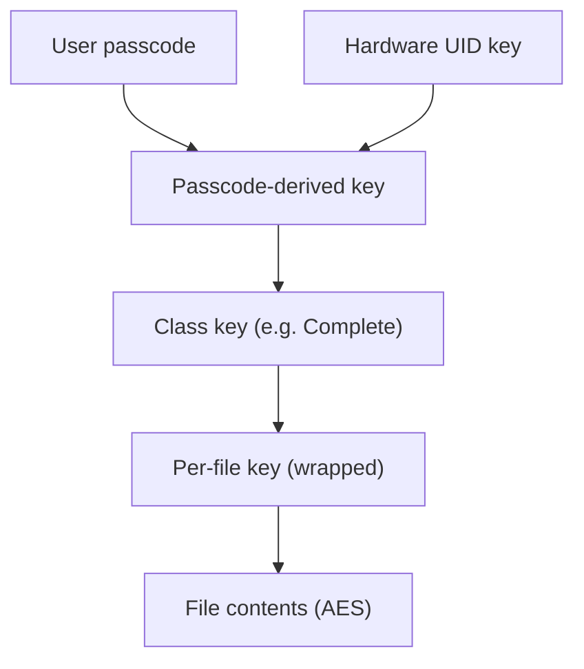
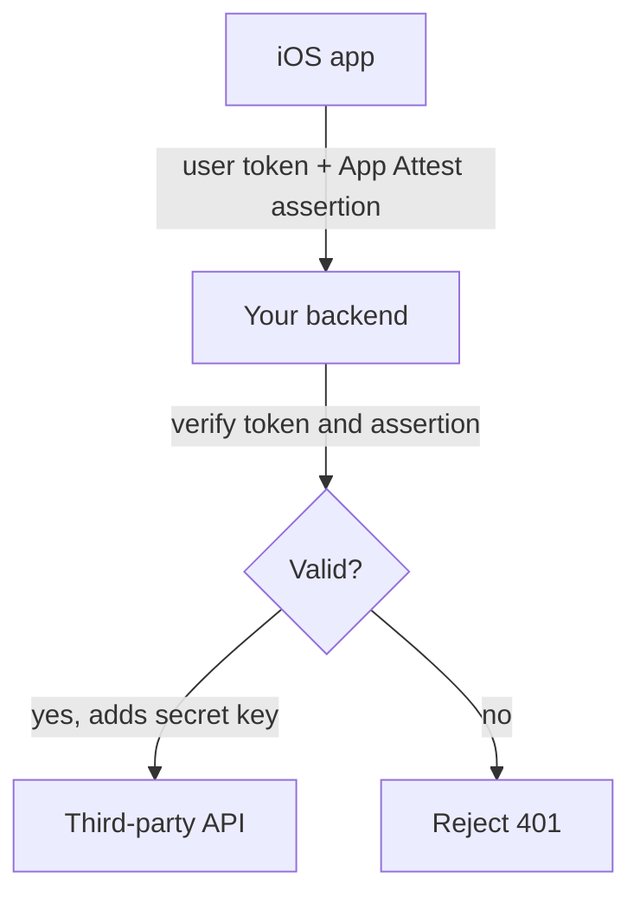
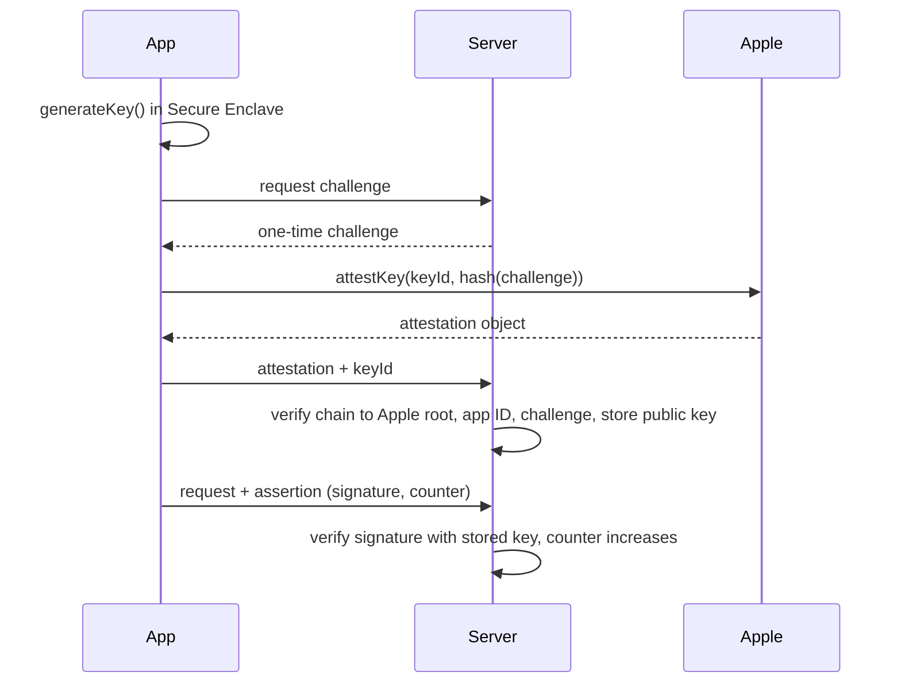
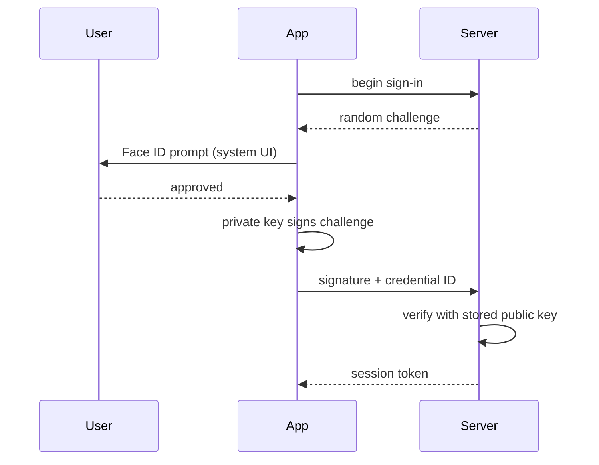
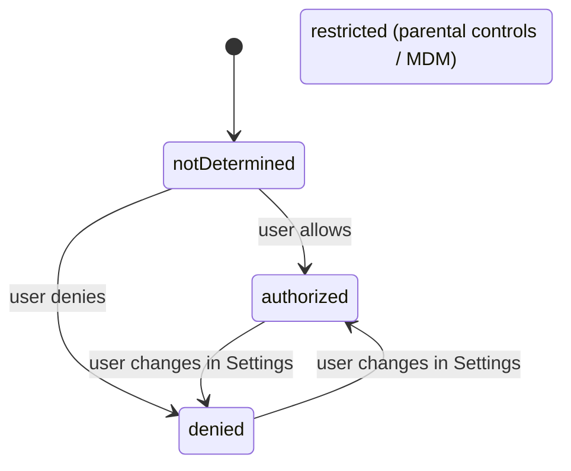
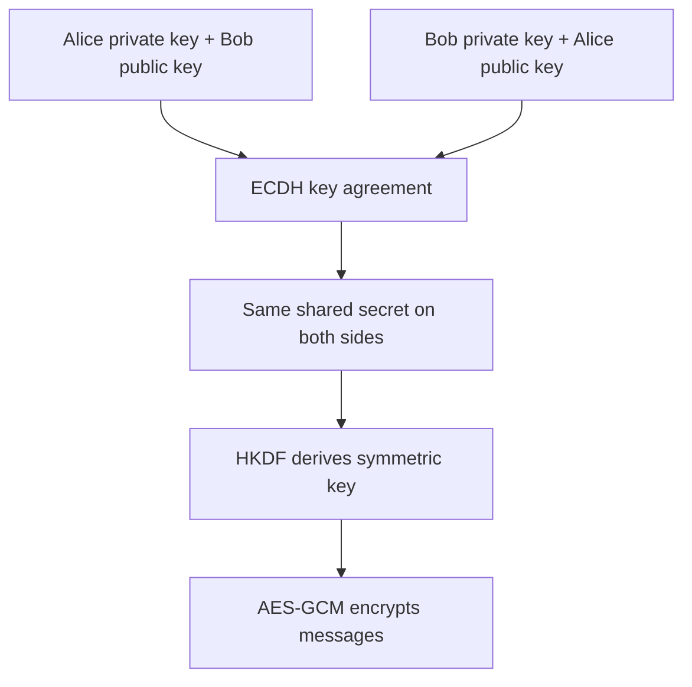

# Security & Privacy

[⬅ Back to index](../README.md)

Covers: secure storage, Data Protection, Keychain & Secure Enclave, biometrics, network security, permissions model, App Tracking Transparency, privacy manifests, jailbreak detection, App Attest, passkeys, OWASP risks.

---

## Security

### 1. How do you store sensitive data securely on iOS?

<details>
<summary>Answer</summary>

**In short:** Put small secrets (tokens, passwords, keys) in the **Keychain** with the right accessibility level, protect files with **Data Protection** (`.complete` where possible), and encrypt larger data with **CryptoKit** using a key that itself lives in the Keychain or Secure Enclave. Never put secrets in UserDefaults, plists, source code, logs or an unencrypted database.

#### Why the choice matters

An attacker can get at your app's data in several ways: an unencrypted iTunes/Finder backup, a jailbroken device, a forensic tool on a stolen phone, or simply someone reading log output. Each storage option on iOS defends against a different subset of these.

| Storage | Encrypted at rest? | In backups? | Good for |
|---|---|---|---|
| `UserDefaults` | Only by the default file protection class | Yes, as a plain plist | Preferences, feature flags. **Never secrets** |
| Files in the sandbox | Yes, per Data Protection class | Yes (unless excluded) | Documents, caches, databases |
| **Keychain** | Yes, managed by `securityd` and the Secure Enclave | Depends on accessibility (`…ThisDeviceOnly` = not migrated to a new device) | Tokens, passwords, small keys |
| **Secure Enclave** | Key never leaves the hardware | No (device-bound) | Non-exportable P-256 signing / key-agreement keys |

#### Keychain: the default home for secrets

The Keychain is an encrypted database outside your app's sandbox. Items survive app deletion (note this when you design "logout"), and you control *when* they can be read through `kSecAttrAccessible`:

- `kSecAttrAccessibleWhenUnlocked` (the default): only while the device is unlocked.
- `kSecAttrAccessibleAfterFirstUnlock`: after the first unlock since boot. Needed if a background task (e.g. a silent push) must read the token.
- `…ThisDeviceOnly` variants: the item is not restored onto a different device from a backup.
- `kSecAttrAccessibleWhenPasscodeSetThisDeviceOnly`: the item is deleted if the user removes their passcode.

```swift
import Security

func saveToken(_ token: String) throws {
    let data = Data(token.utf8)
    let query: [String: Any] = [
        kSecClass as String: kSecClassGenericPassword,
        kSecAttrService as String: "com.example.auth",
        kSecAttrAccount as String: "accessToken"
    ]
    let attributes: [String: Any] = [
        kSecValueData as String: data,
        kSecAttrAccessible as String: kSecAttrAccessibleAfterFirstUnlockThisDeviceOnly
    ]

    var status = SecItemAdd(query.merging(attributes) { $1 } as CFDictionary, nil)
    if status == errSecDuplicateItem {
        // Item already exists: update it instead of failing
        status = SecItemUpdate(query as CFDictionary, attributes as CFDictionary)
    }
    guard status == errSecSuccess else { throw KeychainError(status: status) }
}
```

#### Encrypting larger data

The Keychain is meant for small blobs. For a file or a local database export, generate a `SymmetricKey`, store the key in the Keychain, and encrypt the payload with AES-GCM:

```swift
import CryptoKit

let key = SymmetricKey(size: .bits256)               // persist key.withUnsafeBytes { Data($0) } in the Keychain
let sealed = try AES.GCM.seal(plaintext, using: key)
try sealed.combined!.write(to: url, options: .completeFileProtection)

// Later
let box = try AES.GCM.SealedBox(combined: Data(contentsOf: url))
let plaintext = try AES.GCM.open(box, using: key)
```

#### Common pitfalls

- Storing a JWT in `UserDefaults` "because it's temporary". It ends up in plain text in backups.
- Forgetting that Keychain items survive uninstall: on first launch after reinstall, clear stale credentials if your app logic expects a fresh state.
- Logging tokens or request bodies with `print`; device logs can be read with a cable.
- Leaving sensitive caches (e.g. `URLCache` responses with account data) in the default cache directory.

#### Likely follow-ups

- *Is the Keychain safe on a jailbroken device?* Not fully: a jailbreak can dump items available in the current lock state. Data-at-rest protection still helps against a locked, stolen device.
- *How do you share a token with an extension?* Use a shared **Keychain access group** (`kSecAttrAccessGroup`) via the Keychain Sharing entitlement.
- *What about Core Data / SwiftData?* The store file gets Data Protection like any file; for stronger needs encrypt sensitive fields or use an encrypted SQLite (e.g. SQLCipher).

</details>

### 2. What is iOS Data Protection?

<details>
<summary>Answer</summary>

**In short:** Data Protection encrypts every file with its own key, and that key is wrapped by a **class key** derived from the user's **passcode** combined with a hardware key unique to the device. The file's protection class decides when the class key is available: `.complete` (only while unlocked), `.completeUnlessOpen`, `.completeUntilFirstUserAuthentication` (the **default**) or `.none`.

#### How it works

When a file is created, the system generates a random per-file key and encrypts the file contents with it. That per-file key is then wrapped (encrypted) with the key of the file's **protection class**. The class keys are themselves protected by a key derived from the passcode entangled with the device's hardware UID, which the Secure Enclave can use but never exposes. Because of this, nobody can brute-force the passcode off-device: guesses must run on the phone, with hardware-enforced delays.



When the device locks, the class key for `.complete` is discarded from memory after a short delay, so those files become unreadable until the next unlock.

#### The classes

| Class (`FileProtectionType`) | Readable when | Typical use |
|---|---|---|
| `.complete` | Only while unlocked | Medical records, financial documents |
| `.completeUnlessOpen` | New files can be created while locked; an already open file stays readable | Finishing a download or write after the user locks the phone |
| `.completeUntilFirstUserAuthentication` (default) | After the first unlock since boot, until the next reboot | Most app data; lets background fetch and push handlers work |
| `.none` | Always (still encrypted with a device key, but no passcode involvement) | Rarely justified |

#### Using it

```swift
// Per file
try data.write(to: url, options: .completeFileProtection)

// Change an existing file
try FileManager.default.setAttributes(
    [.protectionKey: FileProtectionType.complete],
    ofItemAtPath: url.path
)
```

You can also raise the app-wide default with the **Data Protection** capability in Xcode (the `com.apple.developer.default-data-protection` entitlement, e.g. `NSFileProtectionComplete`).

#### Choosing a class

Ask: "does anything need this file while the phone is locked?" A background URLSession completion, a location update, or a VoIP push handler that touches a `.complete` file will fail with a permission error. In that case use `.completeUntilFirstUserAuthentication`, or `.completeUnlessOpen` if you only need to finish writing.

#### Pitfalls

- Data Protection only applies when the user has a **passcode** set; no passcode means much weaker protection.
- Background crashes like "file not readable" right after the device locks usually mean a class that is too strict.
- Use `UIApplication.protectedDataWillBecomeUnavailableNotification` / `isProtectedDataAvailable` to know when protected files are about to become unreadable.

</details>

### 3. What is the Secure Enclave?

<details>
<summary>Answer</summary>

**In short:** The Secure Enclave is a **hardware security coprocessor** isolated from the main processor, with its own boot process and encrypted memory. It handles biometric data and can **generate and store private keys (P-256) that can never be exported**: signing and key agreement happen inside the enclave, and your app only ever holds a reference to the key. Use it via CryptoKit's `SecureEnclave.P256` or the Keychain with `kSecAttrTokenIDSecureEnclave`.

#### Why it exists

If a private key lives in normal app memory, malware on a compromised device (or a jailbreak tweak) could read it and use it anywhere. The Secure Enclave removes that possibility: the key material is created inside the enclave and never leaves it. Even a fully compromised iOS kernel can only *ask* the enclave to sign something, not steal the key. Combined with access control (e.g. require Face ID), you get a key that is both **device-bound** and **user-presence-bound**.

It also does the core work behind Data Protection (entangling the passcode with the hardware UID) and Face ID / Touch ID matching; biometric templates are never available to iOS or apps.

#### Using it with CryptoKit

```swift
import CryptoKit

guard SecureEnclave.isAvailable else { return }   // false on Simulator and older hardware

// Optionally require biometrics every time the key is used
let access = SecAccessControlCreateWithFlags(
    nil,
    kSecAttrAccessibleWhenUnlockedThisDeviceOnly,
    [.privateKeyUsage, .biometryCurrentSet],
    nil
)!

let privateKey = try SecureEnclave.P256.Signing.PrivateKey(accessControl: access)

// Send the public key to your server once (e.g. at device registration)
let publicKeyData = privateKey.publicKey.derRepresentation

// Later: sign a server-provided challenge
let signature = try privateKey.signature(for: challengeData)

// To keep using the key across launches, persist this opaque blob (e.g. in the Keychain).
// It is encrypted by the enclave and is useless on any other device.
let keyBlob = privateKey.dataRepresentation
let restored = try SecureEnclave.P256.Signing.PrivateKey(dataRepresentation: keyBlob)
```

#### Limits

| Supports | Doesn't support |
|---|---|
| P-256 signing and key agreement | Arbitrary symmetric encryption of your data directly |
| Biometric / passcode-gated key use | Exporting or backing up the private key |
| Device-bound authentication | Moving the key to a new phone (you must re-enrol) |

To encrypt bulk data with an enclave key, do a P-256 key agreement and derive a symmetric key from the shared secret (HKDF), then use AES-GCM.

#### Likely follow-ups

- *What happens when the user gets a new phone?* The key is gone; design a re-registration flow (log in again, create a new key).
- *How is this different from a Keychain item?* A Keychain item's secret is decrypted into your process when read; an enclave private key is never in your process at all.
- *Where else does iOS use it?* App Attest keys, passkey operations, Apple Pay, Data Protection.

</details>

### 4. How do you implement Face ID / Touch ID authentication?

<details>
<summary>Answer</summary>

**In short:** Use the **LocalAuthentication** framework (`LAContext.evaluatePolicy`) and add `NSFaceIDUsageDescription` to Info.plist. But for real security, don't just trust a `true` from `evaluatePolicy`: store the secret in a **Keychain item protected by access control** (`.biometryCurrentSet`), so the system only releases the secret after a successful biometric match.

#### The simple (UI-gate) approach

```swift
import LocalAuthentication

func unlock() async -> Bool {
    let context = LAContext()
    var error: NSError?
    guard context.canEvaluatePolicy(.deviceOwnerAuthenticationWithBiometrics, error: &error) else {
        // Not enrolled, not available, or locked out: fall back to password
        return false
    }
    do {
        return try await context.evaluatePolicy(
            .deviceOwnerAuthenticationWithBiometrics,
            localizedReason: "Unlock your account"
        )
    } catch {
        return false   // LAError.userCancel, .userFallback, .biometryLockout, ...
    }
}
```

The problem: the result is just a `Bool` in your process. On a jailbroken device, a hooking tool (e.g. Frida) can make `evaluatePolicy` return `true` without any face. Fine for "hide the app behind Face ID", not fine for protecting a credential.

#### The secure approach: Keychain + access control

The secret is stored with a `SecAccessControl` that requires biometrics. When you read it, iOS itself shows the Face ID prompt, and the Secure Enclave releases the item only on a real match. There is no boolean to patch.

```swift
// Store
let access = SecAccessControlCreateWithFlags(
    nil,
    kSecAttrAccessibleWhenPasscodeSetThisDeviceOnly,
    .biometryCurrentSet,          // invalidated if fingerprints/faces change
    nil
)!
let add: [String: Any] = [
    kSecClass as String: kSecClassGenericPassword,
    kSecAttrAccount as String: "refreshToken",
    kSecValueData as String: Data(token.utf8),
    kSecAttrAccessControl as String: access
]
SecItemAdd(add as CFDictionary, nil)

// Read: triggers the Face ID prompt
let context = LAContext()
context.localizedReason = "Sign in to your account"
let query: [String: Any] = [
    kSecClass as String: kSecClassGenericPassword,
    kSecAttrAccount as String: "refreshToken",
    kSecReturnData as String: true,
    kSecUseAuthenticationContext as String: context
]
var result: AnyObject?
let status = SecItemCopyMatching(query as CFDictionary, &result)
```

#### Policy and flag options

| Option | Meaning |
|---|---|
| `.deviceOwnerAuthenticationWithBiometrics` | Biometrics only |
| `.deviceOwnerAuthentication` | Biometrics with passcode fallback |
| `.biometryCurrentSet` | Item invalidated when enrolled biometrics change (someone adds their face) |
| `.biometryAny` | Survives enrolment changes; weaker |
| `.userPresence` | Biometrics or passcode |

#### Pitfalls

- Missing `NSFaceIDUsageDescription` crashes the app on Face ID devices.
- Treat `.biometryCurrentSet` invalidation as "log in with password again", not as an error.
- Handle `LAError.biometryLockout` (too many failures) by falling back to the passcode.
- The Simulator can simulate enrolment and matches (Features > Face ID).

#### Likely follow-ups

- *How do you detect that biometrics changed?* Compare `LAContext().evaluatedPolicyDomainState` with a saved value, or rely on `.biometryCurrentSet` invalidating the item.
- *Can you get the user's face data?* No. Apps only get success or failure.

</details>

### 5. How do you secure network communication?

<details>
<summary>Answer</summary>

**In short:** Use HTTPS only (App Transport Security enforces TLS 1.2+ by default), add **certificate or public-key pinning** for high-value apps, use short-lived tokens with refresh tokens stored in the Keychain, never ship secrets in the binary, validate every server response, and strip verbose logging from release builds.

#### Layers of protection

1. **TLS everywhere (ATS).** ATS blocks plain HTTP and weak TLS unless you add exceptions in Info.plist. Treat every `NSAllowsArbitraryLoads` or `NSExceptionDomains` entry as a security review item; App Review asks you to justify them.
2. **Pinning.** Normal TLS trusts any certificate issued by any CA in the device trust store. If a user installs a malicious profile with a custom root CA, or a CA is compromised, a man-in-the-middle can read traffic. Pinning means your app additionally checks that the server's key matches one you expect.
3. **Tokens, not passwords.** Send the password once, receive a short-lived access token plus a refresh token. Store the refresh token in the Keychain; keep the access token in memory where possible.
4. **No secrets in the binary.** Anything shipped in the app can be pulled out with `strings`, class-dump or a disassembler. Let your backend hold third-party secrets (see Q6).
5. **Validate responses.** Decode strictly, check types and ranges, never trust a server field to build a file path, SQL or a URL without validation.
6. **No sensitive logging.** Use `Logger` with privacy annotations and avoid logging headers or bodies in release builds.

#### Pinning options

**Declarative (iOS 14+), no code:** `NSPinnedDomains` inside `NSAppTransportSecurity` in Info.plist, with `NSPinnedLeafIdentities` or `NSPinnedCAIdentities` entries containing a base64 SHA-256 hash of the certificate's SubjectPublicKeyInfo (`SPKI-SHA256-BASE64`).

**Programmatic: URLSession delegate**

```swift
final class PinningDelegate: NSObject, URLSessionDelegate {
    private let pinnedKeyHashes: Set<String>   // base64 SHA-256 of the expected public keys

    init(pinnedKeyHashes: Set<String>) { self.pinnedKeyHashes = pinnedKeyHashes }

    func urlSession(_ session: URLSession,
                    didReceive challenge: URLAuthenticationChallenge,
                    completionHandler: @escaping (URLSession.AuthChallengeDisposition, URLCredential?) -> Void) {
        guard challenge.protectionSpace.authenticationMethod == NSURLAuthenticationMethodServerTrust,
              let trust = challenge.protectionSpace.serverTrust,
              SecTrustEvaluateWithError(trust, nil),                 // 1. normal TLS validation first
              let leaf = (SecTrustCopyCertificateChain(trust) as? [SecCertificate])?.first,
              let key = SecCertificateCopyKey(leaf),
              let keyData = SecKeyCopyExternalRepresentation(key, nil) as Data?
        else {
            completionHandler(.cancelAuthenticationChallenge, nil)
            return
        }
        // 2. Compare the key hash with the pinned set.
        // (Simplified: this hashes the raw key bytes, not the full SPKI structure.)
        let hash = Data(SHA256.hash(data: keyData)).base64EncodedString()
        if pinnedKeyHashes.contains(hash) {
            completionHandler(.useCredential, URLCredential(trust: trust))
        } else {
            completionHandler(.cancelAuthenticationChallenge, nil)
        }
    }
}
```

#### Pinning trade-offs

| Pin | Pros | Cons |
|---|---|---|
| Leaf certificate | Strictest | Breaks every time the certificate renews |
| Leaf **public key** | Survives renewal if the key is reused | Key rotation needs an app update |
| Intermediate/CA key | Rarely breaks | Trusts more certificates |

Always ship **at least one backup pin**, or a certificate rotation can brick every installed version of your app.

See [Networking Q13–14](13-networking.md).

#### Likely follow-ups

- *Does pinning stop a determined attacker on their own jailbroken phone?* No; they can hook out the check. It protects users from network attackers, not your API from reverse engineers (that's App Attest's job).
- *Why still call `SecTrustEvaluateWithError` when pinning?* Pinning adds a check; it shouldn't replace hostname and expiry validation.

</details>

### 6. How do you protect API keys in an iOS app?

<details>
<summary>Answer</summary>

**In short:** Assume **anything in the app bundle can be read**. The only real protection is to keep the secret **on your server** and have the app call your backend, which calls the third party. On top of that: restrict keys by bundle ID where the provider allows it, use **App Attest** so your backend only serves genuine app instances, and keep keys out of git. Obfuscation only slows attackers down.

#### Why the bundle isn't safe

An `.ipa` is a zip file. String constants, Info.plist values, `.xcconfig`-injected build settings and bundled JSON all end up in the binary or resources. Tools like `strings`, class-dump, Hopper or Ghidra will find them in minutes, and on a jailbroken device an attacker can also read memory at runtime or intercept the outgoing request with a proxy.

#### Options, from strongest to weakest

| Approach | What it protects against | Notes |
|---|---|---|
| **Backend proxy** | Key never reaches the device | Your server adds the key, rate-limits per user, logs abuse |
| **Per-user, short-lived tokens** from your server | A leaked token expires quickly and is tied to one user | Used for e.g. uploading directly to cloud storage via signed URLs |
| **App Attest / DeviceCheck** | Calls from scripts, modified apps, emulators | Server verifies requests come from a genuine app on a real device |
| **Provider-side restrictions** | Key used from other apps | Many SDKs allow restricting by iOS bundle ID; the header can be spoofed, so it's a speed bump |
| **Obfuscation** (XOR, split strings, compute at runtime) | Casual `strings` scans | Anyone with a debugger recovers it |



#### Keeping keys out of source control

Even keys that are "public-ish" (analytics, maps) shouldn't sit in git history:
- Put them in an `.xcconfig` that is listed in `.gitignore`, reference them as `$(MAPS_API_KEY)` in Info.plist, and read them via `Bundle.main.object(forInfoDictionaryKey:)`.
- Inject them in CI from the CI provider's secret store.
- If a key ever leaks into git, **rotate it**; removing the commit isn't enough.

Note that this only protects the repository: the key still ends up inside the shipped app.

#### Pitfalls

- Treating "it's in an `.xcconfig`" as "it's secret". It's secret from GitHub, not from users.
- Shipping a payment, AI or SMS provider key in the app: abuse turns directly into your bill.

#### Likely follow-up

- *What if the key must be on the device (e.g. a maps SDK)?* Use the provider's bundle-ID restrictions and usage quotas/alerts, and accept that it can be extracted.

</details>

### 7. What are App Attest and DeviceCheck?

<details>
<summary>Answer</summary>

**In short:** Both live in the **DeviceCheck** framework and help your *server* trust the client. **App Attest** (`DCAppAttestService`) creates a key in the Secure Enclave and gets Apple to **attest** that the key belongs to a genuine, unmodified instance of your app on a real Apple device; afterwards the app signs sensitive requests with **assertions** your server verifies. **DeviceCheck** (`DCDevice`) lets your server store **2 bits per device** on Apple's servers, which **persist across reinstalls**, e.g. "already claimed the free trial".

#### App Attest flow



```swift
import DeviceCheck
import CryptoKit

let service = DCAppAttestService.shared
guard service.isSupported else { /* older device, Simulator: fall back */ return }

// One time per install
let keyId = try await service.generateKey()            // store keyId (e.g. Keychain)
let challenge = try await api.fetchChallenge()
let attestation = try await service.attestKey(keyId,
    clientDataHash: Data(SHA256.hash(data: challenge)))
try await api.registerAttestation(attestation, keyId: keyId)

// Per sensitive request
let body = try JSONEncoder().encode(order)
let assertion = try await service.generateAssertion(keyId,
    clientDataHash: Data(SHA256.hash(data: body)))
try await api.placeOrder(body, assertion: assertion)
```

The server checks the attestation's certificate chain against Apple's App Attest root, that the app ID (team ID + bundle ID) matches, and that the challenge is the one it issued. For assertions it checks the signature and that the **counter** only ever increases (blocks replay).

You need the App Attest capability (`com.apple.developer.devicecheck.appattest-environment` entitlement, `development` or `production`).

#### DeviceCheck

```swift
let token = try await DCDevice.current.generateToken()
// Send the token to your server; the server calls Apple's DeviceCheck API
// to query or update the two bits for this device.
```

#### Comparison

| | App Attest | DeviceCheck |
|---|---|---|
| Question it answers | "Is this request from my genuine app?" | "Has this device done X before?" |
| Data | Per-install key + signed assertions | 2 bits + timestamp per device per developer |
| Survives reinstall | No (new key needed) | Yes |
| Typical use | Anti-fraud, protecting APIs, game cheating | Free-trial / promo abuse, flagging fraudulent devices |

#### Pitfalls

- Attestation can fail transiently or be unsupported; roll out gradually and decide on a fallback policy (allow with extra risk scoring vs block).
- Don't attest on every launch; Apple rate-limits. Attest once, then use assertions.
- It proves the app is genuine, not that the *user* is honest; keep normal server-side authorization.

</details>

### 8. How do you detect jailbroken devices? Should you?

<details>
<summary>Answer</summary>

**In short:** Use heuristics: jailbreak files existing (`/Applications/Cydia.app`, `/bin/bash`), being able to write outside the sandbox, the `cydia://` URL scheme opening, suspicious dylibs being loaded (Frida, Substrate), or a debugger being attached (`sysctl` `P_TRACED`). **Every one of these can be bypassed**, so treat them as **risk signals** for high-value apps (banking, DRM), combine them with **server-side** checks such as App Attest, and never rely on them alone.

#### Why bother at all

A jailbroken device has the sandbox and code-signing protections weakened. Attackers can read other apps' Keychain items, hook your functions at runtime and bypass client-side checks. Banking, payments, enterprise and DRM apps often have compliance requirements to "detect and respond" to compromised devices.

#### Common checks

```swift
import Foundation
import MachO

enum JailbreakSignals {
    static func suspiciousFilesExist() -> Bool {
        let paths = ["/Applications/Cydia.app", "/Library/MobileSubstrate/MobileSubstrate.dylib",
                     "/bin/bash", "/usr/sbin/sshd", "/etc/apt", "/private/var/lib/apt/"]
        return paths.contains { FileManager.default.fileExists(atPath: $0) }
    }

    static func canWriteOutsideSandbox() -> Bool {
        let path = "/private/jb_test.txt"
        do {
            try "x".write(toFile: path, atomically: true, encoding: .utf8)
            try? FileManager.default.removeItem(atPath: path)
            return true                       // should be impossible on a stock device
        } catch { return false }
    }

    static func suspiciousLibrariesLoaded() -> Bool {
        for i in 0..<_dyld_image_count() {
            guard let name = _dyld_get_image_name(i) else { continue }
            let lib = String(cString: name).lowercased()
            if lib.contains("frida") || lib.contains("substrate") || lib.contains("cycript") { return true }
        }
        return false
    }

    static func debuggerAttached() -> Bool {
        var info = kinfo_proc()
        var size = MemoryLayout<kinfo_proc>.stride
        var mib: [Int32] = [CTL_KERN, KERN_PROC, KERN_PROC_PID, getpid()]
        sysctl(&mib, UInt32(mib.count), &info, &size, nil, 0)
        return (info.kp_proc.p_flag & P_TRACED) != 0
    }
}
```

Checking the `cydia://` scheme with `canOpenURL` requires listing it in `LSApplicationQueriesSchemes`. Always `#if targetEnvironment(simulator)` these checks out, or the Simulator looks "jailbroken".

#### Why it's an arms race

Tools exist that hide jailbreak files from specific apps, hook `fileExists`, rename dylibs and patch `sysctl` results. Modern "rootless" jailbreaks also move files away from the classic paths. Whatever you check in the app, the attacker controls the process running the check.

#### A sensible response strategy

- Collect signals and send them to the server as part of risk scoring, rather than hard-crashing locally.
- Pair with **App Attest**, which is much harder to fake because Apple signs it.
- Degrade gracefully: e.g. disable high-risk features (adding a payee) and require extra verification, instead of blocking all use.
- Don't over-invest: a sound server-side design (authorization, rate limiting) matters more than client checks.

#### Likely follow-up

- *Will Apple reject an app for jailbreak detection?* Not for detection itself; it's common in banking apps. Avoid private APIs while doing it.

</details>

### 9. What are common iOS security vulnerabilities (OWASP Mobile)?

<details>
<summary>Answer</summary>

**In short:** The usual ones are insecure data storage (secrets in UserDefaults or logs), insecure communication (ATS disabled, no TLS validation), hardcoded credentials, weak or client-only authentication, bad cryptography (custom crypto, static IVs), data leaking via **app switcher snapshots**, the **pasteboard** and the **keyboard cache**, unvalidated **deep link** parameters, WebView JavaScript bridges exposing native functions, and vulnerable third-party SDKs. The OWASP Mobile Top 10 is the standard checklist for these.

#### OWASP Mobile Top 10 (2024) mapped to iOS

| OWASP risk | What it looks like on iOS | Fix |
|---|---|---|
| M1 Improper Credential Usage | API keys or passwords hardcoded in the binary | Backend proxy, Keychain |
| M2 Inadequate Supply Chain Security | Outdated or malicious SDKs, unpinned SPM versions | Pin versions, audit SDKs, privacy manifests |
| M3 Insecure Authentication/Authorization | "isPremium" or "isAdmin" checked only on the device | Enforce on the server |
| M4 Insufficient Input/Output Validation | Deep link or WebView message used unchecked | Validate and allow-list |
| M5 Insecure Communication | `NSAllowsArbitraryLoads`, trusting any certificate | ATS, pinning |
| M6 Inadequate Privacy Controls | PII in logs or analytics | Minimize, `Logger` privacy |
| M7 Insufficient Binary Protections | Easy to patch/reverse a high-value app | App Attest, server-side checks, obfuscation where justified |
| M8 Security Misconfiguration | Debug flags, test endpoints left in release | Build-configuration hygiene |
| M9 Insecure Data Storage | Tokens in UserDefaults, unprotected files | Keychain, Data Protection |
| M10 Insufficient Cryptography | MD5, static IV, home-made crypto | CryptoKit (AES-GCM, SHA-256) |

#### iOS-specific leaks worth naming

**App switcher snapshot.** iOS screenshots your UI when backgrounding. Cover sensitive screens (see Q17).

**Pasteboard.** The general pasteboard can sync via Universal Clipboard and be read by other apps (iOS shows a paste notice, but it still happens). For copied OTPs or account numbers:

```swift
UIPasteboard.general.setItems(
    [[UTType.plainText.identifier: accountNumber]],
    options: [.localOnly: true,                                 // no Universal Clipboard
              .expirationDate: Date().addingTimeInterval(60)]   // cleared after 60s
)
```

**Keyboard cache and third-party keyboards.** Use `isSecureTextEntry = true` for secrets (this also forces the system keyboard) and `autocorrectionType = .no` for fields like card numbers. Set the right `textContentType` (`.password`, `.oneTimeCode`) so AutoFill works.

**Deep links.** A URL like `myapp://transfer?to=123&amount=500` can be triggered by any website or app. Treat parameters as untrusted, never perform an action without user confirmation, and prefer **Universal Links** (domain-verified) over custom schemes.

**WebView bridges.** A `WKScriptMessageHandler` that exposes "get token" to any loaded page hands your token to any injected script (see Q10).

#### Likely follow-ups

- *What's the single most common real-world finding?* Hardcoded keys and secrets in storage/logs.
- *How do you check a release build?* Run `strings` on the binary, inspect the `.ipa` contents, proxy traffic with Charles/Proxyman, and review Info.plist ATS exceptions.

</details>

### 10. How do you secure WKWebView usage?

<details>
<summary>Answer</summary>

**In short:** Load only trusted HTTPS content, check every navigation in `decidePolicyFor navigationAction`, keep `WKScriptMessageHandler` bridges minimal and validate their messages, turn JavaScript off when it isn't needed (`WKWebpagePreferences.allowsContentJavaScript`), never build JavaScript by concatenating untrusted strings into `evaluateJavaScript`, and use `WKWebsiteDataStore.nonPersistent()` for sensitive sessions. `UIWebView` is deprecated and the App Store rejects apps that use it.

#### Why WebViews are risky

A WebView runs someone else's code (HTML/JS) inside your app. If an attacker can get content into it (a compromised CDN, an open redirect, user-generated HTML, an XSS on your site), that script can call any native bridge you expose and navigate to phishing pages that look like part of your app.

#### Restrict navigation

```swift
func webView(_ webView: WKWebView,
             decidePolicyFor navigationAction: WKNavigationAction,
             decisionHandler: @escaping (WKNavigationActionPolicy) -> Void) {
    guard let url = navigationAction.request.url,
          url.scheme == "https",
          let host = url.host,
          ["example.com", "help.example.com"].contains(host)
    else {
        // Open external links in Safari instead of inside the app
        if let url = navigationAction.request.url { UIApplication.shared.open(url) }
        decisionHandler(.cancel)
        return
    }
    decisionHandler(.allow)
}
```

For apps that should only ever browse their own domains, **App-Bound Domains** (`WKAppBoundDomains` in Info.plist plus `limitsNavigationsToAppBoundDomains = true`) let the system enforce this.

#### Keep the bridge small and validate it

```swift
func userContentController(_ controller: WKUserContentController,
                           didReceive message: WKScriptMessage) {
    // Only accept messages from the expected origin
    guard message.frameInfo.securityOrigin.host == "example.com",
          message.name == "analytics",
          let body = message.body as? [String: Any],
          let event = body["event"] as? String,
          allowedEvents.contains(event)
    else { return }
    analytics.track(event)
}
```

Never expose generic handlers like "run this native method" or "return the auth token". Use `WKContentWorld` to keep your own injected scripts separate from the page's scripts.

#### Calling JavaScript safely

```swift
// Wrong: user input becomes code (JS injection)
webView.evaluateJavaScript("showName('\(userName)')")

// Right: pass data as arguments, not as source
try await webView.callAsyncJavaScript("showName(name)",
                                      arguments: ["name": userName],
                                      contentWorld: .page)
```

#### Other settings

| Setting | Why |
|---|---|
| `configuration.defaultWebpagePreferences.allowsContentJavaScript = false` | Static content doesn't need JS |
| `configuration.websiteDataStore = .nonPersistent()` | No cookies/cache left on disk after a sensitive session |
| No ATS exceptions for WebView content | Keep HTTPS-only |
| `ASWebAuthenticationSession` for OAuth logins | Users can't verify the URL in an embedded WebView, and some providers block embedded logins |

#### Pitfall

- Loading local HTML with broad file-read access (`loadFileURL(_:allowingReadAccessTo:)` with your whole Documents folder) lets a script read other files; scope it to the folder you need.

</details>

### 11. What are passkeys? How do you implement them?

<details>
<summary>Answer</summary>

**In short:** Passkeys are **passwordless, phishing-resistant credentials** built on WebAuthn/FIDO2 public-key cryptography. The private key lives in **iCloud Keychain** (synced end-to-end encrypted across the user's devices) and the server stores only the **public key**. You implement them with **AuthenticationServices** (`ASAuthorizationPlatformPublicKeyCredentialProvider`) plus **Associated Domains** (`webcredentials:`). iOS 26 adds an account creation API that makes creating a passkey at sign-up easier. Also mention **Sign in with Apple**: under Guideline 4.8, apps using third-party/social login must also offer an *equivalent privacy-focused login option*; since 2024 that no longer has to be Sign in with Apple specifically, but it's the usual choice.

#### Why passkeys beat passwords

| Problem with passwords | How passkeys fix it |
|---|---|
| Phishing: user types password on a fake site | The credential is bound to the domain (relying party ID); a fake domain can't request it |
| Server breach leaks password hashes | Server holds only public keys, useless to an attacker |
| Reuse across sites | A unique key pair per account per site |
| Weak passwords | Nothing to choose or remember; user approves with Face ID |

#### How it works



Registration is the same idea: the server sends a challenge plus user info, the device creates a new key pair, and the server stores the public key with the account.

#### Implementation

1. Add the **Associated Domains** capability with `webcredentials:example.com`, and host an `apple-app-site-association` file on that domain listing your app ID.
2. Have your backend implement WebAuthn (most teams use a server library).
3. In the app:

```swift
import AuthenticationServices

let provider = ASAuthorizationPlatformPublicKeyCredentialProvider(
    relyingPartyIdentifier: "example.com")

// Sign-up: create a passkey
let registration = provider.createCredentialRegistrationRequest(
    challenge: serverChallenge, name: "alex@example.com", userID: userIdData)

// Sign-in: use an existing passkey
let assertion = provider.createCredentialAssertionRequest(challenge: serverChallenge)

let controller = ASAuthorizationController(authorizationRequests: [assertion])
controller.delegate = self
controller.presentationContextProvider = self
controller.performRequests()
// For QuickType-bar suggestions on the username field instead:
// controller.performAutoFillAssistedRequests()

// Delegate
func authorizationController(controller: ASAuthorizationController,
                             didCompleteWithAuthorization authorization: ASAuthorization) {
    if let credential = authorization.credential
        as? ASAuthorizationPlatformPublicKeyCredentialAssertion {
        // Send credential.signature, credential.rawAuthenticatorData,
        // credential.rawClientDataJSON and credential.credentialID to the server
    }
}
```

You can put a passkey request and an `ASAuthorizationPasswordProvider` request in the same controller so returning password users still get a smooth sign-in.

#### Pitfalls

- Associated Domains misconfigured is the number one reason passkeys "don't show up".
- Keep a recovery path (email, another passkey); the user may lose access to their Apple account.
- Challenges must be one-time and verified on the server.

#### Likely follow-ups

- *Can passkeys be used on a non-Apple device?* Yes, via cross-device sign-in (scan a QR code with the phone), or the credential manager on that platform.
- *How do passkeys relate to the Secure Enclave?* Synced passkeys are stored in iCloud Keychain, protected end to end; device-bound hardware keys are a different mechanism.

</details>

---

## Privacy

### 12. How does the iOS permission model work?

<details>
<summary>Answer</summary>

**In short:** Sensitive resources (camera, microphone, photos, location, contacts, Bluetooth, motion, health, local network, tracking) require **user authorization at runtime** and a **usage description string** in Info.plist; without the string the app **crashes** when it touches the resource. Ask **in context** when the user triggers the feature, check status first, handle **denied/restricted** gracefully with a link to Settings, and remember **the system prompt is shown only once**.

#### How it works

Each protected resource has its own framework API for status and request (e.g. `AVCaptureDevice.authorizationStatus(for: .video)`), and its own Info.plist key, such as `NSCameraUsageDescription`, `NSMicrophoneUsageDescription`, `NSPhotoLibraryUsageDescription`, `NSLocationWhenInUseUsageDescription`, `NSContactsUsageDescription`, `NSBluetoothAlwaysUsageDescription`, `NSLocalNetworkUsageDescription` or `NSUserTrackingUsageDescription`. The string is shown in the system alert, and App Review rejects vague ones like "We need camera access".



`restricted` means the user *cannot* grant access (Screen Time or device management), so don't offer a Settings link that won't help.

#### A typical camera flow

```swift
import AVFoundation

func openCamera() async {
    switch AVCaptureDevice.authorizationStatus(for: .video) {
    case .authorized:
        showCamera()
    case .notDetermined:
        // Optional: show your own explainer screen first
        if await AVCaptureDevice.requestAccess(for: .video) { showCamera() }
    case .denied:
        showAlert("Camera access is off. Enable it in Settings to scan documents.",
                  action: { UIApplication.shared.open(URL(string: UIApplication.openSettingsURLString)!) })
    case .restricted:
        showAlert("Camera access is restricted on this device.")
    @unknown default:
        break
    }
}
```

#### Best practices

- **Ask in context.** "Scan a receipt" makes the camera prompt obvious; a prompt at launch gets denied.
- **Pre-permission screen.** A custom screen explaining the benefit, with "Continue" leading to the system prompt. Because you can only show the system prompt once, this protects your one shot.
- **Prefer APIs that need no permission**: `PHPickerViewController`/`PhotosPicker`, `CLLocationButton`/`LocationButton` (one-time location), `ContactAccessButton` (iOS 18).
- **Degrade gracefully**: the app must still work without the permission where possible (App Review checks this).

#### Pitfalls

- Missing Info.plist key → immediate crash (and sometimes an App Store upload rejection for linked APIs).
- Revoking a permission in Settings terminates the app; don't be surprised by a fresh launch.
- Re-requesting after denial does nothing: the call returns the denied status without a prompt.

</details>

### 13. What are the location and photo permission options?

<details>
<summary>Answer</summary>

**In short:** **Location** can be **When In Use**, **Always** or **Allow Once**, and independently **Precise or Approximate** (iOS 14; `accuracyAuthorization`, `requestTemporaryFullAccuracyAuthorization`). Always is requested after When In Use. **Photos** can be full access, **limited access** (only selected photos, iOS 14) or add-only, and `PHPickerViewController` / `PhotosPicker` need **no permission at all**. iOS 18 also added **limited contacts access**.

#### Location

| Choice | What the app gets |
|---|---|
| Allow Once | When In Use for this session; resets to "ask" afterwards |
| While Using the App | Location while in foreground (and while a visible background indicator is shown) |
| Always | Also in the background: region monitoring, significant-change, visits |
| Don't Allow | Nothing |
| Precise off | Approximate location (`.reducedAccuracy`), roughly a few km |

```swift
import CoreLocation

final class LocationService: NSObject, CLLocationManagerDelegate {
    let manager = CLLocationManager()

    func start() {
        manager.delegate = self
        manager.requestWhenInUseAuthorization()          // needs NSLocationWhenInUseUsageDescription
    }

    func locationManagerDidChangeAuthorization(_ manager: CLLocationManager) {
        switch manager.authorizationStatus {
        case .authorizedWhenInUse, .authorizedAlways:
            if manager.accuracyAuthorization == .reducedAccuracy {
                // e.g. turn-by-turn needs precision for this one task
                manager.requestTemporaryFullAccuracyAuthorization(withPurposeKey: "Navigation")
                // purpose key defined in NSLocationTemporaryUsageDescriptionDictionary
            }
            manager.startUpdatingLocation()
        case .denied, .restricted:
            showLocationOffUI()
        default:
            break
        }
    }
}
```

**Always:** call `requestAlwaysAuthorization()` (needs `NSLocationAlwaysAndWhenInUseUsageDescription`) after the user has already granted When In Use and you have a feature that clearly needs background location. iOS also periodically reminds users which apps use location in the background, so unjustified Always access tends to get revoked.

#### Photos

| Access | How | Notes |
|---|---|---|
| None needed | `PHPickerViewController` / SwiftUI `PhotosPicker` | Runs out of process; you only receive what the user picks. Best default |
| Add only | `PHPhotoLibrary.requestAuthorization(for: .addOnly)` | Saving images; `NSPhotoLibraryAddUsageDescription` |
| Limited | User chooses "Select Photos" | Status is `.limited`; offer `presentLimitedLibraryPicker(from:)` to change the selection |
| Full | `.authorized` | Only for gallery-style apps |

```swift
import PhotosUI
import SwiftUI

struct AvatarPicker: View {
    @State private var item: PhotosPickerItem?
    var body: some View {
        PhotosPicker("Choose photo", selection: $item, matching: .images)   // no permission prompt
    }
}
```

#### Contacts (iOS 18)

Users can grant access to selected contacts only. The authorization status can be `.limited`, and `ContactAccessButton` lets users add specific contacts to the app's access without granting the whole address book.

#### Pitfall

- Treat `.limited` as a normal success state; many apps wrongly show "access denied" UI for it.

</details>

### 14. What is App Tracking Transparency (ATT)?

<details>
<summary>Answer</summary>

**In short:** Since iOS 14.5, apps **must ask permission** with `ATTrackingManager.requestTrackingAuthorization` before **tracking users across apps and websites owned by other companies** or reading the **IDFA** (advertising identifier). You need `NSUserTrackingUsageDescription`. If the user denies, or is never asked, the IDFA is all zeros. Fingerprinting to get around this is prohibited. For ad attribution without tracking, use **SKAdNetwork / AdAttributionKit**.

#### What counts as "tracking"

Apple defines tracking as linking user or device data collected from your app with data collected from other companies' apps, websites or offline properties for targeted advertising or advertising measurement, or sharing it with data brokers. Examples:

- Sending an email hash or IDFA to an ad network that matches it with other apps' data: **tracking**.
- Your own first-party analytics, used only by you: **not tracking** (but still declared in privacy labels).
- Fraud prevention or security use: not tracking.

#### Requesting permission

```swift
import AppTrackingTransparency
import AdSupport

func requestTrackingIfNeeded() async {
    guard ATTrackingManager.trackingAuthorizationStatus == .notDetermined else { return }
    // Must be called while the app is active, or the prompt won't appear
    let status = await ATTrackingManager.requestTrackingAuthorization()
    if status == .authorized {
        let idfa = ASIdentifierManager.shared().advertisingIdentifier
        adSDK.configure(idfa: idfa)
    } else {
        adSDK.configureWithoutTracking()
    }
}
```

| Status | Meaning |
|---|---|
| `.notDetermined` | Not asked yet |
| `.authorized` | User allowed; real IDFA available |
| `.denied` | User declined; IDFA is zeros |
| `.restricted` | Can't be asked (e.g. child account, MDM, or the user turned off "Allow Apps to Request to Track") |

#### Rules and gotchas

- The prompt appears **once**; after that only Settings can change it.
- You may show a pre-prompt explaining why, but you can't incentivize ("allow tracking to get coins") or mimic the system alert.
- Don't call it in `application(_:didFinishLaunching…)` before UI is active; the request is silently ignored.
- Third-party SDKs that track count as *your* app tracking. Declare them in your privacy manifest's tracking domains (see Q15); iOS blocks connections to declared tracking domains when the user hasn't granted permission.
- Fingerprinting (combining device signals to identify a user) is not allowed regardless of the ATT answer.

#### Attribution without tracking

**SKAdNetwork** and its successor **AdAttributionKit** let ad networks measure installs and conversions with privacy-preserving, delayed, aggregated postbacks signed by Apple, with no user-level identifier.

</details>

### 15. What is a Privacy Manifest?

<details>
<summary>Answer</summary>

**In short:** `PrivacyInfo.xcprivacy` is a property-list file (required since **May 2024** for App Store submissions) that declares the **data types your app collects** and why, whether the app **tracks** users and which **tracking domains** it contacts, and which **Required Reason APIs** it uses (e.g. `UserDefaults`, file timestamps, system boot time, disk space) with an approved reason code. **Commonly used third-party SDKs** must ship their own manifests and signatures. Xcode combines them into a **privacy report** that helps you fill in the App Store **privacy nutrition labels**.

#### Why it exists

Privacy nutrition labels used to rely on developers knowing what every SDK they embedded collected. Many didn't. Required Reason APIs exist because some harmless-looking APIs (boot time, free disk space, file timestamps) were being used for **fingerprinting**. The manifest makes each binary declare its behaviour, and makes the SDK vendor responsible for its own part.

#### What's in it

| Key | Purpose |
|---|---|
| `NSPrivacyTracking` | Bool: does this app/SDK track (per ATT's definition)? |
| `NSPrivacyTrackingDomains` | Domains used for tracking; iOS blocks them if the user hasn't allowed tracking |
| `NSPrivacyCollectedDataTypes` | Each data type collected, whether it's linked to the user, used for tracking, and the purposes |
| `NSPrivacyAccessedAPITypes` | Required Reason API categories used, each with reason codes |

```xml
<key>NSPrivacyAccessedAPITypes</key>
<array>
    <dict>
        <key>NSPrivacyAccessedAPIType</key>
        <string>NSPrivacyAccessedAPICategoryUserDefaults</string>
        <key>NSPrivacyAccessedAPITypeReasons</key>
        <array>
            <string>CA92.1</string>   <!-- read/write data only accessible to the app itself -->
        </array>
    </dict>
</array>
<key>NSPrivacyTracking</key>
<false/>
```

Required Reason API categories include `UserDefaults`, file timestamp, system boot time, disk space and active keyboard APIs. Each allowed reason code describes a specific permitted use; using the API for anything else (like fingerprinting) isn't allowed.

#### Workflow

1. Add `PrivacyInfo.xcprivacy` to the app target (File > New > File > App Privacy).
2. Update SDKs to versions that include their own manifests. Apple publishes a list of commonly used SDKs that must include a manifest and a **signature**, so you can verify the SDK came from its vendor.
3. Archive, then in the Organizer choose **Generate Privacy Report** to get a combined PDF of all manifests.
4. Use the report to fill in the privacy nutrition label in App Store Connect.

#### Pitfalls

- Using `UserDefaults` without declaring it leads to a warning email or rejection on upload. Almost every app needs that entry.
- Static libraries' manifests may need to be added manually to the app's bundle.
- The manifest must match reality; App Review and the labels are checked against your declared behaviour.

</details>

### 16. How do you protect user privacy in your app's design?

<details>
<summary>Answer</summary>

**In short:** Practice **data minimization** (collect only what the feature needs), process on device where possible, ask for clear consent, offer **account deletion inside the app** (an App Store requirement for apps that support account creation), delete data properly, anonymize analytics, keep PII out of logs (`os_log`/`Logger` privacy markers like `\(email, privacy: .private)`), and respect system privacy settings such as Limit IP Address Tracking and iCloud Private Relay.

#### Principles, with concrete iOS practices

| Principle | In practice |
|---|---|
| **Data minimization** | Ask for a postcode, not a full address; use approximate location when precise isn't needed |
| **On-device first** | Vision, Natural Language, Core ML and on-device speech recognition keep data on the phone |
| **Least permission** | `PhotosPicker` instead of full library access; `LocationButton` for one-off location |
| **Transparency and consent** | Clear purpose strings; separate opt-ins for analytics and marketing |
| **User control** | Export and delete data; in-app account deletion |
| **Retention limits** | Expire caches, purge old logs and local data |
| **Security of what you keep** | Keychain, Data Protection, encryption (see Q1–Q2) |

#### Logging without leaking PII

With `Logger` (unified logging), interpolated dynamic values are **redacted by default** in logs collected off the device; you mark what's safe to show.

```swift
import os

let logger = Logger(subsystem: "com.example.app", category: "auth")

logger.info("Login attempt for \(email, privacy: .private)")          // shown as <private>
logger.info("Login attempt for \(email, privacy: .private(mask: .hash))") // hashed: correlate without revealing
logger.info("Retry count \(retryCount, privacy: .public)")            // safe to show
```

Avoid `print` in release code; it bypasses these controls.

#### Account deletion

Apps that let users create an account must let them **start deletion from within the app** (not just "email us"). Deletion should remove the account and associated personal data (subject to legal retention), and if you use Sign in with Apple, revoke the user's tokens via Apple's REST API.

#### Analytics

- Use random, resettable install IDs rather than email, phone or device identifiers.
- Aggregate on the server, drop raw events after a retention period.
- Avoid sending free-text fields that may contain PII.

#### Likely follow-ups

- *How does Private Relay affect my app?* User traffic from Safari (and unencrypted app traffic, for some users) gets an anonymized IP, so don't rely on IP for precise geolocation or identification.
- *What's "privacy by design"?* Making privacy the default behaviour (opt-in, minimal data, local processing) instead of a setting added later.

</details>

### 17. How do you hide sensitive content in the app switcher?

<details>
<summary>Answer</summary>

**In short:** When the scene resigns active (`sceneWillResignActive`, or `scenePhase == .inactive` in SwiftUI), put a blur or placeholder view over the content, and remove it when the scene becomes active again. The system takes the app switcher snapshot when the app moves to the background, so your cover must already be in place by then.

#### Why

When your app leaves the foreground, iOS captures a snapshot of the UI and shows it in the app switcher. That image is also kept on disk. For a banking or health app, this means an account balance or diagnosis is visible to anyone glancing at the phone's app switcher, and lingers in a cached file.

#### UIKit (scene delegate)

```swift
final class SceneDelegate: UIResponder, UIWindowSceneDelegate {
    var window: UIWindow?
    private var privacyView: UIView?

    func sceneWillResignActive(_ scene: UIScene) {
        guard let window, privacyView == nil else { return }
        let blur = UIVisualEffectView(effect: UIBlurEffect(style: .systemMaterial))
        blur.frame = window.bounds
        blur.autoresizingMask = [.flexibleWidth, .flexibleHeight]
        window.addSubview(blur)
        privacyView = blur
    }

    func sceneDidBecomeActive(_ scene: UIScene) {
        privacyView?.removeFromSuperview()
        privacyView = nil
    }
}
```

#### SwiftUI

```swift
struct RootView: View {
    @Environment(\.scenePhase) private var scenePhase

    var body: some View {
        ContentView()
            .overlay {
                if scenePhase != .active {
                    Rectangle().fill(.ultraThinMaterial)
                        .overlay(Image(systemName: "lock.fill").font(.largeTitle))
                        .ignoresSafeArea()
                }
            }
    }
}
```

#### Why "resign active" and not "did enter background"

`.inactive` also happens when the user pulls down Notification Center or Control Center, or begins the app switcher gesture. Covering at that point guarantees the cover is drawn before the snapshot; covering only in `didEnterBackground` can be too late.

#### Related protections

| Threat | API |
|---|---|
| Screen recording / AirPlay mirroring | `UIScreen.isCaptured` / `sceneCaptureState`, observe changes and hide content |
| User took a screenshot | `UIApplication.userDidTakeScreenshotNotification` (after the fact; you can warn or log, not prevent) |
| Password fields | `isSecureTextEntry` fields are automatically hidden in recordings and screenshots |

#### Pitfall

- Only cover screens that are actually sensitive if users rely on the switcher preview to find content; a blanket blur is fine for banking apps, annoying for a notes app.

</details>


---

## Cryptography Basics

### 18. Hashing vs encryption vs encoding? How do you compute a secure hash in Swift?

<details>
<summary>Answer</summary>

**In short:** **Encoding** changes the representation of data and anyone can reverse it (Base64), **encryption** hides data so only someone with the key can reverse it (AES-GCM), and **hashing** produces a one-way fixed-size fingerprint for integrity (SHA-256). In Swift, use CryptoKit: `SHA256.hash(data:)` for a hash, and `HMAC<SHA256>` when you need a keyed hash that proves who produced it.

| | Purpose | Reversible? | Key? | Examples |
|---|---|---|---|---|
| **Encoding** | Change the representation (transport/storage) | Yes, by anyone | No | Base64, URL encoding, UTF-8 |
| **Encryption** | **Confidentiality** | Yes, with the key | Yes | AES-GCM, ChaChaPoly, RSA/ECC |
| **Hashing** | **Integrity/fingerprint**, one-way | No | No (HMAC uses one) | SHA-256, SHA-512 |

#### Hashing and HMAC in CryptoKit

```swift
import CryptoKit

let data = Data("hello".utf8)

// Plain hash: integrity / fingerprint / cache key
let digest = SHA256.hash(data: data)
let hex = digest.map { String(format: "%02x", $0) }.joined()

// HMAC: keyed integrity (proves the sender knows the key)
let key = SymmetricKey(size: .bits256)
let mac = HMAC<SHA256>.authenticationCode(for: data, using: key)

// Verify in constant time (don't compare with ==)
let ok = HMAC<SHA256>.isValidAuthenticationCode(mac, authenticating: data, using: key)
```

A good hash has three properties: the same input always gives the same output, a tiny change in input changes the output completely, and it's infeasible to find two inputs with the same hash (collision resistance) or to reverse it.

#### Why plain hashing isn't enough for integrity against an attacker

If someone can modify a message, they can also recompute its SHA-256. An **HMAC** mixes in a secret key, so only key holders can produce a valid tag. For data you also need to keep secret, use authenticated encryption (AES-GCM), which gives confidentiality and integrity together.

#### Passwords are a special case

Fast hashes like SHA-256 are bad for passwords because attackers can try billions per second. Passwords should be hashed **on the server** with slow, salted algorithms (**bcrypt, scrypt, Argon2**), and never stored on the device at all. If you need to derive a local encryption key from a user PIN, use a key-derivation function like PBKDF2 with a salt and a high iteration count, and still prefer Keychain/Secure Enclave-protected keys.

#### Pitfalls

- **Base64 is not security.** "Encrypted" tokens that are just Base64 are readable by anyone.
- **MD5 and SHA-1 are broken** for security purposes. CryptoKit only exposes them under `Insecure.MD5` / `Insecure.SHA1` for legacy compatibility (e.g. checking an old checksum).
- Hashing low-entropy values (phone numbers, emails) does not anonymize them; they can be brute-forced. Use a keyed HMAC or don't send them.

#### Likely follow-up

- *What's a salt?* A random value stored with each password hash so identical passwords get different hashes and precomputed tables don't work.

</details>

### 19. Symmetric vs asymmetric encryption? How does CryptoKit help?

<details>
<summary>Answer</summary>

**In short:** **Symmetric** encryption (AES-GCM, ChaChaPoly) uses the **same key** to encrypt and decrypt; it's fast and used for bulk data, but you must protect and share the key. **Asymmetric** cryptography (P-256/Curve25519, RSA) uses a **public/private key pair**; it's slower but solves **key exchange** and enables **signatures**. Real systems (TLS, end-to-end messaging) are **hybrid**: asymmetric key agreement derives a symmetric session key, then AES encrypts the data. **CryptoKit** (iOS 13+) gives safe, Swift-native APIs for all of this.

#### Comparison

| | Symmetric | Asymmetric |
|---|---|---|
| Keys | One shared secret key | Public key (shareable) + private key (secret) |
| Speed | Fast, hardware-accelerated | Much slower |
| Used for | Encrypting files, databases, network payloads | Key exchange, digital signatures, identity |
| Main problem | How do both sides get the key safely? | Not suited to large data |
| CryptoKit | `AES.GCM`, `ChaChaPoly` | `Curve25519`, `P256`/`P384`/`P521`, `SecureEnclave.P256` |
| Examples on iOS | Encrypting a local cache | Code signing, passkeys, App Attest |

#### Hybrid encryption, step by step



```swift
import CryptoKit

// Each side has a key pair; public keys are exchanged openly
let alice = Curve25519.KeyAgreement.PrivateKey()
let bob = Curve25519.KeyAgreement.PrivateKey()

// Alice computes the shared secret with Bob's public key
let shared = try alice.sharedSecretFromKeyAgreement(with: bob.publicKey)
let sessionKey = shared.hkdfDerivedSymmetricKey(
    using: SHA256.self, salt: Data("chat-v1".utf8), sharedInfo: Data(), outputByteCount: 32)

// Symmetric, authenticated encryption of the actual data
let sealed = try AES.GCM.seal(Data("hi Bob".utf8), using: sessionKey)
let wire = sealed.combined!                         // nonce + ciphertext + tag

// Bob derives the same key from his private key + Alice's public key, then:
let opened = try AES.GCM.open(AES.GCM.SealedBox(combined: wire), using: sessionKey)
```

#### Signatures

```swift
let signingKey = P256.Signing.PrivateKey()
let signature = try signingKey.signature(for: payload)
let valid = signingKey.publicKey.isValidSignature(signature, for: payload)   // anyone with the public key can verify
```

Signatures prove **who** produced data and that it wasn't changed; encryption keeps it **secret**. They are different jobs.

#### What CryptoKit gives you

- Authenticated encryption: `AES.GCM.seal/open`, `ChaChaPoly` (nonces generated for you, tampering detected on `open`).
- Key agreement and derivation: `Curve25519.KeyAgreement`, `P256.KeyAgreement`, `HKDF`.
- Signatures: `Curve25519.Signing`, `P256.Signing`.
- Hardware-backed keys: `SecureEnclave.P256` (non-exportable).
- Hashes and MACs: `SHA256/384/512`, `HMAC`.
- **Post-quantum** algorithms (ML-KEM, ML-DSA) added in iOS 26, to protect against future quantum computers breaking today's elliptic-curve crypto.
- Types like `SymmetricKey` that make misuse harder (e.g. you can't accidentally pass a string as a key).

#### Pitfalls

- **Never implement your own crypto** or combine primitives ad hoc (e.g. AES-CBC without a MAC).
- Never reuse a nonce with the same key in AES-GCM; let CryptoKit generate it.
- Don't hardcode keys; generate them and store them in the Keychain or Secure Enclave.
- Choose GCM/ChaChaPoly over legacy CommonCrypto modes like ECB.

#### Likely follow-ups

- *Why not just use RSA for everything?* It's slow and limited in message size; it's used to exchange or sign, not for bulk data.
- *What is forward secrecy?* Using fresh (ephemeral) key pairs per session, so stealing a long-term key later doesn't decrypt past traffic. TLS 1.3 does this.

</details>

---

[⬅ Previous: Testing](17-testing.md) · [⬅ Back to index](../README.md) · [Next: Xcode, Build & Release ➡](19-xcode-build-release.md)
