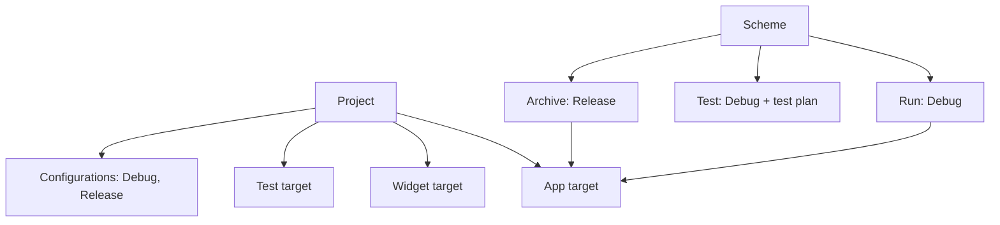
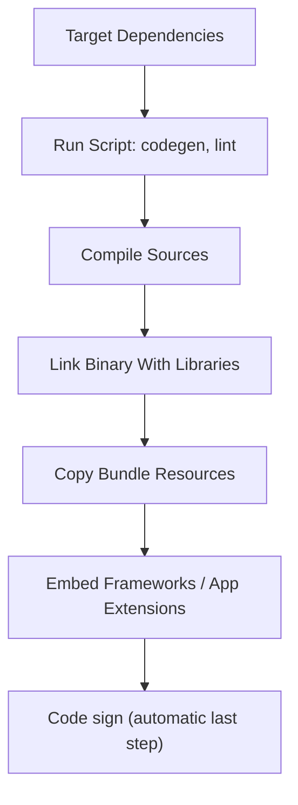
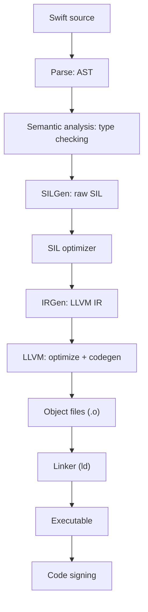
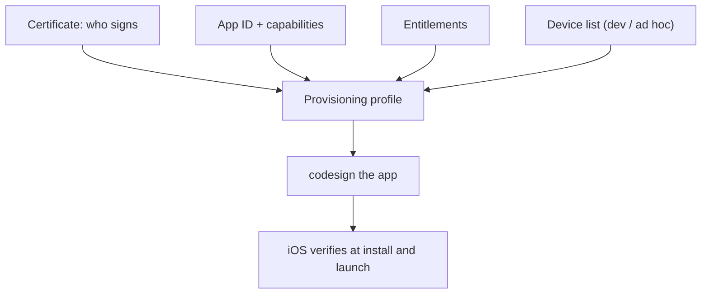
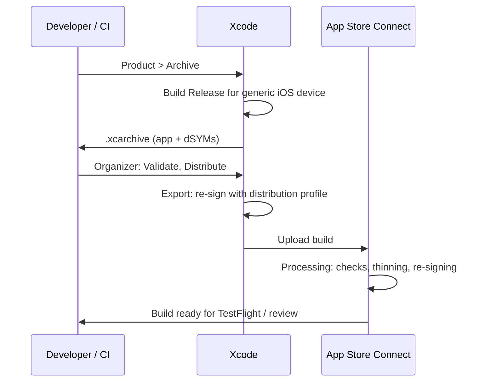
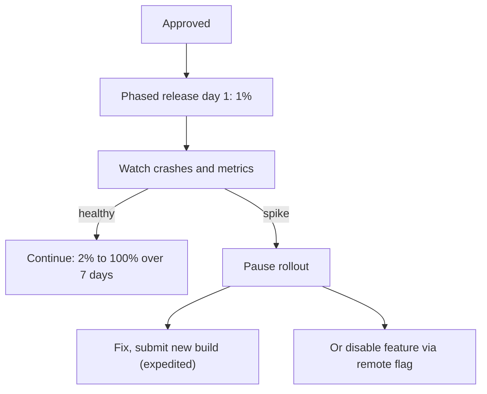
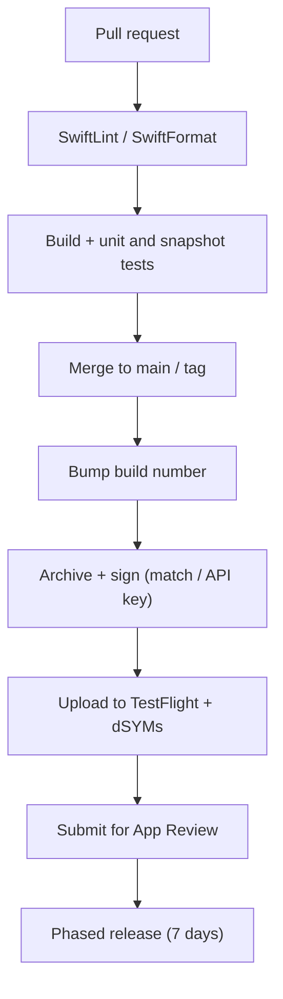

# Xcode, Build System & App Store Release

[⬅ Back to index](../README.md)

Covers: targets/schemes/configurations, xcconfig, build phases, compiler, code signing & provisioning, entitlements, archiving, TestFlight, App Store review, phased release, CI/CD, versioning, debugging tools.

---

### 1. Project vs Target vs Scheme vs Configuration?

<details>
<summary>Answer</summary>

**In short:** The **project** is the container. A **target** is one product you build, such as the app, a widget extension or a test bundle. A **configuration** is a named set of build settings, such as Debug or Release. A **scheme** ties it together: it says which targets to build for each action (Run, Test, Profile, Archive) and which configuration each action uses.

#### What each one is

- **Project (`.xcodeproj`)** – holds the file references, the targets, and **project-level build settings** that every target inherits. A **workspace (`.xcworkspace`)** groups several projects, for example your app plus a CocoaPods `Pods` project.
- **Target** – builds exactly one **product**: an app, an app extension (widget, share, notification service), a framework, or a unit/UI test bundle. Each target has its own build settings (which override the project's), build phases, Info.plist, entitlements and bundle ID.
- **Build configuration** – a named variant of the settings. Every project starts with `Debug` (no optimization, debug symbols, `DEBUG` flag) and `Release` (optimized, stripped). You can add custom ones like `Staging`. Each target has a value for every setting in every configuration.
- **Scheme** – a recipe for the actions. For each action it chooses the targets, the configuration, environment variables and launch arguments, diagnostics (Address/Thread Sanitizer, Main Thread Checker) and the **test plan**. Schemes can be **shared** (committed to git, under `xcshareddata`) so that CI can use them.

| Concept | Answers the question | Example |
|---|---|---|
| Project | Where do the files and settings live? | `MyApp.xcodeproj` |
| Target | What is being built? | `MyApp`, `MyAppWidget`, `MyAppTests` |
| Configuration | With which settings? | `Debug`, `Release`, `Staging` |
| Scheme | What do Run/Test/Archive do? | `MyApp-Staging`: Run uses Debug-Staging, Archive uses Release-Staging |



#### Setting resolution order

A build setting is resolved from most specific to least specific: target-level value → target's xcconfig → project-level value → project's xcconfig → Xcode default. Bold values in the Build Settings "Levels" view show where the winning value comes from.

**Common pitfalls**
- Adding a new configuration but forgetting that CocoaPods or SPM-based settings also need it (run `pod install` again after adding one).
- Leaving a scheme unshared, so CI can't find it.
- Confusing "the scheme's Run action uses Release" with "my archive is Release": each action has its own configuration.

**Likely follow-ups**
- *Where do you set environment variables for a run?* In the scheme's Run action (Arguments tab). They don't exist in archived builds.
- *Why have separate test plans?* To run different test sets or configurations (e.g. with sanitizers, different languages) from the same scheme.

</details>

### 2. How do you manage multiple environments (Dev/Staging/Prod)?

<details>
<summary>Answer</summary>

**In short:** Create a **build configuration** per environment (e.g. Debug-Dev, Debug-Staging, Release-Prod), put the per-environment values in **`.xcconfig` files**, expose them to the app through Info.plist, and create a **scheme** per environment. Different bundle IDs let all environments live side by side on one device.

#### Why not just `if` statements in code?

Hard-coding URLs behind `#if` flags scatters configuration across Swift files, makes it easy to ship a staging URL to production, and means every change needs a code review of logic rather than config. Build settings keep configuration in one place and let CI pick the environment just by choosing the scheme.

#### Step by step

1. **Duplicate configurations** in Project → Info → Configurations (Debug → Debug-Staging, Release → Release-Staging, and so on).
2. **Create xcconfig files** and assign them to each configuration.

```xcconfig
// Shared.xcconfig
PRODUCT_NAME = MyApp

// Staging.xcconfig
#include "Shared.xcconfig"
PRODUCT_BUNDLE_IDENTIFIER = com.company.myapp.staging
APP_DISPLAY_NAME = MyApp β
ASSETCATALOG_COMPILER_APPICON_NAME = AppIcon-Staging
// "//" starts a comment in xcconfig, so break it up with $()
API_BASE_URL = https:/$()/staging-api.company.com
SWIFT_ACTIVE_COMPILATION_CONDITIONS = $(inherited) STAGING
```

3. **Expose values in Info.plist**: add a key `APIBaseURL` with value `$(API_BASE_URL)`, and set `CFBundleDisplayName` to `$(APP_DISPLAY_NAME)`.
4. **Read them in code** in one place:

```swift
enum AppConfig {
    static let apiBaseURL: URL = {
        guard
            let string = Bundle.main.object(forInfoDictionaryKey: "APIBaseURL") as? String,
            let url = URL(string: string)
        else {
            fatalError("APIBaseURL missing from Info.plist") // fail fast at launch, not later
        }
        return url
    }()
}
```

5. **Create a scheme per environment** (`MyApp-Dev`, `MyApp-Staging`, `MyApp-Prod`), each using the matching configurations for Run and Archive, and mark them shared.

#### Options compared

| Approach | Good for | Downside |
|---|---|---|
| xcconfig + Info.plist | URLs, bundle IDs, icons, names | Values end up in the bundle in plain text |
| Compilation conditions (`#if STAGING`) | Code that must not exist in prod (debug menus) | Easy to overuse; hard to test every branch |
| Remote config / feature flags | Values that change after release | Needs network and a fallback default |

**Common pitfalls**
- Putting **secrets** in xcconfig: anything in Info.plist is readable by anyone who downloads the app. Keep real secrets on the server.
- Forgetting that `//` in an xcconfig value starts a comment, truncating URLs.
- Separate bundle IDs need separate App IDs, provisioning profiles and push/Firebase configs per environment.

**Likely follow-ups**
- *How do you pick a different `GoogleService-Info.plist` per environment?* Keep one per environment and copy the right one in a Run Script phase, based on `$(CONFIGURATION)`.
- *Why do Debug/Release still matter if you have environments?* They control optimization and debug symbols; environment is a separate axis, which is why you often get combinations like Debug-Staging.

</details>

### 3. What are build phases?

<details>
<summary>Answer</summary>

**In short:** Build phases are the **ordered steps** Xcode runs to turn a target into a product: build its dependencies, run scripts, compile sources, link libraries, copy resources and embed frameworks or extensions. You can reorder them and add **Run Script** phases for things like linting or code generation.

#### The standard phases



| Phase | What it does |
|---|---|
| **Target Dependencies** | Builds other targets first (e.g. a framework or a widget extension the app embeds) |
| **Run Script** | Runs a shell script at that point: SwiftLint, SwiftGen/code generation, uploading dSYMs, copying a config file |
| **Compile Sources** | Compiles `.swift`, `.m`, `.c` files that are members of the target |
| **Link Binary With Libraries** | Links frameworks and static/dynamic libraries |
| **Copy Bundle Resources** | Copies asset catalogs (compiled), storyboards (compiled to nibs), JSON, fonts into the bundle |
| **Embed Frameworks / App Extensions** | Copies dynamic frameworks and `.appex` bundles into the app and signs them |

#### Run Scripts done right

Run Scripts are where build times and flakiness usually come from. Two rules:

1. **Declare input and output files** (or `.xcfilelist` files). Xcode then skips the script when no input changed. A script with no outputs runs on every build, and Xcode warns about it.
2. **Put code-generation scripts before Compile Sources**, so the generated Swift exists when compilation starts.

```bash
if command -v swiftlint >/dev/null; then
  swiftlint --quiet
else
  echo "warning: SwiftLint not installed"
fi
```

**User script sandboxing:** Xcode 15+ enables `ENABLE_USER_SCRIPT_SANDBOXING` by default for new projects. A sandboxed script can only read and write the files it declares as inputs and outputs, which makes builds more reproducible and lets Xcode schedule scripts correctly. Scripts that silently read undeclared files will fail with "Sandbox: deny file-read".

**Common pitfalls**
- A file added to the project but not to the target's **Compile Sources** (target membership): "Cannot find X in scope".
- A dynamic framework linked but not **embedded**: it builds, then crashes at launch with "Library not loaded".
- Run Scripts without outputs slowing every incremental build.

**Likely follow-up**
- *How do SPM plugins relate?* Build tool plugins are the package-based replacement for many Run Scripts; they declare inputs and outputs by design.

</details>

### 4. How does the Swift compilation process work?

<details>
<summary>Answer</summary>

**In short:** The Swift compiler parses source into an **AST**, type-checks it, lowers it to **SIL** (Swift Intermediate Language) where Swift-specific optimizations happen, then to **LLVM IR**, which LLVM turns into machine code in object files. The **linker** combines the object files and libraries into the executable, and the result is **code signed**.

#### The pipeline



1. **Parsing** – the source becomes an abstract syntax tree. Syntax errors appear here.
2. **Semantic analysis** – type inference and checking, overload resolution, protocol conformance checks. This is where most compile errors come from, and where slow builds often come from (complex expressions are expensive to type-infer).
3. **SIL generation and optimization** – SIL is a Swift-aware representation. Here the compiler checks **definite initialization** and exclusivity, and optimizes: removes redundant **ARC retain/release** pairs, **devirtualizes** calls (turns dynamic dispatch into direct calls when it can prove the type), **specializes generics** for concrete types, and inlines.
4. **IRGen + LLVM** – SIL is lowered to LLVM IR, and LLVM does general optimizations and generates machine code for the target architecture (arm64).
5. **Linking** – the linker resolves symbols across object files and libraries. Xcode 15 introduced a new, faster linker (often called ld-prime).
6. **Signing** – `codesign` signs the bundle (see question 5).

#### Optimization settings

| Setting | Meaning | Used for |
|---|---|---|
| `-Onone` | No optimization, best debugging | Debug |
| `-O` | Optimize for speed | Release (default) |
| `-Osize` | Optimize for binary size | Size-sensitive apps |
| **Whole Module Optimization** | Compile the whole module as one unit, so the optimizer sees across files (better inlining, devirtualization, dead code removal) | Release (default) |
| Incremental | Recompile only changed files and their dependents | Debug (fast rebuilds) |

`final`, `private` and `fileprivate` help the optimizer: if nothing can override a method, it can be called directly instead of through the vtable.

**Common pitfalls**
- Long type-checking times from big literal expressions or chained operators with no type annotations. Find them with the Swift flags `-Xfrontend -warn-long-expression-type-checking=100` and `-Xfrontend -warn-long-function-bodies=100`.
- Bugs that only appear in Release because of optimization (e.g. relying on undefined ordering or data races).

**Likely follow-ups**
- *What is a dSYM?* The debug symbols extracted from the binary, used to symbolicate crash reports.
- *Why is WMO slower for incremental builds?* Any change recompiles the whole module, which is why Debug uses incremental mode.

</details>

### 5. How does code signing work? What is a provisioning profile?

<details>
<summary>Answer</summary>

**In short:** Code signing proves **who built the app** and that it **hasn't been modified** since. iOS refuses to run unsigned or tampered code. A **provisioning profile** is an Apple-signed file that ties together your **certificate(s)**, the **App ID**, the allowed **entitlements**, and (for development and Ad Hoc) the **device list**, so iOS can decide whether this signed app may run on this device with these capabilities.

#### The pieces

- **Certificate** (Apple Development / Apple Distribution) – your signing identity. Apple signs your public key; the **private key lives in your keychain**. Lose the private key and the certificate is useless.
- **App ID / bundle ID** – identifies the app (Team ID prefix + bundle ID) and records its enabled **capabilities**.
- **Entitlements** – key-value claims embedded in the signature that the binary requests: push (`aps-environment`), App Groups, iCloud, Keychain sharing, Associated Domains.
- **Provisioning profile** – **certificate(s) + App ID + entitlements + devices**. Types: Development, Ad Hoc, App Store, Enterprise (in-house).



#### What happens when signing

1. Xcode embeds the profile in the bundle as `embedded.mobileprovision`.
2. `codesign` hashes every file in the bundle (recorded in `_CodeSignature/CodeResources`) and the executable's pages, then signs those hashes with your private key, together with the entitlements.
3. At install and launch, iOS checks: the signature is valid and chains to Apple; the certificate is in the profile; the profile is valid and not expired; the bundle ID matches; every entitlement requested is allowed by the profile; and for development/Ad Hoc, the device UDID is listed.

For App Store builds, Apple **re-signs** the app with its own certificate after review, so users' devices verify Apple's signature.

| Profile type | Signed with | Runs on |
|---|---|---|
| Development | Development cert | Registered devices, debugging from Xcode |
| Ad Hoc | Distribution cert | Up to 100 registered devices per device type per year |
| App Store | Distribution cert | Uploaded to App Store Connect (TestFlight/App Store) |
| Enterprise | Enterprise distribution cert | Any device in the organization (Enterprise program only, internal apps) |

#### Managing signing

- **Automatic signing**: Xcode creates and renews certificates and profiles. Good for small teams and local development.
- **Manual signing / fastlane match**: certificates and profiles are stored encrypted in a git repo or cloud bucket and installed on each machine and CI runner. Good for teams and CI because everyone uses the same identity.
- **Cloud-managed signing** with Xcode Cloud or App Store Connect API keys is another option.

**Common pitfalls**
- "Provisioning profile doesn't include the X entitlement": you enabled a capability in Xcode but the profile was created before; regenerate it.
- Adding a device and forgetting to regenerate the development/Ad Hoc profile.
- Each app extension has its own bundle ID and needs its own profile.

**Likely follow-ups**
- *What does `codesign -d --entitlements - MyApp.app` do?* Prints the entitlements actually embedded in the signature, which is the fastest way to debug entitlement problems.
- *What happens when a distribution certificate expires?* Apps already on the App Store keep working (Apple re-signed them); you just need a new certificate to upload new builds. Enterprise apps, by contrast, stop launching when the certificate expires or is revoked.

</details>

### 6. What happens when you archive and upload an app?

<details>
<summary>Answer</summary>

**In short:** **Product → Archive** builds the app with the scheme's Archive configuration (normally Release) for a generic device, and produces an **`.xcarchive`** containing the app and its **dSYMs**. From the **Organizer** you validate and **distribute** it, which re-signs and exports it for a method (App Store Connect, Ad Hoc, Enterprise, Development) and uploads it. App Store Connect then **processes** the build, after which it can go to TestFlight and App Review.

#### Step by step



1. **Archive** – compiles with optimization, generates dSYMs (`DEBUG_INFORMATION_FORMAT = dwarf-with-dsym`), and stores everything in `~/Library/Developer/Xcode/Archives`.
2. **Validate** – checks things App Store Connect would reject: signing, entitlements, icons, Info.plist keys, private API usage.
3. **Distribute / export** – picks the method, signs with the right distribution certificate and profile, and either uploads or writes an `.ipa`.
4. **Processing** – App Store Connect runs automated checks (this is where many "Missing purpose string" or "invalid binary" emails come from), creates the device-specific **thinned variants**, and makes the build available. This can take from minutes to over an hour.

#### The same thing on the command line (CI)

First archive, then export (and optionally upload) with an `ExportOptions.plist` whose `method` is `app-store-connect` and `destination` is `upload` or `export`:

```bash
xcodebuild archive \
  -scheme MyApp-Prod \
  -configuration Release \
  -destination "generic/platform=iOS" \
  -archivePath build/MyApp.xcarchive

xcodebuild -exportArchive \
  -archivePath build/MyApp.xcarchive \
  -exportOptionsPlist ExportOptions.plist \
  -exportPath build/export
```

In practice most teams wrap this with fastlane (`gym` to build, `pilot`/`upload_to_testflight` to upload).

**Common pitfalls**
- Not keeping the dSYMs: crash reports can't be symbolicated without them. Upload them to your crash reporter (Crashlytics, Sentry) as part of the release.
- Reusing a build number: the upload is rejected (see question 10).
- The archive uses the scheme's **Archive** action configuration; if someone changed it to Debug, you ship an unoptimized build.

**Likely follow-up**
- *What's in an `.ipa`?* A zip with a `Payload/MyApp.app` folder, i.e. the signed app bundle.

</details>

### 7. What is TestFlight?

<details>
<summary>Answer</summary>

**In short:** TestFlight is Apple's beta testing service, built into App Store Connect. **Internal testers** (up to 100 members of your App Store Connect team) get builds right after processing, with no review. **External testers** (up to 10,000, invited by email or public link) need the build to pass **Beta App Review** first. Builds expire after **90 days**.

#### How it works

1. Upload a build (question 6). After processing, it appears in the TestFlight tab.
2. Add **What to Test** notes and assign the build to **groups**.
3. Testers install the **TestFlight app**, accept the invite, and install the beta, which lives alongside nothing else: it replaces the App Store version of the same app on that device.

| | Internal testers | External testers |
|---|---|---|
| Who | App Store Connect users on your team (with a role) | Anyone with an email invite or public link |
| Limit | 100 | 10,000 |
| Review | None | Beta App Review for the first build of a version (later builds usually go faster) |
| Typical use | Team QA, dogfooding | Customers, stakeholders, public beta |

#### Feedback and data

- Testers can send **feedback with screenshots** from inside the app (take a screenshot, then share to beta feedback) and crash feedback when the app crashes.
- Crashes and feedback show up in App Store Connect and in Xcode's **Organizer**.
- Builds stop working **90 days** after upload, so long-running betas need regular new builds.

**Common pitfalls**
- Beta builds use the **sandbox** environment for in-app purchases (no real charges) but the **production** APNs environment, since they're distribution-signed.
- External testers can't test until Beta App Review passes, so plan for it in your release schedule.
- Public links with no limit can fill your tester slots quickly; set a tester cap.

**Likely follow-ups**
- *Can you test a build that's already in App Review on TestFlight?* Yes, the same build can be on TestFlight and submitted for review.
- *TestFlight vs Ad Hoc?* Ad Hoc needs device UDIDs and a manual install; TestFlight needs only an Apple ID and handles updates.

</details>

### 8. What happens in App Store Review? Common rejection reasons?

<details>
<summary>Answer</summary>

**In short:** Apple's reviewers (combined with automated checks) test your build against the **App Store Review Guidelines**, which are grouped into five areas: **safety, performance, business, design and legal**. The most common rejections are crashes and incomplete apps, missing or vague permission explanations, digital goods sold outside In-App Purchase, privacy problems (no account deletion, missing privacy policy or manifest), and apps with too little functionality.

#### The process

1. You submit a version with metadata, screenshots, privacy details and **review notes** (including a demo account if login is needed).
2. Automated checks scan the binary (private APIs, required Info.plist keys, Privacy Manifest).
3. A human reviewer installs and uses the app on real devices.
4. Result: approved, or rejected with a guideline number in the **App Review** messages (often called the Resolution Center). You can reply, fix and resubmit, or appeal to the App Review Board.

#### Common rejection reasons

| Guideline area | What gets rejected | How to avoid it |
|---|---|---|
| **2.1 App Completeness** | Crashes, broken links, placeholder content, a login the reviewer can't get past | Test the exact build on a clean device; provide a working demo account |
| **2.3 Accurate Metadata** | Screenshots that don't match the app, hidden features | Keep metadata honest and current |
| **5.1.1 Data Collection** | Vague permission strings ("needs camera"), forcing login for features that don't need an account, **no in-app account deletion** for apps that offer account creation | Write specific usage descriptions; allow guest use where possible; add account deletion |
| **Privacy (5.1)** | Missing privacy policy, privacy labels that don't match the app, missing **Privacy Manifest** or required-reason API declarations | Audit SDKs; keep `PrivacyInfo.xcprivacy` accurate |
| **3.1.1 In-App Purchase** | Unlocking digital content or subscriptions with your own payment system | Use IAP for digital goods; regional exceptions (e.g. external purchase links in the US) keep changing, so check the current rules |
| **4.2 Minimum Functionality** | A website in a web view, a thin wrapper with no native value | Add real native features |
| **4.3 Spam** | Copies of your own or others' apps, template apps | Make each app distinct |
| **2.5.1 Software Requirements** | Private API usage, downloading executable code | Use only public APIs |

Good permission string example:

```xml
<key>NSCameraUsageDescription</key>
<string>Used to scan receipts so you don't have to type the amounts.</string>
```

**Common pitfalls**
- Server-side feature flags that hide functionality from reviewers can be treated as hidden features. Describe them in review notes.
- Reviewers often test on iPad even for iPhone-only apps (they run in compatibility mode), so layout bugs there matter.

**Likely follow-ups**
- *How long does review take?* Usually around a day or less, but it varies.
- *What if a critical fix is needed fast?* Request an **expedited review** (question 9).

</details>

### 9. What release strategies does App Store Connect offer?

<details>
<summary>Answer</summary>

**In short:** After approval you can release **manually**, **automatically**, or on a **scheduled date**. **Phased release** rolls an update out to automatic-update users over **7 days** (1% → 2% → 5% → 10% → 20% → 50% → 100%) and can be paused. For urgent fixes there's **expedited review**. Because you **can't roll back** a shipped binary, teams also rely on remote **feature flags** and a **force-update** mechanism.

#### The options

| Option | What it does | When to use |
|---|---|---|
| Manual release | You press "Release" after approval | Coordinate with marketing, backend deploys |
| Automatic release | Goes live as soon as it's approved | Routine updates |
| Scheduled release | Goes live after a date you choose (if approved by then) | Launches tied to an event |
| **Phased release** | 7-day gradual rollout to users with automatic updates on | Every non-trivial update |
| Expedited review | Ask Apple to prioritize review | Critical bug or security fix |

#### Phased release details

- The percentages apply to users who have **automatic updates** turned on. Anyone can still update manually from the App Store at any time, and new users always get the latest version.
- You can **pause** the rollout (for up to 30 days in total) if crash rates or metrics spike, then resume, or **release to everyone** early.
- Pausing doesn't remove the version from people who already got it. The only real fix is a new build.



#### Why feature flags and force updates matter

On the web you redeploy; on iOS, a bad build stays on devices until users update. So:

- **Feature flags** (Firebase Remote Config, LaunchDarkly, your own endpoint) let you ship code dark and turn a broken feature off without a new release.
- **Force update**: the backend returns a minimum supported version; older apps show a blocking "please update" screen.

```swift
struct VersionPolicy: Decodable { let minimumVersion: String }

func mustUpdate(policy: VersionPolicy) -> Bool {
    let current = Bundle.main.object(forInfoDictionaryKey: "CFBundleShortVersionString") as? String ?? "0"
    // .numeric compares "2.10.0" > "2.9.0" correctly
    return current.compare(policy.minimumVersion, options: .numeric) == .orderedAscending
}
```

**Common pitfalls**
- Comparing versions as plain strings ("2.10" < "2.9").
- Shipping a backend change that old app versions can't handle; old versions stay in use for months.

**Likely follow-up**
- *Can you roll back to the previous version?* No. You can only remove the app from sale or ship a new, higher version.

</details>

### 10. What is the difference between version and build number?

<details>
<summary>Answer</summary>

**In short:** The **version** (`CFBundleShortVersionString`, build setting `MARKETING_VERSION`) is the user-facing release number shown on the App Store, like `2.3.0`. The **build number** (`CFBundleVersion`, build setting `CURRENT_PROJECT_VERSION`) identifies a specific build; it must be **unique for each upload within a version** and should keep increasing. CI usually sets the build number automatically.

| | Version | Build |
|---|---|---|
| Info.plist key | `CFBundleShortVersionString` | `CFBundleVersion` |
| Build setting | `MARKETING_VERSION` | `CURRENT_PROJECT_VERSION` |
| Seen by | Users (App Store, Settings) | Developers, TestFlight, crash reports |
| Format | Up to three numbers, e.g. `2.3.0` (semantic versioning is common) | Numbers separated by periods, e.g. `412` or `2.3.0.412` |
| Changes when | You release a new version | Every upload |

#### Example flow

You prepare version `2.3.0`. You upload build `100` to TestFlight, find a bug, upload `101`, then `102`, which passes QA and is submitted for review. All three are "2.3.0" to users, but App Store Connect needs different build numbers to tell them apart.

#### Setting it automatically

With `agvtool` (needs "Versioning System" set to Apple Generic), or by passing the setting to `xcodebuild`:

```bash
agvtool new-marketing-version 2.3.0     # set the version
agvtool new-version -all 412            # set the build number
agvtool next-version -all               # increment the build number

xcodebuild archive ... CURRENT_PROJECT_VERSION=$CI_BUILD_NUMBER   # or pass it straight from CI
```

fastlane has `increment_build_number` and `latest_testflight_build_number` (to fetch the last uploaded number and add one).

**Common pitfalls**
- Two CI jobs or two developers uploading the same build number: the second upload is rejected.
- Hard-coding the values in Info.plist instead of using `$(MARKETING_VERSION)` and `$(CURRENT_PROJECT_VERSION)`, so app extensions drift out of sync. Extensions must have the **same version** as the host app.

**Likely follow-up**
- *Why use the CI run number as the build number?* It's unique, always increasing, and lets you trace any crash report back to the exact CI run and commit.

</details>

### 11. What does an iOS CI/CD pipeline look like?

<details>
<summary>Answer</summary>

**In short:** On every pull request, CI **lints, builds and runs tests**. On merge or a release tag, CI **bumps the build number, archives, signs** (with certificates from fastlane match or cloud signing, and an App Store Connect API key), **uploads to TestFlight**, uploads dSYMs, and optionally submits for review with a phased release. Common tools: **Xcode Cloud**, GitHub Actions (macOS runners), Bitrise, CircleCI, Jenkins, with **fastlane** for automation.



#### PR pipeline (fast feedback, minutes)

1. Lint and format check (SwiftLint/SwiftFormat).
2. Build for testing and run **unit tests** with code coverage.
3. **Snapshot tests**; **UI tests** are slower and flakier, so many teams run them nightly or on a subset.
4. Optionally static analysis and binary-size checks.

#### Release pipeline (on merge or tag)

1. Set the build number from the CI run number.
2. Install signing assets: `match(type: "appstore", readonly: true)`. Read-only so CI never creates or revokes certificates.
3. Archive and export (`gym` / `build_app`).
4. Upload to TestFlight (`pilot` / `upload_to_testflight`) using an **App Store Connect API key** (no 2FA prompts).
5. Upload dSYMs to the crash reporter.
6. Generate release notes, submit for review (`deliver`), enable phased release.

A minimal `fastlane/Fastfile` lane:

```ruby
lane :beta do
  api_key = app_store_connect_api_key(
    key_id: ENV["ASC_KEY_ID"],
    issuer_id: ENV["ASC_ISSUER_ID"],
    key_content: ENV["ASC_KEY_P8"]
  )
  match(type: "appstore", readonly: true, api_key: api_key)
  increment_build_number(build_number: ENV["CI_BUILD_NUMBER"])
  build_app(scheme: "MyApp-Prod", export_method: "app-store")
  upload_to_testflight(api_key: api_key, skip_waiting_for_build_processing: true)
end
```

#### Making it fast and reliable

- **Cache** SPM packages (and DerivedData carefully), and pin the Xcode version on runners.
- Split jobs: tests in parallel with `-parallel-testing-enabled YES` or test plans.
- Keep **secrets** (match password, `.p8` key, crash-reporter tokens) in the CI secret store, never in the repo.
- Treat flaky tests as bugs; quarantine them rather than retrying forever.

**Common pitfalls**
- Using a personal Apple ID with 2FA on CI: use an API key.
- Different Xcode versions locally and on CI producing different results.

**Likely follow-up**
- *Xcode Cloud vs GitHub Actions?* Xcode Cloud is integrated with App Store Connect and handles signing for you; GitHub Actions is more flexible and fits existing workflows, but you manage signing and macOS runner costs.

</details>

### 12. What debugging tools in Xcode should you know?

<details>
<summary>Answer</summary>

**In short:** Breakpoints (conditional, symbolic, exception and Swift error breakpoints, and breakpoint actions), **LLDB** commands, the **View Hierarchy Debugger**, the **Memory Graph Debugger**, Environment Overrides, **sanitizers** and the **Main Thread Checker**, structured logging with `Logger`, and **Instruments** for performance.

#### Breakpoints

- **Conditional**: stop only when `userID == 42`.
- **Actions**: log a message or run an LLDB command, and tick "Automatically continue", i.e. logging without adding `print` and rebuilding.
- **Symbolic**: stop in any method by name, e.g. `UIViewAlertForUnsatisfiableConstraints` for Auto Layout conflicts.
- **Exception breakpoint** (Objective-C exceptions) and **Swift Error breakpoint** (stop where an error is thrown): add both to every project; they show the real crash location instead of `main`.

#### LLDB essentials

| Command | What it does |
|---|---|
| `v name` (`frame variable`) | Read a variable from memory, no code execution; fastest and safest |
| `p expr` | Evaluate an expression and print it with the data formatter |
| `po obj` | Evaluate and print the object's description (`debugDescription`) |
| `expr x = 5` | Change state while paused |
| `bt` | Backtrace of the current thread (`bt all` for all threads) |
| `thread step-over`, `c` | Step, continue |

```text
(lldb) v user.name
(lldb) po viewModel.items.count
(lldb) expr isLoggedIn = true
(lldb) bt
```

#### Visual and runtime debuggers

| Tool | Use it for |
|---|---|
| **View Hierarchy Debugger** | 3D view of the UI: hidden or off-screen views, Auto Layout ambiguity, wrong z-order |
| **Memory Graph Debugger** | Retain cycles and leaks: shows who holds a reference to an object |
| **Environment Overrides** | Toggle Dynamic Type size, dark mode, accessibility settings live |
| **Network Link Conditioner** / device conditions | Simulate slow or lossy networks |
| **Location simulation** | Fake GPS location and routes |
| **Address Sanitizer** | Memory errors: use-after-free, buffer overflows |
| **Thread Sanitizer** | Data races |
| **Undefined Behavior Sanitizer** | Undefined behavior in C/ObjC code |
| **Main Thread Checker** | UIKit calls from a background thread |
| **Zombie Objects** | Messages to deallocated Objective-C objects |
| **Instruments** | Time Profiler, Allocations, Leaks, Hangs, Network, Energy |

Sanitizers and checkers are enabled in the scheme's Run or Test action (Diagnostics tab). Address and Thread Sanitizer can't be enabled at the same time.

**Common pitfalls**
- Debugging only on the simulator: performance, memory and some APIs (camera, push) differ on a device.
- Leaving Zombie Objects on: nothing is ever freed, so memory numbers are wrong.

**Likely follow-up**
- *`po` vs `v`?* `v` reads memory directly and doesn't run code, so it works even when expression evaluation fails; `po` compiles and runs an expression.

</details>

### 13. What is the difference between `print`, `NSLog`, `os_log`/`Logger`?

<details>
<summary>Answer</summary>

**In short:** `print` writes only to stdout, so you only see it in Xcode's console while debugging. `NSLog` writes to the system log but is slow and synchronous. **`Logger`** (the Swift API of OSLog, the unified logging system) is fast, structured, has **levels, subsystems and categories**, and **redacts dynamic values for privacy** by default. `Logger` is the recommended choice.

| | `print` | `NSLog` | `Logger` / `os_log` |
|---|---|---|---|
| Destination | stdout (Xcode console) | Unified system log + stderr | Unified system log |
| Visible on device without Xcode | No | Yes (Console.app) | Yes (Console.app, `log` command) |
| Performance | Fine, but ships in release unless removed | Slow, synchronous | Very fast; formatting deferred; debug messages cheap when not collected |
| Levels | None | None | `debug`, `info`, `notice`, `error`, `fault` |
| Filtering | None | Text search | By subsystem, category, level |
| Privacy | Prints everything | Prints everything | Dynamic values `<private>` by default in logs collected off-device |

#### Using Logger

```swift
import OSLog

extension Logger {
    private static let subsystem = Bundle.main.bundleIdentifier!
    static let network = Logger(subsystem: subsystem, category: "network")
    static let auth = Logger(subsystem: subsystem, category: "auth")
}

func login(email: String, attempt: Int) {
    // Integers are public by default; strings are private by default
    Logger.auth.info("Login attempt \(attempt) for \(email, privacy: .private(mask: .hash))")
}

func requestFailed(_ url: URL, status: Int) {
    Logger.network.error("Request failed: \(url.path, privacy: .public) status \(status)")
}
```

#### Levels and what's kept

- `debug` – development detail; not stored by default, very cheap when disabled.
- `info` – helpful but not essential; kept in memory, stored only in some cases.
- `notice` (the default level) – persisted to disk.
- `error`, `fault` – persisted; `fault` is for bugs in your code.

#### Viewing logs

- **Xcode 15+ console** shows structured logs with filtering by level, subsystem and category, and lets you jump to the source line.
- **Console.app** on a Mac with the device connected.
- Terminal: `log stream --predicate 'subsystem == "com.company.myapp"' --level debug`.
- In the app: `OSLogStore` (iOS 15+) can read the app's own logs, for example to attach them to a support report.

**Common pitfalls**
- Logging tokens or personal data with `privacy: .public`.
- Building log strings with string interpolation outside the `Logger` call (`let msg = "\(x)"; logger.info("\(msg)")`): you lose deferred formatting and privacy control for each value.

**Likely follow-up**
- *`os_log` vs `Logger`?* Same system; `Logger` (iOS 14+) is the Swift-friendly API using string interpolation, `os_log` is the older C-style API.

</details>

### 14. What are linker issues you might face?

<details>
<summary>Answer</summary>

**In short:** The usual ones are **"Undefined symbols"** (something isn't linked or a file isn't in the target), **"duplicate symbols"** (the same code linked twice), categories missing from static Objective-C libraries (needs `-ObjC`), **architecture mismatches** between simulator and device (solved by XCFrameworks), and the runtime crash **"Library not loaded / image not found"** (a dynamic framework was linked but not embedded).

#### Background: static vs dynamic

- A **static library/framework** is copied into your binary at link time. Nothing to embed, but linking it into two targets that end up in the same process duplicates the code.
- A **dynamic framework** is loaded at launch by `dyld`. It must be **embedded** in the app bundle (Embed & Sign) and found through `@rpath`.

| Error | Typical cause | Fix |
|---|---|---|
| `Undefined symbols for architecture arm64: _OBJC_CLASS_$_Foo` | Framework not in "Link Binary With Libraries"; source file not in the target; wrong architecture slice | Add the library; check target membership; use an XCFramework |
| `duplicate symbol '_foo'` | Same static library linked in two places (e.g. via two pods or app + framework) | Link it once, in one place; or make it dynamic |
| Crash: `unrecognized selector` on a category method | Static ObjC library categories stripped by the linker | Add `-ObjC` to Other Linker Flags |
| `building for iOS Simulator, but linking in object file built for iOS` | A "fat" framework without a proper simulator slice (common on Apple silicon) | Ship/consume an **XCFramework** |
| Runtime: `dyld: Library not loaded: @rpath/Foo.framework/Foo` | Dynamic framework linked but not embedded | Set it to **Embed & Sign** |
| `Undefined symbol: Swift ... ` after updating a binary dependency | Binary built with an incompatible Swift compiler | Use a build with **Library Evolution** enabled (`BUILD_LIBRARY_FOR_DISTRIBUTION`) or rebuild from source |

#### XCFrameworks

An XCFramework bundles separate framework builds per platform and architecture (iOS device arm64, iOS Simulator arm64 + x86_64, macOS...). Xcode picks the right slice automatically. It replaced "fat" frameworks built with `lipo`, which couldn't hold an arm64 device slice and an arm64 simulator slice at once.

```bash
xcodebuild -create-xcframework \
  -framework build/ios/MyKit.framework \
  -framework build/sim/MyKit.framework \
  -output MyKit.xcframework
```

**Common pitfalls**
- Embedding a **static** framework (it gets copied in but isn't needed and can fail validation).
- An app extension and the app both statically linking the same big library: increased size, and duplicated singletons if shared through a dynamic framework too.

**Likely follow-up**
- *Static or dynamic for your own modules?* Static linking improves launch time (fewer dylibs for `dyld` to load); dynamic makes sense to share code between the app and extensions without duplicating it. Xcode 15 also added **mergeable libraries** to get dynamic in Debug and merged into the binary in Release.

</details>

### 15. What are App Store Connect features beyond publishing?

<details>
<summary>Answer</summary>

**In short:** Beyond uploading and releasing, App Store Connect gives you **analytics, sales and trends**, **customer reviews** with replies, setup of **in-app purchases and subscriptions** (plus promo and offer codes), store optimization tools like **Product Page Optimization** (A/B tests) and **Custom Product Pages**, **in-app events**, TestFlight, and the **App Store Connect API** to automate all of it.

| Feature | What it's for |
|---|---|
| **App Analytics** | Impressions, product page views, downloads, conversion rate, sessions, retention, crashes (from users who opted in), traffic sources |
| **Sales and Trends / Payments** | Units, proceeds, subscriptions, payouts and financial reports |
| **Ratings and reviews** | Read reviews by country, reply publicly; prompt for ratings in-app with `requestReview` |
| **In-app purchases and subscriptions** | Define products, prices, subscription groups, introductory offers, promotional offers, offer codes, family sharing |
| **Promo codes / offer codes** | Give free downloads or subscription discounts |
| **Product Page Optimization** | A/B test icons, screenshots and previews on your default product page |
| **Custom Product Pages** | Extra product page variants with their own screenshots and URL, for different ad campaigns or audiences |
| **In-app events** | Time-based events (challenges, launches) shown on the App Store and in search |
| **App privacy** | Privacy "nutrition labels" |
| **TestFlight** | Beta distribution (question 7) |
| **Users and Access** | Roles, team members, API keys |
| **App Store Connect API** | Automate builds, TestFlight, metadata, users, reports (used by fastlane and CI) |

#### Why an interviewer asks

They want to see you think beyond code: how the team measures a release (conversion and retention), handles reviews, runs monetization experiments, and automates the release process.

**Likely follow-ups**
- *Product Page Optimization vs Custom Product Pages?* PPO tests variants of the default page against each other on random traffic; Custom Product Pages are separate pages you send specific traffic to via their URL.
- *Where do you get crash data?* Xcode Organizer (crashes and energy/hang reports from opted-in users), plus a third-party crash reporter for real-time data.

</details>

### 16. What is StoreKit 2?

<details>
<summary>Answer</summary>

**In short:** StoreKit 2 is the modern in-app purchase API (iOS 15+), built on **Swift concurrency**. You load products with `Product.products(for:)`, buy with `product.purchase()`, listen to **`Transaction.updates`** from app launch, and check what the user owns with **`Transaction.currentEntitlements`**. Transactions are **JWS-signed**, so they can be **verified on the device** without a receipt-validation server, and the backend uses the **App Store Server API** and **App Store Server Notifications**.

#### Why it replaced the original StoreKit

The original API relied on a delegate-based `SKPaymentQueue` and a single opaque **receipt** file you had to send to a server (or parse with OpenSSL) to validate. StoreKit 2 gives you typed `Product` and `Transaction` values, `async` calls, and per-transaction signed data you can verify locally.

#### Core flow

```swift
import StoreKit

@MainActor
final class Store: ObservableObject {
    @Published private(set) var products: [Product] = []
    @Published private(set) var purchasedIDs: Set<String> = []
    private var updatesTask: Task<Void, Never>?

    init() {
        // Start at launch: renewals, refunds, Ask to Buy approvals, purchases on other devices
        updatesTask = Task { [weak self] in
            for await result in Transaction.updates {
                await self?.handle(result)
            }
        }
    }

    func load() async throws {
        products = try await Product.products(for: ["pro.monthly", "pro.yearly"])
        await refreshEntitlements()
    }

    func buy(_ product: Product) async throws {
        switch try await product.purchase() {
        case .success(let verification):
            await handle(verification)
        case .userCancelled, .pending: // pending = Ask to Buy / SCA
            break
        @unknown default:
            break
        }
    }

    func refreshEntitlements() async {
        var ids: Set<String> = []
        for await result in Transaction.currentEntitlements {
            if case .verified(let tx) = result, tx.revocationDate == nil {
                ids.insert(tx.productID)
            }
        }
        purchasedIDs = ids
    }

    private func handle(_ result: VerificationResult<Transaction>) async {
        guard case .verified(let tx) = result else { return } // signature check failed
        await refreshEntitlements()   // unlock content
        await tx.finish()             // always finish, or it is delivered again
    }
}
```

#### Testing

- **StoreKit configuration file** in Xcode: define products locally, test purchases, renewals (with accelerated time), refunds and failures without App Store Connect.
- **Sandbox** accounts for testing against Apple's servers; TestFlight builds also use the sandbox.

#### Ready-made UI

SwiftUI offers `StoreView`, `ProductView` and `SubscriptionStoreView` (iOS 17+) for merchandising screens with little code.

**Common pitfalls**
- Not listening to `Transaction.updates` at launch: you miss renewals and purchases approved later.
- Not calling `finish()`.
- Trusting only the client for valuable content; the server should verify with the App Store Server API and track state through Server Notifications.

**Likely follow-up**
- *How do you restore purchases?* Entitlements sync automatically; for a "Restore" button call `AppStore.sync()`, which may prompt for sign-in, so only use it on user request.

</details>


### 17. Development vs distribution certificates? What is an App ID?

<details>
<summary>Answer</summary>

**In short:** An **Apple Development** certificate signs builds you run and debug on **registered devices** from Xcode; each developer can have their own. An **Apple Distribution** certificate signs builds for **App Store/TestFlight, Ad Hoc and Enterprise** distribution and is usually shared by the team or CI. An **App ID** is the app's identifier registered in the developer portal: **Team ID prefix + bundle ID**, together with the **capabilities** it's allowed to use.

| | Apple Development | Apple Distribution |
|---|---|---|
| Purpose | Running and debugging on devices | Shipping: App Store, TestFlight, Ad Hoc |
| Used with profile type | Development | App Store, Ad Hoc (Enterprise uses an in-house distribution cert) |
| Device restrictions | Only registered devices | App Store: none; Ad Hoc: registered devices |
| Who has it | Each developer | Shared by the team / CI (fastlane match, or cloud-managed signing in Xcode) |
| `get-task-allow` entitlement | Yes, so the debugger can attach | No |

#### App IDs

- **Explicit App ID** – `TEAMID.com.company.app`. Required for most capabilities (push, iCloud, App Groups, Sign in with Apple, Associated Domains, In-App Purchase).
- **Wildcard App ID** – `TEAMID.com.company.*`. Matches many apps, handy for quick prototypes, but can't use most capabilities.
- Every **app extension** has its own explicit App ID, usually prefixed by the app's ID (`com.company.app.widget`).

Enabling a capability on the App ID changes what provisioning profiles generated for it can grant; existing profiles must be regenerated to include it.

#### Push notifications: keys vs certificates

Push used to require a separate APNs certificate per app, per environment, expiring yearly. Now teams usually use one **APNs authentication key (.p8)** per team: it doesn't expire, works for all your apps, and works for both sandbox and production. The server uses it to sign JWT tokens for APNs.

**Common pitfalls**
- Revoking a distribution certificate that CI depends on breaks every release pipeline (App Store apps already live are unaffected).
- Hitting the per-account limit on distribution certificates because each machine created its own; this is the problem match solves.

**Likely follow-up**
- *What's the Team ID for?* It prefixes App IDs and keychain access groups, so apps from the same team can share keychain items and App Groups.

</details>

### 18. What Git workflow questions come up? (merge vs rebase, branching, project file conflicts)

<details>
<summary>Answer</summary>

**In short:** `merge` combines branches and keeps history as it happened (with merge commits); it's safe on shared branches. `rebase` replays your commits on top of another branch for a linear history but **rewrites commits**, so **never rebase commits others already have**. Teams pick a branching model (trunk-based, GitHub Flow, Git Flow). The iOS-specific problem is **`.pbxproj` merge conflicts**, reduced with Xcode 16 synchronized folders, project generators (Tuist/XcodeGen) or moving code into SPM packages.

#### Merge vs rebase

| | `merge` | `rebase` | Squash merge |
|---|---|---|---|
| History | True history, with merge commits | Linear, rewritten | One commit per PR on `main` |
| Rewrites commits | No | Yes (new hashes) | Yes (combines them) |
| Safe on shared branches | Yes | No | Done by the server at PR merge |
| Conflicts | Resolved once | Possibly once per replayed commit | Resolved in the PR |

A common setup: rebase your own feature branch on `main` to keep it current, then **squash-merge** the PR to keep `main` readable.

#### Branching models

- **Trunk-based** – short-lived branches merged to `main` daily; unfinished features hidden behind **feature flags**. Fewer conflicts; needs good CI.
- **GitHub Flow** – feature branch → PR → `main`, deploy from `main`.
- **Git Flow** – `develop`, `release/x.y`, `hotfix/` branches. Fits App Store releases well, because a release branch can be stabilized during review while `main` keeps moving.

#### Commands worth knowing

```bash
git stash push -m "wip"            # park uncommitted changes
git cherry-pick abc123             # bring a fix onto release/2.3
git bisect start; git bisect bad; git bisect good v2.2.0   # binary-search a regression
git reflog                         # find "lost" commits after a bad reset or rebase
git revert abc123                  # new commit that undoes abc123 (safe on shared branches)
git reset --hard HEAD~1            # move the branch back (rewrites; local only)
```

#### The `.pbxproj` problem

`project.pbxproj` lists every file reference, group and build-phase entry with generated IDs. Two people adding files in the same group conflict constantly, and a bad resolution corrupts the project. Mitigations:

- **Xcode 16 synchronized folders** (buildable folders): the folder on disk is the source of truth, so adding a file doesn't change the project file.
- **Project generators** (**Tuist**, **XcodeGen**): the project is generated from a YAML/Swift spec and not committed.
- Moving most code into **local SPM packages**, whose `Package.swift` lists targets, not files.
- Commit `Package.resolved` so everyone builds the same dependency versions, and ignore `xcuserdata/` and DerivedData in `.gitignore`.

**Common pitfalls**
- `git push --force` on a shared branch after a rebase (use `--force-with-lease` on your own branches only).
- Resolving a `.pbxproj` conflict by "keeping both" and ending up with duplicate or dangling file references; open the project afterwards to check it loads.

**Likely follow-up**
- *`revert` vs `reset`?* `revert` adds a new commit that undoes changes (safe for shared history); `reset` moves the branch pointer and discards commits (local only).

</details>

### 19. What are app thinning and on-demand resources? What replaces them for large assets?

<details>
<summary>Answer</summary>

**In short:** **App thinning** means the App Store delivers a variant tailored to each device (**slicing**: only the right image scales and architecture), so users download less. **On-demand resources** let you tag assets so the App Store hosts them and the app downloads them only when needed. For large content today, Apple recommends the **Background Assets** framework (including Apple-hosted asset packs), which downloads assets before first launch or in the background.

#### App thinning

When you upload a build, App Store Connect creates **variants** for different device types. A device with a 3x screen gets only the @3x images from asset catalogs, and only the arm64 code. This only works for resources in **asset catalogs**, which is one reason to keep images there instead of loose files.

Bitcode, once part of app thinning (Apple could recompile your app), was deprecated in Xcode 14 and is no longer accepted.

You can see the per-device sizes by exporting with the "App Thinning: All compatible device variants" option, which produces an **App Thinning Size Report**.

#### On-demand resources (ODR)

You tag assets (game levels, tutorial videos) in Xcode. Tagged assets are hosted by the App Store, not included in the initial download, and fetched at runtime:

```swift
let request = NSBundleResourceRequest(tags: ["level-5"])
request.loadingPriority = NSBundleResourceRequestLoadingPriorityUrgent

do {
    try await request.beginAccessingResources()
    // Assets tagged "level-5" are now available through Bundle.main
    let image = UIImage(named: "level5-background")
    // ... use them, then release when done so the system can purge them
    request.endAccessingResources()
} catch {
    // No network or not enough storage: show a retry
}
```

The system may purge downloaded ODR content when storage is low, so the app must handle re-downloading.

#### Background Assets

The **Background Assets** framework downloads large content outside the app's normal lifecycle: before the first launch (right after install) and periodically in the background, so assets are ready when the user opens the app. It can use your own server or **Apple-hosted asset packs**. It's the recommended direction for large content instead of on-demand resources.

| | App thinning | On-demand resources | Background Assets |
|---|---|---|---|
| What | Device-specific variant of the app | Tagged assets fetched when needed | Large assets fetched before launch or in background |
| You write code | No | Yes (`NSBundleResourceRequest`) | Yes (download extension + manager) |
| Hosting | App Store | App Store | Your server or Apple-hosted asset packs |

#### Interview angle: reducing app size

- Use asset catalogs (enables slicing), compress images (HEIC, vector PDFs/SF Symbols) and media.
- Remove unused code, resources and duplicate dependencies; audit large third-party SDKs.
- Use `-Osize` where it matters and strip debug symbols from release (they live in dSYMs).
- Download large optional content after install (Background Assets or ODR).
- Measure with the App Thinning Size Report, not the size of the `.ipa`.

**Common pitfalls**
- Measuring the universal `.ipa` and thinking that's what users download.
- Loose PNGs outside asset catalogs: every scale ships to every device.

</details>

---

[⬅ Previous: Security & Privacy](18-security-privacy.md) · [⬅ Back to index](../README.md) · [Next: iOS System Design ➡](20-system-design.md)
