# iOS (Mobile) System Design

[⬅ Back to index](../README.md)

Covers: how to approach the round, plus worked designs: image cache/loader, news feed, chat app, offline-first sync, file downloader, analytics SDK, video streaming, and common building blocks.

---

### 1. How should you approach a mobile system design interview?

<details>
<summary>Answer</summary>

**In short:** Drive the conversation through a fixed structure: clarify requirements, sketch the client architecture, define the API, design the data layer (local storage, caching, sync), deep-dive into 2–3 hard parts, then wrap up with testing, monitoring, security and accessibility. Say the trade-off out loud for every choice.

#### Why a structure matters

A mobile system design round is less about the "right" answer and more about whether you can take a vague prompt ("design Instagram") and turn it into a sensible, scoped, defensible client design in ~45 minutes. Interviewers are watching for: scoping, mobile-specific constraints (flaky networks, battery, memory, app lifecycle), clean layering, and how you reason about trade-offs. A predictable structure stops you from rambling into one detail and running out of time.

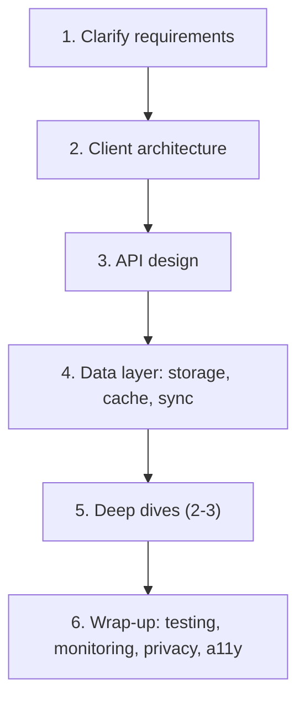

#### The steps, with rough timings

1. **Clarify requirements (~5 min)**
   - *Functional:* list the core features and agree on what is out of scope ("feed + likes + comments; no DMs, no posting").
   - *Non-functional:* offline support, real-time needs, scale (users, items per screen, media size), latency targets, battery and data usage, privacy and security, accessibility, minimum iOS version, iPad/Mac support.
   - Write these down; you will refer back to them when justifying choices.
2. **High-level client architecture (~10 min)** – UI (SwiftUI/UIKit) → ViewModel → Repository → (API client, persistence, cache), plus a coordinator/router for navigation, dependency injection, and feature modules (SPM packages). Draw boxes and arrows.
3. **API design (~5 min)** – endpoints and payloads, **cursor pagination**, REST vs GraphQL vs WebSocket/SSE for real-time, authentication (OAuth tokens, refresh).
4. **Data layer (~10 min)** – the local schema (SwiftData/Core Data/SQLite), the caching policy, the **single source of truth** (UI observes the local DB, network only writes into it), sync and conflict resolution.
5. **Deep dives (~10 min)** – pick 2–3 that matter for *this* product: pagination, image loading, offline mode, real-time updates, background work, error handling, scroll performance. Often the interviewer picks; offer options if not.
6. **Wrap-up** – testing strategy, monitoring (crash reporting, MetricKit), analytics, feature flags, security, accessibility, localization, rollout (phased release, kill switches).

#### What a typical client architecture looks like

| Layer | Responsibility | iOS tools |
|---|---|---|
| View | Render state, forward user intents | SwiftUI, UIKit |
| ViewModel | Screen state, formatting, intents → use cases | `@Observable`, `@MainActor` |
| Repository | Decide cache vs network, expose data streams | actors, `AsyncStream` |
| Remote | HTTP/WebSocket, auth, retries | `URLSession` |
| Local | Persistence, queries, migrations | SwiftData, Core Data, SQLite |

#### Pitfalls

- Jumping into code or class names before agreeing on scope.
- Designing the backend in depth. Mention it, but the client is the focus.
- Ignoring the app lifecycle (backgrounding, termination, low memory) and poor networks.
- Listing technologies without saying *why* or what the alternative was.

#### Likely follow-ups

- *"What would you cut if you had half the time?"* – Keep the core flow and offline-read; drop secondary features and polish.
- *"How would this change for 10x users?"* – Mostly server-side; on the client, think pagination limits, cache size caps, request batching and backoff to avoid thundering herds.
- *"How do you know it works in production?"* – Crash/hang reporting, MetricKit, client-side performance metrics, and dashboards per release.

</details>

### 2. Design an image loading and caching library (like Kingfisher/Nuke).

<details>
<summary>Answer</summary>

**In short:** A pipeline of memory cache (`NSCache` of decoded, downsampled images) → disk cache (raw bytes, LRU by size/age) → network (`URLSession`), with decoding and downsampling done off the main thread. An `actor` tracks in-flight downloads so duplicate requests share one task, and requests are cancelled when cells are reused.

#### Requirements

- **Functional:** load a remote image into a view; placeholders and error images; memory and disk caching; downsampling to the view's size; cancellation on cell reuse; request deduplication; prefetching; optional transforms (rounded corners, blur).
- **Non-functional:** smooth 60/120 fps scrolling (no decoding on the main thread), bounded memory (no jetsam kills), bounded disk usage, thread safety, easy to test.

#### High-level flow

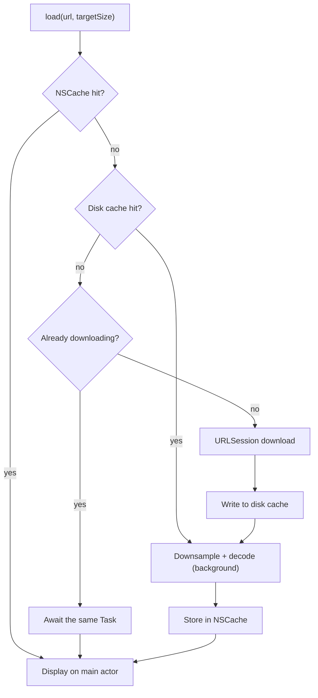

#### The pipeline, layer by layer

1. **Memory cache** – `NSCache<NSString, UIImage>` keyed by URL **plus target size** (the same URL at thumbnail and full-screen sizes are different entries). Set `cost` to the decoded byte size (`width × height × 4`) and a `totalCostLimit`, so the cache evicts by memory, not count. `NSCache` is thread-safe and auto-evicts under memory pressure; also clear it on `didReceiveMemoryWarningNotification`.
2. **Disk cache** – store the *original compressed bytes* (not decoded bitmaps) in `Caches/` (the OS may purge this; that's fine). File name = SHA-256 of the URL. Evict with LRU by total size and max age; track access dates in a small index or use file attributes.
3. **Network** – `URLSession` data/download task. Respect `Cache-Control`/ETag if you want, but most libraries use their own disk cache and give `URLCache` a small or zero size to avoid double storage.
4. **Decode + downsample** – this is the key performance step. A 4000×3000 JPEG decodes to ~48 MB in memory even if shown in a 100-pt cell. ImageIO can produce a thumbnail directly at the target size without decoding the full image:

```swift
import ImageIO
import UIKit

func downsample(_ data: Data, to pointSize: CGSize, scale: CGFloat) -> UIImage? {
    // Don't decode the full image when creating the source.
    let sourceOptions = [kCGImageSourceShouldCache: false] as CFDictionary
    guard let source = CGImageSourceCreateWithData(data as CFData, sourceOptions) else { return nil }

    let maxPixels = max(pointSize.width, pointSize.height) * scale
    let options = [
        kCGImageSourceCreateThumbnailFromImageAlways: true,
        kCGImageSourceShouldCacheImmediately: true,      // decode now, on this background thread
        kCGImageSourceCreateThumbnailWithTransform: true, // respect EXIF orientation
        kCGImageSourceThumbnailMaxPixelSize: maxPixels
    ] as CFDictionary

    guard let cgImage = CGImageSourceCreateThumbnailAtIndex(source, 0, options) else { return nil }
    return UIImage(cgImage: cgImage, scale: scale, orientation: .up)
}
```

#### Concurrency design: deduplicating in-flight requests

```swift
actor ImageLoader {
    private var inFlight: [String: Task<UIImage, Error>] = [:]
    private let memory = NSCache<NSString, UIImage>()
    private let disk: DiskCache          // protocol, injectable for tests
    private let session: URLSession

    init(disk: DiskCache, session: URLSession = .shared) {
        self.disk = disk
        self.session = session
        memory.totalCostLimit = 100 * 1024 * 1024 // ~100 MB of decoded pixels
    }

    func image(for url: URL, size: CGSize, scale: CGFloat) async throws -> UIImage {
        let key = "\(url.absoluteString)|\(Int(size.width))x\(Int(size.height))@\(scale)"
        if let hit = memory.object(forKey: key as NSString) { return hit }
        if let running = inFlight[key] { return try await running.value } // share the download

        let task = Task.detached(priority: .userInitiated) { [disk, session] in
            let data: Data
            if let cached = try? disk.data(for: url) {
                data = cached
            } else {
                let (fetched, _) = try await session.data(from: url)
                try? disk.store(fetched, for: url)
                data = fetched
            }
            guard let image = downsample(data, to: size, scale: scale) else {
                throw URLError(.cannotDecodeContentData)
            }
            return image
        }
        inFlight[key] = task
        defer { inFlight[key] = nil }

        let image = try await task.value
        let cost = Int(image.size.width * image.scale * image.size.height * image.scale * 4)
        memory.setObject(image, forKey: key as NSString, cost: cost)
        return image
    }
}
```

The heavy work (disk I/O, decoding) runs in a detached task, not on the actor, so the actor stays responsive. The view side holds its own `Task` and cancels it in `prepareForReuse` (UIKit) or relies on `.task(id: url)` (SwiftUI cancels automatically on disappear or id change).

#### Other deep dives

- **Prioritisation and prefetching:** raise priority for visible cells; prefetch with `UICollectionViewDataSourcePrefetching` and cancel prefetches in `cancelPrefetchingForItemsAt`.
- **Animated images / progressive JPEG:** separate decoders behind a `ImageDecoding` protocol.
- **Pluggability:** `MemoryCaching`, `DiskCaching`, `ImageProcessing` protocols so apps can swap pieces and tests can inject fakes.

#### Pitfalls

- Decoding on the main thread (`UIImage(data:)` is lazy; the decode happens at first draw, on the main thread). Force decode in the background.
- Showing the wrong image in a reused cell: check that the URL the cell expects still matches when the result arrives.
- Cancelling a shared in-flight task because *one* caller went away. Use reference counting, or just let it finish and populate the cache.
- Caching full-size decoded bitmaps: memory blows up quickly.

#### Likely follow-ups

- *"Why not just use `URLCache`?"* – It caches HTTP responses (compressed bytes) only, has no decoded-image layer, no downsampling, and limited eviction control.
- *"How do you test it?"* – Inject a `URLProtocol` stub session and in-memory caches; assert one network call for N concurrent requests.
- *"Where do you store the disk cache?"* – `Caches/`, because it is re-downloadable; never `Documents/` (backed up to iCloud).

</details>

### 3. Design a news feed (like Instagram/Twitter).

<details>
<summary>Answer</summary>

**In short:** Cursor-paginated API, a local database as the single source of truth (cached feed shows instantly, network refreshes write into it), infinite scroll with prefetching, an image/video pipeline that downsamples and plays only the most visible video, optimistic likes with an offline queue, and batched impression analytics.

#### Requirements

- **Functional:** scrolling feed of posts (text, images, video), infinite scroll, pull-to-refresh, like/comment, "new posts" indicator, offline viewing of the last feed.
- **Non-functional:** instant launch (show something within ~1 s), smooth scrolling, low data/battery use, works on poor networks.

#### Architecture

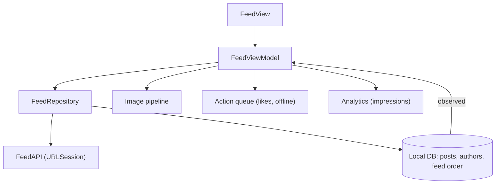

The ViewModel never shows network results directly: the repository writes them to the DB and the UI observes the DB. That gives offline support and consistency for free (a like on one screen shows everywhere).

#### API

```http
GET /v1/feed?cursor=eyJpZCI6MTIzfQ&limit=20
→ 200 { "posts": [ ... ], "nextCursor": "eyJpZCI6MTAzfQ", "hasMore": true }

POST /v1/posts/{id}/like   (Idempotency-Key: <uuid>)
```

**Why cursor, not offset/page number?** With `?page=2`, if 5 new posts arrive at the top between requests, everything shifts and you see duplicates. A cursor ("items older than X") is stable regardless of insertions.

#### Data model

| Entity | Key fields |
|---|---|
| `Post` | `id`, `authorId`, `text`, `media[]` (url, width, height, type), `likeCount`, `likedByMe`, `createdAt` |
| `Author` | `id`, `name`, `avatarURL` |
| `FeedEntry` | `position`, `postId`, `cursor` (keeps the server's order separate from posts) |

Store media aspect ratios so cell heights are known before images load (no layout jumps).

#### Loading behaviour

- **Launch:** render the cached feed from the DB immediately, then fetch page 1 in the background and merge.
- **Infinite scroll:** when the user is ~5 items from the end, request `nextCursor`. Guard against duplicate concurrent page loads.
- **Pull-to-refresh:** fetch the newest page; if there's a gap with the cached feed, either drop the old cache or mark a gap.
- **New posts while reading:** don't jump the scroll position; show a "New posts" pill that scrolls to top when tapped.

#### Media

- Image pipeline with downsampling to the cell size and **prefetching** (`UICollectionViewDataSourcePrefetching` or `onAppear` lookahead in SwiftUI).
- **Video autoplay only for the most visible cell**, muted by default, with a single reused `AVPlayer` (or a small pool); pause when scrolled away or the app backgrounds.
- Use multiple server-provided resolutions and request the one matching the screen.

#### Optimistic interactions

```swift
@MainActor
func toggleLike(_ post: Post) async {
    let newValue = !post.likedByMe
    store.update(post.id) { $0.likedByMe = newValue; $0.likeCount += newValue ? 1 : -1 } // instant UI
    do {
        try await api.setLike(post.id, liked: newValue, idempotencyKey: UUID())
    } catch let error as URLError where error.code == .notConnectedToInternet {
        actionQueue.enqueue(.like(post.id, newValue))                 // retry later
    } catch {
        store.update(post.id) { $0.likedByMe = !newValue; $0.likeCount += newValue ? -1 : 1 } // roll back
    }
}
```

#### Performance

- Diffable data source or SwiftUI `List`/`LazyVStack` with **stable IDs** (post id, not array index).
- Precompute text layout and heights off the main thread for complex cells; avoid off-screen rendering (shadows without `shadowPath`, masks).
- Keep cell view hierarchies shallow; measure with Instruments (Time Profiler, Animation Hitches).

#### Analytics

Impression = post more than 50% visible for more than 1 s. Track visibility in the scroll callbacks, queue events, upload in batches (see the analytics SDK question).

#### Pitfalls

- Offset pagination causing duplicates/skips.
- Letting network responses drive the UI directly, so offline and cross-screen consistency break.
- Autoplaying several videos at once (memory, battery, audio chaos).

#### Likely follow-ups

- *"How do you rank the feed?"* – Server-side; the client just renders the order it receives (`FeedEntry.position`).
- *"How big can the local cache get?"* – Cap it (e.g. last few hundred posts) and trim old entries on launch.
- *"Real-time updates?"* – Usually not needed for a feed; poll on foreground or use a silent push to show the "New posts" pill.

</details>

### 4. Design a chat app (like WhatsApp/iMessage).

<details>
<summary>Answer</summary>

**In short:** A local database is the source of truth; messages are inserted locally first (optimistic, with a client UUID for idempotency) and sent from an outbox over a WebSocket. The server assigns sequence numbers for ordering and returns acks and delivered/read receipts. In the background, APNs plus a Notification Service Extension deliver messages; after reconnecting, the client resyncs from its last sequence number.

#### Requirements

- **Functional:** 1:1 and group chats, send/receive text and media, delivery and read receipts, typing indicators, message history, push notifications.
- **Non-functional:** messages must never be lost or duplicated, correct order, low latency (< ~500 ms on a good network), works offline (queue and send later), end-to-end encryption, battery friendly.

#### Message send/receive flow

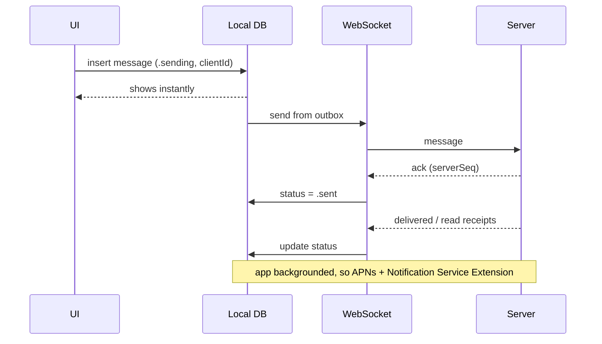

#### Data model

```swift
struct Message {
    let clientId: UUID          // generated on device: idempotency + dedup
    var serverId: String?       // assigned by server
    var serverSeq: Int64?       // per-conversation ordering
    let conversationId: String
    let senderId: String
    var body: String
    var media: MediaRef?
    var status: Status          // .sending, .sent, .delivered, .read, .failed
    let createdAt: Date
}
```

Index by `(conversationId, serverSeq)` for paging; unsent messages (no `serverSeq` yet) sort at the end by `createdAt`.

#### Real-time transport

| Situation | Mechanism |
|---|---|
| App in foreground | **WebSocket** (`URLSessionWebSocketTask`): heartbeats/pings, reconnect with exponential backoff + jitter, resync after reconnect |
| App backgrounded / killed | **APNs** push with `mutable-content`; a **Notification Service Extension** decrypts, enriches the notification, and can write to the shared App Group DB |
| After reconnect | `GET /conversations/{id}/messages?afterSeq=N` to fill any gap |

The WebSocket is a fast path, not a guarantee: anything missed while disconnected is recovered by the sequence-number resync.

#### Sending reliably

1. Insert locally with status `.sending` and a fresh `clientId`. UI updates instantly.
2. The outbox (an actor) sends pending messages in order.
3. The server deduplicates by `clientId`, so retries after a lost ack don't create duplicates, and replies with `serverSeq`.
4. On ack, mark `.sent`; on delivered/read receipts, update status.
5. On failure, retry with backoff; flush the outbox on reconnect, app foreground, or a `BGTaskScheduler` task. After a limit, mark `.failed` and show "tap to retry".

#### Ordering and dedup

The server is the authority on order (per-conversation `serverSeq`); client clocks are unreliable. Incoming messages are upserted by `clientId`/`serverId`, so the same message arriving via push and WebSocket appears once.

#### Media

Upload first (a background `URLSession` upload task for large files), then send a message that references the media URL. Show a local thumbnail immediately and a blurhash/low-res placeholder on the receiver side; download full media on demand.

#### History and UI

- Paginate older messages by cursor as the user scrolls up, preserving the scroll position (anchor on the top visible message).
- Typing indicators are ephemeral WebSocket events, never stored.

#### Security and notifications

- **End-to-end encryption** (e.g. the Signal protocol); private keys in the Keychain (Secure Enclave can hold P-256 keys). The server only relays ciphertext, which is why the Notification Service Extension must decrypt.
- Notifications grouped by thread (`threadIdentifier`), inline reply actions, and communication notifications showing the sender's avatar (via `INSendMessageIntent`).

#### Pitfalls

- Treating WebSocket delivery as reliable and not resyncing after reconnect.
- Ordering by device timestamp.
- Generating the message id on the server only, which makes retries create duplicates.

#### Likely follow-ups

- *"Group chats with 1,000 members?"* – Server fan-out; client is the same, but receipts become aggregated counts.
- *"Multiple devices?"* – Per-device keys and server-side sync of history; sequence-number resync handles catch-up.
- *"Why not polling?"* – Latency and battery; WebSocket in foreground, push in background is the standard combo.

</details>

### 5. Design an offline-first app with sync.

<details>
<summary>Answer</summary>

**In short:** The local database is the single source of truth; the UI reads and writes only locally. Each record carries a client-generated id, a version/timestamp and a sync state. A sync engine (an actor) pushes pending local changes, pulls server changes since a sync token, and merges them with a defined conflict policy. It runs on foreground, connectivity changes, silent pushes and background refresh.

#### Why offline-first

Mobile networks are unreliable: subways, elevators, flights, captive Wi-Fi. If every action waits for the server, the app feels slow and breaks offline. Offline-first flips it: the app always works against local data, and syncing is a background concern. Think Notes, Things, or Notion's mobile apps.

#### Record design

| Field | Purpose |
|---|---|
| `id` (client UUID) | Created offline without asking the server; stable across sync |
| `updatedAt` / `version` | Detect conflicts (server version you based your edit on) |
| `syncState` | `synced`, `pendingCreate`, `pendingUpdate`, `pendingDelete` |
| `deletedAt` (tombstone) | Soft delete so the deletion itself can sync; purge after confirmation |

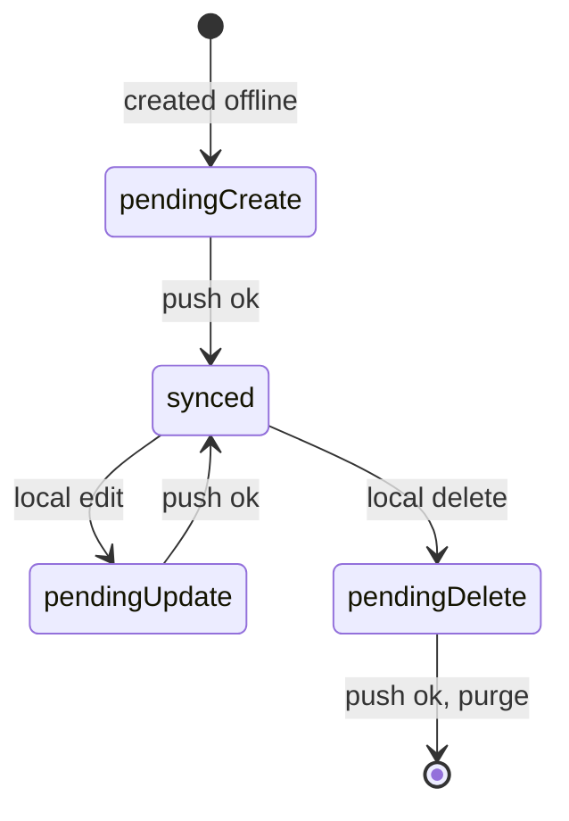

#### The sync engine

```swift
actor SyncEngine {
    private let store: LocalStore
    private let api: SyncAPI
    private var isSyncing = false

    func sync() async {
        guard !isSyncing else { return }       // coalesce triggers
        isSyncing = true
        defer { isSyncing = false }
        do {
            // 1. Push local changes (batched, idempotent by record id)
            let pending = try await store.pendingChanges(limit: 100)
            let results = try await api.push(pending)
            try await store.apply(pushResults: results)   // mark synced or record conflicts

            // 2. Pull server changes since the last token
            let token = try await store.lastSyncToken()
            let delta = try await api.pull(since: token)

            // 3. Merge and save the new token in one transaction
            try await store.merge(delta.changes, newToken: delta.nextToken)
        } catch {
            // leave pending states; retry later with backoff
        }
    }
}
```

**Triggers:** app foreground, connectivity regained (`NWPathMonitor`), a silent push ("something changed"), `BGAppRefreshTask`, and a short debounce after local edits.

#### Conflict resolution

A conflict is when both the device and the server changed the same record since the last sync.

| Strategy | How | Good for |
|---|---|---|
| Last-write-wins (server timestamp) | Newer write overwrites | Simple settings, low-stakes data |
| Per-field merge | Merge fields changed on each side | Forms, profiles |
| Domain merge / CRDT | Union of sets, counters, text merges | Collaborative lists and documents |
| Ask the user | Show both versions | Rare, high-value conflicts |

Use the server's clock (or version numbers), not device clocks, to decide "newer".

#### CloudKit option

For per-user data in the Apple ecosystem, `NSPersistentCloudKitContainer` (Core Data) or SwiftData with a CloudKit container gives automatic sync across a user's devices with no backend. Limits: Apple-only, schema constraints (e.g. no unique constraints, relationships must be optional), and less control over conflict handling.

#### UX

Show sync status subtly ("Saved on this device", "Syncing…"), surface permanently failed items, and never block editing on sync.

#### Pitfalls

- Hard deletes, which can't be synced (the server never hears about them).
- Saving the sync token before the merged data is committed: a crash then skips changes forever.
- Server-assigned ids, forcing the client to remap references after creation.
- Non-idempotent push endpoints: a retried batch creates duplicates.

#### Likely follow-ups

- *"How do you handle schema migrations?"* – Versioned local migrations plus API versioning; the sync payload carries a schema version.
- *"What if a user is offline for a month?"* – The server may say the token is too old; do a full resync while keeping pending local changes.
- *"How do you test sync?"* – Fake API and in-memory store, deterministic scenarios for each conflict type.

</details>

### 6. Design a large file downloader (e.g. offline videos/podcasts).

<details>
<summary>Answer</summary>

**In short:** Use a background `URLSession` so the system continues downloads when the app is suspended or killed; persist each download's state in a database; support pause/resume with resume data; limit concurrency and respect cellular settings; move finished files out of the temp location into Application Support (excluded from backup). For HLS video, use `AVAssetDownloadURLSession`.

#### Requirements

- **Functional:** queue downloads, show progress, pause/resume/cancel, Wi-Fi-only option, play offline, delete.
- **Non-functional:** survive app suspension, termination and network drops; don't fill the disk; verify integrity; battery friendly.

#### Architecture

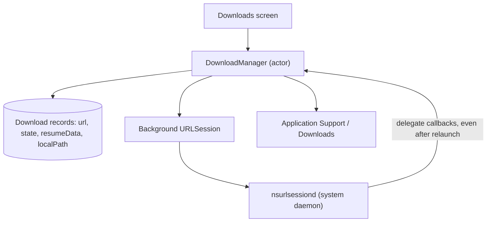

With a **background session**, the transfer is done by a system process, not your app. If your app is killed by the system, iOS relaunches it in the background when tasks finish and calls `application(_:handleEventsForBackgroundURLSession:completionHandler:)`. (If the *user* force-quits the app, the system cancels its background transfers.)

#### Setting up the session

```swift
final class DownloadManager: NSObject, URLSessionDownloadDelegate {
    static let shared = DownloadManager()
    var backgroundCompletionHandler: (() -> Void)?

    lazy var session: URLSession = {
        let config = URLSessionConfiguration.background(withIdentifier: "com.example.downloads")
        config.isDiscretionary = false              // user-initiated: start now
        config.sessionSendsLaunchEvents = true      // relaunch app when done
        config.allowsCellularAccess = Settings.allowCellular
        config.allowsExpensiveNetworkAccess = Settings.allowCellular
        config.httpMaximumConnectionsPerHost = 2    // concurrency limit
        return URLSession(configuration: config, delegate: self, delegateQueue: nil)
    }()

    func urlSession(_ session: URLSession, downloadTask: URLSessionDownloadTask,
                    didFinishDownloadingTo location: URL) {
        // The temp file is deleted when this method returns: move it synchronously.
        let destination = Paths.downloads.appendingPathComponent(downloadTask.taskDescription ?? UUID().uuidString)
        try? FileManager.default.moveItem(at: location, to: destination)
        var values = URLResourceValues(); values.isExcludedFromBackup = true
        var url = destination; try? url.setResourceValues(values)
        // update DB record -> .completed
    }

    func urlSession(_ session: URLSession, downloadTask: URLSessionDownloadTask,
                    didWriteData bytesWritten: Int64, totalBytesWritten: Int64,
                    totalBytesExpectedToWrite: Int64) {
        // publish progress (throttle to a few updates per second)
    }

    func urlSessionDidFinishEvents(forBackgroundURLSession session: URLSession) {
        DispatchQueue.main.async { self.backgroundCompletionHandler?(); self.backgroundCompletionHandler = nil }
    }
}
```

Store an identifier in `taskDescription` so you can map tasks back to DB records after a relaunch (also call `session.getAllTasks` on launch to reconcile).

#### Pause and resume

`cancel(byProducingResumeData:)` gives a blob you persist; later `downloadTask(withResumeData:)` continues where it left off, if the server supports range requests and the ETag hasn't changed. On failure, the error's `userInfo[NSURLSessionDownloadTaskResumeData]` may also contain resume data.

#### Queue and policies

- Max concurrent downloads (e.g. 2); the rest wait in a DB-backed queue.
- Wi-Fi-only via `allowsCellularAccess`/`allowsExpensiveNetworkAccess`; respect Low Data Mode (`allowsConstrainedNetworkAccess`).
- Check free space (`volumeAvailableCapacityForImportantUsage`) before starting.
- Verify checksums after completion; auto-delete after watching/listening or after expiry (licensing).

#### Progress UI

Map delegate progress into an `@Observable` model per download; consider a Live Activity for long downloads.

#### HLS video

Streaming video is a playlist of many segments, so you can't download a single file. `AVAssetDownloadURLSession` with `AVAssetDownloadTask`/`AVAggregateAssetDownloadTask` downloads chosen bitrates and audio/subtitle tracks into a `.movpkg`, playable offline with `AVURLAsset`. Protected content uses **FairPlay** persistent keys.

#### Pitfalls

- Not moving the file inside `didFinishDownloadingTo`: it is gone afterwards.
- Saving into `Caches/` (purgeable) or `Documents/` (backed up to iCloud) instead of Application Support with backup excluded.
- Using completion-handler APIs with background sessions (not supported; delegates only).
- Forgetting to call the stored background completion handler, which keeps the app's snapshot stale and wastes background time.

#### Likely follow-ups

- *"What happens if the user force-quits?"* – Background tasks are cancelled; on next launch, resume from saved resume data or restart.
- *"Discretionary vs not?"* – `isDiscretionary = true` lets iOS wait for Wi-Fi and power; good for prefetching, not for user-initiated downloads.

</details>

### 7. Design an analytics SDK.

<details>
<summary>Answer</summary>

**In short:** A tiny, non-blocking `track(_:properties:)` API that hands events to an actor, which appends them to a persistent on-disk queue so nothing is lost on termination. A batcher uploads compressed batches every N events / T seconds and when the app backgrounds, with retries and backoff and a cap on stored events. Context is attached automatically, consent and privacy are enforced in the SDK, and the SDK does no work at app launch.

#### Requirements

- **Functional:** track named events with properties, identify users (anonymous id → logged-in id), sessions, automatic context (app version, OS, device), opt-out.
- **Non-functional:** never block or crash the host app, don't lose events, minimal battery/data/binary-size impact, privacy compliant, easy to integrate, stable API.

#### Architecture

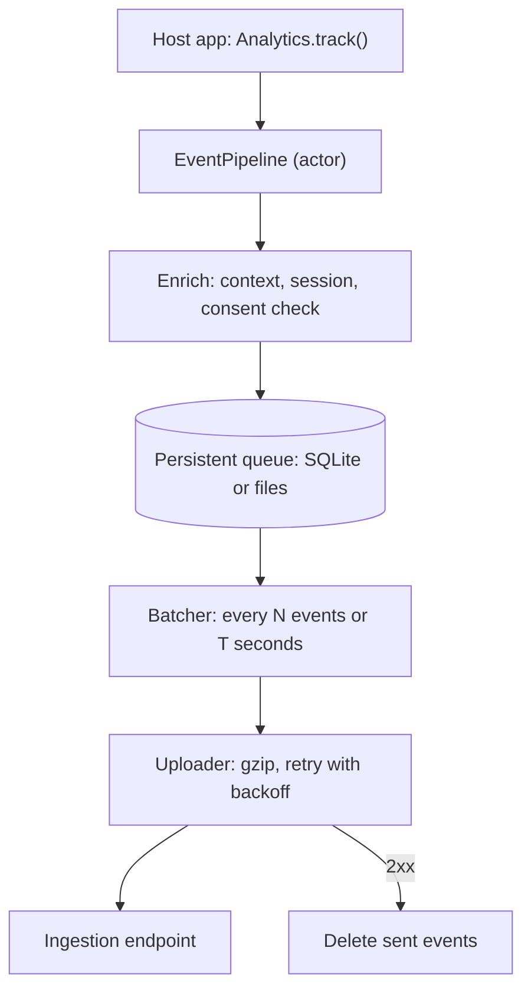

#### Public API

```swift
public enum Analytics {
    public static func configure(_ config: AnalyticsConfig) { /* stores config, lazy start */ }

    public static func track(_ name: String, properties: [String: AnalyticsValue] = [:]) {
        let event = Event(name: name, properties: properties, timestamp: Date(), id: UUID())
        Task { await pipeline.enqueue(event) }   // returns immediately; never throws to caller
    }

    public static func identify(userId: String) { /* ... */ }
    public static func setConsent(_ granted: Bool) { /* ... */ }
}
```

`AnalyticsValue` is a small `Sendable`, `Codable` enum (string, int, double, bool) rather than `Any`, so properties are type-safe and serialisable.

#### Persistence and batching

- Append each event to a **persistent queue** (SQLite table or append-only files) before anything else. In-memory-only queues lose events on crash or termination.
- Upload when the queue reaches N events (e.g. 20–50), every T seconds (e.g. 30 s), and on `didEnterBackground` (wrapped in `beginBackgroundTask` to get a little extra time).
- Gzip the JSON batch; send events with their client UUIDs so the server can deduplicate retries.
- On failure, retry with exponential backoff + jitter; on 4xx for malformed data, drop the batch rather than retrying forever.
- Cap the queue (e.g. 10k events or a few MB) and drop the oldest when full.

#### Context and sessions

Attach automatically: app version/build, OS version, device model, locale, SDK version, session id (new session after ~30 min in background), anonymous install id (a UUID in the Keychain or UserDefaults). Don't use the IDFA unless the user granted App Tracking Transparency.

#### Privacy

- Consent gating: buffer or drop events until consent is known (GDPR); respect ATT for anything tracking-related.
- No PII in events by default; offer hashing or allow-lists.
- Ship a **Privacy Manifest** (`PrivacyInfo.xcprivacy`) declaring collected data types and required-reason APIs; third-party SDKs are expected to include one and be signed.
- Opt-out deletes the local queue and stops collection.

#### SDK engineering quality

- **No work at launch:** don't hook `+load` or block `didFinishLaunching`; initialise lazily on first use.
- Small binary, zero or few dependencies (dependency conflicts with host apps are painful).
- Distributed via SPM and/or an XCFramework; semantic versioning; documented public API; `@_spi` or `internal` for everything else.
- Thread-safe from any thread; never crash the host (no force unwraps, catch everything internally).

#### Pitfalls

- Doing disk or network work on the caller's thread.
- One HTTP request per event (battery and data drain).
- Swizzling app delegate methods aggressively, which breaks other SDKs.

#### Likely follow-ups

- *"How do you guarantee exactly-once?"* – You can't fully; do at-least-once delivery with client event ids and server-side deduplication.
- *"How do you test it?"* – Inject clock, storage and transport; verify batching thresholds and retry behaviour deterministically.
- *"Server-side config?"* – Fetch sampling rates and batch sizes remotely so you can tune without an app release.

</details>

### 8. Design a video streaming app (like Netflix/YouTube).

<details>
<summary>Answer</summary>

**In short:** Play content with `AVPlayer` using **HLS adaptive bitrate** streaming (and **FairPlay** DRM for protected titles), manage the player lifecycle carefully (buffering state, interruptions, route changes), support Picture in Picture, AirPlay and background audio, offer offline downloads via `AVAssetDownloadURLSession`, sync resume positions, and measure quality of experience (startup time, rebuffering).

#### Requirements

- **Functional:** browse a catalog, play videos, resume where you left off, subtitles/audio tracks, PiP, AirPlay, offline downloads.
- **Non-functional:** fast startup (< ~2 s), minimal rebuffering, adapts to network quality, content protection, smooth catalog scrolling.

#### How HLS adaptive streaming works

The server encodes each video at several bitrates/resolutions and splits each into short segments (a few seconds each). A **master playlist** (`.m3u8`) lists the variants; each variant has a **media playlist** listing its segments. `AVPlayer` measures throughput and switches variants between segments: on a weak network it drops to 480p rather than stalling. You get this for free by pointing `AVPlayer` at the master playlist URL.

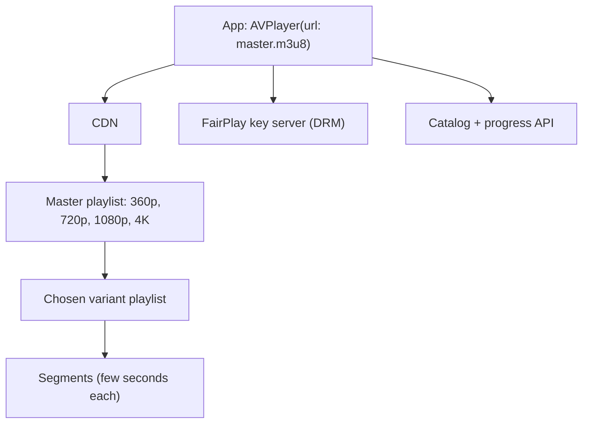

#### Player lifecycle

```swift
let item = AVPlayerItem(url: hlsURL)
item.preferredForwardBufferDuration = 10        // seconds to buffer ahead (0 = system decides)
let player = AVPlayer(playerItem: item)

statusObservation = item.observe(\.status) { item, _ in
    if item.status == .failed { /* show error, log item.error */ }
}
bufferObservation = item.observe(\.isPlaybackLikelyToKeepUp) { item, _ in
    // toggle loading spinner
}
timeObserver = player.addPeriodicTimeObserver(forInterval: CMTime(seconds: 5, preferredTimescale: 1),
                                              queue: .main) { time in
    progressStore.save(position: time.seconds, for: videoId)  // resume position
}
```

- **Interruptions:** observe `AVAudioSession.interruptionNotification` (phone call, Siri) and pause/resume.
- **Route changes:** pause when headphones are unplugged (`routeChangeNotification`, reason `.oldDeviceUnavailable`).
- **Preloading:** create the next episode's `AVPlayerItem` early, or use `AVQueuePlayer`.

#### Platform integrations

| Feature | API |
|---|---|
| Picture in Picture | `AVPictureInPictureController` (or automatic with `AVPlayerViewController`) |
| AirPlay | `AVRoutePickerView`, `allowsExternalPlayback` |
| Background audio | *Audio, AirPlay, and Picture in Picture* background mode, session category `.playback` |
| Lock screen / Control Center | `MPNowPlayingInfoCenter`, `MPRemoteCommandCenter` |
| DRM | FairPlay Streaming via `AVContentKeySession` |

#### Offline downloads

`AVAssetDownloadURLSession` downloads an HLS stream (chosen quality, plus audio/subtitle tracks) in the background. FairPlay persistent keys allow offline playback with expiry rules. Store download metadata in the local DB.

#### Resume and catalog

- Save the playback position locally every few seconds and on pause/background; sync it to the server so another device resumes at the same spot.
- Catalog: compositional-layout carousels (or SwiftUI lazy stacks), image prefetching and downsampling, cached catalog JSON for instant launch.

#### Quality-of-experience metrics

Startup time (tap → first frame), rebuffering ratio (stall time / watch time), bitrate switches, playback failures. `AVPlayerItem` access and error logs (`accessLog()`, `errorLog()`) provide many of these.

#### Pitfalls

- Creating a new `AVPlayer` per cell or screen instead of reusing.
- Forgetting to remove time observers (leaks, crashes).
- Not configuring the audio session, so audio stops in the background or ignores the silent switch incorrectly.

#### Likely follow-ups

- *"Why HLS over progressive MP4?"* – Adaptive bitrate, fast startup, seeking without downloading everything, DRM support.
- *"How do you reduce startup time?"* – Start at a lower bitrate, preload the item, prefetch the manifest, keep the CDN close.

</details>

### 9. What caching strategies exist on mobile?

<details>
<summary>Answer</summary>

**In short:** The main read strategies are cache-first / stale-while-revalidate (show cached data instantly, refresh in the background), network-first with cache fallback (for data that must be fresh), and cache-only / network-only. Caches live in layers: memory (`NSCache`), disk (database or files) and HTTP (`URLCache`). The hard part is invalidation: TTLs, ETags, server-pushed invalidation, versioned keys, and clearing on logout.

#### Why caching matters on mobile

Networks are slow and unreliable, and every request costs battery and data. A good cache makes launch instant, scrolling smooth and the app usable offline. The trade-off is always **freshness vs speed**, chosen per type of data.

#### Read strategies

| Strategy | Flow | Use for |
|---|---|---|
| **Cache-first / stale-while-revalidate** | Return cache now, fetch in background, update UI | Feeds, profiles, catalogs |
| **Network-first, cache fallback** | Try network; on failure show cache (marked stale) | Balances, prices, order status |
| **Cache-only** | Never hit network | Offline mode, static bundled data |
| **Network-only** | Never cache | Payments, one-time tokens, sensitive data |
| **Cache with TTL** | Use cache if younger than X, else fetch | Config, reference data |

```swift
func profile(id: String) -> AsyncStream<Profile> {
    AsyncStream { continuation in
        Task {
            if let cached = await cache.profile(id) { continuation.yield(cached) } // instant
            if let fresh = try? await api.profile(id) {
                await cache.save(fresh)
                continuation.yield(fresh)                                       // refresh
            }
            continuation.finish()
        }
    }
}
```

#### Cache layers

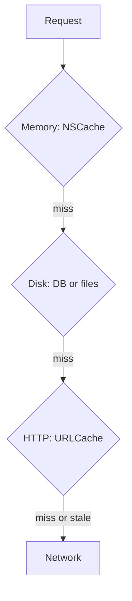

| Layer | Speed | Survives relaunch | Notes |
|---|---|---|---|
| Memory (`NSCache`) | Fastest | No | Auto-evicts under memory pressure; decoded objects |
| Disk (SwiftData, SQLite, files in `Caches/`) | Fast | Yes | Queryable; the OS may purge `Caches/` when low on space |
| HTTP (`URLCache`) | Fast | Yes | Honours `Cache-Control`, `ETag`/`If-None-Match`; transparent to code |

#### Invalidation

- **TTL:** store a fetched-at time; treat as stale after X.
- **Conditional requests:** send `If-None-Match: <etag>`; a `304 Not Modified` costs almost no data.
- **Server-driven:** silent push or a WebSocket event saying "X changed".
- **Versioned keys:** include the API/schema version in the key so a new app version doesn't read old shapes.
- **Event-based:** clear on logout (privacy!), on account switch, after writes that affect the data.

#### Pitfalls

- Leaking one user's cached data to the next user after logout.
- Unbounded disk caches growing to gigabytes.
- Caching sensitive data in `URLCache` unintentionally (use `.ephemeral` sessions or `cachePolicy` for sensitive endpoints).
- Showing stale data without any indicator where freshness matters.

#### Likely follow-ups

- *"NSCache vs Dictionary?"* – `NSCache` is thread-safe, evicts automatically under memory pressure and supports cost limits.
- *"Where should a cache live on disk?"* – `Caches/` for re-downloadable data; Application Support for data you must keep.

</details>

### 10. How do you design deep linking?

<details>
<summary>Answer</summary>

**In short:** Accept Universal Links (with a custom URL scheme as a fallback) and push-notification payloads, and parse all of them in one `DeepLinkParser` into a typed `Route` enum (`.product(id)`, `.order(id)`). A router/coordinator handles routes: it checks auth (saving a pending route until after login), validates parameters, and builds the navigation stack, both on cold launch and while the app is running.

#### Entry points

| Source | How it arrives |
|---|---|
| **Universal Links** (`https://example.com/product/42`) | `onOpenURL` (SwiftUI) or `scene(_:continue:)` with `NSUserActivity` (UIKit); requires the Associated Domains entitlement and an `apple-app-site-association` file on your domain |
| **Custom scheme** (`myapp://product/42`) | `onOpenURL` or `scene(_:openURLContexts:)` |
| **Push notification** | `UNUserNotificationCenterDelegate.didReceive` with a route in the payload |
| **Widgets, Shortcuts, Spotlight, App Intents** | URLs or `NSUserActivity` / intents |
| **Cold launch** | `connectionOptions.urlContexts` / `userActivities` in `scene(_:willConnectTo:options:)` |

Universal Links are preferred: they are verified against your domain (no other app can claim them) and fall back to the website if the app isn't installed. Custom schemes can be registered by any app, so treat them as untrusted.

#### Flow

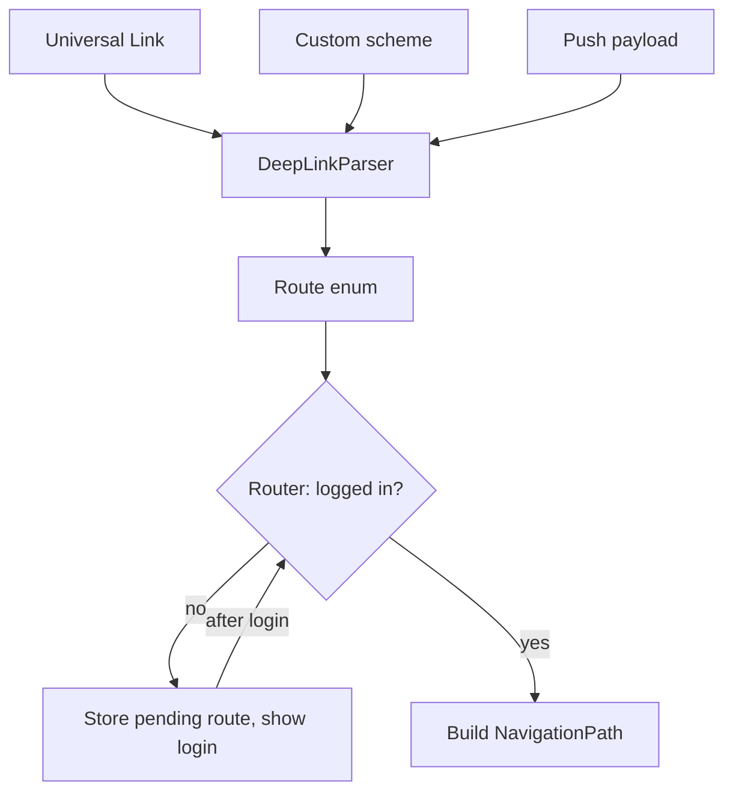

#### Code sketch

```swift
enum Route: Hashable {
    case product(id: String)
    case order(id: String)
    case settings
}

struct DeepLinkParser {
    func route(from url: URL) -> Route? {
        let parts = url.pathComponents.filter { $0 != "/" }   // ["product", "42"]
        switch (parts.first, parts.dropFirst().first) {
        case ("product", let id?) where id.allSatisfy(\.isNumber): return .product(id: id)
        case ("order", let id?):                                     return .order(id: id)
        case ("settings", nil):                                      return .settings
        default:                                                     return nil // unknown: open home
        }
    }
}

@MainActor @Observable
final class Router {
    var path = NavigationPath()
    private var pending: Route?

    func handle(_ route: Route, isLoggedIn: Bool) {
        guard isLoggedIn else { pending = route; return }
        path = NavigationPath()          // reset to a known state
        path.append(route)
    }

    func didLogIn() { if let r = pending { pending = nil; handle(r, isLoggedIn: true) } }
}
```

In SwiftUI: `.onOpenURL { url in if let r = parser.route(from: url) { router.handle(r, isLoggedIn: session.isLoggedIn) } }`.

#### Design points

- One parser, one `Route` type: every entry point converges, so it's testable with plain unit tests.
- Build a sensible back stack (e.g. Home → Category → Product) rather than a lone screen.
- Validate every parameter; never let a link trigger destructive actions (payments, deletes) without confirmation.
- Handle unknown/old links gracefully (fall back to home, log it).

#### Pitfalls

- Handling the link before the UI/auth state is ready on cold launch.
- Forgetting the cold-launch path entirely (only handling it while running).
- AASA file served with redirects or wrong content type, so Universal Links silently open Safari.

#### Likely follow-ups

- *"Deferred deep linking (link clicked before install)?"* – Needs a server-side or third-party attribution step; iOS doesn't pass the URL through the App Store.
- *"How do you test it?"* – Unit-test the parser; use `xcrun simctl openurl booted <url>` for end-to-end.

</details>

### 11. How do you handle app versioning and forced updates?

<details>
<summary>Answer</summary>

**In short:** The backend exposes a **minimum supported app version** (and a recommended version); on launch the app compares its own version and shows either a blocking "Update required" screen or a dismissible prompt. APIs are **versioned** and old versions kept alive while old apps are in use, and **feature flags / kill switches** let you disable broken features remotely, because you can't roll back an App Store release.

#### Why this matters on mobile

On the web you deploy and everyone has the new version. On iOS, users update whenever they like (or never), so many app versions hit your API at once, and a bad release can't be pulled back; you can only ship a new one through review. The design must assume old clients exist for months or years.

#### Forced/soft update check

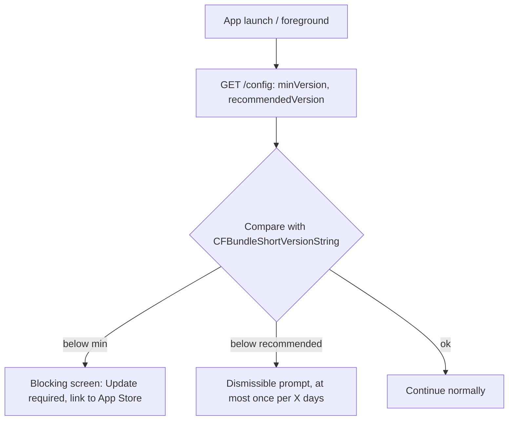

```swift
struct AppVersion: Comparable {
    let parts: [Int]
    init(_ s: String) { parts = s.split(separator: ".").map { Int($0) ?? 0 } }
    static func < (a: Self, b: Self) -> Bool {
        let n = max(a.parts.count, b.parts.count)
        let pa = a.parts + Array(repeating: 0, count: n - a.parts.count)
        let pb = b.parts + Array(repeating: 0, count: n - b.parts.count)
        return pa.lexicographicallyPrecedes(pb)
    }
}

let current = AppVersion(Bundle.main.infoDictionary?["CFBundleShortVersionString"] as? String ?? "0")
if current < AppVersion(config.minVersion) { showHardUpdate() }
```

Compare numerically, not as strings ("1.10" > "1.9"). Fetch the config from your own backend or Remote Config, cache the last value, and fail open (don't block users if the config call fails).

#### API versioning

- Version endpoints (`/v2/orders`) or via headers; make changes additive (new optional fields) whenever possible.
- Send the app version in a header (`User-Agent` or `X-App-Version`) so the server can tailor responses and you can see which versions are still active.
- Retire an old API version only when its traffic is negligible, then raise `minVersion`.
- Clients must decode tolerantly: ignore unknown fields, handle unknown enum cases with a fallback.

#### Feature flags and kill switches

Wrap risky features in remotely controlled flags (Firebase Remote Config, LaunchDarkly or an in-house service). If a feature crashes in production, turn it off within minutes instead of waiting for a hotfix review. Combine with **phased release** in App Store Connect (7-day gradual rollout that can be paused).

#### Pitfalls

- String comparison of versions.
- Blocking the app when the config endpoint is down.
- Strict `Codable` enums that crash or fail decoding when the server adds a new case.

#### Likely follow-ups

- *"Is there a built-in Apple API for forced updates?"* – No; it's custom logic, sometimes using the iTunes Lookup API to read the latest store version.
- *"How long do you support old versions?"* – Based on usage data; commonly until a small percentage of active users remain.

</details>

### 12. What non-functional aspects should you always mention?

<details>
<summary>Answer</summary>

**In short:** Beyond features, always cover performance (launch time, scrolling, memory), battery and data use, offline and error/empty/loading states, security and privacy, accessibility and localization, observability (crashes, MetricKit, logs, analytics), and engineering qualities like testability, modularity, app size and the minimum OS strategy. Mentioning these briefly, with one concrete technique each, is what separates senior answers.

#### Why interviewers care

Functional requirements make the app *work*; non-functional ones make it *good* and shippable at scale. Interviewers often grade on whether you raise these unprompted. You don't need to deep-dive every one; a quick checklist at the start (requirements) and end (wrap-up) is enough.

#### Checklist with concrete techniques

| Area | What to say |
|---|---|
| **Performance** | Launch time (defer work, lazy init), smooth scrolling (background decoding, stable IDs, cell reuse), memory (downsampling, `NSCache` limits); measure with Instruments |
| **Battery and data** | Batch network calls, avoid polling, use background tasks wisely, compress payloads, respect Low Data / Low Power Mode |
| **Offline and states** | Local cache as source of truth; explicit loading, empty, error and retry states |
| **Security** | Tokens in Keychain, ATS (HTTPS only), optional certificate pinning, no secrets in the binary, jailbreak-aware for sensitive apps |
| **Privacy** | Minimal permissions asked in context, Privacy Manifest, data minimization, ATT where tracking |
| **Accessibility** | VoiceOver labels and traits, Dynamic Type, sufficient contrast, Reduce Motion, large tap targets |
| **Localization** | String Catalogs with pluralization, RTL layouts, locale-aware dates/numbers/currency |
| **Observability** | Crash reporting, MetricKit (hangs, launch, memory), structured logging (`Logger`), analytics, per-release dashboards |
| **Testability and modularity** | DI via protocols, SPM feature modules, unit + UI + snapshot tests |
| **App size** | Asset catalogs, on-demand resources, avoid heavy dependencies |
| **OS support** | Minimum iOS version based on user stats; `if #available` for newer APIs |
| **Release safety** | Feature flags, phased release, forced-update mechanism |

#### How to use this in the interview

- **At the start:** "Non-functionally I'll assume offline read, accessibility, and low battery impact matter. Anything else?"
- **During:** tie choices back ("the DB is the source of truth, which gives us offline support").
- **At the end:** spend 2–3 minutes running down the remaining items you haven't covered.

#### Pitfalls

- Saying "and it should be secure and performant" without a concrete technique.
- Forgetting error and empty states, which real users see constantly.
- Treating accessibility as an afterthought; mention it explicitly.

#### Likely follow-ups

- *"How would you monitor launch time in production?"* – MetricKit's launch metrics plus custom signposts, tracked per release.
- *"How do you keep the app small?"* – Audit dependencies, compress assets, use App Thinning, and track size in CI.

</details>


---

## More System Design Problems

### 13. Design Instagram Stories (iOS).

<details>
<summary>Answer</summary>

**In short:** Fetch and cache a "tray" of users with unseen/seen state for an instant launch, then make the full-screen viewer feel instant by aggressively preloading the next 1–2 stories (downsampled images, pre-buffered video). A paging container holds one page per user; segmented progress bars are driven by a pausable timer; a single reused `AVPlayer` plays video; seen state is marked locally and synced in batches.

#### Requirements

- **Functional:** a tray of users with coloured rings for unseen stories; a full-screen viewer that auto-advances (~5 s per image, video length for video); tap right/left to go forward/back; long-press to pause; swipe between users; stories expire after 24 h.
- **Non-functional:** feels instant (no spinners between stories), smooth transitions, bounded memory, works on poor networks, accessible.

#### Architecture

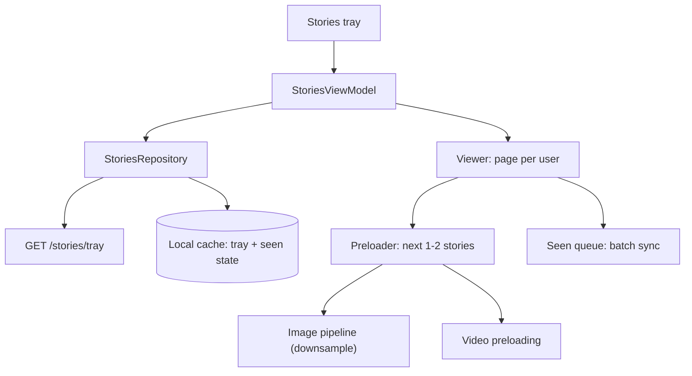

#### API and data

```http
GET /v1/stories/tray
→ { "users": [ { "userId", "name", "avatarURL", "hasUnseen",
                 "stories": [ { "id", "type": "image|video",
                                "media": [ {"url", "width", "height"} ],   // several resolutions on a CDN
                                "duration", "createdAt", "expiresAt", "seen" } ] } ] }
POST /v1/stories/seen   { "storyIds": [...] }    // batched
```

Cache the tray locally (SwiftData or a JSON file) so the tray renders immediately on launch, then refresh.

#### Preloading: the key deep dive

The difference between a good and bad Stories implementation is whether the next story is already ready when the user taps.

- Prefetch the **next 1–2 stories** of the current user and the **first story of the next user** (likely swipe target).
- **Images:** download the resolution closest to the screen size, then downsample and decode in the background so display is instant.
- **Video:** create the next `AVPlayerItem` early with a small `preferredForwardBufferDuration`, or pre-download the first seconds; use a single reused `AVPlayer` (or a small pool of 2–3) to avoid the cost of creating players.
- Cancel prefetches that are no longer near the current position.

#### Viewer and progress

- Paging container: `UIPageViewController`, a paging collection view, or SwiftUI `ScrollView` with `.scrollTargetBehavior(.paging)` (or `TabView` with `.page` style). One page per user, with a cube or slide transition.
- Segmented progress bars per user, driven by a **timer or `CADisplayLink`** that tracks elapsed time and **pauses** on touch-down, when the app goes inactive, and while the video is buffering.

```swift
@MainActor @Observable
final class StoryProgress {
    private(set) var fraction: Double = 0
    private var elapsed: TimeInterval = 0
    private var lastTick: Date?
    var isPaused = false { didSet { lastTick = nil } }
    let duration: TimeInterval
    var onFinish: () -> Void = {}

    init(duration: TimeInterval) { self.duration = duration }

    func tick(now: Date = .now) {               // called from CADisplayLink / TimelineView
        guard !isPaused else { return }
        if let last = lastTick { elapsed += now.timeIntervalSince(last) }
        lastTick = now
        fraction = min(elapsed / duration, 1)
        if fraction >= 1 { onFinish() }
    }
}
```

For videos, drive progress from the player's current time instead, so buffering naturally pauses it.

#### Seen state

Mark a story seen locally as soon as it's displayed (rings update immediately), enqueue the id, and sync in batches (works offline, retried later).

#### Memory

Keep only the current, previous and next pages' media in memory; release off-screen players and images; `NSCache` limits; clear on memory warnings.

#### Edge cases

- Stories that expire while viewing or while cached: filter by `expiresAt` locally.
- Network loss mid-story: pause with a retry affordance rather than skipping.
- Accessibility: VoiceOver reads author and time, auto-advance pauses for VoiceOver users, and tap zones get labelled actions.
- Analytics: view and completion events, batched.

#### Likely follow-ups

- *"How would you handle a user with 50 stories?"* – Paginate stories per user and preload only around the current index.
- *"How do you avoid jank during the cube transition?"* – Preload, keep decoding off the main thread, and avoid creating players during the animation.

</details>

### 14. Design a networking library for iOS.

<details>
<summary>Answer</summary>

**In short:** Expose one generic async API, `send<T>(_ endpoint: Endpoint<T>) async throws -> T`, where endpoints are values describing path, method, parameters and the response type. Internally run a pipeline: request adapters (auth, headers) → transport (`URLSession`) → response validators → retriers (backoff, single-flight token refresh) → decoding. Add typed errors, caching, pluggable logging/metrics, protocol-based transport for testability, and ship it as an SPM package.

#### Requirements

- **Functional:** typed requests and responses, auth with token refresh, retries, cancellation, uploads/downloads, optional caching.
- **Non-functional:** Swift concurrency-safe, easy to test, extensible without editing the core, no third-party dependencies, good diagnostics.

#### Public API

```swift
public struct Endpoint<Response: Decodable>: Sendable {
    public var path: String
    public var method: HTTPMethod = .get
    public var query: [URLQueryItem] = []
    public var headers: [String: String] = [:]
    public var body: Data? = nil
    public var decoder: JSONDecoder = .init()
}

public protocol HTTPClient: Sendable {
    func send<T>(_ endpoint: Endpoint<T>) async throws -> T
}

// Usage
extension Endpoint where Response == [Order] {
    static func orders(page: String?) -> Self {
        Endpoint(path: "/v1/orders", query: page.map { [URLQueryItem(name: "cursor", value: $0)] } ?? [])
    }
}
let orders = try await client.send(.orders(page: nil))
```

Endpoints as values (rather than one giant enum) let each feature module define its own endpoints.

#### Request pipeline (Chain of Responsibility)

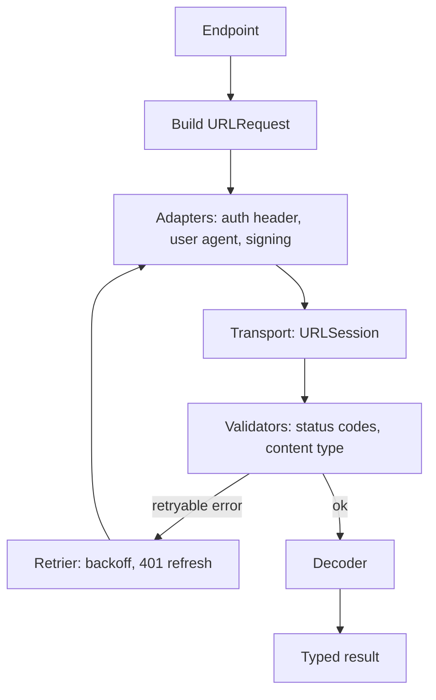

```swift
public protocol RequestAdapter: Sendable { func adapt(_ r: URLRequest) async throws -> URLRequest }
public protocol ResponseValidator: Sendable { func validate(_ r: HTTPURLResponse, data: Data) throws }
public protocol RetryPolicy: Sendable { func shouldRetry(_ error: Error, attempt: Int) async -> RetryDecision }
```

#### Token refresh without a stampede

When ten requests fail with 401 at once, only one refresh should happen; the rest wait for it.

```swift
actor TokenStore {
    private var token: String
    private var refreshTask: Task<String, Error>?
    init(token: String) { self.token = token }

    func validToken() -> String { token }

    func refresh(using api: AuthAPI) async throws -> String {
        if let task = refreshTask { return try await task.value }   // join in-flight refresh
        let task = Task { try await api.refreshToken() }
        refreshTask = task
        defer { refreshTask = nil }
        token = try await task.value
        return token
    }
}
```

#### Retries

Retry only idempotent requests (GET, PUT, DELETE, or POST with an idempotency key) on transient failures (timeouts, connection lost, 5xx, 429 honouring `Retry-After`), with exponential backoff + jitter and a max attempt count.

#### Other concerns

| Concern | Approach |
|---|---|
| **Concurrency** | async/await, `Sendable` types; task cancellation propagates to the `URLSessionTask` automatically with `URLSession.data(for:)` |
| **Deduplication** | Optional actor keyed by request for identical concurrent GETs |
| **Caching** | `URLCache` + cache policies; optional custom response cache with TTL |
| **Errors** | `enum NetworkError { case offline, timeout, unauthorized, server(status: Int, body: Data), decoding(Error), cancelled }`, keeping the underlying error |
| **Observability** | Pluggable loggers and metrics (`URLSessionTaskMetrics`), redacting `Authorization` and cookies |
| **Testability** | Transport behind a protocol, or a `URLProtocol` subclass registered in the session config to return fixtures |
| **Packaging** | SPM package, no dependencies, DocC documentation, semantic versioning |

#### Pitfalls

- Retrying non-idempotent POSTs, creating duplicate orders.
- Refreshing the token once per failing request.
- Logging full request bodies or tokens.
- A single "god enum" of endpoints that every module must edit.

#### Likely follow-ups

- *"Why not Alamofire?"* – Modern `URLSession` with async/await covers most needs; owning a thin layer avoids a dependency, but Alamofire is fine if the team knows it.
- *"How do you handle multipart uploads?"* – A body builder producing a file, uploaded with `upload(for:fromFile:)` (needed for background sessions).

</details>

### 15. Design a ride-hailing app (rider side, like Uber).

<details>
<summary>Answer</summary>

**In short:** Model the trip as a server-authoritative state machine (`idle → searching → driverAssigned → arriving → onTrip → completed`) mirrored on the client and restored on relaunch. Use Core Location with When In Use permission, MapKit for search and routes, a WebSocket for live driver location during an active trip, APNs and a Live Activity when backgrounded, smooth marker interpolation, and idempotent ride requests.

#### Requirements

- **Functional:** choose pickup and destination, see fare estimates, request a ride, get matched, track the driver live, ride, pay, rate.
- **Non-functional:** real-time accuracy (driver position every few seconds), reliability (never double-book), battery-conscious location use, privacy, works across app backgrounding and relaunch.

#### Main flow

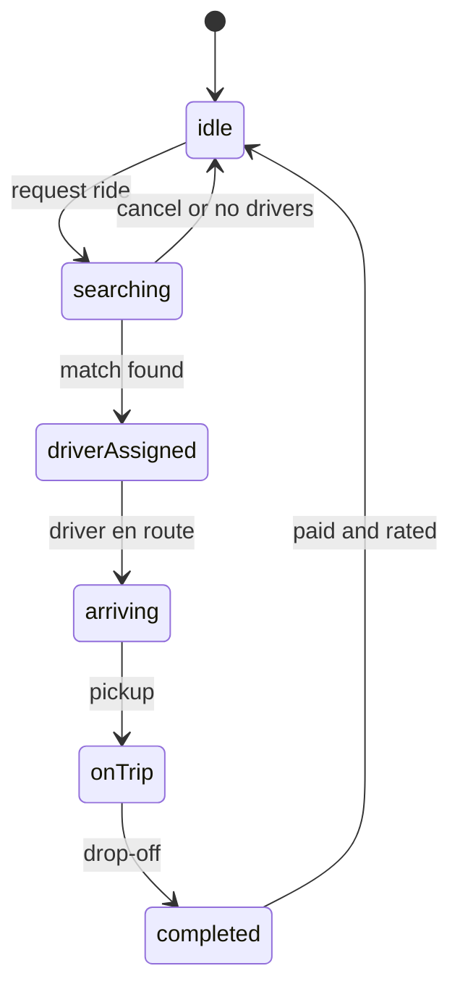

The server owns the true state; the client's store (an actor or `@Observable` model) mirrors it and is **re-synced on reconnect and relaunch** (`GET /trips/active`), so killing the app mid-trip restores the right screen.

#### Location and maps

- `CLLocationUpdate.liveUpdates()` (async sequence) or `CLLocationManager`, with **When In Use** authorization; a rider app rarely needs Always.
- Raise accuracy only when it matters (choosing pickup, active trip) and stop updates afterwards.
- Address search with `MKLocalSearchCompleter` (autocomplete) and `MKLocalSearch`; routes with `MKDirections` or server-provided polylines (so ETA and drawn route match pricing).

#### Real-time updates

| App state | Channel |
|---|---|
| Foreground, active trip | **WebSocket**: driver location every few seconds, ETA, state changes |
| Background | **APNs** for key events (driver arrived, trip started) |
| Lock Screen / Dynamic Island | **Live Activity** (ActivityKit) with driver ETA and car details, updated via ActivityKit push notifications |

#### Smooth driver marker

Updates arrive every few seconds; jumping the pin looks broken. Animate the annotation from the old coordinate to the new one over the update interval, and rotate to the heading.

```swift
func move(_ annotation: DriverAnnotation, to new: CLLocationCoordinate2D, heading: Double) {
    UIView.animate(withDuration: 3.0, delay: 0, options: [.curveLinear, .beginFromCurrentState]) {
        annotation.coordinate = new                   // MKAnnotation coordinate is KVO-animatable
        annotation.view?.transform = CGAffineTransform(rotationAngle: heading * .pi / 180)
    }
}
```

#### Reliability

- **Idempotent ride requests:** the client generates a request UUID; retrying after a timeout doesn't book two cars.
- Reconnect with exponential backoff + jitter; show "Reconnecting…" rather than stale data silently.
- Graceful offline states: keep showing last known info, disable actions that need the server.

#### Payment and rating

Apple Pay (`PKPaymentRequest`) or a saved card tokenised through the payment provider's SDK; never store raw card details. Rating is a simple post-trip screen, queued if offline.

#### Battery and privacy

Stop high-frequency location after the trip, don't collect location when not needed, explain permission prompts clearly, and only share precise location while a trip is active.

#### Pitfalls

- Treating the client as the source of truth for trip state.
- Requesting Always location permission without need (App Review and user trust issues).
- Polling for driver location over HTTP every second.

#### Likely follow-ups

- *"How do you show nearby cars before requesting?"* – Periodic fetch of approximate positions for the visible map region; they don't need to be real-time.
- *"What if the WebSocket drops mid-trip?"* – Fall back to polling `GET /trips/active` while reconnecting; push notifications still cover key events.

</details>

### 16. How do voice and video calls work in an iOS app?

<details>
<summary>Answer</summary>

**In short:** Media usually flows over **WebRTC** (encrypted SRTP, peer-to-peer where possible, using STUN to discover public addresses and TURN relays as a fallback; group calls go through an SFU). Your own signaling server (often a WebSocket) exchanges SDP offers/answers and ICE candidates. For incoming calls when the app isn't running, a **PushKit VoIP push** wakes the app, which **must immediately report the call to CallKit**, giving the native call UI. `AVAudioSession` is configured for voice chat, with VoIP and audio background modes.

#### The pieces

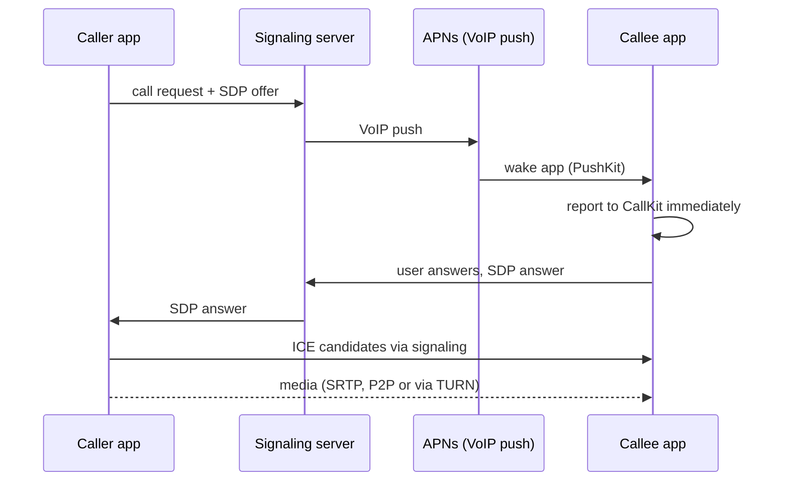

#### Media: WebRTC

- Audio and video are carried as encrypted **SRTP**, typically over UDP for low latency, with codecs such as Opus (audio) and H.264/VP8 (video).
- Most devices sit behind NAT. **ICE** gathers candidate addresses: local ones, public ones discovered via **STUN**, and relay addresses on a **TURN** server (used when direct connection fails, e.g. symmetric NAT or strict firewalls).
- **Group calls:** a mesh of P2P connections doesn't scale; an **SFU** (Selective Forwarding Unit) receives each participant's stream once and forwards it to others.

#### Signaling

WebRTC doesn't define signaling. Your server (usually a WebSocket) exchanges the SDP offer/answer (codecs, media capabilities) and ICE candidates, plus call events (ringing, declined, ended).

#### Incoming calls: PushKit + CallKit

A normal push can't wake your app to ring. A **PushKit VoIP push** launches or wakes the app in the background. Since iOS 13, the app **must report a new incoming call to CallKit** while handling that push, or iOS terminates the app, and repeated violations can stop VoIP push delivery to it.

```swift
func pushRegistry(_ registry: PKPushRegistry, didReceiveIncomingPushWith payload: PKPushPayload,
                  for type: PKPushType, completion: @escaping () -> Void) {
    let update = CXCallUpdate()
    update.remoteHandle = CXHandle(type: .generic, value: payload.dictionaryPayload["caller"] as? String ?? "Unknown")
    update.hasVideo = payload.dictionaryPayload["video"] as? Bool ?? false
    provider.reportNewIncomingCall(with: UUID(), update: update) { error in
        // then connect to signaling and start WebRTC setup
        completion()
    }
}
```

**CallKit** provides the native call UI (lock screen, full-screen incoming call), Recents integration, Bluetooth/CarPlay handling, and correct behaviour with other calls. **LiveCommunicationKit** (iOS 17.4+) is an alternative in regions where CallKit is restricted.

#### Audio

- `AVAudioSession` category `.playAndRecord`, mode `.voiceChat` (or `.videoChat`), which enables echo cancellation and voice processing.
- With CallKit, activate audio when CallKit tells you to (`provider(_:didActivate:)`), not earlier.
- Handle route changes (speaker, AirPods, car) and interruptions.
- Background modes: **Voice over IP** and **Audio**.

#### Video

Camera capture via AVFoundation (or the WebRTC SDK's capturer), rendering with Metal or sample buffer layers, and **Picture in Picture** for video calls using `AVPictureInPictureController.ContentSource` with an `AVSampleBufferDisplayLayer`.

#### Pitfalls

- Doing network work before reporting the call to CallKit inside the VoIP push handler.
- Using VoIP pushes for non-call purposes (not allowed; leads to termination).
- Activating the audio session yourself instead of waiting for CallKit's callback, causing silent calls.

#### Likely follow-ups

- *"Why do you need TURN if it's P2P?"* – A meaningful share of networks block direct connections; TURN relays media so the call still works, at server bandwidth cost.
- *"How is the call encrypted?"* – WebRTC mandates DTLS-SRTP; true end-to-end for group calls through an SFU needs an extra layer such as insertable streams.

</details>

### 17. Design a music or podcast player app that keeps playing in the background.

<details>
<summary>Answer</summary>

**In short:** Enable the *Audio, AirPlay, and Picture in Picture* background mode, set the `AVAudioSession` category to `.playback` and activate it, and play with `AVPlayer`/`AVQueuePlayer` owned by a single `PlayerManager`. Publish Now Playing info and handle remote commands (lock screen, Control Center, headphones, CarPlay), react to interruptions and route changes, download episodes for offline use, and persist the queue and playback positions.

#### Architecture

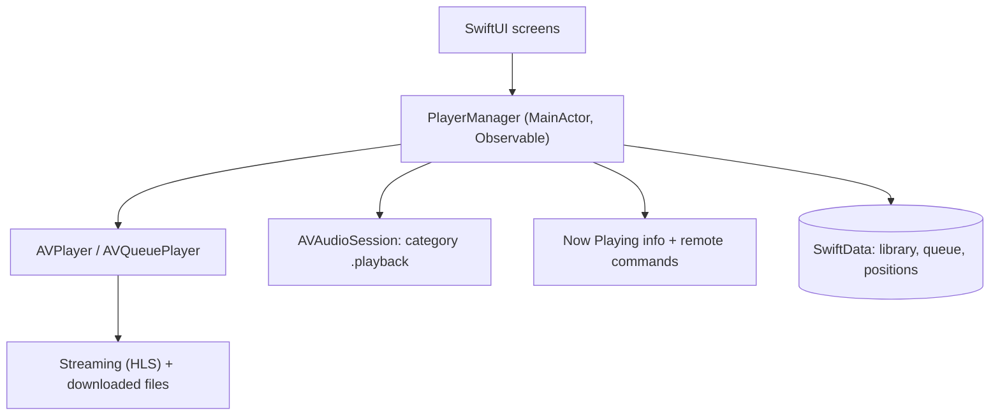

One long-lived `PlayerManager` (not owned by any screen) so playback continues while the user navigates; screens observe its state.

#### Background audio

Without the background mode and the right session category, iOS suspends the app when it goes to the background and playback stops.

```swift
@MainActor @Observable
final class PlayerManager {
    private let player = AVQueuePlayer()
    private(set) var isPlaying = false

    func play(_ episode: Episode) throws {
        let session = AVAudioSession.sharedInstance()
        try session.setCategory(.playback, mode: .spokenAudio)   // .default for music
        try session.setActive(true)

        let item = AVPlayerItem(url: episode.localFileURL ?? episode.streamURL)
        player.replaceCurrentItem(with: item)
        player.seek(to: CMTime(seconds: episode.savedPosition, preferredTimescale: 600))
        player.play()
        isPlaying = true
        updateNowPlaying(episode)
    }
}
```

`.playback` keeps playing with the silent switch on and in the background; `.spokenAudio` mode lets the system pause (rather than duck) your audio for navigation prompts.

#### Now Playing and remote controls

- Publish title, artist, artwork, duration, elapsed time and playback rate to `MPNowPlayingInfoCenter.default().nowPlayingInfo`; update elapsed time on seek and pause.
- Handle commands from `MPRemoteCommandCenter.shared()`: `playCommand`, `pauseCommand`, `togglePlayPauseCommand`, `skipForwardCommand` (podcasts: 15/30 s), `changePlaybackPositionCommand` (scrubbing), `nextTrackCommand`.
- These drive the Lock Screen, Control Center, AirPods gestures and CarPlay. iOS 27 introduces a NowPlaying framework covering the Lock Screen, Control Center, Dynamic Island and CarPlay.

#### Interruptions and routes

| Event | Notification | Typical reaction |
|---|---|---|
| Phone call, Siri, alarm | `AVAudioSession.interruptionNotification` (`.began` / `.ended`) | Pause on began; resume on ended if `.shouldResume` is set |
| Headphones unplugged / AirPods removed | `routeChangeNotification`, reason `.oldDeviceUnavailable` | Pause (don't blast audio from the speaker) |
| Media services reset | `mediaServicesWereResetNotification` | Recreate player and session |

#### Offline

Download episodes with a background `URLSession` (or `AVAssetDownloadURLSession` for HLS) into Application Support, excluded from backup; show storage usage, auto-delete played episodes, Wi-Fi-only option.

#### State

Persist the queue and per-episode positions (every few seconds and on pause/background) in SwiftData so playback resumes where the user stopped, including after the app is terminated. Sync positions to the server for multi-device users.

#### Extras

AirPlay (`AVRoutePickerView`), a CarPlay audio app (CarPlay framework templates), Siri/App Intents ("play my latest episode"), variable playback speed (`player.rate` / `defaultRate`), sleep timer, and a Live Activity if useful.

#### Pitfalls

- Forgetting the background mode or using `.ambient`/`.soloAmbient`, so audio stops on lock.
- Not updating elapsed time in Now Playing info, so the lock-screen scrubber drifts.
- Auto-resuming after an interruption when the system didn't indicate `.shouldResume`.

#### Likely follow-ups

- *"How do you add chapter or transcript sync?"* – Use a periodic/boundary time observer on the player to drive UI.
- *"Gapless music playback?"* – `AVQueuePlayer` with items enqueued ahead of time.

</details>

### 18. Design a photo backup / upload app (like iCloud Photos or Google Photos backup).

<details>
<summary>Answer</summary>

**In short:** Request photo library access (handling limited access), detect new assets via `PHAsset` fetches and a change observer while persisting what's already been backed up, export original files with `PHAssetResourceManager` (allowing iCloud downloads), and upload them from files with a **background `URLSession`** so uploads continue while suspended. Schedule scanning with `BGProcessingTask`, deduplicate with content hashes, support chunked/resumable uploads for big videos, and show clear per-asset and overall progress.

#### Requirements

- **Functional:** automatic backup of new photos and videos, manual upload of selected items, progress, pause, Wi-Fi-only option.
- **Non-functional:** never upload the same asset twice, survive suspension and termination, respect battery/Low Power Mode and data settings, handle very large videos, privacy.

#### Architecture

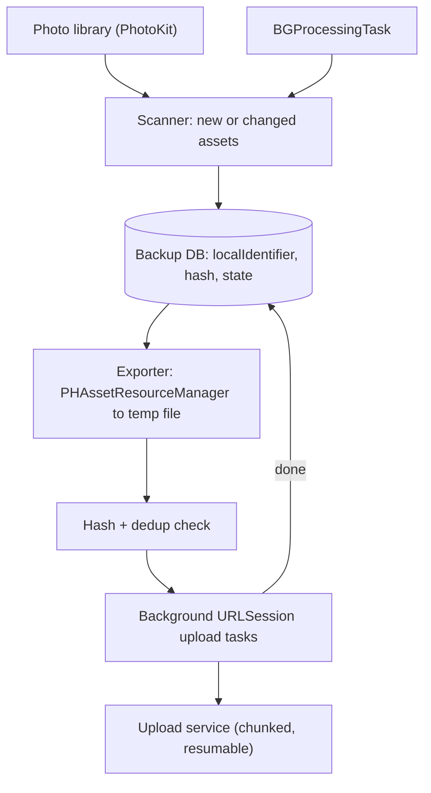

#### Access

| Need | API | Permission |
|---|---|---|
| One-off upload | `PhotosPicker` (SwiftUI) / `PHPickerViewController` | None: runs out of process |
| Automatic backup | `PHPhotoLibrary.requestAuthorization(for: .readWrite)` | Full or **limited** access |

With limited access, the app only sees assets the user selected; explain this in the UI and offer `presentLimitedLibraryPicker` to add more.

#### Detecting new assets

- Fetch `PHAsset`s sorted by `creationDate` and compare against the backup DB (keyed by `localIdentifier`, plus a content hash).
- Register a `PHPhotoLibraryChangeObserver` to react to changes while the app runs.
- Persist sync state in SwiftData/Core Data so a relaunch doesn't rescan everything from scratch.

#### Exporting originals

```swift
func exportOriginal(of asset: PHAsset, to url: URL) async throws {
    guard let resource = PHAssetResource.assetResources(for: asset)
        .first(where: { $0.type == .photo || $0.type == .video }) else { throw BackupError.noResource }
    let options = PHAssetResourceRequestOptions()
    options.isNetworkAccessAllowed = true          // original may live only in iCloud (Optimize Storage)
    try await PHAssetResourceManager.default().writeData(for: resource, toFile: url, options: options)
}
```

Live Photos have both a photo and a paired video resource; edited assets have adjusted and original versions. Decide which to back up.

#### Uploading

- **Background `URLSession` upload tasks from files** (`uploadTask(with:fromFile:)`); background sessions require file-based uploads, and the system continues transfers while the app is suspended.
- Large videos: **chunked/resumable uploads** (e.g. 8 MB parts with a server upload id) so a dropped connection doesn't restart from zero.
- Retries with exponential backoff; delete the temp export after success.

#### Scheduling and policies

- `BGProcessingTask` with `requiresNetworkConnectivity = true` and ideally `requiresExternalPower = true` for big scans/backlogs; `BGAppRefreshTask` for short checks.
- Respect Low Power Mode (`ProcessInfo.processInfo.isLowPowerModeEnabled`), cellular/Low Data settings (`allowsCellularAccess`, `allowsConstrainedNetworkAccess`), and pause when storage is low.

#### Deduplication

Hash the file content (e.g. SHA-256) and ask the server whether it already has it before uploading. This prevents re-uploads after reinstalling the app (when local identifiers and the DB are gone) and across devices.

#### Progress and UI

Per-asset state (`pending`, `exporting`, `uploading`, `done`, `failed`), overall "1,234 of 5,000 backed up", a clear status screen with reasons when paused (Low Power Mode, no Wi-Fi, limited access).

#### Pitfalls

- Uploading from memory (`Data`) with a background session: not supported, and large videos exhaust memory.
- Forgetting `isNetworkAccessAllowed`, so iCloud-optimised originals fail to export.
- Relying only on `localIdentifier` for dedup; it isn't stable across reinstalls or devices.

#### Likely follow-ups

- *"How do you back up while the app isn't open?"* – You can't run continuously; background tasks and background upload sessions make progress opportunistically, which is why opening the app speeds things up.
- *"HEIC vs JPEG?"* – Upload originals (HEIC/HEVC) for fidelity; convert server-side for clients that need JPEG.

</details>

---

[⬅ Previous: Xcode, Build & Release](19-xcode-build-release.md) · [⬅ Back to index](../README.md) · [Next: What's New & Trending ➡](21-whats-new-trending.md)
