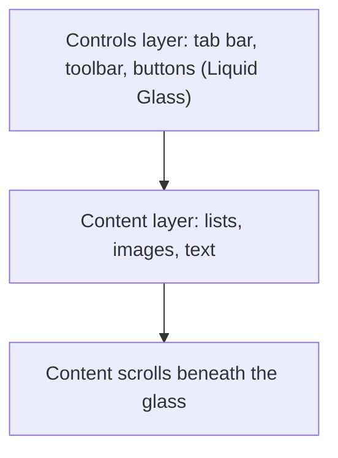
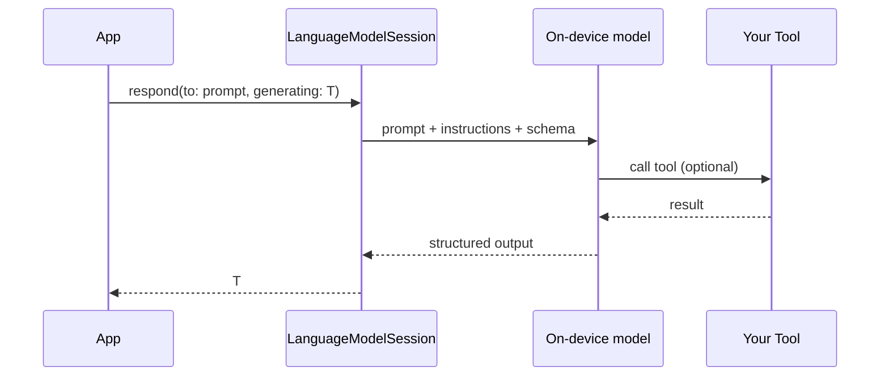
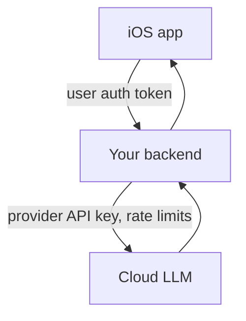
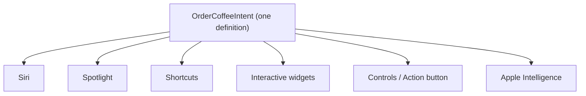
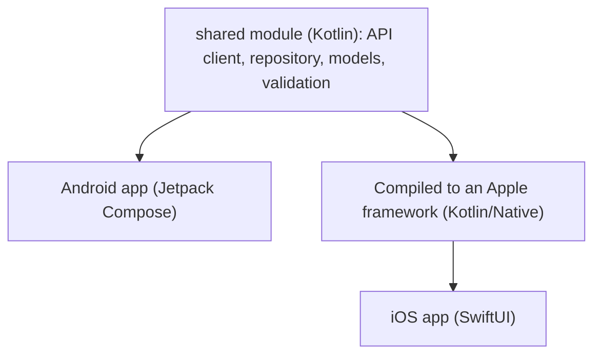
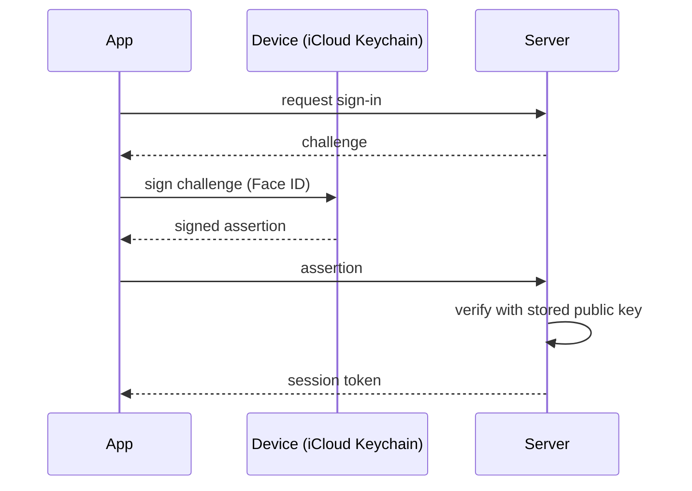
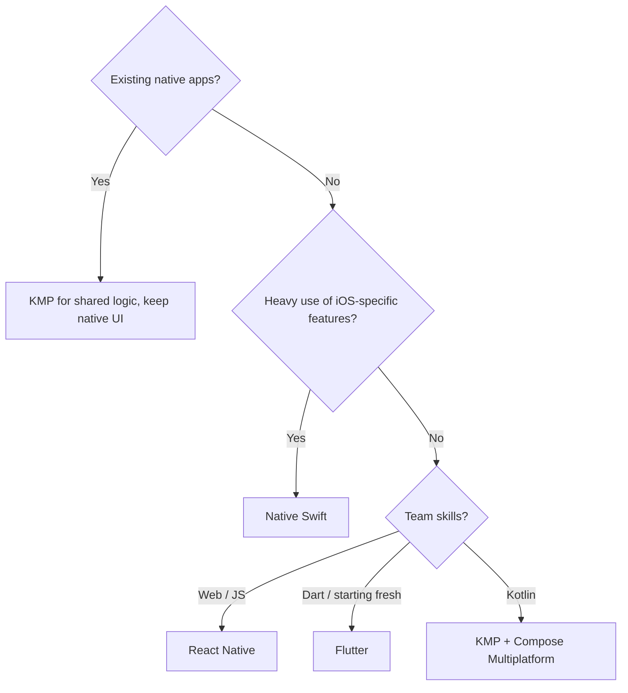
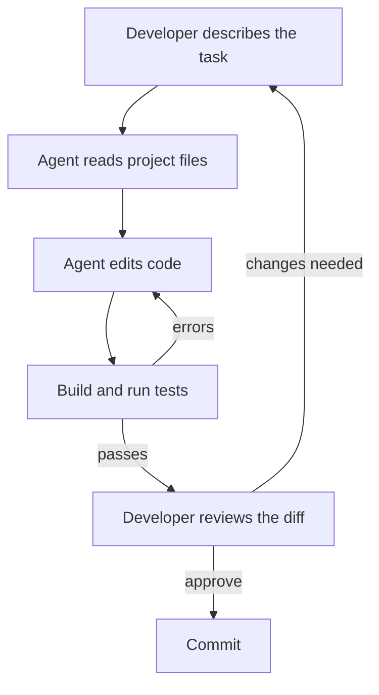

# What's New & Trending in iOS

[⬅ Back to index](../README.md)

Interviewers often ask *"What's new in iOS/Swift?"* or *"Which recent APIs have you adopted?"*. This file covers the trending topics from roughly 2023 onward. Check the latest WWDC sessions and release notes before an interview.

---

## OS Releases

### 1. What were the highlights of iOS 17 for developers?

<details>
<summary>Answer</summary>

**In short:** iOS 17 (WWDC 2023) brought a new data and state stack: **SwiftData** for persistence and the **Observation framework** (`@Observable`) for state. It also added **interactive widgets** driven by App Intents, Swift **macros** (Swift 5.9) including `#Preview`, String Catalogs, and many SwiftUI scroll and animation APIs.

iOS 17 is a common reference point because many teams now treat it as their minimum deployment target, so its APIs are the ones you can actually use in production today.

#### Data and state

- **SwiftData** is a Swift-native persistence layer built on Core Data's storage engine. You mark a class with `@Model` and query it with `@Query` in SwiftUI. No `.xcdatamodeld` file and no `NSManagedObject` subclasses.
- **Observation** (`@Observable` macro) replaces most uses of `ObservableObject` + `@Published`. SwiftUI tracks which properties a view's `body` actually reads, and only those properties trigger a redraw. With `ObservableObject`, any `@Published` change invalidated every observing view.

```swift
import SwiftData
import Observation

@Model
final class Note {           // persisted by SwiftData
    var title: String
    var createdAt: Date
    init(title: String) { self.title = title; self.createdAt = .now }
}

@Observable
final class EditorModel {    // plain state, fine-grained tracking
    var draft = ""           // views reading only `draft` redraw only when it changes
    var isSaving = false
}
```

#### Widgets and system surfaces

- **Interactive widgets**: `Button` and `Toggle` in a widget run an **App Intent** without opening the app, then the timeline reloads.
- Widgets in **StandBy** (iPhone charging on its side) and on the **iPad Lock Screen**.
- **TipKit** for in-app feature tips with display rules.

#### Swift and tooling

- **Swift 5.9 macros**: `#Preview` replaces `PreviewProvider`; `@Observable` and `@Model` are macros themselves.
- **String Catalogs** (`.xcstrings`): one file for all localizations, including plurals, with Xcode extracting strings automatically.

#### SwiftUI and UIKit

| Area | Additions |
|---|---|
| Scrolling | `scrollTargetBehavior` (paging, view-aligned snapping), `scrollPosition` |
| Animation | `PhaseAnimator`, `KeyframeAnimator` |
| Layout | `containerRelativeFrame`, `.inspector` |
| UIKit | `viewIsAppearing` (geometry and traits ready before the view shows), custom traits, `registerForTraitChanges` instead of overriding `traitCollectionDidChange` |

#### Other

- `CLMonitor` and `CLLocationUpdate` give async-sequence location APIs.
- Core Data gained **staged migrations**.
- The **Privacy Manifest** (`PrivacyInfo.xcprivacy`) was introduced and became mandatory in 2024.

**Common pitfalls:**
- Using `@Observable` with `@StateObject`/`@ObservedObject`. With Observation you use `@State` to own the model and pass it in as a plain property (or `@Bindable` when you need bindings).
- Assuming SwiftData has every Core Data feature. It shipped with gaps that later releases filled (see iOS 18 below).

**Likely follow-ups:**
- *Why is `@Observable` faster?* It tracks per-property reads during `body`, so unrelated changes don't redraw the view.
- *What does `viewIsAppearing` fix?* In `viewWillAppear` the trait collection and geometry may not be final yet; in `viewIsAppearing` they are.

</details>

### 2. What were the highlights of iOS 18?

<details>
<summary>Answer</summary>

**In short:** iOS 18 (WWDC 2024) centred on **Apple Intelligence** (from iOS 18.1), with **App Intents** as the way apps plug into it, plus **Controls** in Control Center, Home Screen tinting, **Swift 6** with data-race safety, **Swift Testing**, and a round of SwiftUI and SwiftData improvements.

#### Apple Intelligence (iOS 18.1+)

- **Writing Tools** (rewrite, proofread, summarize) appear **automatically** in standard text views (`UITextView`, SwiftUI `TextEditor`, and so on). You can tune or opt out of the behaviour for specific fields.
- **Image Playground** and **Genmoji** for image generation and custom emoji.
- **Siri** improvements that rely on your app exposing actions and data through **App Intents**. This is why App Intents became a priority for many teams.

#### System integration

- **Controls**: small buttons/toggles in **Control Center**, on the **Lock Screen** and on the **Action button**. Built with WidgetKit (`ControlWidget`) and backed by App Intents.
- Home Screen customization with **dark and tinted app icons**. Apps should provide icon variants so they don't look wrong in those modes.

#### SwiftUI

- **Zoom navigation transition** (a card zooms into its detail screen).
- New **`Tab` API** and tab views that can adapt into a sidebar on iPad.
- **Mesh gradients**, **custom containers** (building your own `List`-like containers from subviews).
- The **`@Entry` macro**, which removes the boilerplate for custom `EnvironmentValues` keys:

```swift
extension EnvironmentValues {
    // Before: a separate EnvironmentKey struct + get/set computed property
    @Entry var accentStyle: Color = .blue
}
```

#### SwiftData

`#Index` and `#Unique` macros, **history tracking** (see what changed, useful for syncing with widgets or extensions), and **custom data stores** (plug a different storage backend behind the SwiftData API).

#### Swift and testing

- **Swift 6** language mode turns data-race checking into compile-time errors.
- **Swift Testing** (`@Test`, `#expect`) arrived with Xcode 16.

#### Privacy and other APIs

- **Limited contacts access**: the user can share only selected contacts, similar to limited photo access. Your app must handle a partial list.
- **AccessorySetupKit** for pairing Bluetooth/Wi-Fi accessories without broad permissions.
- Users can **lock and hide apps**.
- **Translation framework** APIs for in-app translation.

**Likely follow-ups:**
- *What did you have to do for Writing Tools?* Usually nothing for standard text views; custom text engines need extra adoption work.
- *How do Controls relate to widgets?* Same extension target and WidgetKit infrastructure, but the action is an App Intent rather than a timeline.

</details>

### 3. What is iOS 26? What's Liquid Glass?

<details>
<summary>Answer</summary>

**In short:** At WWDC 2025 Apple switched to **year-based version numbers** (iOS 26, macOS Tahoe 26, and so on, all aligned), and introduced **Liquid Glass**, a translucent, refractive material used for controls, tab bars, toolbars and navigation, with content flowing beneath them. Apps built with the iOS 26 SDK pick it up automatically in standard components.

#### Why the version jump

Before, iOS was 18, macOS 15, watchOS 11 and so on, which was confusing. Now every platform uses the number of the year that follows the release (released in 2025, used through 2026), so iOS 26, iPadOS 26, macOS 26, watchOS 26, tvOS 26 and visionOS 26 match.

#### What Liquid Glass is

Liquid Glass is a material, not just a blur. It reflects and refracts what's behind it, adapts its tint to light and dark content, and reacts to touch. It sits in a "functional layer" above your content: navigation and controls float on glass, and content scrolls underneath.



#### What developers need to do

- **Automatic adoption**: rebuilding with the iOS 26 SDK gives standard UIKit and SwiftUI bars, sheets, buttons and menus the new look. No code changes for the basics.
- **Audit custom UI**: custom opaque backgrounds on navigation bars or tab bars, hard-coded colors, and custom toolbars can fight the glass. Removing custom styling is often the fix.
- **New APIs** for your own views:

```swift
// SwiftUI
Text("Now Playing")
    .padding()
    .glassEffect()                 // apply Liquid Glass to a custom view

Button("Join") { join() }
    .buttonStyle(.glass)

GlassEffectContainer {             // groups glass shapes so they blend/morph together
    HStack { /* several .glassEffect() views */ }
}
```

  UIKit has `UIGlassEffect` (used with `UIVisualEffectView`). Tab bars can **minimize on scroll**, and `.tabViewBottomAccessory` adds an accessory above the tab bar (like a mini player).
- **App icons**: a new layered icon design, built with the **Icon Composer** app, so the system can render light, dark, tinted and clear variants.
- A **temporary opt-out key** existed for the transition period, but it isn't intended as a long-term option, so plan to adopt.

#### Other iOS 26 items

The **Foundation Models framework** (on-device LLM), a native SwiftUI **`WebView`**, rich-text editing in **`TextEditor`**, **`BGContinuedProcessingTask`** (continue a user-started task in the background with progress shown), the **Declared Age Range** API, and **Live Activities on CarPlay and Mac**.

**Common pitfalls:**
- Putting glass on content (cards in a list) rather than on the controls layer. Apple's guidance is to use it for navigation and controls.
- Stacking glass on glass, which looks muddy. Use `GlassEffectContainer` to group nearby elements.
- Forgetting legibility: check contrast, Reduce Transparency and Increase Contrast settings.

**Likely follow-up:**
- *How would you roll this out in a big app?* Rebuild with the new SDK, remove custom bar appearances, fix screens that look broken, then adopt glass APIs in custom controls.

</details>

---

## AI on Apple Platforms

### 4. What is the Foundation Models framework?

<details>
<summary>Answer</summary>

**In short:** The Foundation Models framework (iOS 26) gives apps a Swift API to Apple's **on-device large language model**, the one behind Apple Intelligence. It's **private, works offline and is free** (no per-request API cost). Its standout feature is **guided generation**: the model fills in typed Swift structs instead of returning free text.

#### Why it matters

Before, adding LLM features meant calling a cloud API: you paid per token, sent user data to a server, needed a backend to hide the API key, and nothing worked offline. Foundation Models moves small, focused tasks onto the device.

#### Basic use

```swift
import FoundationModels

@Generable
struct TripIdea {
    @Guide(description: "A short catchy title") var title: String
    var activities: [String]
}

func makeIdea() async throws -> TripIdea {
    // 1. Check that the model can run on this device right now
    guard case .available = SystemLanguageModel.default.availability else {
        throw TripError.modelUnavailable   // show a non-AI fallback
    }

    // 2. A session keeps the conversation context (multi-turn)
    let session = LanguageModelSession(instructions: "You are a travel assistant.")

    // 3. Guided generation: the result is a TripIdea, not a string to parse
    let response = try await session.respond(to: "Plan a day in Kyoto", generating: TripIdea.self)
    return response.content
}
```

#### Key features

| Feature | What it does |
|---|---|
| **Guided generation** (`@Generable`, `@Guide`) | The model's output is constrained to your type's structure, so you get valid typed data without JSON parsing |
| **Streaming** | Receive partial results as they're generated, to update UI progressively |
| **Tool calling** | You define tools (Swift types conforming to `Tool`); the model can call them to fetch data, such as searching your app's database |
| **Sessions** | `LanguageModelSession` keeps the transcript for multi-turn conversations |
| **Instructions** | System-style guidance set once per session, separate from the user's prompt |



#### Limits

- It only runs on **Apple Intelligence-capable devices** with Apple Intelligence **enabled**, and the model may still be downloading. Always check `SystemLanguageModel.default.availability` and design a fallback.
- It's a small model. It's good for **summarization, extraction, classification, tagging and short generation**. It's not a frontier-scale model, so it's a poor fit for broad world knowledge, complex reasoning or long code generation.
- The context window is limited, so keep prompts and transcripts short.

**Common pitfalls:**
- Shipping a feature with no fallback for unsupported devices.
- Trusting output blindly: it can still be wrong. Validate and let the user edit.

**Likely follow-ups:**
- *When would you still use a cloud LLM?* For tasks needing a larger model, broad knowledge, or support on devices without Apple Intelligence.
- *Why is guided generation better than asking for JSON?* The output is constrained to the schema, so it can't produce malformed JSON or missing fields.

</details>

### 5. How else can you add ML/AI features to iOS apps?

<details>
<summary>Answer</summary>

**In short:** Beyond Foundation Models, use **Core ML** for your own on-device models, **Create ML** to train them, task-specific frameworks (**Vision**, **Natural Language**, **Speech**, **Translation**, **Sound Analysis**) for common jobs, **App Intents** to let Siri and Apple Intelligence use your app, and **cloud LLMs through your own backend** for heavy work.

#### Choosing the right tool

| Need | Use | Notes |
|---|---|---|
| Run a custom model (image classifier, recommender) | **Core ML** | Convert PyTorch/TensorFlow models with `coremltools`; runs on CPU, GPU or Neural Engine |
| Train a simple model without ML expertise | **Create ML** | App and framework for image, text, sound and tabular classifiers/regressors |
| OCR, barcodes, faces, body pose | **Vision** | Has newer Swift-native APIs |
| Language detection, tokenization, sentiment | **Natural Language** | |
| Speech-to-text | **Speech** | `SpeechAnalyzer` (iOS 26) is the modern API |
| In-app translation | **Translation** | |
| Classify sounds | **Sound Analysis** | |
| Let the system and Siri act on your app | **App Intents** | See the next question |
| Large-model tasks | **Cloud LLM via your backend** | Never ship provider API keys inside the app |

```swift
import Vision

// Recognize text in an image with Vision
func recognizeText(in image: CGImage) throws -> [String] {
    let request = VNRecognizeTextRequest()
    request.recognitionLevel = .accurate
    try VNImageRequestHandler(cgImage: image).perform([request])
    return request.results?.compactMap { $0.topCandidates(1).first?.string } ?? []
}
```

#### Why never embed API keys

Anything in your app binary can be extracted. If you ship an OpenAI or Anthropic key, someone will find it and run up your bill. Put the key on your server, authenticate your own users, add rate limits, and proxy the request.



#### Design considerations

- **Privacy**: prefer on-device; be clear when data leaves the device.
- **Latency**: stream responses so the UI shows progress instead of a spinner.
- **Cost**: cloud calls cost money per request; cache results and limit usage.
- **Safety and guardrails**: filter inputs and outputs; handle refusals.
- **Hallucinations**: show sources, let users verify and edit, don't auto-act on risky output.
- **Fallbacks**: older devices, offline, model unavailable.

**Likely follow-ups:**
- *Core ML vs Foundation Models?* Core ML runs any model you bring; Foundation Models is Apple's built-in general-purpose LLM.
- *How do you keep a Core ML model updated without an app release?* Download a new compiled model at runtime (or use Core ML model deployment) and compile it on device.

</details>

### 6. What are App Intents and why are they important now?

<details>
<summary>Answer</summary>

**In short:** **App Intents** (iOS 16+) let you describe your app's **actions** (`AppIntent`) and **data** (`AppEntity`) in plain Swift. The system then surfaces them in **Siri, Spotlight, Shortcuts, the Action button, Controls, interactive widgets, Live Activities** and **Apple Intelligence**. They've become the main way an app integrates with the rest of the OS.

#### Why it matters now

Each new system feature in recent years runs on App Intents: interactive widget buttons, Control Center controls, the Action button, Siri with Apple Intelligence, and **Visual Intelligence** and onscreen awareness. Writing an intent once makes the action available in all of these places. An app with no intents is invisible to these features.



#### What it looks like

```swift
import AppIntents

struct OrderCoffeeIntent: AppIntent {
    static var title: LocalizedStringResource = "Order Coffee"

    @Parameter(title: "Drink")
    var drink: DrinkEntity          // an AppEntity the system can query and show

    func perform() async throws -> some IntentResult & ProvidesDialog {
        try await OrderService.shared.order(drink.id)
        return .result(dialog: "Ordered a \(drink.name).")
    }
}

// Makes the intent available with zero user setup
struct CoffeeShortcuts: AppShortcutsProvider {
    static var appShortcuts: [AppShortcut] {
        AppShortcut(intent: OrderCoffeeIntent(),
                    phrases: ["Order coffee in \(.applicationName)"],
                    shortTitle: "Order Coffee",
                    systemImageName: "cup.and.saucer")
    }
}
```

#### Key pieces

- **`AppIntent`**: an action with parameters and a `perform()` method.
- **`AppEntity`** + **`EntityQuery`**: your app's objects (drinks, notes, playlists) so the system can find and display them.
- **`AppEnum`**: fixed choices as parameters.
- **`AppShortcutsProvider`**: registers shortcuts with spoken phrases. They work as soon as the app is installed, no setup in the Shortcuts app needed.

App Intents replaced the older SiriKit Intents definition files (`.intentdefinition`). Everything is now Swift code, which the compiler reads at build time to generate metadata.

**Common pitfalls:**
- Putting heavy logic in `perform()` that assumes the UI is running. Intents can run in the background or in an extension, so use shared services.
- Forgetting localization of titles and phrases.

**Likely follow-up:**
- *How do widgets use them?* A widget `Button(intent:)` runs the intent's `perform()` then reloads the timeline.

</details>

### 7. What AI tooling exists in Xcode?

<details>
<summary>Answer</summary>

**In short:** Xcode 16 added **predictive code completion** that runs on device. Xcode 26 added **coding intelligence**: a chat assistant that works with ChatGPT and other providers (Claude, or local models, through API keys), plus code explanation, fix-its for errors, and generated previews, documentation and tests. Interviewers mostly want to hear how you use these tools **responsibly**.

#### What each release added

| Xcode | AI features |
|---|---|
| 16 | On-device predictive code completion, trained for Swift and Apple SDKs (needs Apple silicon) |
| 26 | Chat-based coding assistant in the editor; ChatGPT integration built in; other providers via API keys or local models; explain code; fix compiler errors; generate previews, docs and tests |

The assistant sees your project context (the current file, related files) so it can make changes across files, and you review the changes before they're applied.

#### How to talk about using AI tools responsibly

- **Review every change** like a pull request from a teammate. Read the diff; don't accept what you don't understand.
- **Run the build and tests**. Generated code often compiles but uses deprecated APIs or misses edge cases (threading, error handling, accessibility).
- **Security and privacy**: never paste secrets, API keys or customer data into prompts. Know your company's policy on which providers are allowed and what code can leave the machine. Local models help when code can't leave.
- **Licensing**: be careful with large generated blocks that may mirror existing code.
- **Use it for the right jobs**: boilerplate, tests, documentation, explaining unfamiliar code, first drafts of migrations. Keep architecture and tricky concurrency decisions in human hands.

**Likely follow-ups:**
- *Give an example where AI helped you.* Have a concrete story: for example generating unit tests for a parser, then fixing the cases it got wrong.
- *Where did it fail?* For example, code that compiled but had a data race or used an outdated API.

</details>

---

## Swift & Tooling

### 8. What's new in Swift 6.x?

<details>
<summary>Answer</summary>

**In short:** **Swift 6 (2024)** made **data-race safety a compile-time guarantee** in the Swift 6 language mode, and added typed throws, noncopyable generics and the `Synchronization` module. **Swift 6.1** was a smaller polish release. **Swift 6.2 (2025)** focused on **"approachable concurrency"**: default main-actor isolation as an option, and `nonisolated async` functions staying on the caller's actor, plus `InlineArray` and `Span` for performance.

#### Swift 6 (2024)

- **Compile-time data-race safety**: in Swift 6 mode, code that could access shared mutable state from multiple threads without protection is an **error**, not a warning. This is built on `Sendable`, actors and isolation checking. You can enable it per module and migrate gradually (Swift 5 mode with strict-concurrency warnings first).
- **Typed throws**: declare exactly which error a function throws.

```swift
enum ParseError: Error { case badHeader, truncated }

func parse(_ data: Data) throws(ParseError) -> Packet {
    guard data.count > 4 else { throw .truncated }
    // ...
}

do { _ = try parse(data) }
catch { /* `error` is ParseError here, not `any Error` */ }
```

- **Noncopyable generics** (`~Copyable` in generic code), the **`Synchronization`** module with `Mutex` and `Atomic`, a **unified Foundation** (`swift-foundation`, the same Swift implementation on all platforms), and **Embedded Swift** for microcontrollers.

#### Swift 6.1

Trailing commas allowed in more places (parameter lists, tuples), `nonisolated` on types and extensions, and improvements to package traits in SwiftPM.

#### Swift 6.2 (2025): approachable concurrency

Swift 6 was strict, and many app developers found the errors hard. 6.2 changes defaults to match how apps really work: most app code is UI code on the main thread.

| Change | Effect |
|---|---|
| Opt-in **default main-actor isolation** for a module | Everything is `@MainActor` unless you say otherwise, so most UI code has no concurrency errors |
| `nonisolated async` functions **run on the caller's actor** | Calling an async helper from the main actor no longer silently hops to a background thread, which removes many `Sendable` errors |
| **`@concurrent`** | Explicitly say "run this on the background pool" when you want parallelism |

```swift
// Swift 6.2 with approachable concurrency
nonisolated func loadThumbnail() async -> Image { ... } // runs on caller's actor

@concurrent
nonisolated func decodeLargeImage(_ data: Data) async -> Image { ... } // offloaded
```

Also in 6.2: **`InlineArray`** (fixed-size array stored inline, no heap allocation), **`Span`** (safe, fast view of contiguous memory, replacing many unsafe pointer uses), opt-in **strict memory safety** checking, **raw identifiers** (backtick names with spaces, handy for test names), **WebAssembly** support, and Swift Testing improvements (**exit tests**, **attachments**).

**Common pitfalls:**
- Turning on Swift 6 mode for a whole large app at once. Migrate module by module.
- Sprinkling `@unchecked Sendable` or `nonisolated(unsafe)` to silence errors, which hides real races.

**Likely follow-up:**
- *Why did 6.2 change the async default?* Before, a `nonisolated async` function always left the caller's actor, which forced values to be `Sendable` and surprised developers.

</details>

### 9. What is Swift Testing and why are teams adopting it?

<details>
<summary>Answer</summary>

**In short:** Swift Testing is Apple's modern, open-source testing framework (shipped with Xcode 16). Tests are plain functions marked `@Test`, assertions use `#expect` and `#require`, and it supports **parameterized tests**, **traits and tags**, and runs tests **in parallel by default**. Teams adopt it because it's more expressive than XCTest, gives better failure messages, and **coexists with XCTest** so you can migrate gradually.

#### XCTest vs Swift Testing

```swift
// XCTest
final class CartTests: XCTestCase {
    func testTotal() {
        let cart = Cart(items: [.init(price: 2), .init(price: 3)])
        XCTAssertEqual(cart.total, 5)
    }
}

// Swift Testing
import Testing

struct CartTests {
    @Test func total() {
        let cart = Cart(items: [.init(price: 2), .init(price: 3)])
        #expect(cart.total == 5)   // failure shows both sides: "cart.total → 4 == 5"
    }

    @Test("Discounts apply", arguments: [10, 20, 50])
    func discount(percent: Int) throws {
        let cart = try #require(Cart.sample)   // stops the test if nil
        #expect(cart.applying(percent: percent).total < cart.total)
    }
}
```

| | XCTest | Swift Testing |
|---|---|---|
| Declaring tests | `XCTestCase` subclass, `test` prefix | `@Test` on any function; suites can be structs |
| Assertions | Many `XCTAssert*` functions | `#expect(expr)` and `#require(expr)` macros |
| Failure messages | Generic | Shows sub-expression values |
| Parameterized | Manual loops | `arguments:` built in, each case reported separately |
| Setup | `setUp`/`tearDown` | `init`/`deinit` of the suite (fresh instance per test) |
| Parallelism | Opt-in | On by default |
| Organization | Classes | Tags, traits (`.disabled`, `.timeLimit`, `.bug`) |
| UI / performance tests | Yes | No, still use XCTest |

#### Why adoption is growing

- Less boilerplate and clearer output speed up writing and debugging tests.
- Parameterized tests replace copy-pasted test methods.
- Works with async/await and Swift concurrency naturally.
- It's open source and runs on Linux and Windows too.

**Common pitfalls:**
- Tests that share global state break under default parallel execution. Use the `.serialized` trait or remove the shared state.
- Expecting UI tests or `measure {}` performance tests to move over; they stay in XCTest.

See [Testing Q3](17-testing.md) for more detail.

</details>

### 10. What's the state of SwiftUI vs UIKit in 2025–26?

<details>
<summary>Answer</summary>

**In short:** **SwiftUI is the default for new apps and features**; Apple's newest APIs and designs (Liquid Glass, widgets, Live Activities, visionOS) are SwiftUI-first. **UIKit is still fully supported** and common in large existing codebases and for very custom or performance-critical UI. Most production apps are **hybrid**, and interviewers expect you to know both and how to migrate incrementally.

#### Where each one fits

| Situation | Typical choice |
|---|---|
| New app or new screen | SwiftUI |
| Widgets, Live Activities, watchOS, visionOS | SwiftUI (often required) |
| Large existing UIKit app | Keep UIKit, add new screens in SwiftUI |
| Very complex lists/collections with fine control | UIKit `UICollectionView` is still strong |
| Custom text engines, advanced gesture handling, low-level control | UIKit |
| Minimum OS target is old | UIKit, or SwiftUI with fewer features |

#### How hybrid apps work

```swift
// SwiftUI inside UIKit
let host = UIHostingController(rootView: ProfileView(user: user))
navigationController?.pushViewController(host, animated: true)

// UIKit inside SwiftUI
struct MapViewWrapper: UIViewRepresentable {
    func makeUIView(context: Context) -> MKMapView { MKMapView() }
    func updateUIView(_ view: MKMapView, context: Context) { /* sync state */ }
}
```

`UIViewControllerRepresentable` does the same for whole view controllers.

#### Incremental migration strategy

1. Build **new features** in SwiftUI, hosted in `UIHostingController`.
2. Move **leaf screens** (settings, detail pages) first; they have few dependencies.
3. Move state to `@Observable` models that both UIKit and SwiftUI can use.
4. Keep navigation in UIKit until most screens are SwiftUI, then switch to `NavigationStack`.
5. Leave performance-critical or very custom screens in UIKit if they work well.

#### Why UIKit isn't going away

UIKit still gets new APIs each year (for example trait changes, `UIGlassEffect`), and SwiftUI itself is built on UIKit on iOS. Many large apps have years of UIKit code that isn't worth rewriting.

**Likely follow-ups:**
- *What are SwiftUI's weak spots?* Fine-grained control of complex lists, some navigation edge cases, debugging re-renders, and APIs that need newer OS versions.
- *How do you share state across both?* An `@Observable` model; SwiftUI observes it directly, and UIKit can observe it too (UIKit gained automatic observation tracking in recent releases) or via closures/Combine.

</details>

### 11. What is visionOS / spatial computing?

<details>
<summary>Answer</summary>

**In short:** visionOS is Apple's operating system for **Apple Vision Pro**. Apps are built with **SwiftUI** (windows and volumes), **RealityKit** for 3D content and **ARKit** for understanding the room. An **Immersive Space** can partly or fully surround the user. Existing iPhone and iPad apps can run as compatible apps, so adaptive SwiftUI layouts pay off.

#### The three scene types

| Scene | What it is | Example |
|---|---|---|
| **Window** | A flat 2D SwiftUI window floating in space, which the user can move and resize | A notes app, a settings screen |
| **Volume** | A bounded 3D box showing 3D content viewable from any angle | A 3D model of a product, a board game |
| **Immersive Space** | Content placed around the user, without window bounds; mixed (passthrough visible) through to full immersion | A meditation environment, a 3D game |

```swift
@main
struct SolarApp: App {
    var body: some Scene {
        WindowGroup { ContentView() }                 // 2D window

        WindowGroup(id: "globe") { GlobeView() }
            .windowStyle(.volumetric)                 // 3D volume

        ImmersiveSpace(id: "space") {
            RealityView { content in                  // RealityKit content around the user
                if let planets = try? await Entity(named: "Planets") {
                    content.add(planets)
                }
            }
        }
    }
}
```

#### Key concepts

- **Input** is mostly eyes and hands: users look at an element and pinch to tap. SwiftUI's standard controls handle hover effects automatically; custom views should add `.hoverEffect()`.
- **RealityKit** uses an entity-component-system model for 3D. **Reality Composer Pro** is used to build scenes and materials.
- **ARKit** on visionOS gives hand tracking, plane detection and scene understanding, but only inside an Immersive Space and with user permission.
- **Privacy**: apps don't get raw camera frames or where the user is looking by default; the system handles gaze-based hover without exposing it.

#### Why iOS developers should care

- Your existing iPhone/iPad app may already run on Vision Pro as a compatible app. Testing that it looks reasonable is cheap.
- Skills transfer directly: SwiftUI, Swift concurrency and RealityKit are the same frameworks.
- Recent releases added **spatial widgets** and better SwiftUI 3D layout APIs, so more of the work is plain SwiftUI.

**Likely follow-ups:**
- *How do you port an iPad app?* Start with it as a compatible app, then add a native visionOS target, adopt standard SwiftUI controls and materials, and add a volume or immersive experience only where 3D adds value.
- *Can you access the camera?* Not freely; access to raw camera feeds is very restricted (enterprise-only APIs).

</details>

### 12. What is Kotlin Multiplatform's relevance to iOS developers?

<details>
<summary>Answer</summary>

**In short:** **Kotlin Multiplatform (KMP)** lets a team write business logic (networking, persistence, domain rules) once in Kotlin and use it on Android and iOS, while the iOS UI stays native SwiftUI, or optionally uses **Compose Multiplatform** (stable for iOS since 2025). iOS developers consume the shared code as a framework through SPM or CocoaPods. You should know how it plugs into an iOS project and its trade-offs.

#### How it fits together



Kotlin/Native compiles the shared module to native machine code and produces an Apple framework. Today it exposes an **Objective-C** header, so Swift sees the Kotlin classes through Objective-C bridging. **Swift Export** (in progress) aims to produce Swift APIs directly, giving better interop.

```swift
import Shared   // the KMP framework

@Observable
final class ProductsModel {
    private let repo = ProductRepository()   // Kotlin class
    var products: [Product] = []

    func load() async {
        // Kotlin suspend functions can be called as async from Swift
        products = (try? await repo.fetchProducts()) ?? []
    }
}
```

#### Platform-specific code

`expect`/`actual` declarations let shared code say "I need a UUID generator" (`expect`) while each platform provides the implementation (`actual`), using Foundation on iOS.

#### Trade-offs

| Benefits | Costs |
|---|---|
| One implementation of business rules, so fewer platform differences and bugs | iOS developers need some Kotlin and Gradle knowledge |
| Can adopt incrementally, one module at a time | Longer build times; Xcode build includes a Gradle step |
| UI stays fully native (or shared with Compose Multiplatform) | Interop rough edges: generics, sealed classes, Kotlin `Flow` need wrappers or helper libraries |
| | Debugging Kotlin code from Xcode is harder |

**Likely follow-ups:**
- *How do you expose a Kotlin `Flow` to SwiftUI?* With a wrapper or a library (such as SKIE or KMP-NativeCoroutines) that turns it into an `AsyncSequence`.
- *KMP vs Flutter?* KMP shares logic and keeps native UI; Flutter shares UI and logic with its own renderer.

</details>

### 13. What App Store and policy changes should iOS developers know?

<details>
<summary>Answer</summary>

**In short:** Know the privacy rules (**Privacy Manifests**, required-reason APIs, signed third-party SDKs), **in-app account deletion**, the **EU Digital Markets Act** changes, the 2025 US rulings on **external purchase links**, **Accessibility Nutrition Labels**, the **Declared Age Range API**, and Apple's yearly **minimum SDK requirement**. Policies change often, so always check the current App Review Guidelines.

#### Privacy

- **Privacy Manifest** (`PrivacyInfo.xcprivacy`, required since 2024): declares the data your app and each SDK collect, and whether it's used for tracking.
- **Required-reason APIs**: certain APIs that could be used for fingerprinting (for example `UserDefaults`, file timestamps, system boot time, disk space) need a declared approved reason in the manifest. Missing reasons cause upload rejections.
- **Third-party SDK signatures**: commonly used SDKs must be signed and include their own manifest, so you can verify they came from their real author.

#### Accounts

- **Account deletion**: if users can create an account in the app, they must be able to start deleting it from inside the app, not just by email.

#### Payments and distribution

| Region | What changed |
|---|---|
| EU (Digital Markets Act) | Alternative app marketplaces, web distribution, alternative payment providers, and different business terms |
| US (2025 court rulings) | Apps can include **external purchase links** to buy on the web in US storefronts |
| Elsewhere | Standard In-App Purchase rules mostly apply |

These rules keep changing through legal cases, so check the current guidelines before designing purchase flows.

#### Accessibility and age

- **Accessibility Nutrition Labels** (announced 2025): App Store pages show which accessibility features (VoiceOver, Larger Text, Dark Interface, captions and more) your app supports. Only claim what you actually support for common tasks.
- **Declared Age Range API**: lets an app ask for the user's age range (shared by the user or a parent through Family Sharing) without collecting a birthdate, to help comply with child-safety laws.

#### Minimum SDK requirements

Every spring Apple requires App Store uploads to be built with a recent Xcode and SDK: the iOS 18 SDK / Xcode 16 from April 2025, and the iOS 26 SDK / Xcode 26 from April 2026. This doesn't change your **deployment target** (you can still support older iOS), but building with the new SDK can change behaviour, such as adopting Liquid Glass automatically.

**Common pitfalls:**
- Forgetting that an SDK you embed counts toward your privacy manifest and required-reason declarations.
- Confusing the build SDK requirement with the minimum supported iOS version.

</details>

### 14. What are passkeys and why are they trending?

<details>
<summary>Answer</summary>

**In short:** Passkeys are **passwordless, phishing-resistant** sign-in credentials based on the WebAuthn/FIDO standards. The device keeps a private key, the server stores only a public key, and Apple syncs passkeys through **iCloud Keychain**. Apple, Google and Microsoft all support them, so more apps are making them the default login. iOS 26 added APIs to create a passkey during account sign-up and to import/export credentials.

#### How they work

When a user registers, the device creates a **key pair** for that website or app. The server stores only the public key. To sign in, the server sends a random challenge, the device signs it with the private key after Face ID or Touch ID, and the server checks the signature with the public key.



#### Why they're better than passwords

| Problem with passwords | Passkeys |
|---|---|
| Phishing: users type passwords into fake sites | Bound to the real domain; a fake site can't request them |
| Server breaches leak password hashes | Server only has public keys, useless to an attacker |
| Reuse across sites | A unique key pair per account |
| Weak or forgotten passwords | Nothing to remember; Face ID unlocks it |

#### On iOS

You use the **AuthenticationServices** framework (`ASAuthorizationPlatformPublicKeyCredentialProvider`) and must set up **Associated Domains** (`webcredentials:example.com`) so the passkey is tied to your domain and shared between your app and website.

```swift
let provider = ASAuthorizationPlatformPublicKeyCredentialProvider(relyingPartyIdentifier: "example.com")
let request = provider.createCredentialAssertionRequest(challenge: challengeFromServer)
let controller = ASAuthorizationController(authorizationRequests: [request])
controller.delegate = self
controller.performRequests()
```

**Common pitfalls:**
- Removing the password path too early. Keep a fallback and account recovery for users on devices without passkeys.
- Generating the challenge on the client. The challenge must come from the server and be single-use.

See [Security Q11](18-security-privacy.md) for more detail.

</details>

### 15. How do you stay up to date with iOS development?

<details>
<summary>Answer</summary>

**In short:** Follow **WWDC** each year (especially the "What's new in Swift/SwiftUI/UIKit" sessions), Apple's release notes, **Swift Evolution** and the Swift Forums, a few good newsletters and blogs, and **build small projects with new APIs**. In an interview, back it up with a **specific recent API you tried** and what you learned.

#### Sources worth naming

| Type | Examples | What you get |
|---|---|---|
| Apple official | WWDC sessions and sample code, Apple Developer News, Xcode and iOS release notes, documentation "What's new" pages | Authoritative changes and deprecations |
| Swift language | Swift Evolution proposals, Swift Forums, Swift.org blog | Why features exist and what's coming next |
| Newsletters/blogs | iOS Dev Weekly, SwiftLee, Hacking with Swift, Swift by Sundell | Curated, practical articles |
| Deeper learning | Point-Free | Architecture and advanced Swift |
| Podcasts | Various iOS and Swift podcasts | Industry discussion |

#### A practical routine

- **June (WWDC)**: watch the platform "What's new" sessions, then sessions related to your app's features.
- **Summer betas**: build your app with the beta Xcode and note what breaks or changes (new SDK behaviour, deprecations).
- **Ongoing**: skim one or two newsletters weekly; read Swift Evolution proposals for features you'll use.
- **Hands-on**: try new APIs in a small side project or a feature branch. Reading alone doesn't stick.

#### How to answer in an interview

A strong answer is concrete. For example: "After WWDC I tried the Foundation Models framework in a side project to summarize notes. I learned that guided generation with `@Generable` removes JSON parsing, and that you must handle devices where the model isn't available." That shows curiosity, judgment and real experience, which a list of websites doesn't.

</details>

### 16. How has Swift changed since 2014?

<details>
<summary>Answer</summary>

**In short:** Swift evolved from a young, frequently breaking language (Swift 1–3) to a stable one (**ABI stability in Swift 5**), then added **SwiftUI-enabling features** (5.1), **structured concurrency** (5.5), **macros** (5.9) and **compile-time data-race safety** (Swift 6). The trend is safety, performance, expressiveness and reach beyond Apple platforms.

#### Timeline

| Version | Year | Highlights |
|---|---|---|
| Swift 1–2 | 2014–15 | Introduction; `guard`, `defer`, error handling (`throws`), protocol extensions (protocol-oriented programming). Open-sourced in December 2015 |
| Swift 3 | 2016 | The "Grand Renaming" API guidelines, a big source-breaking cleanup |
| Swift 4 | 2017 | **Codable**, smart key paths, multi-line strings |
| Swift 5.0 | 2019 | **ABI stability** (the runtime ships with the OS), `Result`, raw strings |
| 5.1 | 2019 | Module stability, **opaque types (`some`)**, property wrappers, function builders, which together enabled **SwiftUI** |
| 5.5 | 2021 | **async/await, actors, structured concurrency** |
| 5.7 | 2022 | `if let x` shorthand, `any`, primary associated types, regex literals |
| 5.9 | 2023 | **Macros**, `if`/`switch` expressions, parameter packs, ownership (`consuming`/`borrowing`), noncopyable types |
| Swift 6 | 2024 | **Compile-time data-race safety**, typed throws, Embedded Swift, the Swift Testing framework, a unified Foundation |
| 6.2 | 2025 | Approachable concurrency, `InlineArray`, `Span`, WebAssembly support |

#### Why the key milestones matter

- **ABI stability (5.0)**: before it, every app bundled its own copy of the Swift runtime, making apps bigger. Since iOS 12.2 the runtime ships in the OS. **Module stability (5.1)** then let binary frameworks built with one compiler version work with later ones.
- **SwiftUI's foundations (5.1)**: `some View` (opaque types), `@State` (property wrappers) and the `body` DSL (function builders, later result builders) were all language features added for SwiftUI.
- **Concurrency (5.5 to 6)**: async/await replaced completion-handler pyramids; actors protect shared state; Swift 6 made races compile errors.
- **Macros (5.9)**: generate code at compile time; `@Observable`, `@Model` and `#Preview` are built on them.

#### The overall trend

- **Safety**: memory safety first, then concurrency safety.
- **Performance**: ownership, noncopyable types, `Span`, `InlineArray`.
- **Expressiveness**: macros, result builders, `if`/`switch` expressions.
- **Reach**: Linux, Windows, Android, embedded and server.

**Likely follow-up:**
- *Why was Swift 3 so painful?* It renamed most Cocoa APIs to Swift-style names, so nearly every file needed changes; the migration taught Apple to prioritise source compatibility afterwards.

</details>

### 17. Native vs Flutter vs React Native vs Kotlin Multiplatform – what would you choose?

<details>
<summary>Answer</summary>

**In short:** There's no universal winner. **Native** gives the best UX, performance and day-one access to new iOS features. **Flutter** and **React Native** share UI and logic, reducing cost when the product looks the same everywhere. **KMP** shares business logic while keeping native UI, and can be adopted incrementally. Choose based on team skills, how platform-specific the product is, and whether it's a new app or an existing one.

| | Native (Swift) | Flutter | React Native | KMP (+ Compose Multiplatform) |
|---|---|---|---|---|
| Language | Swift | Dart | JS/TS | Kotlin |
| UI | UIKit/SwiftUI (true native, Liquid Glass "for free") | Own renderer (Impeller); not native widgets | Native components through the new architecture | Native SwiftUI, **or** shared Compose UI |
| Sharing | None | UI + logic | UI + logic | Logic first, optional UI |
| New iOS APIs | Day one | Through plugins | Through native modules | Swift interop / expect-actual |
| Adoption | — | Usually a rewrite | Full app or brownfield | **Incremental** |

#### How each one renders UI

- **Native**: real UIKit/SwiftUI views, so new system designs (like Liquid Glass) and accessibility behaviour come automatically.
- **Flutter**: draws every pixel itself with its own engine (Impeller). Consistent across platforms, but it imitates iOS controls rather than using them, so new iOS designs need the framework to catch up.
- **React Native**: JavaScript describes the UI, which is rendered with real native components. The new architecture (Fabric, TurboModules, JSI) removed the old asynchronous bridge for faster native calls.
- **KMP**: by default only logic is shared, so UI is fully native; Compose Multiplatform can optionally share UI too.

#### A decision guide



#### A good interview answer

"Native gives the best UX, performance and immediate access to new platform features (widgets, Live Activities, App Intents, Liquid Glass). Cross-platform reduces cost when the UI is mostly shared and the team has the skills. KMP is a pragmatic middle ground for sharing business logic while keeping SwiftUI."

Add that even cross-platform apps still need native code for widgets, Live Activities, App Intents and extensions, which must be written in Swift.

**Likely follow-ups:**
- *Biggest risk of cross-platform?* Lagging behind new OS features and needing native experts anyway for platform integrations.
- *When is native clearly right?* Apps where platform feel, performance or deep system integration is the product.

</details>

### 18. What did Apple announce for developers with iOS 27?

<details>
<summary>Answer</summary>

**In short:** WWDC 2026 was again AI-heavy. The **Foundation Models framework** gained multimodal prompts, model-callable Vision tools, Dynamic Profiles, an Evaluations framework and support for other models (including cloud models such as Claude and Gemini). Apple added **Private Cloud Compute** access for small developers, a new **Core AI** framework for your own models, deeper **App Intents** integration with Spotlight and natural language, refined **Liquid Glass**, and new **SwiftUI** and **media** frameworks.

#### Foundation Models framework grows

- **Multimodal prompts**: send images along with text.
- **Vision tools** (OCR, barcodes) the model can call on-device, so it can read what's in an image without you wiring that up by hand.
- **Dynamic Profiles**: swap models, tools and instructions within a session, for example switching from a "triage" setup to a "write reply" setup.
- An **Evaluations** framework to test AI features: run a set of prompts and check outputs, so you can catch regressions when prompts or models change.
- **Other models through a language-model protocol**, including cloud models such as Claude and Gemini. Your feature code can stay the same while the model behind it changes.

#### Running models

- **Private Cloud Compute** access to Apple's latest foundation model for apps in the **App Store Small Business Program**, without cloud API costs. This gives larger-model quality while keeping Apple's privacy guarantees.
- **Core AI**: a new on-device framework for loading, specialising and running **your own models** with a Swift API.

| Need | Option |
|---|---|
| Quick on-device text tasks | Foundation Models (on-device model) |
| More capable model, small developer | Private Cloud Compute |
| Your own custom model | Core AI |
| Third-party cloud model | Foundation Models via the language-model protocol, or your own backend |

#### App Intents

- **Entity schemas** feed Spotlight's semantic index, so your content is found by meaning, not just keywords.
- **Intent schemas** make actions available through natural language.
- A **View Annotations** API maps on-screen views to entities, so the system understands what the user is looking at.
- An **App Intents Testing** framework.

#### Design, SwiftUI and media

- **Design**: refined Liquid Glass materials, typography and tab/navigation bars.
- **SwiftUI**: document APIs (`ReadableDocument`/`WritableDocument`), reorderable containers across lists and grids, new toolbar controls, alerts/confirmation dialogs with item bindings, `AsyncImage` using HTTP caching by default, and lazily initialised `@State` classes (so an `@Observable` model in `@State` isn't recreated on every view init).
- **Media**: a **NowPlaying** framework (Lock Screen, Control Center, Dynamic Island, CarPlay) and a **Music Understanding** framework.

**Interview angle:** pick one or two items you'd actually use in your app and explain why. For example, View Annotations plus entity schemas to make your content available to Siri and Spotlight, or Evaluations to keep an AI feature from regressing.

</details>

### 19. What's new in Swift 6.4?

<details>
<summary>Answer</summary>

**In short:** Swift 6.4 (released September 2026) is a broad release: language conveniences (`some P?`/`any P?`, `@diagnose`, module selectors, `await` in `defer`, `withTaskCancellationShield`), more **ownership and noncopyable tools** (`UniqueBox`, `UniqueArray`, borrow accessors, `Iterable`), library updates (Subprocess 1.0), **Swift Build as SwiftPM's default engine**, Swift Testing/XCTest interop, and progress on WebAssembly, Android and Embedded Swift.

#### Language

- **Optional opaque/existential types** written as `some P?` / `any P?`, instead of needing parentheses like `(some P)?`.
- An **`@diagnose` attribute** to control warnings in source, for example for a specific declaration, instead of only through build settings.
- **Module selectors** (`Module::name`) to disambiguate when two modules export the same name.
- **`await` inside `defer`**: async cleanup at scope exit, which previously wasn't allowed.
- **`withTaskCancellationShield`**: run cleanup code that isn't interrupted by task cancellation. This matters when a cancelled task still has to, say, close a connection or save state.

```swift
func upload() async throws {
    let session = try await openSession()
    defer { await session.close() }    // now allowed: await in defer

    try await session.send(payload)
}
```

#### Ownership and performance

More tools for **noncopyable types** and safe low-level code: `UniqueBox` (a uniquely owned heap value), `UniqueArray`, **borrow accessors** (read a stored value without copying it), an **`Iterable`** protocol (iteration that also works for noncopyable elements), and safer **`RawSpan`** loading. These continue the 5.9 to 6.2 direction of getting C-like performance without unsafe pointers.

#### Libraries and tooling

| Area | Change |
|---|---|
| Libraries | **Subprocess 1.0** for running processes, Observation improvements, `Span` interop with C++ `std::span` |
| Tooling | **Swift Build** is the default build engine in SwiftPM (the same engine Xcode uses), SBOM generation, better VS Code support |
| Testing | Interop between Swift Testing and XCTest assertions; repeated test runs from `swift test` |
| Platforms | WebAssembly, an Android SDK, Embedded Swift improvements |

#### Why it matters for iOS developers

- Testing interop makes migrating from XCTest to Swift Testing smoother, because helper code using one style works in the other.
- Cancellation shields and `await` in `defer` fix real concurrency cleanup problems.
- Swift Build in SwiftPM means packages build the same way on the command line as in Xcode.
- SBOM generation helps with supply-chain and security requirements.

**Likely follow-up:**
- *Why is a cancellation shield needed?* Cancellation is cooperative, and async calls during cleanup may see the task as cancelled and exit early; the shield lets the cleanup finish.

</details>

### 20. What is new in Xcode 27 (agentic coding)?

<details>
<summary>Answer</summary>

**In short:** Xcode 27 adds **coding agents** inside Xcode, powered by the model of your choice, that can prototype, implement and polish features across your project. It ships **agent skills** for SwiftUI APIs and conventions, **agent-assisted localization** in String Catalogs, a **Device Hub** for devices and simulators, and **Instruments** improvements including a Swift Concurrency instrument.

#### Chat assistant vs agent

Xcode 26's coding intelligence was mostly a chat assistant: you ask, it suggests changes. An **agent** works through a multi-step task on its own: it reads files, edits code, builds, looks at errors and iterates until the task is done, and you review the result.



#### Features

- **Coding agents**, powered by the model of your choice, for prototyping, implementing and polishing features.
- **Agent skills** for SwiftUI APIs and conventions, so agents follow Apple's recommended patterns instead of outdated ones from their training data.
- **Agent-assisted localization**: adding languages and translating strings, including plural variants, in String Catalogs.
- **Device Hub**: devices and simulators managed in one place.
- **Instruments**: a **Swift Concurrency** instrument (see tasks and actors, find where work is blocked or hopping) and **comparisons between runs** to spot performance regressions.

#### Interview angle: using agents responsibly

- **Review every diff**. You own the code that gets merged, not the agent.
- **Run tests and the app**. Agents can produce code that builds but is wrong; good test coverage makes agents much more useful.
- **Keep conventions in instruction files or skills** (architecture rules, naming, preferred APIs) so the agent follows your project's style consistently.
- **Scope tasks small** and give clear acceptance criteria.
- **Protect secrets**: don't let agents see credentials; know which model provider your company allows.
- **Check localization output** with native speakers for user-facing text.

**Likely follow-ups:**
- *What kinds of tasks suit an agent?* Well-defined changes with tests: adding a screen following existing patterns, migrations, test writing, localization.
- *What would you not delegate?* Architecture decisions, security-sensitive code, and subtle concurrency logic without careful review.

</details>

---

[⬅ Previous: System Design](20-system-design.md) · [⬅ Back to index](../README.md) · [Next: Coding & Behavioral ➡](22-coding-scenarios.md)
