# Coding, Scenario & Behavioral Questions

[⬅ Back to index](../README.md)

Covers: iOS-flavoured coding problems from live-coding rounds, output questions, debugging scenarios, and behavioral / project questions.

---

## Coding Problems

### 1. Implement an LRU cache in Swift.

<details>
<summary>Answer</summary>

**In short:** combine a **dictionary** (key → node, for O(1) lookup) with a **doubly linked list** (for O(1) reordering and eviction). Every `get` or `set` moves the node to the head; when the cache is over capacity, drop the tail. Make the back-pointer `weak` to avoid retain cycles, and wrap it in an actor or lock for thread safety.

#### Why this structure

An LRU ("least recently used") cache keeps at most `capacity` items and, when full, evicts the item that was touched longest ago. You need three operations to be O(1):

| Operation | Needs | Data structure that gives it |
|---|---|---|
| Find a value by key | Hash lookup | `Dictionary` |
| Mark an item "just used" | Move it to the front from anywhere | Doubly linked list (unlink + relink) |
| Evict the oldest item | Know and remove the last item | Linked list `tail` pointer |

An array alone fails: moving an item to the front is O(n). A dictionary alone has no order. Together they cover each other's weakness. The dictionary stores **nodes**, not values, so after a lookup you can unlink the node directly without searching the list.

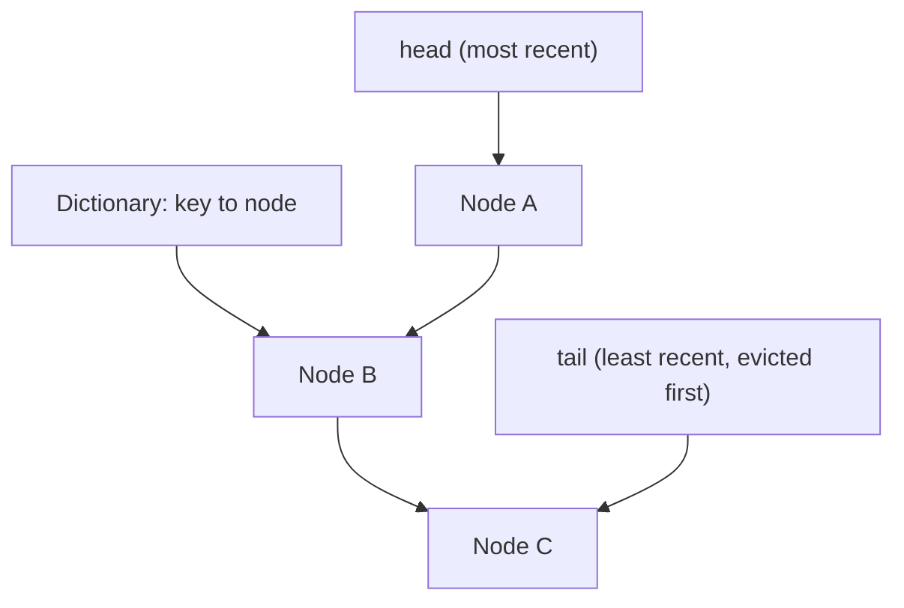

#### Implementation

```swift
final class LRUCache<Key: Hashable, Value> {
    private final class Node {
        let key: Key; var value: Value
        weak var prev: Node?; var next: Node?   // weak back-link avoids retain cycles
        init(key: Key, value: Value) { self.key = key; self.value = value }
    }
    private let capacity: Int
    private var map: [Key: Node] = [:]
    private var head: Node?   // most recent
    private var tail: Node?   // least recent

    init(capacity: Int) { precondition(capacity > 0); self.capacity = capacity }

    func get(_ key: Key) -> Value? {
        guard let node = map[key] else { return nil }
        moveToHead(node)
        return node.value
    }

    func set(_ value: Value, for key: Key) {
        if let node = map[key] { node.value = value; moveToHead(node); return }
        let node = Node(key: key, value: value)
        map[key] = node
        insertAtHead(node)
        if map.count > capacity, let lru = tail { remove(lru); map[lru.key] = nil }
    }

    private func insertAtHead(_ n: Node) {
        n.next = head; n.prev = nil
        head?.prev = n; head = n
        if tail == nil { tail = n }
    }
    private func remove(_ n: Node) {
        n.prev?.next = n.next; n.next?.prev = n.prev
        if head === n { head = n.next }
        if tail === n { tail = n.prev }
        n.prev = nil; n.next = nil
    }
    private func moveToHead(_ n: Node) { remove(n); insertAtHead(n) }
}
```

#### Walking through it

- **`get`**: look up the node in the map. Missing → `nil`. Found → move it to the head (it is now the most recently used) and return its value.
- **`set` for an existing key**: update the value and move it to the head.
- **`set` for a new key**: create a node, insert it at the head, add it to the map. If the map is now over capacity, the `tail` is the least recently used item: unlink it and remove it from the map. This is why each node stores its **key**: when you evict the tail you need its key to delete the dictionary entry.
- **Both operations are O(1)** time; space is O(capacity).

#### Memory: why `prev` is `weak`

Nodes are classes, so each link is a reference. If `next` and `prev` were both strong, A → B and B → A would keep each other alive forever, and evicted or deallocated nodes would leak. Making `prev` weak means each node is owned only by its predecessor's `next` (and the map / `head`). Interviewers like it when you point this out unprompted. An alternative is `unowned(unsafe)` or storing indices into an array, but `weak` is the clearest answer.

#### Thread safety

The class above is not thread-safe: two threads calling `set` could corrupt the list. Options:

```swift
// 1. Actor: callers must await, compiler enforces isolation
actor SafeLRUCache<Key: Hashable & Sendable, Value: Sendable> {
    private let storage: LRUCache<Key, Value>
    init(capacity: Int) { storage = LRUCache(capacity: capacity) }
    func get(_ key: Key) -> Value? { storage.get(key) }
    func set(_ value: Value, for key: Key) { storage.set(value, for: key) }
}

// 2. Lock: keeps a synchronous API (useful from non-async code)
// let lock = NSLock(); lock.withLock { cache.set(v, for: k) }
```

Note that even `get` mutates (it reorders the list), so a reader/writer lock with concurrent reads does **not** work here; every operation needs exclusive access.

**Common pitfalls:**
- Forgetting to store the key in the node, so you can't remove the evicted entry from the map.
- Forgetting to update `head`/`tail` when removing the first or last node.
- Not handling `capacity` of 0 (the `precondition` guards this).
- Treating `get` as read-only when adding concurrency.

**Likely follow-ups:**
- *Why not just use `NSCache`?* `NSCache` evicts by its own policy (cost, memory pressure) and doesn't guarantee LRU order; use it for memory-pressure-aware caches, a custom LRU when you need exact behaviour.
- *How would you add expiry (TTL)?* Store a timestamp per node and treat expired entries as misses in `get`.
- *Can you avoid classes?* Yes: store nodes in an array and use integer indices for `prev`/`next`, which avoids ARC overhead.

</details>

### 2. Implement a debounced search.

<details>
<summary>Answer</summary>

**In short:** each keystroke cancels the previous pending search and starts a new one that first waits ~300 ms. Only the search that survives the pause actually hits the network. With Swift Concurrency you keep a `Task` handle and cancel it (or use SwiftUI's `.task(id:)`); with Combine you use `debounce` + `removeDuplicates` + `switchToLatest`.

#### Why debounce

Without it, typing "iphone" fires six requests ("i", "ip", "iph"...). That wastes bandwidth and server capacity, and, worse, responses can arrive **out of order**: the result for "iph" might land after "iphone" and overwrite the correct results. Debouncing solves the volume problem; cancelling the previous request solves the ordering problem. You need both.

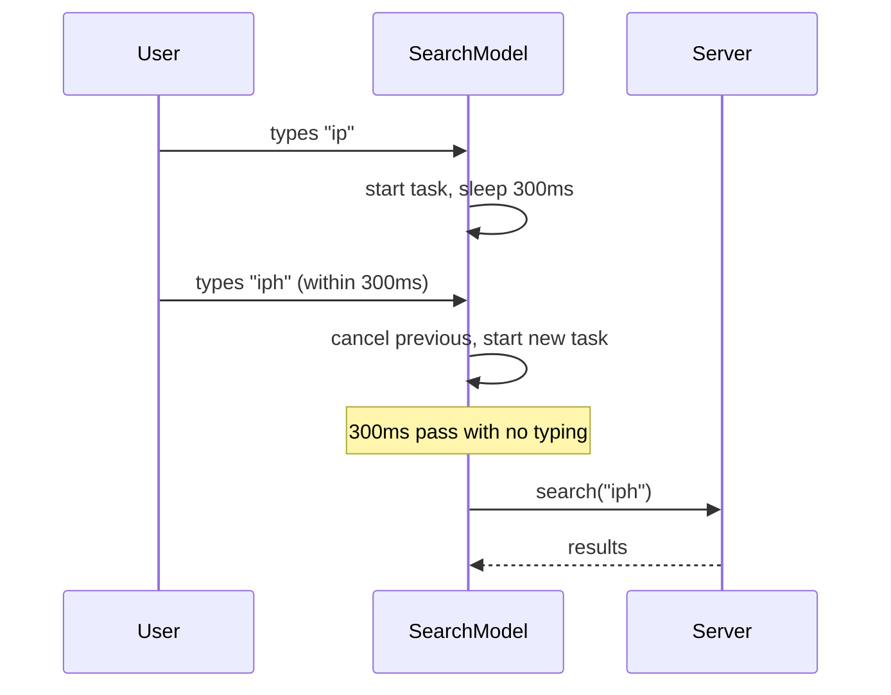

#### Swift Concurrency (SwiftUI)

```swift
@MainActor @Observable
final class SearchModel {
    var query = "" { didSet { scheduleSearch() } }
    private(set) var results: [Item] = []
    private var searchTask: Task<Void, Never>?
    private let service: SearchService
    init(service: SearchService) { self.service = service }

    private func scheduleSearch() {
        searchTask?.cancel()
        let q = query
        searchTask = Task {
            try? await Task.sleep(for: .milliseconds(300))   // debounce window
            guard !Task.isCancelled, !q.isEmpty else { return }
            do {
                let found = try await service.search(q)
                guard !Task.isCancelled else { return }       // a newer query won
                results = found
            } catch {
                // ignore CancellationError; surface other errors as state
            }
        }
    }
}
```

How it works:
1. `didSet` on `query` runs on every keystroke and calls `scheduleSearch()`.
2. The previous task is cancelled. `Task.sleep` throws when cancelled, so a cancelled task wakes immediately and exits at the `guard`.
3. The query is captured into `q` before the task starts, so the task searches for the text as it was when it was scheduled.
4. The second `isCancelled` check after the network call stops a stale response from overwriting newer results. If `service.search` uses `URLSession`'s async APIs, cancellation also cancels the HTTP request itself.
5. Because the class is `@MainActor`, the `Task { }` inherits main-actor isolation, so assigning `results` is safe for the UI.

**SwiftUI shortcut:** `.task(id:)` restarts its task whenever the id changes and cancels the old one automatically, so the view can do the debounce for you:

```swift
.task(id: model.query) {
    try? await Task.sleep(for: .milliseconds(300))
    guard !Task.isCancelled else { return }
    await model.search()
}
```

#### Combine

```swift
$query
    .debounce(for: .milliseconds(300), scheduler: RunLoop.main) // wait for a pause
    .removeDuplicates()                                         // "ab" -> "abc" -> "ab" won't refetch
    .map { [service] q in service.searchPublisher(q) }          // publisher of publishers
    .switchToLatest()                                           // cancel the old inner request
    .receive(on: RunLoop.main)
    .assign(to: &$results)
```

`switchToLatest` is the key operator: it subscribes only to the most recent inner publisher and cancels the previous one, which is the Combine equivalent of `searchTask?.cancel()`. In a real pipeline the inner publisher should catch its own errors (`.catch { _ in Just([]) }`), otherwise one failed request terminates the whole stream.

**Common pitfalls:**
- Debouncing but not cancelling in-flight requests, so out-of-order responses show wrong results.
- Letting an error terminate a Combine chain forever.
- Searching on an empty or whitespace-only query.
- Using `throttle` instead of `debounce`: throttle fires periodically *while* typing; debounce fires once *after* typing stops.

**Likely follow-ups:**
- *How do you unit test it?* Inject a clock (or the delay) so tests don't really wait 300 ms, and use a fake service that records calls.
- *Where should the delay live?* In the view model, so it's testable and shared across UIKit and SwiftUI.

</details>

### 3. Fetch multiple APIs in parallel and combine the results.

<details>
<summary>Answer</summary>

**In short:** for a fixed number of requests use `async let`: each one starts immediately and runs concurrently, and you `await` them together. For a dynamic number use `withThrowingTaskGroup`. Both are **structured concurrency**: if one throws, the others are cancelled automatically. Decide per request whether a failure should fail the whole screen or be tolerated.

#### Fixed number of requests: `async let`

```swift
func loadDashboard() async throws -> Dashboard {
    async let profile = api.profile()          // starts now
    async let orders = api.orders()            // starts now, in parallel
    async let offers = try? api.offers()       // optional: failure tolerated
    // Suspend until all three are done
    return try await Dashboard(profile: profile, orders: orders, offers: offers ?? [])
}
```

What happens:
1. Each `async let` creates a **child task** that starts running straight away. Nothing waits yet.
2. The `await` on the last line suspends until each value is ready. Total time ≈ the slowest request, not the sum.
3. If `profile` throws, the error propagates out of the function and Swift **cancels** the other child tasks. You never leak work.
4. `offers` uses `try?`, so its failure becomes `nil` and the dashboard still loads. This is a product decision: required data throws, optional data degrades.

Compare with the sequential version, which is a common mistake:

```swift
// ❌ Sequential: total time = sum of all three
let profile = try await api.profile()
let orders = try await api.orders()
let offers = try await api.offers()
```

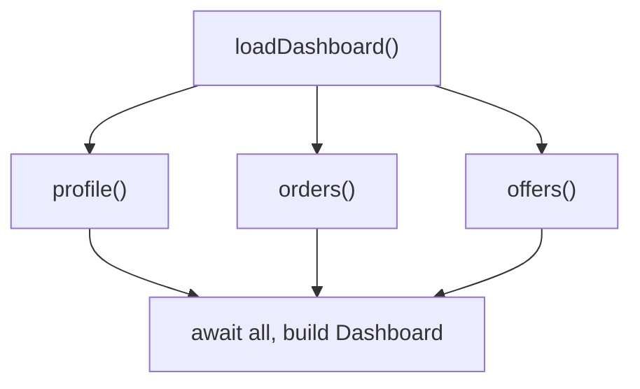

#### Dynamic number of requests: task group

```swift
func loadThumbnails(ids: [Photo.ID]) async throws -> [Photo.ID: UIImage] {
    try await withThrowingTaskGroup(of: (Photo.ID, UIImage).self) { group in
        var result: [Photo.ID: UIImage] = [:]
        let maxConcurrent = 4
        var iterator = ids.makeIterator()

        // Start the first batch
        for _ in 0..<maxConcurrent {
            guard let id = iterator.next() else { break }
            group.addTask { (id, try await self.api.thumbnail(id)) }
        }
        // Each time one finishes, start the next: at most 4 in flight
        while let (id, image) = try await group.next() {
            result[id] = image
            if let nextID = iterator.next() {
                group.addTask { (nextID, try await self.api.thumbnail(nextID)) }
            }
        }
        return result
    }
}
```

Results arrive in **completion order**, not request order, which is why each task returns its id with its value. Limiting concurrency matters: firing 500 requests at once floods the connection pool and the server.

| Tool | Use when | Error behaviour |
|---|---|---|
| `async let` | Fixed, known set of calls, different result types | First thrown error cancels siblings when it propagates |
| `withThrowingTaskGroup` | Variable count, same result type | Throwing out of the group cancels remaining tasks |
| `withTaskGroup` + `Result` | You want every result, including failures | Nothing cancels; you inspect each `Result` |
| Combine `Zip` / `CombineLatest` | Existing Combine code | Any failure ends the stream |

**Common pitfalls:**
- Awaiting each call on its own line (sequential, not parallel).
- Using unstructured `Task { }` per request: no automatic cancellation and easy to leak.
- Mutating shared state from inside `addTask` closures instead of returning values.

**Likely follow-ups:**
- *What if the user leaves the screen?* If the work runs in SwiftUI's `.task`, the parent task is cancelled and that cancellation propagates to all children.
- *What about a timeout?* Race the work against `Task.sleep` in a task group and cancel the loser.

</details>

### 4. Write a thread-safe counter / cache using an actor.

<details>
<summary>Answer</summary>

**In short:** an `actor` protects its mutable state by running only one piece of its code at a time, so `value += 1` can't race. Callers outside the actor must `await`. If you need a synchronous API, use a lock (`NSLock`, `OSAllocatedUnfairLock`, or `Mutex` from the Synchronization module) and mark the class `@unchecked Sendable`, promising the compiler you did the synchronisation yourself.

#### The problem

`value += 1` is three steps: read, add, write. Two threads can both read 5, both write 6, and one increment is lost. This is a **data race**, and it's undefined behaviour in Swift (Thread Sanitizer will flag it).

#### Actor version

```swift
actor Counter {
    private(set) var value = 0
    func increment() -> Int { value += 1; return value }
}

let counter = Counter()
await withTaskGroup(of: Void.self) { group in
    for _ in 0..<1_000 { group.addTask { _ = await counter.increment() } }
}
print(await counter.value)   // always 1000
```

An actor has a serial **executor**: calls queue up and run one at a time. From outside, every call is `async` because you might have to wait your turn. Inside the actor, code is synchronous and can touch `value` freely.

#### Actor cache, and the re-entrancy trap

```swift
actor ImageCache {
    private var images: [URL: UIImage] = [:]
    private var inFlight: [URL: Task<UIImage, Error>] = [:]

    func image(for url: URL) async throws -> UIImage {
        if let cached = images[url] { return cached }
        if let task = inFlight[url] { return try await task.value }   // join existing request

        let task = Task { try await download(url) }
        inFlight[url] = task                     // record BEFORE suspending
        defer { inFlight[url] = nil }
        let image = try await task.value         // suspension point: other calls may run here
        images[url] = image
        return image
    }
}
```

Actors are **re-entrant**: at every `await` inside the actor, other calls can run. If you checked the cache, then awaited a download, a second caller could start a duplicate download in between. Storing the in-flight `Task` *before* the `await` fixes that. Always re-check assumptions after an `await` inside an actor.

#### Lock version (synchronous API)

```swift
final class AtomicCounter: @unchecked Sendable {
    private let lock = NSLock()
    private var value = 0
    func increment() -> Int { lock.withLock { value += 1; return value } }
}
```

`@unchecked Sendable` tells the compiler "trust me, this is safe to share across threads". The compiler can no longer check it, so every access to `value` must go through the lock.

| Approach | API | Pros | Cons |
|---|---|---|---|
| `actor` | `async` | Compiler-checked, no deadlocks from forgetting to unlock | Callers must `await`; re-entrancy surprises |
| `NSLock` / `OSAllocatedUnfairLock` / `Mutex` | sync | Usable from any code, very fast for tiny critical sections | You must remember to lock; deadlock risk if nested |
| Serial `DispatchQueue` | sync or async | Familiar in older code | More overhead; `sync` from the same queue deadlocks |

**Common pitfalls:**
- Holding a lock across an `await` (don't: the task may resume on another thread).
- Assuming state is unchanged after an `await` inside an actor.
- Marking a class `@unchecked Sendable` without actually protecting its state.

**Likely follow-ups:**
- *Is `value += 1` on a `@MainActor` class safe?* Yes, as long as all access is on the main actor; the compiler enforces it.
- *Why not `DispatchQueue.concurrent` with a barrier?* It works for many-readers/one-writer, but for a counter every operation writes, so a plain lock is simpler.

</details>

### 5. Convert a completion-handler API to async/await.

<details>
<summary>Answer</summary>

**In short:** wrap the callback API in `withCheckedThrowingContinuation` (or `withCheckedContinuation` if it can't fail). The async function suspends until the callback fires, and the callback calls `continuation.resume(returning:)` or `resume(throwing:)` **exactly once**. See [Swift Concurrency Q15](05-swift-concurrency.md).

#### The pattern

```swift
// Existing API
func fetchUser(id: String, completion: @escaping (Result<User, Error>) -> Void)

// Async wrapper
func fetchUser(id: String) async throws -> User {
    try await withCheckedThrowingContinuation { continuation in
        fetchUser(id: id) { result in
            continuation.resume(with: result)    // Result maps straight to returning/throwing
        }
    }
}
```

For the classic `(Data?, Error?)` shape, handle every branch so you always resume:

```swift
func loadData(from url: URL) async throws -> Data {
    try await withCheckedThrowingContinuation { continuation in
        legacyClient.load(url) { data, error in
            if let error {
                continuation.resume(throwing: error)
            } else if let data {
                continuation.resume(returning: data)
            } else {
                continuation.resume(throwing: URLError(.badServerResponse))  // don't forget this path
            }
        }
    }
}
```

#### How it works

1. `withChecked...Continuation` suspends the current task and gives you a `continuation` object.
2. You start the old API inside the closure. The task stays suspended (not blocking a thread).
3. When the callback fires, on any thread, `resume` schedules the task to continue with the value or error.

#### The "exactly once" rule

| Mistake | What happens |
|---|---|
| Never resuming (a missed branch, or the callback is never called) | The task hangs forever. Checked continuations log a warning when the continuation is deallocated without being resumed. |
| Resuming twice | Checked continuation: crash with a clear message. Unsafe continuation: undefined behaviour. |

`withCheckedContinuation` does these runtime checks; `withUnsafeContinuation` skips them for a tiny performance gain. Use the checked version unless profiling says otherwise.

#### Cancellation and streams

- A continuation doesn't know about task cancellation. If the old API is cancellable, use `withTaskCancellationHandler` to call its `cancel()` when the task is cancelled.
- If the callback fires **many times** (progress updates, location updates, delegate events), a continuation is the wrong tool. Use `AsyncStream` / `AsyncThrowingStream` and `yield` each value.

**Common pitfalls:**
- A code path (e.g. `guard ... else { return }`) inside the callback that returns without resuming.
- Wrapping a delegate-based API and storing the continuation, then a second delegate call resumes it again. Set the stored continuation to `nil` after resuming.

**Likely follow-ups:**
- *Does Swift do this for you?* Objective-C methods with a completion handler are imported automatically as `async` versions, so check before writing a wrapper.
- *Which thread does the code after `await` run on?* Whatever the caller's isolation is (e.g. the main actor), not the callback's thread.

</details>

### 6. Implement a generic network request function with retry.

<details>
<summary>Answer</summary>

**In short:** write a generic `withRetry` that runs an `async throws` operation, catches only **transient** errors, waits with **exponential backoff** (plus jitter) between attempts, and rethrows once attempts run out. Respect cancellation, and only retry requests that are safe to repeat (idempotent).

#### A generic retry helper

```swift
func withRetry<T>(maxAttempts: Int = 3, initialDelay: Duration = .milliseconds(500),
                  _ operation: () async throws -> T) async throws -> T {
    var delay = initialDelay
    for attempt in 1...maxAttempts {
        do { return try await operation() }
        catch let error as URLError where attempt < maxAttempts && error.code != .cancelled {
            try await Task.sleep(for: delay)
            delay *= 2                                     // exponential backoff
        }
    }
    fatalError("unreachable")
}
```

How the control flow works:
- The `do` returns on the first success.
- The `catch` only matches when the error is a `URLError`, it's **not** the last attempt, and it isn't a cancellation. Any other error (or the last failure) doesn't match, so it propagates out of the function. That's why the final `fatalError` really is unreachable.
- `Task.sleep` throws `CancellationError` if the task is cancelled, so a user leaving the screen stops the retry loop immediately.

#### A generic request function using it

```swift
struct APIClient {
    let session: URLSession
    let decoder = JSONDecoder()

    func send<T: Decodable>(_ request: URLRequest, as type: T.Type = T.self) async throws -> T {
        try await withRetry {
            let (data, response) = try await session.data(for: request)
            guard let http = response as? HTTPURLResponse else { throw URLError(.badServerResponse) }
            switch http.statusCode {
            case 200..<300: return try decoder.decode(T.self, from: data)
            case 500..<600, 429: throw URLError(.badServerResponse)   // transient: retry
            default: throw APIError.http(http.statusCode)              // 4xx: don't retry
            }
        }
    }
}
enum APIError: Error { case http(Int) }
```

Generics let one function decode any `Decodable` type; the caller writes `let user: User = try await client.send(request)`.

#### Which errors to retry

| Retry | Don't retry |
|---|---|
| Timeouts, connection lost, DNS hiccups | 400 Bad Request, 401/403 (refresh the token instead), 404 |
| 5xx server errors | Decoding errors (retrying gets the same bad JSON) |
| 429 Too Many Requests (honour `Retry-After`) | Cancellation |

#### Backoff and jitter

Exponential backoff (500 ms, 1 s, 2 s...) gives a struggling server time to recover. **Jitter** (a random component) stops thousands of clients that failed at the same moment from retrying in lock-step and hammering the server again:

```swift
let jittered = delay * Double.random(in: 0.5...1.5)
try await Task.sleep(for: jittered)
```

**Common pitfalls:**
- Retrying a non-idempotent `POST` (e.g. "place order") without an idempotency key: you can create duplicates.
- Retrying forever, or retrying 4xx errors that will never succeed.
- Swallowing `CancellationError` and continuing to retry.
- Retrying when the device is offline; better to wait for connectivity (`NWPathMonitor`) or let `URLSessionConfiguration.waitsForConnectivity` handle it.

**Likely follow-ups:**
- *Where should retry live?* In the networking layer, configurable per request, not scattered across view models.
- *How do you test it?* Inject a fake operation that fails N times, and make the delay injectable so the test runs instantly.

</details>

### 7. Build a reusable image view that loads from a URL with caching (UIKit).

<details>
<summary>Answer</summary>

**In short:** a `UIImageView` subclass that keeps a handle to its current loading task, cancels it when a new URL is set or the cell is reused, shows a placeholder, and asks a shared `ImageLoader` for the image. The loader is an actor with an in-memory `NSCache`, in-flight request deduplication, optional disk cache, and decoding/downsampling off the main thread.

#### The view

```swift
final class RemoteImageView: UIImageView {
    private var task: Task<Void, Never>?
    func setImage(url: URL, placeholder: UIImage? = nil) {
        task?.cancel()
        image = placeholder
        task = Task { [weak self] in
            guard let image = try? await ImageLoader.shared.image(for: url),
                  !Task.isCancelled else { return }
            self?.image = image
        }
    }
    func cancel() { task?.cancel() }   // call from prepareForReuse
}
```

Why each line matters:
- **`task?.cancel()` first**: in a table or collection view, cells are reused. Without cancelling, a slow request for row 3 could finish after the cell now shows row 40 and put the wrong image on screen.
- **Placeholder immediately**: clears the previous row's image so the user never sees a stale picture.
- **`!Task.isCancelled` check**: even if the download completes, a cancelled task must not set the image.
- **`[weak self]`**: the view may be deallocated while the download is in flight.
- `UIImageView` is `@MainActor`, so the `Task` inherits main-actor isolation and setting `self?.image` is safe.

```swift
override func prepareForReuse() {
    super.prepareForReuse()
    imageView.cancel()
    imageView.image = nil
}
```

#### The loader

```swift
actor ImageLoader {
    static let shared = ImageLoader()
    private let cache = NSCache<NSURL, UIImage>()
    private var inFlight: [URL: Task<UIImage, Error>] = [:]

    init() { cache.totalCostLimit = 50 * 1024 * 1024 }   // ~50 MB of decoded pixels

    func image(for url: URL) async throws -> UIImage {
        if let cached = cache.object(forKey: url as NSURL) { return cached }
        if let existing = inFlight[url] { return try await existing.value }   // dedupe

        let task = Task.detached(priority: .userInitiated) { () throws -> UIImage in
            let (data, _) = try await URLSession.shared.data(from: url)
            guard let image = UIImage(data: data)?.preparingForDisplay() else {   // decode off main
                throw URLError(.cannotDecodeContentData)
            }
            return image
        }
        inFlight[url] = task
        defer { inFlight[url] = nil }

        let image = try await task.value
        let cost = Int(image.size.width * image.size.height * image.scale * image.scale * 4)
        cache.setObject(image, forKey: url as NSURL, cost: cost)
        return image
    }
}
```

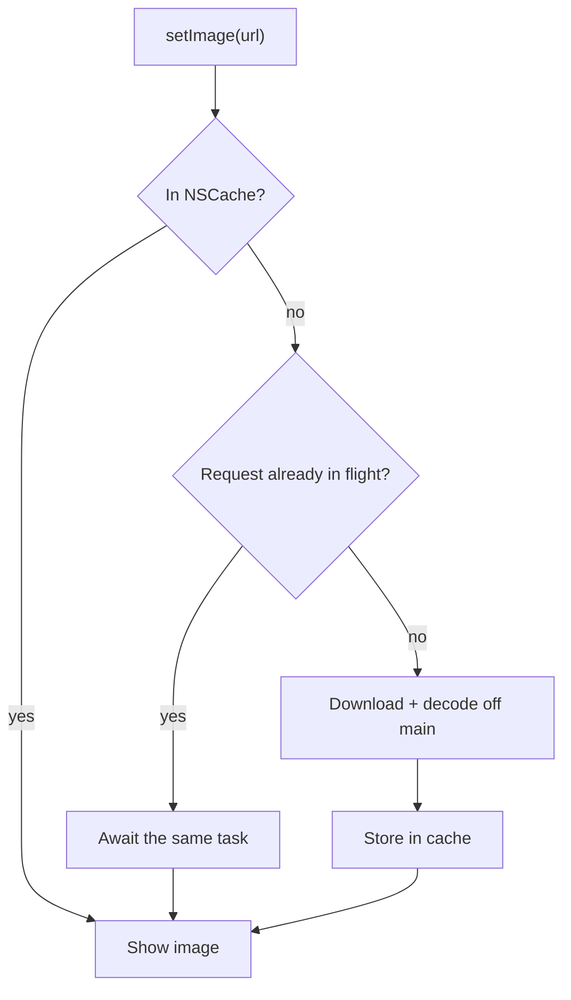

Design points to mention (see [System Design Q2](20-system-design.md) for the full design):
- **`NSCache`** evicts automatically under memory pressure and is thread-safe. Use the **decoded size** as cost; a 200 KB JPEG can be 12 MB of pixels.
- **Decoding**: `UIImage(data:)` is lazy, so the expensive decode would otherwise happen on the main thread at first draw. `preparingForDisplay()` (iOS 15+) forces it in the background.
- **Downsampling**: for thumbnails, use ImageIO (`CGImageSourceCreateThumbnailAtIndex`) to decode straight to the display size, saving lots of memory.
- **Disk cache**: `URLCache` respects HTTP caching headers; a custom file cache gives you control over size and expiry.
- **Cancellation subtlety**: with deduplication, cancelling one view's task shouldn't cancel the shared download that another view is waiting on. Here the view cancels its own `Task`, which only stops *it* from setting the image; the detached download keeps going and fills the cache.

**Common pitfalls:**
- Not cancelling on reuse, causing flickering or wrong images.
- Caching undecoded images or ignoring cost, then getting memory warnings.
- Setting the image from a background thread.

**Likely follow-ups:**
- *Would you use a library?* In production, often (Kingfisher, Nuke, SDWebImage), but you should be able to explain what they do.
- *SwiftUI?* `AsyncImage` exists but doesn't cache beyond `URLCache`; a custom view backed by the same loader is common.

</details>

### 8. Common Swift output questions.

<details>
<summary>Answer</summary>

**In short:** these questions test whether you understand a handful of core rules: **value vs reference semantics**, **closure capture** (capture lists copy, plain captures share the variable), **lazy evaluation**, **`defer` order**, and **when queued work actually runs**. Read the code slowly, say which rule applies, then give the output.

#### 1. Value vs reference types

```swift
struct Point { var x = 0 }
var a = Point(); var b = a; b.x = 5
print(a.x)                 // 0 – value type copied

class Box { var x = 0 }
let c = Box(); let d = c; d.x = 5
print(c.x)                 // 5 – shared reference
```

Assigning a struct copies it, so `b` is independent. Assigning a class instance copies the **reference**, so `c` and `d` point at the same object. Note `let c` doesn't stop mutating `c.x`: `let` makes the *reference* constant, not the object.

#### 2. Closure capture

```swift
var counter = 0
let closure = { [counter] in print(counter) }
counter = 10
closure()                  // 0 – captured value at creation (capture list)
let closure2 = { print(counter) }
counter = 20
closure2()                 // 20 – captured by reference
```

A **capture list** (`[counter]`) copies the value when the closure is created. Without it, the closure captures the **variable itself**, so it sees later changes. This is also why `[weak self]` is written in a capture list: it decides how `self` is captured at creation time.

#### 3. Lazy sequences

```swift
let arr = [1, 2, 3].lazy.map { n -> Int in print("map \(n)"); return n * 2 }
print(arr.first!)          // "map 1" then 2 – lazy evaluation
```

Without `.lazy`, `map` runs immediately and prints "map 1", "map 2", "map 3". With `.lazy`, the transform runs only when an element is accessed, and only for that element. Gotcha: accessing the same element twice runs the closure twice; lazy results aren't cached.

#### 4. Main queue ordering

```swift
DispatchQueue.main.async { print("A") }
print("B")
// B, A  (when run on main thread)
```

`async` only **enqueues** the block. The main thread is busy running the current code, so "B" prints first; "A" runs on a later turn of the run loop. With `DispatchQueue.main.sync` called from the main thread, it would **deadlock**.

#### 5. `defer` order

```swift
func test() {
    defer { print("1") }
    defer { print("2") }
    print("3")
}
test()   // 3, 2, 1 – defers run in reverse order when the scope exits
```

#### 6. Array of structs vs classes

```swift
var points = [Point(x: 1)]
var first = points[0]
first.x = 99
print(points[0].x)         // 1 – `first` is a copy

points[0].x = 99           // mutates in place
print(points[0].x)         // 99
```

#### 7. `Task` ordering

```swift
@MainActor func run() {
    Task { print("A") }    // inherits main actor; runs after the current code finishes
    print("B")
}
// B, A
```

| Rule | Quick test |
|---|---|
| Structs/enums copy on assignment | Changing the copy never affects the original |
| Classes share | Any reference can change the object |
| Capture list copies the value | `[x]` freezes `x` at creation |
| Plain capture shares the variable | Sees later changes |
| `async` enqueues | Code after it runs first |

**Common pitfalls:**
- Saying `let` makes a class instance immutable.
- Assuming `DispatchQueue.global().async` blocks run in a predictable order relative to the caller (they don't; never answer with a guaranteed order there).

</details>

### 9. Find the bug in this code.

<details>
<summary>Answer</summary>

**In short:** this snippet has four classic bugs: a **retain cycle** through the view model's closure, a **UI update off the main thread**, a **force unwrap** that crashes on network failure, and a **Timer that retains its target** so the screen never deallocates. Fix them with `[weak self]`, hopping to the main actor, proper error handling, and a block-based timer invalidated when the screen goes away.

#### The buggy code

```swift
class ProfileViewController: UIViewController {
    var viewModel = ProfileViewModel()
    override func viewDidLoad() {
        super.viewDidLoad()
        viewModel.onUpdate = { self.nameLabel.text = self.viewModel.name }   // ❌ 1
        URLSession.shared.dataTask(with: url) { data, _, _ in
            self.nameLabel.text = String(data: data!, encoding: .utf8)          // ❌ 2, 3
        }.resume()
        timer = Timer.scheduledTimer(timeInterval: 1, target: self,
                                     selector: #selector(tick), userInfo: nil, repeats: true)  // ❌ 4
    }
}
```

#### What's wrong

1. **Retain cycle**: the VC owns the view model, which owns the closure, which captures the VC strongly. Use `[weak self]`.
2. **UI updated off the main thread**: the URLSession callback runs on a background queue. UIKit is not thread-safe; this can cause glitches, crashes, and Main Thread Checker warnings.
3. **Force unwrapping** `data!` crashes on a network error (`data` is `nil` when the request fails).
4. The **Timer retains its target**, so the VC is never deallocated. Use the block-based API with `[weak self]` and invalidate the timer.

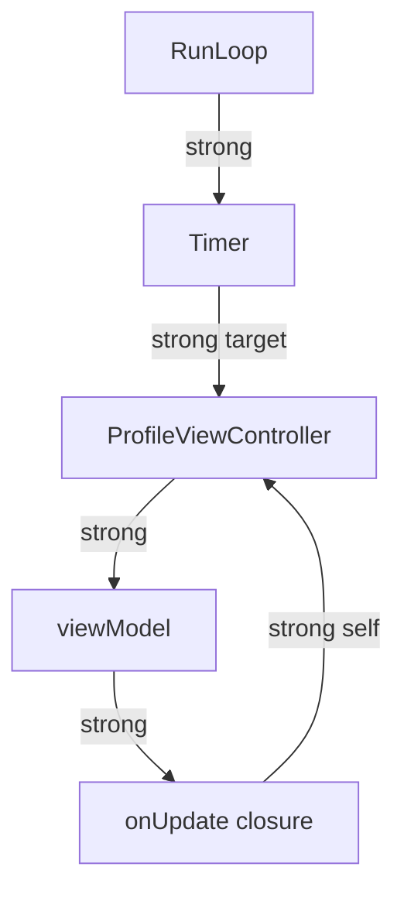

The timer cycle is sneaky: even if the VC doesn't hold the timer strongly, the **run loop** retains a scheduled repeating timer, and the timer retains its target. So the VC lives forever and `deinit` never runs, meaning invalidating in `deinit` doesn't help.

#### Fixed version

```swift
final class ProfileViewController: UIViewController {
    private let viewModel = ProfileViewModel()
    private var timer: Timer?
    private var loadTask: Task<Void, Never>?

    override func viewDidLoad() {
        super.viewDidLoad()

        viewModel.onUpdate = { [weak self] in                      // 1. break the cycle
            guard let self else { return }
            nameLabel.text = viewModel.name
        }

        loadTask = Task { [weak self] in                           // 2 + 3. main actor, no force unwrap
            do {
                let (data, _) = try await URLSession.shared.data(from: url)
                self?.nameLabel.text = String(decoding: data, as: UTF8.self)
            } catch {
                self?.showError(error)
            }
        }
    }

    override func viewWillAppear(_ animated: Bool) {
        super.viewWillAppear(animated)
        timer = Timer.scheduledTimer(withTimeInterval: 1, repeats: true) { [weak self] _ in  // 4.
            self?.tick()
        }
    }

    override func viewWillDisappear(_ animated: Bool) {
        super.viewWillDisappear(animated)
        timer?.invalidate()                                        // stop the run loop holding it
        timer = nil
        loadTask?.cancel()
    }
}
```

The `Task` created inside a `UIViewController` method inherits `@MainActor`, so assigning to the label after `await` is on the main thread. With the old callback API you'd write `DispatchQueue.main.async { ... }` inside the completion handler instead.

#### How to spot these in an interview

Walk the code with a checklist: **ownership** (who holds whom, any closures stored on owned objects?), **threading** (which queue does each callback run on?), **failure paths** (`!`, `try!`, missing `else`), **lifecycle** (timers, observers, tasks started but never stopped). Say each issue, why it matters, and the fix.

**Common pitfalls (in your answer):**
- Adding `[weak self]` everywhere without explaining *why*; e.g. `UIView.animate` closures don't need it because they aren't stored.
- Invalidating the timer only in `deinit`, which never runs because of the cycle.

**Likely follow-ups:**
- *How would you confirm the leak?* Xcode's Memory Graph Debugger, Instruments Leaks/Allocations, or a `deinit` print when popping the screen.
- *`weak` vs `unowned`?* `unowned` crashes if the object is gone; use it only when the closure can't outlive `self`.

</details>

### 10. Implement pagination in a view model.

<details>
<summary>Answer</summary>

**In short:** the view model holds the loaded `items`, a **cursor** (or page number) for the next page, `isLoading` and `hasMore` flags. When a row near the end of the list appears, it calls `loadNextPage()`, which is guarded so only one request runs at a time and nothing loads after the last page. New items are appended (de-duplicated), and errors become state the UI can retry from.

#### Implementation

```swift
@MainActor @Observable
final class FeedModel {
    private(set) var items: [Post] = []
    private(set) var isLoading = false
    private var cursor: String?
    private var hasMore = true
    private let api: FeedAPI
    init(api: FeedAPI) { self.api = api }

    func loadNextPageIfNeeded(current item: Post?) async {
        guard let item else { return await loadNextPage() }
        let thresholdIndex = items.index(items.endIndex, offsetBy: -5, limitedBy: items.startIndex) ?? 0
        if items.firstIndex(where: { $0.id == item.id }) == thresholdIndex { await loadNextPage() }
    }

    private func loadNextPage() async {
        guard !isLoading, hasMore else { return }
        isLoading = true; defer { isLoading = false }
        do {
            let page = try await api.feed(after: cursor)
            items += page.posts.filter { new in !items.contains { $0.id == new.id } }
            cursor = page.nextCursor
            hasMore = page.nextCursor != nil
        } catch { /* expose error state */ }
    }
}
// In the view: .task { await model.loadNextPageIfNeeded(current: post) } on each row
```

#### How it works

1. **Initial load**: the view calls `loadNextPageIfNeeded(current: nil)` once (e.g. in `.task` on the list), which loads the first page.
2. **Trigger**: each row's `.task` runs when the row appears. If that row is 5 from the end (the **threshold**), the next page loads *before* the user hits the bottom, so scrolling feels endless.
3. **Guards**: `isLoading` stops duplicate requests when several rows appear at once; `hasMore` stops requests after the last page. Because the class is `@MainActor`, these checks and updates can't race.
4. **Append**: new posts are filtered against existing ids. With offset-based APIs, items inserted at the top shift pages and you'd get duplicates; this protects against it.
5. **Cursor**: the server returns `nextCursor`; `nil` means there are no more pages.

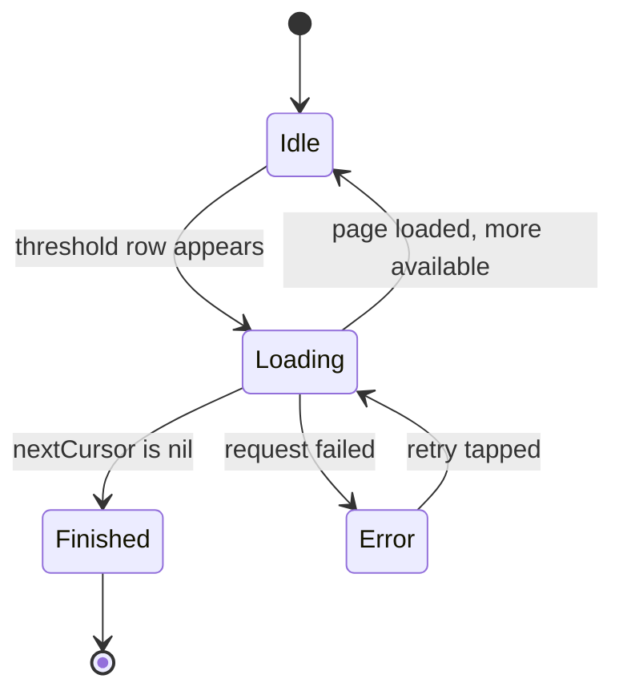

#### Cursor vs offset pagination

| | Offset (`?page=3&limit=20`) | Cursor (`?after=abc123`) |
|---|---|---|
| Simplicity | Very simple | Needs server support |
| New items inserted at top | Shifts pages: duplicates or skipped items | Stable |
| Jump to page N | Easy | Not possible |
| Typical use | Admin lists, search results | Feeds, chats, timelines |

#### UI side

```swift
List {
    ForEach(model.items) { post in
        PostRow(post: post)
            .task { await model.loadNextPageIfNeeded(current: post) }
    }
    if model.isLoading { ProgressView() }
}
.task { await model.loadNextPageIfNeeded(current: nil) }
.refreshable { await model.refresh() }   // reset cursor, items, hasMore
```

In UIKit, the equivalent trigger is `tableView(_:willDisplay:forRowAt:)` or `UITableViewDataSourcePrefetching`.

**Common pitfalls:**
- No `isLoading` guard, so fast scrolling fires the same page several times.
- `items.firstIndex(where:)` on every row is O(n); for very large lists, compare ids against a stored threshold id instead.
- Pull-to-refresh racing an in-flight "next page" request; cancel or ignore the old one when refreshing.
- Silently swallowing errors so the list just stops loading with no retry.

**Likely follow-ups:**
- *How would you add offline support?* Persist pages (SwiftData/Core Data) and show cached items first, then fetch.
- *How do you test it?* A fake `FeedAPI` returning scripted pages; assert items, `hasMore`, and that a second call during loading is ignored.

</details>

### 11. What DSA problems should you practice for iOS interviews?

<details>
<summary>Answer</summary>

**In short:** iOS interviews usually ask easy-to-medium problems built on a few patterns: hash maps, two pointers, sliding window, stacks, BFS/DFS, binary search, intervals, heaps/sorting, and linked lists, plus "practical" ones like an LRU cache or flattening nested arrays. Practise them **in Swift**, know their time/space complexity, and know Swift's quirks, especially `String` indexing.

#### Core problems by pattern

| Pattern | Problems to practise | Key Swift tool | Typical complexity |
|---|---|---|---|
| Hash map | Two-sum, group anagrams, first unique character | `Dictionary`, `Set`, `Dictionary(grouping:by:)` | O(n) |
| Stack | Valid parentheses, min stack, evaluate expression | `Array` with `append` / `popLast` | O(n) |
| Two pointers | Merge sorted arrays, reverse string, container with most water | Indices on `Array` | O(n) |
| Sliding window | Longest substring without repeats, max sum subarray of size k | Convert string to `Array(s)` first | O(n) |
| Binary search | Search in sorted / rotated array, first bad version | `while lo <= hi` | O(log n) |
| BFS / DFS | Number of islands, shortest path in grid, tree level order | `[[Character]]`, a queue | O(rows × cols) |
| Intervals | Merge intervals, meeting rooms | `sorted(by:)` | O(n log n) |
| Top-K | Top-K frequent elements | Sort by count, or a heap (no built-in heap in the standard library) | O(n log n) |
| Linked list | Reverse, detect cycle, merge two lists | `class ListNode` | O(n) |
| Design | LRU cache, rate limiter, debounce | Dictionary + linked list | O(1) per op |
| Recursion | Flatten nested arrays, permutations | `indirect enum` or `[Any]` | O(n) |

#### Swift specifics that trip people up

```swift
let s = "héllo"
// s[1]                         // ❌ won't compile: String isn't integer-indexed
let i = s.index(s.startIndex, offsetBy: 1)
print(s[i])                     // "é" – a Character (a grapheme cluster)

let chars = Array(s)            // ✅ O(1) random access for window/two-pointer problems
print(chars[1])                 // "é"

print("🇮🇳".count)               // 1 Character, though it's several Unicode scalars
```

- `String.count` is O(n) because characters are variable-width grapheme clusters. Convert to `[Character]` once for index-heavy algorithms.
- `Character` is not `String`; `Character("a").asciiValue` gives a `UInt8?`.
- Value semantics: passing arrays into recursive functions copies on write; use `inout` for in-place algorithms.
- No built-in `Queue` or `Heap` in the standard library (swift-collections has `Deque` and `Heap`, but you can't always import packages in an interview). `removeFirst()` on an `Array` is O(n); for BFS, use an index pointer into the array instead.

#### Example: two-sum, the hash-map pattern

```swift
func twoSum(_ nums: [Int], _ target: Int) -> (Int, Int)? {
    var seen: [Int: Int] = [:]                 // value -> index
    for (i, n) in nums.enumerated() {
        if let j = seen[target - n] { return (j, i) }
        seen[n] = i
    }
    return nil
}
```

O(n) time, O(n) space, versus O(n²) for the nested-loop brute force.

#### How to approach the round

1. Repeat the problem and ask about edge cases (empty input, duplicates, negatives, Unicode).
2. State a brute force and its complexity, then improve it.
3. Code clearly with good names; talk while you type.
4. Walk through a small example by hand and test edge cases.

**Likely follow-ups:**
- *Can you do it in O(1) extra space?* Often a two-pointer or in-place answer exists for sorted input.
- *What's the complexity of `Set.contains`?* O(1) on average, which is why hashing is the first tool to reach for.

</details>

---

## Scenario / Debugging Questions

### 12. Users report the app is slow to launch. How do you investigate?

<details>
<summary>Answer</summary>

**In short:** measure first (Xcode Organizer, MetricKit, Instruments' App Launch template on an older device), then split the time into **pre-main** (dyld loading frameworks, static initializers) and **post-main** (`didFinishLaunching` and building the first screen). Fix the biggest costs: defer SDK setup, cut dynamic frameworks, move I/O and network off the launch path, and show cached content fast. Then guard it with a launch-time test in CI.

#### What "launch" actually includes

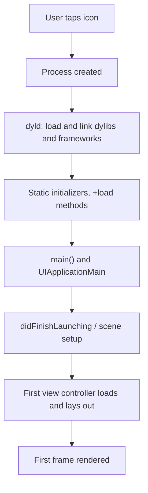

Steps C–D are **pre-main**; E–H are **post-main**. A **cold launch** (app not in memory, e.g. after reboot) is the worst case and the one to optimise; a **warm launch** reuses cached data; **resume** from background isn't a launch at all.

#### Step by step

1. **Measure real users first.** Xcode Organizer shows launch-time percentiles per app version and device class. **MetricKit** (`MXAppLaunchMetric`) gives the same data inside your app. This tells you whether the problem is real, how big it is, and when it started (which release).
2. **Reproduce locally** on an **older device** with a **release build** (debug builds are slower and misleading). Use the **App Launch** template in Instruments: it shows the process lifecycle phases plus a time profile of the main thread.
3. **Check pre-main:**
   - Many **dynamic frameworks** (each one must be loaded and linked by dyld). Merge them or link statically; Xcode's mergeable libraries help here.
   - **Static initializers** and Objective-C `+load` methods run before `main`. Move that work to `+initialize` or lazy code.
4. **Check post-main** (usually where the time goes):
   - Analytics, crash, ads and feature-flag **SDKs initialised synchronously** in `didFinishLaunching`.
   - **Synchronous I/O**: reading big files, opening a large database, decoding JSON on the main thread.
   - **Network calls the UI waits on** before showing anything.
   - A **heavy first screen**: large storyboards, complex Auto Layout, big images.
5. **Fix:**
   - Initialise only what the first frame needs; defer the rest until after first frame (or lazily on first use).
   - Show **cached data** immediately and refresh in the background.
   - Move work off the main thread, but don't just push it to a background thread that the main thread then waits on.
6. **Verify and protect:** a performance test with `XCTApplicationLaunchMetric` in CI catches regressions before release, and Organizer / MetricKit confirms the improvement in production.

```swift
func testLaunchPerformance() {
    measure(metrics: [XCTApplicationLaunchMetric()]) {
        XCUIApplication().launch()
    }
}
```

#### Typical findings and fixes

| Finding | Fix |
|---|---|
| 40 dynamic frameworks | Static linking / mergeable libraries |
| 6 SDKs set up in `didFinishLaunching` | Defer non-critical SDKs until after first frame |
| Core Data store migration on launch | Show UI first; migrate with progress, or migrate lazily |
| First screen waits for API | Render cached / placeholder content, then update |
| Huge storyboard | Split it, or build the first screen in code / SwiftUI |

**Common pitfalls:**
- Profiling a debug build or the simulator.
- Optimising warm launch while users suffer cold launches.
- Moving work to a background queue and then blocking the main thread waiting for it.

**Likely follow-ups:**
- *What's a good target?* Apple recommends the first frame within about 400 ms.
- *What happens if launch is extremely slow?* The system watchdog terminates apps that take too long to launch (crash reports show exception code `0x8badf00d`).

</details>

### 13. The app crashes only in production and you can't reproduce it. What do you do?

<details>
<summary>Answer</summary>

**In short:** treat it as detective work. Start from the **symbolicated crash reports** (Xcode Organizer, Crashlytics): the exception type, crashing thread and stack, and which app versions, OS versions and devices are affected. Look for patterns, form hypotheses, add **breadcrumbs/logging** to confirm them, try to reproduce under the same conditions (sanitizers, low-end device, bad network, background launch), then ship a fix with a regression test through a **phased release** and watch the crash rate.

#### Step by step

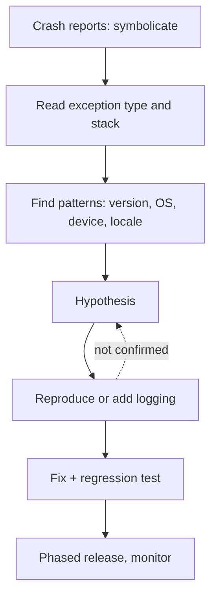

1. **Get readable stacks.** Make sure dSYMs are uploaded so reports are **symbolicated** (function names and line numbers, not addresses). Without that, you're guessing.
2. **Read the exception type**, which narrows the cause a lot:

| Exception / signal | Usual meaning |
|---|---|
| `EXC_BREAKPOINT` / `SIGTRAP` | A Swift runtime trap: force unwrap of `nil`, array out of bounds, `fatalError`, integer overflow |
| `EXC_BAD_ACCESS` / `SIGSEGV` | Accessing freed or invalid memory: often a threading race, an `unowned` reference, or unsafe pointers |
| `NSInvalidArgumentException` and other `NSException`s | Objective-C exceptions, e.g. "unrecognized selector", inserting `nil` into a collection, table view row count mismatch |
| `0x8badf00d` | Watchdog: main thread blocked too long (launch, background task) |
| No crash report, app just disappeared | Often **jetsam**: killed for memory; check MetricKit's exit reasons |

3. **Look for patterns.** One OS version? Only devices with little RAM? Only after an update (a data migration)? Only in some locales (date/number parsing)? Only when launched in the background (protected data not yet available while the device is locked)? Did it start in a specific release (diff that release)?
4. **Check the other threads** in the report. Two threads touching the same object suggest a race.
5. **Reproduce under realistic conditions:**
   - **Thread Sanitizer** for races, **Address Sanitizer** / Zombies for use-after-free.
   - Oldest supported device, Network Link Conditioner on a bad network, low storage, a different locale and region.
   - Background launch, state restoration, upgrading from an old version with old data on disk.
6. **If you still can't reproduce, instrument it.** Add **breadcrumbs** (screen views, key actions) and non-PII logs, plus guard code that reports a non-fatal error before the crash point. The next version tells you more.
7. **Fix and protect.** Write a test that reproduces the bad input or state, fix the root cause (not just `if x != nil` around the symptom), release with **phased release** (gradual rollout over 7 days) and compare crash-free users against the previous version. Use a **feature flag** if you need to switch the faulty path off remotely.

**Classic example:** a crash that only affects users whose device uses a non-Gregorian calendar (e.g. Buddhist) or a 12-hour clock setting, because a `DateFormatter` parsing fixed-format server dates returns `nil` and the result is force-unwrapped. The fix is `locale = Locale(identifier: "en_US_POSIX")` with an explicit calendar and time zone (or `ISO8601DateFormatter`), and no force unwrap.

**Common pitfalls:**
- Guessing from an unsymbolicated report.
- Wrapping the crashing line in an `if` and calling it fixed, while the bad state remains.
- Ignoring memory terminations because they don't produce normal crash reports.

**Likely follow-ups:**
- *How do you prioritise crashes?* By affected users and trend, not raw count; a new crash in the latest release beats an old long-tail one.
- *What's a good crash-free rate?* Many teams target 99.9% crash-free users or higher; the trend matters more than one number.

</details>

### 14. A table view scrolls with stutters. How do you fix it?

<details>
<summary>Answer</summary>

**In short:** stutter means frames miss their deadline (about 16.7 ms at 60 Hz, 8.3 ms at 120 Hz). Profile on a real device with Instruments (**Animation Hitches**, **Time Profiler**) to see whether the main thread is doing too much (commit hitches) or the GPU is overloaded (render hitches). Typical fixes: decode and resize images off the main thread, cache computed values, avoid off-screen rendering (set `shadowPath`, avoid masks), simplify cell layout, use prefetching, and never do synchronous I/O or Core Data fetches in `cellForRowAt`.

#### Why scrolling stutters

Every frame, the main thread must handle events, run your `cellForRowAt`, lay out and draw, then commit the layer tree to the render server, which renders it on the GPU. If any step overruns, the frame is late and the user sees a **hitch**.

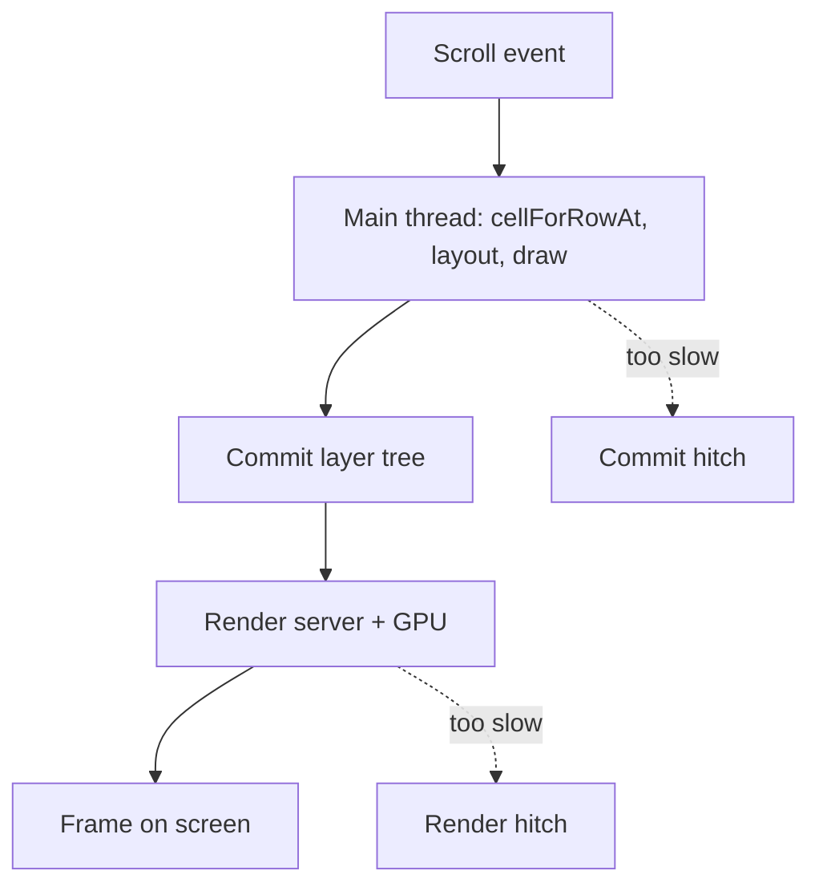

#### Investigate

1. Run on an **older real device** with a release build. The simulator uses your Mac's GPU and hides problems.
2. **Animation Hitches** instrument: shows each hitch and whether it was a commit or render hitch.
3. **Time Profiler**: filter to the main thread during scrolling, invert the call tree, and look at your own heaviest methods.
4. Simulator's **Color Off-screen Rendered** and **Color Blended Layers** debug options highlight GPU-expensive layers.

#### Common causes and fixes

| Cause | Fix |
|---|---|
| Image decode / resize on the main thread | Decode in background (`preparingForDisplay()`, `byPreparingThumbnail(ofSize:)`, or ImageIO downsampling); cache the decoded image |
| Creating `DateFormatter` / `NumberFormatter` per cell | Create once and reuse; or cache formatted strings in the view model |
| Synchronous file I/O or Core Data fetch in `cellForRowAt` | Precompute data before display; use `NSFetchedResultsController` with batch size |
| Shadows without a path, `cornerRadius` + `masksToBounds` on complex views | Set `layer.shadowPath`; pre-round images once (in the background) instead of masking every frame |
| Deep or ambiguous Auto Layout in cells | Flatten the hierarchy, avoid constraint churn; reuse constraints, toggle `isHidden` instead of add/remove |
| Self-sizing cells computing heights repeatedly | Good `estimatedRowHeight`; cache heights for complex cells |
| Images loaded after display | `UITableViewDataSourcePrefetching` to start downloads early |
| `reloadData()` on every small change | Diffable data source with targeted snapshot updates |

```swift
// ❌ Off-screen render pass for every cell
cell.layer.shadowOpacity = 0.3
// ✅ Tell Core Animation the shape so it doesn't have to compute it
cell.layer.shadowOpacity = 0.3
cell.layer.shadowPath = UIBezierPath(roundedRect: cell.bounds, cornerRadius: 12).cgPath
```

**Common pitfalls:**
- Optimising by guesswork instead of profiling.
- Doing work in `cellForRowAt` that should be done once in the view model.
- Forgetting to cancel image loads on reuse, which wastes work and can show wrong images.

**Likely follow-ups:**
- *What about SwiftUI `List`?* Same principles: keep `body` cheap, give stable ids, move work out of `body`, and use the SwiftUI instrument to find views that update too often.
- *How do you stop it regressing?* `XCTOSSignpostMetric.scrollDecelerationMetric` / scroll performance tests, and MetricKit's hitch metrics in production.

</details>

### 15. How would you migrate a large UIKit app to SwiftUI?

<details>
<summary>Answer</summary>

**In short:** incrementally, never as a big-bang rewrite. Host new SwiftUI screens inside UIKit with `UIHostingController`, starting with new features and simple leaf screens; build a shared SwiftUI design system; move state into view models both frameworks can use; keep UIKit navigation (coordinators) at first; wrap complex UIKit views with representables; and measure crashes and performance as you go.

#### Why incremental

A rewrite freezes feature work for months, reintroduces old bugs, and is risky to ship in one go. UIKit and SwiftUI interoperate well in both directions, so you can migrate screen by screen while the app keeps shipping.

| Direction | API |
|---|---|
| SwiftUI inside UIKit | `UIHostingController(rootView:)`, `UIHostingConfiguration` for cells (iOS 16+) |
| UIKit inside SwiftUI | `UIViewRepresentable`, `UIViewControllerRepresentable` |

#### The plan

1. **Start with new features and leaf screens** (settings, about, detail pages). They have few dependencies and few navigation paths, so they're low risk and teach the team SwiftUI.

```swift
// From an existing UIKit coordinator
let screen = SettingsView(model: settingsModel)
let host = UIHostingController(rootView: screen)
navigationController.pushViewController(host, animated: true)
```

2. **Build a SwiftUI design system**: buttons, text styles, colours, spacing, cells. It keeps new screens consistent with the old ones and speeds up every later screen.
3. **Move state out of view controllers** into observable view models (`@Observable` or `ObservableObject`) and services. Both a UIKit view controller and a SwiftUI view can observe the same model, so a screen can be swapped without touching business logic.
4. **Keep navigation in UIKit coordinators at first.** Each coordinator can push a hosting controller. Once a whole flow is SwiftUI, migrate it to `NavigationStack` with a path you control.
5. **Keep complex or performance-critical UIKit screens** (custom collection layouts, camera, rich text editors) via representables until there's a real reason to rewrite them.
6. **Use cells as a middle step**: `UIHostingConfiguration` lets you write SwiftUI cell content inside an existing `UICollectionView`/`UITableView`.
7. **Measure and plan the minimum OS.** Track crash rates, launch time and scrolling per migrated screen. Raise the minimum iOS version strategically, because newer SwiftUI APIs depend on it (e.g. Observation needs iOS 17).

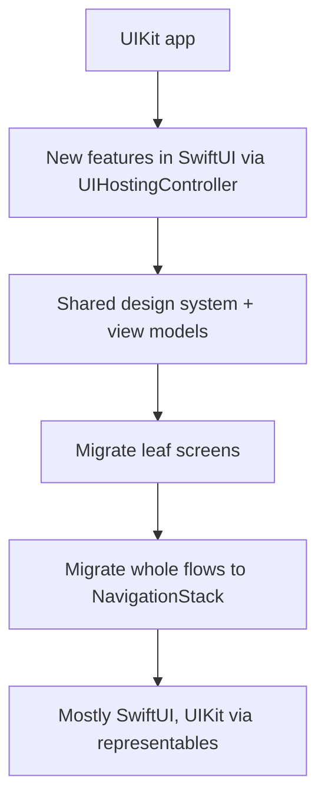

**Common pitfalls:**
- Mixing two navigation systems in one flow (UIKit pushes and `NavigationStack` fighting over the same nav bar).
- Re-creating a `UIHostingController` on every update instead of updating its `rootView` or model.
- Hosting-controller sizing issues in cells or child view controllers (use `sizingOptions` / `UIHostingConfiguration`).
- Rewriting stable, complex screens just for the sake of it.

**Likely follow-ups:**
- *How do you convince the business?* Faster feature delivery on new screens, no feature freeze, and measurable checkpoints.
- *How do you share data between a UIKit and a SwiftUI screen?* Inject the same model object into both; never let one reach into the other's views.

</details>

### 16. How do you prevent a payment from being submitted twice?

<details>
<summary>Answer</summary>

**In short:** defend in layers. On the client, drive the UI from state so the button is disabled while a submission is in progress. The real guarantee is a client-generated **idempotency key** sent with the request: the server records it and returns the original result for any repeat. Persist the pending payment and its key so retries after a crash or timeout reuse the same key, and confirm the final status with the server instead of guessing. For in-app purchases, StoreKit handles this: listen to `Transaction.updates` and finish transactions only after delivering content.

#### Why the button alone isn't enough

Double payments come from more than double taps:
- The user taps twice before the UI updates.
- The request **times out** on the client but actually succeeded on the server; the app (or user) retries.
- The app is killed mid-request, and on relaunch the user pays again.
- An automatic retry layer resends a `POST`.

Only the server can reliably detect "this is the same payment", so it needs a key to deduplicate on.

#### Client: state-driven UI

```swift
@MainActor @Observable
final class CheckoutModel {
    enum State { case idle, submitting, succeeded(Receipt), failed(Error) }
    private(set) var state: State = .idle
    private var idempotencyKey = UUID()          // one key per checkout attempt, not per tap
    private let api: PaymentsAPI
    init(api: PaymentsAPI) { self.api = api }

    func pay(_ cart: Cart) async {
        guard case .idle = state else { return }  // ignore taps while submitting or done
        state = .submitting
        do {
            let receipt = try await api.charge(cart, idempotencyKey: idempotencyKey)
            state = .succeeded(receipt)
        } catch {
            state = .failed(error)                // retry keeps the SAME key
        }
    }

    func retry(_ cart: Cart) async {
        state = .idle
        await pay(cart)
    }

    var isSubmitting: Bool {
        if case .submitting = state { return true } else { return false }
    }
}
// View: Button("Pay") { Task { await model.pay(cart) } }
//         .disabled(model.isSubmitting)   // plus a progress indicator
```

The key is generated once per checkout, **not** per tap or per request, so every retry of the same payment carries the same key. A new key is generated only when the cart actually changes.

#### Server: deduplicate on the key

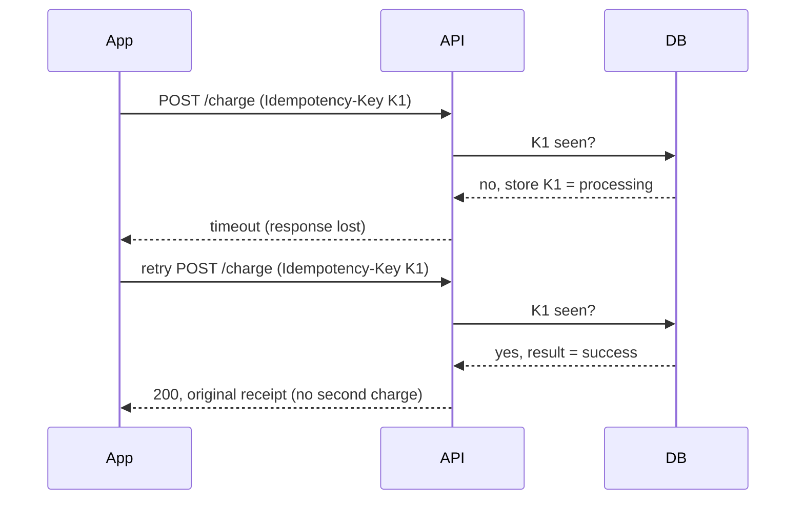

Payment providers commonly support an idempotency-key header on payment requests for exactly this reason.

#### Surviving termination and unknown outcomes

- Persist `{ orderID, idempotencyKey, status: pending }` before sending. On relaunch, if a payment is pending, **query its status** from the server rather than showing the pay button again.
- On a timeout, the outcome is **unknown**, not failed. Show "checking payment status" and poll, or retry with the same key.

#### In-app purchases (StoreKit 2)

- Purchases can complete outside your call (interrupted purchase, Ask to Buy, another device), so listen to `Transaction.updates` from app launch.
- Verify the transaction, deliver the content (ideally recorded server-side by transaction id), and only then call `transaction.finish()`. Unfinished transactions are redelivered, which is what makes the flow safe.

**Common pitfalls:**
- Generating a new UUID on each retry, which defeats the purpose.
- Treating a timeout as failure and letting the user pay again.
- Relying only on `isEnabled = false` on the button.
- Finishing a StoreKit transaction before the content is delivered.

**Likely follow-ups:**
- *How long does the server keep keys?* Long enough to cover realistic retries (often hours to days), then they expire.
- *What if the same key comes with a different amount?* The server should reject it as a conflict rather than silently reusing the old result.

</details>

---

## Behavioral & Project Questions

### 17. "Tell me about yourself."

<details>
<summary>Answer</summary>

**In short:** a 60–90 second pitch with three parts: **current role** (the app, its scale, what you own) → **two or three relevant achievements with numbers** ("cut launch time by 40%", "crash-free users from 99.2% to 99.8%", "led the SwiftUI migration of the checkout") → **why this role**. Keep it focused on iOS and impact, not your life story.

#### Why it matters

This is usually the first question, and it sets the agenda: interviewers often follow up on whatever you mention. So mention the things you *want* to be asked about, and have a deeper story ready for each.

#### Structure

| Part | Time | What to say |
|---|---|---|
| Present | ~20 s | Role, company/app, team size, scale (users, rating), what you own |
| Highlights | ~40 s | 2–3 achievements with measurable results and the technology involved |
| Future | ~15 s | Why this company and role, linked to your experience |

#### Example

> "I'm a senior iOS engineer at a food-delivery company. Our app has about two million monthly users, and I own the checkout and payments module in a team of six iOS engineers.
>
> Over the last two years I led the move of checkout from UIKit to SwiftUI with a shared design system, which cut new-screen development time roughly in half. I also drove a stability push, mostly fixing threading issues found with Thread Sanitizer, that took crash-free users from 99.2 to 99.8 percent. And I mentor two junior developers.
>
> I'm looking for a role where I can work on a larger product with a strong platform team, which is why this position, with its focus on app architecture and performance, really interests me."

(Use your own real facts and numbers; never invent them, as interviewers will dig in.)

#### Tips

- **Tailor it** to the job description: if they mention performance, lead with your performance work.
- **Numbers make claims believable**: users, percentages, time saved, crash rates, ratings.
- Say **"I"** for what you did and **"we"** for team results; interviewers want to know your part.
- Practise out loud and time it; most people run long.

**Common pitfalls:**
- Reciting your CV chronologically from university.
- Listing technologies ("Swift, SwiftUI, Combine, Core Data...") without saying what you achieved with them.
- Personal details that aren't relevant, or negativity about your current employer.

**Likely follow-ups:**
- *"Tell me more about that migration / stability work."* Have a STAR story ready (see the next question).
- *"Why are you leaving?"* Stay positive: focus on what you're moving towards.

</details>

### 18. "What's the most challenging bug or project you've worked on?" (STAR)

<details>
<summary>Answer</summary>

**In short:** use **STAR**: **Situation** (brief context) → **Task** (what you were responsible for) → **Action** (your technical steps in detail: tools, hypotheses, dead ends, the fix) → **Result** (measurable impact, plus what you learned or changed in the process). Spend most of the time on Action, and make it clear what *you* did.

#### Why STAR

Interviewers use this question to judge how you think under difficulty: do you debug systematically, communicate, and learn? STAR keeps the story focused and makes sure you finish with a result instead of trailing off.

| Part | Share of time | Content |
|---|---|---|
| Situation | ~10% | App, team, what was going wrong, why it mattered |
| Task | ~10% | Your specific responsibility |
| Action | ~60% | Steps, tools, reasoning, trade-offs, dead ends |
| Result | ~20% | Numbers, outcome, lessons, process change |

#### Example (technical)

- **Situation:** "After a release, our crash-free rate dropped from 99.7% to 98.9%. The top crash was `EXC_BAD_ACCESS` in our image cache, only on older devices, and we couldn't reproduce it."
- **Task:** "I owned the media module, so I took the investigation."
- **Action:** "The stacks showed two threads inside the cache's dictionary at the same time, which pointed to a race. I reproduced it with Thread Sanitizer by scrolling fast on a slow network. The cache was a class accessed from URLSession callbacks and the main thread without synchronisation. I rewrote it as an actor with in-flight request deduplication, added a stress test that hits it from many tasks, and turned on TSan for that test target in CI."
- **Result:** "The crash disappeared in the next release, the crash-free rate went back to 99.8%, and duplicate image downloads dropped noticeably. We added 'run TSan on concurrency changes' to our review checklist."

(The example shows the shape; use your own real story and numbers.)

#### Stories to prepare

Have 5–6 stories ready; each can answer several questions:
- A hard crash or memory leak.
- A performance win (launch time, scrolling, memory).
- Adopting Swift 6 strict concurrency, or another migration.
- An offline sync or caching design.
- An App Store rejection you resolved.
- A disagreement about architecture.
- Mentoring a teammate.

**Common pitfalls:**
- Spending two minutes on the situation and ten seconds on the action.
- "We did..." throughout, so the interviewer can't tell your contribution.
- No result, or a result without a number or lesson.
- Picking a story where the hard part was someone else's.

**Likely follow-ups:**
- *"What would you do differently?"* Have an honest answer, e.g. adding monitoring earlier.
- *"How did you know it was fixed?"* Point to metrics: crash rate, a regression test, production monitoring.

</details>

### 19. Common behavioral questions to prepare.

<details>
<summary>Answer</summary>

**In short:** prepare short STAR stories for the recurring themes: conflict, a production mistake, code review, tech debt vs features, estimates and deadlines, ownership beyond your role, and why you're leaving. Interviewers are checking for **collaboration, ownership, honesty and learning**. Also prepare good **questions for the interviewer**.

#### The common questions and what they test

| Question | What they're really checking | A strong answer shows |
|---|---|---|
| A conflict with a teammate, designer or PM | Can you disagree without damaging the relationship? | You listened, used data or prototypes, found a compromise, and the relationship stayed good |
| A mistake that reached production | Honesty and ownership | You owned it, fixed it fast (hotfix, feature flag, phased release pause), and changed the process so it can't repeat |
| How you give and receive code review feedback | Collaboration and ego | Specific, kind feedback; you separate blocking issues from nits; you accept feedback without defensiveness |
| Balancing tech debt with feature work | Pragmatism | You tie debt to business cost (crashes, slower delivery), fix it incrementally alongside features, and agree priorities with the PM |
| Estimating work and handling deadlines | Reliability | You break work down, add buffer for unknowns, raise risks early, and negotiate scope rather than quality |
| Ownership beyond your role | Initiative | You noticed a problem nobody owned (flaky CI, accessibility gaps) and drove it to a result |
| Why you're leaving | Attitude | Positive framing: what you're moving towards, not what you're escaping |

#### Example: conflict

> "Our designer wanted a custom animated tab bar that would have taken about two weeks and had accessibility issues. Instead of just saying no, I built a quick prototype of a simpler version using standard components plus one custom transition, and showed both with VoiceOver on. We agreed on the simpler version, shipped it in three days, and the designer and I set up a weekly sync to catch these trade-offs earlier."

The pattern: **acknowledge the other side's goal → bring evidence → find a shared solution → improve the process.**

#### Example: mistake

> "I shipped a migration that crashed for users upgrading from a very old version. We paused the phased release within an hour of seeing the crash spike, shipped a fix the next day, and I added upgrade-path tests from older app versions to CI."

#### Questions to ask the interviewer

Asking good questions shows interest and helps you judge the role:
- How big is the iOS team, and how is it structured (feature teams vs platform team)?
- What's the SwiftUI/UIKit split, and where is the codebase heading?
- What's the release cadence, and how do you handle rollouts and feature flags?
- What does the testing culture look like (unit, UI, snapshot tests; CI)?
- What's the biggest technical challenge for the team right now?
- How is success measured for this role in the first six months?

**Common pitfalls:**
- Blaming others in conflict or mistake stories.
- Claiming you've never made a mistake or had a conflict.
- Generic answers with no concrete example.
- Having no questions for the interviewer.

</details>


---

## More Coding & Process Questions

### 20. Merge two sorted arrays into one sorted array.

<details>
<summary>Answer</summary>

**In short:** use **two pointers**, one per array. Repeatedly append the smaller of the two current elements and advance that pointer; when one array runs out, append the rest of the other. That's **O(n + m)** time, versus O((n + m) log(n + m)) for concatenating and sorting.

#### Implementation

```swift
func merge<T: Comparable>(_ a: [T], _ b: [T]) -> [T] {
    var result: [T] = []
    result.reserveCapacity(a.count + b.count)
    var i = 0, j = 0
    while i < a.count && j < b.count {
        if a[i] <= b[j] { result.append(a[i]); i += 1 }
        else { result.append(b[j]); j += 1 }
    }
    result.append(contentsOf: a[i...])
    result.append(contentsOf: b[j...])
    return result
}
merge([1, 4, 7], [2, 3, 8])   // [1, 2, 3, 4, 7, 8]
```

#### Walking through `[1, 4, 7]` and `[2, 3, 8]`

| Step | a[i] | b[j] | Append | Result |
|---|---|---|---|---|
| 1 | 1 | 2 | 1 (i++) | [1] |
| 2 | 4 | 2 | 2 (j++) | [1, 2] |
| 3 | 4 | 3 | 3 (j++) | [1, 2, 3] |
| 4 | 4 | 8 | 4 (i++) | [1, 2, 3, 4] |
| 5 | 7 | 8 | 7 (i++) | [1, 2, 3, 4, 7] |
| end | a exhausted | | rest of b: 8 | [1, 2, 3, 4, 7, 8] |

#### Points to say out loud

- **Complexity:** O(n + m) time because each element is visited once; O(n + m) space for the output.
- **Why not `(a + b).sorted()`?** It's correct and a fine first answer, but O((n+m) log(n+m)) and it ignores that the inputs are already sorted. Mention it as the brute force, then improve.
- **Stability:** `<=` takes from `a` on ties, so equal elements keep their original relative order (matters when sorting structs by one key).
- **`reserveCapacity`** avoids repeated reallocations as the array grows.
- **Generics:** `T: Comparable` makes it work for `Int`, `String`, `Date`, etc.
- **Edge cases:** either array empty (the loop doesn't run; the tail appends handle it), duplicates, negative numbers. `a[i...]` with `i == a.count` is a valid empty slice, not a crash.

#### Common variation: merge in place (LeetCode "Merge Sorted Array")

`nums1` has extra space at the end for `nums2`. Fill from the **back** so you never overwrite unread values:

```swift
func mergeInPlace(_ nums1: inout [Int], _ m: Int, _ nums2: [Int], _ n: Int) {
    var i = m - 1, j = n - 1, k = m + n - 1
    while j >= 0 {
        if i >= 0 && nums1[i] > nums2[j] { nums1[k] = nums1[i]; i -= 1 }
        else { nums1[k] = nums2[j]; j -= 1 }
        k -= 1
    }
}
```

O(n + m) time and O(1) extra space.

**Likely follow-ups:**
- *Merge k sorted arrays?* Use a min-heap of the current head of each array: O(N log k). Without a heap, merge pairwise like merge sort.
- *Where is this used?* It's the merge step of merge sort, and it's how you'd combine two already-sorted lists (e.g. local and remote messages by timestamp).

</details>

### 21. Implement your own `map`, `filter` and `reduce`.

<details>
<summary>Answer</summary>

**In short:** write them as **generic extensions on `Sequence`** that loop with `for ... in`: `map` appends the transformed element, `filter` appends elements that pass the predicate, and `reduce` threads an accumulator through every element. Mark the closures `throws` and the functions `rethrows` so they only throw when the caller's closure can, just like the standard library.

#### Implementation

```swift
extension Sequence {
    func myMap<T>(_ transform: (Element) throws -> T) rethrows -> [T] {
        var result: [T] = []
        result.reserveCapacity(underestimatedCount)
        for element in self { result.append(try transform(element)) }
        return result
    }
    func myFilter(_ isIncluded: (Element) throws -> Bool) rethrows -> [Element] {
        var result: [Element] = []
        for element in self where try isIncluded(element) { result.append(element) }
        return result
    }
    func myReduce<Result>(_ initial: Result,
                          _ next: (Result, Element) throws -> Result) rethrows -> Result {
        var acc = initial
        for element in self { acc = try next(acc, element) }
        return acc
    }
}
[1, 2, 3].myReduce(0, +)   // 6
```

#### What each part demonstrates

| Feature | Why it's there |
|---|---|
| `extension Sequence` | Works for `Array`, `Set`, `Dictionary`, ranges, strings and any custom sequence, not just arrays |
| Generic `<T>` / `<Result>` | The output type can differ from the input (`[Int]` → `[String]`) |
| `rethrows` | `[1, 2].myMap { $0 * 2 }` needs no `try`; `try items.myMap(parse)` can throw. The function throws only if its closure does |
| `reserveCapacity(underestimatedCount)` | Avoids repeated reallocation; `underestimatedCount` is a cheap lower bound (`count` for collections, often 0 for one-pass sequences) |
| `for ... where try ...` | Concise filtering loop |

`filter` can't reserve capacity sensibly, because you don't know how many elements will pass.

#### Usage

```swift
let names = ["ana", "bob", "cy"]
names.myMap { $0.uppercased() }          // ["ANA", "BOB", "CY"]
names.myFilter { $0.count > 2 }          // ["ana", "bob"]
names.myReduce(0) { $0 + $1.count }      // 8

// rethrows in action
enum ParseError: Error { case invalid(String) }
func parse(_ s: String) throws -> Int {
    guard let n = Int(s) else { throw ParseError.invalid(s) }
    return n
}
let numbers = try ["1", "2"].myMap(parse)   // `try` needed only here
```

#### `reduce(into:)`

The standard library also has `reduce(into:)`, which mutates the accumulator `inout` instead of returning a new value each step. For building arrays or dictionaries that avoids a copy per element:

```swift
extension Sequence {
    func myReduce<Result>(into initial: Result,
                          _ update: (inout Result, Element) throws -> Void) rethrows -> Result {
        var acc = initial
        for element in self { try update(&acc, element) }
        return acc
    }
}
let counts = "hello".myReduce(into: [Character: Int]()) { $0[$1, default: 0] += 1 }
// ["h": 1, "e": 1, "l": 2, "o": 1] (dictionary order varies)
```

**Common pitfalls:**
- Extending only `Array`, which misses the point of protocol-oriented design.
- Forgetting `rethrows`, forcing every caller to write `try`.
- Using `reduce` with array concatenation (`acc + [x]`), which is O(n²); prefer `reduce(into:)`.

**Likely follow-ups:**
- *How would you build `compactMap`?* Same loop; append only when `try transform(element)` is non-nil.
- *How is lazy `map` different?* `lazy.map` returns a wrapper that applies the transform on access instead of building an array up front.

</details>

### 22. Why doesn't this code compile? (Common compile-error questions)

<details>
<summary>Answer</summary>

**In short:** most "why doesn't this compile" questions test a handful of rules: a `let` struct is fully immutable; struct methods that change state need `mutating`; `final` members can't be overridden; optionals must be unwrapped before use; a closure stored or called later must be `@escaping`; and in Swift 6, captured mutable state can't be shared with concurrently running code. Name the rule, then give the fix.

#### 1. Mutating a `let` struct

```swift
struct Point { var x = 0 }
let p = Point()
p.x = 5                       // ❌ `p` is a let constant – struct is fully immutable
```

A struct is a value: `let` freezes the whole value, including its `var` properties. **Fix:** `var p = Point()`. Contrast with a class, where `let` only freezes the reference and `p.x = 5` compiles.

#### 2. Missing `mutating`

```swift
struct Counter { var count = 0
    func increment() { count += 1 }   // ❌ needs `mutating`
}
```

Inside a struct method, `self` is immutable by default. **Fix:** `mutating func increment()`. Calling it then requires a `var` instance, which ties back to rule 1.

#### 3. Overriding a `final` method

```swift
class Base { final func save() {} }
class Child: Base { override func save() {} }   // ❌ cannot override final method
```

`final` forbids overriding (and lets the compiler use static dispatch, which is faster). **Fix:** remove `final` if overriding is intended, or add a separate hook method. Related errors: forgetting `override` when you do override, or overriding a method from a protocol extension (those are statically dispatched and can't be overridden).

#### 4. Using an optional without unwrapping

```swift
let value: Int? = 5
let doubled = value * 2       // ❌ must unwrap optional first
```

`Int?` is a different type from `Int`; there's no `*` for it. **Fixes:** `if let value { value * 2 }`, `(value ?? 0) * 2`, or `value.map { $0 * 2 }` (gives `Int?`).

#### 5. Non-escaping closure escaping

```swift
func load(completion: () -> Void) {
    DispatchQueue.main.async { completion() }   // ❌ non-escaping closure captured by escaping one → mark @escaping
}
```

Closure parameters are **non-escaping by default**: the compiler assumes they're used only during the call, which allows optimisations and lets you skip `self.` in them. Calling it later from an async block means it outlives the function. **Fix:** `completion: @escaping () -> Void` (and then think about `[weak self]` at the call site).

#### 6. Swift 6 data-race checks

```swift
var items = [1, 2, 3]
Task.detached { items.append(4) }   // ❌ Swift 6: mutation of captured var in concurrently-executing code
```

A detached task can run in parallel with the code that created it, so both could touch `items` at once. In Swift 6 language mode, this data race is a compile error. **Fixes:** keep the state in an actor, return a value from the task instead of mutating shared state, or capture an immutable copy (`[items]`) and build a new array.

#### 7. Protocol with `Self` or associated type used as a plain type

```swift
let things: [Equatable] = [1, "a"]   // ❌ must be written 'any Equatable'
```

Since Swift 5.7, a protocol with `Self` or associated-type requirements can be used as a type only when written `any Equatable`. Even then, `things[0] == things[1]` won't compile, because `==` needs two values of the **same** concrete type. **Fix:** use generics or `some` when one concrete type is meant (`func allEqual<T: Equatable>(_ xs: [T])`), or a type-erased wrapper like `AnyHashable` when you really need mixed types.

| Error message (paraphrased) | Rule |
|---|---|
| Cannot assign to property: 'p' is a 'let' constant | Value types and `let` |
| Cannot assign to property: 'self' is immutable | Missing `mutating` |
| Instance method overrides a 'final' instance method | `final` |
| Value of optional type must be unwrapped | Optionals |
| Escaping closure captures non-escaping parameter | `@escaping` |
| Mutation of captured var in concurrently-executing code | Sendable / Swift 6 |

**Common pitfalls:**
- Fixing optionals with `!` in an interview; reach for `if let`, `guard let` or `??` instead.
- Saying "just make it a class" to fix immutability, without discussing value semantics.

</details>

### 23. How do you do code reviews?

<details>
<summary>Answer</summary>

**In short:** as a reviewer, first understand the intent, then check **correctness** (edge cases, error paths, threading, memory), **architecture fit**, **readability** and **tests**, plus iOS-specific issues (main-thread work, retain cycles, force unwraps, accessibility, localization, privacy). Be kind and specific, separate blocking issues from nits, and explain the *why*. Automate style with SwiftLint/SwiftFormat so humans review substance. As an author, send small PRs with a clear description and screenshots, self-review first, and include tests.

#### Why reviews matter

Reviews catch bugs, but their bigger value is **shared knowledge** (more than one person understands each part of the codebase) and **consistent standards**. Interviewers ask this to see whether you're thorough *and* pleasant to work with.

#### Reviewer checklist, in order of importance

| Area | What to look for |
|---|---|
| Intent | Does it solve the ticket? Is this the right approach at all? (Raise design concerns first, before nitpicking lines.) |
| Correctness | Edge cases (empty, nil, huge input), error paths, optionals, off-by-one, state after failure |
| Concurrency | Actor isolation, UI updates off the main actor, data races, unstructured `Task`s that never get cancelled |
| Memory | Retain cycles (stored closures, delegates not `weak`, timers), large images held in memory |
| Architecture | Right layer (no networking or business logic in views), dependencies injected, follows team patterns |
| Tests | Logic covered, tests meaningful (not just for coverage), no flaky timing |
| iOS hygiene | Force unwraps, main-thread blocking, accessibility labels and Dynamic Type, localized strings, no PII in logs, dark mode |
| Readability | Clear names, small functions, comments explaining *why* |

#### How to write comments

```text
❌ "This is wrong."
✅ "blocking: this closure is stored on viewModel and captures self strongly,
    so the VC leaks. Could we use [weak self] here?"
✅ "nit: maybe `isLoading` instead of `flag`? Not blocking."
✅ "question: should this retry on 401, or refresh the token first?"
```

- **Label severity** (blocking / suggestion / nit / question) so the author knows what must change.
- **Explain why** and suggest a fix; link to docs or the team guideline.
- **Ask questions** rather than assume: the author may know something you don't.
- **Praise** good solutions too.
- Big disagreement? Move to a quick call rather than a long comment thread.
- Review promptly; a PR waiting a day blocks a teammate.

#### As an author

- **Small PRs** (a few hundred lines at most) focused on one change; split refactors from features.
- A clear **description**: what, why, how to test, and **screenshots or videos** for UI changes.
- **Self-review** the diff first; you'll catch half the issues.
- Include **tests**, and run the linter locally.
- Respond to feedback without defensiveness; if you disagree, explain your reasoning.

#### Automate what you can

SwiftLint/SwiftFormat for style, CI for build and tests, Danger-style checks for PR size or missing changelog, and snapshot tests for UI. Then human review time goes to logic and design.

**Common pitfalls:**
- Bikeshedding formatting while missing a threading bug.
- Approving huge PRs without really reading them ("LGTM").
- Comments that sound personal ("you always...") instead of being about the code.

**Likely follow-ups:**
- *How do you handle a disagreement in review?* Discuss trade-offs with evidence, follow team conventions, escalate to a tech lead only if needed, and don't block on personal preference.
- *How do you review a PR in an area you don't know?* Focus on what you can judge (tests, clarity, obvious bugs), ask questions, and pull in an owner for the rest.

</details>

### 24. Agile vs Waterfall? Have you filed bugs with Apple?

<details>
<summary>Answer</summary>

**In short:** **Waterfall** runs sequential phases (requirements → design → build → test → release) with fixed scope, so changes are expensive and feedback arrives late. **Agile** delivers in short iterations with continuous feedback, usually as **Scrum** (sprints, ceremonies, roles) or **Kanban** (continuous flow, WIP limits). Mobile teams add **release trains**, **feature flags** and **phased releases**. For Apple bugs, file them in **Feedback Assistant** with a minimal sample project, then work around the bug and reference the FB number in code.

#### Waterfall vs Agile

| | Waterfall | Agile |
|---|---|---|
| Process | Sequential phases, each finished before the next | Short iterations that each deliver working software |
| Scope | Fixed up front | Evolves with feedback |
| Feedback | Late, at the end | Every iteration |
| Cost of change | High | Low |
| Fits | Fixed, well-understood requirements; regulated contracts | Products where needs change and learning matters (most apps) |

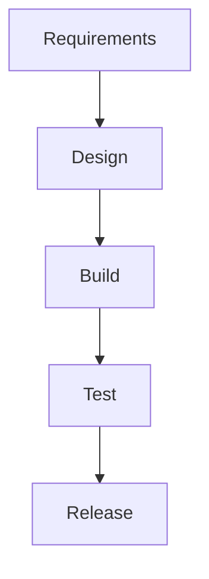

Waterfall is a single pass down this chain. Agile runs a small version of the whole loop every one or two weeks.

#### Scrum vs Kanban

- **Scrum:** fixed-length **sprints** (often 2 weeks); roles (product owner, scrum master, team); ceremonies (planning, daily stand-up, review, retrospective). Good for teams that want a steady planning rhythm.
- **Kanban:** a board with columns (To do → In progress → Review → Done) and **WIP limits** per column; work flows continuously. Good for support-heavy or interrupt-driven teams.

#### How mobile changes the picture

App Store review and user updates mean you can't deploy instantly or roll back like a website, so mobile teams typically:
- Run a **release train**: cut a release branch on a fixed schedule (e.g. weekly or every two weeks), whatever is ready ships.
- Hide unfinished work behind **feature flags** so code can merge to main continuously.
- Use App Store **phased release** (gradual rollout over 7 days, which can be paused) and monitor crashes.
- Keep a **hotfix** process, plus remote config to switch off a broken feature without a new build.

#### Filing bugs with Apple

1. Confirm it's really a framework bug: reproduce it in a **minimal sample project**, outside your app.
2. File it in **Feedback Assistant** (the app on macOS/iOS, or feedbackassistant.apple.com) with: the sample project, OS and Xcode versions, exact steps, expected vs actual behaviour, and a **sysdiagnose** or screen recording if relevant.
3. **Work around it** in code, and leave a comment with the FB number so the team knows why the workaround exists and can remove it later:

```swift
// Workaround for FB12345678: the list loses scroll position after a reload on this OS version.
// Remove once fixed upstream.
```

4. Re-test on new betas and update the report. You can also ask Apple engineers on the Developer Forums or in WWDC labs, referencing the FB number.

Interviewers like candidates who do this, because it shows ownership: you isolate problems carefully and don't just complain about the platform.

**Common pitfalls:**
- Describing Agile as "no planning" or "no documentation".
- Saying you use Scrum while describing none of its practices.
- Filing a vague bug report without a reproducible sample.

**Likely follow-ups:**
- *What makes a good retrospective?* Concrete, owned action items that are checked at the next retro.
- *How do you handle a sprint commitment you can't meet?* Raise it early, explain why, and agree on scope with the product owner.

</details>

---

[⬅ Previous: What's New & Trending](21-whats-new-trending.md) · [⬅ Back to index](../README.md) · [Next: Objective-C Essentials ➡](23-objective-c.md)
