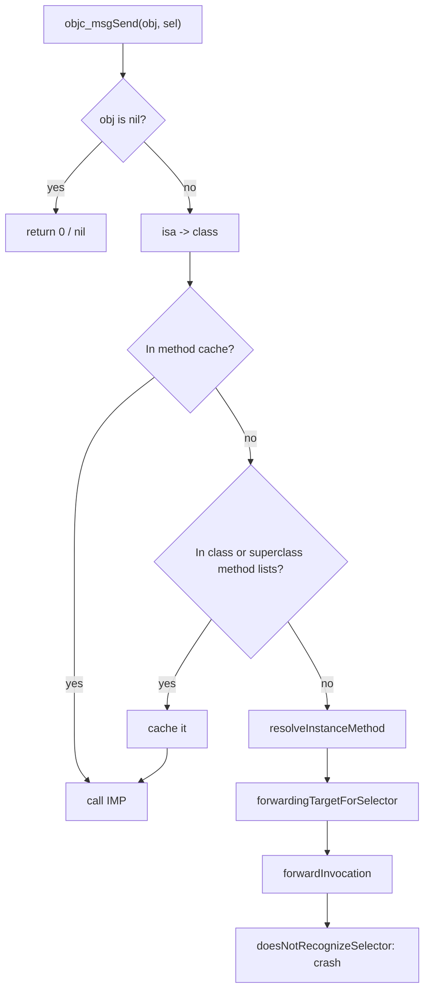
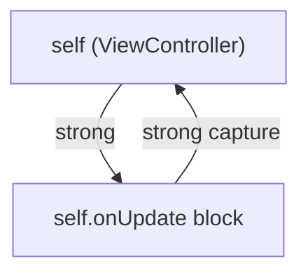
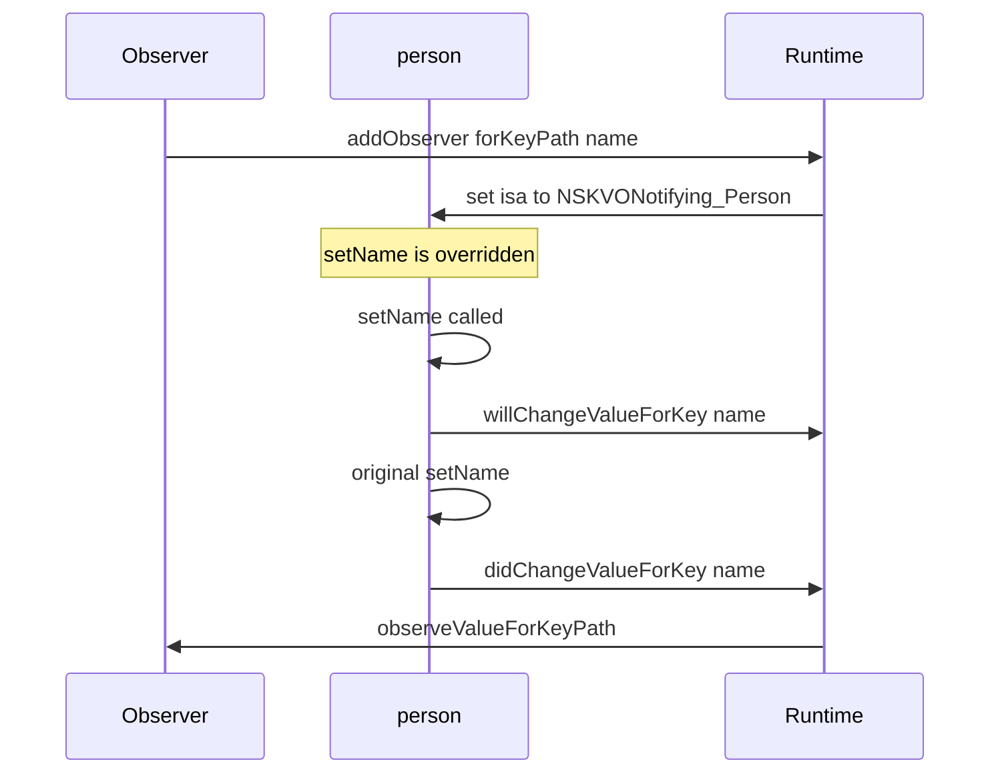

# Objective-C Essentials

[⬅ Back to index](../README.md)

Many companies still have Objective-C in their codebases, and interviews for those roles include ObjC questions. Covers: Swift vs ObjC, the runtime & messaging, properties & attributes, memory (MRC/ARC), categories & extensions, blocks, KVC/KVO, selectors, NSError, interop.

---

### 1. Swift vs Objective-C?

<details>
<summary>Answer</summary>

**In short:** Objective-C is C plus a Smalltalk-style dynamic runtime: method calls are messages resolved at runtime, and `nil` is silently tolerated. Swift is a statically typed, safety-focused language with optionals, value types and generics, using static dispatch by default. They interoperate, so most large apps today mix both.

#### Why the difference matters

Objective-C was designed in the 1980s to add objects to C cheaply. Every method call goes through the runtime (`objc_msgSend`), which makes the language extremely flexible (swizzling, KVO, proxies, Core Data's dynamic properties) but pushes many errors to runtime. Swift (2014) was designed to catch those errors at compile time and to let the compiler optimise aggressively.

| Objective-C | Swift |
|---|---|
| A superset of C with Smalltalk-style **dynamic messaging** | A modern, **statically typed**, compiled language |
| Messages to `nil` are no-ops (silent bugs) | **Optionals** make nil explicit |
| Header (`.h`) + implementation (`.m`) files | Single `.swift` files, module namespaces |
| No namespaces, so class prefixes (`NS`, `UI`, `ABC`) | Types namespaced by module |
| Mostly reference types (NSObject) | **Value types** (struct, enum) are first-class |
| Very dynamic: swizzling, KVO, `performSelector` | Mostly static dispatch (faster, safer); dynamic only with `@objc dynamic` |
| No generics (only lightweight generics for interop) | Full generics, protocols with associated types |
| Blocks | Closures |
| Manual or ARC memory management | ARC |
| Mature, stable ABI since forever | ABI-stable since Swift 5; concurrency, macros, SwiftUI |

The same idea in both languages:

```objc
// Objective-C
NSString *name = user.name;          // could be nil; nothing forces you to check
NSUInteger length = [name length];   // nil -> 0, no crash, possibly a hidden bug
```

```swift
// Swift
let name: String? = user.name
let length = name?.count ?? 0        // the compiler forces you to handle nil
```

#### How they interoperate

- A **bridging header** (`MyApp-Bridging-Header.h`) exposes ObjC headers to Swift inside an app target. Frameworks use their umbrella header / module map instead.
- The compiler generates **`MyApp-Swift.h`**, which exposes `@objc`-compatible Swift to ObjC. Import it in `.m` files only.

**Common pitfalls**
- Assuming ObjC's "nil is safe" behaviour carries over: in Swift, force-unwrapping an implicitly unwrapped optional from an unannotated ObjC API crashes.
- Importing `MyApp-Swift.h` in a header, which easily causes circular imports. Use `@class` forward declarations in headers.

**Likely follow-ups**
- *Why is Swift usually faster?* Static/vtable dispatch, inlining, value types on the stack, whole-module optimisation; ObjC always pays for dynamic lookup (though it is cached).
- *When would you still write ObjC?* Maintaining legacy code, some low-level runtime work, or C++ interop via Objective-C++ (Swift now has direct C++ interop too, but adoption varies).

</details>

### 2. How does message sending work in the Objective-C runtime?

<details>
<summary>Answer</summary>

**In short:** `[object doSomething:arg]` compiles to `objc_msgSend(object, @selector(doSomething:), arg)`. At runtime, the runtime follows the object's `isa` pointer to its class, finds the implementation (IMP) for that selector through a cache and the class hierarchy, and jumps to it. If nothing is found, a three-step message forwarding process runs before the app crashes with "unrecognized selector".

#### Step by step

1. **Nil check.** If the receiver is `nil`, `objc_msgSend` returns zero immediately (see question 3).
2. **Find the class.** Every object starts with an **`isa` pointer** to its class (on modern 64-bit runtimes it is a packed "non-pointer isa" that also stores the retain count and flags).
3. **Check the method cache.** Each class has a per-class cache mapping `SEL` to `IMP`. A hit is very fast, which is why ObjC dispatch is acceptable in practice.
4. **Search method lists.** On a miss, the runtime searches the class's method list, then the superclass's, up the chain to the root class. When found, the `IMP` (a plain C function pointer `id (*)(id self, SEL _cmd, ...)`) is cached and called.
5. **Dynamic method resolution.** If not found anywhere, `+resolveInstanceMethod:` (or `+resolveClassMethod:`) gives the class a chance to add the method with `class_addMethod`.
6. **Fast forwarding.** `-forwardingTargetForSelector:` can return another object to receive the same message.
7. **Full forwarding.** `-methodSignatureForSelector:` returns a signature, then `-forwardInvocation:` receives an `NSInvocation` you can inspect, modify or redirect.
8. If all fail: `-doesNotRecognizeSelector:` raises an exception: **"unrecognized selector sent to instance"**.



#### Example: forwarding to a helper

```objc
@implementation MyProxy
- (id)forwardingTargetForSelector:(SEL)aSelector {
    if ([self.target respondsToSelector:aSelector]) {
        return self.target;          // the runtime re-sends the message to target
    }
    return [super forwardingTargetForSelector:aSelector];
}
@end
```

#### Why it matters

Because the method to run is looked up by name at runtime, ObjC can do things Swift can't do natively:
- **Method swizzling**: exchanging two IMPs with `method_exchangeImplementations` (used by analytics SDKs to hook `viewDidAppear:`).
- **KVO** via isa-swizzling (question 12).
- **Proxies** (`NSProxy`) and mocking libraries like OCMock.
- Classes are objects too: a class's `isa` points to its **metaclass**, which holds class methods.

**Common pitfalls**
- Swizzling in `+load` without `dispatch_once`, or swizzling a method the class only inherits (you end up swapping the superclass's implementation). Use `class_addMethod` first.
- Assuming forwarding is free: full forwarding with `NSInvocation` is slow.

**Likely follow-ups**
- *What are `self` and `_cmd`?* The two hidden arguments every method receives: the receiver and the selector.
- *Can Swift do this?* Only for `@objc dynamic` members of `NSObject` subclasses; pure Swift uses static or vtable dispatch.

</details>

### 3. What happens when you send a message to `nil`?

<details>
<summary>Answer</summary>

**In short:** Nothing, and it doesn't crash. `objc_msgSend` checks for a `nil` receiver first and returns zero: `nil` for objects, `0` for numbers, `NO` for `BOOL`, and a zeroed struct for most struct returns. It's convenient, but it hides bugs, which is exactly what Swift optionals were designed to fix.

#### Why it works

The very first thing `objc_msgSend` does is test whether the receiver is `nil`. If it is, it clears the return registers and returns without looking up any method. So all of these are legal:

```objc
NSArray *items = nil;
NSUInteger count = [items count];     // 0
id first = [items firstObject];       // nil
BOOL empty = [items containsObject:x];// NO
[self.delegate didFinish];            // no delegate set: silently does nothing
```

This lets ObjC code skip many `if (obj != nil)` checks. The idiom `if ([string length] > 0)` covers both nil and empty strings in one go.

#### Why it's dangerous

```objc
// Bug: the session was never created, but nothing fails loudly
NSURLSession *session;            // forgot to assign
[[session dataTaskWithURL:url] resume];   // no request, no error, no crash
```

The bug shows up later as "the screen never loads" instead of a crash at the faulty line.

| Situation | ObjC | Swift |
|---|---|---|
| Call method on nil | Returns 0/nil silently | Must unwrap: `obj?.method()` or compile error |
| Forgot to set delegate | Silent no-op | Optional chaining is explicit: `delegate?.didFinish()` |

**Common pitfalls**
- Struct returns: with very old runtimes/ABIs large struct returns could be garbage; on modern 64-bit Apple platforms they are zeroed, but don't rely on the return value to mean "valid".
- **Collections are different**: inserting `nil` into an `NSArray` or `NSDictionary` (an array literal containing a nil variable, `[array addObject:nil]`, `[dict setObject:nil forKey:key]`) **crashes**. Use `NSNull` as a placeholder.

**Likely follow-ups**
- *Messaging a deallocated object?* That's different: it's a dangling pointer and usually crashes (`EXC_BAD_ACCESS`). Use `weak` so it becomes `nil` instead.

</details>

### 4. What are property attributes? (`atomic`/`nonatomic`, `strong`/`weak`/`copy`/`assign`, `readonly`)

<details>
<summary>Answer</summary>

**In short:** Property attributes tell the compiler how to generate the getter and setter: whether they lock (`atomic`/`nonatomic`), what ownership the setter takes (`strong`, `weak`, `copy`, `assign`), and whether there is a setter at all (`readonly`/`readwrite`). Typical iOS code uses `nonatomic`, `strong` for objects, `copy` for strings/collections/blocks, `weak` for delegates and `assign` for primitives.

```objc
@property (nonatomic, strong) NSArray *items;
@property (nonatomic, copy) NSString *name;
@property (nonatomic, weak) id<MyDelegate> delegate;
@property (nonatomic, assign) NSInteger count;
@property (nonatomic, readonly) BOOL isLoaded;
```

#### Atomicity

- **`atomic`** (the default) – the synthesized getter and setter are thread-safe **for that single property access**: a reader always gets a whole, valid value, never a half-written one. It does **not** make the object thread-safe (e.g. `if (self.count > 0) self.count--;` is a check-then-act race), and the internal locking makes it slower.
- **`nonatomic`** – no locking, faster. It's almost always used on iOS, with thread safety handled at a higher level (serial queues, locks, actors).

#### Ownership

| Attribute | What the setter does | Use for |
|---|---|---|
| **`strong`** | Retains the new value (+1), releases the old one. Default for objects under ARC | Most object references you own |
| **`weak`** | No retain; **zeroing** (becomes `nil` when the object deallocates) | Delegates, parent back-pointers, IBOutlets to subviews |
| **`copy`** | Stores `[value copy]` | `NSString`, `NSArray`, `NSDictionary`, blocks |
| **`assign`** | Plain assignment, no memory management | Primitives (`NSInteger`, `CGFloat`, `BOOL`, structs) |
| **`unsafe_unretained`** | Like weak but **not zeroing** | Rare: classes that can't be weakly referenced; dangerous |

**Why `copy` for strings?** `NSMutableString` is a subclass of `NSString`, so a caller can pass a mutable string and later mutate it:

```objc
NSMutableString *m = [@"Anna" mutableCopy];
person.name = m;          // with strong: person.name and m are the same object
[m appendString:@"!!!"];  // with strong, person.name is now "Anna!!!"
                          // with copy, person.name stays "Anna"
```

#### Access

- **`readonly` / `readwrite`** – `readonly` generates only a getter. A common pattern is public `readonly` in the `.h` and a `readwrite` redeclaration in the class extension in the `.m`, so the class can set it internally.
- **`getter=` / `setter=`** – rename accessors, e.g. `@property (nonatomic, getter=isEnabled) BOOL enabled;`.
- **`nullable` / `nonnull`** – nullability, important for Swift import (question 15).
- **`class`** – a class property (`@property (class, readonly) MyManager *shared;`); you must implement its accessors yourself.

**Common pitfalls**
- `assign` on an object pointer creates a dangling pointer (crash after dealloc). Use `weak`.
- Thinking `atomic` makes a mutable array property thread-safe: it only protects the pointer swap, not `[self.items addObject:]`.
- `strong` delegates cause retain cycles.

**Likely follow-ups**
- *Default attributes under ARC?* `atomic`, `strong` (for objects) or `assign` (for primitives), `readwrite`.
- *How does weak work?* The runtime keeps a side table of weak references per object and sets them to nil during deallocation.

</details>

### 5. What is the difference between `copy` and `retain`/`strong`?

<details>
<summary>Answer</summary>

**In short:** `strong`/`retain` adds another owner to the **same object**, so changes to a mutable object are visible through every reference. `copy` creates a **new object** (via `NSCopying`) and owns that, giving you an independent snapshot. For immutable objects, `copy` is usually optimised to a retain, so it costs nothing.

#### How it works

- **`retain`/`strong`** increments the reference count of the existing instance. Two variables, one object.
- **`copy`** calls `-copyWithZone:` (from the `NSCopying` protocol). For mutable classes like `NSMutableString` or `NSMutableArray`, this returns a new **immutable** instance. For already-immutable classes like `NSString`, Foundation just returns `self` retained, since an immutable object can safely be shared.
- **`mutableCopy`** (from `NSMutableCopying`) always returns a new **mutable** instance.

```objc
NSMutableArray *source = [@[@1, @2] mutableCopy];

NSArray *strongRef = source;        // same object
NSArray *copied    = [source copy]; // new immutable NSArray

[source addObject:@3];
// strongRef -> (1, 2, 3)   it sees the change
// copied    -> (1, 2)      independent snapshot
```

| | `strong`/`retain` | `copy` | `mutableCopy` |
|---|---|---|---|
| New object? | No | Yes (unless the source is immutable) | Always |
| Result mutable? | Same as source | Immutable for Foundation types | Mutable |
| Requires | Nothing | `NSCopying` | `NSMutableCopying` |

**Shallow, not deep:** copying a collection copies the container, not the elements. Both arrays still point to the same element objects. For a deep copy use `initWithArray:copyItems:YES` (one level) or serialise.

**Custom classes:** to use `copy` with your own class, adopt `NSCopying`:

```objc
- (id)copyWithZone:(NSZone *)zone {
    Person *p = [[[self class] allocWithZone:zone] init];
    p.name = self.name;   // the name property is itself `copy`
    return p;
}
```

**Common pitfalls**
- A `copy` property of type `NSMutableArray *`: the setter stores an *immutable* copy, so calling `addObject:` later crashes with "unrecognized selector".
- A custom setter for a `copy` property must call `copy` itself; the attribute only affects synthesized setters.

**Likely follow-ups**
- *Why must blocks be `copy`?* Historically blocks start on the stack and `copy` moves them to the heap; ARC now does this automatically for most cases, but `copy` documents intent.

</details>

### 6. What are `@synthesize` and `@dynamic`? `_name` vs `self.name`?

<details>
<summary>Answer</summary>

**In short:** `@synthesize` tells the compiler to generate the backing ivar and accessors (automatic since Xcode 4.4, so you rarely write it). `@dynamic` promises the accessors will exist at runtime, so the compiler generates nothing (Core Data uses this). `_name` reads the ivar directly, bypassing accessors; `self.name` calls the getter/setter, so KVO, `copy` semantics and custom logic apply.

#### `@synthesize`

```objc
@synthesize name = _name;   // ivar _name + -name + -setName:
```

Since auto-synthesis, the compiler does this for every property. You still need `@synthesize` when:
- you want a different ivar name,
- the property comes from a **protocol** (protocols don't auto-synthesize),
- you implement **both** the getter and setter of a `readwrite` property (or the getter of a `readonly` one) and still want an ivar.

#### `@dynamic`

```objc
@interface Note : NSManagedObject
@property (nonatomic, copy) NSString *title;
@end

@implementation Note
@dynamic title;   // Core Data provides the accessors at runtime
@end
```

The compiler won't warn about missing accessors. If nothing provides them at runtime, you get "unrecognized selector".

#### `_name` vs `self.name`

| | `_name` (ivar) | `self.name` (accessor) |
|---|---|---|
| Goes through getter/setter | No | Yes |
| KVO notifications | No | Yes |
| `copy`/`strong` semantics of the property | No (ARC still retains for `__strong` ivars, but no `copy`) | Yes |
| Subclass overrides | Bypassed | Respected |
| Lazy loading in getter | Skipped | Runs |

**Rule of thumb:** use `_name` in `init`, `dealloc` and inside the property's own custom accessors; use `self.name` everywhere else.

Why avoid accessors in `init`/`dealloc`? The object is partially constructed or being torn down, and a subclass might override the accessor and touch state that doesn't exist yet (or anymore). Also, KVO observers could fire on a half-initialised object.

```objc
- (instancetype)initWithName:(NSString *)name {
    if ((self = [super init])) {
        _name = [name copy];   // copy by hand, since we bypass the setter
    }
    return self;
}
```

**Common pitfalls**
- Writing `self.name = ...` inside `-setName:` causes infinite recursion.
- Writing a custom getter + setter and then getting "use of undeclared identifier `_name`": auto-synthesis is disabled in that case, so add `@synthesize`.

</details>

### 7. Categories vs class extensions?

<details>
<summary>Answer</summary>

**In short:** A **category** adds methods to any existing class, even one you don't have the source for (like `NSString`), but it can't add stored ivars. A **class extension** is an anonymous category declared in the class's own `.m` file; it can add private properties, ivars and methods, and redeclare `readonly` properties as `readwrite`. Swift extensions are roughly the equivalent of categories.

#### Category

```objc
// NSString+Validation.h
@interface NSString (Validation)
- (BOOL)xyz_isValidEmail;
@end

// NSString+Validation.m
@implementation NSString (Validation)
- (BOOL)xyz_isValidEmail {
    return [self containsString:@"@"];   // simplified
}
@end
```

Categories are merged into the class at runtime when the image loads. Uses: splitting a large class across files, adding helpers to framework classes, exposing private methods for testing.

**Stored state?** Categories can declare `@property`, but no ivar or accessors are synthesized. You implement the accessors yourself using **associated objects**:

```objc
#import <objc/runtime.h>
static const void *kBadgeKey = &kBadgeKey;

- (NSString *)badge { return objc_getAssociatedObject(self, kBadgeKey); }
- (void)setBadge:(NSString *)badge {
    objc_setAssociatedObject(self, kBadgeKey, badge, OBJC_ASSOCIATION_COPY_NONATOMIC);
}
```

#### Class extension

```objc
// MyViewController.m
@interface MyViewController ()
@property (nonatomic, strong) UITableView *tableView;    // private property
@property (nonatomic, readwrite) BOOL isLoaded;          // public readonly, private readwrite
- (void)reloadData;                                      // private method
@end
```

It must be compiled with the class's main `@implementation`, so it requires the source.

| | Category | Class extension | Swift extension |
|---|---|---|---|
| Needs source? | No | Yes | No |
| Add methods | Yes | Yes | Yes |
| Add stored properties/ivars | No (associated objects only) | Yes | No |
| Named | Yes `(Validation)` | No `()` | N/A |
| Typical file | Separate `Class+Name.h/.m` | Inside the `.m` | Anywhere |

**Common pitfalls**
- **Name collisions**: if a category method has the same name as an existing method or another category's method, which one wins is undefined. That's why category methods on framework classes get a prefix (`xyz_isValidEmail`).
- Overriding an existing method in a category: you can't call the original (there's no `super` for it). Use subclassing or swizzling.

**Likely follow-ups**
- *Can Swift extensions add stored properties?* No; same associated-objects workaround applies for `NSObject` subclasses.

</details>

### 8. What are blocks? How do you avoid retain cycles with them?

<details>
<summary>Answer</summary>

**In short:** Blocks are Objective-C's closures: objects containing code plus the variables they capture. A retain cycle occurs when `self` holds a block (directly or through an object it owns) and the block captures `self` strongly. The fix is the **weak–strong dance**: capture a `__weak` reference to `self`, then turn it into a `__strong` local inside the block.

#### Syntax and capture

```objc
// Declaring a block variable, a property and a parameter
void (^completion)(NSData *data, NSError *error);
@property (nonatomic, copy) void (^onUpdate)(void);
- (void)loadWithCompletion:(void (^)(NSArray *items))completion;

// A typedef keeps it readable
typedef void (^FetchCompletion)(NSArray *items, NSError *error);
```

- Captured local variables are **copied by value** at the time the block is created and are read-only inside it.
- **`__block`** variables are captured by reference and can be modified inside the block.
- Captured **objects** are retained (strongly) by the block once it's on the heap.
- Blocks start on the **stack** for speed and are copied to the **heap** when they need to outlive the scope. ARC does this automatically when you assign to a strong variable or property, but `copy` is still the conventional property attribute.

```objc
__block NSInteger total = 0;
[numbers enumerateObjectsUsingBlock:^(NSNumber *n, NSUInteger idx, BOOL *stop) {
    total += n.integerValue;   // allowed only because of __block
}];
```

#### The retain cycle



Neither can reach a retain count of zero, so the view controller leaks.

```objc
// Wrong: cycle
self.onUpdate = ^{
    [self reload];
};

// Right: weak-strong dance
__weak typeof(self) weakSelf = self;
self.onUpdate = ^{
    __strong typeof(weakSelf) strongSelf = weakSelf;
    if (!strongSelf) return;      // self already deallocated
    [strongSelf reload];          // strongSelf keeps self alive until the block ends
};
```

Why the strong local? Without it, `weakSelf` could become nil halfway through the block on another thread, and the block would run half its work.

#### Hidden captures

```objc
self.onUpdate = ^{
    NSLog(@"%@", _name);    // really self->_name: captures self strongly!
};
```

Referencing an **ivar** captures `self` implicitly. Clang can warn about this (`-Wimplicit-retain-self`).

**When you don't need weak self:** blocks that aren't stored by `self` (e.g. `[UIView animateWithDuration:animations:]`, `dispatch_async` to a queue) only retain `self` temporarily; no cycle.

**Common pitfalls**
- Using `weakSelf->_ivar` directly: dereferencing a nil weak pointer crashes. Use the strong local.
- Under MRC, `__block` did *not* retain objects (it was used to break cycles); under ARC `__block` retains, so use `__weak`.

**Likely follow-ups**
- *Swift equivalent?* `[weak self]` in the capture list plus `guard let self else { return }`.

</details>

### 9. What is the difference between MRC and ARC? What did `retain`/`release`/`autorelease` do?

<details>
<summary>Answer</summary>

**In short:** Both use reference counting. Under **MRC** (manual retain-release) you wrote `retain`, `release` and `autorelease` yourself following ownership rules. **ARC** (introduced with iOS 5 / Xcode 4.2) has the compiler insert those calls for you at compile time. It is not a garbage collector: there's no runtime scanning, and retain cycles still leak.

#### MRC ownership rules

- You **own** an object you create with a method starting with `alloc`, `new`, `copy` or `mutableCopy` (+1).
- `retain` → +1 (you take ownership); `release` → −1 (you give it up). When the count reaches 0, `dealloc` runs.
- `autorelease` → "release this **later**", when the current **autorelease pool drains** (on the main thread, roughly at the end of each run loop iteration). This is how a method returns an object it created without the caller owning it.
- In `dealloc`: release your ivars, then call `[super dealloc]`.

```objc
// MRC
- (NSString *)fullName {
    NSString *s = [[NSString alloc] initWithFormat:@"%@ %@", first, last]; // +1
    return [s autorelease];   // caller doesn't own it; freed when pool drains
}

- (void)setName:(NSString *)name {
    if (_name != name) {
        [_name release];
        _name = [name copy];
    }
}

- (void)dealloc {
    [_name release];
    [super dealloc];
}
```

#### ARC

The compiler applies the same rules automatically and adds optimisations (e.g. eliding a retain/autorelease pair when the caller immediately retains the result).

```objc
// ARC: same code, no memory calls
- (NSString *)fullName {
    return [[NSString alloc] initWithFormat:@"%@ %@", first, last];
}
- (void)dealloc {
    [[NSNotificationCenter defaultCenter] removeObserver:self]; // cleanup only, no [super dealloc]
}
```

| | MRC | ARC |
|---|---|---|
| Who writes retain/release | You | Compiler |
| `[super dealloc]` | Required | Forbidden (added automatically) |
| Weak references | `assign` (not zeroing) | `weak` (zeroing) |
| Retain cycles | Leak | Still leak |
| Core Foundation objects | Manual `CFRelease` | Still manual; bridge with casts |

#### Things that still matter under ARC

- **`@autoreleasepool { }`**: wrap tight loops that create many temporary objects to keep peak memory low.
- **Bridging with Core Foundation** (ARC doesn't manage CF types):
  - `__bridge` – cast only, no ownership change.
  - `__bridge_retained` / `CFBridgingRetain` – ObjC → CF, you now must `CFRelease`.
  - `__bridge_transfer` / `CFBridgingRelease` – CF → ObjC, ARC takes over ownership.
- **Ownership qualifiers**: `__strong` (default), `__weak`, `__unsafe_unretained`, `__autoreleasing` (used for `NSError **` out-parameters).

**Common pitfalls**
- Loops creating many autoreleased images or strings without an `@autoreleasepool`, causing memory spikes.
- Mixing MRC files into an ARC target: use the `-fno-objc-arc` per-file compiler flag.

**Likely follow-ups**
- *Is ARC garbage collection?* No: deterministic, compile-time inserted reference counting; objects are freed immediately when the count hits zero.

</details>

### 10. Does `performSelector:withObject:afterDelay:` retain the object?

<details>
<summary>Answer</summary>

**In short:** Yes. It schedules a timer on the current thread's run loop, and that timer **retains both the receiver and the argument** until the selector fires or the request is cancelled with `cancelPreviousPerformRequestsWithTarget:`. This can keep a view controller alive after it was dismissed and run code on it unexpectedly.

#### Why it retains

The call creates an `NSTimer`-like entry on the run loop. Something has to keep the target alive until the method runs, otherwise it would message a deallocated object. So the run loop owns the target and argument for the duration of the delay.

```objc
// In a view controller
[self performSelector:@selector(hideBanner) withObject:nil afterDelay:30];
// User dismisses the screen after 2s:
// the VC is NOT deallocated until 30s pass and -hideBanner runs.
```

Fix: cancel when the object goes away (e.g. in `viewWillDisappear:`). Doing it in `dealloc` is too late, because the pending request is what keeps the object from deallocating.

```objc
- (void)viewWillDisappear:(BOOL)animated {
    [super viewWillDisappear:animated];
    [NSObject cancelPreviousPerformRequestsWithTarget:self
                                             selector:@selector(hideBanner)
                                               object:nil];
}
```

Alternatively, use `dispatch_after` with a weak reference so the object can deallocate freely:

```objc
__weak typeof(self) weakSelf = self;
dispatch_after(dispatch_time(DISPATCH_TIME_NOW, 30 * NSEC_PER_SEC),
               dispatch_get_main_queue(), ^{
    [weakSelf hideBanner];   // no-op if self is gone
});
```

#### Related gotchas

- **Run loop required:** the delayed version only fires if the current thread's run loop is running. Called on a background GCD thread, it usually never fires.
- **ARC warning:** `[obj performSelector:sel]` with a selector variable gives "PerformSelector may cause a leak because its selector is unknown". ARC can't tell whether the method returns a +1 (owned) object, so it can't insert the right memory calls. Fix with a known selector, a block, or `methodForSelector:` cast to a typed function pointer.
- **`NSTimer` has the same problem**: a repeating `scheduledTimerWithTimeInterval:target:selector:` retains its target until invalidated. Use the block-based API with weak self.

**Likely follow-ups**
- *Does `dispatch_after` retain?* It retains the block, and the block retains whatever it captures strongly; with `weakSelf` it does not keep self alive.

</details>

### 11. What are selectors? What is `@selector` / `#selector`?

<details>
<summary>Answer</summary>

**In short:** A selector (`SEL`) is the **name** of a method, used by the runtime to look up the implementation; it's not the implementation itself. `@selector(buttonTapped:)` creates one in ObjC and `#selector(buttonTapped(_:))` in Swift (where the method must be exposed with `@objc`). They power target-action, timers, `respondsToSelector:` checks and `performSelector:`.

#### How it works

The runtime interns selector names, so every `@selector(buttonTapped:)` in the process yields the same unique `SEL` value and comparisons are cheap pointer comparisons. The class's method list maps each `SEL` to an `IMP`.

Selector names include the colons, one per argument: `tableView:didSelectRowAtIndexPath:` is different from `tableView:`.

```objc
// Target-action
[button addTarget:self action:@selector(buttonTapped:)
 forControlEvents:UIControlEventTouchUpInside];

// Optional protocol method check
if ([self.delegate respondsToSelector:@selector(listDidRefresh:)]) {
    [self.delegate listDidRefresh:self];
}

// Building from a string (e.g. for dynamic dispatch)
SEL sel = NSSelectorFromString(@"reloadData");
```

```swift
// Swift
button.addTarget(self, action: #selector(buttonTapped(_:)), for: .touchUpInside)

@objc private func buttonTapped(_ sender: UIButton) { ... }
```

Swift's `#selector` is checked at compile time: a typo or a non-`@objc` method is a compile error, which is safer than the old string-based `Selector("buttonTapped:")`.

| Concept | Meaning |
|---|---|
| `SEL` | Method name (unique per name) |
| `IMP` | Function pointer to the implementation |
| `Method` | Runtime struct pairing a `SEL`, `IMP` and type encoding |

**Common pitfalls**
- Missing colon: `@selector(buttonTapped)` when the method takes an argument → "unrecognized selector" crash at runtime.
- Calling an optional delegate method without `respondsToSelector:` → crash if the delegate didn't implement it.
- Renaming a method without updating string-built selectors.

**Likely follow-ups**
- *Are selectors tied to a class?* No; the same `SEL` can map to different `IMP`s in different classes, which is what makes polymorphism and swizzling possible.

</details>

### 12. How do KVC and KVO work in Objective-C?

<details>
<summary>Answer</summary>

**In short:** **KVC** (Key-Value Coding) lets you read and write properties by string name (`valueForKey:`), with the runtime finding accessors or ivars by naming convention. **KVO** (Key-Value Observing) lets you observe changes to a property; it's implemented by **isa-swizzling**: the runtime creates a hidden subclass whose setters post change notifications. Changes that bypass the setter (direct ivar writes) aren't observed.

#### KVC

```objc
NSString *name = [person valueForKey:@"name"];
[person setValue:@"Anna" forKey:@"name"];
NSString *city = [person valueForKeyPath:@"address.city"];

// Collection operators
NSNumber *total   = [orders valueForKeyPath:@"@sum.amount"];
NSNumber *average = [orders valueForKeyPath:@"@avg.amount"];
NSArray  *ids     = [orders valueForKeyPath:@"@distinctUnionOfObjects.customerId"];
```

Lookup for `valueForKey:@"name"`: getter methods (`getName`, `name`, `isName`, `_name`), then (if `+accessInstanceVariablesDirectly` returns YES) ivars `_name`, `_isName`, `name`, `isName`. If nothing matches, `valueForUndefinedKey:` raises an exception: the classic **"this class is not key value coding-compliant for the key X"** crash, often from a broken storyboard outlet.

KVC automatically boxes scalars into `NSNumber`/`NSValue`.

#### KVO

```objc
static void *PersonNameContext = &PersonNameContext;

[person addObserver:self forKeyPath:@"name"
            options:NSKeyValueObservingOptionNew | NSKeyValueObservingOptionOld
            context:PersonNameContext];

- (void)observeValueForKeyPath:(NSString *)keyPath ofObject:(id)object
                        change:(NSDictionary *)change context:(void *)context {
    if (context == PersonNameContext) {
        NSLog(@"name changed to %@", change[NSKeyValueChangeNewKey]);
    } else {
        [super observeValueForKeyPath:keyPath ofObject:object change:change context:context];
    }
}

- (void)dealloc {
    [person removeObserver:self forKeyPath:@"name" context:PersonNameContext];
}
```

#### How KVO works under the hood



1. On the first observer, the runtime dynamically creates a subclass `NSKVONotifying_Person` and changes the object's `isa` to it.
2. It overrides the observed setters to wrap the original in `willChangeValueForKey:` / `didChangeValueForKey:`.
3. It also overrides `-class` to still return `Person`, hiding the trick.

Because of this, writing `_name = @"x"` directly is invisible to observers. Call `willChange…`/`didChange…` manually, or use the setter. Dependent keys are declared with `+keyPathsForValuesAffectingValueForKey:` (e.g. `fullName` depends on `firstName` and `lastName`).

**Common pitfalls**
- Not removing observers: before iOS 11 / macOS 10.13 this could crash when the observed object sent a notification to a deallocated observer. Removing an observer twice also throws.
- Not using a unique `context`, so a subclass and superclass handle each other's notifications.
- KVO notifications arrive on the thread where the change happened, not necessarily the main thread.

**Likely follow-ups**
- *KVO in Swift?* `observe(\.name, options: [.new]) { obj, change in }` returns an `NSKeyValueObservation` that removes itself when deallocated; the property must be `@objc dynamic`. Modern code often prefers Combine or Observation instead.

</details>

### 13. How does error handling work in Objective-C (`NSError`)?

<details>
<summary>Answer</summary>

**In short:** Recoverable errors use an **`NSError **` out-parameter**: the method returns `NO`/`nil` on failure and fills in the error. You must check the **return value**, not the error pointer. Exceptions (`@try/@catch`) are reserved for programmer errors (out-of-bounds, unrecognized selector) and are generally not caught. Swift imports these methods as `throws`.

#### The convention

```objc
NSError *error = nil;
BOOL ok = [data writeToURL:url options:NSDataWritingAtomic error:&error];
if (!ok) {
    NSLog(@"%@ (%ld) %@", error.domain, (long)error.code, error.localizedDescription);
}
```

Writing your own:

```objc
NSString * const MyAppErrorDomain = @"com.example.myapp";
typedef NS_ERROR_ENUM(MyAppErrorDomain, MyAppErrorCode) {
    MyAppErrorInvalidInput = 1,
    MyAppErrorNotFound     = 2,
};

- (BOOL)saveUser:(User *)user error:(NSError **)error {
    if (user.name.length == 0) {
        if (error) {   // caller may pass NULL
            *error = [NSError errorWithDomain:MyAppErrorDomain
                                         code:MyAppErrorInvalidInput
                                     userInfo:@{NSLocalizedDescriptionKey: @"Name is required."}];
        }
        return NO;
    }
    return YES;
}
```

#### What's in an NSError

| Part | Example | Purpose |
|---|---|---|
| **domain** | `NSURLErrorDomain`, `NSCocoaErrorDomain` | Namespace for codes |
| **code** | `NSURLErrorNotConnectedToInternet` (-1009) | Specific error within the domain |
| **userInfo** | `NSLocalizedDescriptionKey`, `NSUnderlyingErrorKey`, `NSLocalizedRecoverySuggestionErrorKey` | Human-readable text, underlying cause |

#### Why check the return value?

The API contract only guarantees the error is valid **when the method fails**. On success, a method may legally leave garbage or an intermediate error in `*error`. So `if (error)` is the wrong check.

#### Exceptions vs errors

| | `NSError` | `NSException` |
|---|---|---|
| For | Expected failures (network, file, validation) | Programmer bugs |
| Handled | Normally, by the caller | Usually crashes the app |
| Unwinding safety | N/A | ARC is not exception-safe by default, so objects can leak |

#### Swift bridging

```swift
// The ObjC method above is imported as:
func saveUser(_ user: User) throws

do { try store.saveUser(user) }
catch let error as NSError { print(error.domain, error.code) }
```

Swift `Error` types bridge to `NSError` automatically; conform to `LocalizedError` / `CustomNSError` to control description, domain and code. `NS_ERROR_ENUM` makes the codes import as a Swift error type you can `catch`.

**Common pitfalls**
- Not checking `if (error)` before writing `*error` → crash when the caller passes `NULL`.
- Using exceptions for control flow.

</details>

### 14. What is `instancetype` vs `id`?

<details>
<summary>Answer</summary>

**In short:** `id` means "a pointer to any Objective-C object", with no compile-time type checking. `instancetype` is a **related result type** meaning "an instance of the class this method was called on". Use it as the return type of initializers and factory methods so the compiler (and Swift) knows the exact type.

#### The problem `instancetype` solves

```objc
@interface User : NSObject
+ (id)userWithName:(NSString *)name;            // old style
+ (instancetype)userNamed:(NSString *)name;     // modern
@end

// With id: the compiler can't catch this mistake
NSArray *a = [User userWithName:@"Anna"];        // compiles, crashes later
[[User userWithName:@"Anna"] count];            // compiles (id accepts any message)

// With instancetype: the result is typed User *
NSArray *b = [User userNamed:@"Anna"];          // warning: incompatible pointer types
```

It also works for subclasses: calling `[Admin userNamed:]` returns `Admin *`, which is something you can't express with a concrete `User *` return type.

#### What the compiler infers

Clang already treats methods in the `alloc`, `init`, `new` families as returning the related type even if declared as `id`. But **convenience constructors** (`+userWithName:`) don't get that inference, so `instancetype` matters most there. Writing it everywhere is the modern convention.

| | `id` | `instancetype` | `User *` |
|---|---|---|---|
| Allowed as | Any type position | Return type only | Anywhere |
| Type checking | None | Yes, related to the receiver | Yes, fixed |
| Subclass-aware | N/A | Yes | No |
| Swift import | `Any` | `Self` / the class type | `User` |

`id` is still useful for heterogeneous values and delegates: `id<UITableViewDelegate>` means "any object conforming to this protocol".

**Likely follow-ups**
- *Can you use `instancetype` for a parameter?* No, only as a return type.
- *Swift equivalent?* Returning `Self`.

</details>

### 15. How do you make Objective-C code work well with Swift?

<details>
<summary>Answer</summary>

**In short:** Annotate your ObjC headers so Swift imports them precisely: **nullability** (so Swift gets real optionals instead of `String!`), **lightweight generics** (so arrays aren't `[Any]`), **`NS_ENUM`/`NS_OPTIONS`**, **`NS_SWIFT_NAME`** and designated initializer markers. In the other direction, Swift is visible to ObjC only for `@objc`-compatible declarations on `NSObject` subclasses.

#### ObjC → Swift

**Nullability**

```objc
NS_ASSUME_NONNULL_BEGIN
@interface UserStore : NSObject
- (nullable User *)userWithID:(NSString *)userID;   // -> User?
@property (nonatomic, copy) NSArray<User *> *users; // -> [User]
@end
NS_ASSUME_NONNULL_END
```

Without annotations, everything imports as an implicitly unwrapped optional (`User!`), which crashes in Swift when it's actually nil.

**Generics, enums and naming**

```objc
typedef NS_ENUM(NSInteger, PlayerState) {      // -> enum PlayerState: Int { case idle, playing }
    PlayerStateIdle,
    PlayerStatePlaying,
};

typedef NS_OPTIONS(NSUInteger, SyncOptions) {  // -> struct SyncOptions: OptionSet
    SyncOptionsPhotos = 1 << 0,
    SyncOptionsVideos = 1 << 1,
};

- (void)fetchUsersWithCompletion:(void (^)(NSArray<User *> *users))completion
    NS_SWIFT_NAME(fetchUsers(completion:));
```

| Annotation | Effect in Swift |
|---|---|
| `nullable` / `nonnull` / `NS_ASSUME_NONNULL_*` | Proper optionals / non-optionals |
| `NSArray<User *> *` | `[User]` instead of `[Any]` |
| `NS_ENUM` / `NS_OPTIONS` / `NS_ERROR_ENUM` | Swift enum / `OptionSet` / catchable error codes |
| `NS_SWIFT_NAME(...)` | Custom Swift name |
| `NS_REFINED_FOR_SWIFT` | Imports with `__` prefix so you can wrap it in a nicer Swift API |
| `NS_SWIFT_UNAVAILABLE("msg")` | Hides it from Swift |
| `NS_DESIGNATED_INITIALIZER` | Correct initializer inheritance rules |
| `NS_SWIFT_UI_ACTOR` / `NS_SWIFT_SENDABLE` | Concurrency annotations |

Completion-handler methods are also imported as **`async`** functions automatically when they follow the naming convention (a final block parameter named like `completion`/`completionHandler`).

#### Swift → ObjC

- Classes must inherit from `NSObject` (or another ObjC class) to be usable from ObjC.
- Members need `@objc`, or `@objcMembers` on the class.
- ObjC sees them through the generated `MyApp-Swift.h` header.

```swift
@objcMembers
final class AnalyticsTracker: NSObject {
    func track(_ event: String) { ... }      // visible to ObjC
}
```

**Can't be exposed:** structs, enums with associated values (only `@objc enum` with `Int` raw values), generic types, protocols with associated types, tuples, Swift-only optionals of value types like `Int?`, and functions using any of those.

**Common pitfalls**
- Forgetting nullability on a new header: Swift users get `!` types and nil-related crashes.
- Lying in annotations (`nonnull` on something that can be nil) → crash in Swift.
- Importing `MyApp-Swift.h` in a header instead of the `.m`.

**Likely follow-ups**
- *How do you migrate a large ObjC codebase?* Incrementally: annotate headers first, write new code in Swift, convert leaf classes before core ones, keep the bridging header small.

</details>

### 16. Is it faster to look up an item in an NSArray or an NSSet?

<details>
<summary>Answer</summary>

**In short:** `NSSet` (and Swift `Set`). `containsObject:` on a set is a **hash lookup, O(1) on average**, while on an `NSArray` it's a **linear scan, O(n)** comparing with `isEqual:`. Use a set when you need fast membership checks and don't care about order or duplicates.

#### Why

- **NSArray** stores elements in order. To find one, it has to compare against each element with `isEqual:` until it finds a match.
- **NSSet** is a hash table. It computes the object's `hash`, jumps to the matching bucket, and calls `isEqual:` only on the few objects there.

```objc
NSArray *bannedIDs = ...;    // 10,000 ids
NSSet   *bannedSet = [NSSet setWithArray:bannedIDs];

for (Message *m in messages) {
    // O(n) per check -> O(n*m) overall
    if ([bannedIDs containsObject:m.senderID]) { ... }
    // O(1) per check -> O(m) overall
    if ([bannedSet containsObject:m.senderID]) { ... }
}
```

| Operation | NSArray | NSSet |
|---|---|---|
| `containsObject:` | O(n) | O(1) average |
| Access by index | O(1) | Not possible |
| Order | Preserved | None |
| Duplicates | Allowed | Unique |
| Iterate all | O(n), slightly faster (contiguous) | O(n) |
| Build from n items | O(n) | O(n) (hashing each) |

There's also **`NSOrderedSet`** when you need both order and fast membership, and **`NSCountedSet`** for counting duplicates.

**Common pitfalls**
- Custom objects in a set need consistent **`hash` and `isEqual:`**: equal objects must have equal hashes. Overriding one without the other breaks lookups.
- Mutating an object in a way that changes its hash while it's in a set: the set can no longer find it.
- For tiny collections (a handful of items) the difference is negligible; converting an array to a set just for one lookup costs O(n) anyway.

**Likely follow-ups**
- *Worst case for a set?* O(n) if many objects collide in the same bucket (bad `hash` implementation, e.g. returning a constant).
- *NSDictionary lookup?* Also O(1) average, hashing the key.

</details>

---

[⬅ Previous: Coding & Behavioral](22-coding-scenarios.md) · [⬅ Back to index](../README.md) · [Next: Accessibility & Localization ➡](24-accessibility-localization.md)
