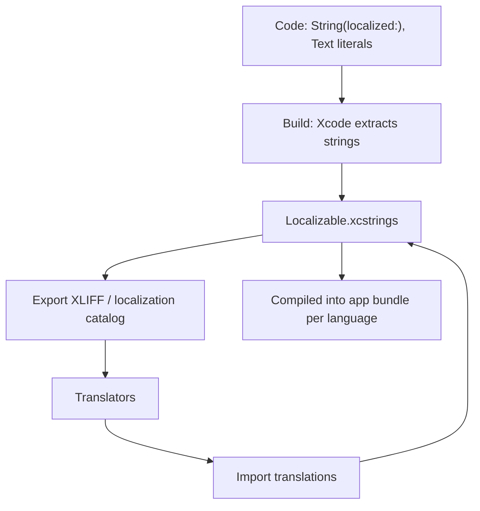

# Accessibility & Localization

[⬅ Back to index](../README.md)

Covers: accessibility problems & principles, VoiceOver, labels/traits/hints, Dynamic Type, other accommodations, SwiftUI accessibility, testing; localization with String Catalogs, plurals, formatting, RTL, testing.

---

## Accessibility

### 1. What are the main problems we need to solve when making apps accessible?

<details>
<summary>Answer</summary>

**In short:** Accessibility means people with vision, motor, hearing and cognitive disabilities can use the app. In practice that means: everything works with **VoiceOver**, text scales with **Dynamic Type**, contrast is sufficient and colour isn't the only signal, touch targets are large and gestures have alternatives, audio has captions, and the UI is simple and respects settings like **Reduce Motion**.

#### The four areas

| Area | Who | What the app must do |
|---|---|---|
| **Vision** | Blind, low vision, colour blind | Work with **VoiceOver**; support **Dynamic Type** and Zoom; sufficient **contrast** (WCAG suggests 4.5:1 for body text); never rely on **colour alone** (add icons or text to red/green states) |
| **Motor** | Tremors, limited dexterity, paralysis | Hit targets at least **44×44 pt**; work with **Switch Control** and **Voice Control** ("tap Send" needs visible labels); alternatives to complex gestures (swipe, long-press, pinch) |
| **Hearing** | Deaf, hard of hearing | **Captions and subtitles**; visual or haptic alternatives to sounds |
| **Cognitive** | Learning, attention, memory differences | Clear, simple language; consistent navigation; no time pressure; honour **Reduce Motion**; avoid flashing content |

Remember that these needs aren't only permanent: a broken arm, bright sunlight or a noisy train create the same constraints temporarily. Features like captions and larger text get used by far more people than the "target" group.

#### Why companies care

- **Users**: a significant share of people have some disability, and many more use accessibility settings (larger text is very common).
- **Legal**: accessibility is a legal requirement in many markets (ADA lawsuits in the US, the **European Accessibility Act** applying from 2025).
- **App Store**: the App Store now shows **Accessibility Nutrition Labels**, where developers declare which features (VoiceOver, larger text, captions, etc.) the app supports.
- **Engineering**: good accessibility identifiers and semantics also make UI tests more stable.

#### How to approach it in a team

1. Use standard UIKit/SwiftUI controls, which are accessible by default.
2. Add labels, traits and grouping for custom views.
3. Support Dynamic Type and test the largest sizes.
4. Audit with Accessibility Inspector and automated audits; test manually with VoiceOver.
5. Put accessibility in the definition of done, not a final "polish" phase.

**Likely follow-ups**
- *What's the minimum touch target?* 44×44 points per Apple's Human Interface Guidelines.
- *How do you prioritise a backlog of a11y issues?* Blockers first (a flow that can't be completed with VoiceOver), then high-traffic screens.

</details>

### 2. How would you explain VoiceOver to a new developer? What do you need to configure?

<details>
<summary>Answer</summary>

**In short:** VoiceOver is iOS's built-in screen reader. The user swipes left/right to move focus between elements, VoiceOver speaks each element's label, value and traits, and a double-tap activates the focused element. It reads the **accessibility tree** your views expose, not the pixels, so your job is to give each meaningful element a good `accessibilityLabel`, the right `accessibilityTraits`, a value and hint where useful, and to hide or group everything else.

#### How a user experiences it

- **Swipe right/left**: next/previous element, in reading order.
- **Double-tap**: activate. **Swipe up/down**: adjust a value (on adjustable elements) or pick a custom action.
- **Rotor** (two-finger rotate): jump by headings, links, form controls, etc.
- **Two-finger scrub (Z gesture)**: go back / dismiss (`accessibilityPerformEscape`).

For a button it might say: *"Play, button, Plays the episode."* That's **label**, **trait**, **hint**.

#### What you configure

| Property | Meaning | Example |
|---|---|---|
| **`accessibilityLabel`** | *What* it is. Short, no element type | "Play", "Profile photo of Anna" |
| **`accessibilityTraits`** | *What kind* / state | `.button`, `.header`, `.selected`, `.image`, `.link`, `.adjustable` |
| **`accessibilityValue`** | Current value | "50%", "3 of 5 stars" |
| **`accessibilityHint`** | The *result* of acting, when not obvious | "Opens the article" |
| **`isAccessibilityElement`** | Whether VoiceOver stops on it | `false` for decorative images |

```swift
// UIKit: an icon-only button
playButton.accessibilityLabel = "Play"
playButton.accessibilityHint = "Plays the episode"

// Decorative image
divider.isAccessibilityElement = false

// Group a cell so it reads once: "Anna, 3 new messages, 2 minutes ago"
cell.isAccessibilityElement = true
cell.accessibilityLabel = "\(name), \(unread) new messages, \(time)"

// Swipe-only actions need an alternative
cell.accessibilityCustomActions = [
    UIAccessibilityCustomAction(name: "Delete") { _ in self.delete(item); return true },
    UIAccessibilityCustomAction(name: "Archive") { _ in self.archive(item); return true }
]
```

#### Ordering and dynamic changes

- **Reading order** defaults to top-left to bottom-right; override with `accessibilityElements` on the container.
- **Announcements**: `UIAccessibility.post(notification: .announcement, argument: "Message sent")` for transient feedback like toasts.
- **`.screenChanged`** when a new screen or modal appears (moves focus; pass the element to focus). **`.layoutChanged`** when part of the screen changes.
- **Modals**: set `accessibilityViewIsModal = true` on custom overlays so VoiceOver ignores what's behind.

**Common pitfalls**
- Labels like "Button play" or "btn_play": traits already say "button"; labels must be human-readable and localized.
- Icon-only buttons with no label (VoiceOver reads the image file name or nothing).
- Cells where VoiceOver stops on every tiny label, making navigation slow.
- Features that only exist as swipe or long-press gestures.

**Likely follow-ups**
- *Label vs hint?* Label says what it is; hint says what happens. Users can turn hints off, so never put essential info in a hint.
- *Where's the a11y info for standard controls?* `UIButton`, `UISwitch` etc. set traits and values automatically; you mostly add labels for icon-only content.

</details>

### 3. How would you explain Dynamic Type? How do you support it?

<details>
<summary>Answer</summary>

**In short:** Dynamic Type is the system-wide text size setting (Settings → Display & Brightness / Accessibility → Larger Text), with standard sizes plus much larger **accessibility sizes**. Apps support it by using **text styles** (`.body`, `.headline`), scaling custom fonts with `UIFontMetrics` or `relativeTo:`, and building layouts that grow: no fixed heights, unlimited lines, scrolling, and switching from horizontal to vertical layouts at large sizes.

#### Why it matters

Many people use a non-default text size, not only users with low vision. If your text doesn't scale, they can't read it; if it scales but your layout doesn't, text gets truncated or overlaps.

Sizes range from `xSmall` to `xxxLarge` (the default is `large`), plus five accessibility sizes (`accessibilityMedium` to `accessibilityExtraExtraExtraLarge`, often called AX1–AX5). At AX5, body text is several times its default size.

#### UIKit

```swift
// System font
label.font = .preferredFont(forTextStyle: .body)
label.adjustsFontForContentSizeCategory = true   // updates live when the setting changes
label.numberOfLines = 0

// Custom font
let base = UIFont(name: "Brand-Regular", size: 17)!
label.font = UIFontMetrics(forTextStyle: .body).scaledFont(for: base)
label.adjustsFontForContentSizeCategory = true

// Scale non-text values (spacing, icon size)
let spacing = UIFontMetrics.default.scaledValue(for: 8)
```

#### SwiftUI

```swift
Text("Title").font(.headline)                                  // scales automatically
Text("Body").font(.custom("Brand-Regular", size: 17, relativeTo: .body))

@ScaledMetric(relativeTo: .body) var iconSize: CGFloat = 24    // scales with text
Image(systemName: "star").frame(width: iconSize, height: iconSize)
```

#### Layout that adapts

```swift
// SwiftUI: horizontal row becomes vertical at accessibility sizes
@Environment(\.dynamicTypeSize) var size

var body: some View {
    let layout = size.isAccessibilitySize
        ? AnyLayout(VStackLayout(alignment: .leading))
        : AnyLayout(HStackLayout())
    layout { avatar; nameAndDetails }
}
```

UIKit equivalent: check `traitCollection.preferredContentSizeCategory.isAccessibilityCategory` and change a `UIStackView`'s `axis` in `traitCollectionDidChange` (or the newer trait-change registration APIs). `ViewThatFits` is another SwiftUI option: it picks the first child layout that fits.

General rules:
- No fixed heights on text containers; use self-sizing cells.
- Put screens in a scroll view so content can grow.
- Don't truncate important text; wrap it.
- Use `.dynamicTypeSize(...)` limits only for genuinely constrained UI (e.g. a tab bar), and offer the **Large Content Viewer** there.

#### Testing

Xcode **Environment Overrides** (debug bar) change text size live; SwiftUI Previews can show variants (`.environment(\.dynamicTypeSize, .accessibility5)`); snapshot tests at several sizes catch regressions.

**Common pitfalls**
- Forgetting `adjustsFontForContentSizeCategory` → text only updates after relaunch.
- Using `UIFont.systemFont(ofSize: 17)`: fixed size, doesn't scale.
- Fixed-size icons next to huge text.

</details>

### 4. What other accessibility accommodations do you add?

<details>
<summary>Answer</summary>

**In short:** Beyond VoiceOver and Dynamic Type, apps should respect the user's display and motion settings (**Reduce Motion**, **Reduce Transparency**, **Increase Contrast**, **Differentiate Without Color**, **Bold Text**, **Smart Invert**), provide **captions** and haptics for media, and work with **Voice Control**, **Switch Control** and **Full Keyboard Access**. Using system colours, materials and controls gets you most of this for free.

#### Settings to respect

| Setting | How to read it | What to do |
|---|---|---|
| **Reduce Motion** | `UIAccessibility.isReduceMotionEnabled` / `@Environment(\.accessibilityReduceMotion)` | Replace zooms, parallax and large slides with fades |
| **Reduce Transparency** | `UIAccessibility.isReduceTransparencyEnabled` / `\.accessibilityReduceTransparency` | Use solid backgrounds instead of blur (system materials adapt automatically) |
| **Increase Contrast** | `traitCollection.accessibilityContrast == .high` / `\.colorSchemeContrast` | Provide high-contrast colour variants in the asset catalog |
| **Differentiate Without Color** | `UIAccessibility.shouldDifferentiateWithoutColor` / `\.accessibilityDifferentiateWithoutColor` | Add shapes, icons or text to colour-coded states |
| **Bold Text** | `UIAccessibility.isBoldTextEnabled` / `legibilityWeight` | System fonts handle it; check custom fonts |
| **Smart Invert** | `accessibilityIgnoresInvertColors` | Set `true` on photos and videos so they aren't inverted |

```swift
// SwiftUI: respect Reduce Motion
@Environment(\.accessibilityReduceMotion) var reduceMotion

.transition(reduceMotion ? .opacity : .move(edge: .bottom))
.animation(reduceMotion ? nil : .spring(), value: isExpanded)
```

#### Input methods

- **Voice Control**: users say "tap Send". It uses the accessibility label, so labels should match the visible text. Add `accessibilityInputLabels` (UIKit `accessibilityUserInputLabels`) for alternative names, e.g. a "Compose" icon could also respond to "New message".
- **Switch Control**: scans elements one by one, so the same good element structure as VoiceOver matters; avoid time-limited interactions.
- **Full Keyboard Access**: everything must be reachable with Tab/arrow keys; support focus and keyboard shortcuts on iPad.

#### Media and feedback

- **Captions/subtitles**: AVKit's player supports them when the media includes caption tracks; respect the user's caption style preferences.
- **Haptics** as non-audio feedback for important events, plus visual equivalents for sounds.
- **Audio descriptions** for video where relevant.

#### Large Content Viewer

When a UI element can't grow (tab bars, toolbars, small custom bars), long-pressing it at accessibility text sizes shows an enlarged HUD of the item. Standard bars do this automatically; custom views add `UILargeContentViewerInteraction` (SwiftUI: `.accessibilityShowsLargeContentViewer()`).

#### Stories to tell in interviews

Concrete examples land better than lists:
- "Made our feed cells a single VoiceOver element with custom actions for like and share, cutting swipes per post from 8 to 1."
- "Fixed layouts truncating at AX5 by switching rows to vertical stacks."
- "Replaced our onboarding parallax with cross-fades when Reduce Motion is on."

**Common pitfalls**
- Hardcoded colours that ignore dark mode and Increase Contrast.
- Auto-playing animations or carousels that ignore Reduce Motion.

</details>

### 5. How do you make SwiftUI views accessible?

<details>
<summary>Answer</summary>

**In short:** Start with standard controls (`Button`, `Toggle`, `Label`, `Slider`), which come with correct labels, traits and actions. Then use accessibility modifiers to add labels to icons, hide decorative content, combine related elements, add header traits, values and custom actions, and use `.accessibilityRepresentation` when a custom control should behave like a standard one.

#### The core modifiers

```swift
// Label an icon-only element
Image(systemName: "heart.fill")
    .accessibilityLabel("Favorite")

// Hide decoration
Image("divider")
    .accessibilityHidden(true)

// Read a row as one element: "Anna, 3 new messages, 2 minutes ago"
HStack {
    Image(avatar)
    Text(name)
    Text(time)
}
.accessibilityElement(children: .combine)

// Headings for rotor navigation
Text("Settings").accessibilityAddTraits(.isHeader)

// Value
Slider(value: $volume)
    .accessibilityValue("\(Int(volume * 100)) percent")

// Custom actions instead of swipe-only gestures
Row(item)
    .accessibilityAction(named: "Delete") { delete(item) }

// Custom adjustable control (swipe up/down with VoiceOver)
CustomStepper(value: $count)
    .accessibilityAdjustableAction { direction in
        switch direction {
        case .increment: count += 1
        case .decrement: count -= 1
        @unknown default: break
        }
    }
```

#### More modifiers worth knowing

| Modifier | Use |
|---|---|
| `.accessibilityElement(children: .ignore / .combine / .contain)` | Replace, merge or group child elements |
| `.accessibilitySortPriority(1)` | Change reading order (higher first) within a container |
| `.accessibilityRepresentation { Toggle(...) }` | Make a custom-drawn control behave exactly like a standard one for assistive tech |
| `.accessibilityHint("...")` | Describe the result of an action |
| `.accessibilityInputLabels([...])` | Alternative names for Voice Control |
| `.accessibilityFocused($isFocused)` | Move VoiceOver focus programmatically |
| `.accessibilityRotor(...)` | Custom rotor entries (e.g. "Unread messages") |
| `.accessibilityIdentifier("loginButton")` | For UI tests; not read to users |

#### Prefer controls over gestures

```swift
// Wrong: VoiceOver doesn't know this is a button
Image(systemName: "trash")
    .onTapGesture { delete() }

// Right: button trait, activation and keyboard/Voice Control support come free
Button(action: delete) {
    Image(systemName: "trash")
}
.accessibilityLabel("Delete")
```

`Label("Delete", systemImage: "trash")` is even better: it has a text label built in even when only the icon is displayed.

#### Previewing it

Xcode's Accessibility Inspector works with the simulator, and SwiftUI previews can be inspected for accessibility properties. The `.combine` result is especially worth checking, because it joins children's labels in order with commas.

**Common pitfalls**
- `.combine` on rows containing buttons: the buttons become actions on the combined element, which is usually fine, but verify it.
- Overusing `.accessibilityLabel` on `Text` (it already reads its content) and creating labels that don't match visible text, which breaks Voice Control.

</details>

### 6. How do you test accessibility on iOS?

<details>
<summary>Answer</summary>

**In short:** Combine three layers: **manual testing** with VoiceOver, large Dynamic Type sizes and other settings on a real device; **Accessibility Inspector** in Xcode to inspect elements and run audits; and **automated checks**, such as `performAccessibilityAudit()` in XCUITests (iOS 17+) and snapshot tests at several text sizes. Then make accessibility part of the definition of done.

#### 1. Manual testing

- Set the **Accessibility Shortcut** (Settings → Accessibility → Accessibility Shortcut) so a triple-click of the side button toggles VoiceOver.
- Complete every key flow **with VoiceOver only**, ideally with Screen Curtain on (three-finger triple-tap) so you can't cheat by looking.
- Check: is every element labelled meaningfully, is the order logical, can you reach and dismiss modals, are swipe actions available as custom actions?
- Repeat at the largest **Dynamic Type** sizes, with **Voice Control**, Switch Control, Reduce Motion, Increase Contrast and dark mode.

#### 2. Accessibility Inspector

Xcode → Open Developer Tool → Accessibility Inspector. Point it at the simulator or a device:
- **Inspection**: see label, value, traits, identifier and frame of any element.
- **Audit**: flags low contrast, small hit areas, missing labels, clipped text with Dynamic Type, and more.
- **Settings**: toggle text size and other settings live.

#### 3. Automated tests

```swift
final class AccessibilityTests: XCTestCase {
    func testLoginScreenAudit() throws {
        let app = XCUIApplication()
        app.launch()
        try app.performAccessibilityAudit()      // fails the test on issues
    }

    func testFeedAuditIgnoringKnownIssue() throws {
        let app = XCUIApplication()
        app.launch()
        try app.performAccessibilityAudit(for: [.dynamicType, .contrast]) { issue in
            // return true to ignore a specific, tracked issue
            issue.element?.identifier == "legacyBanner"
        }
    }
}
```

- **Snapshot tests** at multiple content size categories (and RTL, dark mode) catch layout regressions.
- **Unit tests** can assert labels on view models or views for critical elements.

| Method | Catches | Misses |
|---|---|---|
| Automated audit | Missing labels, contrast, hit area, clipping | Whether labels make sense, logical flow |
| Accessibility Inspector | Element-level issues quickly | Full-flow usability |
| Manual VoiceOver | Real experience, order, context | Slow; not repeatable in CI |
| Snapshot tests | Layout regressions at big text sizes | Semantics |

#### 4. Process

- Add accessibility to the **definition of done** and the PR checklist.
- Review new custom components for labels, traits and Dynamic Type.
- Where possible, get feedback from people who use assistive technologies daily.

**Likely follow-ups**
- *Can automation replace manual testing?* No; audits catch mechanical problems, but only a human can tell whether "Button 3" is a useful label or the flow makes sense.

</details>

---

## Localization & Internationalization

### 7. How do you localize an iOS app?

<details>
<summary>Answer</summary>

**In short:** Write user-facing strings with localization APIs (`String(localized:)`, SwiftUI `Text` literals, `LocalizedStringResource`), let Xcode extract them into a **String Catalog** (`.xcstrings`, Xcode 15+), add languages and translations (including **plural** and device variants), localize Info.plist strings, assets and App Store metadata, and never build sentences by concatenating fragments.

#### Internationalization vs localization

- **Internationalization (i18n)**: engineering the app so it *can* be localized: no hardcoded strings, locale-aware formatting, flexible layouts, RTL support.
- **Localization (l10n)**: actually providing translations and locale-specific resources.

#### String Catalogs

String Catalogs replace `.strings` and `.stringsdict` files with a single JSON-backed file per table, edited in Xcode.

- On build, Xcode **automatically extracts** strings from code (`String(localized:)`, SwiftUI `Text("Hello")` literals, `LocalizedStringResource`) and from Info.plist.
- It tracks each translation's **state**: new, needs review, translated, stale (the key no longer appears in code).
- **Plurals and device variations** are built in: "1 item" / "%lld items", with per-language plural categories (English has *one/other*; Arabic has six forms: *zero, one, two, few, many, other*). You can also vary text by device ("Tap" on iPhone vs "Click" on Mac).

```swift
// Key, default English value and a comment for translators
let title = String(localized: "welcome_message",
                   defaultValue: "Welcome, \(name)!",
                   comment: "Home screen greeting with the user's first name")

// SwiftUI literals are localized automatically
Text("Settings")

// Plurals: one catalog entry, variants per language
Text("\(count) items")   // catalog: one -> "%lld item", other -> "%lld items"

// Pass localizable text around without resolving it yet (e.g. for App Intents, widgets)
let resource: LocalizedStringResource = "Order shipped"
```



#### Other things to localize

- **Info.plist strings** like `NSCameraUsageDescription` (via an `InfoPlist.xcstrings` catalog), and the app's display name.
- **Images** that contain text or culturally specific content (asset catalogs support localization).
- **App Store metadata**: name, subtitle, description, keywords, screenshots.

#### Working with translators

Use **Product → Export Localizations** to produce `.xcloc` bundles (XLIFF inside) and import them back. Write a **comment** for every string describing where it appears; context prevents bad translations. Xcode 26 can generate comments for translators automatically.

#### Rules

```swift
// Wrong: word order and grammar differ between languages
let msg = NSLocalizedString("You have", comment: "") + " \(n) " + NSLocalizedString("messages", comment: "")

// Right: one full sentence with a placeholder, plural variants in the catalog
let msg = String(localized: "You have \(n) messages")
```

**Common pitfalls**
- Concatenating fragments or reusing one string in different contexts ("Open" as a verb vs an adjective).
- Hardcoded strings in code Xcode can't extract (e.g. `Text(verbatim:)` or passing a `String` variable to `Text`, which isn't localized).
- Layouts that break with longer translations (German text is often around 30% longer than English).
- Strings in Swift packages: use `bundle: .module` when localizing, or strings resolve from the main bundle.

**Likely follow-ups**
- *`NSLocalizedString` still works?* Yes, and String Catalogs extract from it too, but `String(localized:)` is the modern API.

</details>

### 8. How do you format dates, numbers and currencies for different locales?

<details>
<summary>Answer</summary>

**In short:** Never hardcode formats like `"MM/dd/yyyy"` or `"$%.2f"` for display. Use locale-aware formatting: the `.formatted()` FormatStyle APIs (iOS 15+) or the older `DateFormatter`/`NumberFormatter` family. They pick the right order, separators, symbols, calendar and units for the user's locale. Store and transmit data in a fixed, locale-independent format (UTC, ISO-8601, raw numbers).

#### Modern FormatStyle APIs

```swift
date.formatted(date: .abbreviated, time: .shortened)          // "Nov 6, 2026 at 3:41 PM" / "6 nov 2026, 15:41"
price.formatted(.currency(code: "INR"))                        // ₹1,234.50 – grouping per locale
0.25.formatted(.percent)                                       // 25%
Measurement(value: 5, unit: UnitLength.kilometers).formatted() // "3.1 mi" for US users
date.formatted(.relative(presentation: .named))                // "yesterday"
1_234_567.formatted()                                          // "1,234,567" / "1.234.567" / "12,34,567"
["Anna", "Ben", "Chen"].formatted(.list(type: .and))           // "Anna, Ben, and Chen"
```

SwiftUI integrates these directly: `Text(date, format: .dateTime.day().month())`, `TextField("Amount", value: $amount, format: .currency(code: "EUR"))`.

#### What varies by locale

| Thing | Examples |
|---|---|
| Date order | 11/6/2026 (US) vs 6/11/2026 (UK) vs 2026/11/06 (Japan) |
| 12h vs 24h clock | 3:41 PM vs 15:41 (the user can override this in Settings) |
| Decimal/grouping separators | 1,234.5 vs 1.234,5 vs 1 234,5; Indian grouping 12,34,567 |
| Currency symbol and position | $10.00, 10,00 €, ¥10 |
| Calendar | Gregorian, Buddhist, Japanese, Hijri |
| Units | km vs miles, °C vs °F |
| First day of week | Sunday vs Monday |

#### Legacy formatters

`DateFormatter` (with `dateStyle`/`timeStyle` or `setLocalizedDateFormatFromTemplate("MMMd")`), `NumberFormatter`, `MeasurementFormatter`, `RelativeDateTimeFormatter`, `ListFormatter`. They're **expensive to create**, so cache and reuse them (they're thread-safe for formatting on modern OS versions, but don't mutate a shared one concurrently).

```swift
// Wrong for display: fixed US pattern
formatter.dateFormat = "MM/dd/yyyy"

// Right: a template; the formatter reorders it for the locale
formatter.setLocalizedDateFormatFromTemplate("yMMMd")
```

#### Storage vs display

- **Store** dates as UTC timestamps or ISO-8601 strings (`Date.ISO8601FormatStyle`, `ISO8601DateFormatter`). When parsing fixed-format server dates with `DateFormatter`, set `locale = Locale(identifier: "en_US_POSIX")` and an explicit time zone, or parsing can break for users with a different calendar or 12/24h setting.
- **Display** in the user's time zone and calendar with `Locale.current`, `TimeZone.current`, `Calendar.current`.
- Currency: the **currency code comes from your data** (what the price is in), while the **format comes from the locale**. Don't infer currency from the user's region.
- Keep money in `Decimal`, not `Double`, to avoid rounding errors.

**Common pitfalls**
- Parsing server dates without `en_US_POSIX` → nil dates for some users.
- Language vs region: a user can have English language with German region; formatting follows the region settings.

</details>

### 9. How do you support right-to-left (RTL) languages?

<details>
<summary>Answer</summary>

**In short:** Use **leading/trailing** instead of left/right everywhere (Auto Layout, stack views, padding, alignment) so UIKit and SwiftUI can **mirror layouts automatically** for Arabic, Hebrew, Persian and Urdu. Use `.natural` text alignment, flip directional images (arrows, back chevrons) but not non-directional ones (logos, play icons, clocks), and test with the Right-to-Left pseudolanguage and real RTL locales.

#### What mirroring means

In an RTL language, the whole UI flows right to left: the back button is on the right, navigation pushes from the left, a list cell's image is on the right and the disclosure chevron on the left, and progress bars fill from right to left.

#### Layout

```swift
// Wrong: fixed physical direction
label.leftAnchor.constraint(equalTo: view.leftAnchor, constant: 16)

// Right: flips automatically in RTL
label.leadingAnchor.constraint(equalTo: view.leadingAnchor, constant: 16)
```

- `UIStackView`, `UICollectionViewCompositionalLayout` and SwiftUI stacks follow layout direction automatically.
- SwiftUI's `.padding(.leading)`, `HStack` and `alignment: .leading` already mean "start side".

#### Text

- `textAlignment = .natural` aligns to the start of the language's direction (right for Arabic).
- Mixed content (an English brand name in an Arabic sentence, phone numbers) is handled by the Unicode bidirectional algorithm; in rare cases you may need direction marks or a forced direction.

#### Images and icons

```swift
// UIKit: flip a custom directional image
let arrow = UIImage(named: "arrow-forward")?.imageFlippedForRightToLeftLayoutDirection()

// SwiftUI
Image("arrow-forward").flipsForRightToLeftLayoutDirection(true)
```

- Many **SF Symbols** with direction (like `chevron.forward`, `arrow.forward`) flip automatically; prefer `forward`/`backward` names over `right`/`left`.
- Asset catalogs have a **Direction** setting (e.g. "Left to Right, Mirrors").
- **Don't flip**: media play/fast-forward buttons (they represent tape direction), logos, clocks, checkmarks, images of real objects, graphs where time goes left to right by convention.

#### Exceptions

Some UI should stay LTR even in RTL languages, e.g. a phone number field, a video scrubber, or a code editor:

```swift
phoneField.semanticContentAttribute = .forceLeftToRight
```

In SwiftUI, read `@Environment(\.layoutDirection)` or override it with `.environment(\.layoutDirection, .leftToRight)` for that subtree.

#### Testing

- Scheme → Run → Options → App Language: **"Right-to-Left Pseudolanguage"** mirrors the UI with your existing strings, so you can test before having translations.
- Run in real Arabic/Hebrew locales to check text rendering, truncation and mixed-direction text.
- SwiftUI previews: `.environment(\.layoutDirection, .rightToLeft)`.

**Common pitfalls**
- Custom gesture code using `translation.x > 0` to mean "forward"; flip the sign for RTL.
- Hardcoded `CGAffineTransform` animations sliding in from the left.
- Manually computed frames (`x: 16`) in custom layouts instead of using `effectiveUserInterfaceLayoutDirection`.

</details>

### 10. How do you test localization?

<details>
<summary>Answer</summary>

**In short:** Run the app in specific languages and regions through the **scheme options** or launch arguments, use **pseudolanguages** to catch truncation, hardcoded strings and RTL problems before translations exist, preview and snapshot-test key screens per locale, watch the String Catalog for untranslated or stale entries (ideally in CI), and support iOS's per-app language setting instead of building your own.

#### Running in a language without changing the device

- **Scheme → Run → Options → App Language / App Region.**
- Or launch arguments, which also work in UI tests:

```swift
let app = XCUIApplication()
app.launchArguments += ["-AppleLanguages", "(de)", "-AppleLocale", "de_DE"]
app.launch()
```

#### Pseudolanguages

Available in the App Language menu; they need no translations:

| Pseudolanguage | Catches |
|---|---|
| **Double-Length** | Truncation, fixed widths, layouts that can't grow (German/Finnish-like text) |
| **Accented** | Font support for diacritics, clipped ascenders/descenders |
| **Bounded String** | Concatenated or clipped strings (each string is wrapped in markers, so a missing end marker reveals clipping) |
| **Right-to-Left** | Mirroring problems |

Any text that appears unchanged in a pseudolanguage is a **hardcoded string** that isn't going through localization.

#### Previews and snapshot tests

```swift
#Preview("Arabic") {
    SettingsView()
        .environment(\.locale, Locale(identifier: "ar"))
        .environment(\.layoutDirection, .rightToLeft)
}
```

Snapshot tests per locale (and per Dynamic Type size) catch regressions automatically. Note that `\.locale` in the environment affects formatting and SwiftUI text lookup, but not every API, so also run the app in the language.

#### Catalog health and CI

- The String Catalog shows the percentage translated per language and flags **new**, **stale** and **needs review** entries.
- Add a CI check (e.g. a script parsing the `.xcstrings` JSON) that fails the build if any shipped language has untranslated strings.
- Review screenshots in each language before release; App Store screenshots per locale often reveal problems.

#### Per-app language

Since iOS 13, users can pick an app-specific language in **Settings → [Your App] → Language**, which appears when the app has more than one localization. Support it by listing the localizations in the project. Don't build an in-app language switcher that fights the system; if you want an in-app entry point, deep link to your app's Settings page (`UIApplication.openSettingsURLString`).

**Common pitfalls**
- Testing only in English and German; also test a long language, an RTL language and a CJK language.
- Forgetting that the region (formatting) and language are separate settings.

**Likely follow-ups**
- *How do you catch hardcoded strings early?* Pseudolanguages, plus Xcode's static analyzer option for localizability issues ("Missing Localizability").

</details>

---

[⬅ Previous: Objective-C Essentials](23-objective-c.md) · [⬅ Back to index](../README.md) · [Next: Company-Wise Questions ➡](25-company-wise-questions.md)
