# Company-Wise Questions (Product Companies)

[⬅ Back to index](../README.md)

Covers: how iOS interview loops work at Apple, Google, Meta, Amazon, Microsoft, Uber, Airbnb, Netflix, LinkedIn, Spotify and Indian product companies (Flipkart, Swiggy, Zomato, PhonePe, Paytm, CRED, Meesho, Zepto, Hotstar, Dream11, Razorpay); the machine-coding round; the most-asked questions; and full answers for company-style mobile design prompts (UPI app, quick commerce, live order tracking, super-app, product listing, short-video feed, server-driven UI, live scores, feature-flag SDK).

> These lists come from commonly reported interview experiences. Companies change their questions and loops often, so use them to practise each company's **style**, not as a guaranteed list. Links point to the full answers in this repo. For backend-heavy design rounds, see the [System Design repo](https://github.com/AkshayAshokCode/System-Design-Interview-Questions-and-Answers).

---

## How Product Companies Interview iOS Engineers

### 1. What does a typical iOS interview loop at a product company look like?

<details>
<summary>Answer</summary>

**In short:** A product-company iOS loop is usually 4–6 rounds drawn from five types: DSA coding, iOS/platform deep dive, machine coding, mobile system design, and behavioral/hiring manager. The exact mix depends on the company and level, so ask the recruiter which rounds you will get and prepare for those.

#### The five round types

| Round | What happens | Where it is heaviest | How to prepare |
|---|---|---|---|
| **DSA / coding** (1–3 rounds) | Data structures and algorithms problems, usually solved in Swift in a shared editor | Google, Meta, Amazon, Microsoft | Timed practice in Swift; know `Array`, `Dictionary`, `Set`, and how to write a heap or queue by hand |
| **iOS / platform knowledge** | Swift language, memory management, concurrency, UIKit and SwiftUI, app lifecycle, performance, architecture. Often a conversation that goes deeper with each answer, sometimes with code | Almost everywhere | Go deep on "why" and internals, not just API names |
| **Machine coding** | Build a small working app or feature in 60–180 minutes, then walk through it | Indian product companies, startups | Practise building a list-detail app with networking end to end |
| **Mobile system design** | Design an app's client architecture and its contract with the backend | Senior and above | Practise out loud with a structure (see [System Design](20-system-design.md)) |
| **Behavioral / hiring manager** | Past projects, ownership, conflict, impact | Everywhere; Amazon asks it in every round | 6–8 STAR stories with numbers (see [Coding, Scenarios & Behavioral](22-coding-scenarios.md)) |

#### A typical flow

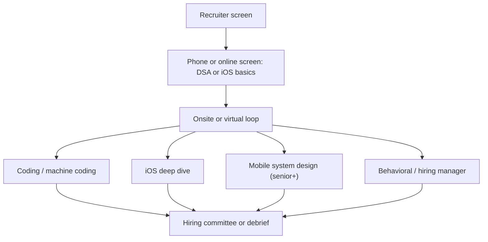

The screen filters candidates cheaply; the loop gives several interviewers independent signals; a debrief or committee then decides the level and outcome. One weak round does not always sink you, but a clear "no hire" signal in a core round usually does.

#### Why companies mix rounds

Each round tests something different. DSA checks problem solving under time pressure. The iOS deep dive checks whether you understand the platform well enough to debug hard problems. Machine coding checks whether you can actually ship clean, working code. System design checks whether you can own a feature area. Behavioral checks whether you will work well with others and take ownership.

**Pitfalls**
- Preparing only DSA for a company that runs machine coding (or the reverse).
- Treating the iOS round as trivia; interviewers follow up with "why" until you hit the edge of your knowledge.
- Ignoring behavioral prep; it often decides the level offered.

**Likely follow-ups**
- *Which language for DSA?* Swift is accepted almost everywhere for iOS roles; use the language you are fastest and cleanest in.
- *Are take-homes common?* Some teams (including some Apple teams and startups) use them instead of live machine coding.

</details>

### 2. What are iOS interviews at Apple like?

<details>
<summary>Answer</summary>

**In short:** Apple hires per team, so loops vary a lot, but commonly reported loops include several technical conversations with team members, practical coding (often iOS-flavoured, sometimes DSA), deep framework knowledge, and a manager round. They probe deep Swift, memory, concurrency, UIKit/SwiftUI internals, privacy, accessibility and performance, and they value care for user experience.

#### Format (commonly reported)

Apple does not run one central loop the way Google does. The team that has the opening runs the process, so two Apple interviews can look quite different. Expect:
- Several technical conversations with engineers on the team, often going deep into one area.
- Practical coding: sometimes classic DSA, often something closer to real iOS work (write a small component, debug code, reason about threading).
- A manager or senior leader conversation about your past work and fit.
- Some teams give a take-home or a live app-building exercise.

Because the team owns the hiring, the questions tend to match the team's work. A team building a framework will push on API design and performance; a team building an app will push on UI, data flow and polish.

#### What they probe

| Area | Typical questions | Read |
|---|---|---|
| Deep Swift | Value vs reference semantics, copy-on-write, protocols and generics, `some` vs `any` | [Swift Advanced](02-swift-advanced.md) |
| Memory | ARC, retain cycles, `weak` vs `unowned` | [Memory](03-memory-management.md) |
| Concurrency | GCD, actors, `Sendable`, Swift 6 strict concurrency | [GCD](04-gcd-operations.md), [Swift Concurrency](05-swift-concurrency.md) |
| UI internals | Run loop, rendering, view identity, data flow | [UIKit](09-uikit.md), [SwiftUI](10-swiftui.md) |
| Privacy and accessibility | Privacy by design, on-device processing, VoiceOver, Dynamic Type | [Security & Privacy](18-security-privacy.md), [Accessibility](24-accessibility-localization.md) |
| Performance | Finding hangs, leaks and slow launches with Instruments | [Performance](16-performance.md) |

A typical deep-Swift probe looks like this:

```swift
var a = [1, 2, 3]
var b = a          // no copy yet: both share one buffer (copy-on-write)
b.append(4)        // buffer is copied here, because it is shared
// Follow-up: how would you give your own struct copy-on-write?
// Answer: wrap storage in a final class and check isKnownUniquelyReferenced(&storage)
// before mutating.
```

#### What helps you stand out

- Show care for user experience, privacy and platform conventions (Human Interface Guidelines). If you design a feature, mention accessibility and privacy without being asked.
- Know the latest WWDC changes relevant to the team → [What's New](21-whats-new-trending.md).
- Be honest about the limits of your knowledge; deep follow-ups are expected.

**Pitfalls**
- Talking about third-party libraries as the answer to everything; Apple teams expect you to know the system frameworks.
- Ignoring accessibility and privacy in a design answer.

**Likely follow-ups**
- *Why does privacy matter in your design?* Apple treats it as a product feature: collect less, process on device where possible, ask for permissions in context.
- *How would you find a hang?* Instruments (Time Profiler, Hangs), check main-thread work, move I/O and heavy work off the main thread.

</details>

### 3. What are iOS interviews at Google like?

<details>
<summary>Answer</summary>

**In short:** Google's coding rounds are mostly language-agnostic DSA (graphs, trees, dynamic programming) that you solve in Swift with clean code and complexity analysis. iOS roles add a domain round on iOS fundamentals and app design, and senior candidates also get mobile system design and a "Googleyness and leadership" round. Architecture and testing at scale come up because Google's iOS apps are large and modular.

#### Format (commonly reported)

- **DSA coding rounds** – the same style as other Google engineering roles. You are judged on problem solving, code quality, testing your own code, and time/space complexity. Swift is fine; write idiomatic Swift, not Java in Swift syntax.
- **iOS domain round** – iOS fundamentals (lifecycle, memory, concurrency, UI) plus designing part of an app.
- **Mobile system design** (senior) – design a client and its API contract.
- **Googleyness and leadership** – collaboration, handling ambiguity, doing the right thing.
- A hiring committee reviews all feedback, so each interviewer writes detailed notes. Explaining your thinking out loud matters as much as the final code.

#### Writing DSA in Swift well

```swift
// Breadth-first search on a grid: a classic Google-style problem.
func shortestPath(_ grid: [[Int]], from start: (Int, Int), to goal: (Int, Int)) -> Int {
    let rows = grid.count, cols = grid[0].count
    var visited = Array(repeating: Array(repeating: false, count: cols), count: rows)
    var queue = [(start.0, start.1, 0)]
    var head = 0                      // index-based queue: O(1) dequeue, unlike removeFirst()
    visited[start.0][start.1] = true
    let dirs = [(1, 0), (-1, 0), (0, 1), (0, -1)]
    while head < queue.count {
        let (r, c, d) = queue[head]; head += 1
        if (r, c) == goal { return d }
        for (dr, dc) in dirs {
            let nr = r + dr, nc = c + dc
            guard nr >= 0, nr < rows, nc >= 0, nc < cols,
                  grid[nr][nc] == 0, !visited[nr][nc] else { continue }
            visited[nr][nc] = true
            queue.append((nr, nc, d + 1))
        }
    }
    return -1
}
```

Mention complexity (O(rows × cols) time and space) and Swift-specific details like `removeFirst()` being O(n) on arrays.

#### Common design prompts

- An image loading and caching library (memory + disk cache, deduplicating requests, cancellation).
- An offline-first app (local store as source of truth, sync queue, conflict resolution).
- A Google Photos-style backup client (background uploads with `URLSession` background sessions, resumable uploads, battery and network constraints).
- A YouTube-style video screen (AVPlayer, adaptive streaming, comments pagination).

See [System Design](20-system-design.md).

**Pitfalls**
- Jumping into code before clarifying input sizes and edge cases.
- Not testing your code with a small example at the end.
- Using Swift features you can't explain (e.g. lazy sequences) just to look clever.

**Likely follow-ups**
- *How would you test this at scale?* Unit tests on view models and services via protocols, snapshot tests for UI, a few UI tests for critical flows.
- *How do large apps stay buildable?* Modularization into many small libraries with clear dependencies → [DI & Modularization](12-dependency-injection-modularization.md).

</details>

### 4. What are iOS interviews at Meta like?

<details>
<summary>Answer</summary>

**In short:** Commonly reported Meta iOS loops have two fast-paced DSA coding rounds (often two problems in 45 minutes), a mobile system design / product architecture round, and a behavioral round. Design prompts are Meta's own products (feed, Stories, Messenger, photo upload), and they expect you to drive from the product down to data flow and edge cases.

#### Format (commonly reported)

| Round | What to expect |
|---|---|
| Coding × 2 | Usually two medium problems per 45 minutes. Speed and bug-free code matter; you may not be allowed to run the code |
| Mobile system design / product architecture | Design a Meta-style feature end to end on the client, including API and data model |
| Behavioral | Conflict, ownership, impact, growth; questions often dig into specifics of one project |

#### Common design prompts

- The Instagram or Facebook feed.
- Instagram Stories (prefetching media, progress bars, tap navigation).
- Messenger / WhatsApp chat (real-time delivery, offline send queue, read receipts).
- A photo upload flow (background upload, retries, progress, compression).
- A video feed with prefetching → [short-video feed](#21-design-a-short-video-feed-like-instagram-reels--moj--sharechat).

See also [System Design](20-system-design.md).

#### Deep-dive topics they push on

- **Pagination and caching** – cursor-based pagination, a local cache so the feed shows instantly at launch.
- **Prefetching** – images and video for the next few items, cancelled when the user scrolls away.
- **Optimistic updates** – a like shows immediately and rolls back on failure.
- **Offline queues** – posts and messages queued and retried with idempotency keys.
- **Real-time updates** – WebSocket/long-poll for new items, merged without jumping the scroll position.
- **Scroll performance** – cell reuse, precomputed layout, image decoding off the main thread.
- **App size and launch time**, and behaviour on poor networks.

```swift
// Optimistic like with rollback: a common deep-dive snippet.
@MainActor
func toggleLike(_ post: Post) async {
    let previous = post.isLiked
    post.isLiked.toggle()                 // update UI immediately
    do {
        try await api.setLike(postID: post.id, liked: post.isLiked)
    } catch {
        post.isLiked = previous           // roll back and tell the user
        showToast("Couldn't update like")
    }
}
```

#### How to approach the design round

Drive from the product: first what the user sees and does, then the data flow (API, models, cache, view models), then edge cases (offline, slow network, app suspended or terminated, very long feeds). Interviewers want you to lead the conversation, not wait for prompts.

**Pitfalls**
- Spending the design round on backend details (databases, sharding) instead of the client.
- Forgetting failure states: what does the user see when the upload fails at 90%?

**Likely follow-ups**
- *How do you avoid duplicate posts when retrying an upload?* Client-generated idempotency key sent with each attempt.
- *How do you keep scroll position when new items arrive?* Insert above with diffable snapshots and adjust content offset, or show a "new posts" pill.

</details>

### 5. What are iOS interviews at Amazon like?

<details>
<summary>Answer</summary>

**In short:** Commonly reported Amazon iOS loops have DSA rounds, an iOS/technical round, often a low-level or system design round, and **Leadership Principles** questions in every round. Prepare 6–8 STAR stories mapped to the principles, and practical designs like a product page, cart sync and order tracking.

#### Format (commonly reported)

Each interviewer is usually assigned one or two Leadership Principles to assess, in addition to a technical area. So even a coding round may start with 15 minutes of "Tell me about a time when...". One interviewer, often called the "Bar Raiser", is from outside the team and checks that the hire raises the overall bar.

#### Leadership Principles: how to prepare

Prepare 6–8 stories in STAR form (Situation, Task, Action, Result), each reusable for several principles:

| Principle | Story it fits |
|---|---|
| Customer Obsession | You noticed users struggling (crash, slow screen, confusing flow) and fixed it |
| Dive Deep | You tracked down a hard bug with Instruments, crash logs or data |
| Ownership | You fixed something outside your area because it hurt users |
| Disagree and Commit | You pushed back on a technical decision, then fully supported the final call |
| Deliver Results | You shipped under a tight deadline by cutting scope wisely |
| Bias for Action | You made a reversible decision quickly instead of waiting |

Use "I", give numbers in the Result ("crash-free sessions went from 99.1% to 99.7%"), and be ready for follow-ups like "what would you do differently?".

#### Technical topics

- iOS fundamentals and architecture → [Architecture](11-architecture.md)
- Concurrency and memory
- Testing → [Testing](17-testing.md)
- Practical designs: a product detail page, cart sync across devices, order tracking with notifications and Live Activities → [Background & Notifications](15-background-notifications.md)

For **cart sync across devices**, a good answer covers: the server as source of truth, a local cache for instant UI, optimistic quantity updates with debounce, and reconciliation when the server returns a different cart (item out of stock, price changed).

**Pitfalls**
- Stories with "we" everywhere; interviewers can't tell what you did.
- Stories without a measurable result.
- Reusing the same story for every principle.

**Likely follow-ups**
- *What was the trade-off you made?* Always have one ready per story.
- *What data did you use to decide?* Mention metrics, crash logs, A/B tests or user feedback.

</details>

### 6. What do Microsoft, LinkedIn, Uber, Airbnb, Netflix and Spotify typically ask?

<details>
<summary>Answer</summary>

**In short:** Each company's questions follow its product. Microsoft and LinkedIn focus on large-codebase concerns (modularization, build times, feed performance, A/B testing); Uber and similar companies on architecture at scale, location and real-time state; Airbnb on server-driven UI and design systems; Netflix and Spotify on media playback, offline downloads and background audio.

#### Company by company (commonly reported)

| Company | Focus | Read |
|---|---|---|
| **Microsoft / LinkedIn** | Team-dependent mix of DSA, iOS deep dive and design. Large-codebase concerns: modularization, build times, feed performance, A/B testing | [DI & Modularization](12-dependency-injection-modularization.md), [Build & Release](19-xcode-build-release.md) |
| **Uber / Lyft / DoorDash** | Architecture at scale (Uber publicly described its RIBs architecture), location tracking, maps, real-time trip state, Live Activities, reliability on bad networks, feature flags | [Uber-style design](20-system-design.md), [feature-flag SDK](#23-design-a-feature-flag--experimentation-sdk-for-ios) |
| **Airbnb** | Server-driven UI, design systems, search and booking flows, deep links | [server-driven UI](#20-design-server-driven-ui-like-airbnb--swiggy--flipkart) |
| **Netflix / Spotify** | AVFoundation playback, offline downloads with FairPlay DRM, background audio, adaptive streaming, CarPlay | [System Design](20-system-design.md), [Background](15-background-notifications.md) |

#### Why these themes

- **Microsoft / LinkedIn** apps are built by many teams in one codebase. Questions like "how would you cut a 20-minute build" or "how do you make the feed scroll at 60/120 fps" reflect daily problems. Expect discussion of module boundaries, interface packages, caching build artifacts, and experiment frameworks.
- **Uber-style** apps must stay correct while the trip changes state in real time and the network drops. Expect a trip state machine, location updates with battery trade-offs, and server-controlled feature flags to switch off broken features without a release.
- **Airbnb** has publicly described its server-driven UI work. Expect "how would you let the server change the search results screen without an app update?" and how a design system keeps components consistent.
- **Netflix / Spotify** are media-first. Expect `AVPlayer` and HLS, downloading content for offline use (`AVAssetDownloadURLSession` with FairPlay-protected content), background audio mode with `AVAudioSession` and Now Playing info, and handling interruptions like phone calls.

```swift
// Background audio basics (Spotify-style follow-up).
// 1. Enable the "Audio, AirPlay, and Picture in Picture" background mode.
// 2. Configure the session before playback:
try AVAudioSession.sharedInstance().setCategory(.playback, mode: .default)
try AVAudioSession.sharedInstance().setActive(true)
// 3. Observe AVAudioSession.interruptionNotification to pause/resume on calls.
// 4. Update MPNowPlayingInfoCenter and MPRemoteCommandCenter for Lock Screen controls.
```

**Pitfalls**
- Preparing generic answers; use the company's app before the interview and think about how its main screen is built.
- Assuming loops are uniform; at Microsoft and LinkedIn especially, the team decides.

**Likely follow-ups**
- *How do you roll out a risky change?* Feature flag, phased release, monitor crash and business metrics, kill switch.
- *How do offline downloads survive app termination?* Background `URLSession` downloads continue in a system process, and the app is relaunched to handle completion.

</details>
### 7. What do Indian product companies ask iOS engineers?

<details>
<summary>Answer</summary>

**In short:** Most Indian product companies run machine coding (build an app in 1–3 hours), then an iOS deep dive, then mobile HLD/LLD, then a hiring manager or culture round; some add DSA (more common at Flipkart, PhonePe and Razorpay). Design prompts mirror each company's product: listings for e-commerce, live tracking for food delivery, UPI for payments, live scores for sports.

#### Typical loop

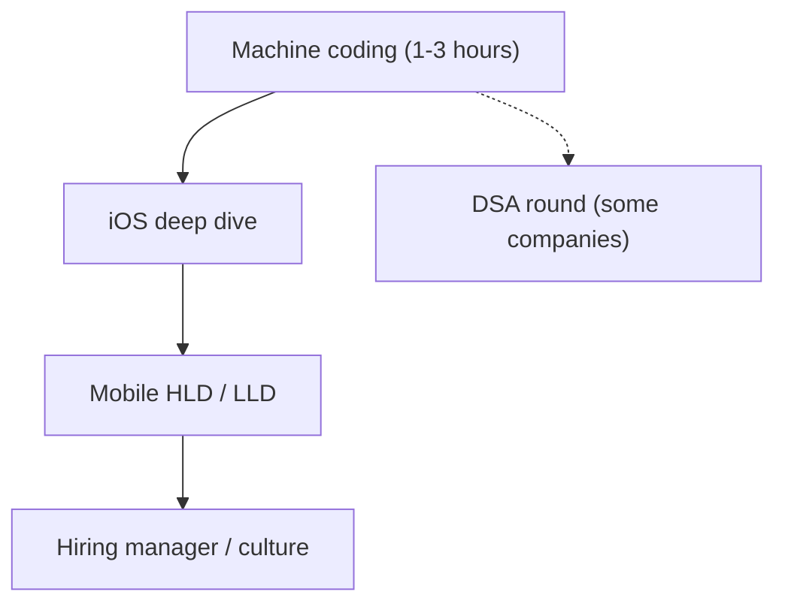

The machine-coding round often comes first and acts as the main filter. If your app doesn't run or the code is messy, you rarely get to the later rounds.

#### Company focus (commonly reported)

| Company | Commonly reported focus and prompts |
|---|---|
| **Flipkart / Meesho / Myntra** | Product listing with filters and infinite scroll, image-heavy screens, app size and launch time → [product listing](#19-design-a-product-listing-page-with-filters-and-infinite-scroll-flipkart--amazon) |
| **Swiggy / Zomato** | Live order tracking with Live Activities, restaurant listing, server-driven UI, cart → [order tracking](#16-design-a-live-order-tracking-screen-swiggy--zomato--uber-eats), [SDUI](#20-design-server-driven-ui-like-airbnb--swiggy--flipkart) |
| **Zepto / Blinkit / Instamart** | Quick-commerce home and cart with per-store inventory → [quick commerce](#15-design-a-quick-commerce-app-zepto--blinkit--instamart) |
| **PhonePe / Paytm / Google Pay / CRED / Razorpay** | UPI flows, Keychain/Secure Enclave security, jailbreak detection, super-app modularization, payment SDKs → [UPI app](#14-design-a-upi-payments-app-client-phonepe--google-pay--paytm), [super-app](#17-design-a-super-app-architecture-paytm--phonepe--tata-neu) |
| **Hotstar / Dream11 / Cricbuzz** | Live scores and streaming for millions, Live Activities, spikes → [live scores](#22-design-a-live-score--fantasy-sports-screen-for-millions-of-concurrent-users) |
| **ShareChat / Moj / Josh / Instagram** | Short-video feed with preloading and smooth playback → [short-video feed](#21-design-a-short-video-feed-like-instagram-reels--moj--sharechat) |

#### Deep-dive favourites

These come up again and again in the iOS round:
- ARC and retain cycles (closures capturing `self`, delegates that should be `weak`).
- GCD vs async/await and actors; when to use which; deadlocks with `sync` on the current queue.
- SwiftUI state and identity (`@State`, `@Binding`, `@Observable`, why a view resets when its identity changes).
- `UITableView`/`UICollectionView` cell reuse and diffable data sources.
- App lifecycle and background modes.
- Core Data concurrency (contexts are bound to their queue; use `perform`).
- Method dispatch (static vs dynamic, `final`, protocol extensions).
- Protocol-oriented programming.

A classic deep-dive question:

```swift
// Why does this protocol-extension method print "Default" for the second call?
protocol Greeter {}
extension Greeter { func greet() { print("Default") } }   // not a requirement
struct Friendly: Greeter { func greet() { print("Hi!") } }

Friendly().greet()                  // "Hi!" – static type is Friendly
let g: Greeter = Friendly()
g.greet()                           // "Default" – static dispatch on the existential,
                                    // because greet() is not declared in the protocol
```

**Pitfalls**
- Underestimating machine coding; it needs practice under a timer, not just knowledge.
- Ignoring app size and low-end devices, which matter a lot in the Indian market.

**Likely follow-ups**
- *How would you make this work on a 2G/3G connection?* Smaller payloads, aggressive caching, image size per device, retries with backoff, clear offline states.
- *How do you keep the app small?* Asset catalogs with app thinning, removing unused code and dependencies, static linking, compressing images.

</details>

### 8. What is the machine-coding round and how do you do well in it?

<details>
<summary>Answer</summary>

**In short:** You build a small working app or feature in 60–180 minutes, then walk the interviewer through it. You score well by clarifying scope, getting a clean end-to-end version working early (MVVM, a service layer behind protocols, async/await), then adding loading/error/empty states, pagination and caching, and explaining your trade-offs.

#### Typical prompts

- Image gallery or movie list from an API with search, pagination and a detail screen.
- A to-do or notes app with persistence (SwiftData/Core Data or a file).
- A countdown timer or stopwatch that keeps correct time across backgrounding.
- A chat screen UI with a fake socket, or a product listing with filters and a cart.

#### What interviewers evaluate

| Area | What "good" looks like |
|---|---|
| Working software | It runs, the main flow works end to end |
| Structure | Clear layers, no massive view controller, dependencies injected |
| Edge cases | Loading, error, empty states; cancellation; no duplicate requests |
| Code quality | Readable names, small functions, no force unwraps without reason |
| Communication | You explain choices and what you'd do with more time |

#### How to score well

1. **Clarify scope** (5 min) – list must-haves and nice-to-haves; build must-haves first.
2. **Set up a clean structure fast** – MVVM with a service/repository layer, protocols for dependencies (testability), async/await, SwiftUI or UIKit with diffable data sources.
3. **Get something working end to end early**, then add loading/error/empty states, pagination, image caching, and cancellation of in-flight requests.
4. **Readable code**, no massive view controllers; a few unit tests for the view model if time allows.
5. **Keep a template project ready** if the company allows it (networking client, image loader, folder structure).

A skeleton you can type in minutes:

```swift
protocol MovieService {
    func movies(page: Int) async throws -> [Movie]
}

@MainActor @Observable
final class MovieListViewModel {
    enum State { case idle, loading, loaded, empty, failed(String) }
    private(set) var movies: [Movie] = []
    private(set) var state: State = .idle
    private var page = 1
    private var canLoadMore = true
    private let service: MovieService

    init(service: MovieService) { self.service = service }

    func loadNextPage() async {
        guard canLoadMore, !isLoading else { return }   // avoid duplicate requests
        state = .loading
        do {
            let next = try await service.movies(page: page)
            movies += next
            page += 1
            canLoadMore = !next.isEmpty
            state = movies.isEmpty ? .empty : .loaded
        } catch is CancellationError {
            // the view went away; ignore
        } catch {
            state = .failed(error.localizedDescription)
        }
    }

    private var isLoading: Bool { if case .loading = state { true } else { false } }
}
```

In SwiftUI, `.task { await vm.loadNextPage() }` ties the request to the view's lifetime, so it is cancelled automatically when the view disappears.

#### The timer prompt: a common trap

Don't count ticks of a `Timer`; timers pause when the app is suspended. Store the **start date** (or end date) and compute the remaining time from `Date()` each tick, so the value is correct after returning from the background. Schedule a local notification for the end time if the user should be alerted while away.

#### The walkthrough

Spend the last 10 minutes on: architecture in one sentence, a demo, trade-offs, and "with more time I would add tests for X, disk caching, accessibility labels".

**Pitfalls**
- Over-engineering (VIPER + coordinators + DI container) and running out of time with nothing working.
- Doing networking or image decoding on the main thread.
- No error state: the screen stays blank when the request fails.

See worked examples in [Coding & Scenarios](22-coding-scenarios.md).

</details>

### 9. Which iOS questions come up most across product companies?

<details>
<summary>Answer</summary>

**In short:** The same core set appears almost everywhere: value vs reference types, ARC and retain cycles, GCD and Swift Concurrency, app lifecycle, UIKit and SwiftUI internals, architecture and DI, networking, persistence, background work and notifications, performance, and mobile system design. If you can answer each of the 15 items below confidently, with a follow-up or two, you are well prepared.

#### The checklist

| # | Topic | What you should be able to explain | Read |
|---|---|---|---|
| 1 | Struct vs class | Value vs reference semantics, copy-on-write, when to use each | [01](01-swift-basics.md), [02](02-swift-advanced.md) |
| 2 | ARC | Retain cycles in closures and delegates, `weak` vs `unowned` | [03](03-memory-management.md) |
| 3 | GCD | Serial vs concurrent, sync vs async, deadlocks, thread safety | [04](04-gcd-operations.md) |
| 4 | Swift Concurrency | async/await, `Task`, task groups, actors, `@MainActor`, `Sendable`, Swift 6 | [05](05-swift-concurrency.md) |
| 5 | Combine | Publishers, operators, when to use it vs async sequences | [06](06-combine.md) |
| 6 | Lifecycle | App and scene lifecycle, background states, run loop | [08](08-ios-fundamentals.md) |
| 7 | UIKit | View controller lifecycle, Auto Layout, cell reuse, diffable data sources | [09](09-uikit.md) |
| 8 | SwiftUI | View identity, `@State`/`@Binding`/`@Observable`, data flow, performance | [10](10-swiftui.md) |
| 9 | Architecture | MVVM vs VIPER vs TCA, coordinators, Clean Architecture | [11](11-architecture.md) |
| 10 | DI and modules | Dependency injection, modularization with SPM | [12](12-dependency-injection-modularization.md) |
| 11 | Networking | Layer design, Codable, token refresh, caching | [13](13-networking.md) |
| 12 | Persistence | Keychain vs UserDefaults, Core Data/SwiftData concurrency | [14](14-data-persistence.md) |
| 13 | Background | APNs flow, silent pushes, BGTaskScheduler, Live Activities | [15](15-background-notifications.md) |
| 14 | Performance | Launch time, hangs, scrolling performance, Instruments | [16](16-performance.md) |
| 15 | System design | Feed, chat, image cache, offline sync | [20](20-system-design.md) |

#### How to use it

For each item, practise three layers:
1. **The one-liner** – what it is, in one or two sentences.
2. **The mechanism** – how it works under the hood (e.g. ARC inserts retain/release at compile time; the object is freed when the strong count reaches zero).
3. **The scenario** – a bug you'd hit and how you'd fix it.

Example for item 2:

```swift
final class ProfileViewModel {
    var onUpdate: (() -> Void)?
    func start() {
        // Wrong: the closure strongly captures self, and self owns the closure → cycle.
        // onUpdate = { self.refresh() }

        // Right: capture self weakly.
        onUpdate = { [weak self] in self?.refresh() }
    }
    func refresh() {}
}
```

**Pitfalls**
- Memorising definitions without being able to explain a real bug.
- Skipping older topics (GCD, UIKit) because they feel outdated; most production codebases still use them.

</details>

### 10. How do expectations differ for senior and staff iOS engineers?

<details>
<summary>Answer</summary>

**In short:** Mid-level engineers are expected to build features end to end with clean code; seniors own a feature area's architecture, explain trade-offs and drive design rounds; staff engineers shape the whole app platform (modularization, build and release, observability, large migrations) and influence many teams. The same question gets a deeper expected answer as the level rises.

#### Level by level

| Level | Scope | What interviewers look for |
|---|---|---|
| **Mid** | A feature | Solid Swift and UIKit/SwiftUI fundamentals, clean code, builds features end to end, asks good questions |
| **Senior (L5/E5/SDE 3)** | A feature area | Owns the architecture; explains trade-offs (SwiftUI vs UIKit, TCA vs MVVM, Combine vs async/await); designs for offline, performance, accessibility and testability; drives mobile system design rounds; mentors |
| **Staff (L6/E6/Principal)** | The app platform, across teams | Modularization, build times, release process, observability (crash rate, hangs, MetricKit), large migrations (Objective-C → Swift, UIKit → SwiftUI, Swift 6 concurrency), cross-team influence |

Level names differ by company (Google L5, Meta E5, Amazon SDE 3 are roughly senior); treat the mapping as approximate.

#### Same question, different depth

Take "How would you adopt SwiftUI in our app?":
- **Mid**: "Build new screens in SwiftUI and embed them with `UIHostingController`."
- **Senior**: adds a plan: which screens first, shared design-system components, navigation interop, how state flows between UIKit and SwiftUI, performance checks, minimum OS version constraints.
- **Staff**: adds the organisation: guidelines and lint rules for all teams, a migration dashboard, training, measuring build time and crash impact, deciding what *not* to migrate.

#### How this shows up in interviews

- Design rounds become more open-ended at higher levels; you are expected to set the scope yourself.
- Behavioral questions shift from "a hard bug you fixed" to "a decision that affected several teams" and "how you handled disagreement with another team".
- Seniors and above should quantify impact (launch time, crash-free rate, build time, team velocity).

**Pitfalls**
- Interviewing for senior but answering design questions only at the code level.
- Claiming staff scope without examples of cross-team influence.

**Likely follow-ups**
- *Tell me about a technical decision you'd reverse.* Shows judgment and honesty.
- *How did you get other teams to adopt your approach?* RFCs, prototypes, data, pairing, making the right way the easy way.

</details>

### 11. Product companies vs service companies – how should your preparation differ?

<details>
<summary>Answer</summary>

**In short:** Product companies focus more on depth and reasoning (why, internals, trade-offs), DSA, design rounds and measurable product impact; service and consulting companies tend to focus on breadth of tools and project experience. For product companies, practise DSA in Swift, go deep on memory, concurrency and SwiftUI internals, practise mobile system design out loud, and prepare stories with numbers.

#### How the interviews differ

| Aspect | Product companies | Service / consulting companies |
|---|---|---|
| Question style | "Why" and "how does it work"; follow-ups until you hit your limit | "Have you used X?", breadth of libraries and tools |
| DSA | Common, sometimes several rounds | Less common or easier |
| Design | Mobile system design, own the trade-offs | Project architecture discussion |
| Machine coding | Common in India | Sometimes |
| Behavioral | Ownership and measurable impact | Client handling, delivery, adaptability |

The reason is the job: product companies own one app long term, so they need people who understand it deeply and can improve metrics over years. Service companies deliver many projects for clients, so breadth and fast ramp-up matter more.

#### Preparation plan for product companies

1. **DSA in Swift regularly** – a few problems a week, timed, focusing on arrays, hashing, two pointers, trees, graphs, heaps.
2. **Go deep on internals** – memory (ARC, cycles), concurrency (actors, `Sendable`, main-thread rules), SwiftUI identity and state.
3. **Practise mobile system design out loud** – requirements, API, data model, client architecture, edge cases.
4. **Prepare stories with numbers** – "cut launch time by 40%", "crash-free sessions from 99.2% to 99.8%", "reduced app size by 30 MB".

#### Turning service experience into product-style stories

If you come from a service company, reframe your work: instead of "built 6 apps for clients", pick one app and go deep on a hard problem you solved and its measurable effect. Interviewers want depth on one thing more than a list of many.

**Pitfalls**
- Listing libraries ("I used Alamofire, Kingfisher, RxSwift") without explaining what they do under the hood.
- No numbers in project stories.

</details>

### 12. How do you answer "Tell me about an app or feature you built" (the project deep dive)?

<details>
<summary>Answer</summary>

**In short:** Treat it like a mini design review: context (product, users, scale), architecture (draw it), key decisions and trade-offs, one hard problem and how you solved it, measurable impact, and what you'd change in hindsight. Be clear about what **you** did versus the team, and only mention what you can defend in depth.

#### The structure

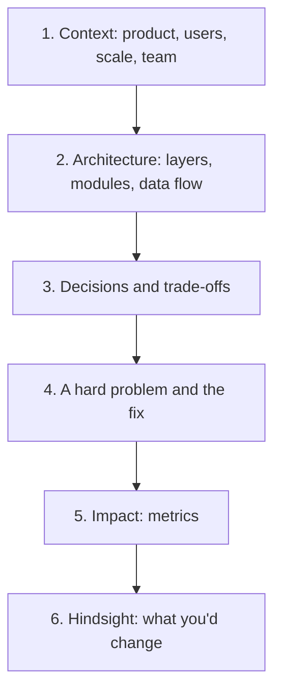

1. **Context** – the product, users, scale, team size. ("A grocery app, 2M monthly users, 5 iOS engineers; I owned checkout.")
2. **Architecture** – draw it: layers, modules (SPM packages), data flow, key frameworks.
3. **Decisions and trade-offs** – e.g. why you adopted SwiftUI incrementally, why actors for a cache, why coordinators for navigation. Say what you gave up.
4. **A hard problem** – a retain cycle, a hang, a Core Data threading crash, a sync bug – and how you found and fixed it (Instruments, crash logs, data).
5. **Impact** – metrics: crash-free rate, launch time, conversion, build time.
6. **Hindsight** – what you'd change now.

#### Example of a strong "hard problem" segment

> "Checkout had a 0.4% crash rate from a Core Data crash. Crash logs showed it was always on a background thread. I found we were passing managed objects between contexts. I changed the code to pass `NSManagedObjectID`s and fetch in each context inside `perform`, enabled the `-com.apple.CoreData.ConcurrencyDebug 1` launch argument in debug builds to catch new violations, and the crash disappeared. Crash-free sessions on checkout went from 99.6% to 99.95%."

It shows the method (data first), the root cause, the fix, prevention, and impact.

#### What interviewers are checking

- Do you understand the system, or did you just work on it?
- Can you explain trade-offs, not just choices?
- How do you debug: guessing, or data and tools?
- Ownership: what was **your** part?

**Pitfalls**
- Mentioning a technology you can't explain in depth; the next question will be about it.
- Only describing features ("we had a login screen, a home screen...") without decisions or problems.
- Saying "we" for everything.

**Likely follow-ups**
- *Why not use X instead?* Have a reasoned comparison ready for each major choice.
- *How would this scale to 10× users or 10× engineers?* Talk about modularization, caching, and ownership boundaries.

</details>

### 13. What should you do in the last week before a product-company iOS interview?

<details>
<summary>Answer</summary>

**In short:** Use the last week to revise, not to learn new topics: revise the most-asked list, do daily timed DSA and one machine-coding practice, run a mobile system design mock out loud, polish 6–8 STAR stories, study the company's app, and rest the day before.

#### A day-by-day plan

| Day | Focus | Details |
|---|---|---|
| 1–2 | Core revision | Go through the most-asked list (question 9) and the README one-liners. For each topic, say the one-liner out loud and one follow-up |
| 3–4 | Coding | One timed DSA session per day in Swift; one machine-coding practice if the company runs that round |
| 5 | Design | A mobile system design mock out loud with a prompt from that company's list (questions 14–23), ideally with a friend |
| 6 | Behavioral and company | 6–8 STAR stories; use the company's app and think about how it's built (feed, caching, push, offline) |
| 7 | Rest | Light revision only; check your setup (camera, editor, Xcode version if machine coding is local) |

#### Why this works

The last week is about **retrieval**: being able to say what you already know quickly and clearly under pressure. Practising out loud matters because many candidates know the answer but explain it poorly. New topics learned in the last days are usually shallow and fall apart at the first follow-up.

#### Company homework

- Use the app for 30 minutes. Note how it behaves offline, how fast it launches, how lists load, what pushes it sends.
- Think about one improvement you would suggest, and how you would build it.
- Read the company's public engineering blog posts about their iOS app if they have any.

#### On the day

- Clarify before you answer.
- Think out loud.
- If you don't know, say what you do know and how you would find out.

**Pitfalls**
- Cramming late the night before.
- Skipping the behavioral prep because it feels easy.

</details>

---

## Company-Style Mobile Design Prompts

### 14. Design a UPI payments app client (PhonePe / Google Pay / Paytm).

<details>
<summary>Answer</summary>

**In short:** A UPI client is built around security and correct transaction state. Bind the device to the phone number by having the user send an SMS, let the NPCI common library handle PIN entry so the app never sees the PIN, keep secrets in the Keychain and Secure Enclave, create every payment with a client transaction ID (idempotency key), and show `Pending`, never a guess, until the server confirms the final status through push or polling.

#### Requirements

- **Functional** – onboard with phone number and device binding, link bank accounts, pay to a UPI ID / QR code / contact, check balance, transaction history, collect requests, notifications.
- **Non-functional** – **secure**, reliable on poor networks, and **never showing a wrong payment status**. Showing "Failed" for a payment that later succeeds leads to double payments and support tickets.

#### High-level architecture

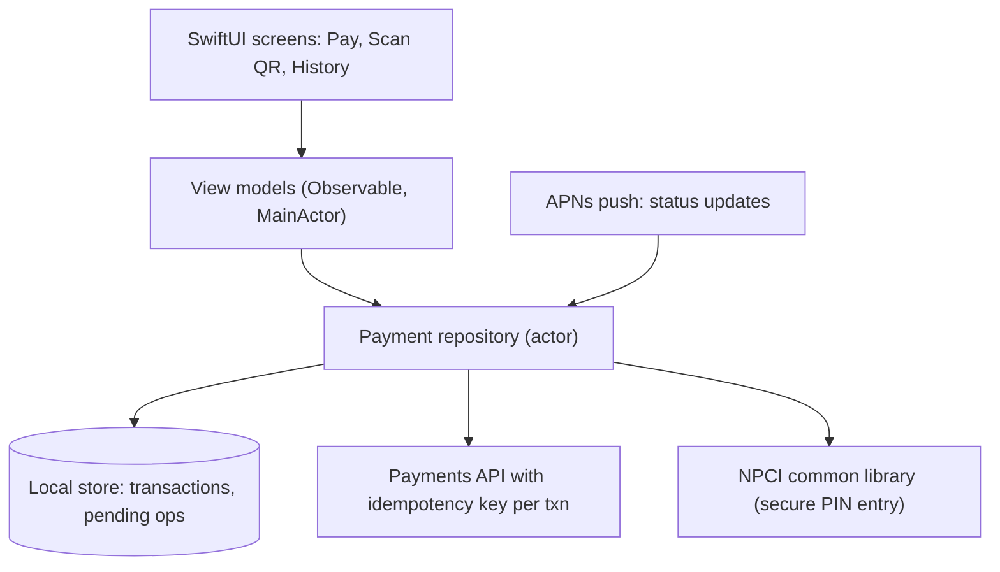

The repository is an actor so that status updates from the network, from APNs and from the UI never race each other. The local store is the source of truth for the UI.

#### Deep dives

**Device binding.** UPI ties an account to a SIM/phone number on a device. On iOS, apps can't send SMS silently, so the app pre-fills an SMS (`MFMessageComposeViewController`) containing a server-generated token that the user sends from their SIM to the provider's number. The server matches the token to the number and binds the device. Rebind when the device changes, the app is reinstalled, or the SIM changes.

**PIN security.** The UPI PIN is entered in the **NPCI common library** UI and encrypted with NPCI keys; the app never sees it. Other layers:
- Secrets and tokens in the **Keychain** with a `ThisDeviceOnly` accessibility (so they are not restored to another device from a backup).
- Signing keys in the **Secure Enclave**, so the private key never leaves the hardware.
- Face ID/Touch ID for app unlock via LocalAuthentication.
- Jailbreak detection (best effort), **App Attest** so the server can check requests come from a genuine app instance.
- Hiding sensitive content in the app switcher snapshot (cover the window when the scene resigns active).

```swift
// Keychain item that never leaves this device and needs the device to be unlocked.
let query: [String: Any] = [
    kSecClass as String: kSecClassGenericPassword,
    kSecAttrAccount as String: "deviceToken",
    kSecValueData as String: tokenData,
    kSecAttrAccessible as String: kSecAttrAccessibleWhenUnlockedThisDeviceOnly
]
let status = SecItemAdd(query as CFDictionary, nil)
```

**Transaction state.** This is the heart of the design.

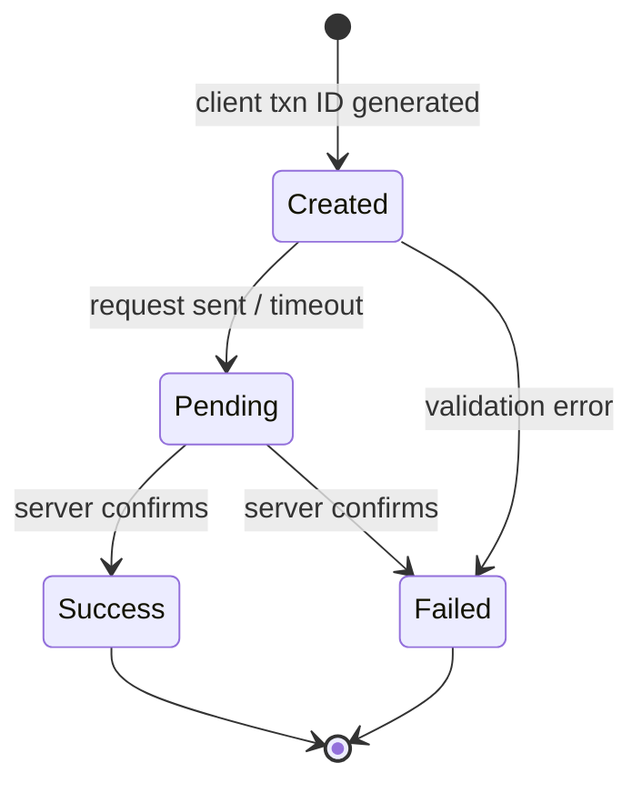

- Generate a client transaction ID and save the transaction locally **before** calling the server.
- On a timeout or network error, show `Pending`, not `Failed`; the money may have moved.
- Update the status via **APNs** or polling with backoff; on app launch, re-check all pending transactions.
- Never re-initiate with a new ID while one is pending; retries reuse the same ID so the server can deduplicate.

**History.** The local store is the source of truth with incremental sync (fetch transactions newer than the last synced cursor); paginated lists.

**QR scanning.** AVFoundation or VisionKit `DataScannerViewController`, then parse the `upi://pay?pa=...&pn=...&am=...` URL. Also handle UPI deep links from merchant apps, validating every parameter.

**Reliability.** Clear states and receipts; retry only safe (idempotent) operations; show "last updated" times for balance.

#### Trade-offs

- Polling vs push for status: push is faster and cheaper but not guaranteed to arrive, so use both: push for speed, polling as a fallback.
- Jailbreak detection can be bypassed; treat it as one signal, with the server making the final trust decision (App Attest, risk checks).

**Pitfalls**
- Marking a transaction as failed on timeout.
- Logging tokens or account numbers in analytics or crash reports.
- Storing secrets in `UserDefaults`.

**Likely follow-ups**
- *What if the user kills the app mid-payment?* The pending transaction is in the local store; on next launch, the app queries its status by client ID.
- *How do you prevent double-tap double payments?* Disable the button and reuse the same idempotency key for the whole attempt.

</details>

### 15. Design a quick-commerce app (Zepto / Blinkit / Instamart).

<details>
<summary>Answer</summary>

**In short:** In quick commerce the catalog, prices and stock depend on the dark store that serves the user's location, so the client first resolves location to a store and scopes every catalog call and cache by store ID. The home screen is mostly server-driven, the cart is local-first with optimistic updates and server sync, and the cart is re-validated before checkout because stock changes by the minute.

#### Requirements

- Catalog and stock depend on the **dark store** (a small warehouse) serving the user's location.
- Home screen with categories and offers; search; cart; checkout.
- Delivery in about 10 minutes with live tracking.
- Very fast launch and first screen; work on mid-range phones and patchy networks.

#### Architecture

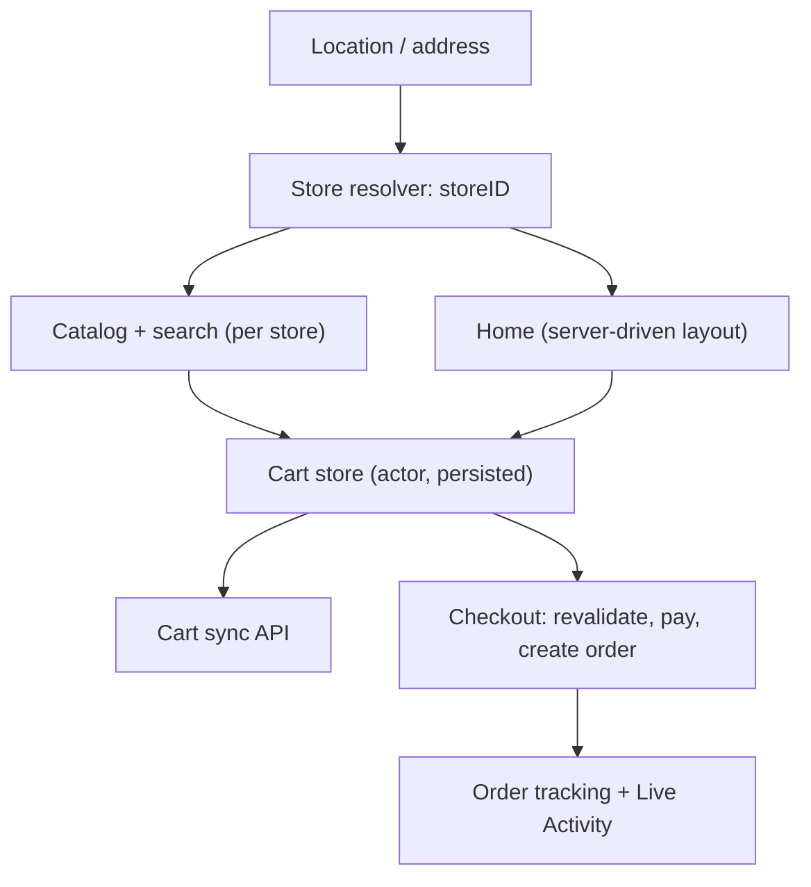

#### Client design

- **Location → store** – resolve the serving store on launch or address change; all catalog calls carry the store ID; cache per store (a cache key like `storeID + endpoint`). When the store changes, re-validate the cart, since items may not exist in the new store.
- **Home screen** – largely **server-driven** so merchandising can change without App Store releases; skeleton loading; images requested at the right size for the device. See [server-driven UI](#20-design-server-driven-ui-like-airbnb--swiggy--flipkart).
- **Inventory freshness** – show cached data instantly, refresh in the background, and **re-validate the cart** before checkout (out of stock, price changes), showing clear UI diffs ("Milk is out of stock, removed", "Bread price changed from ₹40 to ₹45").
- **Cart** – local persistence for instant updates, synced to the server; debounce quantity changes; optimistic UI.
- **Checkout** – idempotent order creation; Apple Pay or a payment SDK; handle pending payments the same way as a UPI app (never show failed on a timeout).
- **Tracking** – see [live order tracking](#16-design-a-live-order-tracking-screen-swiggy--zomato--uber-eats), including a Live Activity.
- **Performance** – very fast launch and first screen; prefetch the home feed; small app size.

#### Debounced cart sync

Tapping "+" five times should not send five requests:

```swift
actor CartStore {
    private var items: [ProductID: Int] = [:]
    private var syncTask: Task<Void, Never>?
    private let api: CartAPI

    init(api: CartAPI) { self.api = api }

    func setQuantity(_ qty: Int, for id: ProductID) {
        items[id] = qty                     // instant local update (UI reads this)
        syncTask?.cancel()                  // restart the debounce window
        syncTask = Task {
            try? await Task.sleep(for: .milliseconds(400))
            guard !Task.isCancelled else { return }
            await self.sync()
        }
    }

    private func sync() async {
        do {
            let serverCart = try await api.update(items)
            items = serverCart.items        // server wins: may drop out-of-stock items
        } catch {
            // keep local state; retry later and show a subtle "not synced" hint
        }
    }
}
```

#### Trade-offs

| Choice | Benefit | Cost |
|---|---|---|
| Server-driven home | Change merchandising instantly | Harder to debug, less type-safe |
| Optimistic cart | Feels instant | Must reconcile with server and explain differences |
| Short cache TTL for stock | Fewer surprises at checkout | More network traffic |

**Pitfalls**
- Caching catalog data without the store ID, then showing items from the wrong store.
- Letting the user reach payment with stale stock.

**Likely follow-ups**
- *User changes address mid-session?* Resolve the new store, invalidate catalog caches, re-validate the cart and show what changed.
- *How do you make the first screen fast?* Render the cached home layout immediately, refresh in the background, defer non-critical SDKs.

</details>

### 16. Design a live order tracking screen (Swiggy / Zomato / Uber Eats).

<details>
<summary>Answer</summary>

**In short:** In the foreground, use a WebSocket (or SSE / polling fallback) to receive order status and the partner's location, animate the map marker between updates, and drive the UI from an order state machine that ignores stale events by sequence number. In the background and on the Lock Screen, use a Live Activity updated by ActivityKit push notifications from the server, so the app doesn't need to run.

#### Requirements

- Order status: placed → accepted → preparing → picked up → arriving → delivered.
- The delivery partner's live location on a map, the ETA, and contact options.
- Keep users informed when the app is in the background or the phone is locked.
- Gentle on battery and data.

#### Order state machine

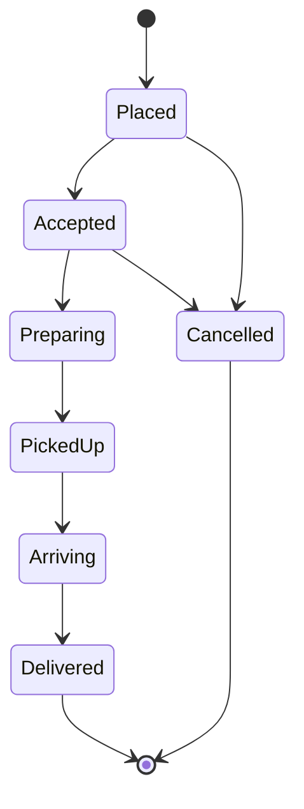

Each server event carries a **sequence number**. The client applies an event only if its sequence is higher than the last applied one, so late or duplicated messages (common after reconnects) never move the UI backwards.

#### Design

- **Foreground** – WebSocket/SSE (`URLSessionWebSocketTask`) or polling as a fallback; reconnect with exponential backoff and jitter; fetch a full snapshot first on reconnect, then apply live events.
- **Map** – a MapKit annotation **animated between updates** (updates arrive every 3–5 s) instead of jumping; a route overlay; keep both the partner and destination visible.
- **Background and Lock Screen** – a **Live Activity** (ActivityKit) showing status and ETA on the Lock Screen and in the Dynamic Island, updated by **ActivityKit push notifications** from the server; regular APNs alerts for key events (picked up, arriving). Respect Live Activity limits: updates are budgeted by the system, and an activity can stay active for about 8 hours.
- **State** – the state machine above, driven by server events with sequence numbers; ignore stale events.
- **Battery and data** – stop the socket when the screen isn't visible; rely on Live Activity pushes in the background.
- **Edge cases** – partner reassignment (new partner details and location), cancellation, network loss (show a "last updated" time instead of a frozen marker), app termination (restore from the saved order ID on launch).

```swift
// Starting a Live Activity with push updates enabled.
let attributes = OrderAttributes(orderID: order.id, restaurant: order.restaurantName)
let initial = OrderAttributes.ContentState(status: .placed, etaMinutes: 30)
let activity = try Activity.request(
    attributes: attributes,
    content: .init(state: initial, staleDate: nil),
    pushType: .token                       // the server updates it via APNs
)
Task {
    for await token in activity.pushTokenUpdates {
        await api.registerLiveActivityToken(token, orderID: order.id)
    }
}
```

```swift
// Applying events in order.
@MainActor
func apply(_ event: OrderEvent) {
    guard event.sequence > lastSequence else { return }   // stale or duplicate
    lastSequence = event.sequence
    status = event.status
    if let location = event.partnerLocation {
        UIView.animate(withDuration: 1.0) { self.partnerAnnotation.coordinate = location }
    }
}
```

#### Sequence on reconnect

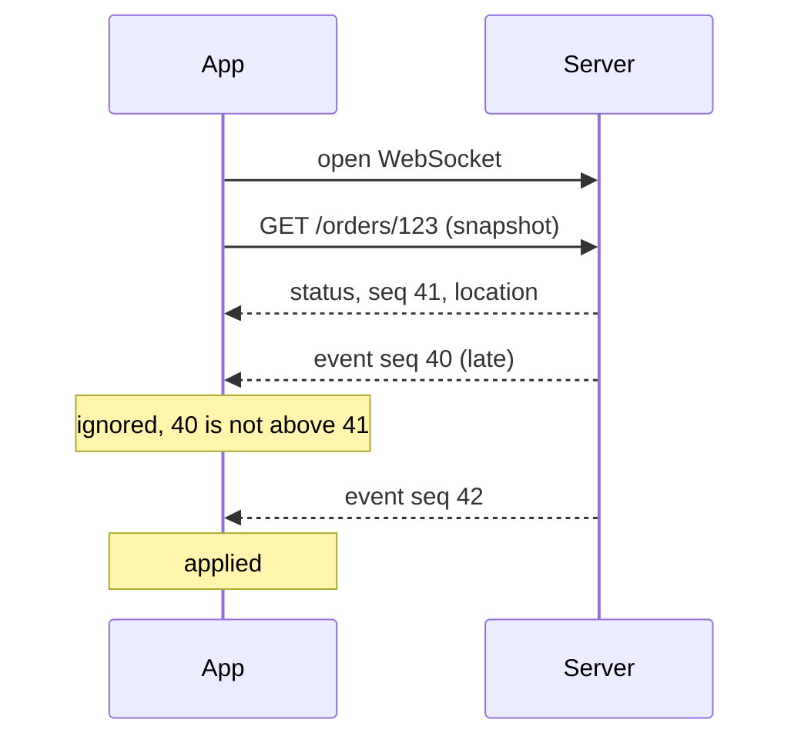

**Pitfalls**
- Keeping the socket open in the background, draining battery (and iOS will suspend the app anyway).
- Letting the marker jump; it looks broken even when data is correct.
- Forgetting to end the Live Activity when the order is delivered or cancelled.

**Likely follow-ups**
- *Why not just use location updates from silent pushes?* Silent pushes are throttled and not guaranteed; Live Activity pushes are designed for this.
- *How does the ETA stay accurate?* The server computes it; the client only displays it with a "last updated" time.

</details>

### 17. Design a super-app architecture (Paytm / PhonePe / Tata Neu).

<details>
<summary>Answer</summary>

**In short:** A super-app hosts many mini-products built by many teams in one binary, so the architecture is about boundaries: a thin app shell and router, shared core packages (networking, auth, design system, analytics, payments), and one SPM package per feature that depends only on other features' *interface* packages. Add strict budgets for binary size and launch time, lazy initialisation per mini-app, server-driven UI for promotional surfaces, and clear ownership.

#### What a super-app is

One app that hosts many mini-products (payments, recharges, travel, shopping, insurance), each built by a different team. The main risks are teams breaking each other, builds getting slow, the binary growing, and launch time creeping up as every team adds startup work.

#### Module structure

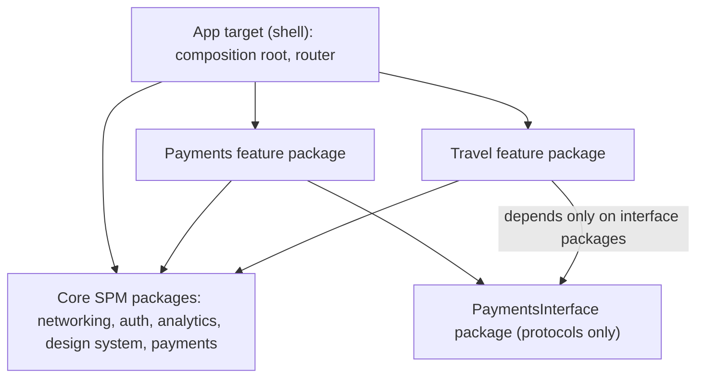

#### Key points

- **Modularization** – SPM packages per feature, split into an **interface** package (protocols, route definitions, small models) and an implementation package. Teams depend on interfaces, not each other's internals, which also gives faster incremental builds because changing an implementation doesn't rebuild its consumers.
- **Navigation** – a central router with deep-link/route contracts; features register their entry points at startup; coordinators inside each feature.
- **Shared platform** – one design system (SwiftUI components), one networking stack, one analytics/feature-flag SDK, one payments SDK. Duplicated platforms are the biggest source of bloat.
- **Binary size and launch** – static vs dynamic linking choices (many dynamic frameworks slow launch because dyld must load each one; prefer static or mergeable libraries), lazy initialisation of each mini-app, launch-time budgets per team. iOS has no on-demand native code download, so size discipline matters more than on Android.
- **Server-driven UI** for home and promotions; some companies embed web or React Native mini-apps for release agility (App Store rules forbid downloading native executable code, but allow web content and interpreted code within the guidelines' limits).
- **Governance** – ownership (CODEOWNERS), API review for core packages, per-team performance and crash dashboards.

#### Interface vs implementation in code

```swift
// PaymentsInterface package: tiny, stable, protocols only.
public protocol PaymentsLauncher {
    @MainActor func makePayFlow(amount: Decimal, payee: String) -> UIViewController
}

// Travel feature: knows only the interface.
final class BookingCoordinator {
    private let payments: PaymentsLauncher           // injected by the app shell
    init(payments: PaymentsLauncher) { self.payments = payments }
    @MainActor func pay(for booking: Booking, from nav: UINavigationController) {
        nav.pushViewController(payments.makePayFlow(amount: booking.total, payee: booking.vendorVPA),
                               animated: true)
    }
}

// App shell (composition root) wires the real implementation:
// let coordinator = BookingCoordinator(payments: PaymentsModule.launcher())
```

#### Lazy mini-app startup

Each mini-app registers a lightweight entry (name, icon, route) at launch, and its real setup runs only when the user first opens it. A launch budget in CI fails the build if a team adds work to the startup path.

**Pitfalls**
- A "Common" or "Utils" module that everything depends on and everyone edits, which recreates a monolith.
- Every team adding its own SDKs in `didFinishLaunching`.
- Cyclic dependencies between features (solved by interface packages).

**Likely follow-ups**
- *How do you release when 20 teams contribute?* A release train (fixed cadence), feature flags for unfinished work, phased release, crash monitoring per module.
- *How do you keep build times down?* Small modules, interface packages, remote build caching, avoiding heavy type inference in hot files → [Build & Release](19-xcode-build-release.md).

</details>

### 18. How would you reduce launch time for an app with 100M users?

<details>
<summary>Answer</summary>

**In short:** Measure first (Xcode Organizer, MetricKit, Instruments App Launch), segmented by device. Then remove work before the first frame: fewer dynamic frameworks, no heavy static initialisers, deferred SDK setup, no synchronous I/O or network on the main thread, and a simple first screen rendered from cache. Finally, prevent regressions with launch tests and budgets in CI and alerts on field data.

#### Why it matters at 100M users

Launch is the first thing every user sees, many times a day. At this scale, the slowest 10% of devices (older iPhones, low storage) represent millions of people, and the system can terminate an app that takes too long to launch. Slow launches also hurt engagement metrics.

#### What happens during launch

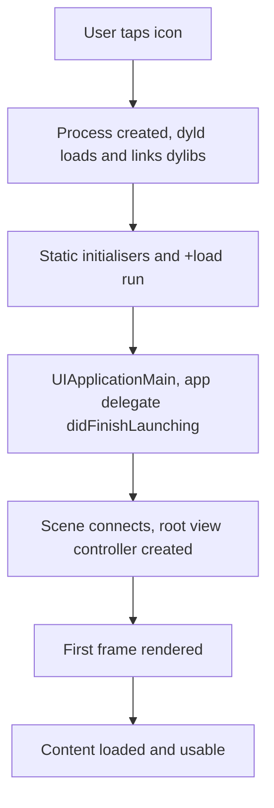

Everything from B to F is on the critical path. Your goal is to make it as short as possible and to push all other work after F.

#### 1. Measure

- **Xcode Organizer** launch metrics (from real users who share data).
- **MetricKit** (`MXAppLaunchMetric`) for your own field data, segmented by device model and OS.
- **Instruments App Launch** template to see what runs on the main thread during launch.
- Segment by device: older devices are the long pole. Track percentiles (p50, p90), not averages.

#### 2. Find work before the first frame

- Too many dynamic frameworks (dyld loading and binding cost).
- `+load` methods and static initialisers.
- Heavy `didFinishLaunching` (SDK setup for analytics, crash reporting, ads, A/B testing).
- Synchronous disk or Keychain reads, large `UserDefaults` files.
- Large storyboards or complex first-screen layouts.
- Synchronous network calls (never acceptable on launch).

#### 3. Fix

- **Reduce dynamic frameworks** (static linking, mergeable libraries).
- **Defer SDK initialisation** until after the first frame or first use.
- **Move I/O off the main thread**; lazy-load services.
- **Render the first screen from cache**; load the rest progressively.
- **Simplify the first screen's view hierarchy.**

```swift
// Before: everything blocks the first frame.
func application(_ app: UIApplication,
                 didFinishLaunchingWithOptions opts: [UIApplication.LaunchOptionsKey: Any]?) -> Bool {
    Analytics.setup(); Ads.setup(); Experiments.fetchSync(); Database.migrate()
    return true
}

// After: only what the first screen needs; the rest is deferred.
func application(_ app: UIApplication,
                 didFinishLaunchingWithOptions opts: [UIApplication.LaunchOptionsKey: Any]?) -> Bool {
    CrashReporter.start()                               // needed early to catch launch crashes
    Experiments.loadCachedConfig()                      // cheap local read, no network
    DispatchQueue.main.async {                          // after the first frame is scheduled
        Task.detached(priority: .utility) {
            Analytics.setup()
            Ads.setup()
            await Experiments.refresh()
        }
    }
    return true
}
```

(Each deferred SDK must be safe to set up off the main thread; check its documentation.)

#### 4. Prevent regressions

- Launch-time tests in CI with XCTest (`XCTApplicationLaunchMetric`) on a fixed device.
- Budgets per team in a modular app; fail or flag the PR when exceeded.
- Alerts on MetricKit/Organizer data after each release.

See [Performance & Instruments](16-performance.md).

**Pitfalls**
- Measuring only on the newest iPhone in debug builds (debug builds are slower and not representative).
- Moving work to a background queue that the main thread then waits for with `sync` or a semaphore.
- Optimising warm launch while cold launch is the real problem.

**Likely follow-ups**
- *Cold vs warm launch?* Cold: the process and dylibs aren't in memory (after reboot or long idle); warm: partly cached. Measure both.
- *What's a reasonable target?* Apple has recommended aiming for the first frame within about 400 ms; set your own budget from your current p90.

</details>

### 19. Design a product listing page with filters and infinite scroll (Flipkart / Amazon).

<details>
<summary>Answer</summary>

**In short:** Use a cursor-paginated API that also returns facets (filter options with counts), a view model that loads the next page when the user nears the end, and a single immutable `FilterState` whose changes cancel the in-flight request and restart pagination. Render with `UICollectionView` + compositional layout + diffable data source (or `LazyVGrid` with stable IDs), downsample and cache images, and share cart/wishlist state through one store.

#### Requirements

- Search or category results with thousands of products.
- Sort and filters (brand, price, rating), with counts.
- Infinite scroll; fast on older devices.
- Add to cart / wishlist directly from the list.

#### API

```
GET /products?query=shoes&filters=brand:nike,price:1000-3000&sort=popularity&cursor=abc&limit=20

{
  "items": [ { "id": "p1", "title": "...", "price": 2499, "imageURL": "...", "rating": 4.3 } ],
  "facets": [ { "key": "brand", "values": [ { "value": "nike", "count": 120 } ] } ],
  "nextCursor": "def"          // null when there are no more pages
}
```

Cursor pagination is better than page numbers here: when products are added or removed while the user scrolls, offsets shift and cause duplicates or gaps; a cursor marks a stable position.

#### Data flow

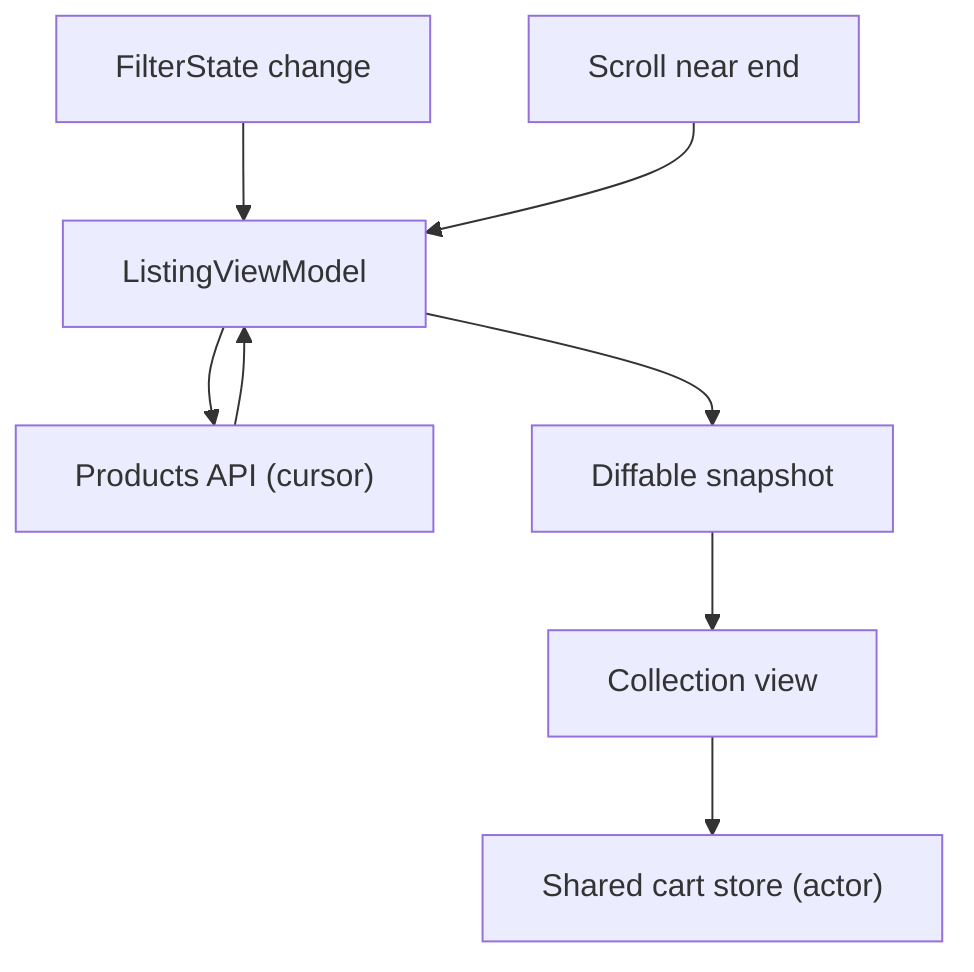

#### Design

- **Pagination** – the view model loads the next page when the user nears the end (`onAppear` of a threshold item, or `UICollectionViewDataSourcePrefetching`); it cancels the in-flight page task when filters change and dedupes items by ID.
- **Filters** – one immutable `FilterState`; changes restart pagination (cancel the old `Task`); debounce rapid changes (e.g. a price slider); restore state after relaunch if useful.
- **UI** – `UICollectionView` with compositional layout + diffable data source, or `LazyVGrid` with stable `id`s; images downsampled (ImageIO thumbnails) and cached; prefetching.
- **Cart/wishlist** – optimistic toggle with rollback; a shared cart store (actor) so all screens agree.
- **Older devices** – smaller images, fewer effects (blurs, shadows); watch memory warnings and clear caches.
- **Analytics** – batched impression logging (log when a cell is visible for a minimum time; send in batches).

```swift
@MainActor @Observable
final class ListingViewModel {
    private(set) var items: [Product] = []
    private(set) var facets: [Facet] = []
    var filters = FilterState() { didSet { restart() } }

    private var cursor: String?
    private var hasMore = true
    private var loadTask: Task<Void, Never>?
    private var seen = Set<Product.ID>()
    private let api: ProductsAPI

    init(api: ProductsAPI) { self.api = api }

    func restart() {
        loadTask?.cancel()                     // drop results for the old filters
        loadTask = nil                         // so the new load isn't blocked by the guard
        items = []; seen = []; cursor = nil; hasMore = true
        loadMore()
    }

    func onItemAppear(_ item: Product) {
        // Prefetch when the user is 5 items from the end.
        if let index = items.firstIndex(where: { $0.id == item.id }), index >= items.count - 5 {
            loadMore()
        }
    }

    private func loadMore() {
        guard hasMore, loadTask == nil else { return }
        let request = filters
        let task = Task {
            defer { if request == filters { loadTask = nil } }   // an old task must not clear the new one
            guard let page = try? await api.products(filters: request, cursor: cursor),
                  !Task.isCancelled, request == filters else { return }
            let fresh = page.items.filter { seen.insert($0.id).inserted }   // dedupe
            items += fresh
            facets = page.facets
            cursor = page.nextCursor
            hasMore = page.nextCursor != nil
        }
        loadTask = task
    }
}
```

The `request == filters` checks protect against results from an old filter arriving late, even if the network call ignored cancellation.

#### Image downsampling

A 2000 × 2000 product photo decoded at full size uses about 16 MB of memory. Decoding it at the cell's pixel size with ImageIO (`CGImageSourceCreateThumbnailAtIndex` with `kCGImageSourceThumbnailMaxPixelSize`) cuts that to a fraction and keeps scrolling smooth. Ask the CDN for the right size in the first place if it supports resizing.

**Pitfalls**
- Not cancelling the old request, so results for "Nike" arrive after the user switched to "Adidas".
- Using array index as identity in SwiftUI, causing wrong cells to update.
- Triggering the next page on every `onAppear` without a guard, causing duplicate requests.

**Likely follow-ups**
- *How do you keep the scroll position after returning from the detail screen?* Keep the view model alive in the navigation stack instead of recreating it.
- *Facet counts after selecting a filter?* The server recomputes them for the new result set; the client just renders what comes back.

</details>

### 20. Design server-driven UI (like Airbnb / Swiggy / Flipkart).

<details>
<summary>Answer</summary>

**In short:** The server sends a tree of components with data and actions; the client decodes it into a Swift enum of known component types (with an `unknown` case), maps each type to a native SwiftUI/UIKit view through a registry, and skips unknown types so old app versions never crash. Add schema versioning, a typed action handler (no downloaded code), and a cached last layout for instant display. Use it for content-driven screens, not complex interactive flows.

#### Why server-driven UI

- Change screens (home, offers, landing pages) **without App Store releases**, which matters because iOS users update slowly and every release goes through review.
- Consistent across iOS, Android and web, since the server defines the layout once.
- Enables experiments: the server can send a different layout to each variant.

#### How it works

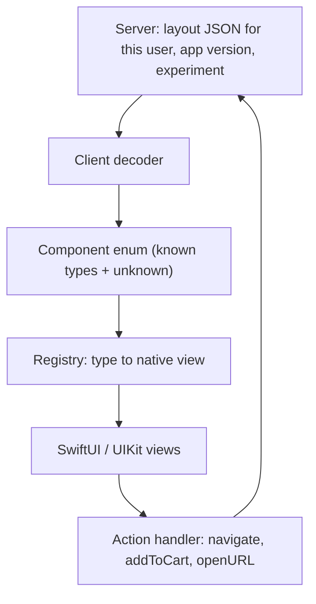

- The server returns a **tree of components** with data (`{type: "carousel", items: [...]}`, `{type: "banner"}`, `{type: "productGrid"}`) plus **actions** (`navigate`, `addToCart`, `openURL`).
- The client decodes into a Swift enum of known component types (with an `unknown` case) and maps each to a native SwiftUI/UIKit view via a registry; **unknown types are skipped** so old app versions never crash.
- **Versioning** – the client sends its supported schema version; the server only sends compatible components.
- **Actions** – a typed action handler (deep links, analytics, mutations), not arbitrary scripting (App Store rules also forbid downloading executable code).
- **Performance** – cache the last layout for instant display; lazy containers with stable IDs.

#### Decoding with a safe fallback

```swift
enum Component: Decodable, Identifiable {
    case banner(Banner)
    case carousel(Carousel)
    case productGrid(ProductGrid)
    case unknown(id: String)

    var id: String {
        switch self {
        case .banner(let b): b.id
        case .carousel(let c): c.id
        case .productGrid(let g): g.id
        case .unknown(let id): id
        }
    }

    private enum CodingKeys: String, CodingKey { case type, id }

    init(from decoder: Decoder) throws {
        let c = try decoder.container(keyedBy: CodingKeys.self)
        let type = try c.decode(String.self, forKey: .type)
        switch type {
        case "banner":      self = .banner(try Banner(from: decoder))
        case "carousel":    self = .carousel(try Carousel(from: decoder))
        case "productGrid": self = .productGrid(try ProductGrid(from: decoder))
        default:            self = .unknown(id: (try? c.decode(String.self, forKey: .id)) ?? UUID().uuidString)
        }
    }
}

struct ComponentView: View {
    let component: Component
    let onAction: (Action) -> Void
    var body: some View {
        switch component {
        case .banner(let b):      BannerView(model: b, onAction: onAction)
        case .carousel(let c):    CarouselView(model: c, onAction: onAction)
        case .productGrid(let g): ProductGridView(model: g, onAction: onAction)
        case .unknown:            EmptyView()          // old app, new component: skip safely
        }
    }
}
```

Also make a single component's decoding failure non-fatal (decode the list element by element and drop failures), otherwise one bad component blanks the whole screen.

#### Actions

```swift
enum Action: Decodable {
    case navigate(route: String)        // resolved by the app's router
    case addToCart(productID: String)
    case openURL(URL)
    case unknown
}
```

The client only executes actions it knows. This keeps behaviour reviewable and within App Store rules.

#### Trade-offs

| Benefit | Cost |
|---|---|
| Ship layout changes instantly | Harder to debug ("why does this user see this?") |
| One layout for all platforms | Less type-safe; contract bugs appear at runtime |
| Experiments without releases | Native feel can suffer if components are too generic |

Use it for content-driven screens (home, offers, landing pages), not complex interactive flows like checkout or editors.

**Pitfalls**
- Crashing on unknown types or missing fields.
- Letting the schema grow into a programming language (conditionals, loops) that is impossible to maintain.
- No local fallback layout for the first launch offline.

**Likely follow-ups**
- *How do you test it?* Contract tests on sample payloads, snapshot tests per component, a debug screen that renders any JSON.
- *How do you track analytics?* Each component carries tracking IDs; impressions and actions are logged with them.

</details>

### 21. Design a short-video feed (like Instagram Reels / Moj / ShareChat).

<details>
<summary>Answer</summary>

**In short:** Build a full-screen vertical paging feed backed by cursor pagination, reuse a small pool of `AVPlayer`s (2–3) instead of creating one per cell, preload the next 1–3 videos and show a thumbnail as the first frame, stream with HLS so quality adapts, and pause players that aren't fully visible or when the app goes to the background. Track time to first frame and stalls to tune it.

#### Requirements

- Vertical swipe feed of short videos that start **instantly** and autoplay.
- Like, comment, share.
- Smooth on older devices and on variable networks.

#### Architecture

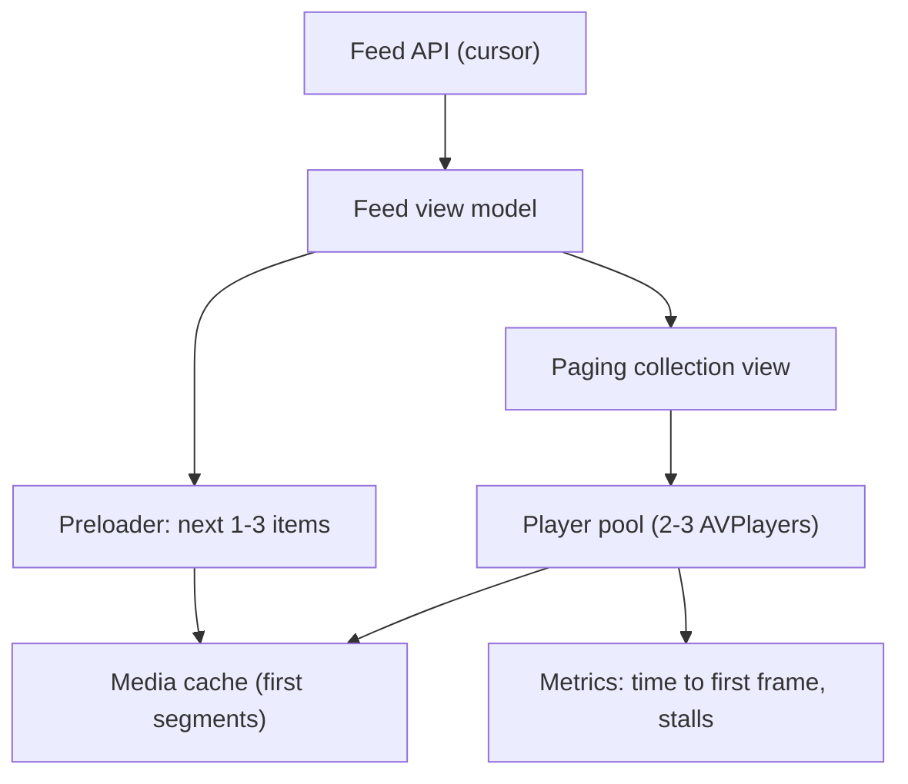

#### Design

- **Feed** – a paging vertical `UICollectionView` (or SwiftUI `ScrollView` with `.scrollTargetBehavior(.paging)`); pages fetched with cursors well before the end.
- **Player pool** – reuse a small pool of `AVPlayer`s (2–3) attached to visible cells; swap `AVPlayerItem`s rather than creating players per cell. Creating and tearing down players is expensive and causes hitches.
- **Preloading** – prepare the next 1–3 items (`AVPlayerItem` with `preferredForwardBufferDuration`, or download the first segments into a cache via `AVAssetResourceLoaderDelegate`/a local proxy); show a thumbnail as the first frame so the screen is never black.
- **Adaptive streaming** – HLS so quality adapts; start at a lower bitrate for a faster start.
- **Lifecycle** – pause on background or when the cell isn't fully visible; configure `AVAudioSession` correctly (respect the silent switch for autoplay, e.g. with the `.ambient` category until the user unmutes).
- **Metrics** – time to first frame, stalls, watch time; batched upload.
- **Memory** – release far-away items; react to memory warnings.

```swift
final class PlayerPool {
    private var players: [AVPlayer] = (0..<3).map { _ in
        let p = AVPlayer()
        p.automaticallyWaitsToMinimizeStalling = true
        return p
    }
    private var assigned: [IndexPath: AVPlayer] = [:]

    func player(for indexPath: IndexPath, url: URL) -> AVPlayer {
        if let p = assigned[indexPath] { return p }
        // Reuse a player not used by a nearby cell.
        let free = players.first { p in !assigned.values.contains { $0 === p } } ?? players[0]
        assigned = assigned.filter { $0.value !== free }
        let item = AVPlayerItem(url: url)
        item.preferredForwardBufferDuration = 2      // buffer a little ahead, not the whole video
        free.replaceCurrentItem(with: item)
        assigned[indexPath] = free
        return free
    }

    func release(_ indexPath: IndexPath) {
        assigned[indexPath]?.pause()
        assigned[indexPath] = nil
    }
}
```

When the paging settles on a new index: play that cell's player, pause the others, and prepare the next index with the remaining player.

#### Why instant start is hard

Starting a video needs the playlist, the first segment, and a decoded frame. Each network round trip on a mobile network can take hundreds of milliseconds. Preloading the first segment of the next video while the current one plays removes most of that wait at the moment of the swipe.

#### Trade-offs

| More preloading | Less preloading |
|---|---|
| Faster start on swipe | Slower start |
| More data used, some wasted on skipped videos | Saves data and battery |

Tune the preload count by network type (fewer on cellular, more on Wi-Fi) and from metrics.

**Pitfalls**
- One `AVPlayer` per cell, leading to memory spikes and stutter.
- Playing audio from two cells at once during a swipe.
- Ignoring the silent switch, so autoplay surprises users with sound.

**Likely follow-ups**
- *How do you measure time to first frame?* From the moment the cell becomes current to when `AVPlayerItem` is ready and the first frame is displayed (e.g. observing `AVPlayerLayer.isReadyForDisplay`).
- *How would you support offline viewing?* Download selected videos with `AVAssetDownloadURLSession` and play from local storage.

</details>

### 22. Design a live score / fantasy sports screen for millions of concurrent users.

<details>
<summary>Answer</summary>

**In short:** Use a WebSocket/SSE connection only while the screen is visible, with a fallback to polling a CDN-cached JSON that is the same for everyone (so the CDN absorbs the load). Send small versioned deltas and fetch a snapshot on gaps, keep state in one observable store, use a Live Activity updated by ActivityKit pushes (broadcast channels on iOS 18+) for the Lock Screen, and protect the backend during spikes with jittered reconnects and server-controlled polling intervals.

#### Requirements

- Ball-by-ball scores and fantasy points updating within seconds for millions of users.
- Huge spikes at the toss, wickets and the final over.
- Battery- and data-friendly.

#### Why the client design matters for scale

Millions of phones reconnecting at once after a network blip can take down a backend. The client decides how often it calls, how it backs off, and how much data it pulls, so good client behaviour is part of the scaling plan.

#### Architecture

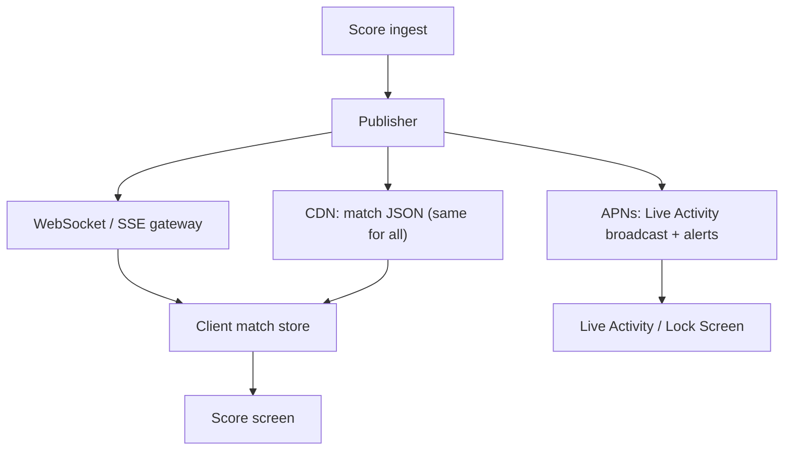

#### Design

- **Transport** – a WebSocket/SSE connection while the screen is visible; fall back to **polling a CDN-cached JSON** (the same object for everyone, so the CDN absorbs the load). A cache lifetime of a few seconds means millions of clients cause only a few origin requests.
- **Payload** – small deltas with a version number; fetch a full snapshot when a gap is detected (received version 105 after 103).
- **Client** – a store (actor or `@Observable` model) exposing match state; observe only while visible; stop updates in the background.
- **Lock Screen** – a **Live Activity** for the live score updated via ActivityKit push notifications (broadcast push channels in iOS 18+ let one push update everyone following a match); APNs alerts for key events (wickets, result).
- **Spikes** – jittered reconnects and backoff; a server-controlled polling interval the server can raise under load.
- **Fantasy specifics** – team-lock deadlines enforced by the server (the client countdown is only a hint); paginated, cached leaderboards.
- **Widgets** – WidgetKit with budgeted timeline reloads.

```swift
@MainActor @Observable
final class MatchStore {
    private(set) var state: MatchState?
    private var version = 0

    func apply(_ delta: ScoreDelta) async {
        guard delta.version == version + 1 else {      // gap or duplicate
            if delta.version > version + 1 { await reloadSnapshot() }
            return
        }
        state?.apply(delta)
        version = delta.version
    }

    func reloadSnapshot() async {
        guard let snap = try? await api.snapshot() else { return }
        state = snap.state
        version = snap.version
    }
}

// Reconnect with exponential backoff and full jitter.
func reconnectDelay(attempt: Int) -> Duration {
    let cap = 30.0, base = 1.0
    let maxDelay = min(cap, base * pow(2, Double(attempt)))
    return .seconds(Double.random(in: 0...maxDelay))   // jitter spreads the herd
}
```

#### Why jitter

If a gateway restarts and every client retries after exactly 1 s, 2 s, 4 s, the retries arrive in synchronised waves. Random delays spread them out so the server recovers.

**Pitfalls**
- Keeping the socket open in the background (wasted battery; iOS suspends the app anyway).
- Per-user API calls for data that is identical for everyone.
- Trusting the client clock for team-lock deadlines.

**Likely follow-ups**
- *What if APNs is delayed?* The Live Activity shows a stale state; set a `staleDate` so the UI can indicate it, and the app refreshes when opened.
- *How do you show the leaderboard for millions of entries?* The server ranks; the client fetches the user's rank plus nearby pages, cached for short periods.

</details>

### 23. Design a feature-flag / experimentation SDK for iOS.

<details>
<summary>Answer</summary>

**In short:** Persist the last fetched config and load it synchronously and cheaply at launch, so no flag check ever waits for the network; ship compiled-in safe defaults; refresh in the background and apply new values at the next session or safe points; assign experiment variants deterministically and log exposure only when a variant is actually used. Expose type-safe flags, a debug override menu, and a thread-safe store with fast synchronous reads.

#### Requirements

- Teams check flags and experiment variants anywhere in the app.
- Values are available **instantly at launch**, consistent within a session, updated from the server, and safe when offline.
- Low overhead: flag reads happen on hot paths, including the main thread.

#### Architecture

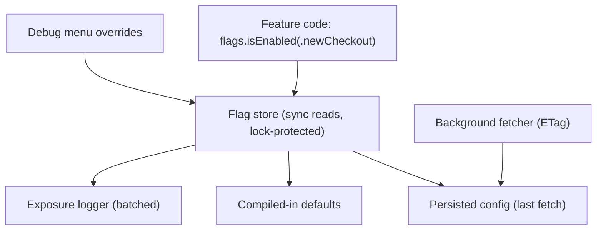

Lookup order for a flag: debug override (internal builds) → value active for this session → compiled-in default.

#### Design

- **Storage** – the last fetched config persisted (file or UserDefaults suite), loaded cheaply at launch, so no flag check waits for the network.
- **Fetch** – refresh in the background at launch and periodically; apply new values on the **next session** or at safe points to avoid the UI flipping mid-flow; use ETags so an unchanged config costs only a `304 Not Modified`.
- **Defaults** – compiled-in defaults for every flag; kill switches default to safe values.
- **Experiments** – server-assigned or deterministic hashing of the user ID; log **exposure events** when a variant is actually used (not when the config is fetched), otherwise the analysis includes users who never saw the feature.
- **Targeting** – app version, iOS version, country, user segment.
- **Developer experience** – type-safe flag definitions (an enum or generated code), a debug menu to override flags in internal builds, cleanup of stale flags.
- **Thread safety** – an actor or lock-protected store; reads are synchronous and cheap.
- **Why it matters on iOS** – App Store review and phased releases mean a fixed build takes days to reach users; a remote kill switch is often the fastest way to stop a broken feature.

```swift
import os

enum Flag: String, CaseIterable {
    case newCheckout, videoAutoplay, paymentsKillSwitch
    var defaultValue: Bool {
        switch self {
        case .newCheckout: false
        case .videoAutoplay: true
        case .paymentsKillSwitch: false   // safe default: payments enabled
        }
    }
}

final class FlagStore: @unchecked Sendable {   // safety ensured by the lock below
    private let lock = OSAllocatedUnfairLock(initialState: [String: Bool]())
    private var overrides: [String: Bool] = [:] // debug builds only

    init(persisted: [String: Bool]) {
        lock.withLock { $0 = persisted }       // session values fixed at launch
    }

    func isEnabled(_ flag: Flag) -> Bool {
        #if DEBUG
        if let o = overrides[flag.rawValue] { return o }
        #endif
        return lock.withLock { $0[flag.rawValue] } ?? flag.defaultValue
    }
}
```

(A synchronous lock is chosen over an actor here because flag reads must be callable synchronously from anywhere, including SwiftUI `body`. Overrides would also need the lock if they can change at runtime.)

#### Deterministic bucketing

```swift
import CryptoKit

// Same user + same experiment always gives the same bucket, on any device, offline too.
func bucket(userID: String, experiment: String, buckets: Int = 100) -> Int {
    let digest = SHA256.hash(data: Data("\(experiment):\(userID)".utf8))
    let value = digest.prefix(4).reduce(UInt32(0)) { ($0 << 8) | UInt32($1) }
    return Int(value % UInt32(buckets))
}
// e.g. buckets 0..<50 → control, 50..<100 → treatment
```

Don't use Swift's `hashValue` for this: it is randomly seeded per process, so the bucket would change on every launch.

**Pitfalls**
- Blocking launch on a network fetch for flags.
- Changing a flag mid-session, so a screen half-renders the old and new flow.
- Never deleting old flags, leaving dead code paths and a growing config.

**Likely follow-ups**
- *How do you roll out to 5% then 100%?* A percentage rollout using the same deterministic bucketing, increased from the server.
- *How do you make sure a kill switch applies quickly?* Kill switches can be an exception to "next session" and apply at the next safe point, with a silent push to trigger a fetch.

</details>

---

[⬅ Previous: Accessibility & Localization](24-accessibility-localization.md) · [⬅ Back to index](../README.md)
